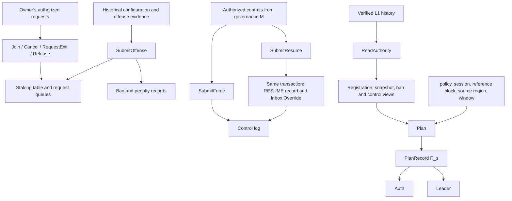

# Module 01: L1 Authority (v9 working draft v0.1)

Date: 2026-11-02. The overview and shared model are in [00 arch](00_arch_en_v0_1.md); the source is [arch v0.2 §4.1](../formalization_v8/arch_zh_v0_2.md).

## 1. Role and intuition

The L1 Authority consists of contracts deployed on L1 and their associated pure functions. It answers three questions:

- **Who is eligible to participate in consensus?** It maintains positions (stake registrations), produces snapshots under fixed rules, and processes evidence of offenses and penalties.
- **Who has a given responsibility?** `Plan` uses the branch policy, selection reference block, and source region to freeze a session assignment $\Pi_s$: the responsible region, committee, weights, fault bound, eligible proposers, leader rule, and production window.
- **How does governance change production assignments?** It records two types of control record: Force (change region or policy) and RESUME (recover from the derived chain). RESUME calls Batch Inbox `Override` in the same transaction.

The Authority only records facts and performs checks decidable within the contract. A control record's activation time is fixed by the L1 block that includes it (§3.1); after activation, the GFR determines during public replay which branch it affects and which anchor it uses ([09 §3–§4](09_finality_rules_en_v0_2.md)).

## 2. Minimal assumptions

**Model assumptions used by this module.**

- L1 safety and fixed pace ([00 §1.2](00_arch_en_v0_1.md)): finalized prefixes are mutually prefix-comparable and do not revert; contract calls execute atomically within the prefix. Thus all readers at the same L1 height see the same registrations, snapshots, ban set, and control log.
- EUF-CMA signatures and hash binding ([00 §1.1](00_arch_en_v0_1.md)): owner authorizations, proofs of possession, and governance signatures cannot be forged.
- The PKI setting and the definitions of positions and snapshots ([00 §2.1–§2.2](00_arch_en_v0_1.md)).
- Governance $\mathsf M$'s public key is given in the configuration ([00 §2.5](00_arch_en_v0_1.md)). The assumption that $\mathsf M$ is honest and issues controls according to the procedure is used only for recovery liveness; the Authority's checks do not themselves depend on $\mathsf M$ being honest.

**Assumptions about other modules.**

- `SubmitOffense` uses the Session Program's public `CheckEvidence` ([02 §3.11](02_session_program_en_v0_1.md)) to decide offenses; the Authority defines no separate conflict relation.
- `SubmitResume` requires Batch Inbox `Override` to succeed in the same transaction ([07 §3.5](07_batch_inbox_en_v0_1.md)); the two commit atomically.

**Upstream inputs and downstream outputs.** Numbers refer to the interface connections in [00 §4.4](00_arch_en_v0_1.md).

| Direction | Other module and interface | Object exchanged | Connection |
| --- | --- | --- | --- |
| Input | Owner, governance $\mathsf M$ | Authorized requests, Force / RESUME records and signatures | — |
| Input | Publisher.`SubmitEvidence` | Descriptor $\nu$, accused pid, complete evidence ev | W28 |
| Input | Batch Inbox contract state | `SubmitResume` reads InboxState.cursor directly within the contract ([07 §3.2](07_batch_inbox_en_v0_1.md)) | — |
| Output | Manager.`PrepareCandidate`, Program.`Create`, GFR selection | PlanRecord $\Pi_s$ | W1 |
| Output | Program configuration | AuthorizationView, $\mathrm{Leader}_s(v)$ | W2 |
| Output | L1 log → GFR.`AdvanceGlobal` | ControlEntry (Force / RESUME) | W3, W4 |
| Output | Inbox.`Override` | Target Cursor | W4 |
| Output | Plan verification, Manager, GFR | AuthorityRead | W6 |

## 3. Interfaces

### 3.1 State

The Authority maintains on L1:

- **Staking table:** keyed by pid, with region, pk, owner, stake, and status as in [00 §2.1](00_arch_en_v0_1.md); it also stores occupied public keys, the next non-reused pid, and join/exit requests.
- **Snapshots** $\mathcal C_e$ and their cutoff and activation; reading and numbering follow [00 §2.2](00_arch_en_v0_1.md).
- **Bans and offense records:** the set of banned public keys and records of processed offense evidence. Let $\mathsf{Ban}(\ell)$ be the ban set after processing L1 height $\ell$.
- **Control state:** the control log, largest control sequence number used, request-result table, and address of the Inbox it manages.

The public fixed staking rule $\mathcal P_{\rm stake}$ specifies registration admission, snapshot inclusion, exit queuing, penalty calculation, and fund release conditions. It takes registration and queue state, L1 position, and authorized requests, and returns the new state and call result. This document uses that rule without redefining its economic parameters.

**Branch policy.** Region selection reads the branch policy

$$
\mathcal P_\beta=(S_\beta,\mathcal L_\beta,\lambda_\beta).
$$

$S_\beta:\mathcal R\to\{0,1\}$ specifies which regions are enabled, $\mathcal L_\beta$ is a cyclic ordering in which each region appears exactly once, and $\lambda_\beta$ is the minimum L1 height for authorization reads (the L1 floor). The policy is fixed within branch $\beta$ and replaced only by Force or RESUME.

**Control records.** There are two kinds, sharing strictly increasing nonnegative integer sequence numbers $c$:

- **Force record** $U=(c,\beta_{\rm target},\mathcal P_{\rm new})$: control sequence number, target branch, and new policy. Intuitively, it requests: “At the activation time, close branch $\beta_{\rm target}$ and change region under the new policy, starting from the then-current end of the global chain.”
- **RESUME record** $(c,\mathcal P_{\rm new},h_{\rm res})$: control sequence number, new policy, and target L2 height. Intuitively, it requests: “At the activation time, align the global chain with the derived chain's prefix at $h_{\rm res}$ and restart production from there.”

**Activation time.** Let the announcement lead time $M_a>0$ be a protocol configuration parameter. A control record included in L1 block $\ell$, whether Force or RESUME, has activation time

$$
\mathrm{act}:=\mathit{ts}_{\rm L1}(\ell)+M_a .
$$

The including block alone fixes the activation time; governance cannot specify another. We use the including block's timestamp rather than “the time it became finalized”: the latter is not a public value that all readers compute identically, and the time needed for finalization is covered by the $M_a$ budget ([09 §3.5](09_finality_rules_en_v0_2.md)). The GFR orders all control records by activation time as their time key; because $\mathit{ts}_{\rm L1}$ is strictly increasing, this equals ordering by L1 position ([09 §3.3](09_finality_rules_en_v0_2.md)).

### 3.2 Data structures

The records below define logical contents by field; field names are also used in interfaces. Storage may use complete records or verifiable references, but the objects actually used must be obtained before executing an interface. Lists retain order; maps are looked up by key. A record used in a signature or hash uses the protocol's fixed canonical encoding; sets and maps are also ordered by keys as that encoding specifies. Fields that can be recomputed from the same inputs must still be checked for consistency and cannot be filled arbitrarily by the submitter.

**Stake registrations and requests.** A position in [00 §2.1](00_arch_en_v0_1.md) is an entry in the staking table:

```text
Positions[pid] = {
    region, pk, owner, stake, status
}
StakingRequest = {
    req, kind, pid, L1_position
}
OffenseRecord = {
    offense_id, pid, params, evidence, result, L1_position
}
```

The Positions key pid is a unique, non-reused nonnegative integer; the types and meanings of the five fields follow [00 §2.1](00_arch_en_v0_1.md). StakingRequest.req is a general request identifier ([00 §4.2](00_arch_en_v0_1.md)); kind is JOIN or EXIT; pid refers to the registration; and L1_position is a position $p$ as in [00 §1.2](00_arch_en_v0_1.md). Each region's request queue stores ordered StakingRequests; $\mathcal P_{\rm stake}$ gives the queue-processing conditions. The request-result table is keyed by req and stores the canonical request contents and output produced for retry checks.

OffenseRecord stores a processed offense. Offense_id is the canonical bit-string identifier used by $\mathcal P_{\rm stake}$ for the same act of punishment; different proofs of the same offense use the same identifier, and cannot be deduplicated solely by request number or proof-byte hash. The remaining fields store the accused registration, historical instance configuration used for checking, evidence, penalty result, and processing position. $\mathsf{Ban}$ is the finite set of public keys whose bans are in effect; historical reads obtain the corresponding version by L1 position.

**Snapshot entries.** An entry in snapshot $\mathcal C_e$ is `SnapshotEntry{region, pk, weight}`, keyed by pid. Region and pk come from the corresponding stake registration; weight is the positive integer frozen in that version. Snapshot cutoff and activation are L1 heights with meanings given in [00 §2.2](00_arch_en_v0_1.md); current Positions and historical snapshots are maintained separately.

**Policy and window.** The mathematical notation $\mathcal P_\beta$ corresponds to these records:

```text
Policy = {
    enabled_regions, region_order, L1_floor
}
Window = {
    h_min, h_max
}
```

Enabled_regions is a subset of $\mathcal R$; $S_\beta(i)=1$ if and only if $i$ is in it. Region_order is a cyclic ordering of $\mathcal R$, corresponding to $\mathcal L_\beta$; L1_floor is a nonnegative integer corresponding to $\lambda_\beta$. The two Window fields are L2 heights, corresponding to $h_{\min,s}$ and $h_{\max,s}$, and satisfy the window constraints in [00 §2.2](00_arch_en_v0_1.md).

**Selection reference.** Input Ref selects authorization history and is recorded as `BlockRef{h, os, block_id}`. Here h is the L2 height, os the L1-origin height, and block_id the linking identifier $\mathrm{id}(\cdot)$ of [00 §3.2](00_arch_en_v0_1.md); these fields must be obtained from a verified source block. Plan binds Ref as this record; the reader separately retains the complete block and verification material. The GFR's handoff boundary determines Ref: regular handoff uses the predecessor session's initial anchor, while the GFR separately selects the anchor actually used by the successor instance ([09 §4.3](09_finality_rules_en_v0_2.md)); Force and RESUME use the new branch's starting anchor ([09 §4.4, §4.6](09_finality_rules_en_v0_2.md)).

**Rule parameters and protocol configuration.** The public protocol configuration has a unique version/content identifier config_ref, a nonempty bit string encoded under the protocol, pointing to the complete rules, parameters, and canonical encoding; configuration under the same identifier cannot be rewritten. `RuleSpec{rule_id, version, params}` in the configuration describes a publicly deterministic rule: rule_id and version uniquely identify the algorithm, and params contains fixed parameter bytes in the format specified by that algorithm. If the configuration cannot be obtained or its parameters cannot be parsed, it cannot be treated as a verified rule.

`ProtocolConfig` names the contents of the “public protocol configuration” in [00 §4.2](00_arch_en_v0_1.md): chain identifier, rule and verifier versions, canonical encoding rules, contract address table, staking rule, fault-weight rule, leader rule, and BFT size and timing parameters. The fault-weight rule computes $F_s$ for the selected region and committee and checks $3F_s<W_s$; the leader rule returns an eligible proposer replica given a committee, eligible proposers, and view. This document does not additionally choose a fault ratio or random leader algorithm.

**Plan record.** $\Pi_s$ is the fixed record returned by `Plan` for session $s$:

```text
PlanRecord = {
    session, policy, reference_block, source_region, window,
    L1_reference_height, snapshot_id, banned_keys,
    region, committee, total_weight, fault_bound,
    eligible_proposers, leader_rule, config_ref
}
CommitteeEntry = {
    pid, pk, weight
}
AuthorizationView = {
    committee, total_weight, fault_bound,
    eligible_proposers, leader_rule, window, config_ref
}
```

The PlanRecord fields are defined as follows:

- session, policy, reference_block, source_region, and window are the five selection inputs to the call. Session is $(\beta,r)$; source_region is a region identifier, or $\bot$ at genesis when there is no predecessor.
- L1_reference_height is $\ell_s:=\max\{\mathit{Ref}.\mathit{os},\lambda_\beta\}$; snapshot_id is $e_s:=\mathsf{SnapshotAt}(\ell_s)$; banned_keys is the frozen set $\mathsf{Ban}(\ell_s)$ at that height. These three fields provide the historical basis used in the computation.
- region is the selected region $i_s$. Committee is a CommitteeEntry table indexed by pid, containing exactly the entries in $\mathcal C_{e_s}$ whose region is $i_s$; each public key and positive weight comes from that snapshot. Each entry's pid corresponds to replica $m$'s $m.\mathit{pid}$, determining $V_s$ and $w_s(m)$.
- total_weight is $W_s$ and must equal the sum of committee weights; fault_bound is $F_s$, obtained under the fault-weight rule specified by config_ref. It describes the fault bound used, not the identities actually controlled by the adversary.
- eligible_proposers is the set of pids in committee whose pk is not in banned_keys and must be nonempty. Banned members retain their frozen voting weights but are not in the proposer set.
- leader_rule is a RuleSpec whose params are determined by the public rule from session, selection inputs, and config_ref. Together with committee and eligible_proposers, it determines $\mathrm{Leader}_s(v)$. Config_ref also binds the public configuration version used for the remaining computations.

AuthorizationView's fields are taken directly from the identically named PlanRecord fields; it is the authorization view used by the Program to construct ProgramConfig ([02 §3.2](02_session_program_en_v0_1.md)). Snapshot contents can be reconstructed from snapshot_id and the specified L1 history; PlanRecord does not separately copy owner or current stake.

**Verified Plan.** To verify a received Plan, the reader reruns `Plan` from its recorded selection inputs, specified L1 history, and public configuration, and checks the result field by field. A “verified Plan” below includes at least this recomputation and configuration check. When using it as a production assignment, the consumer must also check that these selection inputs correspond to that assignment (given by the GFR's Boundary, [09 §4.7](09_finality_rules_en_v0_2.md)). A regular successor can compute a Plan in advance without waiting for the final anchor; Plan content validity and selection of the candidate descriptor by the GFR are separately checked facts.

**Control log and read result.**

```text
ControlEntry = {
    body, L1_position
}
AuthorityRead = {
    as_of, query, value, read_evidence
}
```

ControlEntry stores an accepted control item: body is a Force or RESUME record from §3.1, whose c, policy, and target branch/target height come from a call passing contract checks; L1_position is its inclusion position, and the corresponding L1 timestamp is read from L1 history and determines the activation time under §3.1. The sequence number and body are not modified after inclusion. The L1_position fields in the output events `ExitRequested`, `ForceRecorded`, and `ResumeRecorded` below have the same meaning; this L1 record position is distinct from a position (stake registration) in [00 §2.1](00_arch_en_v0_1.md).

The query of `ReadAuthority` is `POSITION{pid}`, `SNAPSHOT{snapshot_id}`, `BANS`, or `CONTROLS`. AuthorityRead.as_of is the queried L1 height; value is the position, snapshot, ban set, or control-log prefix at that height, or $\bot$ if the corresponding record is proven absent; read_evidence identifies the verified L1 history from which the value comes.

**Inbox records used by RESUME.** `SubmitResume` uses the Batch Inbox's Cursor and CursorRead to construct the Override target, as defined in [07 §3.2](07_batch_inbox_en_v0_1.md). When Cursor.source is `RESUME(control_seq)`, it refers to the RESUME record identified in this module by that unique control sequence number.

### 3.3 Interface overview

Staking write interfaces are Join, Cancel, RequestExit, SubmitOffense, and Release; governance write interfaces are SubmitForce and SubmitResume; ReadAuthority reads history; Plan, Auth, and Leader compute regional assignments and authorization from the configuration obtained.



| Interface | Main inputs | Main outputs | Purpose |
| --- | --- | --- | --- |
| `Join` | Region, public key, owner, stake amount, authorization | `Joined(pid)`, new record | Register a position |
| `Cancel` | pid, owner authorization | `Cancelled(pid, refund)` | Cancel a registration not yet included in a snapshot |
| `RequestExit` | pid, owner authorization | `ExitRequested(pid, L1_position)` | Register an exit request |
| `SubmitOffense` | Historical configuration, pid, evidence | `Slashed(pid, amount, stakeAfter)` | Verify and process an offense |
| `Release` | pid, owner authorization | `Released(pid, amount)` | Release funds when conditions are met |
| `SubmitForce` | Force record (sequence number, target branch, new policy), governance signature | `ForceRecorded(c, L1_position)` | Record a forced-switch intention |
| `SubmitResume` | Sequence number, policy, target height, governance signature | `ResumeRecorded(c, L1_position)` and `CursorSet` | Atomically record recovery and advance the Inbox |
| `ReadAuthority` | L1 height, query | AuthorityRead | Read a determined authorization history |
| `Plan` | policy, session, reference block, source region, window | PlanRecord $\Pi_s$, or $\bot$ | Freeze a regional assignment |
| `Auth` | $\Pi_s$ | AuthorizationView | Read frozen authorization |
| `Leader` | $\Pi_s$, view $v$ | $\mathrm{Leader}_s(v)$ | Compute the proposer for a view |

### 3.4 Join(i, pk, owner, b, auth)

**Input.** General request identifier req; region $i\in\mathcal R$, consensus public key pk, owner's L1 account, staked amount $b\ge0$ transferred in; auth contains owner authorization and proof of possession of the private key corresponding to pk. The contract environment supplies the L1 execution position.

**Output.** On success, `Joined(pid)` and the new position record; return REJECT if admission conditions fail.

**Processing.** Check authorization, funds, region, public-key uniqueness, and the registration conditions in $\mathcal P_{\rm stake}$. Allocate a new pid, record the five fields, set status to Pending, and add the request to the appropriate queue. A repeated request does not allocate a second pid.

### 3.5 Cancel(pid, auth)

**Input.** req, the pid to cancel, and owner authorization for cancellation; read the position's status from the staking table and snapshot history.

**Output.** On success, `Cancelled(pid, refund)`, where refund is the amount returned under the staking rule; otherwise REJECT.

**Processing.** Process only a Pending position that has not entered any snapshot. Under $\mathcal P_{\rm stake}$, cancel the queued request and refund, update stake and status, and release the public key for reuse. A position that has already held snapshot responsibilities uses the exit and release interfaces.

### 3.6 RequestExit(pid, auth)

**Input.** req, pid of an Active position, and owner authorization; read the current registration and exit queue.

**Output.** On success, `ExitRequested(pid, L1_position)`, where L1_position is the position recording the exit request; otherwise REJECT.

**Processing.** Set status to Exiting and record the exit request. $\mathcal P_{\rm stake}$ determines when it is removed from subsequent snapshots and when it becomes Retired. This call neither changes old snapshot weights nor releases funds.

### 3.7 SubmitOffense(params, pid, ev)

**Input.** req; pid of the accused position; ev, complete evidence of an offense for the BFT version used; params, the descriptor $\nu$ of the program to which the evidence pertains (Plan, anchor, and cid, [02 §3.2](02_session_program_en_v0_1.md)). The Plan in $\nu$ binds the verifier version through config_ref, allowing verifiers to recompute cid and obtain historical public keys and weights. Usually called by Publisher.`SubmitEvidence` ([04 §3.7](04_publisher_en_v0_1.md)).

**Output.** On success, `Slashed(pid, amount, stakeAfter)`: amount is the penalty and stakeAfter the remaining stake. If the offense was already processed, return the original result; return REJECT for mismatched evidence or configuration.

**Processing.** Call $\mathsf{CheckEvidence}(\nu,\mathit{ev})$ ([02 §3.11](02_session_program_en_v0_1.md)) and check that the accused public key belongs to pid. After verification, $\mathcal P_{\rm stake}$ computes the penalty and updates current stake, ban status, and OffenseRecord; old snapshots are not rewritten.

### 3.8 Release(pid, auth)

**Input.** req, pid of a Retired position, and owner authorization; read current remaining stake, retirement record, and L1 history required by the staking rule.

**Output.** On success, `Released(pid, amount)`; return REJECT if release conditions are unmet or authorization is invalid.

**Processing.** Check fund release conditions under $\mathcal P_{\rm stake}$, return the remaining escrow permitted for release, update stake and Released status, and release the public key for reuse. A Program stopping is not grounds for releasing funds through this interface.

### 3.9 SubmitForce(U, sig)

**Input.** req, complete Force record $U=(c,\beta_{\rm target},\mathcal P_{\rm new})$, and governance $\mathsf M$'s signature sig; read the current control sequence number and the L1 height $\ell_U$ including this call.

**Output.** On success, `ForceRecorded(c, L1_position)` and a control-log entry; REJECT if checks fail.

**Processing.** Verify the governance signature, control sequence number, and policy format. On success, update the control sequence number and log. The record's activation time is $\mathrm{act}(U)=\mathit{ts}_{\rm L1}(\ell_U)+M_a$ (§3.1); $M_a$ ensures that all GFR readers can read it before processing $\mathrm{act}(U)$ (R-WAIT in [09 §3.4](09_finality_rules_en_v0_2.md)). This interface records only the control intention; after activation, the GFR determines whether it is valid and from which anchor the new branch starts ([09 §4.4](09_finality_rules_en_v0_2.md)).

### 3.10 SubmitResume(c, policy, h_res, sig)

**Input.** req, new control sequence number $c$, new policy, target L2 height $h_{\rm res}$, and governance signature; the contract reads the Inbox's current cursor and this L1 execution position.

**Output.** On success, `ResumeRecorded(c, L1_position)` and, in the same transaction, the Inbox's `CursorSet`; if any check or internal call fails, REJECT and roll back the entire transaction.

**Processing.** Verify governance authorization, sequence number, and policy; require $h_{\rm res}$ to be strictly greater than the current Inbox cursor height. The Authority constructs the target Cursor: height is $h_{\rm res}$; frames_digest is zero (clearing an unfinished channel); origin is determined under the existing override format and does not exceed the L1 height including this call; source is `RESUME(c)`. It then calls Inbox.`Override` as admin ([07 §3.5](07_batch_inbox_en_v0_1.md)) and records the RESUME ControlEntry bound to it. The Inbox cursor changes immediately in this transaction; the GFR-side alignment happens at the activation time $\mathit{ts}_{\rm L1}(L)+M_a$ (§3.1, [09 §4.6](09_finality_rules_en_v0_2.md)), where $L$ is the L1 block including this call.

**Governance procedure (off-chain).** The contract performs only the authorization, format, and target monotonicity checks above. $\mathsf M$ follows this procedure to decide whether and how to issue RESUME; these conditions serve recovery liveness and are not checked by the contract:

- An emergency has occurred: the derived chain $D$ has passed or diverged from the current production branch, for example when the Inbox cursor has stalled beyond the native window.
- Espresso has returned to live; if the failure was in the batch layer, the Batcher and Certifier have also recovered.
- $h_{\rm res}$ is above the then-current end of the global chain, Inbox-accepted height, and derived tip.
- Let $L$ be the L1 block including RESUME, $T_{\rm prep}$ the state-preparation budget, and $\epsilon>0$ a margin; choose

$$
\mathit{ts}_{\rm L1}(L)+T_{\rm prep}\le\mathit{ts}^*(h_{\rm res})\le\mathit{ts}_{\rm L1}(L)+T_{\rm drift}-\epsilon.
$$

The lower bound allows time for L1 finalization, GFR processing, and state preparation, so $T_{\rm prep}\ge M_a$: the slot of $h_{\rm res}$ is no earlier than the activation time; the upper bound makes the recovery anchor satisfy the drift premise in [00 §3.4](00_arch_en_v0_1.md). The new policy excludes regions that are still faulty.

### 3.11 ReadAuthority(ℓ, query)

**Input.** Finalized L1 height $\ell$; query specifies a pid registration, snapshot, ban set, or control-log prefix; the reader supplies or obtains the corresponding verified L1 history.

**Output.** AuthorityRead, whose value may be verified $\bot$; WAIT if history is insufficient.

**Processing.** Return the state after processing height $\ell$. Snapshots are computed from fixed cutoff history; reading does not wait for a separate publication transaction. The call does not change Authority state.

### 3.12 Plan(policy, s, Ref, sourceRegion, window)

**Input.** Branch policy, logical session $s=(\beta,r)$, selection reference block Ref (BlockRef), source region sourceRegion ($\bot$ at genesis), and fixed physical window (Window). Also read public configuration and verified L1 history and snapshots sufficient to compute

$$
\ell_s:=\max\{\mathit{Ref}.\mathit{os},\lambda_\beta\},
\qquad e_s:=\mathsf{SnapshotAt}(\ell_s).
$$

**Output.** PlanRecord $\Pi_s$ with fields filled under §3.2; return $\bot$ if no region is eligible, without constructing a successful record with region $\bot$; WAIT if history is missing; REJECT if input format or window is invalid.

**Processing.** Freeze $\mathsf{Ban}(\ell_s)$. Cycle along $\mathcal L_\beta$ starting after sourceRegion; if sourceRegion is $\bot$, start at the first entry. Select the first enabled region with an unbanned proposer in $\mathcal C_{e_s}$. The committee contains all identities and positive weights for that region in the snapshot; a ban does not remove frozen voting weight. Use the public configuration for the fault-weight bound and leader rule, determining $\mathrm{Leader}_s$ over the frozen eligible proposer set without recomputing it as the online population later changes.

`Plan` is a pure function: identical selection inputs, L1 history, and configuration yield the same result. The GFR, Manager, and Program can therefore independently compute and check the same $\Pi_s$ field by field.

### 3.13 Auth(Π_s)

**Input.** A verified complete Plan $\Pi_s$.

**Output.** AuthorizationView.

**Processing.** Read the authorization fields from the Plan; do not reselect a region based on the current staking table or current ban set.

### 3.14 Leader(Π_s, v)

**Input.** A verified Plan and positive integer view $v$.

**Output.** Leader replica $\mathrm{Leader}_s(v)\in V_s$ for the view.

**Processing.** Execute the leader_rule bound in the Plan. This query neither changes the BFT view nor starts a proposal.
