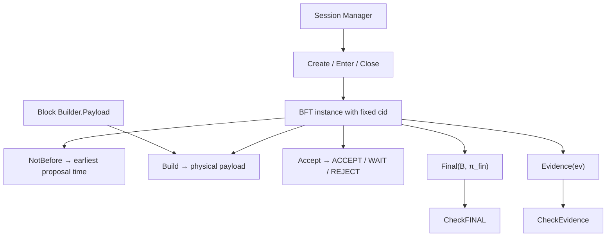

# Module 02: Session Program (Regional BFT) and Block Builder (v9 working draft v0.1)

Date: 2026-11-02. The overview and shared model are in [00 arch](00_arch_en_v0_1.md); the sources are [arch v0.2 §4.2–§4.3, §5.1](../formalization_v8/arch_zh_v0_2.md) and [Regional BFT v0.13](../formalization_v8/regional_bft_abstraction_zh_v0_13.md).

## 1. Role and intuition

A session program is a regional BFT instance running in a fixed context. The context is fixed by three things: a verified Plan $\Pi_s$ (who votes, who may propose, and the heights in the window), an anchor $A$ (the L2 block from which production continues), and a signature domain cid computed from them and the public configuration. In this context, the Program decides a physical chain and outputs publicly verifiable final proofs and offense evidence.

One session can have multiple candidate programs: they share session parameters but have different anchors and thus different cids; their signatures cannot be reused across contexts. The GFR selects which candidate ultimately contributes global content ([09 §4.3](09_finality_rules_en_v0_2.md)); the Program does not read Espresso to decide internal votes.

The Program has three groups of interfaces:

- **Control interfaces** (Create, Enter, Close), called by the Session Manager to manage the instance lifecycle.
- **Application configuration interfaces** (Build, Accept, NotBefore), called by the BFT kernel to build and check physical payloads. BFT selects a safe parent; Config checks whether a payload on the given parent follows the chain rules.
- **Outputs and public verification** (Final and Evidence events; CheckFINAL and CheckEvidence functions), which deliver results and let any reader verify them.

The Block Builder is Build's local transaction source and is described as a dependency interface in §3.14.

## 2. Minimal assumptions

**Model assumptions used by this module.**

- EUF-CMA signatures and hash binding ([00 §1.1](00_arch_en_v0_1.md)).
- L1 safety and DEP inputs ([00 §1.2–§1.3](00_arch_en_v0_1.md)): on the same finalized L1 prefix, all replicas compute the same $\mathrm{DEP}_\omega(h)$.
- Session parameters and fault model ([00 §2.2–§2.3](00_arch_en_v0_1.md)): committee $V_s$, weights $w_s$, $3F_s<W_s$, $\mathrm{Byz}_s$ static within each session, and honest replicas' protocol clocks equal to real time.
- Regional partial synchrony ([00 §2.4](00_arch_en_v0_1.md)): an unknown $\mathrm{GST}_{i_s}$ and known $\Delta_{i_s}$ exist. Safety properties do not depend on it; bounded progress does.
- Chain data and mappings ([00 §3](00_arch_en_v0_1.md)): physical blocks, anchor and $\mathrm{id}(A)$, $\mathsf{Apply}$, VP1–VP3, $\mathrm{Merge}$, fixed regional origin $\omega_A$, and $\mathrm{Virt}(C):=\mathrm{Merge}_{\omega_A}(C)$.

**Assumptions about other modules.**

- The reader has recomputed and verified the Plan under [01 §3.2](01_l1_authority_en_v0_1.md); the Program does not check whether the GFR selected it.
- At Enter, $A.\sigma$ provided by the Manager is the exact state after executing through the anchor and has been checked under ReadyState ([03 §3.2](03_session_manager_en_v0_1.md)).
- The Builder's Payload supplies only a candidate list of ordinary transactions; Accept and BFT decide whether its output enters a block.

**Upstream inputs and downstream outputs.**

| Direction | Other module and interface | Object exchanged | Connection |
| --- | --- | --- | --- |
| Input | Authority.`Plan` / `Auth` / `Leader` | PlanRecord, AuthorizationView, $\mathrm{Leader}_s$ | W1, W2 |
| Input | Manager.`PrepareCandidate` / `EnterCandidate` / `ApplyLifecycle` | Create / Enter / Close calls | W24 |
| Input | Builder.`Payload` | Ordinary transaction list Txs | W7 |
| Output | Manager.`HandleProgramEvent` | FinalEvent, EvidenceEvent | W8, W10 |
| Output | Manager, Publisher, GFR, Authority | CheckFINAL / CheckEvidence decisions | W11 |
| Output | Assembled by Manager and delivered to Publisher | RegionalResult Res | W9 |

## 3. Interfaces

### 3.1 State

Each replica stores separate instance state per cid. The fixed part is descriptor $\nu$ and program configuration $\mathcal K_s$ (§3.2). The mutable part includes:

- entered and terminated flags, entry time, and close reason;
- current view and internal consensus state such as votes, locks, and timers of the BFT implementation;
- records of signatures produced and the first receipt time of proposals;
- known physical blocks, decided prefix, and ancestor bodies needed for verification;
- execution state, L1 input cache, and Final / Evidence events awaiting delivery.

The chosen BFT implementation specifies internal message and lock formats. An instance saves the corresponding state and signature record before sending a signature; after a pause or crash it resumes from the original state and cannot reinitialize to bypass prior votes. Changing BFT or verifier is a protocol-version choice, not something done within the same cid.

### 3.2 Data structures

**Program configuration.** $\mathcal K_s$ is determined by the public protocol configuration and Plan fields, with named form

```text
ProgramConfig = {
    chain, rule_version, verifier_version, config_ref,
    committee, fault_bound, eligible_proposers, leader_rule,
    window, byte_limit, metadata_window
}
```

Chain is the chain identifier; rule_version, verifier_version, and config_ref come from the public configuration. Committee, fault_bound, eligible_proposers, leader_rule, and window are taken from the identically named AuthorizationView fields ([01 §3.2](01_l1_authority_en_v0_1.md)) and checked for equality field by field. Byte_limit is the byte limit $L_{\rm bytes}>0$ for ordinary transaction encoding; metadata_window is the proposal-reception time allowance $T_{\rm win}$, whose lower bound is given in §4.6. Leader_rule is a finite encoding of RuleSpec that yields $\mathrm{Leader}_s$ when executed.

Let $Q_s:=W_s-F_s$. This is the weight threshold used for the participation conditions below: BFT can make progress only when online honest weight reaches $Q_s$.

**Context and descriptor.** The context is the signature domain determined by this configuration and the anchor, identified by

$$
\mathrm{cid}_{s,A}:=\mathsf H(\texttt{REGIONAL},s,\mathrm{id}(A),\mathcal K_s).
$$

The descriptor is the triple $\nu=(\Pi_s,A,\mathrm{cid}_{s,A})$, recorded as

```text
Descriptor = {
    plan, anchor, cid
}
```

$\nu.\mathit{plan}=\Pi_s$, $\nu.\mathit{anchor}=A$, and $\nu.\mathrm{cid}=\mathrm{cid}_{s,A}$. Cid must equal the value calculated above from the canonical encoding of session, $\mathrm{id}(A)$, and ProgramConfig; the caller cannot choose it. Below, cid alone means $\nu.\mathrm{cid}$. A program does not change its descriptor.

The anchor's block identity and metadata are fixed at Create; its exact execution state is supplied and verified before Enter. The execution state is not encoded as an identity field of the descriptor; it is uniquely determined by the actual execution result for the fixed anchor.

**Anchor source.** Source evidence $\pi_A$ is recorded as

```text
AnchorEvidence = {
    kind, source_ref, source_objects
}
```

Kind is GENESIS, REGIONAL, FORCE, or RESUME; source_ref points respectively to the initial configuration, predecessor regional result, Force public replay position, or RESUME L1 position. Source_objects are the complete logs, blocks, and proofs needed to check that the source corresponds to the anchor. A regional source may be merely a valid regional decision of the predecessor; whether the GFR selected it is checked separately.

**Instance record.**

```text
BFTInstance = {
    descriptor, entered, terminated, entry_time, close_reason,
    view, kernel_state, signature_records,
    first_received, blocks, final_proofs, evidence_store, decided_tip,
    execution_cache, L1_cache, output_queue
}
```

Descriptor is fixed; entered and terminated are Boolean; entry_time is a protocol time or $\bot$; close_reason is a close-reason label (CloseReason in [03 §3.2](03_session_manager_en_v0_1.md)) or $\bot$; view is a positive integer and does not start before entry. Kernel_state is internal consensus state specified by the BFT version corresponding to verifier_version; external modules only retain the instance handle and do not rewrite internal locks or votes.

Signature_records stores `{message_type, view, signed_bytes}`, parsed according to that BFT version. First_received is keyed by proposal identifier and stores the first protocol receipt time, which retries cannot overwrite. Blocks stores complete blocks keyed by physical hash; final_proofs stores final proofs keyed by target hash; evidence_store stores checked offense evidence. Decided_tip points to the decided tip, or the anchor when there is no new decision. Execution_cache associates execution state with verified parent-chain identity and height, and does not reuse another chain's state based on height alone; L1_cache stores verified L1 objects; output_queue stores undelivered events. Delivery does not delete blocks, proofs, or evidence still needed for later checks.

**Regional result and output events.** The complete regional result delivered to consumers is

```text
RegionalResult = {
    descriptor, block, final_proof, chain, anchor_evidence
}
FinalEvent = {
    cid, block, final_proof
}
EvidenceEvent = {
    cid, evidence
}
```

RegionalResult corresponds one-to-one to $\mathit{Res}=(\nu,B,\pi_{\rm fin},C,\pi_A)$. Block is the target physical block $B$; chain is the complete hash-linked physical chain $C$ from descriptor.anchor to $B$ and must end at $B$; final_proof is a bit string $\pi_{\rm fin}$ in the fixed BFT verifier's format, whose verified subject must be this cid and $B$; anchor_evidence is $\pi_A$ and must refer to the same anchor.

The fixed verifier version defines the encoding of Evidence; it must permit checking the accused registered public key, message type, view / signature coordinates, conflicting signed contents, and context. The architecture does not prescribe one BFT's QC or signature aggregation format for all implementations.

### 3.3 Interface overview

Create, Enter, and Close manage the instance; Config supplies Build, Accept, and NotBefore; CheckFINAL and CheckEvidence are public verification functions; Final and Evidence are output events. Pausing only stops scheduling; resumption continues the original program state without a second Enter.



| Interface | Main inputs | Main outputs | Purpose |
| --- | --- | --- | --- |
| `Create` | Plan, anchor identity and metadata | `Assigned(cid)`, descriptor | Create or reuse a fixed instance |
| `Enter` | Anchor, source evidence, exact post-execution state | `Entered(cid, τ_entry)` | Complete initial entry once |
| `Close` | Close reason | `Terminated(cid, reason)` | Permanently stop new consensus signatures |
| `Build` | Parent, current protocol time | Physical block | Construct proposal payload |
| `Accept` | Parent, payload, first receipt time | ACCEPT / WAIT / REJECT | Check application validity |
| `NotBefore` | Valid parent | Earliest time or $+\infty$ | Compute proposal-time boundary |
| `CheckFINAL` | Descriptor, block, final proof | true / false | Publicly verify regional final proof |
| `CheckEvidence` | Descriptor, offense evidence | true / false | Publicly verify offense relation |
| `Final` (output event) | Instance decision and proof | FinalEvent | Deliver regional result |
| `Evidence` (output event) | Valid offense evidence obtained by instance | EvidenceEvent | Deliver accountability task |

### 3.4 Create(Π_s, A)

**Input.** Verified Plan and anchor block identity and metadata; $A.\sigma$ may not yet be available.

**Output.** `Assigned(cid)` and descriptor $\nu$; if the same cid exists, return the existing instance identifier and current state without changing its termination flag; REJECT for mismatched configuration, anchor identity, or window.

**Processing.** Check $A.h<h_{\min,s}$, fix the configuration and signature domain, and create an independent instance. Creation does not start consensus or copy the predecessor's locks or votes. A terminated instance is not revived.

### 3.5 Enter(A, π_A, σ_A)

**Input.** For an already created instance, provide the complete anchor, source evidence $\pi_A$, and exact post-execution state $\sigma_A=A.\sigma$; read the descriptor, this replica's identity, L1 input, and current protocol time.

**Output.** `Entered(cid, τ_entry)`, where $\tau_{\rm entry}$ is the protocol time of first entry; WAIT for incomplete source or state material; REJECT for anchor mismatch, a replica outside the committee, a terminated instance, or time at $\tau_s^{\rm stop}$.

**Processing.** Check the anchor source, linking identity, and execution state, and recheck the anchor premises in [00 §3.4](00_arch_en_v0_1.md). On first entry set entered and initialize this BFT's entry state and view 1; repeated calls return the first result without reinitializing. Entry may precede $\tau_s^{\rm start}$, but proposals must still wait for NotBefore.

### 3.6 Close(reason)

**Input.** A close-reason label from CloseReason in [03 §3.2](03_session_manager_en_v0_1.md), or the local trigger of the instance reaching $\tau_s^{\rm stop}$.

**Output.** `Terminated(cid, reason)`; repeated close returns the original termination record.

**Processing.** Set an irreversible termination flag, stop new consensus signatures, and retain existing blocks, signature records, and outputs. At $\tau_s^{\rm stop}$ the same stopping action occurs even without this call; a paused instance checks this condition before resuming scheduling.

### 3.7 Build(P, τ)

**Input.** An extendable parent $P$ in the same context and current protocol time $\tau$; read fixed configuration, ancestor bodies, execution state, L1 data, and Builder Payload (§3.14).

**Output.** Physical block $B$; WAIT if the earliest time has not arrived or inputs are missing; REJECT if the instance is closed, time has reached stop, or parent / height is invalid.

**Processing.** Set $h=\mathrm{slot}(\tau)$ and check $h_{\min,s}\le h\le h_{\max,s}$ and $P.h<h$. Execute the necessary padding after the parent and compute the pre-execution root at height $h$; after executing the mandatory prefix $\mathrm{Dep}^*_A(h)$ at that height, call $\mathsf{Payload}(h,\sigma,L_{\rm bytes})$. Fill in $\mathit{ts}^*(h)$ and $\mathit{os}^*_A(h)$ under [00 §3.4](00_arch_en_v0_1.md) and the parent identifier under [00 §3.2](00_arch_en_v0_1.md). Before sending, recheck that the instance is not terminated and current time is less than $\tau_s^{\rm stop}$; after the deadline, do not make catch-up proposals through $h_{\max,s}$. This interface only builds the payload; BFT chooses the parent for consensus.

### 3.8 Accept(P, B, τ_recv)

**Input.** Parent $P$, complete proposal payload $B$, and the protocol time $\tau_{\rm recv}$ at which this replica first received the proposal; read configuration and local inputs needed for checks.

**Output.** ACCEPT, WAIT(missing), or REJECT(reason).

**Processing.** Check in order:

1. **Link and window:** $B.\mathit{ph}$ points to $P$, $P.h<B.h$, and $h_{\min,s}\le B.h\le h_{\max,s}$.
2. **Metadata:** $B.\mathit{ts}=\mathit{ts}^*(B.h)$ and $B.\mathit{os}=\mathit{os}^*_A(B.h)$.
3. **Execution consistency:** $B.\mathit{root}$ equals the pre-execution root after executing intermediate padding from $P$ (VP3).
4. **Transaction format:** $\mathsf{BasicTx}(B.\mathit{Txs},L_{\rm bytes})$ holds (§3.14).
5. **Timing:**

$$
\mathit{ts}^*(B.h)\le\tau_{\rm recv}
<\mathit{ts}^*(B.h+1)+T_{\rm win},
\qquad \tau_{\rm recv}<\tau_s^{\rm stop}.
$$

A retry after missing input retains the original first receipt time. ACCEPT means application checks passed; an actual vote must also meet the BFT's internal rules and the stop guard at signing. Verification of an existing final proof does not call Accept again with the observer's current time: historical decision verification and voting checks for a new proposal are separate entry points.

### 3.9 NotBefore(P)

**Input.** A valid parent $P$ for the current instance; read the fixed window.

**Output.** If $P.h<h_{\max,s}$, return $\max\{\tau_s^{\rm start},\mathit{ts}^*(P.h+1)\}$; otherwise return $+\infty$.

**Processing.** Compute the earliest time at which a successor payload may be built; do not change instance state or advance the view. When no successor can be proposed, the instance may still process valid consensus messages for existing proposals before stop.

### 3.10 CheckFINAL(ν, B, π_fin)

**Input.** Complete descriptor $\nu$, target physical block $B$, and final proof $\pi_{\rm fin}$; read the public protocol configuration used to reconstruct $\mathcal K_s$.

**Output.** true or false.

**Processing.** Reconstruct $\mathcal K_s$ and check cid, then use its historical public keys, weights, and verifier version to check that the proof binds the block and context. Return false if input cannot be parsed or the proof fails. This function checks only the regional final proof; public provenance of the Plan, complete ancestry, and eligibility for global acceptance are separately checked by the consumer. Verification does not require synchronized clocks.

### 3.11 CheckEvidence(ν, ev)

**Input.** Complete descriptor, public configuration for reconstructing $\mathcal K_s$, and offense evidence ev defined by that BFT version.

**Output.** true or false.

**Processing.** Verify evidence using the fixed signature domain and historical configuration, and decide under that verifier version's conflict relation. Each BFT implementation must explicitly specify this relation and evidence encoding; an undefined “valid evidence” predicate alone does not satisfy this interface. This function neither changes escrow nor imposes on-chain penalties.

### 3.12 Output event Final(B, π_fin)

**Trigger.** The instance forms a decision and final proof for a target block in the current context.

**Output.** FinalEvent, with access to stored blocks needed by the consumer to obtain the complete decided chain.

**Processing.** Deliver to the Manager to assemble the complete Res ([03 §3.6](03_session_manager_en_v0_1.md)). The original interface does not produce a separate certificate for each padding height; consumers apply $\mathrm{Virt}$ to the decided chain to obtain the corresponding virtual segment. A target hash alone is insufficient to assemble a complete Res.

### 3.13 Output event Evidence(ev)

**Trigger.** The instance obtains complete evidence passing CheckEvidence.

**Output.** EvidenceEvent, delivered to the Manager.

**Processing.** Store the evidence and create a delivery task without waiting for an on-chain penalty; later Program closure does not delete the task.

### 3.14 Dependency interface: Block Builder

Build obtains ordinary transactions from the local Builder. The Builder does not belong to a session; it is each replica's local transaction pool.

**State and data structures.**

```text
PendingTx[txid] = {
    tx_bytes
}
PayloadRequest = {
    height, prefix_state, byte_limit
}
```

Tx_bytes is the complete native encoding of an ordinary transaction in $\mathcal T$; txid is computed from that encoding and the native transaction-identifier rule, and a key inconsistent with the bytes is not accepted. PendingTx deduplicates by txid; pool order is not a protocol commitment to transaction order. PayloadRequest records Payload's parameters: height is an L2 height, prefix_state is the state after executing that height's mandatory prefix (in $\Sigma$), and byte_limit is $L_{\rm bytes}$.

**Transaction-format predicate.** For a list $\mathit{Txs}\in\mathcal T^*$ and bound $L$, $\mathsf{BasicTx}(\mathit{Txs},L)=1$ if and only if every entry is nonempty, decodable in the native format, has a valid transaction signature, is not a deposit type, and the list's total byte length is at most $L$. It checks only format and does not require every transaction to be executable in the current state; transaction-by-transaction admission is performed by $\mathsf{Valid}$ within $\mathsf{Apply}$ ([00 §3.3](00_arch_en_v0_1.md)).

**SubmitTx(tx).** Input a complete ordinary transaction. Return REJECT for invalid format, signature, or type; otherwise put it in PendingTx and return `Received(txid)`, without duplicate registration on resubmission. Receipt means only that the transaction was received locally; it does not put it in a decided block.

**Payload(h, σ, L_bytes).** Input target height $h$, state $\sigma$ after executing that height's mandatory prefix, and byte limit. Return an ordered list of ordinary transactions satisfying $\mathsf{BasicTx}(\cdot,L_{\rm bytes})$, possibly empty; WAIT if execution context is missing, REJECT if the limit is invalid. Session, anchor, and parent are determined by the caller.

## 4. Properties

The properties in this section concern a BFT implementation for the same fixed valid descriptor $\nu$. Sections 4.1–4.9 state Required Properties (BFT-1…7) that an implementation must satisfy; §4.10 gives goals (G1–G3) obtained by composing these properties with Config rules, conditional on BFT-1…7, and does not claim that a particular implementation has been proved to satisfy them. Conclusions involving signatures and hashes allow negligible failure probability.

### 4.1 Observation events and regional finality

**Decided chain and regional finality.** If $\mathsf{CheckFINAL}(\nu,B,\pi_{\rm fin})=\mathrm{true}$, $B$ and its physical ancestors on the same chain are called **decided**, or **regionally finalized**. The chain from the fixed anchor to $B$ is the decided chain. Other readers may obtain the proof only later.

Regional finality answers only whether this instance has decided the block. The GFR must also determine whether this instance was selected, whether the result was publicly available in time, and whether the corresponding heights can still be accepted ([09 §4.2](09_finality_rules_en_v0_2.md)). A valid regional proof may pass the first test and fail the subsequent global acceptance conditions; a final proof in a predecessor context may support a candidate anchor, but does not replace the GFR's selection of the successor context.

**Entry into a BFT chain.** To include blocks already used by an honest replica as parent but not yet having a final proof, define for every non-anchor physical block $B$:

- $\tau_{\rm par}(B)$: the first time an honest replica selects $B$ or a physical descendant as parent, including calling Build or Accept on that basis;
- $\tau_{\rm fin}(B)$: the first time any participant holds a valid final proof for $B$ or a physical descendant;
- an event that has not occurred has time $+\infty$; set $\tau_{\rm in}(B):=\min\{\tau_{\rm par}(B),\tau_{\rm fin}(B)\}$.

$\tau_{\rm in}(B)<+\infty$ means $B$ has **entered a BFT chain**; a physical chain ending in such a block is a **BFT chain**. The anchor is a verified external input, not a block newly produced by this instance. A proposal's view is identified by its signed consensus messages; the physical payload has no view field. A view “contributes a block” when its proposal becomes a physical block on the chain under discussion.

### 4.2 BFT-1 — Agreement (safety)

Any two decided chains $C,C'$ in the same cid are prefix-comparable: $C\preceq C'$ or $C'\preceq C$.

This requirement applies during asynchrony, when replicas enter at different times, and when some replicas are offline or paused. It does not compare decided chains across candidate cids.

### 4.3 BFT-2 — Chain validity (safety)

For every physical block $B$ that enters a BFT chain, there exists an honest replica that records its actual first proposal-reception time, calls Accept on it and its parent, and receives ACCEPT at or before $\tau_{\rm in}(B)$.

If the replica first received WAIT for missing data, it still uses the original first receipt time when it completes checking. A correctly formatted signature or incomplete check alone cannot replace this ACCEPT. Intuitively, this ensures that any block passes application checks before being decided or used as parent by an honest replica.

### 4.4 BFT-3 — One block per view (safety)

On any BFT chain in the same context, a view contributes at most one physical block.

This restricts chain outcomes; it does not prevent a Byzantine leader from sending multiple conflicting proposals.

### 4.5 BFT-4 — External verifiability (safety)

The implementation supplies public, deterministic CheckFINAL and CheckEvidence and satisfies:

1. Every proof output by Final passes CheckFINAL and binds the descriptor and target block.
2. Results passing CheckFINAL satisfy decision properties including BFT-1 and BFT-2; an adversary cannot bypass them by forging another proof.
3. An honest replica following the protocol does not produce offense evidence against its identity that passes CheckEvidence.
4. A signature under another cid cannot be reused as a valid decision or offense evidence under this cid.

Verification uses only the declared public inputs and requires neither a synchronized observer clock nor that the observer was online when signatures formed. This property does not require every offense to be discovered.

### 4.6 Conditions for bounded progress

BFT-5 and BFT-6 are used only on an interval satisfying the following conditions. Take $I=[\tau_{\rm lc},\tau_{\rm end})$ and a fixed set of honest replicas $U\subseteq V_s\setminus\mathrm{Byz}_s$ satisfying

$$
\tau_{\rm lc}\ge\mathrm{GST}_{i_s},\qquad
\tau_{\rm end}\le\tau_s^{\rm stop},\qquad
\sum_{m\in U}w_s(m)\ge Q_s.
$$

Replicas in $U$ are the interval's **active replicas**: they complete Enter or resume from their original state no later than $\tau_{\rm lc}$, remain online and schedule the same cid throughout the interval, and have not Closed; required L1 inputs, ancestor bodies, execution state, and Payload are available within the stated processing budgets. Committee and threshold are not recomputed from the number currently online. $\tau_{\rm lc}$ is chosen once enough replicas are ready, not from the first replica's Enter; when replicas stop scheduling this cid due to a candidate switch, the existence of an interval meeting these conditions must be rechecked.

**Time parameters.** Within the declared message size, state preparation, and processing load range, $T_{\rm build}$ bounds the time from starting Build to sending the proposal. The selected BFT implementation provides four budgets: $T_{\rm sync}$ (restore view synchronization), $T_{\rm fin}$ (decision), $T_{\rm next}$ (advance to the next view), and $T_{\rm vc}$ (leave an unsuccessful view). $T_{\rm fin}$ and $T_{\rm next}$ include the relevant verification and data retrieval. Config's metadata window satisfies

$$
T_{\rm win}\ge T_{\rm build}+\Delta_{i_s}.
$$

**View start time.** For replica $m$ and view $v$, let $\tau_{\rm view}(m,v)$ be when $m$ enters the view and $P_{m,v}$ its parent selected on entry under BFT rules. Define

$$
\tau_{\rm st}(m,v):=\max\{\tau_{\rm view}(m,v),\mathsf{NotBefore}(P_{m,v})\}.
$$

This is the time the replica has entered the view and the application permits it to build a successor from that parent; it can be $+\infty$ when the parent reaches the height limit.

**Synchronization starting point.** Intuitively, $\tau_{\rm sync}$ starts the clock for the subsequent bounded-progress deadlines: ordinarily one first waits $T_{\rm sync}$ for active replicas' views to align; only when all active replicas are ready before the window begins can timing start directly at $\tau_s^{\rm start}$. Formally, normally set $\tau_{\rm sync}:=\max\{\tau_{\rm lc}+T_{\rm sync},\tau_s^{\rm start}\}$. When all four conditions below hold, this is a **synchronized start**, and $\tau_{\rm sync}=\tau_s^{\rm start}$:

- $\tau_{\rm lc}=\tau_s^{\rm start}$;
- all active replicas initially Entered before this time;
- no active replica previously reached the start time of any view;
- the required synchronization conditions already hold.

A candidate switch or resumption from pause does not automatically satisfy this exception. View $v$ **starts after $\tau_{\rm sync}$** if before $\tau_{\rm sync}$ no active replica reached that view's start time and no active replica entered a higher view.

### 4.7 BFT-5 — Progress (liveness)

Suppose view $v$ starts after $\tau_{\rm sync}$, leader $m=\mathrm{Leader}_s(v)\in U$, and $P_{m,v}.h<h_{\max,s}$. Let $\tau_0:=\tau_{\rm st}(m,v)$; the leader starts Build at $\tau_0$ and proposes. Each item below requires its corresponding deadline to be strictly earlier than $\tau_{\rm end}$:

1. The view's block is decided no later than $\tau_0+T_{\rm build}+T_{\rm fin}$.
2. Active replicas enter the next or a higher view no later than $\tau_0+T_{\rm build}+T_{\rm next}$. On entering the immediate next view $v+1$, they use this block as parent; on entering a higher view, the selected parent extends the physical prefix containing this block.

The decided block is the one proposed in this successful view, not merely any block at the same height.

### 4.8 BFT-6 — View synchronization and bounded unsuccessful view (liveness)

In the interval of §4.6:

- **View synchronization.** If an active replica has entered view $v$ at $\tau\ge\tau_{\rm sync}$ and $\tau+T_{\rm next}<\tau_{\rm end}$, all active replicas reach $v$ or a higher view by $\tau+T_{\rm next}$.
- **Leaving an unsuccessful view.** For a view that cannot progress under BFT-5 (for example, its leader is not in $U$), active replica $m$ leaves the view within $T_{\rm vc}$ from $\max\{\tau_{\rm st}(m,v),\tau_{\rm sync}\}$; use this only when the start time is finite and the full deadline is strictly earlier than $\tau_{\rm end}$.

Time spent waiting for NotBefore does not count toward the unsuccessful-view time.

### 4.9 BFT-7 — Bounded height and scheduled shutdown (safety)

- **Bounded height.** Every block passing CheckFINAL satisfies $h_{\min,s}\le B.h\le h_{\max,s}$.
- **Scheduled stop.** At $\tau\ge\tau_s^{\rm stop}=\mathit{ts}^*(h_{\max,s}+1)$, no honest replica produces any new consensus signature for this cid; an instance Closed earlier also does not resume signing. An offline or paused replica checks this condition before resuming.

Signatures made before stop may be combined or published as a valid certificate after stop. Thus “stop new signatures” does not mean that no new valid proof can appear after stop; the GFR's public deadline handles late results ([09 §3.2](09_finality_rules_en_v0_2.md)). This property does not require $h_{\max,s}$ to be decided; the GFR's regular-anchor rule fixes the tip at the end of the window ([09 §4.3](09_finality_rules_en_v0_2.md)).

### 4.10 Composed goals G1–G3

The following goals assume the model in [00](00_arch_en_v0_1.md), Config rules, and BFT-1…7. Dependencies are stated for each.

**G1 — Height and time.**

- **G1.1 Fixed timestamp.** The $\mathrm{Virt}$ expansion of decided chain $C$ uses $\mathit{ts}^*(h)$ at every height. Depends on VP1 and Merge; no physical block is required in every slot.
- **G1.2 Not ahead.** Every physical block entering a BFT chain satisfies $\mathit{ts}^*(B.h)\le\tau_{\rm in}(B)$. Depends on BFT-2, Accept's timing check, and the protocol clock.
- **G1.3 Timely admission.** There exists an honest replica that completed checking and whose first receipt time satisfies $\mathit{ts}^*(B.h)\le\tau_{\rm recv}<\min\{\mathit{ts}^*(B.h+1)+T_{\rm win},\tau_s^{\rm stop}\}$. Depends on BFT-2 and Accept; it constrains first receipt, not public disclosure time of the certificate.

**G2 — Safety.** These goals do not depend on the regional network having reached GST.

- **G2.1 Agreement.** Decided physical prefixes of the same cid are comparable; after executing $\mathrm{Virt}$ with the same finalized L1 inputs, the resulting virtual prefixes are also comparable. Depends on BFT-1 and deterministic Merge.
- **G2.2 Prefix closure.** A descendant's final proof determines its physical ancestors on the same chain; intermediate virtual heights are uniquely determined by Merge and padding needs no separate vote.
- **G2.3 Application validity.** A block entering a BFT chain satisfies Accept's metadata, root, and BasicTx checks; root is the state root before executing that height, and ordinary transactions are still filtered by Apply. Depends on BFT-2 and VP3.
- **G2.4 Deposit completeness.** Let the decided-chain tip be $h_C$. For every L1 height $\ell$ with $A.\mathit{os}<\ell\le\mathit{os}^*_A(h_C)$, its deposit list executes exactly once in the virtual segment at the first height that advances to origin $\ell$. The leader cannot omit, reorder, or repeat the mandatory prefix. Depends on the contiguous origin trajectory, VP2, and Merge.
- **G2.5 One block per view.** Depends on BFT-3.
- **G2.6 Close and context isolation.** An honest replica creates no new consensus signatures after Close or stop; signatures and evidence from different cids cannot be reused across them. Depends on the control interfaces, BFT-4, and BFT-7.
- **G2.7 No false evidence.** An honest replica is not judged to have produced valid offense evidence. Depends on BFT-4 and the signature assumption.
- **G2.8 Execution compatibility.** Under the parameters and anchor premises of [00 §3.4](00_arch_en_v0_1.md), regional origin satisfies O1–O3; Apply on the decided chain gives execution results consistent with the mandatory prefix and ordinary transactions. Deriving the same content unchanged on L1 additionally requires the same native parent state, global selection, and batch delivery within the native deadline; see [09 §7](09_finality_rules_en_v0_2.md).
- **G2.9 Unique virtual expansion.** Given the same valid decided physical chain, anchor state, and finalized L1 input, $\mathrm{Virt}$ gives the unique virtual segment satisfying VP1–VP3. Expansion stops at the given physical tip; clock progress alone adds no tail.

**G3 — Conditional progress before stop.**

- **G3.1 Successful-view production.** In the interval of §4.6, a view satisfying BFT-5's premises with enough time to finish has its block decided by the stated deadline, at height $\mathrm{slot}(\tau_0)$. Depends on Build and BFT-5.
- **G3.2 Catch-up by padding.** If the parent of a successful view is lower, Merge fills the intervening heights after decision. If decision occurs at $\tau_f$, the successful block satisfies $\tau_f-\mathit{ts}^*(B.h)<b_{\rm L2}+T_{\rm build}+T_{\rm fin}$. This is a freshness bound for one successful view, not a continuous lag commitment for the whole session.
- **G3.3 Unsuccessful-view rotation.** An unsuccessful view is left within BFT-6's deadline. A uniform upper bound on waiting for the next active leader additionally requires a restriction on the $\mathrm{Leader}_s$ selection sequence and cannot follow from online weight alone.
- **G3.4 Selected-transaction execution.** If Payload has included an ordinary transaction in the block decided under BFT-5 and the transaction passes Valid when Apply reaches it, it remains in that block's Kept list. “Every pending transaction is eventually selected” requires an additional Builder selection condition; this abstraction does not assume fair selection.

“Deciding the final window height” is not a goal of this module. The GFR fixes the regular-handoff anchor; low-latency entry by a successor also depends on cross-region communication, state preparation, and participation in the finally selected cid, as in [10 §3](10_pipelines_en_v0_2.md).
