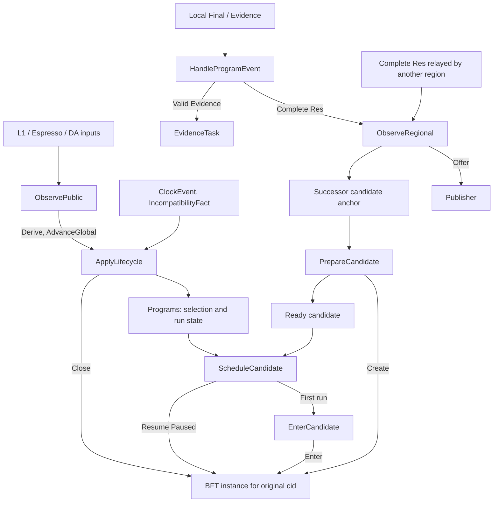

# Module 03: Session Manager (v9 working draft v0.1)

Date: 2026-11-02. The overview and shared model are in [00 arch](00_arch_en_v0_1.md); the sources are [arch v0.2 §4.9, §6.1–§6.3](../formalization_v8/arch_zh_v0_2.md) and [261027 §6](../meetup_record/261027.md).

## 1. Role and intuition

Each replica runs a Session Manager. The GFR and Derivation provide **public facts**: which session is assigned, which branch is closed, and how far the derived chain $D$ has advanced. A session program is a **local instance**. The Manager translates the former into actions on the latter:

- **Preparation:** obtain and check execution state for candidate anchors that may be selected.
- **Entry and scheduling:** initially Enter a candidate at an appropriate time; schedule at most one candidate in a session, pausing an old candidate and switching to a new one when necessary.
- **Closure (Kill):** permanently close a program once public facts show it can no longer contribute to the final chain.
- **Delivery:** assemble complete results from the local program's Final / Evidence and deliver them to the Publisher.

The Manager always finds the original program by cid: it prepares it when state is needed, schedules it when it should run, and retains historical results after permanent closure without resuming consensus.

## 2. Minimal assumptions

**Model assumptions used by this module.**

- Definitions of session, program, and window ([00 §2.2](00_arch_en_v0_1.md)); protocol clocks ([00 §2.3](00_arch_en_v0_1.md)).
- Cross-region communication is synchronous while Espresso is live ([00 §2.4](00_arch_en_v0_1.md)): a predecessor's regional result can reach the successor region within $\Delta_{\rm cross}$. This affects handoff latency only, not correctness.
- Chain mapping and execution ([00 §3](00_arch_en_v0_1.md)), used to check compatibility of a candidate prefix with $D$.

**Assumptions about other modules.**

- The GFR's LifecycleEvent and Tail come from local replay under public rules ([09 §3–§4](09_finality_rules_en_v0_2.md)); the Manager does not accept a remote claim of selection.
- Derivation's $D$ and ResumeCut are computed locally under native rules ([09 §5](09_finality_rules_en_v0_2.md)).
- The Program satisfies the control interfaces: Enter initializes only once and Close is irreversible ([02 §3.4–§3.6](02_session_program_en_v0_1.md)).

**Upstream inputs and downstream outputs.**

| Direction | Other module and interface | Object exchanged | Connection |
| --- | --- | --- | --- |
| Input | Public data from L1, Espresso, DA | Verified log prefixes, DAObject | — |
| Input | GFR.`AdvanceGlobal`, `Responsibility`, `Chain` | LifecycleEvent, Tail, $(G,\mathrm{src}_G,pc)$ | W13, W14, W15 |
| Input | Derivation.`Derive`, `DeriveAtResume` | $D$, DerivedItem, ResumeCut | W22, W23 |
| Input | Authority.`Plan`, `ReadAuthority` | PlanRecord, AuthorityRead | W1, W6 |
| Input | Program.`CheckFINAL`, `CheckEvidence` | Verification decisions | W11 |
| Input | Program output events | FinalEvent, EvidenceEvent | W8, W10 |
| Input | Predecessor region's Manager.`HandleProgramEvent` | Complete RegionalResult | W26 |
| Output | Program.`Create` / `Enter` / `Close` | Control calls | W24 |
| Output | Publisher.`Offer` | RegionalResult | W9 |
| Output | Publisher.`QueueEvidence` | EvidenceTask | W10 |
| Output | Successor region's Manager.`ObserveRegional` | Complete RegionalResult | W26 |

## 3. Interfaces

### 3.1 State

The Manager maintains local public inputs, GFR state $\mathcal X$ (ReplayState, [09 §4.1, §4.7](09_finality_rules_en_v0_2.md)), derivation state $\mathcal D$ (DerivationState, [09 §5.1](09_finality_rules_en_v0_2.md)), candidate anchors and their sources, the current scheduling choice, and delivery tasks. It maintains a Programs table keyed by cid; each entry stores the descriptor, original BFT instance, state-preparation progress, entered flag, close reason, and two components: **run state** and **selection state**.

**Run state** (phase) is Assigned, Preparing, Ready, Running, Paused, or Terminated, meaning respectively that parameters are registered, state is being obtained, state is ready, the instance has entered and is running, it has entered but is paused, or it is permanently terminated. **Selection state** (selection) is Candidate, Selected, or Excluded, meaning respectively awaiting GFR selection, selected, or determined ineligible.

The two components satisfy these invariants:

- Ready requires actually obtaining $A.\sigma$ and reconstructing or verifying its correspondence to the anchor from a verified native prefix; a root or download address alone is insufficient.
- entered changes only from false to true; Paused occurs only after entered is true.
- Terminated does not transition to another run state. An instance stopped by timeout may retain historical results still awaiting public acceptance, so TIME closure does not automatically set selection to Excluded.

**Regional view $R$.** For each cid, the Manager stores that program's regional decided chain $C$ and its $\mathrm{Virt}(C)$. Appending this to the verified anchor prefix yields a candidate virtual chain $R_{\rm cid}$. $R$ denotes the set of these candidate views ([00 §4.5](00_arch_en_v0_1.md)).

### 3.2 Data structures

**Programs table entry.**

```text
ProgramEntry = {
    descriptor, anchor_evidence, program_handle, phase, selection, entered,
    state_material, ready_state, close_reason,
    regional_chain, regional_view, pending_tasks
}
ReadyState = {
    anchor_id, anchor_height, state, execution_evidence
}
```

Descriptor is the fixed $\nu$ ([02 §3.2](02_session_program_en_v0_1.md)); anchor_evidence is $\pi_A$ (AnchorEvidence) received by PrepareCandidate and read by EnterCandidate when calling Enter and by HandleProgramEvent when assembling Res; program_handle points to the original BFTInstance. The table key must equal descriptor.cid. Phase, selection, and entered have the values in §3.1. State_material stores preparation materials obtained so far; ready_state is $\bot$ before checks complete; close_reason is $\bot$ before termination and then takes a CloseReason. Regional_chain is the physical decided prefix for the cid, regional_view is $R_{\rm cid}$, and pending_tasks points to existing publication or evidence tasks.

ReadyState's anchor_id and anchor_height must correspond to $\mathrm{id}(A)$ and $A.h$ of descriptor.anchor; state is a complete state in $\Sigma$. Execution_evidence is the ordered execution input from a verified native checkpoint to the anchor, or complete evidence supplied by the native state-verification mechanism in use, to check that state is indeed the result after executing the anchor. An equal state root or a download address alone is not a complete ReadyState.

**StateMaterial** may be a complete state with verification evidence or a partial collection of a checkpoint, blocks, and L1 / DA inputs awaiting continuation. It records only data obtained and carries no unverified Ready flag. The Manager creates ReadyState only after verification.

**Close reasons.**

$$
\mathsf{CloseReason}
=\{\mathsf{TIME},\mathsf{COMPLETE},\mathsf{FORCE},
\mathsf{RESUME},\mathsf{EXPIRED},\mathsf{EXCLUDED},
\mathsf{INCOMPATIBLE}\}.
$$

The first five respectively mean: the local protocol clock reaches $\tau_s^{\rm stop}$; the GFR publicly completes the session ($h_{\max,s}$ has been accepted or SessionEnd has fixed its tip, [09 §4.3](09_finality_rules_en_v0_2.md)); Force closes the branch; RESUME closes the branch; global expiration closes the branch, or a newly opened assignment can no longer start. EXCLUDED means the context has been determined ineligible for selection; INCOMPATIBLE means it conflicts with the fixed derived prefix (§4.4).

**Local input events.** In addition to the Program's FinalEvent / EvidenceEvent ([02 §3.2](02_session_program_en_v0_1.md)) and the GFR's LifecycleEvent ([09 §4.7](09_finality_rules_en_v0_2.md)), the Manager receives:

```text
ClockEvent = {
    protocol_time
}
IncompatibilityFact = {
    cid, height, candidate_hash, derived_hash, input_ref
}
```

Protocol_time is the local protocol clock value and cannot be replaced with a remote time claim. The two hashes in IncompatibilityFact are native block hashes at the same height, obtained by executing and encoding the candidate's verified prefix and $D$, respectively; they must differ. Input_ref identifies the verified basis for the candidate prefix and derivation inputs. Merely having “$D$ higher” does not produce this structure.

**Complete Manager state.**

```text
ManagerState = {
    self, public_inputs, GFR_state, derivation_state,
    Programs, candidates, scheduled, tasks
}
```

Self is this replica's identity; public_inputs is a cache of verified logs and objects; GFR_state and derivation_state are ReplayState and DerivationState, respectively; candidates associates predecessor cid with available candidate anchors and their AnchorEvidence; scheduled records the currently scheduled cid or $\bot$ for each logical session; tasks stores local records or references for PublicationTask / EvidenceTask ([04 §3.2](04_publisher_en_v0_1.md)). Closing an entry does not delete independent delivery tasks.

### 3.3 Interface overview

ObservePublic and ObserveRegional receive external inputs; HandleProgramEvent receives local BFT events; PrepareCandidate prepares an instance, EnterCandidate completes initial entry, ScheduleCandidate manages candidate scheduling; ApplyLifecycle handles public selection, closure, and local stop events.



| Interface | Main inputs | Main outputs | Purpose |
| --- | --- | --- | --- |
| `ObservePublic` | Public logs, DA data, and verification evidence | Processing positions, lifecycle events, affected cids, path states | Advance derivation and GFR |
| `ObserveRegional` | Complete Res and verification material | Regional tip, publication task, successor candidates | Receive regional result |
| `HandleProgramEvent` | cid, Final / Evidence | Regional-result processing output or evidence task | Handle local BFT output |
| `PrepareCandidate` | Plan, anchor, source evidence, state material | `Prepared(cid, Ready)` or `Preparing(cid, missing)` | Create or reuse instance and prepare state |
| `EnterCandidate` | cid | `Entered(cid, τ_entry)` | Complete first Enter |
| `ScheduleCandidate` | cid | `Running(cid)` | Pause, switch, or resume scheduling |
| `ApplyLifecycle` | LifecycleEvent, ClockEvent, or IncompatibilityFact | Updated state, affected cid list | Apply selection and permanent closure |

### 3.4 ObservePublic(reads)

**Input.** New L1 / Espresso finalized prefixes, DA objects and their verification evidence; read current $\mathcal X$, $\mathcal D$, and Programs.

**Output.** Updated GFR and derivation processing positions, lifecycle events from this call, list of cids changed, and READY or WAIT state for each of the two processing paths; REJECT if input verification fails.

**Processing.** Execute in order:

1. Verify and store public inputs.
2. Call Derivation.`Derive` ([09 §5.4](09_finality_rules_en_v0_2.md)) to advance $\mathcal D$.
3. Call GFR.`AdvanceGlobal` ([09 §4.8](09_finality_rules_en_v0_2.md)), using local `DeriveAtResume` as resumeReader.
4. Call `ApplyLifecycle` for each returned LifecycleEvent.
5. Call GFR.`Responsibility`; if Tail is $\mathsf{NEXT}(\nu)$ and $\nu$'s Plan assigns this replica's region, or the boundary in Tail has determined an anchor, call `PrepareCandidate` for the corresponding anchor. Call GFR.`Chain` to obtain $G$ for state preparation and the G-based kill checks in §4.4.
6. Recheck the time guard for each cid and check for an IncompatibilityFact or another kill fact in §4.4; call `ApplyLifecycle` when one appears.

WAIT from Derive does not block GFR events that do not depend on that data; a RESUME event needing the recovery data waits.

### 3.5 ObserveRegional(Res)

**Input.** Complete regional result Res (RegionalResult); read local material needed to verify the Plan, anchor, ancestry, and execution.

**Output.** Updated cid and regional tip, Publisher task, and new successor anchor candidates (possibly empty); WAIT if a source is missing, REJECT for an invalid proof or content.

**Processing.** Use $\mathsf{CheckFINAL}(\nu,B,\pi_{\rm fin})$ to verify the proof; check Plan provenance, physical ancestry, and Merge inputs; update the cid's regional view; and call Publisher.`Offer` ([04 §3.4](04_publisher_en_v0_1.md)). If the result comes from a predecessor context selected by the GFR, add its decided physical block to the successor anchor candidate set with source evidence `AnchorEvidence{kind: REGIONAL, ...}`. Receipt of a higher regional result alone does not change GFR selection.

### 3.6 HandleProgramEvent(cid, event)

**Input.** FinalEvent or EvidenceEvent output by a registered instance; read its descriptor, stored blocks, and anchor evidence.

**Output.** For Final, the ObserveRegional result after assembling Res; for Evidence, the evidence-delivery task identifier; WAIT for missing assembly material, REJECT for mismatched context or event.

**Processing.** Final: complete the physical chain $C$ from anchor to target block, obtain $\pi_A$ from the entry's anchor_evidence, assemble $\mathit{Res}=(\nu,B,\pi_{\rm fin},C,\pi_A)$, and pass it to ObserveRegional; also relay Res to all Managers in the region responsible for the successor session ($\Pi_{s^+}$.region, see §3.10) (W26). The successor region's Manager can also assemble the same Res from its local GFR publication index (ReplayState.publications), so relay affects only handoff latency. Evidence: after CheckEvidence, create an EvidenceTask and call Publisher.`QueueEvidence` ([04 §3.6](04_publisher_en_v0_1.md)). Stopping the old instance does not delete these results or evidence.

### 3.7 PrepareCandidate(Π_s, A, π_A, stateMaterial)

**Input.** Verified Plan, candidate anchor, source evidence $\pi_A$, and state material obtained so far; material may be empty or include verifiable checkpoints, execution inputs, or complete state. Candidates come from three sources: predecessor regional results from ObserveRegional, the boundary anchor in GFR Tail (Force), and the ResumeCut anchor (RESUME).

**Output.** `Prepared(cid, Ready)`; `Preparing(cid, missing)` if material is insufficient; REJECT for mismatched source, identity, or state.

**Sources of state material.** Starting from $D$'s verified tip checkpoint (W22), StateMaterial applies the following prefixes height by height to $A.h$: REGIONAL uses $G$ (W15) extended by $\mathrm{Virt}$ of candidate Res.chain; FORCE uses $G$, with $\pi_A$.source_objects taken from the public results referenced by $\mathrm{src}_G$; RESUME directly uses ResumeCut.anchor_state (W23).

**Processing.** Recompute the unique cid. If no entry exists, call Program.`Create` ([02 §3.4](02_session_program_en_v0_1.md)) and register it as Assigned; otherwise reuse the original entry. Retain preparation progress; check state material against the anchor's verified native prefix, create ReadyState when Ready conditions hold, and set Ready. Supplying material again advances the same entry and creates no second instance; a Terminated or Excluded cid is not prepared again into a runnable state.

### 3.8 EnterCandidate(cid)

**Input.** Registered cid; read ReadyState, this replica's committee identity, current selection and scheduling, close flag, and protocol time.

**Output.** `Entered(cid, τ_entry)`; WAIT if state is not ready or the cid is not locally scheduled; REJECT if ineligible, terminated, or time has reached stop.

**Processing.** Recheck the entry guards in §4.2, call Program.`Enter` on first entry ([02 §3.5](02_session_program_en_v0_1.md)), and set entered and Running. A repeated request for an unterminated instance returns the original entry result; ScheduleCandidate handles resumption after pause without another Enter.

### 3.9 ScheduleCandidate(cid)

**Input.** A cid selected under the scheduling rule in §4.3; read candidate states, GFR selection, and current time for the same logical session.

**Output.** `Running(cid)`; WAIT if the selected instance still needs preparation; REJECT if the candidate is excluded, terminated, or violates the scheduling rule.

**Processing.** Schedule at most one candidate in the same logical session. On switching, change an old Running instance that may still be selected to Paused and retain its state; call EnterCandidate for the new candidate's first entry or resume its original instance from Paused. When a higher candidate is not yet Ready, the current instance need not be terminated; after public selection schedule only the matching cid.

### 3.10 ApplyLifecycle(event)

**Input.** LifecycleEvent produced by local GFR replay and its processing position, or local ClockEvent or IncompatibilityFact; read affected Programs entries.

**Output.** Updated run / selection states and affected cid list; WAIT for insufficient material; REJECT if the source cannot be checked or contradicts verified facts.

**Processing.** By event kind:

- `SessionAssigned{descriptor}`: set the matching cid to Selected; set candidates in the same session with a nonmatching anchor to Excluded and close them with EXCLUDED. If no entry exists for the matching cid and this replica is in its committee, call PrepareCandidate. Then compute the successor Plan under [09 §4.3](09_finality_rules_en_v0_2.md): $\mathsf{Plan}(\mathcal P_\beta,(\beta,r+1),\mathrm{BlockRef}(\nu.\mathit{anchor}),\nu.\mathit{plan}.\mathit{region},\mathrm{Window}\{h_{\max,s}+1,h_{\max,s}+\mathrm{TB}\})$. If its region is this replica's region, register the successor as awaiting preparation and wait for predecessor results (W26) to provide candidate anchors.
- `SessionClosed{session, reason}`, `BranchClosed{branch, reason}`: close every entry in scope, including entries not yet Entered, Preparing, and Paused, using the corresponding reason.
- `Resumed{control_seq, branch, anchor, derived_prefix}`: close all entries of the old branch with RESUME; call Derivation.`DeriveAtResume`($p_{\rm res}$), where $p_{\rm res}$ is the L1 position in the event position; check that ResumeCut.anchor equals the event's anchor; and store anchor_state and derived_prefix as StateMaterial for that anchor. The new session's Plan is supplied in the subsequent SessionAssigned; call PrepareCandidate then.
- ClockEvent reaches an entry's $\tau_s^{\rm stop}$: close with TIME.
- IncompatibilityFact: close the cid with INCOMPATIBLE, as well as successor entries using its decided chain as anchor source.

Closure first sets and persists Terminated on the entry, then calls Close on the original program ([02 §3.6](02_session_program_en_v0_1.md)), retaining existing results and evidence. Repeated events neither create nor revive instances again.

## 4. Lifecycle rules

This section gives state-transition rules shared by the interfaces in §3. They are part of the Manager specification; corresponding GFR rules are in [09 §4](09_finality_rules_en_v0_2.md), and end-to-end flows in [10](10_pipelines_en_v0_2.md).

### 4.1 Registration, preparation, and permanent closure

After a new descriptor passes source checks, create a unique entry keyed by cid in Assigned state; after starting to obtain anchor state it is Preparing; once Ready is satisfied it is Ready.

Closure sets Terminated before calling Close. All later BFT actions read this termination flag; an unfinished Close call may be retried idempotently. Terminated never transitions back to another run state, but historical results and evidence remain readable.

A closure event processes all relevant cids in its scope, not just the currently Running instance. For example, BranchClosed affects all entries on the old branch; even a Preparing entry still downloading state must be marked terminated, preventing it from entering the closed branch after the download finishes.

### 4.2 Initial entry, pause, and resumption

Initial Enter for a cid requires all of:

1. The entry is Ready.
2. This replica belongs to the Plan's committee.
3. The descriptor and state evidence have been verified.
4. There is no termination or exclusion flag.
5. Current protocol time is less than $\tau_s^{\rm stop}$.
6. This node's scheduling choice points to this cid.

After successful Enter, set entered to true and phase to Running. Early entrants wait for the window start under NotBefore. Repeated Enter requests replay the original result only.

Each Manager schedules at most one candidate program for a logical session. When switching, if the old candidate may still be selected by the GFR, set it to Paused and retain its original BFT state; after the new candidate is Ready, initially Enter it or resume its original instance. Resuming Paused only resumes scheduling; it does not Enter again or clear consensus state. For example, if the first candidate runs, the Manager switches to a second, and the GFR later selects the first, then if it has not terminated it continues from the state retained at pause; messages it previously signed and the view in which it stopped remain part of the same instance's history.

Regardless of whether it is Assigned, Preparing, Ready, Running, or Paused, terminate with TIME at $\tau_s^{\rm stop}$. An offline node also performs this check before its first consensus action after resumption.

### 4.3 Candidate scheduling

Before the public anchor is fixed, the Manager preferentially prepares the highest known valid candidate on the same predecessor decided chain. Among Ready candidates not excluded, schedule the cid corresponding to the highest anchor; if a higher candidate is not ready, the current instance need not be destroyed. After GFR selection only the matching cid may continue; if it is not Ready, prepare and wait rather than running another excluded candidate.

Pause and permanent closure differ: a temporary local preference for a higher candidate only changes scheduling, allowing return to the saved instance; only once public rules exclude the old candidate is it permanently closed.

### 4.4 Exclusion and Kill criteria

Kill answers whether a program can still attach to the final chain, not how long it has been unresponsive. The following facts suffice to close an entry permanently; they fall into two groups ([261027 §6](../meetup_record/261027.md)).

**G-based kill (public GFR events).**

- The GFR explicitly selects a different anchor (the SessionAssigned descriptor does not match): EXCLUDED.
- A higher predecessor physical block has entered $G$ (read from GFR.`Chain`), making the lower anchor impossible as the final tip: EXCLUDED.
- The session or branch has been publicly closed (SessionClosed, BranchClosed, Resumed): close for the event reason; when global expiration makes the next height impossible to accept, the reason is EXPIRED.

**D-based kill (incompatibility fact from the derived chain).** The candidate's fixed virtual prefix and $D$, executed and encoded under [00 §3.3](00_arch_en_v0_1.md), have different native block hashes at some common height, i.e., an IncompatibilityFact exists: INCOMPATIBLE. Incompatibility propagates to successor candidates anchored at a block in the candidate's decided chain, which are also closed.

**Non-criteria.** Merely observing that $D$ is higher, or that there is no physical block at a height, does not establish incompatibility; different native block hashes at the same height must be confirmed. A typical case is a height occupied by a deposit-only block due to window fallback ([00 §3.4](00_arch_en_v0_1.md)) or override.

Kill is a local lifecycle action: it does not modify $G$, revert $G$, or submit an L1 transaction. During Espresso downtime the GFR may wait for an Espresso watermark, while $D$ still advances under L1; the Manager can use D-based kill to stop old production promptly without waiting for Espresso to recover.
