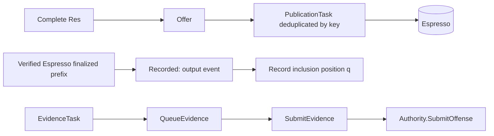

# Module 04: Publisher (v9 working draft v0.1)

Date: 2026-11-02. The overview and shared model are in [00 arch](00_arch_en_v0_1.md); the sources are [arch v0.2 §4.6, §2.5, §5.2](../formalization_v8/arch_zh_v0_2.md) and [Part 0 v0.8 §2.8](../formalization_v6/part0_model_goals_zh_v0_8.md).

## 1. Role and intuition

The Publisher connects regional production to global ordering: it writes complete regional results to Espresso so that the GFR can read them in public order. The Publisher also delivers evidence of offenses to the L1 Authority.

The Publisher makes no correctness decisions. For each publication, the GFR repeats the CheckFINAL, ancestry, and deadline checks ([09 §4.2](09_finality_rules_en_v0_2.md)); the Authority repeats CheckEvidence for each item of evidence. A malicious Publisher can therefore delay or withhold publication, but cannot cause an invalid result to enter $G$. Any participant holding a complete result can act as a Publisher; honest session members usually take on this role.

## 2. Minimal assumptions

**Model assumptions used by this module.**

- Espresso's E-S, E-L, and E-TS ([00 §1.4](00_arch_en_v0_1.md)): E-S guarantees that inclusion does not revert and can be read in full; E-L and E-TS are used only for this module's timing properties.
- Service budget $T_{\rm pub}$ ([00 §2.5](00_arch_en_v0_1.md)): once a complete result is given to an honest online Publisher, the upper bound on the time to submit it to Espresso, provided the inputs are available and the load permits.
- L1's $T_{\rm L1}$ ([00 §1.2](00_arch_en_v0_1.md)): used for the evidence delivery deadline.

**A-RELAY (relay duty, used only for liveness).** For each relay duty—publishing a complete regional result to Espresso and submitting evidence to L1—at least one online honest party takes on the duty during the relevant interval. Honest session members may take on these duties.

**Assumptions about other modules.**

- The Res received by Offer is assembled by the Manager ([03 §3.6](03_session_manager_en_v0_1.md)); the Publisher verifies it independently and does not trust the assembler.
- The deadline key $\theta_s^{\rm end}$ and “first complete public availability” $q_{\rm avail}$ are defined by the GFR ([09 §3.2](09_finality_rules_en_v0_2.md)); the Publisher uses them to decide when to stop retrying.

**Upstream inputs and downstream outputs.**

| Direction | Other module and interface | Object exchanged | Connection |
| --- | --- | --- | --- |
| Input | Manager.`ObserveRegional` | RegionalResult Res | W9 |
| Input | Manager.`HandleProgramEvent` → `QueueEvidence` | EvidenceTask | W10 |
| Input | GFR.`AdvanceGlobal` | LifecycleEvent (to determine whether a result has been excluded) | W13 |
| Input | Program.`CheckFINAL`, `CheckEvidence` | Verification decisions | W11 |
| Output | Espresso → GFR.`AdvanceGlobal` | Publication message | W12 |
| Output | Authority.`SubmitOffense` | Descriptor $\nu$, accused pid, evidence ev | W28 |

## 3. Interfaces

### 3.1 State

The publication queue is keyed by $key=(\mathrm{cid},\mathsf H(B))$ and stores Res, verification and completion status, completed submission attempts, and verified Espresso inclusion positions. This key is the same as the GFR publication index key result_key ([09 §4.7](09_finality_rules_en_v0_2.md)). Offense evidence awaiting delivery is stored separately and is not deleted when a program stops.

### 3.2 Data structures

```text
PublicationTask = {
    key, result, phase, missing, recorded_at
}
EvidenceTask = {
    descriptor, evidence, accused_pid, phase, L1_result
}
```

**PublicationTask.** The key is as above; result is a RegionalResult ([02 §3.2](02_session_program_en_v0_1.md)). When verification sources are incomplete, the task also stores the components obtained so far, which cannot be published as a complete result. Phase is one of:

- VERIFYING: verification in progress;
- QUEUED: awaiting submission;
- SUBMITTED: submitted, but inclusion not yet verified;
- RECORDED: finalized inclusion verified;
- STOPPED: public rules have excluded the result, or the session's deadline key has passed; stop retrying it as a new result.

Missing lists the data still needed and is empty when the result is complete. Before verification of inclusion, recorded_at is $\bot$; afterwards it stores `{q, message_index}` and the basis for the read. A submission attempt does not automatically set phase to RECORDED; only the verified result from the actual public log can populate recorded_at.

**Publication message.** The message submitted to Espresso is the canonical encoding of a RegionalResult. If ancestor blocks or the anchor source for the same cid have already been fully disclosed in other publications, they may be omitted by reference; the GFR merges these objects in its publication index ([09 §4.7](09_finality_rules_en_v0_2.md)).

**EvidenceTask.** Descriptor and evidence have the types in [02 §3.2](02_session_program_en_v0_1.md). Accused_pid is the pid in the descriptor's Plan committee whose public key equals the public key accused by the evidence. Phase is QUEUED, SUBMITTED, or RECORDED. L1_result is empty before a penalty and, on success, records the Authority's processing result and L1 position. Task identity is determined by cid and the canonical content of the evidence; repeated observation does not schedule the same delivery again. Here RECORDED means that L1 processing has completed and is distinct from Espresso inclusion of a PublicationTask.

### 3.3 Interface overview

Offer receives a complete regional result and starts publication; Recorded is a completion event produced from verified Espresso inclusion; QueueEvidence registers an evidence task, and SubmitEvidence submits it to the Authority.



| Interface | Main inputs | Main outputs | Purpose |
| --- | --- | --- | --- |
| `Offer` | Complete Res | `Queued(key)` | Verify, store, and submit a regional result |
| `Recorded` (output event) | Evidence of Espresso finalized inclusion | `Recorded(key, q)` | Mark a task as included |
| `QueueEvidence` | EvidenceTask | `EvidenceQueued(task)` | Verify and register an evidence task |
| `SubmitEvidence` | QUEUED EvidenceTask | `Submitted(task)`, then L1_result | Deliver evidence to the Authority |

### 3.4 Offer(Res)

**Input.** A complete regional result $\mathit{Res}=(\nu,B,\pi_{\rm fin},C,\pi_A)$; read the verified configuration and L1 data needed for verification.

**Output.** `Queued(key)`; return WAIT and retain the task for completion if verification sources are missing; return REJECT if the result has been determined invalid.

**Processing.** Run $\mathsf{CheckFINAL}(\nu,B,\pi_{\rm fin})$, check that $C$ is hash-linked from $\nu.\mathit{anchor}$ to $B$, and that $\pi_A$ refers to the same anchor. After these checks pass, deduplicate by key, store the result, and submit it to Espresso. If the service is temporarily unavailable, retain the task for retry; a program stopping at its scheduled time does not clear the queue. Set the task to STOPPED only if public rules have excluded the result (the local GFR's SessionClosed or BranchClosed, or SessionAssigned choosing another cid, W13), or a watermark already proves $\theta_q\ge\theta_s^{\rm end}$.

### 3.5 Output event Recorded(key, q)

**Trigger.** A verified Espresso finalized prefix and complete message contents confirm that the complete publication for this key was included in $J_q$.

**Output.** `Recorded(key, q)`, with the inclusion position recorded in the task.

**Processing.** Mark the task as included. Repeated observation of the same inclusion does not create a new task. Whether the GFR accepts the result is still determined under [09 §4.2](09_finality_rules_en_v0_2.md).

### 3.6 QueueEvidence(task)

**Input.** An EvidenceTask created by the Manager ([03 §3.6](03_session_manager_en_v0_1.md)).

**Output.** `EvidenceQueued(task)`; return REJECT if the evidence fails CheckEvidence or accused_pid does not match.

**Processing.** Run $\mathsf{CheckEvidence}(\nu,\mathit{ev})$, check accused_pid, deduplicate by (cid, evidence content), and store the task as QUEUED. Each QUEUED task is subsequently passed to SubmitEvidence.

### 3.7 SubmitEvidence(task)

**Input.** A QUEUED EvidenceTask; read the public configuration required by the descriptor.

**Output.** `Submitted(task)`; after L1 finalization, record the Authority's output (`Slashed` or the original processing result) in L1_result; return REJECT if the evidence fails CheckEvidence.

**Processing.** Using the Publisher's own L1 account as caller, allocate request identifier req and call Authority.`SubmitOffense`($\nu$, accused_pid, ev) ([01 §3.7](01_l1_authority_en_v0_1.md)). If L1 does not include it, retry with the same request identifier; the Authority's deduplication ensures that the same offense is not penalized twice.

## 4. Properties

PUB-1 through PUB-3 are safety properties of task state, satisfied by any Publisher operating according to this specification. PUB-4 and PUB-5 are liveness properties that depend on A-RELAY and external service conditions. If a malicious Publisher fails to satisfy these properties, the consequences are limited to liveness: the GFR and Authority's public checks ensure that invalid content is not accepted.

**PUB-1 — Verified queue (safety).** For every queued task with phase QUEUED, SUBMITTED, or RECORDED, result is a complete RegionalResult and the CheckFINAL, ancestry, and anchor-source checks have all passed.

*Intuition:* A Publisher does not submit as a complete result an object it cannot itself verify.

**PUB-2 — Key uniqueness and idempotence (safety).** Each key corresponds to at most one PublicationTask, and each (cid, evidence content) to at most one EvidenceTask. Repeated Offer calls for the same Res, or repeated observation of the same inclusion, create no new task; phase is RECORDED if and only if recorded_at has been populated from a verified Espresso finalized prefix.

**PUB-3 — Persistence (safety).** A PublicationTask stops being retried only if it is RECORDED or has been set to STOPPED (excluded by public rules, or a watermark proves that the deadline key has passed). Program Close, Manager transitions, and local restarts do not delete unfinished publication or evidence tasks.

*Intuition:* Someone continues trying to publish a valid result formed before the stop until the deadline.

**PUB-4 — Timely publication (liveness).** Suppose a complete Res is given to an honest online Publisher at time $\tau$, and throughout $[\tau,\tau+T_{\rm pub}+T_E]$ the Publisher remains online, inputs are available, load satisfies the stated conditions, and $\mathsf{Live}_E\equiv1$. Then, by $\tau+T_{\rm pub}+T_E$, there exists a finalized $J_q$ that includes the complete publication. If $J_q$ satisfies E-TS, then

$$
\theta_q\le\tau+T_{\rm pub}+T_E+\Delta_{\rm ts}.
$$

Dependencies: the $T_{\rm pub}$ service budget, E-L, and E-TS.

*Corollary (relation to the public deadline).* If $\tau\le\tau_s^{\rm stop}$ and the GFR's publication margin satisfies

$$
T_{\rm grace}>T_{\rm pub}+T_E+\Delta_{\rm ts},
$$

then $\theta_q<\tau_s^{\rm stop}+T_{\rm grace}=\theta_s^{\rm end}$, and the result satisfies the deadline condition in [09 §4.2](09_finality_rules_en_v0_2.md). This is the normal delivery budget; this real-time guarantee is not used during non-live periods.

**PUB-5 — Evidence delivery (liveness).** Suppose an honest Publisher holds an EvidenceTask at time $\tau$, remains online throughout $[\tau,\tau+T_{\rm L1}]$, L1 progresses normally, and the fee conditions are met. Then by $\tau+T_{\rm L1}$ the Authority has produced a finalized processing result for the evidence (`Slashed` or the original result for the same offense). Dependencies: A-RELAY, L1's $T_{\rm L1}$, and determinism of CheckEvidence. This does not guarantee that every offense is discovered; it guarantees delivery of valid evidence already obtained.
