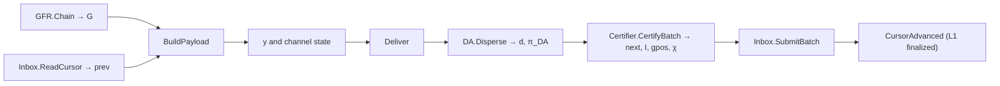

# Module 05: Batcher (v9 working draft v0.1)

Date: 2026-11-02. The overview and shared model are in [00 arch](00_arch_en_v0_1.md); the sources are [arch v0.2 §4.7](../formalization_v8/arch_zh_v0_2.md) and [Part 0 v0.8 §2.8](../formalization_v6/part0_model_goals_zh_v0_8.md).

## 1. Role and intuition

The Batcher delivers content in the global chain $G$ that has not yet been accepted on L1. A delivery has four steps:

1. **Encode:** write consecutive heights as native BlockRecords, assemble a channel, and split it into frames to obtain submission bytes $y$.
2. **DA:** submit $y$ to DA and obtain commitment $d$ and certificate $\pi_{\rm DA}$.
3. **Certification:** ask the Certifier to check that $y$ corresponds to $G$, the current cursor, and DA, and obtain signature $\chi$.
4. **Submit:** submit the cursor transition and signature to the Batch Inbox.

The Batcher is untrusted: the Certifier checks consistency with $G$, and the Inbox checks continuity. The Batcher's behavior affects only when delivery completes.

## 2. Minimal assumptions

**Model assumptions used by this module.**

- Chain mapping and execution ([00 §3.3](00_arch_en_v0_1.md)): the BlockRecord transaction list is $\mathit{Kept}_h$, actually executed by $\mathsf{Apply}$, and excludes DEP.
- Native sequencing window ($\mathrm{ddl}$ and $W_{\rm seq}$ at the end of [00 §3.4](00_arch_en_v0_1.md)): a batch for each height must be accepted before its native deadline position for derivation to adopt it unchanged.

**A-DELIVER (delivery budget, used only for liveness).** There exists $T_{\rm batch}$ such that, if throughout $[\tau,\tau+T_{\rm batch}]$ the Certifier is online, DA is available, L1 progresses normally, and an honest registered Batcher takes responsibility for submission, then a block that enters $G$ at $\tau$ has its batch accepted by the Inbox by $\tau+T_{\rm batch}$. $T_{\rm batch}$ covers queueing, takeover, channel completion, DA certification, Certifier response, and L1 inclusion. This does not follow merely from the existence of an honest Batcher: a malicious primary Batcher can repeatedly open and abandon channels, holding up its successor.

**Assumptions about other modules.**

- The $G$ produced by local GFR replay follows the public rules ([09 §4.8](09_finality_rules_en_v0_2.md)).
- The Certifier signs according to [06](06_certifier_en_v0_1.md); the Inbox checks continuity according to [07](07_batch_inbox_en_v0_1.md).
- DA satisfies DA-S1 and DA-L1 ([08 §4](08_da_en_v0_1.md)).

**Upstream inputs and downstream outputs.**

| Direction | Other module and interface | Object exchanged | Connection |
| --- | --- | --- | --- |
| Input | GFR.`Chain` | $(G,\mathrm{src}_G,pc)$ | W15 |
| Input | Inbox.`ReadCursor` | CursorRead | W20 |
| Input | DA.`Disperse` | $(d,\pi_{\rm DA})$ | W17 |
| Input | Certifier.`CertifyBatch` | CertifiedResult | W18 |
| Input | Derivation.`DeriveAtResume` (local GFR's resumeReader) | ResumeCut | W23 |
| Input | Result of Inbox.`SubmitBatch` | CursorAdvanced | W19 |
| Output | DA.`Disperse` | Submission bytes $y$ | W16 |
| Output | Certifier.`CertifyBatch` | CertificationRequest | W27 |
| Output | Inbox.`SubmitBatch` | Seven BatchSubmission parameters | W18 |

## 3. Interfaces

### 3.1 State

The Batcher maintains local GFR state $\mathcal X$ (ReplayState, [09 §4.1, §4.7](09_finality_rules_en_v0_2.md); using Derivation.`DeriveAtResume` as resumeReader when processing RESUME), the Inbox cursor read from L1 (CursorRead, [07 §3.2](07_batch_inbox_en_v0_1.md)), channel construction state, payloads awaiting delivery, and DA, certification, and L1 submission progress for each delivery task.

The cursor records the Inbox's acceptance progress. Let its height be $h_{\rm cur}$, the highest L2 height whose acceptance the Inbox has completed. The Batcher holds only a read copy and cannot modify the contract's cursor itself; the cursor is not a blockchain.

### 3.2 Data structures

**Height range.** `HeightRange = EMPTY | {first, last}`; when nonempty, first and last are L2 heights, with first $\le$ last.

**Native records and fragments.** The following records use the native encoding version, which specifies the byte layout of their fields:

```text
BlockRecord = {
    block_number, epoch_num, transactions
}
Frame = {
    channel_id, number, frame_data, is_last
}
SubmissionPayload = {
    derivation_version, frames
}
```

A BlockRecord is the native batch record for an L2 height: block_number is the L2 height; epoch_num is the block's L1-origin height (epoch in the name does not refer to a stake snapshot); transactions belongs to $\mathcal T^*$ and is $\mathit{Kept}_h$ obtained by executing Apply on the $G$ prefix, excluding DEP. A record exists even if ordinary transactions are empty.

A Frame is a transport fragment of a channel: channel_id is the channel identifier specified by the native encoding, number is the fragment sequence number starting at 0, frame_data is the fragment bytes, and is_last marks the last fragment. This structure matches [native certifier frame decoding](../megaeth_specs/specs/block-certification/certifier.md#verification-procedure).

SubmissionPayload is the parsed form of submission bytes $y$: derivation_version specifies the native decoding version; frames is one or more consecutively numbered new Frames of the same channel, without repeating the prefix already bound by prev.frames_digest. $y$ is the complete encoding of this structure; grouping and bytes cannot be changed after obtaining a DA commitment.

**Channel construction state.**

```text
ChannelBuilderState = {
    channel_id, records, encoding_options, encoder_state,
    encoded_channel, frames, next_frame, closed
}
```

Records is an ordered list of BlockRecords with consecutive block_number values; encoding_options stores construction options such as compression permitted by the native version; encoder_state is the native encoder state; encoded_channel is the channel bytes produced so far. Frames are generated fragments, next_frame points to the next frame to deliver, and closed indicates whether the channel has ended. Decoding the complete bytes after closure must yield records; the encoder's internal state does not constitute a separate choice of chain content.

**Delivery task.**

```text
BatchDeliveryTask = {
    job_id, prev, payload, source_range, channel_id, phase,
    DA_result, certified_result, L1_result
}
```

Prev is the Cursor used during construction; payload is the fixed $y$; source_range is the HeightRange encoded in this task, which together with channel_id identifies the local source. Job_id distinguishes tasks by the canonical contents of prev and $y$; a retry of the same task reuses its record, while rebuilding a different $y$ creates a new task.

Phase takes BUILT, DA_READY, CERTIFIED, and ACCEPTED in order. DA_result is $\bot$ or `{d, π_DA}`; certified_result is $\bot$ or CertifiedResult ([06 §3.2](06_certifier_en_v0_1.md)); L1_result is $\bot$ or `{L1_position, transaction_ref, event}`, where L1_position is the finalized acceptance position, transaction_ref identifies the corresponding L1 transaction, and event is CursorAdvanced ([07 §3.2](07_batch_inbox_en_v0_1.md)). Waiting retains completed stages; once prev is invalid, rebuild from the new cursor.

### 3.3 Interface overview



| Interface | Main inputs | Main outputs | Purpose |
| --- | --- | --- | --- |
| `BuildPayload` | Contiguous range $J$, prev | `Built(y, channelState)` | Encode block records awaiting delivery |
| `Deliver` | $y$, prev, channel information | `Accepted(prev, next, d, L1_position)` | Complete DA, certification, and L1 submission |

### 3.4 BuildPayload(J, prev)

**Input.** A nonempty contiguous L2 height range $J$ to encode (distinct from the completed range $I$ output by the Certifier), and verified current cursor prev; read local GFR state, source data, native execution state, and channel construction state.

**Output.** `Built(y, channelState)`: $y$ is the complete bytes of one or more consecutive frames; channelState is the updated ChannelBuilderState. Return WAIT if source or execution data is insufficient; return REJECT if the range or cursor does not match.

**Processing.** Encode only heights in $G$ above $h_{\rm cur}$ that are not covered by recovery derivation. Starting from the verified parent state, execute $G$ height by height (the VP3 recursion in [00 §3.3](00_arch_en_v0_1.md)); let $\mathit{Kept}_h$ be the list of ordinary transactions actually executed as returned by Apply at height $h$. For every $h\in J$, write

```text
BlockRecord{
    block_number = h,
    epoch_num    = G[h].os,
    transactions = Kept_h
}
```

A padding height also gets a record with an empty transaction list. Records carry neither DEP reconstructible from L1, ordinary transactions discarded by Apply, nor the original sparse physical-parent links. Generating a local payload does not advance the Inbox cursor.

### 3.5 Deliver(y, prev, channelInfo)

**Input.** $y$ generated by BuildPayload, the prev used, and its channel information channelInfo (channel_id and the frame number range in this submission); read local delivery tasks, registered Batcher authorization, and source.

**Output.** `Accepted(prev, next, d, L1_position)`, meaning the Inbox submission is finalized at the stated L1 position. Return WAIT and retain completed progress if a service or data is temporarily unavailable; return REJECT if another party has advanced the cursor or the submission is invalid.

**Processing.**

1. Call DA.`Disperse(y)` ([08 §3.4](08_da_en_v0_1.md)), obtain $(d,\pi_{\rm DA})$, and set phase to DA_READY.
2. Call Certifier.`CertifyBatch(prev, y, d, π_DA)` with a CertificationRequest ([06 §3.4](06_certifier_en_v0_1.md)), obtain `Certified(next, I, gpos, χ)`, and set phase to CERTIFIED.
3. Call Inbox.`SubmitBatch(prev, next, d, π_DA, I, gpos, χ)` ([07 §3.4](07_batch_inbox_en_v0_1.md)); after L1 finalization record L1_result and set phase to ACCEPTED.

Retries reuse completed steps. If prev is invalidated (another submission advanced the cursor, or RESUME performed an override), rebuild from the new cursor without overwriting other accepted submissions.

## 4. Properties

BAT-1 through BAT-3 are safety properties describing what a Batcher operating according to this specification produces; system acceptance safety does not depend on an honest Batcher, but is guaranteed by CERT-1 and Inbox checks. BAT-4 is a liveness property.

**BAT-1 — Record fidelity (safety).** For each $y$ constructed by the Batcher and each completed BlockRecord within it, if block_number is $h$, then epoch_num $=G[h].\mathit{os}$ and transactions $=\mathit{Kept}_h$, where $G$ and $\mathit{Kept}_h$ come from the same local GFR processing position. The records have consecutive block_number values starting from $h_{\rm cur}+1$ and contain no DEP.

*Intuition:* The Batcher encodes “what $G$ looks like in native format”; derivation adds DEP back and executes on the same parent state, yielding the same native blocks.

**BAT-2 — No cursor authority (safety).** No Batcher operation directly modifies the Inbox cursor; the cursor changes only when the Inbox accepts a submission bearing a valid Certifier signature.

**BAT-3 — Idempotent retry (safety).** Retries of the same (prev, $y$) reuse the same BatchDeliveryTask and completed stages without producing a second, different DA commitment or certification request; a new task created after prev is invalidated uses the new cursor as prev and does not resubmit heights already accepted or covered by RESUME.

**BAT-4 — Timely delivery (liveness).** Under A-DELIVER, the batch for a block entering $G$ at $\tau$ is accepted by the Inbox no later than $\tau+T_{\rm batch}$. If also

$$
W_{\rm exp}+M_a+T_{\rm batch}+T_{\rm drift}\le W_{\rm seq},
$$

then under normal service, every block entering $G$ on time is accepted before its native deadline position and adopted unchanged by derivation (budget condition in [09 §3.5](09_finality_rules_en_v0_2.md)). Dependencies: A-DELIVER, CERT-5, DA-L1, and L1's $T_{\rm L1}$.
