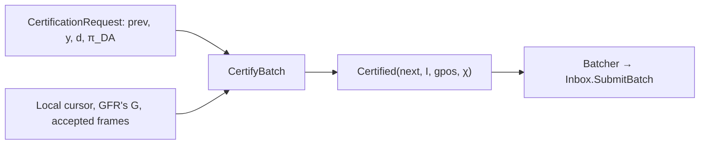

# Module 06: Certifier (v9 working draft v0.1)

Date: 2026-11-02. The overview and shared model are in [00 arch](00_arch_en_v0_1.md); the sources are [arch v0.2 §4.7](../formalization_v8/arch_zh_v0_2.md), [Part 0 v0.8 §2.7](../formalization_v6/part0_model_goals_zh_v0_8.md), and [261027 §2, §7](../meetup_record/261027.md).

## 1. Role and intuition

An L1 contract cannot run the GFR or read DA itself. The Certifier $\mathsf C$ answers one question for the Inbox: **Does this submission append exactly the next segment of $G$ to the current cursor?** It signs after checking four conditions:

1. **Cursor continuity:** the submitted starting point prev is the current cursor on L1.
2. **Source consistency:** each encoded block record agrees with the metadata at the corresponding height of $G$ and with the transactions actually executed.
3. **Recovery alignment:** the local GFR has processed the last RESUME at or before the position where prev was written, so old-branch content is not appended to the new cursor.
4. **DA binding:** the submitted bytes open the DA commitment, and the DA certificate is valid.

The Inbox need only verify $\mathsf C$'s signature and cursor continuity. Batch-layer safety therefore depends on trusting $\mathsf C$ (called “CFT only” in 261027); $\mathsf C$ being offline affects only liveness.

## 2. Minimal assumptions

**Model assumptions used by this module.**

- EUF-CMA signatures ([00 §1.1](00_arch_en_v0_1.md)); $pk_{\mathsf C}$ is given in the configuration ([00 §2.5](00_arch_en_v0_1.md)).
- Chain execution ([00 §3.3](00_arch_en_v0_1.md)), used to recompute $\mathit{Kept}_h$.
- Service budget $T_{\rm cert}$ ([00 §2.5](00_arch_en_v0_1.md)).

**A-CERT (trusted Certifier).** $\mathsf C$ is never corrupted and operates according to §3 of this file. By the signature assumption, every message bearing a valid signature from $\mathsf C$ was actually produced by $\mathsf C$ according to those rules. $\mathsf C$ may be offline; this affects only liveness. The safety of Regional BFT and the GFR does not depend on $\mathsf C$; the source of the contents of $G'$ and $D$ does depend on $\mathsf C$.

**Assumptions about other modules.**

- The GFR run locally by $\mathsf C$ follows the public rules ([09 §3–§4](09_finality_rules_en_v0_2.md)).
- DA satisfies DA-S1, and CheckDA is public and deterministic ([08 §4](08_da_en_v0_1.md)).
- On acceptance, the Inbox checks that prev equals the current cursor and verifies the complete signed message ([07 §3.4](07_batch_inbox_en_v0_1.md)).

**Upstream inputs and downstream outputs.**

| Direction | Other module and interface | Object exchanged | Connection |
| --- | --- | --- | --- |
| Input | Batcher.`Deliver` | CertificationRequest | W27 |
| Input | GFR.`Chain` | $(G,\mathrm{src}_G,pc)$ | W15 |
| Input | Inbox.`ReadCursor` | CursorRead | W20 |
| Input | Result of DA.`Disperse`, DA.`Retrieve` | $(d,\pi_{\rm DA})$, bytes of accepted frames | W17, W21 |
| Input | Inbox acceptance event | CursorAdvanced (locates accepted frames) | W19 |
| Input | Derivation.`DeriveAtResume` (local GFR's resumeReader) | ResumeCut | W23 |
| Output | Batcher → Inbox.`SubmitBatch` | CertifiedResult | W18 |

## 3. Interface

### 3.1 State

$\mathsf C$ maintains its own verified L1, Espresso, and DA views, GFR state $\mathcal X$, current Inbox cursor, accepted frames needed to continue a channel, request-result records, and signing key $sk_{\mathsf C}$. It uses the same version of the rules as readers. Its source view is denoted `{GFR_state, Inbox_read, accepted_prefix_frames}`, respectively a ReplayState ([09 §4.7](09_finality_rules_en_v0_2.md)), CursorRead ([07 §3.2](07_batch_inbox_en_v0_1.md)), and list of Frames ([05 §3.2](05_batcher_en_v0_1.md)).

### 3.2 Data structures

$\mathsf C$ checks a fixed cursor transition:

```text
CertificationRequest = {
    prev, payload, commitment, DA_certificate
}
BatchAttestation = {
    chain, Inbox_address, prev, next,
    commitment, DA_certificate_hash, completed_range, gpos
}
CertifiedResult = {
    next, completed_range, gpos, signature
}
```

**CertificationRequest** corresponds to the four inputs of `CertifyBatch`: prev is a Cursor, payload is the submitted bytes $y$ (the encoding of SubmissionPayload), and commitment and DA_certificate are $d$ and $\pi_{\rm DA}$. The requester does not provide the accepted Frame prefix needed to continue a channel: $\mathsf C$ obtains it independently from L1 acceptance events (W19) and DA (W21) and checks it against prev.frames_digest. Thus the requester cannot substitute frames with the same numbers from another channel for the previously accepted prefix.

**BatchAttestation** names the fields of the message to be signed: chain and Inbox_address fix the signature's purpose; prev and next are complete Cursors; commitment is $d$; DA_certificate_hash is $\mathsf H(\pi_{\rm DA})$; completed_range is the HeightRange $I$ completed and accepted in this submission ([05 §3.2](05_batcher_en_v0_1.md)); and gpos is the source GFR's ReplayPosition ([09 §4.7](09_finality_rules_en_v0_2.md)). It does not include the future L1 write position.

**CertifiedResult** corresponds to output `Certified(next, I, gpos, χ)`: signature is $\chi$, a signature over the complete BatchAttestation. For an unclosed channel, completed_range is EMPTY, next.height and next.origin remain unchanged, and only frames_digest is updated under the native rules; when a channel closes, the complete finished range is checked.

The request-result table associates BatchAttestation and CertifiedResult by the complete request contents and the gpos actually used. Even when a cached result exists, prev must still be checked against the current L1 cursor and the RESUME processing condition; the cache does not permit source checks to be skipped.

### 3.3 Interface overview



| Interface | Main inputs | Main outputs | Purpose |
| --- | --- | --- | --- |
| `CertifyBatch` | prev, $y$, $d$, $\pi_{\rm DA}$ | `Certified(next, I, gpos, χ)` | Sign after checking content, continuity, and DA binding |

### 3.4 CertifyBatch(prev, y, d, π_DA)

**Input.** Starting cursor prev, complete submission bytes $y$, DA commitment $d$, and certificate $\pi_{\rm DA}$; read the current L1 cursor, GFR source, and accepted frames needed to continue a channel from its own state.

**Output.** `Certified(next, I, gpos, χ)`: next is the computed successor cursor, $I$ is the contiguous range of heights whose acceptance completes in this submission, gpos is the GFR processing position used, and $\chi$ is the signature defined below. Return WAIT if inputs are missing; return REJECT if binding, continuity, or content does not match.

**Processing.**

1. **Cursor continuity.** Confirm that prev equals the current cursor in its L1 view. Let $p_{\rm prev}$ be the L1 position where prev was written (CursorRead.written_at).
2. **Recovery alignment.** Its GFR must have processed the last RESUME at or before $p_{\rm prev}$. Otherwise return WAIT until the GFR has processed it.
3. **DA binding.** Check $\mathsf{CheckDA}(d,\pi_{\rm DA})=1$ and that $y$ opens $d$ under the DA scheme's binding relation.
4. **Channel continuity.** Obtain the accepted frames bound by prev.frames_digest; check that the frames in $y$ belong to the same channel and are consecutively numbered. Wait for any missing accepted frame; future frames not yet submitted are not treated as completed heights.
5. **Source consistency.** For block records fully decodable in this submission, check at each height that block_number starts at prev.height $+1$ and is consecutive; epoch_num equals $G[h].\mathit{os}$; transactions equal $\mathit{Kept}_h$ obtained by executing Apply on that $G$ prefix; and these heights have not been covered by recovery derivation.
6. **Sign.** Compute next and $I$, let gpos be the GFR processing position used for this check and $\mathit{InboxAddr}$ the configured Inbox address, and sign

$$
\chi=\mathsf{Sign}_{sk_{\mathsf C}}\!\left(
\mathrm{enc}(\mathit{chain},\mathit{InboxAddr},
prev,next,d,\mathsf H(\pi_{\rm DA}),I,\mathit{gpos})\right).
$$

A retry with the same request contents and source used returns the existing result.

## 4. Properties

CERT-1 through CERT-4 are safety properties that hold for all executions under A-CERT and the signature assumption; CERT-5 is a liveness property. Below, a “valid certificate” means a signature $\chi$ that verifies under $pk_{\mathsf C}$ for a BatchAttestation.

**CERT-1 — Soundness (safety).** For any valid certificate and its BatchAttestation $(\mathit{chain},\mathit{InboxAddr},prev,next,d,\mathsf H(\pi_{\rm DA}),I,\mathit{gpos})$, there exists a view of $\mathsf C$ at signing time such that:

1. prev is the current cursor on L1 in that view;
2. the GFR in that view has processed the last RESUME at or before $p_{\rm prev}$, and gpos is its processing position;
3. $\mathsf{CheckDA}(d,\pi_{\rm DA})=1$, and there is a unique $y$ opening $d$;
4. for every $h\in I$, the record decoded from $y$ together with the frame prefix bound by prev satisfies epoch_num $=G_{\mathit{gpos}}[h].\mathit{os}$ and transactions $=\mathit{Kept}_h$, where $G_{\mathit{gpos}}$ is the global chain at gpos;
5. next is computed from prev and $y$ under the native rules, and $I$ is contiguous from prev.height $+1$ through next.height (or is EMPTY).

*Intuition:* A valid certificate is a trusted statement about which segment of $G$ follows which cursor.

**CERT-2 — Binding (safety).** The signature covers every field of BatchAttestation. A valid certificate cannot be used for a different chain, Inbox, cursor transition, DA commitment, DA certificate, height range, or source position. Dependencies: EUF-CMA signatures and hash binding.

**CERT-3 — RESUME isolation (safety).** Suppose a RESUME's CursorSet writes a new cursor at L1 position $p$. Then: (a) after $p$, the Inbox will not accept a certificate issued before $p$ with the old cursor as prev, because prev no longer equals the current cursor; (b) for a certificate whose prev is the cursor at $p$ (or its successor), the GFR state corresponding to its gpos has processed that RESUME and therefore covers only the new branch of $G$. Dependencies: CERT-1 items 1 and 2 and the Inbox's prev check.

**CERT-4 — Accepted prefix (safety).** Fix an L1 history segment between two consecutive CursorSet events (or between genesis and the first CursorSet). Let $G'$ be the acceptance view materialized by a reader in that segment ([07 §3.7](07_batch_inbox_en_v0_1.md)), and let $G_x$ be the global chain at GFR processing position $x$. For any processing position $x$, if $x$ is no earlier than the gpos of every certificate accepted in the segment, and no new RESUME is processed between those positions and $x$, then

$$
G'\preceq G_x.
$$

*Basis:* By CERT-1, each acceptance appends a contiguous segment of $G_{\mathit{gpos}}$ after prev. Between RESUMEs, the GFR only appends and does not roll back ([09 §7](09_finality_rules_en_v0_2.md)), so a prefix at an earlier gpos remains a prefix at a later position. This is the statement in 261027 that “the batch layer guarantees $G'\preceq G$”; it holds only if $\mathsf C$ is trusted.

**CERT-5 — Responsiveness (liveness).** If $\mathsf C$ is online throughout $[\tau,\tau+T_{\rm cert}]$, the request arrives at $\tau$, and its required inputs (L1 cursor, GFR source, accepted frames, DA certificate) are already available at $\tau$ and pass the checks, then $\mathsf C$ returns CertifiedResult by $\tau+T_{\rm cert}$. Dependency: the service budget $T_{\rm cert}$ in §2.
