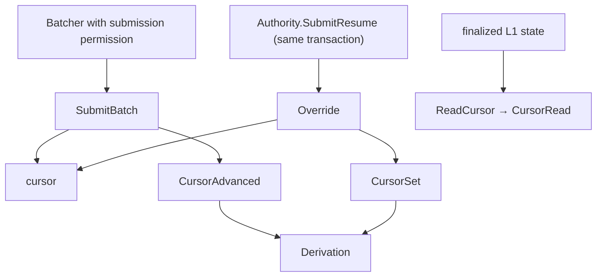

# Module 07: Batch Inbox (v9 working draft v0.1)

Date: 2026-11-02. The overview and shared model are in [00 arch](00_arch_en_v0_1.md); the source is [arch v0.2 §4.1 Inbox records, §4.8](../formalization_v8/arch_zh_v0_2.md).

## 1. Role and intuition

The Batch Inbox is a contract on L1 that maintains a unique **cursor** recording acceptance progress: the L2 height up to which L1 has accepted, the L1 origin used for that progress, and whether a channel remains unfinished. The cursor can change in only two ways:

- **SubmitBatch:** A registered Batcher submits a cursor transition signed by the Certifier. Its starting point must equal the current cursor.
- **Override:** Called only in the same transaction as the Authority's processing of RESUME; it advances the cursor directly to the recovery target $h_{\rm res}$ and clears the unfinished channel.

The Inbox neither executes L2 transactions nor reads Espresso or DA. Its recorded acceptance events are inputs to Derivation; readers use them to materialize the acceptance view $G'$.

## 2. Minimal assumptions

**Model assumptions used by this module.**

- L1 safety and atomic execution ([00 §1.2](00_arch_en_v0_1.md)): cursor updates and events complete atomically in the same call; all readers read the same cursor at the same L1 height.
- Signature verification ([00 §1.1](00_arch_en_v0_1.md)): the contract verifies Certifier signatures using $pk_{\mathsf C}$.
- Request identifiers and idempotence semantics ([00 §4.2](00_arch_en_v0_1.md)).

**Assumptions about other modules.**

- Valid Certifier signatures satisfy CERT-1 and CERT-2 ([06 §4](06_certifier_en_v0_1.md)). The contract itself can check only the signature and continuity; correspondence between content and $G$ depends on trusting $\mathsf C$.
- Override is called only by the Authority within the same transaction as `SubmitResume` ([01 §3.10](01_l1_authority_en_v0_1.md)).
- The contract verifies DA certificates according to existing Inbox rules; the Certifier checks binding between DA content and the commitment.

**Upstream inputs and downstream outputs.**

| Direction | Other module and interface | Object exchanged | Connection |
| --- | --- | --- | --- |
| Input | Batcher.`Deliver` | BatchSubmission (including CertifiedResult fields) | W18 |
| Input | Authority.`SubmitResume` | Target Cursor | W4 |
| Output | Derivation.`Derive` / `DeriveAtResume` | CursorAdvanced, CursorSet events | W5, W19 |
| Output | Batcher, Certifier | CursorRead | W20 |
| Output | Batcher delivery task, Certifier | CursorAdvanced | W19 |
| Output | Authority.`SubmitResume` (read within the contract) | InboxState.cursor | — |
| Input | GFR.`Chain` (reader materializing $G'$) | $(G,\mathrm{src}_G,pc)$ | W15 |

## 3. Interface

### 3.1 State

The Inbox contract maintains the cursor, the L1 position at which it was written, registered Batchers and their native submission/takeover permissions, the Certifier public key, request results, and acceptance events. Admin is fixed as the Authority. Only a successful SubmitBatch or an Override within a RESUME transaction modifies the cursor.

### 3.2 Data structures

**Cursor and read result.**

```text
Cursor = {
    height, origin, frames_digest, source
}
CursorRead = {
    cursor, written_at, as_of, read_evidence
}
```

Height is the last L2 height whose acceptance is complete; origin is the L1-origin height used for that progress. Both are nonnegative integers. Frames_digest is the digest bytes computed by the native channel rules; zero means there is no unfinished channel. Source is a tagged source reference:

- `GLOBAL(gpos)`: points to the GFR processing position gpos used for certification, of type ReplayPosition ([09 §4.7](09_finality_rules_en_v0_2.md));
- `RESUME(control_seq)`: points to the RESUME record identified by the Authority's unique control sequence number ([01 §3.2](01_l1_authority_en_v0_1.md));
- `GENESIS`: points to the initial configuration.

CursorRead is the read result: written_at is the L1 position where the cursor was written; as_of is the finalized L1 height queried; read_evidence is the L1 evidence for checking the value. **Written_at is historical metadata from after acceptance; it is not placed in the cursor to be signed, and the Certifier need not know the future L1 inclusion position.** The RESUME call binds the record using the already determined control_seq within the transaction; its exact L1 position is obtained from ControlEntry after finalization. Source and written_at are therefore distinct fields.

The Inbox modifies the cursor; the Authority, Batcher, and Certifier hold read copies. This draft uses these logical fields to define the signature and interface objects; the adopted Inbox version specifies the concrete native transport encoding.

**Submission and permissions.**

```text
BatchSubmission = {
    prev, next, commitment, DA_certificate,
    completed_range, gpos, signature
}
BatcherPermissions = {
    primary, alternatives, exclusive_window
}
InboxState = {
    cursor, cursor_written_at, permissions,
    certifier_pk, admin, request_results, acceptance_log
}
```

BatchSubmission corresponds to the seven content parameters of SubmitBatch: completed_range is $I$, and signature is $\chi$. These fields, together with the configured chain and Inbox address, reconstruct the complete BatchAttestation ([06 §3.2](06_certifier_en_v0_1.md)).

In BatcherPermissions, primary is the current primary Batcher's L1 account; alternatives is the set of alternative accounts; exclusive_window is the L1-block-count parameter used by the native permission rules. Eligibility follows the existing Inbox rules.

In InboxState, cursor is the unique current acceptance record; cursor_written_at is the finalized L1 position where it was written; certifier_pk is $pk_{\mathsf C}$; admin is the Authority; and request_results is the request deduplication table.

**Acceptance events.** Acceptance_log stores two kinds of event in L1 order:

```text
CursorAdvanced = {
    prev, next, commitment, L1_position, transaction_ref
}
CursorSet = {
    old, next, L1_position, resume_position
}
```

For CursorAdvanced, the first three fields are contract event contents, while L1_position and transaction_ref are verified L1 receipt metadata; the complete BatchSubmission is obtained from the corresponding transaction. For CursorSet, old and next are event contents, L1_position is the event position, and resume_position is the position of the RESUME control record in the same transaction. Receipt metadata does not change the native event byte format. Derivation uses these to construct AcceptedBatchInput and OverrideInput ([09 §5.2](09_finality_rules_en_v0_2.md)).

**Acceptance view.** A reader outside the contract maintains

```text
AcceptedView = {
    cursor_read, virtual_prefix, missing_sources
}
```

Virtual_prefix is the contiguous virtual prefix already checked against acceptance sources, namely the materialized part of $G'$ in §3.7. Missing_sources stores references to GFR sources or recovery cuts still to be obtained. When complete, the prefix ends at cursor_read.cursor.height; when sources are incomplete, the cursor height is not used to claim that unknown blocks have been obtained.

### 3.3 Interface overview



| Interface | Main inputs | Main outputs | Purpose |
| --- | --- | --- | --- |
| `SubmitBatch` | prev, next, $d$, $\pi_{\rm DA}$, $I$, gpos, $\chi$ | CursorAdvanced and L1 position | Accept a submission passing permission, signature, and continuity checks |
| `Override` | Target cursor (Authority call in the same transaction) | CursorSet(old, next) | Advance to the recovery target and clear the unfinished channel |
| `ReadCursor` | Finalized L1 height | CursorRead | Read determined acceptance progress |

### 3.4 SubmitBatch(prev, next, d, π_DA, I, gpos, χ)

**Input.** req, starting and successor cursors, DA commitment and certificate, completed height range $I$, source GFR position gpos, and Certifier signature $\chi$; caller must have current submission permission. Every signed field is explicitly included in the submission.

**Output.** On success, produces CursorAdvanced and a finalized L1 position; return REJECT if a check fails.

**Processing.** Check submission permission, that prev equals the current cursor, the DA certificate, the Certifier public key, and the complete signed message reconstructed from the seven parameters. On success, atomically update cursor and cursor_written_at and record the event. Under native cursor rules, partial frames update only frames_digest and do not increase cursor.height.

### 3.5 Override(next)

**Input.** Same-transaction execution context and target cursor next; caller must be the Authority. Next.height is the RESUME target $h_{\rm res}$, frames_digest is zero, and origin and source use the control record's native override encoding.

**Output.** CursorSet(old, next) and its L1 position; return REJECT if the caller, target, or control binding does not match.

**Processing.** Check that this is an internal call in the same transaction as SubmitResume, require next.height to be strictly greater than the current cursor.height, clear the unfinished channel, and update the cursor. The call and RESUME record succeed or roll back together. This interface neither reads Espresso nor computes the recovery anchor; Derivation fills the skipped heights under the override rules ([09 §5.4](09_finality_rules_en_v0_2.md)).

### 3.6 ReadCursor(ℓ)

**Input.** Finalized L1 height $\ell$ and verifiable state-read material for it.

**Output.** CursorRead: the cursor after processing that height, the L1 position where it was written, and evidence for the read; return WAIT if history is missing.

**Processing.** Read acceptance progress at a determined historical position. The return value does not mean that the reader has obtained or executed the corresponding complete virtual chain.

### 3.7 Reader's acceptance view $G'$

From finalized acceptance records, a reader materializes the **accepted virtual chain**

$$
G'=(G'[h^0],\ldots,G'[h_{G'}]),\qquad G'[h]\in\mathsf{VB}.
$$

$G'$ is the source virtual-chain view authenticated by acceptance records, not a chain executed block by block by the contract. It is updated as follows:

- **Initial:** $G'$ is the genesis prefix.
- **CursorAdvanced with channel closure:** Append the virtual blocks for $I$ from global chain $G_{\mathit{gpos}}$ at the certificate's GFR position gpos to the current $G'$. Since $G$ only appends and does not roll back between RESUMEs ([09 §7](09_finality_rules_en_v0_2.md)), a reader can read $G[I]$ directly from the current $G$ returned by GFR.`Chain` provided no new RESUME has been processed between gpos and the reader's current GFR position. Partial frames do not extend $G'$.
- **CursorSet (target $h_{\rm res}$):** Set $G'$ to the prefix through $h_{\rm res}$ of the derivation cut $D_L$ corresponding to that RESUME ([09 §5.1](09_finality_rules_en_v0_2.md)), namely ResumeCut.derived_prefix ([09 §5.2](09_finality_rules_en_v0_2.md)); historical L1 events are retained, and old accepted content may remain in the historical cache.

When fully materialized, $h_{G'}=\mathit{cursor}.\mathit{height}$. Until source data is obtained, the local report contains only the prefix obtained. Derivation uses L1 and DA directly and does not wait for $G'$ to be materialized first. Between two CursorSet events, $G'\preceq G$ is guaranteed by CERT-4.
