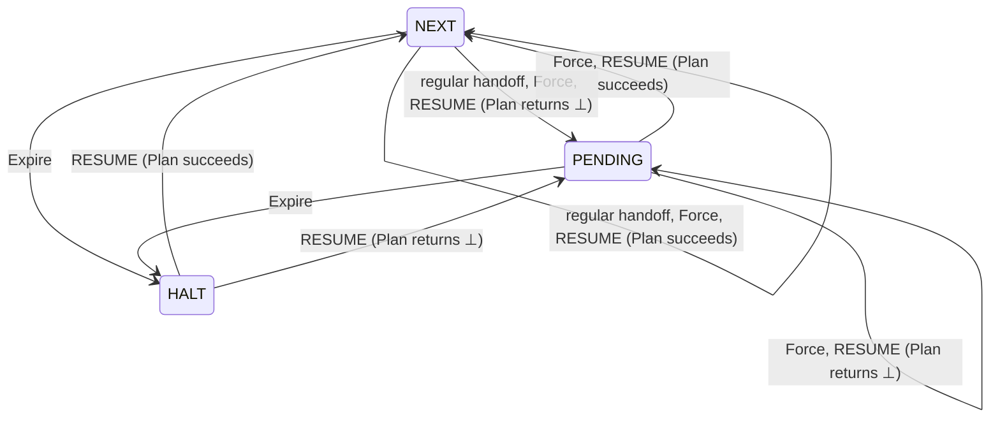
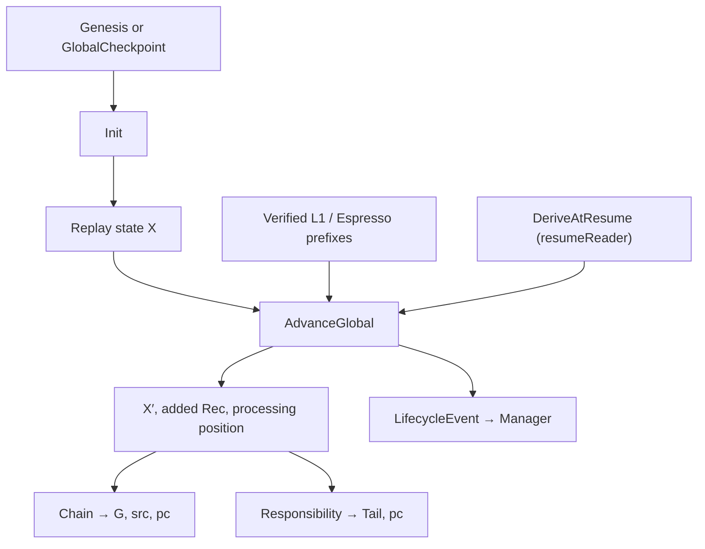
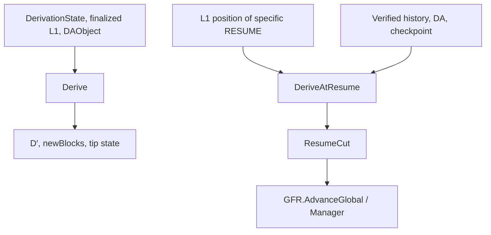

# Module 09: Finality Rules — Global Finality Rule, Derivation Rule, and Native Settlement (v9 working draft v0.2)

Date: 2026-11-03. Previous version: [v0.1](09_finality_rules_en_v0_1.md). The overview and shared model are in [00 arch](00_arch_en_v0_1.md); the sources are [arch v0.2 §4.4, §4.5, §4.10, §5](../formalization_v8/arch_zh_v0_2.md) and [261027 §8](../meetup_record/261027.md). The Chinese source of this translation is [09 v0.2](../formalization_v9/09_finality_rules_zh_v0_2.md).

Changes in this version (Appendix A maps v0.1 sections to this version):

- A Force record no longer carries an Espresso activation threshold $\theta_a$. Both Force and RESUME take “the timestamp of the L1 block including the call plus $M_a$” as their activation time and are ordered by activation time ([01 §3.1](01_l1_authority_en_v0_1.md)).
- The GFR is rewritten as “events → order → state machine”: §3 lists the events and gives the total order; §4 gives the state and the processing of each event kind; records and interfaces move to §4.7–§4.8.
- Force becomes an event of its own; the Espresso block event only accepts regional results. Force's new window is computed from its activation time rather than from the timestamp of the Espresso block where it lands.
- RESUME computes the new session's Plan immediately at activation, as Force does; Tail no longer has an OPEN state. This item is added in this version and is not 261027's original design, which deferred the post-RESUME Plan to the next Espresso block. It was confirmed on 2026-11-03.

§5–§7 are the same as in v0.1 except for updated internal references.

## 1. Role and intuition

The system has two chains determined by public rules, each answering a different question:

- **Global chain $G$** (Global Finality Rule, GFR, §3–§4): given the L1 control records and the public Espresso order, which regional results are selected as global content? Any readers replaying the same L1 and Espresso history obtain the same $G$.
- **Derived chain $D$** (Derivation Rule, §5): what L2 chain results from executing the batches accepted on L1 and L1 deposits under the native rules? Any derivation nodes using the same L1 and DA data obtain the same $D$.

Both use the same representation, “physical content plus DEP gives virtual content” (Merge in [00 §3.3](00_arch_en_v0_1.md)), but select content on different grounds: $G$ selects regional results according to Espresso order, while $D$ selects content and origin according to L1 inputs and native deadlines. Normally $D$ follows $G$; when a batch is not delivered by the native deadline, $D$ fills in deposit-only blocks itself and no longer agrees with $G$. RESUME is the only entry point for realigning $G$ with $D$.

The GFR can be summarized in one sentence: **$G$ accepts only results from the currently responsible instance that can still reach $D$ in time; the responsible instance is handed off by time or replaced by L1 control records; when $G$ can wait no longer it stops, and RESUME restarts it from $D$.**

Native settlement (§6) registers state claims on top of $D$, using the existing mechanism.

## 2. Minimal assumptions

**Model assumptions used by this module.**

- L1 safety and fixed pace ([00 §1.2](00_arch_en_v0_1.md)); L2 schedule $\mathit{ts}^*$ and DEP ([00 §1.3](00_arch_en_v0_1.md)).
- Espresso's E-S (for all executions), and E-L and E-TS used only under live conditions; watermark ([00 §1.4](00_arch_en_v0_1.md)).
- Chain data, Merge, fixed regional origin and $\mathrm{Virt}$, native sequencing window $\mathrm{ddl}$ and $W_{\rm seq}$ ([00 §3](00_arch_en_v0_1.md)).
- Service budgets $T_{\rm pub}$ and $T_{\rm batch}$ ([00 §2.5](00_arch_en_v0_1.md)), used only for timing conclusions.

**Assumptions about other modules.**

- Regional results are verified with CheckFINAL and satisfy BFT-1 and BFT-7 ([02 §4](02_session_program_en_v0_1.md)).
- Plan is a pure function ([01 §3.12](01_l1_authority_en_v0_1.md)), so the GFR can calculate successor duties during replay.
- A control record's activation time is fixed by its including block under [01 §3.1](01_l1_authority_en_v0_1.md).
- Inbox acceptance events and Certifier signatures satisfy CERT-1 ([06 §4](06_certifier_en_v0_1.md)); Derivation uses the fact of L1 acceptance, while the source of the contents depends on trusting $\mathsf C$.
- Accepted data satisfies DA-S1 and DA-RET ([08 §4](08_da_en_v0_1.md), with the post-retention part depending on A-CUSTODY); wait if it cannot be retrieved.

**Upstream inputs and downstream outputs.**

| Direction | Other module and interface | Object exchanged | Connection |
| --- | --- | --- | --- |
| Input (GFR) | L1 log | ControlEntry (Force / RESUME), Authority state | W3, W4, W6 |
| Input (GFR) | Espresso log | Publication submitted by Publisher | W12 |
| Input (GFR) | Derivation.`DeriveAtResume` | ResumeCut | W23 |
| Input (Derivation) | Inbox events | CursorAdvanced, CursorSet | W5, W19 |
| Input (Derivation) | DA.`Retrieve` | DAObject | W21 |
| Output (GFR) | Manager.`ApplyLifecycle`, `PrepareCandidate` | LifecycleEvent, Tail | W13, W14 |
| Output (GFR) | Batcher, Certifier, Inbox readers | $(G,\mathrm{src}_G,pc)$ | W15 |
| Input (GFR) | Authority.`Plan`, Program.`CheckFINAL` | PlanRecord, verification decision | W1, W11 |
| Output (Derivation) | Manager, local GFRs, native settlement | $D$, DerivedItem, ResumeCut, DerivationInputRef | W22, W23, W25 |

## 3. GFR: Events and order

The GFR is a deterministic replayer: it merges the finalized L1 and Espresso logs into one totally ordered event stream and processes it one event at a time with the state machine of §4. Readers holding the same log prefixes obtain the same event stream and the same results. This section answers two questions: which events exist (§3.1–§3.2), and in what order they are processed (§3.3–§3.4). The budgets in §3.5 are used only for timing conclusions.

### 3.1 Two logs and time keys

The GFR reads two logs:

- **The finalized L1 log** ([00 §1.2](00_arch_en_v0_1.md)): its control records (Force and RESUME, [01 §3.1](01_l1_authority_en_v0_1.md)) change the production arrangement.
- **The finalized Espresso log** ([00 §1.4](00_arch_en_v0_1.md)): its publications carry regional results, that is, physical blocks and their regional finality proofs.

Each event has a nonnegative real **time key**, and all keys use one coordinate. Espresso block $J_q$ has key $\theta_q$, its timestamp. An L1 control record has as key the timestamp of the L1 block including it plus the announcement lead time $M_a$, which is the activation time of [01 §3.1](01_l1_authority_en_v0_1.md). Hence, to process up to key $x$, a reader needs the following public history: the Espresso blocks with timestamp less than $x$, and the L1 blocks with timestamp at most $x-M_a$ (§3.4).

Keys only determine replay order; they do not require a reader to finish processing at the corresponding real time. A reader that obtains the logs later replays them in the same order and obtains the same result.

### 3.2 Events

The GFR processes five kinds of events: two from L1, one from Espresso, and two **timers**. A timer is recorded in no log; its key is determined by the current replay state and public parameters.

| Source | Event | Content | Time key |
| --- | --- | --- | --- |
| L1 | $\mathsf{Force}(U)$ | Control sequence number, target branch, new policy | $\mathrm{act}(U)=\mathit{ts}_{\rm L1}(\ell_U)+M_a$ |
| L1 | $\mathsf{Resume}(p)$ | Control sequence number, new policy, target height $h_{\rm res}$; the CursorSet in the same transaction | $\mathrm{act}(p)=\mathit{ts}_{\rm L1}(p.\ell)+M_a$ |
| Timer | $\mathsf{Expire}(h)$ | The next missing height of $G$, $h=h_G+1$ | $\mathit{ts}^*(h)+W_{\rm exp}$ |
| Timer | $\mathsf{SessionEnd}(s)$ | The currently responsible session $s$ | $\theta_s^{\rm end}$ |
| Espresso | $\mathsf{Espresso}(q)$ | Regional results first fully public in block $J_q$ | $\theta_q$ |

**Force and RESUME.** Force record $U=(c,\beta_{\rm target},\mathcal P_{\rm new})$ is included in L1 block $\ell_U$; RESUME record $(c,\mathcal P_{\rm new},h_{\rm res})$ is at L1 position $p=(\ell,j,k)$, whose height component is $p.\ell$. In both cases, the including block alone determines the activation time. Because $\mathit{ts}_{\rm L1}$ is strictly increasing, two control records share a key if and only if they are in the same L1 block.

**Expire.** Given a per-height expiration duration $W_{\rm exp}>0$, Expire applies only to the next missing height of $G$, $h=h_G+1$, and means “$G$ no longer waits for height $h$”: if no result covers $h$ by this key, $h$ can no longer enter the derived chain in time (§3.5). As $G$ grows, the pending Expire moves to the new next height, so at most one Expire is pending at any time.

**SessionEnd.** Given publication margin $T_{\rm grace}>0$, session $s$ has public deadline key

$$
\theta_s^{\rm end}:=\tau_s^{\rm stop}+T_{\rm grace}.
$$

$\tau_s^{\rm stop}$ is when honest replicas stop signing new consensus messages (BFT-7); after $\theta_s^{\rm end}$ the GFR no longer accepts results of $s$; the margin between them allows existing results to be published. A valid certificate formed before the stop but hidden until after the deadline can no longer extend that session's global prefix. Only the session currently holding NEXT has a pending SessionEnd (§4.3).

**Espresso block.** The publications in $J_q$ carry the components of regional results: the regional finality proof, necessary bodies, and context sources (including ancestor or anchor results). The **first-complete-publication height** $q_{\rm avail}(\mathit{Res})$ of a result $\mathit{Res}$ is the height at which all of its components first become available in the Espresso prefix; the components may be spread over several publications. $q_{\rm avail}$ is computed only from fully read public history, never from local reception times. $\mathit{Res}$ takes part in acceptance in $\mathsf{Espresso}(q_{\rm avail})$ (§4.2), and $\theta_{q_{\rm avail}}$ is its publication time.

### 3.3 Total order

Event positions are ReplayPositions (§4.7), compared as follows:

1. Compare time keys first.
2. At the same key, compare kinds: L1 control (Force and RESUME) $\prec$ EXPIRE $\prec$ SESSION_END $\prec$ ESPRESSO.
3. Within the same kind, compare indices: L1 control by L1 position (Force and RESUME interleaved), EXPIRE by height, SESSION_END by session identifier, ESPRESSO by Espresso height.

By rules 1 and 3, all control records are processed in L1-position order: a shared key means the same L1 block, ordered by position within the block. A later-included control record never takes effect before an earlier one; conflicts between control records are resolved by the validity checks made when each is processed (§4.4, §4.6).

This order has three direct consequences:

- **At the same key, the deadline precedes acceptance.** With deadline key 105, a result published at 104 is processed before SessionEnd and can be accepted; a result published at 105 comes after SessionEnd and is not accepted. When observers receive them does not change the decision.
- **A control record precedes an Espresso block with the same key.** A late result from the old branch cannot use the same key to enter $G$ ahead of Force or RESUME.
- **A session opened by a control record can be accepted only in Espresso blocks after the activation.**

**The Espresso height of a Force.** Define

$$
q^*(t):=\min\{\,q:\theta_q\ge t\,\}.
$$

When a Force activates, the Espresso blocks the GFR has processed are exactly $J_0,\dots,J_{q^*-1}$, where $q^*=q^*(\mathrm{act}(U))$. Once a reader holds a watermark whose last timestamp is at least $\mathrm{act}(U)$, it can determine $q^*$, and the value never changes: by E-S, any two finalized prefixes are prefixes of each other and $\theta_q$ is non-decreasing. Force's snapshot (§4.4) therefore depends only on E-S, not on E-L or E-TS. RESUME's snapshot $D_L$ depends only on L1 and DA (§4.6).

### 3.4 R-WAIT

Before processing an event with time key $x$, require:

- The finalized L1 prefix covers a block with timestamp at least $x-M_a$.
- If the event is not an Espresso block, an Espresso watermark with timestamp at least $x$ has been obtained and its preceding prefix fully read.
- If the event is RESUME, resumeReader can obtain its ResumeCut (the necessary DA data is available).

The first condition ensures that every control record with key at most $x$ has been read, because such a record is included in an L1 block with timestamp at most $x-M_a$. The second ensures that every Espresso block with key less than $x$ has been read. Together, the already read history uniquely determines the next event; otherwise a reader could mistake “not yet read” for “does not exist.”

Missing an entire required segment of history and finding a publication incomplete after fully reading the history are different cases. The latter does not block other events; after completion, $q_{\rm avail}$ is redetermined from the position where completion actually occurs.

### 3.5 Timing budgets

The conditions in this section are used only for “how fast” conclusions; they do not change the events or their order. If they do not hold, the same R-WAIT still applies.

- **Announcement.** Use $M_a\ge T_{\rm L1}+2\Delta_{\rm ts}+b_{\rm L1}$. Under normal service, this makes the L1 block holding a control record finalized and readable before its activation time, so L1 does not slow R-WAIT.
- **Espresso progress.** If Espresso is live throughout $[x+\Delta_{\rm ts},\,x+\Delta_{\rm ts}+T_E]$, then by E-L there is a finalized block with timestamp at least $x$ by $x+\Delta_{\rm ts}+T_E$, so the second R-WAIT condition holds. During non-live periods the reader only waits; $q^*$ remains unique.
- **Publication margin.** $T_{\rm grace}>T_{\rm pub}+T_E+\Delta_{\rm ts}$ ensures that a result given to an honest Publisher before the stop meets the deadline (the PUB-4 corollary in [04 §4](04_publisher_en_v0_1.md)).
- **Native window.** To claim that “a block entering $G$ on time is derived unchanged,” also require

$$
W_{\rm exp}+M_a+T_{\rm batch}+T_{\rm drift}\le W_{\rm seq},
$$

leaving total room within the native sequencing window for global waiting, announcement, batch delivery, and origin lag. The terms mean: $W_{\rm exp}$ bounds when the block enters $G$ (measured from $\mathit{ts}^*(h)$); $M_a$ covers the gap between Espresso time keys and L1 reading progress; $T_{\rm batch}$ is delivery time after entry into $G$; and $T_{\rm drift}$ converts $\mathit{ts}^*(h)$ back to origin time, because the native deadline is measured from the L1 origin. These conditions are used only under E-L, E-TS, and normal delivery service. An old result replayed only after a long outage does not thereby regain a native acceptance window.

## 4. GFR: State machine

This section first gives the state (§4.1), then the processing of each of the five event kinds of §3.2 (§4.2–§4.6), and finally the records and interfaces needed for an implementation (§4.7–§4.8).

### 4.1 State

Each reader maintains its own replay state $\mathcal X$, including:

- The global virtual chain $G=(G[h^0],\ldots,G[h_G])$, with elements in $\mathsf{VB}$; define $\mathrm{last}(G):=G[h_G]$.
- Provenance $\mathrm{src}_G(h)$: a regional source records the corresponding cid and a proof covering the height; a derivation source is marked DER.
- Current branch $\beta$, policy, selected descriptors, and closed branches and sessions.
- Obtained L1 / Espresso prefixes, complete publication index, and objects awaiting completion.
- Processed event records Rec and processing position pc (the position of the last fully processed event; see §3.3 for the order).
- The next public duty Tail.

**Tail** takes three values:

- $\mathsf{NEXT}(\nu)$: descriptor $\nu$ has been selected, and subsequent results of that instance are accepted.
- $\mathsf{PENDING}(\zeta)$: Plan has been computed from handoff boundary $\zeta$, but no region is eligible; awaiting Force or RESUME.
- $\mathsf{HALT}(\zeta)$: the branch has stopped because of Expire; only RESUME can recover it.

The handoff boundary $\zeta$ is a Boundary (§4.7) recording the target session, the reference block for region selection, the anchor to extend, and the window. Tail describes public duty and is separate from the running state of any local program.



**Transition summary.** The table below summarizes §4.2–§4.6.

| Event | Tail is NEXT(ν) | Tail is PENDING(ζ) | Tail is HALT(ζ) | Effect on $G$ |
| --- | --- | --- | --- | --- |
| $\mathsf{Espresso}(q)$ | Accept eligible extensions of ν; regular handoff on reaching $h_{\max}$ (§4.2) | None | None | Append |
| $\mathsf{SessionEnd}(s)$ | Regular handoff if ν belongs to $s$ (§4.3) | None | None | Unchanged |
| $\mathsf{Force}(U)$ | Open a new branch if valid (§4.4) | Same | Invalid | Unchanged |
| $\mathsf{Expire}(h)$ | Close the branch → HALT (§4.5) | Same | None | Unchanged |
| $\mathsf{Resume}(p)$ | Open a new branch (§4.6) | Same | Same | Replaced by a prefix of $D_L$ |

$G$ changes in only two places: acceptance in an Espresso block only appends, and RESUME replaces. After each event, state, Rec, and pc are saved together.

### 4.2 Espresso block: accepting regional results

**Use of regional finality.** The GFR uses regional finality from [02 §4.1](02_session_program_en_v0_1.md): $B$ is regionally finalized if and only if there exists $\pi_{\rm fin}$ such that $\mathsf{CheckFINAL}(\nu,B,\pi_{\rm fin})=\mathrm{true}$. A descendant proof in the same context covers its ancestors; heights without physical blocks are uniquely expanded by $\mathrm{Virt}$ of the decided chain. Public verification does not replay an observer's local reception time and cannot reject a valid historical decision because the result arrived late; whether the result is “late” is decided only by the public deadline.

**Acceptance conditions.** Suppose Tail is $\mathsf{NEXT}(\nu)$ and the current processing key is $x$. A complete regional result can extend $G$ if and only if all the following hold:

1. **Responsibility:** its cid equals $\nu.\mathrm{cid}$, and the current branch and session are not closed.
2. **Proof and continuity:** the finality proof is valid, and physical ancestry extends the accepted prefix in the same context or starts from the selected anchor.
3. **Window:** new physical heights lie in the session's fixed window $[h_{\min,s},h_{\max,s}]$.
4. **Native compatibility:** metadata and the forced prefix are computed under [00 §3.4](00_arch_en_v0_1.md), satisfying the origin's not-ahead and drift conditions, and the required L1 inputs are finalized.
5. **Public deadline:** $\theta_{q_{\rm avail}(\mathit{Res})}<\theta_s^{\rm end}$; equality is not accepted.
6. **Not expired:** for each virtual height $h$ newly added in this acceptance, $x<\mathit{ts}^*(h)+W_{\rm exp}$.

Under the order of §3.3, conditions 5 and 6 are already guaranteed by the timers processed earlier: an effective Expire with key at most $x$ has already set Tail to HALT, and higher heights have later expiration keys; a SessionEnd with key at most $x$ has already closed $s$, which condition 1 rejects. They are still listed so that a single acceptance decision can be checked on its own.

**Acceptance.** Compute the new $\mathrm{Virt}$ segment for the selected physical extension, append it to $G$, and record its provenance. One acceptance may add several virtual heights: if the predecessor ends at 98 and the successor's first physical block is at 101, it adds 99, 100, and 101 at once; 99 and 100 are sourced from the successor proof that determines this padding.

Eligible extensions are processed in canonical encoding hash order, removing portions duplicated by the accepted prefix. Under the Byzantine weight assumption, valid decided chains in the same context are comparable (BFT-1); sorting does not replace this property. Candidate results may be cached in advance; once a context is selected, matching cached results are accepted under the above conditions without another publication. Unselected results cannot enter $G$.

**Reaching the upper bound.** If the acceptance includes the physical block at $h_{\max,s}$, complete the regular handoff of §4.3 immediately. Once the new $\mathsf{NEXT}$ is set, repeat this section for it within the same Espresso block until there is no new eligible extension.

### 4.3 SessionEnd: regular handoff

A regular handoff has two triggers: accepting up to $h_{\max,s}$ (§4.2), or processing $\mathsf{SessionEnd}(s)$ while Tail is still the $\mathsf{NEXT}$ of $s$. SessionEnd advances a normal handoff only while Tail is NEXT; it does not bypass PENDING or HALT. If the session has already closed by reaching its upper bound, SessionEnd has no effect.

**Tail criterion.** If the physical block at $h_{\max,s}$ has been accepted, use it as the tail. Otherwise use the last physical block accepted before the deadline; if there was no new physical block, retain that session's initial anchor. In both cases the session closes with reason COMPLETE. For example, if the upper bound is 100 and the last accepted block at the deadline is 98, the regular anchor is 98; the rule does not wait for a block 100 that may never be produced.

**Successor duty.** The window of successor $s^+=(\beta,r+1)$ is

$$
h_{\min,s^+}=h_{\max,s}+1,\qquad
h_{\max,s^+}=h_{\max,s}+\mathrm{TB}.
$$

The successor's reference block for region selection is the predecessor's initial anchor, and its source region is $i_s$. Thus once the predecessor context is selected, the successor Plan can be computed, and changes in the candidate tail do not change this Plan. The region-selection reference block fixes “who takes over,” while the final tail anchor fixes “which block production continues from.” This specification prepares only a successor of a selected predecessor; it does not recursively run the next generation of an unselected candidate.

**Output.** The successor Boundary is $\{$cause: HANDOFF, target_session: $(\beta,r+1)$, source_region: $i_s$, reference_block: BlockRef of the predecessor's initial anchor, anchor: the tail above, window: as above$\}$. The GFR outputs SessionClosed and calls `Plan` with this Boundary: if the result is not $\bot$, it outputs SessionAssigned (the descriptor's anchor is the tail above and its Plan the successor Plan) and sets Tail to $\mathsf{NEXT}$; if the result is $\bot$, it sets Tail to $\mathsf{PENDING}$. Only a cid whose connecting identity exactly matches the selected anchor is selected; the same height alone does not mean the same anchor.

### 4.4 Force

Force changes the production arrangement while keeping the selected global content. Process the control record $U=(c,\beta_{\rm target},\mathcal P_{\rm new})$ included in L1 block $\ell_U$ with activation time $\mathrm{act}(U)$:

1. **Validity.** If $\beta_{\rm target}$ is closed or is not the current branch, or Tail is HALT, the entire record is invalid: no new policy is installed, and the record is only logged in Rec. Force is forbidden in HALT because the next height of $G$ can no longer reach $D$ in time; continuing production on $\mathrm{last}(G)$ would only produce content that cannot be derived.
2. **Close the old branch.** Output BranchClosed (reason FORCE), covering all its sessions, including an early-prepared regular successor; $G$ remains unchanged.
3. **New anchor.** The new branch is $\beta+1$. The new anchor $A$ is the Anchor corresponding to $\mathrm{last}(G)$, where $G$ is the chain after processing every event ordered before this one, that is, after $J_0,\dots,J_{q^*-1}$ with $q^*=q^*(\mathrm{act}(U))$ (§3.3). The connecting identifier follows [00 §3.2](00_arch_en_v0_1.md), with execution state after executing that block. The reference block for region selection is $\mathrm{BlockRef}(A)$. Install the new regional switches and rotation order, and set the L1 floor to the greater of the old floor and $\ell_U$.
4. **Number and source region.** If the old NEXT has not contributed a new physical block, the new duty retains the old number $r$; otherwise use $r+1$. Its source region is the old responsible region. If the old Tail is PENDING, use the number and source region stored in the boundary.
5. **New window.** Given public preparation margin $T_{\rm init}\ge0$,

$$
h_{\min,\rm new}=\max\{A.h+1,\ \mathrm{slot}(\mathrm{act}(U)+T_{\rm init})+1\},
\qquad
h_{\max,\rm new}=h_{\min,\rm new}+\mathrm{TB}-1.
$$

The window depends only on the L1 record and public parameters, not on where Espresso blocks fall. $T_{\rm init}$ can be read as a real-time preparation budget only in intervals where E-TS holds.
6. **Open.** Let Boundary $\zeta=\{$cause: FORCE, target_session: $(\beta+1,r')$, source_region: the source region from step 4, reference_block: $\mathrm{BlockRef}(A)$, anchor: $A$, window: the window from step 5$\}$, where $r'$ is the number from step 4. Immediately call `Plan` with $\zeta$: if the result is not $\bot$, output SessionAssigned and set Tail to $\mathsf{NEXT}(\nu)$; otherwise set Tail to $\mathsf{PENDING}(\zeta)$.

The next control record in the same L1 block sees the state produced by this one and therefore rechecks its target.

**During Espresso non-live periods.** A reader can process Force only after its watermark passes $\mathrm{act}(U)$; by then the new window may already lie in the past in real time. Subsequent SessionEnd events hand off as usual under §4.3 with the anchor unchanged, until some session's window covers the recovery time; if the gap exceeds $W_{\rm exp}$, Expire halts the branch and only RESUME remains. Force therefore has practical effect only while Espresso is live, and the rule needs no special case for outages.

### 4.5 Expire: global expiration

When processing $\mathsf{Expire}(h)$: if $h$ is no longer the next height of $G$, or Tail is already HALT, the event has no effect. Otherwise close the current branch (BranchClosed, reason EXPIRED), record the numbering information needed for recovery, set Tail to HALT, and retain $G$ through $h-1$.

Expire neither revokes blocks already in $G$ nor creates replacement blocks: $G$ cannot skip the missing height, and filler content can only be determined by $D$. PENDING can be replaced by a subsequent Force or RESUME; HALT can be recovered only by RESUME.

### 4.6 RESUME

RESUME re-establishes the production starting point from a determined derivation result. When processing a RESUME at L1 position $p_{\rm res}$ with target $h_{\rm res}$, let $L$ be the L1 block including it; its activation time is $\mathit{ts}_{\rm L1}(L)+M_a$:

1. **Obtain the cut.** Call resumeReader at $p_{\rm res}$ to obtain ResumeCut (§5.5), where $D_L$ is the derived chain after processing in L1 order through this RESUME's CursorSet (§5.1); it binds the specific position $p_{\rm res}$, not just block $L$. Wait here if L1 or DA data is missing, retaining the pre-processing state; do not perform a partial replacement.
2. **Close the old branch.** Output BranchClosed (reason RESUME). RESUME is always valid: it has already rewritten the Inbox cursor in the same L1 transaction and derivation has already followed it; if the GFR could declare it invalid, $G$ and $D$ would disagree permanently.
3. **Align $G$.** Perform

$$
G\leftarrow D_L[\,h^0:h_{\rm res}\,],
$$

with both endpoints included. The new anchor $A$ is ResumeCut.anchor, the Anchor corresponding to $D_L[h_{\rm res}]$, whose connecting identifier is computed using the derived-anchor formula in [00 §3.2](00_arch_en_v0_1.md). The common native prefix of $G$ and $D_L$ is retained; beginning with the first differing native block, the old $G$ suffix is revoked; provenance of the newly adopted part is marked DER. If old $G$ is itself a prefix of $D_L$, no blocks are revoked and only the subsequent part is appended. $D$ itself is neither truncated nor rewritten.
4. **Open.** Install new branch $\beta+1$ and the new policy, with L1 floor no lower than $L$. Let Boundary $\zeta=\{$cause: RESUME, target_session: $(\beta+1,0)$, source_region: $\bot$, reference_block: $\mathrm{BlockRef}(A)$, anchor: $A$, window: $\{h_{\rm res}+1,h_{\rm res}+\mathrm{TB}\}\}$; source_region $\bot$ means selecting a region starting from the first item in the new policy's rotation. Immediately call `Plan` with $\zeta$: if the result is not $\bot$, output SessionAssigned and set Tail to $\mathsf{NEXT}(\nu)$; otherwise set Tail to $\mathsf{PENDING}(\zeta)$. Plan reads only L1 history and configuration, and R-WAIT has already guaranteed the L1 prefix it needs at activation.
5. **Output.** Output a Resumed event carrying control_seq, the new branch, $A$, and a reference to $D_L$.

**An arrangement that cannot start.** The contract only requires $h_{\rm res}$ to be above the Inbox cursor. If $h_{\rm res}$ is chosen so low that the new session's SessionEnd key is already earlier than the activation time, the GFR does not insert the closure event back into processed history; it immediately determines that the arrangement cannot start, outputs SessionClosed (reason EXPIRED), and sets Tail to $\mathsf{HALT}(\zeta)$, so a later valid RESUME is needed. Windows opened by Force and by regular handoff always lie after their opening position, so this case does not arise for them.

The recovery starting point depends only on L1, accepted DA data, and native derivation, not on unsettled regional results on old Espresso. “$G$ has been aligned with $D$,” “a new session has been assigned,” and “a new ordinary block has entered $G$” are three distinct steps.

### 4.7 Records

**Replay position.**

```text
ReplayPosition = {
    key, kind, index
}
```

Key is a nonnegative time key; kind is FORCE, RESUME, EXPIRE, SESSION_END, or ESPRESSO; index is respectively an L1 position, L1 position, L2 height, session identifier, or Espresso height. The comparison rules are in §3.3, where FORCE and RESUME belong to the same kind. Both the cursor's `GLOBAL(gpos)` and a certificate's gpos use this type ([07 §3.2](07_batch_inbox_en_v0_1.md), [06 §3.2](06_certifier_en_v0_1.md)).

**Handoff boundary.** Boundary is $\zeta$:

```text
Boundary = {
    cause, target_session, source_region,
    reference_block, anchor, window
}
```

Cause is GENESIS, HANDOFF (regular handoff), FORCE, or RESUME; target_session is the target $(\beta,r)$; source_region is the source region or $\bot$; reference_block is the BlockRef used to select a region; anchor is the Anchor to extend; and window is a Window (for the last three see [01 §3.2](01_l1_authority_en_v0_1.md) and [00 §3.2](00_arch_en_v0_1.md)). Components not yet determined are $\bot$. Reference_block is used to compute Plan, and anchor to connect the new chain. They are stored separately, and their values are determined by §4.3, §4.4, and §4.6.

**Publication index and provenance.**

```text
PublicationEntry = {
    result_key, available_objects, locations, first_complete_q
}
GlobalSource = REGIONAL(result_key) | DER(resume_position, height)
```

A regional result's result_key is $(\mathrm{cid},\mathsf H(B))$, the same as the Publisher's task key ([04 §3.1](04_publisher_en_v0_1.md)). Available_objects stores result components verified as public; locations stores their (Espresso height, message index), with indices starting at 0; first_complete_q is the $q_{\rm avail}$ of §3.2, or $\bot$ while incomplete. Once complete, these objects can be assembled into a RegionalResult.

Sources is a GlobalSource table keyed by virtual height. REGIONAL points to the complete regional result that determines the segment; padding can also reference a successor proof covering it. DER points to the adopted RESUME L1 position and derived height.

**Replay records, state, and events.**

```text
ReplayRecord = {
    position, input_ref, effects, events
}
ReplayState = {
    G, sources, branch, policy, selected,
    closed_branches, closed_sessions, publications,
    L1_prefix, Espresso_prefix, Rec, pc, Tail
}
LifecycleEvent = {
    position, kind, body
}
```

A ReplayRecord's position is the current event's ReplayPosition; input_ref points, according to event type, to an L1 control position, Espresso block, SessionEnd session, or Expire height. Effects is an ordered list of changes whose elements are `APPEND{first, last, source}` (the contiguous virtual heights appended and their GlobalSource), `RESET{resume_position, target_height}` (the adopted recovery target), or `DUTY{before, after}` (Tail before and after the change); events is the list of LifecycleEvents produced by this event. An invalid Force produces only a ReplayRecord with empty effects.

ReplayState corresponds to $\mathcal X$: G is a contiguous virtual chain; sources corresponds to heights after genesis in G; branch is current branch $\beta$; policy is a Policy; selected associates sessions with selected Descriptors; the two closed tables store closed identifiers; publications is a PublicationEntry table; the two prefixes are verified logs; Rec is a sequence of ReplayRecords; and pc and Tail are as in §4.1.

A LifecycleEvent's position is the ReplayPosition that produced it. The kind and body pairs are:

- `SessionAssigned{descriptor}`: the selected Descriptor.
- `SessionClosed{session, reason}`: the session and reason for closure (CloseReason in [03 §3.2](03_session_manager_en_v0_1.md)).
- `BranchClosed{branch, reason}`: branch version and reason for closure.
- `Resumed{control_seq, branch, anchor, derived_prefix}`: RESUME sequence number, new branch, Anchor at the target height, and adopted derived virtual prefix.

The Manager identifies an event by position, kind, and body and does not merge distinct events at the same pc.

**Checkpoint and return value.**

```text
GlobalCheckpoint = {
    state, L1_cut, Espresso_cut
}
ReplayResult = {
    state, added_records, events, status
}
```

GlobalCheckpoint stores the complete ReplayState and the two public log cuts supporting it (L1 position and Espresso height). Verification must reconstruct or check the corresponding state; the last block hash alone is not a checkpoint. ReplayResult is the return from AdvanceGlobal: status is READY or `WAIT{next_position, missing}`, where next_position points to the event that cannot yet be processed and missing lists the missing logs, objects, or recovery state. WAIT does not erase completed progress.

### 4.8 Interfaces



| Interface | Main inputs | Main outputs | Purpose |
| --- | --- | --- | --- |
| `Init` | Genesis / checkpoint, verification material | $\mathcal X_0$ | Establish or restore replay state |
| `AdvanceGlobal` | $\mathcal X$, L1 / Espresso prefixes, resumeReader | ReplayResult | Advance the state machine of §4 along the event stream of §3 |
| `Chain` | $\mathcal X$ | $(G,\mathrm{src}_G,pc)$ | Read the global chain at one position |
| `Responsibility` | $\mathcal X$ | $(\mathit{Tail},pc)$ | Read the next public duty |

**Init(checkpoint, reads).** The input is a genesis configuration or a GlobalCheckpoint; reads are the L1 / Espresso prefixes and recovery derivation material needed to verify the checkpoint. The genesis configuration gives the initial virtual block, post-execution state, policy, and initial Boundary (cause GENESIS, window starting at $h^0+1$). When initializing from genesis, call `Plan` with the initial Boundary and set Tail to NEXT or PENDING; when restoring from a checkpoint, verify that it agrees with replay of the specified public prefixes. Output the initial replay state $\mathcal X_0$; return WAIT if verification material is missing, and REJECT if the checkpoint disagrees with public replay.

**AdvanceGlobal(X, L1, E, resumeReader).** The inputs are the current state $\mathcal X$, verified finalized L1 and Espresso log prefixes, and resumeReader, which is Derivation's `DeriveAtResume` (§5.5) and returns a ResumeCut or reports missing data for a specific RESUME position. Output ReplayResult $(\mathcal X',\Delta\mathrm{Rec},\mathit{events},\mathit{status})$; READY means all provided processable inputs have been processed; return REJECT if input logs fail verification or do not extend existing prefixes. Take the next event in the total order of §3.3, check the R-WAIT of §3.4, and process it under §4.2–§4.6. On WAIT, return completed progress. An individual publication that is not fully public is temporarily ineligible and does not block other events.

**Chain(X).** Read-only return of $(G,\mathrm{src}_G,pc)$ at the same processing position; does not advance the logs.

**Responsibility(X).** Read-only return of $(\mathit{Tail},pc)$ at that processing position. Readers prepare instances using data already determined in NEXT or the boundary; they do not treat $\bot$ components as selected.

## 5. Derivation Rule

The Derivation Rule abstracts native L2 derivation: it reads only L1 and DA, decodes accepted batches in L1 order, merges DEP, and executes. If no batch can be adopted for a height before the native deadline, it fills in a deposit-only block (the window fallback in [00 §3.4](00_arch_en_v0_1.md)). It does not read Espresso, so it continues to advance with L1 during an Espresso outage. This is the basis for the Manager's D-based termination test ([03 §4.4](03_session_manager_en_v0_1.md)) and RESUME.

### 5.1 State

A derivation node maintains state $\mathcal D$: verified L1 prefix and processing position; DA data obtained and checked against commitments; native channel decoding state; current native parent block and its post-execution state; derived blocks; replayable checkpoints; and recovery cuts indexed by specific RESUME positions.

**Derived chain.** Let $h_D$ be the height of the derived tip. Then

$$
D=(D[h^0],\ldots,D[h_D]),\qquad D[h]\in\mathsf{VB}.
$$

Writing the finally adopted metadata, pre-execution root, and ordinary transactions actually executed at each height as physical blocks and connecting them gives the derived physical chain $C_D$ with genesis as anchor; its actual origin trajectory is $\omega_D$. Each derived height has a record; a deposit-only height has no ordinary transactions, and

$$
D[\,h^0+1:h_D\,]=\mathrm{Merge}_{\omega_D}(C_D).
$$

$D[h^0]$ is given by the genesis configuration. $\omega_D$ is determined by native derivation rules and cannot be replaced by the regional production trajectory $\omega_A$.

**Recovery cut.** If a RESUME is at specific log position $p_{\rm res}$ in L1 block $L$, use $D_L$ as shorthand for the derived chain processed through its CursorSet. This shorthand is always bound to that specific record; cuts for different RESUMEs within the same L1 block are not mixed.

### 5.2 Data structures

DA objects use DAObject ([08 §3.2](08_da_en_v0_1.md)); channel fragments use Frame ([05 §3.2](05_batcher_en_v0_1.md)). Derivation also maintains:

```text
ChannelAssembly = {
    channel_id, frames, next_number, closed,
    first_input, last_input, decoder_state
}
AcceptedBatchInput = {
    L1_position, prev, next, DA_commitment
}
OverrideInput = {
    L1_position, resume_position, old, next
}
DerivedItem = {
    virtual_block, native_block_bytes, post_state_root
}
ResumeCut = {
    resume_position, target_height,
    derived_prefix, anchor, anchor_state
}
```

**ChannelAssembly** stores accepted frames of one channel sorted by number; next_number is the number to append next; closed indicates that the final frame has been accepted; first_input and last_input are the L1 positions of that channel's processed inputs; decoder_state is the state of the fixed native decoder on those bytes, reconstructible from the same input and not specified by the submitter.

**AcceptedBatchInput** comes from CursorAdvanced, and **OverrideInput** from CursorSet ([07 §3.2](07_batch_inbox_en_v0_1.md)); positions are finalized L1 positions and prev, old, and next are Cursors. AcceptedBatchInput points to the DA commitment actually accepted; OverrideInput associates CursorSet with the same RESUME record.

A **DerivedItem**'s virtual_block belongs to $\mathsf{VB}$ (its root is the pre-execution root); native_block_bytes is the complete block output in native format at that height; post_state_root is the root after execution. All three correspond to the same execution.

A **ResumeCut** is indexed by the exact resume_position: target_height is $h_{\rm res}$; derived_prefix is $D_L$, including the target height; anchor is the Anchor corresponding to $D_L[h_{\rm res}]$, with its connecting identifier computed using the derived-anchor formula in [00 §3.2](00_arch_en_v0_1.md); anchor_state is the complete state after executing through that anchor. It is not an alias for the latest local derived tip.

**Derivation state, checkpoint, and input reference.**

```text
DerivationState = {
    L1_prefix, position, DA_objects, channels,
    parent_block, execution_state, physical_prefix, virtual_prefix,
    checkpoints, resume_cuts
}
DerivationCheckpoint = {
    position, channels, parent_block, execution_state,
    physical_prefix, virtual_prefix, config_ref
}
DerivationInputRef = {
    L1_cut, DA_commitments, config_ref
}
```

DerivationState corresponds to $\mathcal D$: position is the last fully processed L1 input position; DA_objects is indexed by commitment; channels stores ChannelAssembly by channel_id; parent_block and execution_state correspond to the current native tip; physical_prefix is $C_D$ and virtual_prefix is $D$; resume_cuts is a ResumeCut table. DerivationCheckpoint stores replay state from a point in time that can be continued, without recursively including other checkpoints or resume_cuts; restoring it must account for the correspondence among these fields. DerivationInputRef lets native settlement reference determinative inputs: L1_cut fixes the log prefix, DA_commitments lists the commitments of relevant accepted inputs in that prefix, and config_ref fixes the native rules version.

### 5.3 Interface overview



| Interface | Main inputs | Main outputs | Purpose |
| --- | --- | --- | --- |
| `Derive` | $\mathcal D$, L1 log, DAObject | $\mathcal D'$, newBlocks, tip state, processing status | Advance derivation under native rules |
| `DeriveAtResume` | Exact L1 position $p_{\rm res}$ of RESUME | ResumeCut | Obtain a historical recovery cut |
| `InputRef` | $\mathcal D$, interval $[a,b]$ | DerivationInputRef | Reference determinative inputs for native settlement |

### 5.4 Derive(Dstate, L1, DAobjects)

**Input.** Previous $\mathcal D$ or a verified checkpoint; finalized L1 log containing Inbox acceptance events, overrides, inputs needed for DEP, and native configuration; DAObjects retrieved and verified against accepted commitments.

**Output.** $(\mathcal D',\mathit{newBlocks},\sigma',\mathit{status})$: newBlocks is an ordered list of DerivedItems added in this call, $\sigma'$ is the updated tip state, and status is READY or `WAIT{next_position, missing}`. Return REJECT if an input does not match the stated log or commitment.

**Processing.** Process inputs in L1 order, checking, selecting, and executing height by height:

| Input encountered | Processing |
| --- | --- |
| Accepted batch with retrievable data | Decode the channel and check against the actual parent state; native rules determine ordinary transactions and origin, then merge DEP for that trajectory and execute |
| No batch can be adopted for a height before its native deadline | After the deadline, adopt empty ordinary transactions and produce a deposit-only block |
| Batch fails native transition or execution conditions | Apply the native same-height replacement rule; on the normal path, Accept checks avoid reaching this case |
| RESUME's CursorSet (target $h_{\rm res}$) | First process previously accepted inputs, then immediately fill heights not yet derived with deposit-only blocks through $h_{\rm res}$, and reset channel state |
| Accepted but DA data temporarily unavailable | WAIT at the explicit position, retaining the derived prefix; do not treat it as empty content |

Invalid content is discarded or replaced before that height is output; an already output prefix is not rewritten. A deposit-only block still includes the height's L1 attributes, deposits, and system transactions.

### 5.5 DeriveAtResume(p_res)

**Input.** L1 position $p_{\rm res}$ (ControlEntry.L1_position) of a finalized RESUME control record; the corresponding CursorSet is the event whose resume_position equals $p_{\rm res}$. Read locally verified L1, DA objects, native configuration, and replayable checkpoints.

**Output.** ResumeCut; return `WAIT{next_position, missing}` if data is missing, or REJECT if the position is not a recovery record.

**Processing.** Using read-only replay or a verified cache, compute the precise processing cut through that CursorSet. A newer local derived tip cannot replace this historical cut; the query neither rolls back the progressing $\mathcal D$ nor reads Espresso.

### 5.6 InputRef(Dstate, a, b)

**Input.** Derivation state $\mathcal D$ and a contiguous derived interval $[a,b]$.

**Output.** DerivationInputRef: L1_cut is the shortest L1 prefix needed to derive through $b$; DA_commitments lists commitments of relevant accepted inputs within it; config_ref is the native rules version used. Return WAIT when $b>h_D$.

**Processing.** Read-only computation; does not modify $\mathcal D$. The native claim submitter (an external role specified by the native settlement mechanism) uses it to construct the inputRef for SubmitStateClaim.

## 6. Native settlement

The native settlement component retains the existing mechanism and maintains submitted state claims and their dispute / proof processing status. This section describes only the objects it exchanges with derivation.

```text
StateClaim = {
    claim_id, first_height, last_height, parent_claim,
    input_ref, state_root, status, resolution
}
ClaimResolution = {
    decision, evidence, L1_position
}
```

Claim_id is a unique identifier allocated by native settlement; first_height $\le$ last_height is the claimed interval; parent_claim references the preceding claim required by the native process; input_ref is a DerivationInputRef (§5.2). State_root belongs to $\mathcal H_\kappa$ and claims the root after execution through last_height. Status is PENDING, ACCEPTED, or REJECTED; resolution is $\bot$ before final resolution. Decision is accepted or rejected; evidence is the complete verification material for the native proof / dispute procedure; L1_position points to the position recording the outcome.

**SubmitStateClaim(a, b, parentClaim, inputRef, stateRoot).** Input a contiguous interval $[a,b]$, preceding claim, DerivationInputRef, and claimed stateRoot; caller and authorization follow the native entry rules. On success return `ClaimRegistered(claimId)` and enter native processing; return REJECT if entry checks fail. Submitting a claim does not modify $D$ or mean that the claim has completed settlement.

**Output event Resolved(claimId, decision).** Emitted when the native proof or dispute procedure finally resolves a registered claim, updating status and resolution. “A segment of $D$ can already be derived” does not mean it has passed settlement.

## 7. Guarantees at each layer

The four chains ([00 §4.5](00_arch_en_v0_1.md)) each promise a different scope:

| Layer | Meaning | What can revoke it |
| --- | --- | --- |
| Regional finality ($R$) | Decision fact under a fixed cid (BFT-1) | A candidate may not be selected by the GFR; it may be abandoned due to Force, expiration, Kill, or RESUME |
| Global finality ($G$) | Result has entered $G$ obtained by public replay | Regular handoff, Force, and Expire do not revoke existing $G$; **RESUME can revoke a suffix of $G$ that has not entered $D$** |
| L1 acceptance ($G'$) | L1 acceptance record attests the source virtual chain | RESUME's CursorSet sets the current view to a prefix of $D_L$ |
| Derivation ($D$) | Chain actually determined by native rules | Does not change under L1 finality, deterministic derivation, and DA binding |

**Monotonicity of $G$.** Between RESUMEs, $G$ only appends and does not roll back: acceptance only appends (§4.2), and regular handoff, Force, and Expire do not modify existing $G$ (§4.3–§4.5). This is the fact used by CERT-4.

**Conditions for agreement between $G$ and $D$.** Under the same native parent state, native compatibility ([00 §3.4](00_arch_en_v0_1.md)), and timely delivery (BAT-4), $G$ and $D$ yield the same native blocks and execution results over the corresponding range. Batch failure or window fallback may cause earlier $G$, $G'$, and $D$ to differ; a valid RESUME removes the divergence between global and derived views at the specified cut.

## Appendix A: Section map from v0.1

| v0.1 | v0.2 | Note |
| --- | --- | --- |
| §1, §2 | §1, §2 | §1 adds a one-sentence summary; §2 adds the dependency on activation time |
| §3.1 State | §4.1 | Tail drops OPEN; transition summary added |
| §3.2 Data structures | §4.7 | ReplayPosition gains kind FORCE |
| §3.3–§3.7 Interfaces | §4.8 | Init computes Plan directly from the genesis Boundary |
| §4.1 Use of regional finality | Start of §4.2 | — |
| §4.2 Public acceptance deadline | §3.2 SessionEnd and Espresso block; §3.5 publication margin | — |
| §4.3 Replay order and R-WAIT | §3.1–§3.5 | Force becomes an event of its own, in the same L1-control kind as RESUME; the Espresso block no longer has internal steps |
| §4.4 Acceptance rule | §4.2 | Notes that conditions 5 and 6 follow from the order |
| §4.5 Regular anchor and regular handoff | §4.3 | — |
| §4.6 Force | §4.4 | $\theta_a$ removed; activation time is $\mathit{ts}_{\rm L1}(\ell_U)+M_a$; new window computed from the activation time |
| §4.6 Global expiration | §4.5 | — |
| §4.6 RESUME | §4.6 | Plan computed at activation, without OPEN |
| §4.6 Unified rule | §4.6 “An arrangement that cannot start”, §4.8 Init | Only the too-low RESUME target remains; Tail is explicitly set to HALT |
| §5–§7 | §5–§7 | Only internal references updated |
