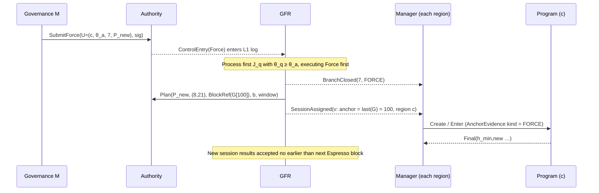

# End-to-End Pipelines: Regular Handoff, Force Handoff, and Two RESUME Recoveries (v9 working draft v0.1)

Date: 2026-11-02. The overview and shared model are in [00 arch](00_arch_en_v0_1.md); the sources are [arch v0.2 §6.4–§6.7](../formalization_v8/arch_zh_v0_2.md) and [261027 §2–§9](../meetup_record/261027.md).

## 1. Structure

This document connects the interfaces in the module files into four complete pipelines to check whether the modules compose: each step's output must be the next step's input and have the type specified by the modules.

Each pipeline includes:

- **Scenario:** initial state and trigger;
- **Sequence diagram:** calls between modules;
- **Steps table:** each row gives “caller → called interface(input) → output → next consumer” and the connection number in [00 §4.4](00_arch_en_v0_1.md);
- **Facts at completion:** the relation among the four chains $R,G,G',D$ and the state of each module at the end.

Below, $\mathrm{cid}(X)$ denotes the cid of a candidate program anchored at block $X$, and a session is denoted $(\beta,r)$. Heights are compressed for illustration and do not represent actual durations.

## 2. Pipeline one: Regular handoff

### 2.1 Scenario

Branch 7's session $s=(7,20)$ is assigned to region a, with window $[91,100]$ and initial anchor 90. Its successor $s^+=(7,21)$ has window $[101,110]$ ([09 §4.5](09_finality_rules_en_v0_1.md)). Region a has decided 98 and then 99; 100 is not produced.

The successor region must prepare before the predecessor ends, but the predecessor's final tail is not publicly determined until deadline key $\theta_s^{\rm end}$. This pipeline shows how to prepare multiple candidates in advance and publicly select one.

### 2.2 Sequence diagram

```mermaid
sequenceDiagram
    participant GFR as GFR (each reader)
    participant AUTH as Authority.Plan
    participant MA as Manager (a)
    participant MB as Manager (b)
    participant PB as Program (b)
    participant PUB as Publisher
    participant ESP as Espresso
    Note over GFR: (7,20) selected → successor Plan can be computed
    MB->>AUTH: Plan(P_7, (7,21), Ref=anchor 90, a, [101,110])
    AUTH-->>MB: Π_{(7,21)}, region = b
    MA->>PUB: Offer(Res for 98)
    MA->>MB: Forward Res(98) (W26)
    MB->>PB: Create(Π, anchor 98) → cid(98)
    MB->>PB: Enter(...) at τ_prepare
    MA->>PUB: Offer(Res for 99)
    MA->>MB: Forward Res(99)
    MB->>PB: Pause cid(98); Create/Enter cid(99)
    PUB->>ESP: publication(98), publication(99)
    ESP->>GFR: J_q (θ_q < θ_s^end)
    GFR->>GFR: Accept 98, 99; SessionEnd(s): tail 99
    GFR-->>MB: SessionClosed(s, COMPLETE), SessionAssigned(cid(99))
    MB->>PB: cid(99) Selected; cid(98) EXCLUDED → Close
    PB->>MB: Final(101)
    MB->>PUB: Offer(Res for 101)
```

### 2.3 Steps

| # | Caller → interface(input) | Output | Next consumer | Connection |
| --- | --- | --- | --- | --- |
| 1 | After the GFR selects the descriptor for $s$, each Manager calls Authority.`Plan`($\mathcal P_7$, (7,21), Ref = anchor 90, sourceRegion = a, [101,110]) in `ApplyLifecycle`(SessionAssigned) | $\Pi_{(7,21)}$, region = b | Manager b's PrepareCandidate; GFR recomputes the same record in [09 §4.5](09_finality_rules_en_v0_1.md) | W1 |
| 2 | Program a outputs `Final`(98) → Manager a.`HandleProgramEvent` | Res(98) | Manager a.`ObserveRegional` | W8, W9 |
| 3 | After assembling Res(98), Manager a.`HandleProgramEvent` calls local `ObserveRegional`(Res(98)) and forwards Res(98) to the Manager of successor region b | Publisher.`Offer`; Manager b.`ObserveRegional` | Publisher; Manager b | W9, W26 |
| 4 | Manager b.`ObserveRegional`(Res(98)) | Successor candidate anchor 98 (AnchorEvidence kind = REGIONAL) | Manager b.`PrepareCandidate` | — |
| 5 | Manager b.`PrepareCandidate`($\Pi_{(7,21)}$, 98, $\pi_{98}$, state material) → Program.`Create` | `Prepared(cid(98), Ready)` | ScheduleCandidate | W24 |
| 6 | At $\tau_{\rm prepare}=\tau_{s^+}^{\rm start}-T_{\rm lead}$ ($T_{\rm lead}\ge0$ is the successor's early-entry margin), Manager b.`ScheduleCandidate`(cid(98)) → `EnterCandidate` → Program.`Enter` | `Entered(cid(98), τ)`; Program waits for NotBefore = $\mathit{ts}^*(101)$ | Program b | W24 |
| 7 | a decides 99; repeat steps 2–5 | `Prepared(cid(99), Ready)` | ScheduleCandidate | — |
| 8 | Manager b.`ScheduleCandidate`(cid(99)) | cid(98) set to Paused (retaining state); cid(99) enters for the first time | Program b | W24 |
| 9 | Publisher submits Res(98), Res(99) → Espresso; `Recorded` | Both publications included in blocks with $\theta<\theta_s^{\rm end}$ | GFR | W12 |
| 10 | GFR.`AdvanceGlobal` | Accept 98 and 99 under [09 §4.4](09_finality_rules_en_v0_1.md); SessionEnd($s$) takes effect, regular anchor = 99 | — | — |
| 11 | GFR.`AdvanceGlobal` outputs | `SessionClosed{(7,20), COMPLETE}`, `SessionAssigned{ν(cid(99))}` | Manager.`ApplyLifecycle` | W13 |
| 12 | Manager b.`ApplyLifecycle` | cid(99) Selected; cid(98) EXCLUDED and closed | Program b | W24 |
| 13 | Program b decides 101 → `Final` → Manager → Publisher.`Offer` | Res(101) enters Espresso; GFR accepts it under NEXT(ν(cid(99))) | GFR | W8, W9, W12 |

**Variant.** If Res(99) misses the deadline ($\theta\ge\theta_s^{\rm end}$ at first complete public availability), the regular anchor in step 10 is 98 and the GFR selects cid(98). Manager b closes cid(99) as EXCLUDED and resumes cid(98) from Paused without entering again ([03 §4.2](03_session_manager_en_v0_1.md)). If a decides 100, the GFR closes $s$ immediately after accepting 100 (reason COMPLETE), without waiting for SessionEnd.

**Early publication.** Before being selected, cid(99) may decide 101 and publish it. After selection, the GFR accepts it from the cache under [09 §4.4](09_finality_rules_en_v0_1.md), without requiring another publication. Results of an unselected cid cannot enter $G$.

### 2.4 Facts at completion

- The predecessor session $s$ ends in $G$ at 99 (or 98), sourced from a's proof; subsequent $G$ content comes only from the selected cid.
- At most one cid per session is Selected; other candidates are EXCLUDED, and their signatures cannot be used for the selected cid (BFT-4 item 4).
- Low-latency handoff requires the ultimately selected candidate to have been prepared and entered before $\tau_{s^+}^{\rm start}$ by honest replicas with total weight at least $Q_{s^+}$, satisfying [02 §4.6](02_session_program_en_v0_1.md), and depends on cross-region synchronization ([00 §2.4](00_arch_en_v0_1.md)). It does not follow from one replica entering early on its own.

## 3. Pipeline two: Force handoff

### 3.1 Scenario

Continue pipeline one, but suppose a decided 100, so $s$ closed with COMPLETE, the tip of $G$ is 100, and session (7,21) was assigned to region b with anchor 100. Region b then suffers a regional failure and contributes no new blocks; $G$ stops at 100. The Expire key $\mathit{ts}^*(101)+W_{\rm exp}$ for the next height 101 has not yet arrived. Governance $\mathsf M$ decides to change regions.

### 3.2 Sequence diagram



### 3.3 Steps

| # | Caller → interface(input) | Output | Next consumer | Connection |
| --- | --- | --- | --- | --- |
| 1 | $\mathsf M$ → Authority.`SubmitForce`($U=(c,\theta_a,7,\mathcal P_{\rm new})$, sig), requiring $\theta_a\ge\mathit{ts}_{\rm L1}(\ell_U)+M_a$ | `ForceRecorded(c, position)`, ControlEntry | GFR (via L1 log) | W3 |
| 2 | GFR.`AdvanceGlobal` processes the start of the first $J_q$ with $\theta_q\ge\theta_a$ (R-WAIT: L1 covers $\theta_q-M_a$) | Check that target branch 7 is still current | — | — |
| 3 | Same as above | `BranchClosed{7, FORCE}`; new branch 8; anchor $A=\mathrm{last}(G)=G[100]$; (7,21) contributed no block, so the new session is (8,21), source region b | Manager.`ApplyLifecycle` | W13 |
| 4 | GFR computes Authority.`Plan`($\mathcal P_{\rm new}$, (8,21), $\mathrm{BlockRef}(G[100])$, b, window) from the Force Boundary, with window $h_{\min,\rm new}=\max\{101,\mathrm{slot}(\theta_q+T_{\rm init})+1\}$ | $\Pi_{(8,21)}$, region = c; `SessionAssigned{ν}`, Tail = NEXT(ν) | Manager | W1, W13 |
| 5 | Manager.`ApplyLifecycle`(BranchClosed) | All cids of branch 7 (including b's Preparing entries) closed with FORCE | Program.`Close` | W24 |
| 6 | Manager c.`PrepareCandidate`($\Pi_{(8,21)}$, $G[100]$, $\pi_A$ kind FORCE, state material) → `EnterCandidate` | Program c enters; old locks and votes are not migrated | Program c | W24 |
| 7 | Program c decides blocks starting at $h_{\min,\rm new}$ → Manager → Publisher | Res enters Espresso; GFR accepts from $J_{q+1}$ under [09 §4.4](09_finality_rules_en_v0_1.md) | GFR | W8, W9, W12 |

### 3.4 Facts at completion

- Force does not revoke any $G$ content; the new branch continues from $\mathrm{last}(G)$.
- Late results from the old branch in $J_q$ cannot enter $G$ ahead of Force (the within-block order in [09 §4.3](09_finality_rules_en_v0_1.md)).
- **Relation to expiration.** If 101's Expire key was processed before Force takes effect, branch 7 is already in HALT and Force is invalid; only RESUME remains (pipeline three or four). Changing regions does not reset the deadline for height 101.

## 4. Pipeline three: RESUME after a long Espresso outage

### 4.1 Scenario

Use example A from 261027. Initially $h_R=115$, $h_G=108$, and $h_{G'}=h_D=105$ (the tip heights of the respective chains): region a's session (7,30) (window [101,110]) has produced through 110; region b's (7,31) (window [111,120]) has taken over with a's 110 as candidate anchor and produced through 115; 106–108 have entered $G$ but have not yet been accepted by the Inbox. Espresso then remains non-live for a long time while the batch layer operates normally.

**Timing example.** The times below illustrate two timing rules and are separate from the compressed heights above (at an actual one block per second, about 44,460 heights separate 10:00 and 22:21, rather than the 16 between 109 and 125). Suppose the fixed timestamp of the next missing height (109 above) is 10:00 and its L1 origin timestamp is 09:30. Set $W_{\rm exp}=10$ hours, the native sequencing window to approximately 12 hours, and $M_a=15$ minutes: 109's Expire key is 20:00 and its native deadline is approximately 21:30.

### 4.2 Sequence diagram

```mermaid
sequenceDiagram
    participant ESP as Espresso
    participant BAT as Batcher / Certifier / Inbox
    participant DER as Derivation
    participant MGR as Manager
    participant GFR as GFR
    participant M as Governance M
    participant AUTH as Authority / Inbox
    Note over ESP: non-live: GFR waits at R-WAIT
    BAT->>DER: Deliver 106–108 (CursorAdvanced)
    Note over DER: D reaches 108
    Note over DER: About 21:30: 109 native deadline → D[109] deposit-only
    DER-->>MGR: IncompatibilityFact(109)
    MGR->>MGR: Kill a and b programs (INCOMPATIBLE)
    Note over ESP: Returns to live
    GFR->>GFR: Replay backlog; Expire(109) key 20:00 → BranchClosed(EXPIRED), HALT
    M->>AUTH: SubmitResume(c, P_new, h_res = 125)
    AUTH->>DER: CursorSet(old: 108, next: 125)
    DER->>DER: Fill 121–125 deposit-only; ResumeCut(D_L, A = D_L[125])
    GFR->>DER: DeriveAtResume(p_res)
    GFR-->>MGR: Resumed(...); next Espresso block: SessionAssigned
    MGR->>MGR: PrepareCandidate(anchor = D_L[125]) → Enter
    Note over MGR: New program produces from 126
```

### 4.3 Steps

| # | Caller → interface(input) | Output | Next consumer | Connection |
| --- | --- | --- | --- | --- |
| 1 | Espresso non-live. GFR.`AdvanceGlobal` | `WAIT{next_position, missing: Espresso watermark}`; $G$ stops at 108 | — | — |
| 2 | Publisher keeps retrying tasks for 109–115 | Tasks remain SUBMITTED (PUB-3) | — | — |
| 3 | Batcher.`BuildPayload`([106,108], prev = cursor 105) → `Deliver` → DA → Certifier → Inbox.`SubmitBatch` | CursorAdvanced(next.height = 108) | Derivation | W15–W19, W27 |
| 4 | Derivation.`Derive` | $D$ reaches 108, consistent with $G$ | Manager | W22 |
| 5 | 109's native deadline (about 21:30) arrives while L1 continues; Derivation.`Derive` | $D[109]$ is deposit-only; $D$ continues forward with deposit-only blocks | Manager | W22 |
| 6 | Manager.`ObservePublic` compares the candidate prefix with $D$ | IncompatibilityFact(cid(a's program), 109): a's 109 is an ordinary block | Manager.`ApplyLifecycle` | — |
| 7 | Manager.`ApplyLifecycle`(IncompatibilityFact) | Both a's program and b's program anchored at a's 110 are closed with INCOMPATIBLE (Kill) | Program.`Close` | W24 |
| 8 | Espresso recovers. GFR.`AdvanceGlobal` replays the backlog. First it processes SessionEnd for (7,30) (its key is well before 20:00): the last physical block accepted before the deadline is 108, so the regular anchor is 108. Thus b's candidate anchored at 110 is EXCLUDED and the GFR selects cid(108) for (7,31); subsequent sessions are assigned in turn with anchor 108 and close with COMPLETE at their respective SessionEnds (none has a new block). 109 was never fully public before 20:00 | `SessionClosed{(7,30), COMPLETE}`, `SessionAssigned{ν(cid(108))}`; then Expire(109): `BranchClosed{7, EXPIRED}`, Tail = HALT, $G$ retained through 108 | Manager | W13 |
| 9 | $\mathsf M$ follows the procedure ([01 §3.10](01_l1_authority_en_v0_1.md)): $D$ has reached 120; choose $h_{\rm res}=125$ → Authority.`SubmitResume`($c$, $\mathcal P_{\rm new}$, 125, sig) | ResumeRecorded; Inbox.`Override` produces CursorSet(old.height = 108, next.height = 125) in the same transaction | Derivation; GFR | W4, W5 |
| 10 | Derivation.`Derive` processes CursorSet | Process earlier inputs first, then fill 121–125 with deposit-only blocks | — | W5 |
| 11 | GFR.`AdvanceGlobal` reaches RESUME key $\mathit{ts}_{\rm L1}(L)+M_a$ with R-WAIT satisfied; calls resumeReader = Derivation.`DeriveAtResume`($p_{\rm res}$, the RESUME's L1 position, [09 §4.6](09_finality_rules_en_v0_1.md)) | ResumeCut($D_L$, $A=D_L[125]$, anchor_state) | GFR | W23 |
| 12 | GFR executes RESUME ([09 §4.6](09_finality_rules_en_v0_1.md)) | $G\leftarrow D_L[h^0:125]$: retain old $G$ through 108 and append 109–125 from $D$; `Resumed{c, 8, A, D_L}`; Tail = OPEN | Manager | W13 |
| 13 | GFR processes the next Espresso block and calls `Plan` with the RESUME Boundary | `SessionAssigned{ν}`: session (8,0), anchor $D_L[125]$, window $[126,125+\mathrm{TB}]$ | Manager | W1, W13 |
| 14 | In `ApplyLifecycle`(Resumed), Manager calls Derivation.`DeriveAtResume`($p_{\rm res}$) and saves anchor_state as StateMaterial; after receiving SessionAssigned from step 13 it calls `PrepareCandidate`($\Pi_{(8,0)}$, $D_L[125]$, $\pi_A$ kind RESUME, StateMaterial) → `EnterCandidate` | New program produces from 126 | Program | W23, W24 |
| 15 | Batcher reads cursor 125; Certifier certifies a submission with prev = cursor 125 only after the GFR processes that RESUME | New batches start at 126 | Inbox | W18–W20, W27 |

### 4.4 Recovery duration

Timing starts when $\mathsf M$ submits RESUME:

| Time (example) | Action |
| --- | --- |
| 22:00 | Espresso has recovered and emergency recovery conditions hold; $\mathsf M$ submits RESUME |
| 22:01 | Transaction included on L1; the fixed timestamp of chosen $h_{\rm res}$ is 22:21, leaving approximately 20 minutes of preparation budget |
| Key 22:16 | Process RESUME at 22:01 + $M_a$; once inputs are ready, $G$ aligns with $D$ and a subsequent Espresso block completes session assignment |
| About 22:21:01 | When state and references are ready, the new session produces $h_{\rm res}+1$ |
| Afterwards | After regional confirmation, publication, and Espresso finalization, the block enters $G$ |

The 20-minute preparation budget starts at the timestamp of the L1 block containing RESUME and includes $M_a$. This is a target budget in the working draft, not a proved upper bound.

### 4.5 Facts at completion

- All blocks of old $G$ are retained; what is abandoned is the old $R$ suffix 109–115, which was only regionally confirmed and did not enter $G$. Transactions among them that still need execution must be resubmitted against the new state.
- $G'=D$ through 125, and $G$ is a prefix of $D_L$ on the new branch; subsequently $D\preceq G'\preceq G\preceq R_{\rm cid}$ holds again on branch 8.
- During the outage, users can still enter $D$ via L1 deposits (deposit-only blocks include L1 deposits). This provides fallback liveness during the failure and depends on L1 progress and DA-RET.

## 5. Pipeline four: RESUME after the batch layer exceeds the native window

### 5.1 Scenario

Use example B from 261027. From the same starting point ($h_{G'}=h_D=105$), the regional layer and Espresso operate normally and $R$ and $G$ continue growing to 200, but the Batcher / Certifier delivery path fails and the Inbox cursor stops at 105.

### 5.2 Sequence diagram

```mermaid
sequenceDiagram
    participant GFR as GFR
    participant BAT as Batcher / Certifier
    participant DER as Derivation
    participant MGR as Manager
    participant M as Governance M
    participant AUTH as Authority / Inbox
    Note over GFR: G grows to 200
    Note over BAT: Delivery fails, cursor stops at 105
    Note over DER: 106 native deadline → D[106] deposit-only ≠ G[106]
    DER-->>MGR: IncompatibilityFact(106)
    MGR->>MGR: Kill current branch's programs (INCOMPATIBLE)
    Note over GFR: No new results; next height's Expire → HALT
    Note over DER: D advances to 150 with deposit-only blocks
    M->>AUTH: SubmitResume(c, P_new, h_res = 260)
    AUTH->>DER: CursorSet(old: 105, next: 260)
    GFR->>DER: DeriveAtResume → D_L through 260
    GFR->>GFR: G ← D_L[h0:260]: retain through 105, revoke old 106–200
    GFR-->>MGR: Resumed; SessionAssigned(anchor D_L[260])
    BAT->>AUTH: Submit new batches starting at 261 from cursor 260
```

### 5.3 Steps

| # | Caller → interface(input) | Output | Next consumer | Connection |
| --- | --- | --- | --- | --- |
| 1 | Batcher.`Deliver` (from 106) | DA, Certifier, or L1 submission fails, returning WAIT; task retains completed stages (BAT-3) | — | W16–W18, W27 |
| 2 | 106's native deadline arrives; Derivation.`Derive` | $D[106]$ is deposit-only, with a native hash different from $G[106]$ | Manager | W22 |
| 3 | Manager.`ObservePublic` → `ApplyLifecycle`(IncompatibilityFact(106)) | All programs in the current branch whose candidate prefixes cover 106 are closed with INCOMPATIBLE; $G$ has not yet been revoked | Program.`Close` | W24 |
| 4 | GFR.`AdvanceGlobal` | No new eligible results; the next missing height reaches its Expire key: `BranchClosed{7, EXPIRED}`, HALT | Manager | W13 |
| 5 | Derivation continues with deposit-only blocks through 150 | — | — | W22 |
| 6 | Service recovers; $\mathsf M$ → Authority.`SubmitResume`($c$, $\mathcal P_{\rm new}$, 260, sig) | ResumeRecorded; CursorSet(old.height = 105, next.height = 260) | Derivation; GFR | W4, W5 |
| 7 | Derivation processes CursorSet; GFR calls `DeriveAtResume` | 151–260 filled with deposit-only blocks; ResumeCut($D_L$, $A=D_L[260]$) | GFR | W23 |
| 8 | GFR executes RESUME | Common native prefix through 105; revoke old $G$'s 106–200; $G\leftarrow D_L[h^0:260]$; Resumed; SessionAssigned at the next Espresso block | Manager | W13 |
| 9 | Manager prepares state for $D_L[260]$ and enters new program | New program produces from 261 | Program | W23, W24 |
| 10 | Old certificate (prev = cursor 105) submitted to Inbox | REJECT: prev does not equal current cursor 260 (CERT-3 (a)) | — | W19 |
| 11 | Batcher constructs from cursor 260; Certifier confirms that the GFR has processed the RESUME | New batches start at 261 (CERT-3 (b)) | Inbox | W18–W20, W27 |

### 5.4 Facts at completion

- The revoked 106–200 had entered $G$ but did not enter $D$ on time. RESUME has the sequencer acknowledge the result already determined by L1 rather than requiring L1 to return to the old regional state. This is the only entry point for revoking $G$ ([09 §7](09_finality_rules_en_v0_1.md)).
- $D$ only grows; deposit-only blocks continue to include L1 deposits.
- The recovery range 106–260 has been determined by derivation and is not resubmitted; later new padding is still submitted as BlockRecords with empty transactions.

## 6. Short failures: cases requiring no governance action

For shorter failures, the system recovers through automatic retries without Force or RESUME. Whether recovery is lossless depends on whether each block can still meet its own acceptance deadline ($W_{\rm exp}$) and native deadline (sequencing window).

| Case | Recovery path |
| --- | --- |
| When Publisher / Espresso recovers, backlogged blocks still satisfy the non-expiration condition in [09 §4.4](09_finality_rules_en_v0_1.md), and delivery budget is sufficient | Publisher retries (PUB-3), GFR appends to $G$ in the original order, and Batcher delivers the backlog; RESUME is unnecessary |
| When the batch layer recovers, every affected height can still be accepted before the native deadline | Batcher continues delivery from the current cursor; no session rebuild is needed |
| The next height of $G$ has expired, but its derivation window has not yet expired | $G$ remains in HALT; once $D$ advances past it or diverges and service recovers, follow the RESUME procedure |
| Derivation has already advanced past or diverged from the old chain | Manager kills old production; after service recovers, $\mathsf M$ initiates RESUME (pipeline three or four) |

The deadlines differ: $W_{\rm exp}$ is measured from the L2 block's fixed timestamp and judged by the GFR using Espresso timestamps; the native deadline is measured from the block's L1 origin and judged by Derivation. Their budget relation is given in [09 §4.3](09_finality_rules_en_v0_1.md):

$$
W_{\rm exp}+M_a+T_{\rm batch}+T_{\rm drift}\le W_{\rm seq}.
$$

In the timing example in §4.1, the origin is already 30 minutes earlier than 109. After 20:00, only about 1 hour 30 minutes remain until the native deadline for event-processing margin and batch delivery.
