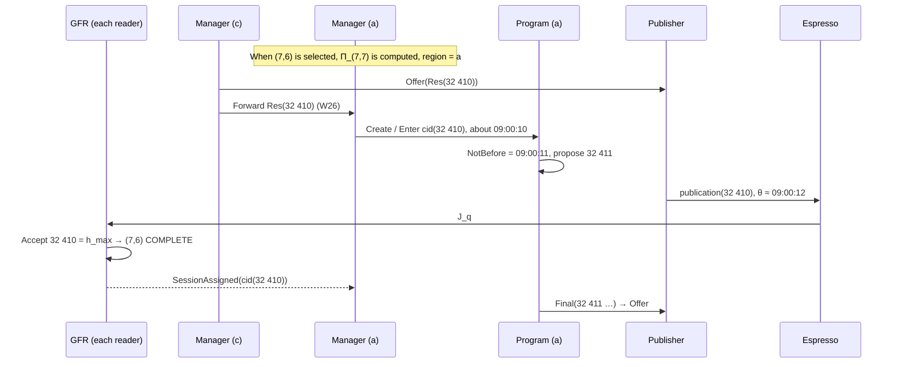

# End-to-end pipelines: Regular handoff, Force handoff, and two kinds of RESUME recovery (v9 working draft v0.2)

Date: 2026-11-02. Previous version: [v0.1](10_pipelines_en_v0_1.md). The overview and shared model are in [00 arch](00_arch_en_v0_1.md); the examples come from [261027](../meetup_record/261027.md) and the [v6 recovery timing assumptions analysis](../formalization_v6/recovery_timing_assumptions_zh.md).

This version recalculates all examples using a calibrated set of parameters. Heights, times, L1 origins, and deadlines use the same time coordinate and can be checked individually. The heights in v0.1 were compressed illustrations that contradicted the timing examples; this version removes that compression. Numerical differences from 261027 and v0.1 are collected in §8. Parameters marked “chosen for this version” are additional choices made here, not values supplied by 261027 or v8.

Update of 2026-11-03: following [09 v0.2](09_finality_rules_en_v0_2.md), Force no longer carries $\theta_a$ and, like RESUME, takes L1 inclusion time plus $M_a$ as its activation time; RESUME assigns the new session immediately at activation. Pipeline two's window therefore changes from [37 922, 41 521] to [37 921, 41 520]; other numbers are unchanged.

## 1. Structure

This document connects the interfaces in the module files into four complete pipelines to check whether the modules compose, and gives timelines under an explicit set of example parameters. §2 gives the parameters, time coordinate, and three deadlines for a height; §§3–6 give the four pipelines; §7 covers short failures that need no governance action; §8 summarizes the calibration.

Each pipeline includes:

- **Scenario:** Initial state and trigger.
- **Sequence diagram:** Calls between participating modules.
- **Steps table:** Each row gives the time, call and output, next consumer, and connection number from [00 §4.4](00_arch_en_v0_1.md).
- **Facts at the end:** Relations among the four chains $R,G,G',D$, abandoned content, and recovery time.

Below, $\mathrm{cid}(X)$ denotes the cid of a candidate program anchored at block $X$; sessions are denoted $(\beta,r)$ and regions a, b, c. $h_R,h_G,h_{G'},h_D$ are the tip heights of the four chains, respectively.

## 2. Calibration parameters and time coordinate

### 2.1 Time coordinate

To convert directly between heights and times, set L2 genesis to 00:00:00 on day one, $h^0=0$, and $b_{\rm L2}=1$ s. Thus

$$
\mathit{ts}^*(h)=h\ \text{seconds}.
$$

For example, height 36,000 is 10:00:00. A time on day two is written “D2 00:05:12”, corresponding to height $86\,400+312=86\,712$. For L1, set $\mathit{ts}_{\rm L1}(\ell)=12\ell$ seconds; for example, L1 block 2,900 has timestamp 09:40:00. This also assumes every L1 slot has a block. Ethereum has missed slots, so block height cannot always be converted linearly at 12 seconds per block; actual genesis, block time, and native configuration must also be substituted for deployment.

In steady state, the origin of regional production follows the schedule in [00 §3.4](00_arch_en_v0_1.md):

$$
\ell^{\rm sch}(h)=\left\lfloor\frac{h-1\,200}{12}\right\rfloor,
$$

namely the last L1 block 20 minutes before the L2 time.

### 2.2 Parameters

| Parameter | Value | Basis | Main use |
| --- | --- | --- | --- |
| $b_{\rm L2}$ | 1 s | Example in 261027 | Convert heights and times |
| $b_{\rm L1}$ | 12 s | Ethereum slot | Convert origins and windows |
| $T_{\rm L1}$ | 19.2 min | Assumed finalized-plus-read budget for this example; not an unconditional Ethereum worst-case bound, since finalization can stall | R-WAIT, $M_a$, $T_{\rm dep}$, RESUME preparation |
| $T_{\rm dep}$ | 20 min (chosen for this version) | Must satisfy $T_{\rm L1}\le T_{\rm dep}$ | Steady-state origin lag |
| $T_{\rm drift}$ | 30 min | This example uses the Fjord parameter 1,800 s; check against the native version actually adopted | O3; upper bound on RESUME target |
| $W_{\rm seq}$ | 12 h | This example uses 3,600 L1 blocks; 12 h is the conversion without missed slots, and the MegaETH deployment value has not been verified | Native deadline |
| $W_{\rm exp}$ | 10 h | 261027 | Gap tolerance (Expire) |
| $M_a$ | 20 min | From $M_a\ge T_{\rm L1}+2\Delta_{\rm ts}+b_{\rm L1}$; 261027 uses 15 min | Activation time of Force and RESUME, R-WAIT |
| $T_{\rm batch}$ | 1 h | 261027 | Delivery budget |
| $\Delta_{\rm ts}$ | 15 s (chosen for this version) | HotShot timestamp validation remains to be checked | E-TS |
| $T_{\rm pub}$, $T_E$ | 30 s each (chosen for this version) | Measurement pending | PUB-4 |
| $T_{\rm grace}$ | 2 min (chosen for this version) | Must satisfy $T_{\rm grace}>T_{\rm pub}+T_E+\Delta_{\rm ts}=75$ s | Public deadline $\theta_s^{\rm end}$ |
| $\mathrm{TB}$ | 3,600 heights, or 1 h (chosen for this version) | — | Session window |
| $T_{\rm prep}$ | 25 min | Must satisfy $M_a+T_{\rm ready}\le T_{\rm prep}\le T_{\rm drift}-\epsilon$, taking $T_{\rm ready}=5$ min, $\epsilon=2$ min; 261027 uses 20 min | RESUME target height |
| $T_{\rm init}$ | 2 min (chosen for this version) | — | Preparation margin for new window after Force |
| $T_{\rm lead}$ | 1 s (chosen for this version) | — | Margin for early entry by a regular successor |
| `CHANNEL_TIMEOUT` | 50 L1 blocks (10 min) | [batch-inbox constant](../megaeth_specs/specs/block-certification/batch-inbox.md#constants) | Expiration of an unfinished channel |

### 2.3 Constraint checks

| Constraint | Substitution | Margin | Consequence if unmet |
| --- | --- | --- | --- |
| $M_a\ge T_{\rm L1}+2\Delta_{\rm ts}+b_{\rm L1}$ | 20 min ≥ 19 min 54 s | 6 s | Some GFR events may wait for L1 finalization. With 261027's 15 min, an event with processing key $x$ waits until about $x+4$ min 24 s (the L1 block covering $x-M_a$ can appear up to 12 s later, then take 19.2 min to finalize); confirmation in $G$ is delayed by about 4.5 min, without changing event order. |
| $T_{\rm L1}\le T_{\rm dep}$ | 19.2 min ≤ 20 min | 48 s | At the slot, the origin selected by the schedule may not yet be finalized; Build and Accept wait. |
| $T_{\rm dep}+b_{\rm L1}\le T_{\rm drift}$ | 20 min 12 s ≤ 30 min | 9 min 48 s | Steady-state origin violates drift. |
| $T_{\rm grace}>T_{\rm pub}+T_E+\Delta_{\rm ts}$ | 120 s > 75 s | 45 s | A result formed before stopping may miss the public deadline. |
| $W_{\rm exp}+M_a+T_{\rm batch}+T_{\rm drift}\le W_{\rm seq}$ | 11 h 50 min ≤ 12 h | 10 min | Content entering $G$ on time may miss the native deadline. |
| $M_a+T_{\rm ready}\le T_{\rm prep}\le T_{\rm drift}-\epsilon$ | 25 ≤ 25 ≤ 28 (min) | 3 min below upper bound | The new session may not be ready to produce at $h_{\rm res}+1$, or the recovery anchor may violate drift. |

With the additional choices $T_{\rm ready}=5$ min and $\epsilon=2$ min, this budget screening gives 25–28 minutes; this is not a proved feasible recovery interval. The Espresso watermark, historical replay, DA retrieval, padding execution, and state preparation by sufficient honest weight must still be shown to finish within budget. If these tasks cannot be bounded, a 25-minute recovery cannot be claimed.

### 2.4 Three deadlines for one height

Consider $X=36\,000$ (10:00:00), in session (7,7), with window $[32\,411,36\,010]$ (see §2.5).

| Deadline | Time | Decided by | Consequence of missing it |
| --- | --- | --- | --- |
| **Public deadline** $\theta_{(7,7)}^{\rm end}=\mathit{ts}^*(36\,011)+T_{\rm grace}$ | 10:02:11 | GFR, by Espresso timestamp | This regional result can no longer enter $G$. |
| **Gap tolerance** $\mathrm{key}(\mathsf{Expire}(X))=\mathit{ts}^*(X)+W_{\rm exp}$ | 20:00:00 | GFR | If no result has covered $X$ (including padding by a successor session), the branch HALTs. |
| **Native deadline** | 21:40:00 | Derivation | $X$ has origin L1 block 2,900 (09:40:00). The candidate batch's window check is inclusion_height ≤ 6,500 (equality itself is not late, and the channel must also complete in time). Fallback for a missing height also depends on the actual derived parent's epoch and cannot be inferred from this candidate origin alone; see below. |

**Native deadline boundary.** Under the native Batch Queue, the out-of-window check is `epoch_num + sequence_window_size < inclusion_block_number`; equality is not out of window. Without a batch, fallback can be generated only after the actual parent epoch's entire window has been read. Here the parent block 35,999 has origin 2,899, so fallback can determine height 36,000 after fully processing L1 block 6,499 (21:39:48), without waiting for the candidate origin 2,900's window. Below, a node having completed reading and derivation through 6,501 is a conservative observation cut; 21:59:24 is that cut plus the example finalized budget, with local processing time still to be added.

The deadlines have different meanings:

- The **public deadline** constrains the regional result. A result at height $h$ in a session must be public before its session's $\theta_s^{\rm end}$, at most about 1 h 2 min after $\mathit{ts}^*(h)$.
- **Gap tolerance** constrains how long $G$ can wait. After the original result misses the public deadline, a successor session or Force can still cover the height with padding if accepted before Expire.
- The **native deadline** constrains delivery. There are 1 h 40 min from Expire to the native deadline, covering $M_a$ (20 min) and $T_{\rm batch}$ (1 h), leaving 20 min. With a worst-case origin lag of 30 min, the margin is 10 min, consistent with §2.3.

In the lifecycle example in 261027, $X$'s result is first made public in an Espresso block with timestamp 19:55 and is still accepted. Under v9's public deadline, that result is already later than 10:02:11 and is ineligible. The 19:55 case applies only if $X$ is covered by a successor session's padding.

### 2.5 Common configuration

Branch 7 was opened by a prior RESUME with $h_{\rm res}=7\,210$ (02:00:10). Thus session $(7,k)$ has window

$$
[\,7\,211+3\,600k,\ 7\,210+3\,600(k+1)\,],
$$

which need not align with whole hours since genesis. The region rotation is c → a → b, consistent with the table:

| Session | Region | Window | Interval | $\tau_s^{\rm stop}$ | $\theta_s^{\rm end}$ |
| --- | --- | --- | --- | --- | --- |
| (7,6) | c | [28 811, 32 410] | 08:00:11–09:00:10 | 09:00:11 | 09:02:11 |
| (7,7) | a | [32 411, 36 010] | 09:00:11–10:00:10 | 10:00:11 | 10:02:11 |
| (7,8) | b | [36 011, 39 610] | 10:00:11–11:00:10 | 11:00:11 | 11:02:11 |

### 2.6 Parameter sensitivity

If the actual L1 finalized-plus-read budget increases, moving only the recovery target later is insufficient: production origins and the recovery anchor are both constrained by drift. Using this draft's sufficient conditions:

$$
T_{\rm L1}+b_{\rm L1}\le T_{\rm drift},\qquad
M_a+T_{\rm ready}+\epsilon\le T_{\rm drift}.
$$

For example, with $T_{\rm L1}=25$ min, the announcement condition requires $M_a\ge25$ min 42 s. Retaining $T_{\rm ready}=5$ min and $\epsilon=2$ min exceeds the 30 min drift, so this document's recovery budget cannot hold simultaneously. This shows that the sufficient budget fails; it does not prove all recovery impossible. Recalculate using actual state preparation time and the native anchor origin rather than continuing to promise a 25-minute recovery.

## 3. Pipeline one: Regular handoff

### 3.1 Scenario

Region c is responsible for session (7,6), and region a for (7,7). The handoff occurs between 09:00:10 and 09:00:11. Once (7,6) is selected, members of region a can compute the Plan for (7,7) and continuously execute c's decided chain, keeping their state close to its tip.

### 3.2 Sequence diagram



### 3.3 Steps (c decides $h_{\max}=32\,410$)

| # | Time | Call → output | Next consumer | Connection |
| --- | --- | --- | --- | --- |
| 1 | About 08:00:12 | (7,6) is selected. Each Manager calls Authority.`Plan`($\mathcal P_7$, (7,7), BlockRef(28 810), c, [32 411, 36 010]) in `ApplyLifecycle`(SessionAssigned) → $\Pi_{(7,7)}$, region = a | Manager a | W1 |
| 2 | 08:00–09:00 | Each decision by c is assembled into Res by `HandleProgramEvent`, given to the Publisher, and forwarded to a; a's Manager executes block by block and maintains state material | Manager a | W8, W9, W26 |
| 3 | About 09:00:10.5 | c decides 32 410; Res(32 410) reaches a | Manager a.`ObserveRegional` | W26 |
| 4 | 09:00:10.5 | Manager a.`PrepareCandidate`($\Pi_{(7,7)}$, 32 410, $\pi_A$ kind REGIONAL, state material) → Ready; `EnterCandidate` | Program a | W24 |
| 5 | 09:00:11 | NotBefore = $\mathit{ts}^*(32\,411)$; Program a proposes 32 411 | — | W7 |
| 6 | About 09:00:12 | Res(32 410) is included in an Espresso block with $\theta\approx$ 09:00:12 (no later than 09:00:11 + 75 s) | GFR | W12 |
| 7 | About 09:00:12 | GFR.`AdvanceGlobal`: accept 32 410; as it is $h_{\max}$, immediately close (7,6) with COMPLETE, `SessionAssigned{ν(cid(32 410))}` | Manager | W13 |
| 8 | From 09:00:12 | a's cached results can be accepted under [09 §4.2](09_finality_rules_en_v0_2.md) in the same Espresso processing loop after selection | GFR | W12 |

### 3.4 Variants

**1a: c does not decide 32 410.** At 09:00:10, a enters using its highest ready candidate, 32 409, and produces on cid(32 409) from 09:00:11. At the SessionEnd(7,6) key, 09:02:11, the GFR fixes regular anchor 32 409 and selects cid(32 409). The approximately 120 blocks produced by a at 09:00:11–09:02:11 are cached and accepted together in a later Espresso block. No content is lost, but global confirmation of these blocks is delayed by up to about 2 minutes.

**1b: The certificate for 32 410 arrives late.** All votes for 32 410 were signed before 09:00:11 (BFT-7 permits the certificate to be assembled or made public later), but a party holding it does not publish it until $\theta=$ 09:01:30, still before 09:02:11. Processing proceeds as follows:

1. The GFR accepts 32 410, which is $h_{\max}$, immediately closes (7,6) with COMPLETE, and selects cid(32 410).
2. a's 32 411–32 490 on cid(32 409) are excluded (EXCLUDED).
3. a enters cid(32 410) at about 09:01:31; its first block is at $\mathrm{slot}(09{:}01{:}31)=32\,491$, and 32 411–32 490 become padding.

About 80 s of fast confirmations are invalidated, and 80 deposit-only heights appear on chain. Feasibility of a late certificate depends on data propagation and certificate assembly in the BFT implementation; v9 does not require every verifiable certificate to reach an honest party immediately. This is a conditional trace consistent with BFT-7, not a withholding attack that works against every implementation.

### 3.5 Facts at the end

- If the ultimately selected candidate is prepared in advance by sufficient honest weight and the BFT synchronization and leader conditions hold, the handoff in this example can have no production pause.
- If the predecessor does not decide $h_{\max}$, global confirmation of approximately the first $T_{\rm grace}$ of the successor's blocks is delayed in this example (1a); actual waiting also depends on log retrieval and replay.
- With a late certificate, about 80 s of the successor's work is invalidated and becomes padding in this example (1b); $T_{\rm grace}$ is not an unconditional upper bound on real recovery delay after an outage.
- At most one cid is selected for a session; signatures for other candidates cannot be used for the selected cid (BFT-4 item 4).

## 4. Pipeline two: Force handoff

### 4.1 Scenario

Region a for (7,7) decides 36 010, and (7,7) closes with COMPLETE. Session (7,8) is assigned to region b with anchor 36 010. Region b fails completely from 10:00:11 and contributes no blocks; $G$ stops at 36 010. The Expire key for 36 011 is 20:00:11, still far away. Governance $\mathsf M$ decides to change regions, and the new policy deactivates b.

### 4.2 Sequence diagram

```mermaid
sequenceDiagram
    participant M as Governance M
    participant AUTH as Authority
    participant GFR as GFR
    participant MGR as Managers (all regions)
    participant PC as Program (c)
    M->>AUTH: SubmitForce(U = (c, 7, P_new)), L1 10:10:00
    Note over GFR: Activation 10:10:00 + M_a = 10:30:00: process Force
    GFR-->>MGR: BranchClosed(7, FORCE)
    GFR->>AUTH: Plan(P_new, (8,8), BlockRef(36 010), b, [37 921, 41 520])
    GFR-->>MGR: SessionAssigned(ν: anchor 36 010, region c)
    MGR->>PC: Create / Enter (AnchorEvidence kind = FORCE)
    PC->>PC: Propose 37 921 at 10:32:01 (parent 36 010)
    Note over GFR: Accept 37 921 once first fully public; 36 011–37 920 become padding
```

### 4.3 Steps

| # | Time | Call → output | Next consumer | Connection |
| --- | --- | --- | --- | --- |
| 1 | About 10:05 | $\mathsf M$ detects the failure | — | — |
| 2 | 10:10:00 | Authority.`SubmitForce`: $U=(c,7,\mathcal P_{\rm new})$ is included in L1 block 3 050; activation time $\mathrm{act}(U)=10{:}10{:}00+M_a=10{:}30{:}00$ | GFR (via L1) | W3 |
| 3 | ≤ 10:29:12 | L1 block 3 050 covering $\mathrm{act}(U)-M_a=10{:}10{:}00$ has finalized | — | — |
| 4 | About 10:30:01 | An Espresso watermark with timestamp at least 10:30:00 is obtained (for example the block with $\theta=10{:}30{:}01$), so R-WAIT holds. The GFR processes Force at key 10:30:00: the Espresso blocks already processed are $J_0..J_{q^*-1}$; branch 7 remains current and is not HALTed | — | — |
| 5 | Same | `BranchClosed{7, FORCE}`; new branch 8; $A$ is 36 010 (origin 2 900, 09:40:00); since (7,8) contributed no block, the new session is (8,8), source region b | Manager.`ApplyLifecycle` | W13 |
| 6 | Same | Window $h_{\min}=\max\{36\,011,\mathrm{slot}(10{:}30{:}00+T_{\rm init})+1\}=37\,921$ (10:32:01), $h_{\max}=41\,520$; `Plan`'s L1_reference_height is $\max\{2\,900,\lambda_8\}=3\,050$; region = c; `SessionAssigned{ν}`, Tail = NEXT(ν) | Manager | W1, W13 |
| 7 | From about 10:30:01 | All cids of branch 7 (including b's Preparing entries) close with FORCE | Program.`Close` | W24 |
| 8 | About 10:30:05 | c's Manager uses the state at 36 010 in $G$ for `PrepareCandidate` → `EnterCandidate` | Program c | W15, W24 |
| 9 | 10:32:01 | c proposes 37 921, parent 36 010; origin = $\ell^{\rm sch}(37\,921)=3\,060$ (10:12:00), lag 20 min 01 s | — | — |
| 10 | About 10:32:04 | The result for 37 921 is accepted in the Espresso block where it is first fully public; $G$ appends padding 36 011–37 920 (1 910 heights, about 31 min 50 s) and 37 921 at once | Batcher etc. | W12, W15 |

### 4.4 Facts at the end

- Force does not roll back any content in $G$. The failure interval 10:00:11–10:32:00 becomes deposit-only padding, whose origins advance along the schedule.
- From failure to block production by the new region is about 32 minutes: roughly 5 min for detection, 20 min total for L1 inclusion and $M_a$ announcement, 2 min for $T_{\rm init}$, plus L1 inclusion time.
- Issue 1 in the [v6 analysis](../formalization_v6/recovery_timing_assumptions_zh.md) (a block-level L1 floor prevents Force from producing its first block) does not arise in v9: v9 has no block-level floor, the new window starts after Force takes effect, and the first block's origin is naturally later than the floor.
- If Force's activation time is later than the key of Expire(36 011) (20:00:11), Expire is processed first and the branch has already HALTed; Force is invalid and only RESUME remains.

## 5. Pipeline three: RESUME after a long Espresso outage (example A)

### 5.1 Scenario

Espresso is non-live after 10:00:00 until it recovers at D2 00:00:00, a total of 14 hours. Session (7,7) runs in a with anchor 32 410 (the normal case in pipeline one); its cid is cid(32 410). This example also assumes that cross-region forwarding happens to arrive on time after the outage; v9 guarantees only eventual delivery during non-live periods, not timely entry by b. The last Espresso block before the outage has timestamp 10:00:00 and includes results through 35 999. At 10:00:00:

- $h_R=35\,999$: a is about to decide 36 000;
- $h_G=35\,999$;
- the finalized acceptance view is $h_{G'}=33\,900$; a transaction covering through 34 800 was included on L1 at 09:55:00 but is not yet finalized and cannot be counted in $G'$;
- $h_D=33\,900$ (09:25:00): the batch through that height was accepted on L1 at 09:40:00 and finalized by 09:59:12.

The second-by-second BFT progress below is an additionally chosen successful trace, not a consequence of $\mathrm{TB}$ alone. The batch layer remains healthy; height 36 000, where an incompatibility fact must arise, contains actually executed ordinary transactions, so its native block hash differs from the deposit-only result.

### 5.2 Sequence diagram

```mermaid
sequenceDiagram
    participant ESP as Espresso
    participant BAT as Batcher / Certifier / Inbox
    participant DER as Derivation
    participant MGR as Manager
    participant GFR as GFR
    participant M as Governance M
    participant AUTH as Authority / Inbox
    Note over ESP: Non-live from 10:00; GFR waits at R-WAIT
    BAT->>DER: Deliver 34 801–35 999
    Note over DER: Around 10:35, D reaches 35 999
    Note over DER: 21:40 native deadline for 36 000 → D[36 000] deposit-only (example observation cut about 21:59:24, plus processing time)
    DER-->>MGR: IncompatibilityFact(36 000)
    Note over ESP: Recovers D2 00:00
    GFR->>GFR: Replay by key: SessionEnd(7,7)…(7,16), Expire(36 000) → HALT
    M->>AUTH: SubmitResume(c, P_new, h_res = 88 212), L1 D2 00:05:12
    AUTH->>DER: CursorSet(35 999 → 88 212)
    DER->>DER: Pad about 44 700 deposit-only blocks through 88 212
    GFR->>DER: DeriveAtResume(p_res), key D2 00:25:12
    GFR-->>MGR: Resumed and SessionAssigned (8,0)
    MGR->>MGR: PrepareCandidate → Enter
    Note over MGR: Produce 88 213 at D2 00:30:13
```

### 5.3 Steps

| # | Time | Call → output | Next consumer | Connection |
| --- | --- | --- | --- | --- |
| 1 | From 10:00 | GFR.`AdvanceGlobal` returns `WAIT{next_position, missing: Espresso watermark}`; $G$ stops at 35 999 | — | — |
| 2 | 10:00:00–10:00:10 | a decides 36 000–36 010; Publisher keeps retrying (PUB-3) | — | W12 |
| 3 | 10:00:11–11:00:10 | b runs (7,8) with candidate cid(36 010), producing 36 011–39 610, and stops at 11:00:11 under BFT-7 | — | W24, W26 |
| 4 | From 11:00:11 | No new production: the Plan for (7,9) must wait for (7,8) to be selected, while the GFR is stopped at step 1 | — | — |
| 5 | About 10:15 | Batcher → DA → Certifier → Inbox.`SubmitBatch`: cursor reaches 35 999 | Derivation | W15–W19, W27 |
| 6 | About 10:35 | Derivation.`Derive`: $D$ reaches 35 999, consistent with $G$ | Manager | W22 |
| 7 | 21:40:00 | Near the candidate window deadline for 36 000; assume the node has completed fallback for the parent epoch by L1 block 6 501, so $D[36\,000]$ is deposit-only | Manager | W22 |
| 8 | ≤ 21:59:24 | The L1 input used in the preceding step is finalized. Manager obtains IncompatibilityFact(cid(32 410), 36 000); a's 36 000 is an ordinary block | Manager.`ApplyLifecycle` | — |
| 9 | Same | a's (7,7) program and b's cid(36 010) close with INCOMPATIBLE. Both already terminated permanently with TIME at 10:00:11 and 11:00:11; repeated Close does not overwrite the original closing reason and only records the incompatibility fact separately | Program.`Close` | W24 |
| 10 | From 22:00 | $D$ advances with deposit-only blocks: origin first catches up to block time (depending on native epoch advancement; a fixed 22 min cannot be derived from the current abstraction), after which the tip of $D$ is about L1 time minus 12 h | — | W22 |
| 11 | D2 00:00:00 | Espresso recovers; the first new block has $\theta\approx$ D2 00:00:00. GFR replays by key | — | — |
| 12 | Same (key 10:02:11) | SessionEnd(7,7): a's 36 000–36 010 were not published until recovery, after the deadline; regular anchor is 35 999. `SessionClosed{(7,7), COMPLETE}`, `SessionAssigned{(7,8), ν(cid(35 999))}`; b's cid(36 010) is excluded | Manager | W13 |
| 13 | Same (keys 11:02:11–19:02:11) | SessionEnd(7,8)…(7,16) close in order with COMPLETE, all without new blocks; the next session is assigned each time, still with anchor 35 999. Their windows have passed in real time, so Enter is rejected | Manager | W13 |
| 14 | Same (key 20:00:00) | Expire(36 000): `BranchClosed{7, EXPIRED}`, Tail = HALT, $G$ remains through 35 999 | Manager | W13 |
| 15 | D2 00:05:00 | $\mathsf M$ follows the procedure in [01 §3.10](01_l1_authority_en_v0_1.md): the emergency has held since about 21:59 and Espresso has recovered. Authority.`SubmitResume`($c$, $\mathcal P_{\rm new}$, $h_{\rm res}=88\,212$) | — | W4 |
| 16 | D2 00:05:12 | Included in L1 block $L=7\,226$. Target check: $\mathit{ts}_{\rm L1}(L)+T_{\rm prep}=$ D2 00:30:12 $\le\mathit{ts}^*(88\,212)=$ D2 00:30:12 $\le$ D2 00:33:12; $88\,212$ exceeds cursor, $h_G$, and $h_D$. In the same transaction Inbox.`Override` produces CursorSet(old.height 35 999, next.height 88 212) | Derivation; GFR | W4, W5 |
| 17 | ≤ D2 00:24:24 | $L$ finalizes. Derivation processes CursorSet: the tip of $D$ is about 43 512 (12:05:12); if actual $h_D^-=43\,512$ before override, pad 43 513–88 212, totaling 44 700 deposit-only blocks. This $h_D^-$ is an example input to be confirmed by native replay; in general the padding amount is $\max\{0,h_{\rm res}-h_D^-\}$. Padding origins advance with L1, at most to $L$; the origin of $D_L[88\,212]$ is $L$ | — | W5 |
| 18 | D2 00:25:12 | RESUME activation time $\mathit{ts}_{\rm L1}(L)+M_a$. R-WAIT holds, resumeReader = Derivation.`DeriveAtResume`($p_{\rm res}$) → ResumeCut | GFR | W23 |
| 19 | Same | GFR executes RESUME ([09 §4.6](09_finality_rules_en_v0_2.md)): $G$ itself is a prefix of $D_L$, so no blocks are rolled back; $G\leftarrow D_L[h^0:88\,212]$, appending 36 000–88 212 with source DER; `Resumed{c, 8, A, D_L}`; Boundary is (8,0), window [88 213, 91 812] | Manager | W13 |
| 20 | Same | In the same event, immediately call `Plan` with Boundary, `SessionAssigned{ν}`, Tail = NEXT(ν); session (8,0) is assigned to the first region in the new policy's rotation, e.g. a | Manager | W1, W13 |
| 21 | D2 00:25–00:30 | Manager calls `DeriveAtResume` in `ApplyLifecycle`(Resumed), stores anchor_state as state material, and after SessionAssigned runs `PrepareCandidate` → `EnterCandidate` | Program | W23, W24 |
| 22 | D2 00:30:13 | New program proposes 88 213. Origin = $\min\{L+1,\ell^{\rm sch}(88\,213)\}=7\,227$ (D2 00:05:24), lag 24 min 49 s, within 30 min; this L1 block finalized by D2 00:24:36. Thereafter origin advances by 1 per block and returns to schedule at 88 239 (D2 00:30:39) | — | — |
| 23 | After the GFR processes RESUME | Batcher reads cursor 88 212; the Certifier certifies a submission using it as prev only after its GFR has processed the RESUME. New batches start at 88 213; certification must wait until the new result at that height enters $G$ | Inbox | W18–W20, W27 |

### 5.4 Recovery time

If the public inputs, replay, and state preparation in the table complete on time, the example takes 25 min 13 s from RESUME submission to production of the first new block. For the first block to enter $G$, add $T_{\rm build}+T_{\rm fin}+T_{\rm pub}+T_E$ and any required GFR waiting and processing time. The BFT abstraction gives no deployment values for these quantities, so an additional maximum of 1 minute cannot be inferred.

| Interval | Duration | Work |
| --- | --- | --- |
| Submission to inclusion | About 12 s | L1 inclusion |
| Inclusion to $L$ finalized | ≤ 19.2 min | Ethereum finalization |
| $L$ finalized to RESUME activation time | ≥ 48 s | Execute about 44 700 padding blocks; if they cannot be executed in advance, GFR waits in R-WAIT until padding completes |
| Key to slot of $h_{\rm res}+1$ | 5 min | Open the session, prepare state, Enter |

As arithmetic alone: completing 44 700 padding blocks in 48 s after finalization requires about 931.25 blocks/s, excluding DA retrieval and state distribution. Allowing the full 5 min gives 149 blocks/s on average, but would process RESUME after its time key. The time key is not a completion time. Pre-execution on unfinalized inputs can only be a discardable cache optimization, not a basis for Ready or public decisions; v9 specifies neither this optimization nor its benefit. The original 20 min must also be validated against actual phase durations; a fixed 14 min threshold cannot decide whether it suffices.

### 5.5 Variant A′: An Espresso block is in flight when the outage starts

For this variant alone, set the outage start to 10:00:01. Suppose Espresso block $J^*$ is proposed at 10:00:00.5 (still live), with $\theta^*=$ 10:00:01, containing the complete publication for 36 000, but is not finalized before the outage. It finalizes only after recovery at D2 00:00. $J^*$ was proposed during a live period and satisfies E-TS.

1. During replay, $J^*$ has key 10:00:01, earlier than SessionEnd(7,7)'s 10:02:11, and is processed first. All acceptance checks pass: matching cid, height in window, $\theta^*<\theta_{(7,7)}^{\rm end}$, and $\theta^*<\mathit{ts}^*(36\,000)+W_{\rm exp}$. **36 000 enters $G$ at real time D2 00:00.**
2. SessionEnd(7,7) uses 36 000 as regular anchor; subsequently Expire(36 001) (key 20:00:01) HALTs the branch, and $G$ stops at 36 000.
3. Between D2 00:00 and 00:25, the Certifier may certify 36 000: prev is 35 999, the content matches $G$, and CertifyBatch does not check the native deadline. The Inbox accepts the out-of-window batch and advances the cursor to 36 000, but derivation discards it; $D[36\,000]$ remains deposit-only. The cursor and $D$ now have different content meanings; $D$ can have a height well above the cursor, so heights alone cannot be compared.
4. At D2 00:25:12, process RESUME: $D_L[36\,000]\ne G[36\,000]$, with common prefix through 35 999. **$G[36\,000]$ is rolled back about 25 minutes after becoming globally final.**

Thus, example A preserves the old $G$ only if the old $G$ was delivered on time and no further late result conflicting with $D$ was accepted. A′ is a counterexample in which rollback is allowed; an in-flight block does not necessarily cause rollback. This continues v6 issue 2: v9 §7 already permits this RESUME semantics, and it is not a violation of BFT agreement for the same cid.

### 5.6 Variant A″: A short outage crossing a session deadline

Suppose Espresso is down only from 10:00:00 to 10:05:00. These 5 minutes cross $\theta_{(7,7)}^{\rm end}=$ 10:02:11.

1. After recovery, SessionEnd(7,7) uses 35 999 as anchor. a's 36 000–36 010 are published after the deadline and are ineligible; (7,8) selects cid(35 999), and b's cid(36 010) is excluded.
2. b enters cid(35 999) at about 10:05:01. Its first block is at approximately 36 305, and 36 000–36 304 become padding (305 heights).
3. Invalidated fast confirmations include 11 blocks from a and about 290 from b. No governance action is needed, and $G$ does not roll back.

If the same five-minute outage falls in the middle of a session (e.g. 09:30–09:35), no deadline is crossed: backlogged results enter $G$ in their original order after recovery, with no loss.

In general, padding length is determined by the last accepted height and first physical height after recovery, while invalidated confirmations count only candidate blocks actually decided; neither equals the outage length. For example, with an outage from 10:00 to 12:00: if replay and preparation can complete before the (7,9) stop at 12:00:11, that session may still produce its last few blocks without waiting until 12:02:11. Otherwise SessionEnd selects (7,10), which can propose 43 333 at about 12:02:13. In the latter case padding is 36 000–43 332, totaling 7 333 heights; the candidate chain actually abandoned extends at most through 39 610, totaling 3 611 heights.

### 5.7 Facts at the end

- Without an in-flight block, all of the original $G$ is retained; with one, see variant A′.
- The abandoned content is 36 000–39 610, which had regional confirmation only and did not enter $G$: a's 11 s and b's 1 h. Transactions among these that still need execution must be resubmitted against the new state.
- After the GFR stops, production continues for at most one further session: only the successor of an already selected predecessor can compute its Plan early. If failure occurs at the start of the current session, its remainder plus one prepared successor can approach two windows; here failure occurs at the end, giving about 1 h. This also depends on actual scheduling of candidates.
- At an observation point where Inbox, Derivation, and GFR have all processed the same RESUME cut and none has advanced further, all three align at 88 212. Subsequent prefix relations still require the same parent state and timely delivery; one component's latest progress cannot be compared directly with another's historical cut.
- During the outage, L1 deposits enter $D$ through deposit-only blocks; the delay budget also includes L1 finalization, DA retrieval, and derivation processing. The 12 h is only this example's window conversion.

## 6. Pipeline four: RESUME after the batch layer exceeds the window (example B)

### 6.1 Scenario

Espresso remains healthy. The Certifier goes offline at 10:00, breaking the batch delivery path. The last previously accepted batch covers through 35 400 (09:50:00) and was included on L1 at 09:57:00; it is then an acceptance record awaiting finalization and, under this example's budget, finalizes by 10:16:12. After data and execution complete on time, both the finalized cursor view and $D$ reach 35 400.

The first undelivered height is 35 401. Assume the native block at 35 401 differs from the deposit-only result. Heights 35 401–35 411 all have origin L1 block 2 850 (09:30:00), with native deadline L1 block 6 450 (21:30:00).

### 6.2 Sequence diagram

```mermaid
sequenceDiagram
    participant GFR as GFR
    participant BAT as Batcher / Certifier
    participant DER as Derivation
    participant MGR as Manager
    participant M as Governance M
    participant AUTH as Authority / Inbox
    Note over GFR: G grows with real time
    Note over BAT: Certification unavailable from 10:00; cursor stops at 35 400
    Note over DER: 21:30 native deadline → D[35 401] deposit-only ≠ G[35 401] (example observation cut about 21:49:24, plus processing time)
    DER-->>MGR: IncompatibilityFact(35 401)
    MGR->>MGR: Kill branch 7 programs (INCOMPATIBLE), G stops at about 78 564
    M->>AUTH: SubmitResume(c, P_new, h_res = 84 312), L1 23:00:12
    AUTH->>DER: CursorSet(35 400 → 84 312)
    GFR->>DER: DeriveAtResume, key 23:20:12
    GFR->>GFR: G ← D_L[h0:84 312]: retain through 35 400, roll back 35 401–78 564
    GFR-->>MGR: Resumed; SessionAssigned (8,0)
    BAT->>AUTH: Submit batches from 84 313, starting at cursor 84 312
```

### 6.3 Steps

| # | Time | Call → output | Next consumer | Connection |
| --- | --- | --- | --- | --- |
| 1 | From 10:00 | Batcher.`Deliver` returns WAIT at CertifyBatch; the task retains completed stages (BAT-3) | — | W16, W27 |
| 2 | 10:00–21:30 | $R$ and $G$ grow normally; $G$ lags $R$ by only a few seconds | — | — |
| 3 | 21:30:00 | Native deadline for 35 401. When derivation processes L1 block 6 451, $D[35\,401]$ is deposit-only, with a native hash different from $G[35\,401]$ | Manager | W22 |
| 4 | ≤ 21:49:24 | The L1 input used in the previous step is finalized. Manager.`ObservePublic` → `ApplyLifecycle`(IncompatibilityFact(35 401)): the running (7,19) (a, window [75 611, 79 210]) and all branch 7 candidates whose prefixes cover 35 401 close with INCOMPATIBLE | Program.`Close` | W24 |
| 5 | Same | $G$ stops at about 78 564 (21:49:24). The GFR continues assigning (7,20)… by SessionEnd, but every candidate's prefix covers 35 401, so each closes during preparation. The next missing height's Expire key is D2 07:49:25 | — | W13 |
| 6 | 21:30–23:00 | $D$ advances with deposit-only blocks: origin first catches up to block time, after which the tip is about L1 time minus 12 h | — | W22 |
| 7 | 23:00:00 | Service recovers. $\mathsf M$ → Authority.`SubmitResume`($c$, $\mathcal P_{\rm new}$, $h_{\rm res}=84\,312$), included in L1 block $L=6\,901$ (23:00:12). Target check: 23:25:12 $\le\mathit{ts}^*(84\,312)=$ 23:25:12 $\le$ 23:33:12; above cursor 35 400, tip of $D$ about 39 612, and tip of $G$ about 78 564 | Derivation; GFR | W4, W5 |
| 8 | ≤ 23:19:24 | $L$ finalizes; if actual $h_D^-=39\,612$ before override, derivation pads 39 613–84 312, totaling 44 700 deposit-only blocks; this cut must be confirmed by native replay | — | W5 |
| 9 | 23:20:12 | RESUME activation time. GFR calls `DeriveAtResume` → ResumeCut | GFR | W23 |
| 10 | Same | Common native prefix through 35 400; **if $h_G=78\,564$ at the stop, roll back 35 401–78 564, totaling 43 164 heights, a height span of about 11 h 59 min 24 s**; $G\leftarrow D_L[h^0:84\,312]$; Resumed; in the same event output SessionAssigned for (8,0), window [84 313, 87 912] | Manager | W13 |
| 11 | 23:25:13 | New program proposes 84 313, origin 6 902 (23:00:24) | — | W24 |
| 12 | After CursorSet takes effect; new signatures also wait for GFR to process RESUME | Inbox rejects certificates with old cursor 35 400 as prev (CERT-3 (a)). Batcher constructs from cursor 84 312; Certifier certifies only after its GFR has processed RESUME (CERT-3 (b)) | Inbox | W18–W20, W27 |

### 6.4 Out-of-window batches

Suppose the Certifier recovers at 21:35, after the native deadline for 35 401:

1. The Batcher requests certification of content from 35 401 with prev = 35 400. CertifyBatch checks only cursor, $G$, and DA, not the native deadline, and therefore signs.
2. The Inbox accepts it and advances the cursor, but derivation discards the batch; $D[35\,401]$ remains deposit-only.
3. It does not follow that all subsequent batches are discarded. The [native Batch Parent Hash rule](../megaeth_specs/specs/rollup/derivation.md#batch-parent-hash) explicitly ignores batch parent_hash; subsequent batches are still evaluated individually on the actual $D$ parent state against their respective window, origin, and execution conditions.
4. Cursor acceptance has a different meaning from derived content; $G'$ materialized from the cursor and $D$ may diverge.

Thus Kill and the question of whether an emergency exists must be determined from $D$, not the cursor. The RESUME condition “$h_{\rm res}$ above the cursor” is only necessary. This is listed in the security review.

### 6.5 Facts at the end

- The rolled-back 35 401–78 564 were globally final but did not enter $D$ on time. This is the designed semantics of $G$ ([09 §7](09_finality_rules_en_v0_2.md)), but the calibrated scale is about 12 hours.
- All of 35 401–84 312 are deposit-only; L1 deposits are included normally, while ordinary transactions require resubmission.
- Kill occurs about 19 minutes after the native deadline because derivation reads finalized L1. During that interval, regions continue producing blocks destined to be invalidated.

## 7. Short failures and the dead zone

Whether recovery is lossless depends on whether each result meets its own public deadline and each height meets the gap tolerance and native deadline. The table measures time from the first affected height $X$ using the parameters in §2.

| Case | Result | Governance needed? |
| --- | --- | --- |
| Espresso outage crosses no $\theta_s^{\rm end}$ | Backlogged results can be accepted if complete results are obtained on time, the participation conditions for the correct cid still hold, and delivery meets the actual deadlines | No |
| Espresso outage crosses a $\theta_s^{\rm end}$ and recovery precedes $\mathit{ts}^*(X)+10$ h | Candidate results not published before the deadline may be lost; count padding and invalidations separately as in §5.6 | No |
| Espresso outage exceeds about 10 h | If the gap in this example is not covered by a late result, Expire HALTs the branch after recovery; the emergency begins at about $\mathit{ts}^*(X)+12$ h; without an in-flight block, $G$ does not roll back | RESUME (§5) |
| All Publishers fail, Espresso is healthy, repaired within 10 h | If a successor is prepared, sufficient running time remains, and new proofs meet all boundaries, the successor can cover the gap with padding | No |
| All Publishers fail for over 10 h | HALT at $\mathit{ts}^*(X)+10$ h; a **dead zone** lasts until $D$ passes $X$ and is finalized, about $\mathit{ts}^*(X)+11$ h 59 min, or roughly 2 hours; then RESUME adds 25 minutes | RESUME |
| Regional failure, Espresso healthy | Force restores production in about 32 minutes; the failure interval becomes padding (§4) | Force |
| Batch-layer failure, and on recovery every undelivered height can still be accepted before its native deadline | Lossless. For $X$, the deadline is about $\mathit{ts}^*(X)+11$ h 40 min; with a 1 h delivery budget, recovery by about $\mathit{ts}^*(X)+10$ h 40 min is only budget screening and still requires the actual deadline, load, and service conditions | No |
| Batch-layer failure exceeds native deadline | $D$ diverges at $X$; Kill follows about 19 minutes later; after recovery, RESUME rolls back $G$ from $X$ (§6) | RESUME |

The dead zone is issue 4 in the [v6 analysis](../formalization_v6/recovery_timing_assumptions_zh.md). Under v6's parameters (30 min origin lag, excluding L1 finalization) it is about 1.5 hours; after calibration it is about 2 hours.

## 8. Calibration conclusions

The table compares this version with 261027 and v0.1. “Open” identifies items requiring a decision or measurement.

| # | Item | 261027 / v0.1 | This version | Reason | Open |
| --- | --- | --- | --- | --- | --- |
| 1 | $M_a$ | 15 min | 20 min | This example uses a 19.2 min finalized budget, not measured or proved as a deployment bound; with 15 min, each GFR event waits up to about 4.5 additional minutes | Accept 20 min, or retain 15 min and accept delayed confirmation in $G$? |
| 2 | RESUME preparation $T_{\rm prep}$ | 20 min | 25 min | $L$ finalization ≤ 19.2 min, plus padding execution, session opening, and Enter; upper bound 28 min | Can padding be pre-executed? Measure padding speed. |
| 3 | Steady-state origin lag | 30 min | 20 min | Schedule uses $T_{\rm dep}=20$ min; 30 min is the drift upper bound | — |
| 4 | Native deadline for a 10:00:00 block | 21:30 | 21:40 | Follows from item 3 | — |
| 5 | Deadline for a regional result to enter $G$ | Block time + 10 h | The session's $\theta_s^{\rm end}$, at most about block time + 1 h 2 min | v9 public deadline; $W_{\rm exp}$ constrains only the gap | Value of $T_{\rm grace}$: larger means less loss from a short outage crossing the deadline but longer confirmation pauses at handoff |
| 6 | Does example A roll back $G$? | No rollback | No rollback under A's assumptions; A′'s late result causes rollback | v6 issue 2, not fixed in v9 | See security review |
| 7 | Regional production in example A | Continues to 115 | Stops at 39 610 (one session) | v9 prepares only the successor of a selected predecessor | — |
| 8 | $G$ rolled back in example B | 106–200 | 35 401–78 564, about 12 h | This example assumes divergence detection and publication lag give exactly this tip; it is not a rollback bound uniquely determined by the window parameters | — |
| 9 | RESUME padding size | Not given | About 44 700 blocks | About $W_{\rm seq}+T_{\rm prep}$ | Measure execution time |
| 10 | Short outage crossing a deadline | v6: 2 h outage without loss | Padding and invalidated confirmations when crossing the deadline (A″) | Public deadline fixed by L2 time | Same as item 5 |
| 11 | Dead zone | About 1.5 h | About 2 h | Item 3 and L1 finalization | Adopt v6's suggested fix, allowing RESUME also when “already HALTed and $G\preceq D$”? |
| 12 | Regular handoff | Logic only | If predecessor does not decide $h_{\max}$, about 2 min confirmation waiting under normal log and state preparation conditions; 1b shows 80 s of invalidated candidate work | Public deadline and BFT-7 | See security review |
| 13 | Force recovery | Logic only | About 32 min; failure interval becomes padding | $M_a$ and $T_{\rm init}$ | Value of $T_{\rm init}$ |

## 9. Evidence and scope of calibration

The 20 min announcement, 25 min recovery, and 1 h session in this file are one set of examples for manual inspection; they have not been written into the protocol configuration. Every second-level “≤” assumes this example's finalized budget and stated data-processing conditions. An event's time key is not its actual processing-completion time. Service throughput, BFT latency, historical replay speed, and actual deployment configuration have not been measured.

External sources consulted on 2026-11-02: [Ethereum PoS](https://ethereum.org/developers/docs/consensus-mechanisms/pos/) supports 12 s slots and 32-slot epochs; finalization requires voting conditions and does not guarantee finalization of every block within a fixed time. [OP configurability](https://specs.optimism.io/protocol/configurability.html#sequencing-window-size) gives the standard window of 3,600 L1 blocks. [OP derivation](https://specs.optimism.io/protocol/derivation.html#batch-queue) gives window and fallback checks, and its parameter table gives the Fjord drift parameter. The cited local versions remain the subject of review for v9 and this repository's native certified derivation semantics.

For arithmetic checks, see [checks/calibrate_261027.py](../formalization_v9/checks/calibrate_261027.py). It checks time, height, and quantity arithmetic; it does not simulate BFT or complete native derivation, or prove protocol safety. See the [security review](security_review_en_v0_1.md) for core open issues.
