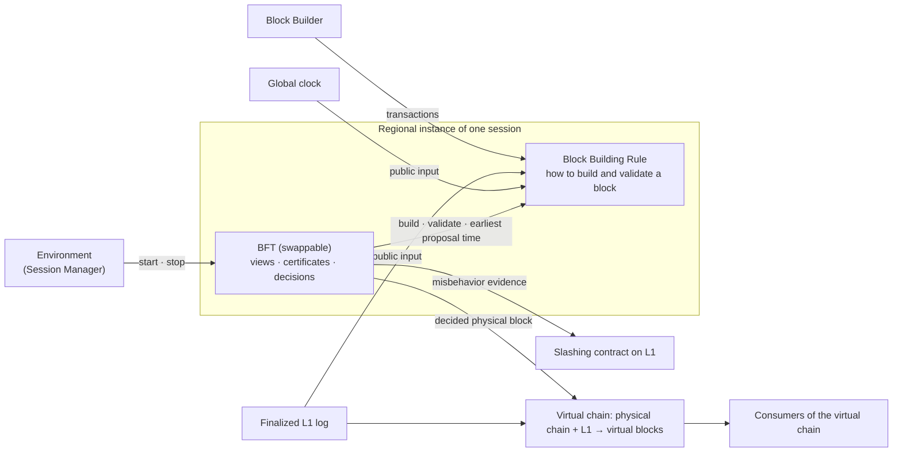
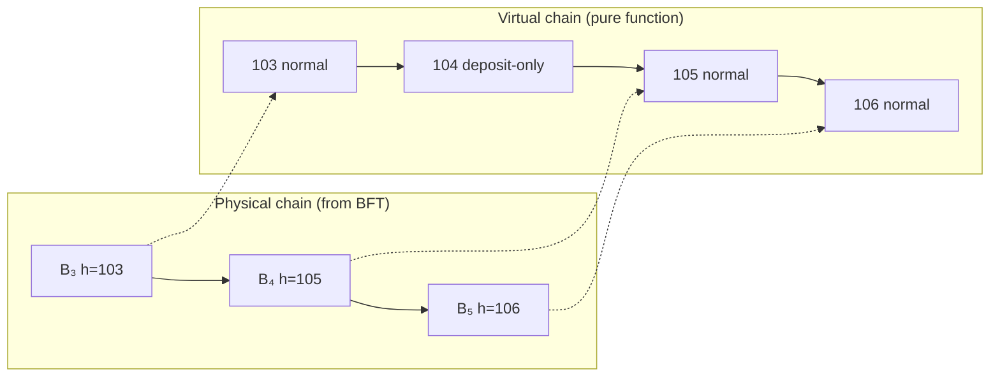

# Regional BFT 的抽象（工作稿 v0.5）

日期：2026-11-01。
状态：草稿。

**本文自成一体：** 每个 term 与 symbol 都定义在正文第一次用到它之前，读正文不需要其他文档。外部链接只是出处。与提纲、v0.3、v0.4、旧记号的对应放在附录 A，不属于正文。

---

## 0. Overview

Regional BFT 是一个 session 内的 state machine replication 实例：一个固定的成员集合（committee）从一个已经确定的 L2 block（anchor）出发，产生连续一段 L2 height 上的 block。

本文区分两种 block：

- **physical block**：BFT 达成共识的对象。一个 L2 height 上可能没有。
- **virtual block**：对外的 L2 block，每个 L2 height 一个，由共识决定的 physical block 与 L1 log 算出。



| Layer | 内容 | 是否可替换 |
| --- | --- | --- |
| BFT | view、vote、certificate、decision。只看见 physical block 和它们的 hash chain | 可替换（§6） |
| Block Building Rule | physical block 怎样构造、怎样验证（§4） | 固定 |
| Virtual chain | 把共识决定的 physical chain 与 L1 log 映射成 virtual block 的纯函数（§3.3） | 固定 |

**核心事实：** L2 height 到 timestamp、到 L1 origin（L2 block 依据的 L1 block）、到 deposit 的对应，都在 BFT 之外固定，与 leader 和 fork 无关。BFT 只决定一件事：哪些 height 带哪些由 leader 选的交易。

这里只给轮廓，上面的词在正文中逐个定义。

---

## 1. Assumptions

**参与者。** 本文固定一个 session，所有参数都属于它，所以省略 session 下标。下面的参数由 environment 给出。

- **Committee** $V$：session 的成员集合。每个 **member** $m\in V$ 有 weight $w_m$。对 $Z\subseteq V$，$w(Z):=\sum_{m\in Z}w_m$；总 weight 是 $W:=w(V)$。
- **Fault threshold** $F$：常数，满足 $3F<W$。
- **$\mathrm{Byz}\subseteq V$**：Byzantine member 的集合。不属于 $\mathrm{Byz}$、按协议运行的 member 叫 **honest member**；它可以崩溃后重新上线；先持久化签名记录，再签名。
- **View** $v\in\mathbb N_{>0}$：一次 proposal 机会，leader 是 $\mathrm{Leader}(v)$。$\mathrm{Leader}:\mathbb N_{>0}\to V$ 是确定函数，整个 session 内不变。没有 term。

| 编号 | 名称 | 内容 | 用途 |
| --- | --- | --- | --- |
| A1 | Partial synchrony | 存在未知的时刻 $\mathrm{GST}$ 与已知的时长 $\Delta$：honest member 之间于 $\tau$ 发出的消息，在 $\max\{\tau,\mathrm{GST}\}+\Delta$ 之前送达并处理完毕；不同 region 之间的上界为 $\Delta_{\rm cross}$ | 只用于 liveness |
| A2 | Authenticated communication | 信道经过认证；签名不可伪造；hash 函数 $\mathsf H$ 抗碰撞；所有 member 的公钥公开已知 | 全部目标 |
| A3 | Global clock | 所有 member 读同一个 global clock $\tau\in\mathbb R_{\ge0}$，没有 drift | 只用于时间目标与 timeout；agreement 不依赖它 |
| A4 | Static adversary | 存在集合 $\mathrm{Byz}\subseteq V$，在 session 开始、$\mathrm{Leader}$ 的 seed 揭晓之前固定，$w(\mathrm{Byz})\le F$，且 $3F<W$ | 全部 safety 目标；liveness 的时间界 |

**A3 的说明。** clock drift 由 clock 模块内部处理，这里不建模。读数误差的影响见 §7 的 G1。

**A4 的说明。** safety 只用到"累计被 corrupt 的 weight 不超过 $F$"，不用 static。static 只用于 §7 中最长连续 Byzantine view 数的最坏值。

---

## 2. Building Blocks

本节只定义外部给定的 building block：L1 与它的 deposit log。

### 2.1 L1：safe、live、fixed pace

L1 是 finalized block 的序列，$\ell\in\mathbb N$ 是 height。L1 block $\ell$ 的 timestamp 记 $\mathit{ts}_{\rm L1}(\ell)$。

- **Fixed pace：** $\mathit{ts}_{\rm L1}(\ell)=\tau^0_{\rm L1}+\ell\,b_{\rm L1}$，每个 slot 都有 block。$\tau^0_{\rm L1}$ 是 L1 的起点，$b_{\rm L1}$ 是 L1 slot 长度。
- **Safety：** 两个 honest member 读到的 finalized log 互为前缀，finalized block 不回退。
- **Liveness 与可读：** 每个 L1 block $\ell$ 在 $\mathit{ts}_{\rm L1}(\ell)+T_{\rm L1}$ 之前已经 finalized，并对所有 honest member 可读。$T_{\rm L1}$ 是从 timestamp 到 finalized 且可读的上界。

这组假设只影响 liveness：读不到 L1 时 member 等待，不会投错票。

**读取约定：** 任何读 L1 log 的函数，在所需 L1 block 还不可读时返回 `WAIT`。`WAIT` 只推迟结果，不改变结果。

### 2.2 Deposit Log

$\mathrm{DepLog}(\ell)$ 是 L1 block $\ell$ 记录的 deposit 交易列表，由 finalized log 唯一确定。

---

## 3. Virtual Chain、Physical Chain 与 Merge Rule

本节依次定义：fixed virtual L2 chain 与它的 property；BFT 达成共识的 physical chain；把 physical chain 与 L1 合成 virtual chain 的 merge rule。

### 3.1 Fixed Virtual L2 Chain

本节的目标是 fixed virtual chain：每个 height 的 timestamp、origin、prefix 都在任何 block 产生之前固定。

#### Virtual Block

**virtual block** 是对外的 L2 block，是下面的六元组：

$$
\mathit{VB}=\bigl\langle\,\mathit{VB}.h,\ \mathit{VB}.\mathit{ts},\ \mathit{VB}.\mathit{os},\ \mathit{VB}.\mathit{Dep},\ \mathit{VB}.\mathit{root},\ \mathit{VB}.\mathit{Txs}\,\bigr\rangle.
$$

| 字段 | 含义 |
| --- | --- |
| $\mathit{VB}.h$ | L2 height |
| $\mathit{VB}.\mathit{ts}$ | timestamp |
| $\mathit{VB}.\mathit{os}$ | **origin**：这个 block 依据的 L1 block |
| $\mathit{VB}.\mathit{Dep}$ | **prefix**：执行时排在最前面的交易列表，含 deposit |
| $\mathit{VB}.\mathit{root}$ | 执行这个 block **之前**的 state root |
| $\mathit{VB}.\mathit{Txs}$ | 排在 prefix 之后、由 leader 选的交易列表 |

对象的字段一律写成 $X.\mathit{field}$。这些字段都是 **actual 值**：对象上实际带着的值，可能由 leader 填写，也可能来自外部。下面的 property 规定字段应该等于什么；规定的目标值带 star，称为 **should-be 值**，任何人都能从公开输入重算。

**Anchor。** session 从 **anchor** $A$ 出发：一个已经确定的 L2 block。它的 height 是 $A.h$，origin 是 $A.\mathit{os}$，执行到它之后的状态是 $A.\sigma$，hash 记 $\mathsf H(A)$。session 覆盖 $\mathrm{TB}\in\mathbb N_{>0}$ 个 height，最高 height 是 $h_{\max}:=A.h+\mathrm{TB}$。

**Virtual chain：** 序列 $\mathcal L=(\mathit{VB}_{A.h+1},\dots,\mathit{VB}_n)$，$n\le h_{\max}$，满足 $\mathit{VB}_i.h=i$：从 anchor 之后开始，每个 height 恰好一个 block。

#### VP1 Fixed Pace

$\tau^0_{\rm L2}$ 是 L2 genesis 时刻，$h^0$ 是 genesis height，$b_{\rm L2}$ 是 L2 block 间隔。$\mathit{ts}^*(h)$ 是 height $h$ 应有的 timestamp：

$$
\mathit{ts}^*(h):=\tau^0_{\rm L2}+(h-h^0)\,b_{\rm L2}.
$$

**VP1 Fixed pace：** virtual chain 上每个 block 满足 $\mathit{VB}.\mathit{ts}=\mathit{ts}^*(\mathit{VB}.h)$。

**这条只约束 virtual block。** physical block 不必每个 height 都有，也不必准时产生。

#### VP2 L1 Synchrony

每个 height 有固定的 origin 和固定的 prefix，都只由 height、anchor 与 L1 log 决定。下面先定义这两个目标值，再给出 property。

**Native origin 规则。** **native** 指 L2 现有的规则，本文不改变。一条 L2 chain 要被 L1 derivation（从 L1 重建 L2 chain 的规则）原样接受，它每个 height 实际的 origin $\mathit{os}(h)$ 必须满足：

- **O1 Continuity：** $\mathit{os}(h)-\mathit{os}(h-1)\in\{0,1\}$；
- **O2 Not ahead：** $\mathit{ts}_{\rm L1}(\mathit{os}(h))\le\mathit{ts}^*(h)$；
- **O3 Drift：** $\mathit{ts}^*(h)\le\mathit{ts}_{\rm L1}(\mathit{os}(h))+T_{\rm drift}$。

$T_{\rm drift}$ 是 native 常数：drift 的上界。

**Scheduled origin。** 设常数 $T_{\rm dep}$（deposit lag）。height $h$ 按 schedule 的 origin 是 $\ell^{\rm sch}(h)$：

$$
\ell^{\rm sch}(h):=\max\{\ell:\ \mathit{ts}_{\rm L1}(\ell)+T_{\rm dep}\le\mathit{ts}^*(h)\}
=\Bigl\lfloor\frac{\mathit{ts}^*(h)-T_{\rm dep}-\tau^0_{\rm L1}}{b_{\rm L1}}\Bigr\rfloor.
$$

**Should-be origin。** height $h$ 应有的 origin 记 $\mathit{os}^*(h)$。anchor 的 actual origin $A.\mathit{os}$ 可能不在 schedule 上（例如紧急恢复时 anchor 来自 L1 derivation）。所以从 anchor 算起：$\mathit{os}^*(A.h):=A.\mathit{os}$，并且

$$
\mathit{os}^*(h):=\min\bigl\{\,A.\mathit{os}+(h-A.h),\ \max\{A.\mathit{os},\ \ell^{\rm sch}(h)\}\,\bigr\},\qquad A.h<h\le h_{\max}.
$$

三者的关系：

- anchor 超前 schedule 时，$\mathit{os}^*$ 冻结，等 schedule 追上来；
- anchor 落后 schedule 时，$\mathit{os}^*$ 每个 height 前进 1，直到追上；
- $A.\mathit{os}=\ell^{\rm sch}(A.h)$ 时，$\mathit{os}^*(h)=\ell^{\rm sch}(h)$：origin 是 height 的纯函数。这就是 L1 与 L2 的同步。

**Constant constraints：**

| 约束 | 作用 |
| --- | --- |
| c1：$b_{\rm L2}\le b_{\rm L1}$ | 相邻 height 的 $\ell^{\rm sch}$ 至多差 1，所以 O1 成立，每个 L1 block 都有第一个使用它的 height |
| c2：$T_{\rm L1}\le T_{\rm dep}$ | 时间到 $\mathit{ts}^*(h)$ 时，L1 block $\mathit{os}^*(h)$ 已可读（下面的 prefix 要读它） |
| c3：$T_{\rm dep}+b_{\rm L1}\le T_{\rm drift}$ | O3 成立 |

**Anchor 条件：** $A.\mathit{os}$ 在 session 开始前已 finalized，且 $\mathit{ts}_{\rm L1}(A.\mathit{os})\le\mathit{ts}^*(A.h)\le\mathit{ts}_{\rm L1}(A.\mathit{os})+T_{\rm drift}$。

**例子。** $b_{\rm L2}=1$ 秒，$b_{\rm L1}=12$ 秒，$T_{\rm L1}=19$ 分钟，$T_{\rm dep}=25$ 分钟，$T_{\rm drift}=30$ 分钟。timestamp 10:00:00 的 L1 block，第一个以它为 origin 的 L2 block 的 timestamp 是 10:25:00；接下来 11 个 height origin 不动；timestamp 10:25:12 的 L2 block 换成下一个 L1 block。

**Should-be prefix。** 对 $A.h<h\le h_{\max}$，height $h$ 应有的 prefix 是 $\mathrm{Dep}^*(h)$。$\Vert$ 是列表拼接，$\varnothing$ 是空列表。

$$
\mathrm{Dep}^*(h):=\mathrm{Attr}^*(h)\ \Vert\ \mathrm{Deposit}^*(h)\ \Vert\ \mathrm{Sys}^*(h).
$$

- $\mathrm{Attr}^*(h)$：L1 attributes transaction，是 $(h,\mathit{os}^*(h),A)$ 与 L1 log 的公开确定函数；
- $\mathrm{Deposit}^*(h):=\mathrm{DepLog}(\mathit{os}^*(h))$ 若 $\mathit{os}^*(h)\ne\mathit{os}^*(h-1)$，否则为 $\varnothing$；
- $\mathrm{Sys}^*(h)$：适用的 system 与 upgrade transaction，是 $(h,\mathit{ts}^*(h),\mathit{os}^*(h))$ 的公开确定函数。

$\mathrm{Attr}^*(h)$ 每个 height 都有，所以 $\mathrm{Dep}^*(h)$ 从不为空。

排在 prefix 之后的是 **ordinary transaction**：由 leader 选的交易，不属于任何 $\mathrm{Dep}^*(h)$。

**VP2 L1 synchrony：** virtual chain 上每个 block 满足：

- (a) origin：$\mathit{VB}.\mathit{os}=\mathit{os}^*(\mathit{VB}.h)$；
- (b) prefix：$\mathit{VB}.\mathit{Dep}=\mathrm{Dep}^*(\mathit{VB}.h)$。

**性质（证明见 §8）：**

- **Native origin：** $\mathit{os}^*$ 满足 O1–O3。
- **Consistent：** 两个 honest member 都读到 $\mathrm{Dep}^*(h)$ 时结果相同，不随时间改变。
- **Leader-independent：** 结果只取决于 $A$、$h$ 与 L1 log。
- **Exactly once：** 每个 L1 block 的 deposit 恰好进入一个 height。

#### Fixed Virtual Chain

**定义。** 同时满足 VP1 与 VP2 的 virtual chain 称为 **fixed virtual chain**。它的 timestamp、origin、prefix 只取决于 height、anchor 与 L1 log，与 leader 和 fork 无关。$\mathit{VB}.\mathit{root}$ 与 $\mathit{VB}.\mathit{Txs}$ 不受这两条约束，由 §3.3 的 merge rule 给出。

### 3.2 Physical Chain

BFT 只对 physical block 达成共识。

physical block 是下面的六元组（payload），字段都是 actual 值：

$$
B=\bigl(B.\mathit{ph},\ B.h,\ B.\mathit{ts},\ B.\mathit{os},\ B.\mathit{root},\ B.\mathit{Txs}\bigr).
$$

| 字段 | 含义 | 应等于 |
| --- | --- | --- |
| $B.\mathit{ph}$ | parent $P$ 的 hash。$P$ 是 chain 上的前一个 physical block，或 anchor $A$ | $\mathsf H(P)$ |
| $B.h$ | virtual height，满足 $B.h>P.h$ | 由时刻决定（§4.1） |
| $B.\mathit{ts}$ | timestamp | $\mathit{ts}^*(B.h)$（VP1） |
| $B.\mathit{os}$ | origin | $\mathit{os}^*(B.h)$（VP2） |
| $B.\mathit{root}$ | height $B.h$ **执行之前**的 state root | 由 parent 与 L1 log 算出（§3.3） |
| $B.\mathit{Txs}$ | ordinary transaction 的有序列表，可以为空 | 没有，由 leader 选 |

physical block 不带 prefix，因为 $\mathrm{Dep}^*(B.h)$ 是公开可算的。vote 时检查 actual 值是否等于上表的值（§4.3）。

**Physical chain：** 序列 $C=(A,B_1,\dots,B_n)$，满足 $B_1.\mathit{ph}=\mathsf H(A)$，$B_{i+1}.\mathit{ph}=\mathsf H(B_i)$。

**三个坐标。** view 只属于 BFT。state 与 virtual block 只用后两个坐标。

| 坐标 | 含义 | 怎样增长 |
| --- | --- | --- |
| view $v$ | 一次 proposal 机会 | BFT 结束这个 view，就进入下一个 |
| physical block $B$ | BFT 的共识对象 | 每个 view 至多一个 |
| virtual height $h$ | L2 height，与时间绑定 | 相邻 physical block 之间可以跳过若干 height |

### 3.3 Merge Rule

merge rule 把 physical chain 与 L1 log 合成 virtual chain：prefix 来自 L1，交易列表来自 physical chain，state root 由逐个 height 执行得到。

**$\mathit{Txs}_C(i)$：** 若 $C$ 中有 $B.h=i$ 的 physical block，取 $B.\mathit{Txs}$；否则取 $\varnothing$。

#### State Transition

**Types.** $\sigma\in\Sigma$ 是 execution state，含当前 block 的 context。$x\in\mathrm{Tx}$ 是一笔交易，$\mathrm{Tx}^*$ 是交易列表。$m\in\mathrm{Meta}$ 是 block metadata $(h,\mathit{ts},\mathit{os})$，height $h$ 应有的 metadata 是 $\mathit{meta}^*(h):=(h,\mathit{ts}^*(h),\mathit{os}^*(h))$。$\mathrm{root}:\Sigma\to\{0,1\}^*$ 是抗碰撞的 state root 函数。

**Native execution.** L2 已有三个函数，本文只使用：

- $\mathsf{Begin}(\sigma,m,D)\to\sigma'$：开始 metadata 为 $m$ 的 block，执行 prefix $D\in\mathrm{Tx}^*$。
- $\mathsf{Valid}(\sigma,x)\to\{\mathrm{true},\mathrm{false}\}$：native 规则是否允许在 $\sigma$ 上执行 $x$，例如 nonce、余额、block gas。Interop 激活的 height 上恒为 false。
- $\mathsf{Run}(\sigma,x)\to\sigma'$：执行 $x$。revert 也算执行过。

$\mathsf{Valid}$ 为 false 的交易叫 **invalid transaction**，即 native 规则不允许执行的交易（如 nonce 错误、余额不足）。revert 不算。**native block** 是按这些规则实际执行的 L2 block（下面给出它的交易列表），它被接受，当且仅当它的交易依次都是 $\mathsf{Valid}$。这三个函数是确定的，除输入外只读 L1 block $\mathit{os}$ 的 header，与 leader 无关，因为 L1 derivation 只凭 height、origin 与交易列表就要重现 block（[BlockRecord](../megaeth_specs/specs/block-certification/block-records.md#fields)）。$\mathsf{Begin}$ 总有结果，否则 L1 derivation 自身就停在 [critical error](../megaeth_specs/specs/rollup/derivation.md#channel-retention-after-execution-rejection)。

**Apply.** 执行一个 height：先执行 prefix，再逐笔处理交易，invalid 的直接丢弃。

```text
Apply(σ, m, D, Txs) → (σ', Kept):
    σ ← Begin(σ, m, D)
    Kept ← []
    for x in Txs:
        if Valid(σ, x):
            σ ← Run(σ, x)
            Kept ← Kept ‖ [x]
    return (σ, Kept)
```

**Should-be state.** 给定 physical chain $C$，从 anchor 开始逐个 height 推进。$\sigma^*_i$ 是 height $i$ 执行完之后应有的状态，$\mathit{Kept}^*_i$ 是 height $i$ 实际生效的 ordinary transaction：

$$
\sigma^*_{A.h}:=A.\sigma,\qquad
(\sigma^*_i,\ \mathit{Kept}^*_i):=\mathsf{Apply}\bigl(\sigma^*_{i-1},\ \mathit{meta}^*(i),\ \mathrm{Dep}^*(i),\ \mathit{Txs}_C(i)\bigr).
$$

height $i$ 上没有 physical block 时，$\mathit{Txs}_C(i)=\varnothing$，这一步只执行 $\mathrm{Dep}^*(i)$，称为 **padding**。

**Should-be state root.** 设 $C$ 以 $P$ 结尾，$h>P.h$。parent 为 $P$、height 为 $h$ 的 block 应有的 state root 是：

$$
\mathit{root}^*(P,h):=\mathrm{root}(\sigma^*_{h-1}).
$$

新 block 只承诺它之前的状态：parent 的交易，加上中间的 padding。所以 vote 不用执行当前 block 的交易，这些交易的结果由下一个 block 的 root 承诺。

**VP3 State consistency：** virtual chain 相对 physical chain $C$ 满足 VP3，当且仅当它的每个 block 满足 $\mathit{VB}_i.\mathit{Txs}=\mathit{Txs}_C(i)$，且 $\mathit{VB}_i.\mathit{root}=\mathrm{root}(\sigma^*_{i-1})$。

本节的函数只读 physical chain 与 L1 log，不读任何 BFT 数据。block 里只有 root，所以 member 要保留完整状态。

#### Merge

设 $C$ 是 physical chain，最后一个 physical block 的 height 是 $h_C\le h_{\max}$。**merge rule** $\mathrm{Virt}(C)$ 在每个 height $i\in(A.h,h_C]$ 上给出一个 virtual block：

$$
\mathit{VB}^*_i:=\bigl\langle\, i,\ \mathit{ts}^*(i),\ \mathit{os}^*(i),\ \mathrm{Dep}^*(i),\ \mathrm{root}(\sigma^*_{i-1}),\ \mathit{Txs}_C(i)\,\bigr\rangle.
$$

**Proposition（§8 Lemma 7）。** $\mathrm{Virt}(C)$ 是 height 范围 $(A.h,h_C]$ 上唯一的、相对 $C$ 满足 VP3 的 fixed virtual chain。所以 state 与 virtual block 都是 physical chain 与 L1 log 的纯函数。

height $i$ 有 physical block 时是 **normal virtual block**，否则是 **deposit-only virtual block**，两者用同一个公式。

**Native block：** height $i$ 实际执行的 block，交易列表是 $\mathrm{Dep}^*(i)\,\Vert\,\mathit{Kept}^*_i$。virtual block 保留 leader 选的原始列表，native block 只含留下的交易。

Example: 


---

## 4. Block Building Rule

本节给出 leader 怎样构造 physical block，member 怎样决定是否 vote。它是 [Chained Simplex](https://decentralizedthoughts.github.io/2026-05-20-from-single-shot-to-chained/) 要求的应用层关系"$C\circ B$ 是 $C$ 的合法扩展"。

### 4.1 Should-be Height 与 Meta

$\mathrm{slot}(\tau)$ 是 timestamp 不晚于 $\tau$ 的最高 height：

$$
\mathrm{slot}(\tau):=h^0+\Bigl\lfloor\frac{\tau-\tau^0_{\rm L2}}{b_{\rm L2}}\Bigr\rfloor.
$$

所以 $\mathit{ts}^*(\mathrm{slot}(\tau))\le\tau<\mathit{ts}^*(\mathrm{slot}(\tau)+1)$。

时刻 $\tau$ 应有的 height 是 $h^*(\tau)$：

$$
h^*(\tau):=\min\{\mathrm{slot}(\tau),\ h_{\max}\}.
$$

honest leader 在时刻 $\tau$、以 $P$ 为 parent 时，用 metadata mapping $\mathsf{Meta}$ 得到 block 的 metadata：

$$
\mathsf{Meta}(P,\tau):=
\begin{cases}
\mathit{meta}^*\bigl(h^*(\tau)\bigr) & P.h<h^*(\tau),\\
\texttt{WAIT} & \text{否则.}
\end{cases}
$$

`WAIT` 表示这个 slot 已经有 block，要等下一个 slot。

### 4.2 Build

leader 的交易来自 Block Builder：`Payload(h, σ, L_bytes)` 返回有序的 ordinary transaction，可以为空。$\sigma$ 是执行完 prefix 之后的状态，$L_{\rm bytes}$ 是总字节数上限。

**$\mathsf{BasicTx}$** 是一个固定的公开谓词，所有 member 相同，不读状态，每笔交易独立判断，所以可以并发。它成立，当且仅当：

- 每个条目非空、能解码、签名正确，且不是 deposit 类型；
- 所有条目的总字节数不超过常数 $L_{\rm bytes}$。

$\mathsf{Build}(P,\tau)$ 把每个字段设为它的 should-be 值：

1. $(h,\mathit{ts},\mathit{os})\gets\mathsf{Meta}(P,\tau)$；
2. $\mathit{root}\gets\mathit{root}^*(P,h)$；
3. 若 $\mathrm{slot}(\tau)>h_{\max}$，$\mathit{Txs}\gets\varnothing$；否则 $\mathit{Txs}\gets$ `Payload(h, Begin(σ*_{h-1}, meta*(h), Dep*(h)), L_bytes)`，并保证通过 $\mathsf{BasicTx}$；
4. 输出 $(\mathsf H(P),h,\mathit{ts},\mathit{os},\mathit{root},\mathit{Txs})$。

**没有 ordinary transaction 也要 propose，** 否则 virtual chain 不前进。leader 可以先模拟 $\mathit{Txs}$，去掉 invalid transaction，但 validity rule 不要求这一步。

### 4.3 Validity Rule

**Metadata window。** $T_{\rm build}$ 是从求 $\mathsf{Meta}$ 到发出 block 的上界：执行 parent、padding、取 Payload、算 state root。**metadata window** $T_{\rm win}$ 是常数，要求 $T_{\rm win}\ge\Delta+T_{\rm build}$，这样 honest block 能通过下面的 V1。

$\mathsf{Accept}(P,B,\tau_{\rm recv})$ 在下面三条都成立时返回 `ACCEPT`。$\tau_{\rm recv}$ 是该 member **首次收到** $B$ 的时刻，这是 $\mathsf{Accept}$ 唯一的时间输入。缺 $\sigma^*$ 或 L1 数据时返回 `WAIT`，否则返回 `REJECT`。

| 条件 | 内容 |
| --- | --- |
| V1 Metadata | **Stable：** $P.h<B.h\le h_{\max}$，$B.\mathit{ts}=\mathit{ts}^*(B.h)$，$B.\mathit{os}=\mathit{os}^*(B.h)$。**Timely：** $\exists\,\tau''\in[\tau_{\rm recv}-T_{\rm win},\ \tau_{\rm recv}]$，使 $B.h=h^*(\tau'')$；若 $\tau_{\rm recv}\ge\mathit{ts}^*(h_{\max}+1)+T_{\rm win}$，还要求 $B.\mathit{Txs}=\varnothing$ |
| V2 State root | $B.\mathit{root}=\mathit{root}^*(P,B.h)$ |
| V3 Basic tx check | $\mathsf{BasicTx}(B.\mathit{Txs})$ |

**V1 Timely 的 closed form（§8 Lemma 3）：** $B.h<h_{\max}$ 时为 $\mathit{ts}^*(B.h)\le\tau_{\rm recv}<\mathit{ts}^*(B.h+1)+T_{\rm win}$；$B.h=h_{\max}$ 时为 $\mathit{ts}^*(h_{\max})\le\tau_{\rm recv}$。

**Remark。** vote 不执行 $B.\mathit{Txs}$，所以 invalid transaction 可能进入 chain。$\mathsf{Apply}$ 会丢弃它们，状态不变。safety 与 liveness 都不依赖 $B.\mathit{Txs}$ 全部有效，这类交易只浪费 block space。leader 没有动机放入这类交易，由激励机制保证，不在本文范围内。

**谁检查什么：**

| 角色 | 对 height $h$ 的 block $B$ 做什么 |
| --- | --- |
| $B$ 的 leader | 算出 $B.\mathit{root}$，选 $B.\mathit{Txs}$ |
| $B$ 的 voter | 查 V1、V2、V3，不执行 $B.\mathit{Txs}$ |
| 下一个 leader | 执行 $B.\mathit{Txs}$，丢弃 invalid transaction，算出新的 root |
| 下一个 block 的 voter | 同样执行，查新的 root |

**$\mathsf{Accept}$ 只判断当前这个 block。** 它不查 ancestor，也不读 BFT 的数据；parent 是否合法由 BFT 负责（§6.0）。

### 4.4 NotBefore 与 Timing Constants

honest leader 要等到新 slot 才能 propose。**NotBefore** 是 $P$ 之后的 block 应有的最早 proposal 时刻，这是本层告诉 BFT 的唯一时间信息：

$$
\tau^*(P):=\mathit{ts}^*\bigl(\min\{P.h+1,\ h_{\max}\}\bigr).
$$

**常数约束：** $2\Delta+T_{\rm build}\le b_{\rm L2}\le b_{\rm L1}$。左边保证每块换 leader 不造成 lag，右边保证 O1。

---

## 5. Interface

调用语义：先持久化，后对外发送；重复调用返回原结果；缺输入返回 `WAIT`；无效返回 `REJECT`。

global clock $\tau$ 与 finalized L1 log 是 public input，所有 member 直接读取，不是接口。$\mathrm{Dep}^*(h)$ 是 L1 log 的纯函数，同样不需要调用。

**BFT 的对象。** 下表用到以下对象，§3、§4 都不读它们。

令 **quorum weight** $Q:=W-F$，**context id** $\mathrm{cid}:=\mathsf H$（session 标识、committee、$\mathsf H(A)$、协议版本）。

**Certificate：** 来自 $V$ 中不同 member、对同一内容的一组签名，总 weight 不小于 $Q$。每条签名绑定 $\mathrm{cid}$、协议版本、消息类型与 protocol slot（由所选 BFT 定义，与 $\mathrm{slot}(\tau)$ 无关）。

由 $3F<W$，任何 certificate 都含 honest 签名，因为 $Q-F=W-2F>0$。

**Certified 与 decided：** block 上有所选 BFT 的 certificate（如 Simplex 的 value certificate），称为 **certified**；block 在一条带 decision certificate 的 chain 上，称为 **decided**。

下面三个由所选 BFT 给出，性质见 §6：

- **view timeout** $T_{\rm to}$：一个 view 等待 leader 的时长上限；
- **公开 verifier** $\mathrm{CheckFINAL}$ 与 $\mathrm{CheckEvidence}$：只凭公开数据检查 decision 的证明与 evidence；
- **conflict relation**：同一把 key 不能同时签的消息之间的关系。违反它的证据记 $\mathit{ev}$。

| 类别 | Interface | 功能 |
| --- | --- | --- |
| Control input | `Create(params)` | 固定 session 的参数（$V$、$w_m$、$F$、$\mathrm{Leader}$、$A$、$\mathrm{TB}$、$\mathrm{cid}$，其中 $A$ 只固定 hash）与 $T_{\rm to}$。不授予签名权，不启动 timer。输出 `Assigned` 或 `REJECT` |
| Control input | `Enter(A, π_A, A.σ)` | $A$ 是 anchor 的完整内容，$\pi_A$ 是 environment 对它已确定的证明。从 view 1 开始运行。每个实例至多进入一次。输出 `Entered(τ)`、`WAIT` 或 `REJECT` |
| Control input | `Close(reason)` | $\mathit{reason}$ 是不透明的标签，实例的行为不依赖它。立即停止一切签名；保留已有的 block、certificate 与 evidence。输出 `Terminated(reason)` |
| Read-only input | `Payload(h, σ, L_bytes)` | 只有 leader 调用，由 Block Builder 提供。$\sigma$ 是执行完 prefix 之后的状态。返回有序的 ordinary transaction，可以为空 |
| Output | `Final(B, π_fin)` | $B$ 是 decided physical block，$\mathrm{CheckFINAL}(\mathrm{cid},V,B,\pi_{\rm fin})$ 为真。height $h_{\max}$ 的 Final 表示实例完成。消费者用 $\mathrm{Virt}$ 得到 virtual block |
| Output | `Evidence(ev)` | 同一把 key 违反了所选 BFT 的 conflict relation，$\mathrm{CheckEvidence}(\mathrm{cid},\mathit{ev})$ 为真。异步提交 L1，任何步骤都不等它 |

**BFT 与 Block Building Rule 之间的 callback（不是对外接口）：** $\mathsf{Build}$、$\mathsf{Accept}$、$\tau^*$。换 BFT 时，这三个函数不变。

---

## 6. Swappability Contract

本节回答：什么样的 BFT 可以换入。范围是基于 view 与 leader 的 chain-based partially synchronous BFT。

### 6.0 BFT 自己的对象

以下对象与 §5 的 certificate 一样只属于 BFT，§3、§4 都不读它们。

**Dummy block：** 所选 BFT 内部的空对象（如原始 Simplex），不是 physical block，不出现在接口上。

**Proposal：** 消息 $(\mathrm{cid},v,B,\rho)$，由 $\mathrm{Leader}(v)$ 签名。$\rho$ 是所选 BFT 要求的证明（如 Simplex 的 certificate）。签名、leader 身份、parent 已 certified、$B.\mathit{ph}=\mathsf H(P)$，都由 BFT 检查。通过之后，BFT 调用 $\mathsf{Accept}$。

**Gate：** BFT 只从 Block Building Rule 读 $\tau^*(P)$。对 member $m$：$\tau_{\rm entry}(m,v)$ 是它进入 view $v$ 的时刻；$\mathrm{tip}(m,\tau)$ 是它在 $\tau$ 时已知的、certificate 的 view 最高的 block，没有时取 $A$。

$$
\tau_{\rm gate}(m,v,\tau):=\max\bigl\{\tau_{\rm entry}(m,v),\ \tau^*(\mathrm{tip}(m,\tau))\bigr\}.
$$

view timeout $T_{\rm to}$ 从 gate 起算，要求 $T_{\rm to}\ge3\Delta+T_{\rm build}$，这样 honest leader 不会被误判。$\mathrm{tip}(m,\tau)$ 变化时，尚未到期的 timer 按新的 gate 重算。

### 6.1 BFT 要提供的性质

**Safety（不依赖 synchrony，也不依赖 clock）：**

| 编号 | 性质 | 内容 |
| --- | --- | --- |
| BFT-1 | Chain agreement | 任意两条 decided chain，一条是另一条的前缀 |
| BFT-2 | Chain validity | certified chain 上的每个 block，都有 honest member 在首次收到它时让 $\mathsf{Accept}$ 返回 `ACCEPT` |
| BFT-3 | One block per view | honest leader 每个 view 至多 propose 一次；任何 certified chain 上，同一 view 至多贡献一个 physical block；dummy block 不出现在输出中 |
| BFT-4 | Transferable decision | 协议给出公开函数 $\mathrm{CheckFINAL}$，只需 $\mathrm{cid}$、$V$、目标 block 与证明，不需要协议内部状态。它为真蕴含目标 block 在一条 decided chain 上 |
| BFT-5 | Verifiable evidence | 协议给出 conflict relation 与公开函数 $\mathrm{CheckEvidence}$；先持久化后签名的 honest member 不会违反 conflict relation |
| BFT-6 | Close and isolation | Close 之后 honest member 不再签名；签名绑定 $\mathrm{cid}$、协议版本、消息类型与 protocol slot |

**Liveness。** **well-behaved** 是执行上的谓词：GST 之后，在线 honest member 的总 weight 不小于 $Q$。**liveness condition** 指：GST 之后；session well-behaved；weight 不小于 $Q$ 的 honest member 已经 Enter；L1 与 Payload 可读；实例未 Close。

下表都在 liveness condition 下成立。$T_{\rm fin}$、$T_{\rm vc}$、$T_{\rm fetch}$ 是所选 BFT 给出的 liveness 常数。

| 编号 | 性质 | 内容 |
| --- | --- | --- |
| BFT-7 | Growth | honest leader 持有此前所需的 certificate，并 propose 了所有 honest member 都 `ACCEPT` 的 block，则这个 block 在 proposal 发出后 $T_{\rm fin}$ 内 decided |
| BFT-8 | Bounded faulty view | leader 失职的 view，从 gate 起 $T_{\rm vc}$ 内结束；$T_{\rm vc}$ 只由 $T_{\rm to}$ 与 $\Delta$ 构成 |
| BFT-9 | Respect the gate | honest leader 不早于 $\tau^*(P)$ propose；这段等待不算失职 |
| BFT-10 | Retrievable | honest member 先持久化 block body 与 certificate，再 vote；任何 certified block 的 body 以及 proposal 所需的 certificate，都能在 $T_{\rm fetch}$ 内取回 |
| BFT-11 | No stale votes needed | liveness 不要求 honest member 为已过 timely 窗口的 block vote：要么每次 proposal 都是新 block（只扩展、不 re-propose）；要么 re-propose 旧 block 时跳过 V1 Timely |
| BFT-12 | Last block termination | certified chain 到达 $h_{\max}$ 后，BFT 自己把它变成 decided，不向 Block Building Rule 要新的 block |

### 6.2 Block Building Rule 要提供的性质

证明见 §8。

| 编号 | 性质 | 内容 |
| --- | --- | --- |
| RULE-1 | Deterministic | V1 Stable、V2、V3 只取决于 $P$、$B$ 与 L1 log，结论不随时间改变；V1 Timely 只取决于 $\tau_{\rm recv}$ |
| RULE-2 | Next block exists | 对任何 $P.h<h_{\max}$ 的 $P$，$\tau\ge\tau^*(P)$ 时 $\mathsf{Build}(P,\tau)$ 都能给出 block |
| RULE-3 | Honest block accepted | GST 之后，honest leader 构造的 block 在 $\Delta$ 内送达 honest member，通过全部条件；只可能因等 parent 或 L1 数据而 `WAIT` |
| RULE-4 | Bounded wait | 对任何 $P$：$\tau^*(P)\le\mathit{ts}^*(P.h)+b_{\rm L2}$。又由 G1.2，$P$ 的 certificate 不早于 $\mathit{ts}^*(P.h)$ 形成，所以 certificate 形成后至多再等 $b_{\rm L2}$ |

### 6.3 Composition

**Proposition。** 设 A1–A4 与 §2 的 building block 成立，§3.1 的 constant constraints 与 anchor 条件成立，BFT 满足 BFT-1 至 BFT-12，Block Building Rule 如 §4。则 §7 的 G1、G2、G3 成立。

每条目标用到哪些性质，写在 §7 的 dependency 列。proof sketch 见 §8。换协议只需要证明 BFT-1 至 BFT-12。

**Swappable 的含义。** $\mathrm{CheckFINAL}$ 与 $\mathrm{CheckEvidence}$ 要由外部 verifier 运行，包括 L1 上的 slashing contract。所以换协议是一次协议版本升级，不是运行时切换。

### 6.4 Instantiation

本节用 Simplex family 的记号：value certificate（VC）让 chain 可以被继续扩展；decision certificate（DC）决定 chain；skip certificate（SC）证明这个 view 没有 DC。

| Protocol | 情况 | 要做什么 |
| --- | --- | --- |
| Chained Simplex | BFT-1、2、3、4 对应 Chain Agreement、Chain Validity、Same View Agreement 与 DC；只扩展不 re-propose，BFT-11 自动成立 | timer 从 gate 起算（BFT-9）；certificate 持久化（BFT-10）；到 $h_{\max}$ 后，leader 带上 VC 与 SC 重新 propose 同一条 chain，不查 timely（BFT-12，这个组合的证明还没写） |
| [Simplex FVS](https://decentralizedthoughts.github.io/2026-05-14-simplex-FVS/) | 一个 L2 slot 一个 view 时，BFT-9 自动成立，$B.h$ 由 $v$ 决定 | 要 $b_{\rm L2}\ge3\Delta$；session 开始时，要能 skip 没有人进入过的 view |
| C-Simplex、Kuplex | 只改 inner protocol，但 Kuplex 的普通 certificate 可能不唯一 | 按变体证明 BFT-1、BFT-3 |
| Concurrent Simplex | 原文是 single-shot | 先写出 chained 规则 |
| Three-chain HotStuff family | 只扩展不 re-propose | decision 要等 descendant，$T_{\rm fin}$ 多约 $2b_{\rm L2}$；last block 要协议内部的空 block（BFT-12） |
| Tendermint、PBFT | lock 之后要 re-propose 旧值 | re-propose 时跳过 V1 Timely（BFT-11） |
| DAG-based | 没有 view、leader、block 的对应 | 不在本 contract 内 |

只有第一行对照原文证明读过，其余是初步判断。

---

## 7. Design Goals

**$r_{\max}$：** 最长连续 Byzantine view 数的最坏值，

$$
r_{\max}:=\max\bigl\{r:\ \exists\,Z\subseteq V,\ w(Z)\le F,\ \exists\,v,\ \forall\,0\le i<r:\ \mathrm{Leader}(v+i)\in Z\bigr\}.
$$

round-robin、equal weight、$\lvert V\rvert=3f+1$ 时 $r_{\max}=f$。

**Lag 上界：** $\Lambda_0:=b_{\rm L2}+T_{\rm fin}$；$\Lambda:=T_{\rm fin}+(r_{\max}+2)\,b_{\rm L2}+r_{\max}T_{\rm vc}$。

**Regular handoff：** 后继 session 的 anchor 是本 session 在 height $h_{\max}$ 的 physical block。$T_{\rm enter}$ 是后继 member 收到它之后完成 Enter 的上界。

### G1 Height 与时间绑定

| 编号 | 目标 | 类型 | Dependency |
| --- | --- | --- | --- |
| G1.1 Fixed timestamp | virtual chain 满足 VP1：height $h$ 的 timestamp 等于 $\mathit{ts}^*(h)$ | safety | Lemma 7 |
| G1.2 Not ahead | 每个 certified physical block：certificate 不早于 $\mathit{ts}^*(B.h)$ 形成 | safety | A3、BFT-2、V1 |
| G1.3 Not stale | 每个 certified、$B.\mathit{Txs}$ 非空的 physical block：有 honest member 在 $\mathit{ts}^*(B.h+1)+T_{\rm win}$ 之前首次收到它。所以事后选择交易的窗口不超过 $b_{\rm L2}+T_{\rm win}$ | safety | A3、BFT-2、V1 |
| G1.4 Time following | liveness condition 下：(a) decided virtual chain 末端的 timestamp 不早于 $\tau-\Lambda$，leader 都 honest 且按时 propose 时不早于 $\tau-\Lambda_0$；(b) 中断结束后，第一个 honest leader 的 proposal 直接落在当前 slot，空档由 padding 填满；恢复时间是一轮共识加 padding 的执行时间。空档超过 $h_{\max}$ 时封顶在 $h_{\max}$，余下的由后继 session 接着补 | liveness | A1、A3、BFT-7、8、9 |

例：$b_{\rm L2}=1$ 秒，$T_{\rm fin}=60$ ms，$T_{\rm vc}=0.25$ 秒，$r_{\max}=2$ 时，$\Lambda_0\approx1.06$ 秒，$\Lambda\approx4.6$ 秒。

**Clock 误差。** 部署时若 clock 读数误差为 $\epsilon$：V1 Timely 的上界放宽为 $\mathit{ts}^*(h)\le\tau_{\rm recv}+2\epsilon$，$T_{\rm win}$ 加 $2\epsilon$，G1.2 的时间放宽 $2\epsilon$。

### G2 Safety

G2 的各条都不需要 well-behaved，也不需要 synchrony。

| 编号 | 目标 | Dependency |
| --- | --- | --- |
| G2.1 Agreement | decided physical chain 互为前缀，所以 virtual chain 也互为前缀 | BFT-1、L1 safety、Lemma 4 |
| G2.2 Prefix closure | 若 $B$ decided，则它的 ancestor 都 decided，中间的 deposit-only height 也都确定 | BFT-1、$\mathrm{Virt}$ |
| G2.3 External validity | certified chain 上的每个 block 满足 V1 Stable、V2、V3，所以 actual root 都等于 VP3 要求的 root | BFT-2、RULE-1、Lemma 5 |
| G2.4 Deposit completeness | virtual chain 满足 VP2(b)：每个 L1 block 的 deposit 恰好进入一个 height，leader 无法影响 | Lemma 2、Lemma 7 |
| G2.5 One block per view | 任何 certified chain 上，同一 view 至多贡献一个 block，所以一个 view 的 leader 至多选定一个 block 的 ordinary transaction | BFT-3 |
| G2.6 Close and isolation | Close 之后 honest member 不再签名；签名不能跨 session 或跨 protocol slot 重放 | BFT-6 |
| G2.7 No false evidence | 不存在针对 honest key 的有效 Evidence | BFT-5 |
| G2.8 Native compatibility | virtual chain 满足 VP2(a)，所以 origin 满足 O1–O3；native block 被 L1 derivation 原样接受（条件见 Lemma 6） | Lemma 1、Lemma 6、Lemma 7 |
| G2.9 Fixed virtual chain | 对任何 physical chain $C$，$\mathrm{Virt}(C)$ 是 fixed virtual chain，并相对 $C$ 满足 VP3 | Lemma 7 |

### G3 Liveness（都在 liveness condition 下）

| 编号 | 目标 | Dependency |
| --- | --- | --- |
| G3.1 Block production | honest leader propose 的 block 在 $T_{\rm fin}$ 内 decided | BFT-7、RULE-3 |
| G3.2 Per-block rotation is free | 从上一 block 的 certificate 到下一个 leader propose，不需要 timeout 或 L1；$b_{\rm L2}\ge2\Delta+T_{\rm build}$ 时不造成 lag | BFT-9、RULE-2、RULE-4 |
| G3.3 Faulty leader rotation | 失职的 leader 在 $T_{\rm vc}$ 内被替换；honest leader 不会被判失职。$T_{\rm vc}<b_{\rm L2}$ 时，孤立的 silent leader 不丢 height | BFT-8、BFT-9 |
| G3.4 Last block | height $h_{\max}$ 的 block 总能 decided，不需要后继 session | BFT-12 |
| G3.5 Transaction inclusion | honest member $m$ 待处理集合中持续有效的 ordinary transaction，在 $m$ 下一次任 leader 时、容量之内被包含 | RULE-3、§4.2 |
| G3.6 Regular handoff | $T_{\rm fin}+\Delta_{\rm cross}+T_{\rm enter}\le b_{\rm L2}$ 时，regular handoff 不产生 lag；否则多出的空档由 padding 填满 | G3.4、G1.4 |

---

## 8. Proof Sketches

**Lemma 1（origin）。** $\mathit{os}^*$ 满足 O1、O2、O3；时间到 $\mathit{ts}^*(h)$ 时 $\mathit{os}^*(h)$ 已可读。

记 $a(h)=A.\mathit{os}+(h-A.h)$，$c(h)=\max\{A.\mathit{os},\ell^{\rm sch}(h)\}$，所以 $\mathit{os}^*=\min\{a,c\}$。

- **O1：** $a$ 每步加 1；由 c1，$c$ 每步加 0 或 1。两者的 $\min$ 每步仍加 0 或 1。
- **O2：** 若 $\mathit{os}^*(h)\le\ell^{\rm sch}(h)$，则 $\mathit{ts}_{\rm L1}(\mathit{os}^*(h))\le\mathit{ts}^*(h)-T_{\rm dep}$；否则 $\mathit{os}^*(h)=A.\mathit{os}$，由 anchor 条件。
- **O3：** 记 $\mathrm{lag}(h)=\mathit{ts}^*(h)-\mathit{ts}_{\rm L1}(\mathit{os}^*(h))$，对 $h$ 归纳，起点是 anchor 条件。
  - $a(h)<c(h)$：origin 这一步前进 1，$\mathrm{lag}(h)=\mathrm{lag}(h-1)+b_{\rm L2}-b_{\rm L1}\le\mathrm{lag}(h-1)$（c1）。
  - $\mathit{os}^*(h)=\ell^{\rm sch}(h)$：由 $\max$ 的定义，$\mathit{ts}_{\rm L1}(\ell^{\rm sch}(h)+1)+T_{\rm dep}>\mathit{ts}^*(h)$，所以 $\mathrm{lag}(h)<T_{\rm dep}+b_{\rm L1}\le T_{\rm drift}$（c3）。
  - $\mathit{os}^*(h)=A.\mathit{os}>\ell^{\rm sch}(h)$：同理 $\mathrm{lag}(h)<T_{\rm dep}$。
- **可读：** $\mathit{os}^*(h)\le\ell^{\rm sch}(h)$ 时由 c2；否则 $\mathit{os}^*(h)=A.\mathit{os}$，它在 session 开始前已 finalized。∎

**Lemma 2（deposit）。** 对 $A.\mathit{os}<\ell\le\mathit{os}^*(h)$，恰有一个 height 使 origin 前进到 $\ell$，$\mathrm{DepLog}(\ell)$ 只在那里进入 $\mathrm{Dep}^*$。由 O1 直接得到。这个 height 只取决于 $A$ 与常数。$\mathrm{Dep}^*(h)$ 的 consistent 与 leader-independent 由 L1 safety 与定义得到。∎

**Lemma 3（timely 的 closed form）。** $\mathrm{slot}(x)\le h\iff x<\mathit{ts}^*(h+1)$；$h\le\mathrm{slot}(x)\iff\mathit{ts}^*(h)\le x$。$\mathrm{slot}$ 在区间上取遍中间的整数，所以 V1 Timely 的 $\exists\tau''$ 条件等价于 §4.3 的 closed form。∎

**Lemma 4（Virt monotone）。** $C\preceq C'$ 表示 $C$ 是 $C'$ 的前缀。若 $C\preceq C'$，则 $\mathrm{Virt}(C)\preceq\mathrm{Virt}(C')$。因为 physical block 的 height 严格增加，$C'$ 只会在 $C$ 的末端之后增加 height，所以 $\mathit{Txs}_C(i)$ 与 $\sigma^*_i$ 在已有 height 上不变。∎

**Lemma 5（state root）。** certified chain 上每个 block 都满足 $B.\mathit{root}=\mathit{root}^*(P,B.h)$。因为 certificate 含 honest vote（§5），honest member 查过 V2，而 $\mathsf{Apply}$ 与 $\mathrm{Dep}^*$ 都是确定的。∎

**RULE-1。** 由定义与 $\mathsf{Apply}$ 的确定性。∎

**RULE-2。** ancestor 都已 certified，body 可取回（BFT-10）。$\mathsf{Apply}$ 是全函数，所以 $\sigma^*$ 存在。$\tau\ge\tau^*(P)$ 时，$\mathrm{slot}(\tau)>P.h$，又 $P.h<h_{\max}$，所以 $h^*(\tau)>P.h$。$\mathit{ts}^*(h)\le\tau$，由 c2 与 Lemma 1，$\mathrm{Dep}^*$ 可读。∎

**RULE-3。** leader 在 $\tau_m$ 求 $\mathsf{Meta}$，在 $\tau_s\le\tau_m+T_{\rm build}$ 发出。GST 之后 $\tau_{\rm recv}\le\tau_s+\Delta$，所以 $\tau_m\in[\tau_{\rm recv}-T_{\rm win},\tau_{\rm recv}]$。取 $\tau''=\tau_m$，$\exists\tau''$ 条件成立。迟到末块的条件：若 $\tau_m<\mathit{ts}^*(h_{\max}+1)$，则 $\tau_{\rm recv}<\mathit{ts}^*(h_{\max}+1)+T_{\rm win}$，不触发；否则 $\mathrm{slot}(\tau_m)>h_{\max}$，leader 按 §4.2 第 3 步不带交易。V1 Stable、V2、V3 由构造保证。∎

**RULE-4。** 由 $\tau^*$ 的定义。∎

**G1.2、G1.3。** certificate 含 honest vote，该 member 查过 V1 Timely。下界给出 $\mathit{ts}^*(B.h)\le\tau_{\rm recv}$，且 certificate 在它 vote 之后才形成；上界给出 G1.3。∎

**G1.4(a)。** honest proposal 于 $p_i$ 发出之后，下一个 view 的 gate 不晚于 $p_i+b_{\rm L2}$（用 $b_{\rm L2}\ge2\Delta+T_{\rm build}$）。每个 Byzantine view 至多再加 $T_{\rm vc}+b_{\rm L2}$：它可能占满 timeout，又让 block 落在新 slot，迫使下一个 leader 再等一个 slot。所以相邻 honest proposal 至多相隔 $b_{\rm L2}+r_{\max}(T_{\rm vc}+b_{\rm L2})$。proposal $p_i$ 在 $p_i+T_{\rm fin}$ 之前 decided，它的 height 满足 $\mathit{ts}^*(h)>p_i-b_{\rm L2}$。合起来得到 $\Lambda$。∎

**G3.4。** 由 BFT-12 直接得到。∎

**Lemma 6（native compatible）。** 对 certified chain，只要 §3.3 的 settlement 义务得到满足，L1 derivation 在每个 height 上都原样接受 timestamp $\mathit{ts}^*(i)$、origin $\mathit{os}^*(i)$、交易列表 $\mathrm{Dep}^*(i)\,\Vert\,\mathit{Kept}^*_i$ 的 block。

- **Timestamp：** 由定义，等于 native 公式。
- **Origin：** O1–O3，由 Lemma 1。
- **Prefix：** $\mathrm{Dep}^*(i)$ 由 L1 log 确定。
- **Batch 不被丢弃：** $\mathit{Kept}^*_i$ 是 $B.\mathit{Txs}$ 的子序列；certificate 含 honest vote，所以 $B.\mathit{Txs}$ 通过了 $\mathsf{BasicTx}$，没有空条目与 deposit 类型条目。Interop 激活的 height 上 $\mathit{Kept}^*_i$ 为空。
- **执行不被拒绝：** $\mathit{Kept}^*_i$ 的每笔交易依次通过了 $\mathsf{Valid}$。∎

**Lemma 7（merge）。** $\mathrm{Virt}(C)$ 是 $(A.h,h_C]$ 上唯一的、相对 $C$ 满足 VP3 的 fixed virtual chain。virtual chain 的定义确定 height，VP1 确定 timestamp，VP2 确定 origin 与 prefix，VP3 确定交易列表与 root，而 $\sigma^*$ 只取决于 $C$ 与 L1 log。所以每个字段都被唯一确定，$\mathit{VB}^*_i$ 正是这些值。∎

---

## 附录 A：对应关系（不属于正文）

**旧记号到新记号（审查稿仍用左列）：**

| 旧 | 新 | 旧 | 新 |
| --- | --- | --- | --- |
| $\mathit{ts}(h)$ | $\mathit{ts}^*(h)$ | $H_s$ | $h_{\max}$ |
| $\mathit{ts}^{\rm L1}(\ell)$ | $\mathit{ts}_{\rm L1}(\ell)$ | $A_s$ | $A$ |
| $\ell^*(h)$ | $\ell^{\rm sch}(h)$ | $h(B)$，$h(A_s)$ | $B.h$，$A.h$ |
| $\mathit{os}(h)$ | $\mathit{os}^*(h)$ | $o(A_s)$ | $A.\mathit{os}$ |
| $\mathrm{Dep}(h)$ | $\mathrm{Dep}^*(h)$ | $\mathit{st}(A_s)$ | $A.\sigma$ |
| $\mathsf{StateMap}(P,h)$ | $\mathit{root}^*(P,h)$ | member $o$ | member $m$ |
| $\mathsf{Exec}^{*}$ | $\mathsf{Apply}$（改为丢弃 invalid transaction，不再整块作废） | $V_s,W_s,F_s,Q_s,\mathrm{cid}_s$ | $V,W,F,Q,\mathrm{cid}$ |
| $\mathsf{Pad}$，$\mathrm{Pre}(B)$，$\mathrm{Post}(B)$ | $\sigma^*_{B.h-1}$，$\sigma^*_{B.h}$（padding 是一个步骤，不再是函数） | $b_t$ | $b_{\rm L2}$ |
| $\mathrm{NotBefore}(P)$ | $\tau^*(P)$ | $t_{\rm gen},h_{\rm gen}$ | $\tau^0_{\rm L2},h^0$ |
| $\mathrm{Gate}_{o,v}$ | $\tau_{\rm gate}(m,v,\tau)$（移到 §6.0） | $t^{\rm L1}_0$ | $\tau^0_{\rm L1}$ |
| $\Delta_{\rm m}$ | $T_{\rm win}$ | $D_{\rm drift}$ | $T_{\rm drift}$ |

**提纲到本文：**

| 提纲 | 本文 | 说明 |
| --- | --- | --- |
| $s$（state root） | $\mathit{root}$ | |
| $B_{\rm prev}$ | $P$ | |
| $\mathit{ts}(\ell)=\mathit{ts}(\ell+1)$ | $\mathit{ts}_{\rm L1}(\ell+1)=\mathit{ts}_{\rm L1}(\ell)+b_{\rm L1}$ | 按上下文改正 |
| $\mathit{os}(s)$ | $\mathit{os}^*(h)$ | 按上下文改正 |
| $\le1/3$ adversary | $3F<W$ | 等号时两个 quorum 可能只交于 Byzantine member |
| 验证窗口 $\Delta$ | $T_{\rm win}$ | 还要算上 leader 构造 proposal 的时间 |
| partial BFT，sweepable | partially synchronous BFT，swappable | |

**提纲之外补的规则：**

| 规则 | 位置 | 审查稿 |
| --- | --- | --- |
| deposit lag $T_{\rm dep}$（沿用 v0.3） | §3.1 | |
| $\mathit{os}^*$ 从 anchor 算起 | §3.1 | H4 |
| $\mathsf{Apply}$（丢弃 invalid transaction）；Lemma 6 | §3.3；§8 | H2 |
| settlement 义务 | §3.3 | H3 |
| $\mathsf{BasicTx}$（V3） | §4.2 | H2 |
| height 上限 $h_{\max}$，迟到末块不带交易 | §4.1、§4.3 | U4 |
| BFT-12（取代 tail block） | §6.1 | H1 |
| NotBefore；gate | §4.4；§6.0 | H5 |
| contract 的具体条目 | §6 | H6、U14 |

**相对 v0.4 的变化（调整结构；should-be 值写成 property VP1–VP3；新增 Lemma 7、G2.8、G2.9；删去没有被引用的 certificate 交集事实；不改规则）：**

| v0.4 | v0.5 |
| --- | --- |
| §2.1 的 L1 | §2.1 |
| §2.1 的 deposit log | §2.2 |
| §2.2 L2 fixed pace | §3.1 VP1，其中 $\mathrm{slot}$ 移到 §4.1 |
| §2.3 origin，含 c1–c3 | §3.1 VP2；anchor 移到 Virtual Block 之后 |
| §2.4 $\mathrm{Dep}^*(h)$ | §3.1 VP2 |
| §3.1 的 $Q$、$\mathrm{cid}$、certificate | §5 |
| §3.1 的三个坐标 | §3.2 |
| §3.2 physical block | §3.2，其中 $\mathit{Txs}_C(i)$ 移到 §3.3，$\preceq$ 移到 §8 Lemma 4，certified 与 decided 移到 §5 |
| §3.3 state transition | §3.3 State Transition，新增 VP3 |
| §3.4 virtual block | §3.3 Merge；字段顺序改为 $h,\mathit{ts},\mathit{os},\mathit{Dep},\mathit{root},\mathit{Txs}$ |
| 无 | §7 G2.8 |

**相对 v0.3 的变化：**

1. 去掉 term、$K$、片段与位置 $(v,j)$：每个 view 至多 propose 一个 physical block，每块都可以换 leader。
2. L2 block 与 BFT block 分开：BFT 只对 physical block 达成共识，L2 block 是 virtual block。
3. BFT 可替换（§6）。
4. 假设收紧：clock 无 drift；adversary static；L1 fixed pace。
5. 不依赖 Espresso：删除 `EspHead`、$\xi$、$q^{\rm open}$。
6. state root 晚一个 height：vote 不用执行本 block 的交易。

审查（loophole、未决问题、对其他文档的影响，章节号按 v0.4）：[regional_bft_review_zh_v0_4.md](regional_bft_review_zh_v0_4.md)。
