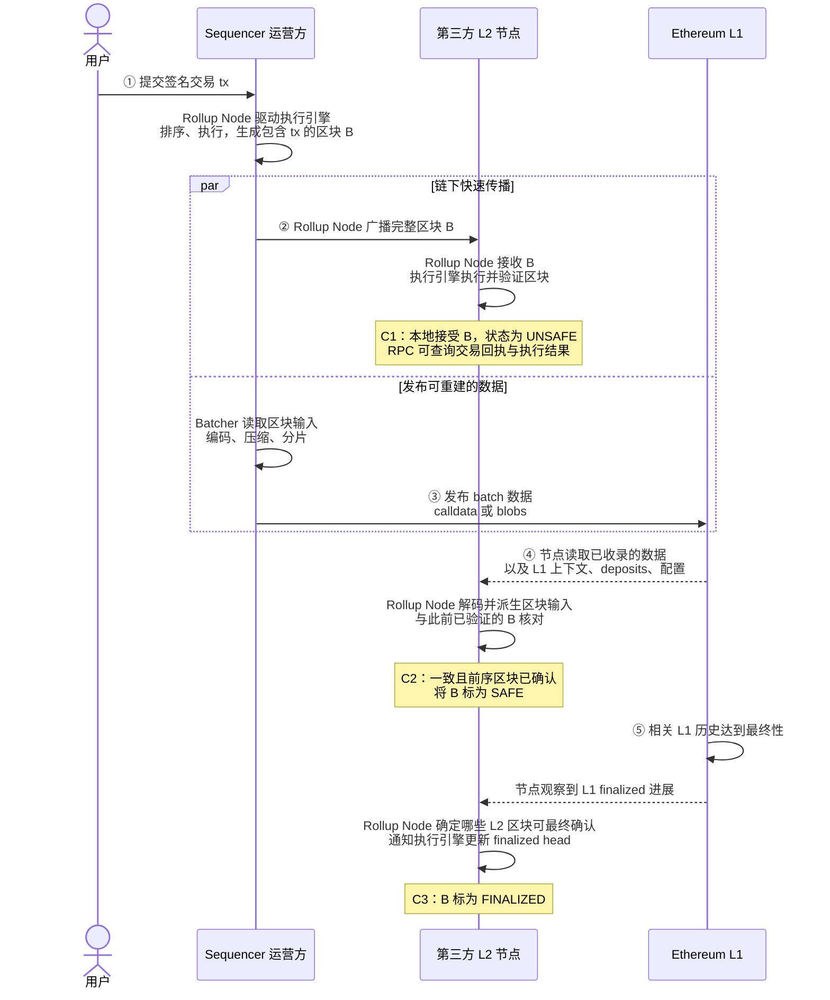
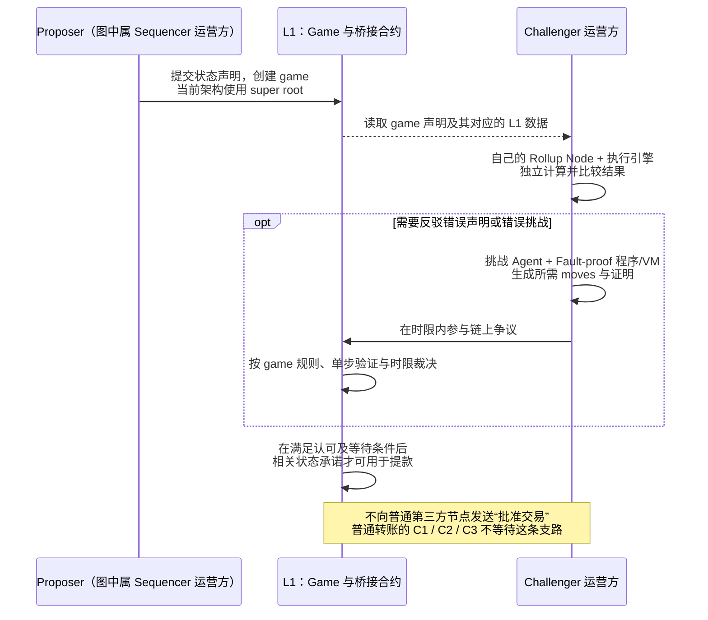

# OP Stack：整体架构、交易确认与 Batch 数据往返

整理日期：2026 年 9 月 21 日；2026 年 9 月 22 日将激励分析统一整理至第 07 篇。根据本次讨论及查阅的 OP Stack 官方规范整理。

本文讨论以 Ethereum 提供数据可用性与结算、采用 permissionless fault proof 的 OP Stack 链，围绕一条 L2 内部的普通转账解释架构、确认与数据派生。跨 L2 互操作暂不展开。当前公开规范与具体链的升级配置可能不同。

[返回中文阅读索引](README.md)

[直接阅读：Challenger 与 Fault Proof 激励](07_sequencer_selection_fees_and_tokenomics.md#7-challenger-与-fault-proof-系统的激励) · [桥接与故障场景](08_op_stack_bridge_and_disputes.md) · [二分与 VM 单步裁决](09_fault_proof_bisection_and_cannon_vm.md)

## 1. 整体架构：区分实体与子模块

OP Stack 将快速出块、发布可重建的数据、独立验证，以及让 L1 接受执行结果分成不同职责。

| 实体 | 内部子模块 | 主要职责 |
| --- | --- | --- |
| **Sequencer 运营方** | 交易入口与交易池、Rollup Node、Execution Engine；本图也放入 Batcher、Proposer | 选择并排序交易，执行并生成 L2 区块；发布交易输入；提交状态承诺 |
| **第三方 L2 节点** | Rollup Node、Execution Engine、RPC | 接收并验证区块；从 L1 独立派生历史；向使用者提供交易结果和确认状态 |
| **Challenger 运营方** | 自己使用的 L2 验证节点、挑战 Agent、Fault-proof 程序与 VM | 独立计算正确结果，检查 L1 上的状态声明，并在需要时参与链上争议 |
| **Ethereum L1** | 共识与数据可用性，以及 Dispute Game、Portal 等合约 | 确定 L1 历史并提供数据；执行争议与桥接规则 |

Batcher、Proposer 放在 sequencer 运营方内部只是便于展示：这些是独立职责，可以由不同运营者承担。**Rollup Node 也不是一个额外的中心化实体，而是 sequencer 和第三方节点都会使用的组件。** 它负责派生及驱动区块构建，Execution Engine 负责执行并计算结果。

见 [官方节点与组件架构](https://specs.optimism.io/protocol/overview.html#l2-node-components)。

独立 L2 节点使用户、交易所和应用能够自己验证结果。普通节点之间不靠多数投票决定哪个执行结果正确：给定相同的正确起点、L1 历史和协议配置，派生与执行应得到相同结果。仅使用未经验证的远程 RPC，仍需信任其回答。

**本地发现错误与阻止 L1 接受错误是两个动作。** 普通节点可以在本地拒绝错误结果；要阻止 L1 桥使用错误状态声明，还需要有人及时参与相应的 dispute game。协议不保证所有参与者诚实，permissionless fault-proof 路径依赖有资源的诚实参与者及时行动，以及 L1、验证规则和实现等前提。

见 [Rollup Node](https://specs.optimism.io/protocol/rollup-node.html#derivation)、[Fault Dispute Game](https://specs.optimism.io/fault-proof/stage-one/fault-dispute-game.html#core-game-mechanics)。

## 2. 普通交易的执行与确认主线

每一列是一个实体；列内的自调用标明哪个子模块在工作。Sequencer 生成区块后，完整区块的快速传播与 batch 数据发布可以并行推进。



这里的箭头表示信息流；“L1 → 节点”通常由节点主动读取实现。图中展示数据有效、两条路径一致的正常情况。

| 确认阶段 | 第三方节点何时作出判断 | 对用户意味着什么 |
| --- | --- | --- |
| **C1 / Unsafe** | 已接收、执行并验证 sequencer 广播的区块，将其纳入本地 unsafe 链 | 已知这条候选历史上的交易结果，但该历史尚未由 L1 数据确认 |
| **C2 / Safe** | 已从当前规范 L1 历史派生出完整输入，并确认区块与之相符 | 区块可由公开的 L1 输入重建；仍受相关 L1 重组影响 |
| **C3 / Finalized** | 派生该区块所依赖的 L1 历史已 finalized | 在 L1 最终性和协议正确性的假设下，这段 L2 历史已经确定 |

见 [确认状态定义](https://specs.optimism.io/glossary.html#safe-l2-block)、[派生中的 head 更新](https://specs.optimism.io/protocol/derivation.html#engine-queue)。

需要保留三个区别：

- **交易被包含与交易执行成功不同。** 转账是否成功，还要检查回执的执行状态。
- **Safe 不要求把同一区块再执行一次。** 如果节点此前已验证该区块，可以核对 L1 派生输入与已有区块是否一致；不一致时，以派生结果为准重建，原 unsafe 历史可能被重组。
- **节点也可以不走快速路径。** 没有提前收到区块的节点，可以直接从 L1 派生输入，再执行得到 safe 区块。

见 [已有 unsafe 区块的核对](https://specs.optimism.io/protocol/derivation.html#l1-consolidation-payload-attributes-matching)。本图从完整 L2 区块开始；启用 Subblocks 或 Flashblocks 的链还可在 C1 前提供部分区块的 pending 结果。当前 Subblocks 是 Flashblocks 的兼容后继方案，由执行客户端原生发布，保留普通 OP Stack 的有效性与最终性规则；具体差异见 [Mini-block、Flashblocks 与 Subblocks 对比](05_miniblocks_and_flashblocks.md#4-三个名称对应什么共同思路是什么)。

## 3. 状态声明与争议是独立支路

普通节点能够自己重算 L2 状态，L1 桥合约则不会日常重放所有 L2 交易。因此，Proposer 另行提交执行结果的承诺，供 L1 上的证明和争议机制处理。

单链的 output root 承诺某个 L2 区块的执行结果及提款相关信息；当前架构使用的 super root 汇总指定链集合在同一时间点的 outputs，该集合也可以只有一条链。见 [Super Fault Dispute Game](https://specs.optimism.io/fault-proof/stage-one/super-fault-dispute-game.html)。

下面这条支路与上一张图独立推进，**不要求先完成 C3 才开始，也不向普通节点发送“批准交易”的消息。**



图中只概括争议动作，没有展开多轮回应。完整提款仍需证明提款消息包含在被认可的状态承诺中，并满足提款自身的检查与等待条件。**L2 区块 finalized 与 L1 提款可 finalize 是不同条件。** 见 [当前架构](https://specs.optimism.io/protocol/overview.html#core-l1-smart-contracts)、[OptimismPortal](https://specs.optimism.io/fault-proof/stage-one/optimism-portal.html)。

桥接与两条流程的关系可以概括为：L1 → L2 的 deposit 进入派生输入；L2 → L1 的 withdrawal 需要 L1 接受相应的状态承诺，并验证消息包含性。参与争议的激励见 [第 07 篇的 Challenger 与 Fault Proof 激励](07_sequencer_selection_fees_and_tokenomics.md#7-challenger-与-fault-proof-系统的激励)，二分与单步裁决见 [第 09 篇](09_fault_proof_bisection_and_cannon_vm.md)。

## 4. Batch：编码、压缩和发布

数据搬运部分可以抽象成“序列化 + 压缩 + 分片运输”。各层的职责如下：

| 层次 | 保存什么 | 为什么需要 |
| --- | --- | --- |
| **Batch** | 有序的普通用户交易，以及关联 L2 区块和 L1 origin 所需的信息 | 描述重建区块所需的输入 |
| **Channel** | 一组编码后的 batches 构成的压缩流 | 利用重复信息节省发布空间 |
| **Frame** | Channel 的一段字节，以及 channel 标识、分片序号和结束标记 | 将数据拆成适合运输的片段，供接收方重组 |
| **L1 数据交易** | 在 calldata 或关联 blobs 中携带这些数据 | 将数据纳入 L1 的可用历史 |

Singular batch 对应一个 L2 区块；span batch 可以编码多个连续区块。因此，L2 区块、batch、channel 和 L1 交易之间没有统一的一对一关系。见 [Batcher](https://specs.optimism.io/protocol/batcher.html)、[Span batches](https://specs.optimism.io/protocol/delta/span-batches.html)。

以单个区块 `B101` 为例，令它的父区块为 `B100`，L1 origin 为 `L900`，时间戳为 `T`，普通用户交易为 `[tx1, tx2]`。其 singular batch 可抽象为：

```text
batch101 = (
    parent_hash      = hash(B100),
    l1_origin        = (900, hash(L900)),
    l2_timestamp     = T,
    transactions     = [已签名 tx1 的字节, 已签名 tx2 的字节]
)

batch101
    → 编码，并与其他 batches 一起压缩成 channel
    → 切成带编号的 frames
    → 由 batcher 签署并广播 L1 数据交易
    → 例如被 L1 区块 L904 收录
```

这里是逻辑结构示意，省略了具体版本字节和序列化格式。Batch 携带可恢复的交易内容与顺序，而非只有交易哈希；无需携带执行后的全体账户余额表。**L900 是 L1 origin，L904 是数据被收录的位置，两者不同。** 见 [Batch 格式](https://specs.optimism.io/protocol/derivation.html#batch-format)。

Batcher 将交易发往约定的 Batch Inbox 地址。这个地址不负责解压或执行 L2 交易；第三方节点按约定识别数据。Calldata 路径直接读取交易数据；blob 路径根据 L1 交易中的引用获取并验证 blob，再恢复其中的字节。密码学检查可抽象为 `VerifyBlob` 接口。见 [Batch Inbox](https://specs.optimism.io/protocol/overview.html#l2-node-components)、[Blob 读取](https://specs.optimism.io/protocol/ecotone/derivation.html#ecotone-blob-retrieval)。

## 5. 反向读取：还原输入，再计算新状态

节点已经拥有正确的父区块 `B100` 及其执行后状态 `S100`。它从 L1 获取并恢复 `batch101`：

```text
读取 L1 数据交易（例如位于 L904）
    → 检查 Batch Inbox 与当时授权的 batcher
    → 提取 calldata，或获取并验证关联 blobs
    → 解析 frames，按标识和序号恢复 channel
    → 解压、反序列化，恢复 batches
    → 按协议检查 batch 的父区块、时间戳、L1 origin 等
    → 得到可用于 B101 的普通交易列表 [tx1, tx2]
```

解码恢复字节，派生规则决定哪些输入可以被采用；这两个步骤要分开理解。节点还要从 L1 补齐 batch 之外的输入。见 [派生流程](https://specs.optimism.io/protocol/derivation.html#l2-chain-derivation-pipeline)。

假设 `B101` 是 epoch 900 的第一个区块，且 `L900` 的 Portal 事件中有一笔 deposit；暂不考虑网络升级交易，则完整交易列表是：

```text
B101.transactions = [
    从 L900 的属性派生的 L1 attributes transaction,
    从 L900 的 receipts / Portal 事件派生的 deposit,
    从 batch101 恢复的 tx1,
    从 batch101 恢复的 tx2
]
```

每个区块都有 L1 attributes transaction；用户 deposits 在对应 epoch 的第一个区块加入。它们不需要由 batcher 重复上传。见 [Deposits](https://specs.optimism.io/protocol/deposits.html#kinds-of-deposited-transactions)。

Rollup Node 将这些交易与按协议确定的时间戳、gas limit 等上下文组成执行输入，交给 Execution Engine。重建时禁止从本地交易池另加交易，以保证所有节点使用相同输入。

```text
完整执行输入 = Derive(L1 历史, 协议配置, 已有链)

(S101, receipts, B101) = ExecuteAndBuild(S100, 完整执行输入)
```

因此，反向运输的终点是恢复区块的**输入**；新的余额、合约存储、回执和状态根由执行引擎重新计算。单独一个 state root 或 output root 无法反序列化出这些状态。见 [Rollup Node](https://specs.optimism.io/protocol/rollup-node.html#derivation)、[执行输入构造](https://specs.optimism.io/protocol/derivation.html#building-individual-payload-attributes)。

若节点此前已验证过 `B101`，派生输入一致时可将其标为 safe；相关 L1 历史 finalized 后再推进 finalized head。整个输入恢复与执行过程不需要等待 Proposer 的状态声明或 Challenger 的批准。

[返回中文阅读索引](README.md)
