# OP Stack：桥接、争议与故障处理流程

整理与来源核对日期：2026 年 9 月 22 日。

本文回答两个问题：**正常情况下，Ethereum 与 L2 的桥如何工作；参与者偏离正常流程时，由谁发现、用什么机制处理、最终恢复什么保证。** 图使用轻量 Mermaid，密码学和虚拟机实现抽象成接口。

范围：Ethereum 提供数据可用性与结算、采用 permissionless interactive fault proof 的 OP Stack 链。ETH 示例按当前 overview 中启用 `ETHLockbox` 的配置讲解；其他部署须核对配置。本篇按**争议与故障场景**分类，不枚举所有可注册的 game 实现，也不讨论第三方流动性桥。

[返回中文阅读索引](README.md) · [前置：架构、实体与交易确认](06_op_stack_architecture_and_pipeline.md)

## 阅读路线

- [1. 实体、子模块与安全目标](#entities)
- [2. 理想流程：L1 → L2](#deposit)
- [3. 理想流程：L2 → L1](#withdrawal)
- [4. Fault proof 究竟检验什么](#proof-scope)
- [5. 场景索引](#scenario-index)
- [6. 错误状态声明与假提款](#wrong-root)
- [7. 错误提款证明或重复领取](#bad-withdrawal)
- [8. 正确声明受到恶意挑战](#bad-challenge)
- [9. 审查普通交易或提款请求](#censorship)
- [10. 扣留 batch 或持续离线](#withholding)
- [11. 短时离线与运营切换](#short-outage)
- [12. 冲突区块与预确认被撤回](#equivocation)
- [13. 有效交易重排与 MEV](#ordering)
- [14. Proposer 停止工作](#proposer-outage)
- [15. 桥接调用失败与应急权限](#limits)

<a id="entities"></a>

## 1. 实体、子模块与安全目标

| 实体 | 内部子模块或合约 | 职责 |
| --- | --- | --- |
| 用户 / Relayer | 钱包、证明生成或提交工具 | 发起操作；任何有能力的人可代为提交证明、触发后续交易，消息中的接收人不会因此改变 |
| Sequencer 运营方 | 交易入口、Rollup Node、Execution Engine；常同时运行 Batcher | 排序、执行、传播 L2 区块；向 L1 发布可重建的输入 |
| 第三方 L2 节点 | Rollup Node、Execution Engine、RPC | 独立派生与执行；向使用者提供自己验证的状态 |
| Proposer | L2 数据来源、状态承诺提交服务 | 在 L1 提出状态声明；不等同于区块生产者 |
| Challenger 运营方 | L2 验证节点、挑战 Agent、Fault-proof Program / VM | 检查声明，挑战错误结果，并在必要时维护正确结果 |
| Ethereum L1 | 共识、DA；Portal、DisputeGameFactory、Games、AnchorStateRegistry、ETHLockbox | 固定输入历史，执行争议规则与桥接检查 |

图中的“L1 自调用”表示合约检查或状态更新；需要的链上调用仍须有人提交，并支付 gas。普通第三方节点不会自动替它的运营者发送挑战交易。角色可以由同一组织承担，但职责必须分开。见 [官方架构](https://specs.optimism.io/protocol/overview.html#l2-node-components)。

- **Safety：**错误状态声明不能被桥用来放款；不存在凭空提款或重复领取。
- **Liveness：**在前提满足时，合法请求有进入 L2 和最终退出到 L1 的路径。
- **快速服务：**普通 RPC 交易及时得到 sequencer 响应。这与经 L1 的较慢退出路径不是同一个保证。

一份错误声明被挑战并挡住，说明防护机制发挥作用，不能据此说已经发生最终状态的 safety violation。节点的 `unsafe → safe → finalized` 也不同于桥的 `initiate → prove → finalize`。

<a id="deposit"></a>

## 2. 理想流程：Ethereum L1 → L2

### 2.1 原生 ETH：L1 托管，L2 按 L1 记录入账

以下以 Alice 直接存入 1 ETH 到自己 L2 地址为例，忽略手续费。标准桥前端可能在 Portal 之上再经过 StandardBridge 与 Messenger。

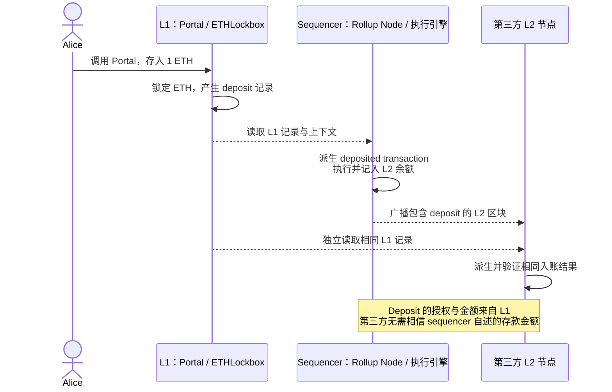

L1 的 ETH 被保留在托管系统中；L2 的原生 ETH 是执行状态中的余额，并非一定对应一个 ERC20 WETH。启用 Lockbox 时，Portal 将存入的 ETH 交给它管理。见 [ETHLockbox](https://specs.optimism.io/interop/eth-lockbox.html)、[Deposit flow](https://docs.optimism.io/op-stack/bridging/deposit-flow)。

Deposited transaction 的授权来自 L1 Portal 记录和派生规则。Sequencer 无权修改金额或伪造来源；即使没有它广播的区块，第三方仍可根据 L1 数据派生。目标调用可能失败：强制纳入保证执行尝试，不保证应用成功。原生 ETH 的 deposit mint 与后续调用是两个步骤，调用失败不会撤销此前的 mint。见 [Deposits](https://specs.optimism.io/protocol/deposits.html#validation-and-authorization-of-deposited-transactions)。

### 2.2 Ethereum 原生 ERC20：标准桥建立对应资产关系

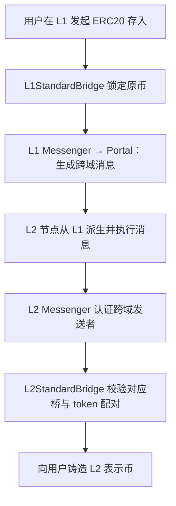

返程是销毁 L2 表示币，经过下节的提款验证后释放 L1 原币。若代币原生于 L2，锁定与表示币的方向可能相反。Messenger 负责跨域身份与消息转发，StandardBridge 负责资产规则；不能把“有人调用了铸币接口”当成合法跨链存款。见 [Standard Bridge](https://docs.optimism.io/app-developers/guides/bridging/standard-bridge#design)、[Messengers](https://specs.optimism.io/protocol/messengers.html)。

<a id="withdrawal"></a>

## 3. 理想流程：L2 → Ethereum L1

### 3.1 无攻击时的完整 pipeline

Alice 在 L2 发起提款消息 `w`。以 ETH 为例，资金进入 `L2ToL1MessagePasser`，退出用户可支配余额，合约同时记录消息摘要；其 `burn()` 是另一个可被触发的操作，不能把每次 `initiateWithdrawal` 都画成原子销毁 ETH。见 [MessagePasser](https://github.com/ethereum-optimism/optimism/blob/develop/packages/contracts-bedrock/src/L2/L2ToL1MessagePasser.sol)。

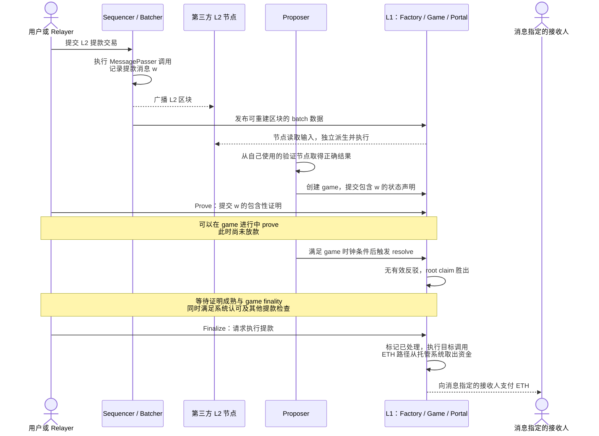

这是消息成功执行的理想路径。Proposer、prove 的提交者、resolve 的调用者、finalize 的调用者不必是同一个人。图中的先后仅表示一条可行路径：节点同步、proposal 和 proof 的处理可以交错，并不要求提款区块先达到 L2 finalized 才开始所有步骤。见 [Withdrawal flow](https://docs.optimism.io/op-stack/bridging/withdrawal-flow)。

### 3.2 两种证明、两种等待

定义：`w` 是绑定发送者、目标、金额、调用数据和 nonce 等内容的提款消息；`r` 是本链 output root；`R` 是 game 的 root claim。当前 super-root 架构中，`R` 承诺包含 `r` 的 super output。

| 检查 | 回答什么 | 由什么完成 |
| --- | --- | --- |
| 包含性 | `w` 是否存在于 `r` 所承诺的提款记录中，以及 `r` 是否对应被引用的 claim？ | Portal 验证承诺关系与包含性证明 |
| 结果正确性 | 被引用的 claim 是否符合指定 L1 输入下的协议计算？ | Fault-proof game，加上系统对 game 的认可条件 |
| 等待与防重放 | 证明是否成熟、game 是否可用于提款、消息是否已处理？ | Portal / AnchorStateRegistry 等检查 |

攻击者可以在自己编造的状态里放入假提款，再生成对该假状态完全正确的包含性证明。因此，包含性成立不推出 root 正确。

设 `t_prove` 是提款证明提交时间，`t_resolve` 是 game 结束时间，`M` 为证明成熟期，`A` 为 game 结束后的 finality delay。提款至少要同时满足：

```text
当前时间 >= t_prove + M
当前时间 >  t_resolve + A
```

此外，game 必须属于系统认可范围、root claim 胜出，且没有被相关失效机制排除；系统不能处于阻断该提款的暂停状态，提款也不能重复执行。两个等待区间可重叠；它们不同于 game 内部的争议时钟。见 [Portal 检查](https://specs.optimism.io/fault-proof/stage-one/optimism-portal.html#checkwithdrawal)、[Valid Claim](https://specs.optimism.io/fault-proof/stage-one/anchor-state-registry.html#valid-claim)。

<a id="proof-scope"></a>

## 4. Fault proof 究竟检验什么

真实 claim 数据结构、attack / defend 二分、Cannon VM 状态及单步裁决的完整例子，见 [第 09 篇：从错误 root 到 Cannon VM 单步裁决](09_fault_proof_bisection_and_cannon_vm.md)。

把密码学与 VM 抽象掉，正确声明可表示为：

```text
R* = ComputeClaim(正确起点, 指定的 L1 历史, 协议配置, 声明位置)
```

`ComputeClaim` 包括派生和执行。争议针对提议者声称的 `R` 是否等于 `R*`，而非判断 sequencer 是否善意、是否采用公平顺序或是否提供了优质服务。

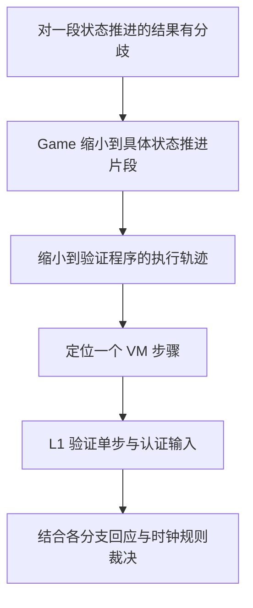

| 接口 | 抽象职责 |
| --- | --- |
| `Program(inputs, claim)` | 按 rollup 规则计算并判断声明 |
| `ReadAuthenticatedData(commitment)` | 提供与指定承诺一致的数据；隐藏 preimage、Merkle、blob 等细节 |
| `VerifyStep(pre, post, witness)` | 检查验证程序的一步；不等于“一笔完整 EVM 交易” |
| `Game(moves, clocks, bonds)` | 组织分歧定位、回应、超时与保证金结算 |

基础单链 FDG 先缩小到区块状态转移，再进入 VM 轨迹；当前 Super FDG 上层改为 super-root 状态推进，底层仍是程序轨迹与单步验证。图只保留共同原理。真实 game 可多人参加，包含多条相互反驳的 claims；不是固定两个人沿唯一分支轮流行动。见 [Fault Proof](https://specs.optimism.io/fault-proof/index.html)、[Super FDG](https://specs.optimism.io/fault-proof/stage-one/super-fault-dispute-game.html)。

<a id="scenario-index"></a>

## 5. 场景索引

以下覆盖本次讨论中的主要场景，不表示所有行为都是正式的链上 dispute。

| 场景 | 直接处理机制 | 对应性质 |
| --- | --- | --- |
| 错误执行、假存款、遗漏必要 deposit 后提出错误 root | 本地验证 + fault dispute game | 状态与桥接 safety |
| 错误包含证明、篡改提款、重复领取 | Portal 直接校验 | 消息认证与防重放 |
| 正确 root 被恶意挑战、争议不回应 | 诚实回应 + 单步验证 + 时钟 + bonds | 结算正确性与进展 |
| 普通链下交易被审查 | L1 deposited transaction | 有延迟的强制纳入 |
| 扣留 batch、长时间没有 batch | 发布窗口 + 确定性 fallback | 规范历史继续推进 |
| 短时离线 | 运营恢复 / HA；必要时 L1 入口 | 快速服务与可用性 |
| 冲突 unsafe 区块或撤回预确认 | L1 派生历史确定规范分支 | 预确认与最终历史的边界 |
| 有效交易重排、MEV | 基础 fault proof 通常不禁止 | 公平性不等于执行正确性 |
| Proposer 停止提交 | 其他参与者提交、维护正确 game | 退出 liveness |

<a id="wrong-root"></a>

## 6. 错误状态声明与假提款

下图给出总体关系；具体如何从 root 不一致定位到一条可验证的机器步骤，见 [第 09 篇的二分示例](09_fault_proof_bisection_and_cannon_vm.md#bisection)。

**触发：**提议者声称错误余额、虚构一笔 deposit、遗漏已经成为必要输入的 deposit，或者在不存在真实提款时声称它存在。这些偏离只有在影响所声明的结果、使 `R != R*` 时，才构成这里的错误 root 场景。

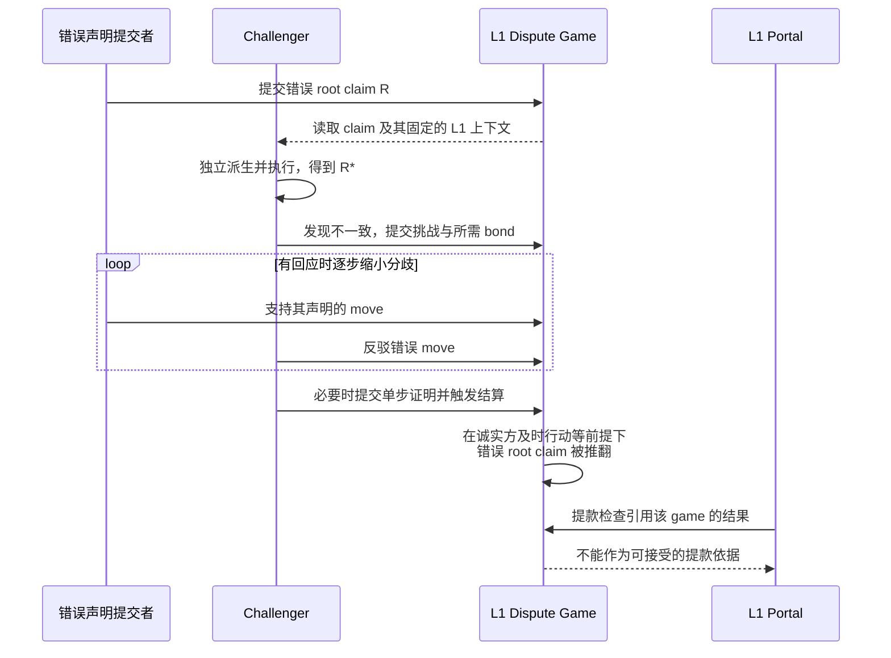

**结果：**阻止依赖这份错误声明放款；正确节点仍按公开输入计算自己的 L2 历史。挑战不是对正常交易排序的重新投票，也不意味着有效 batch 中的全部交易应被删除。

**边界：**本地发现错误不自动改变 L1 合约状态；必须有人及时行动。Game 也可能因超时结束，不必总走到单步验证。见 [FDG](https://specs.optimism.io/fault-proof/stage-one/fault-dispute-game.html)、[派生与错误 output 的关系](https://specs.optimism.io/protocol/derivation.html#sequencing--batch-submission-overview)。

<a id="bad-withdrawal"></a>

## 7. 错误提款证明或重复领取

**触发：**提款内容与证明不匹配、认证路径错误，或消息已经被执行。此处假设被引用的状态承诺本身没有争议；错误 root 的情况见上一节。

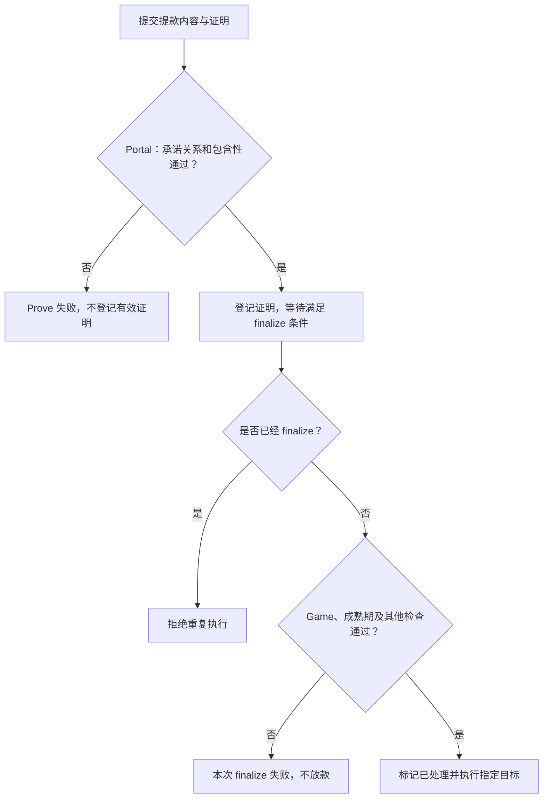

**结果：**由桥接合约直接拒绝不合格调用，不需要为每个错误 Merkle proof 新开一场 fault game。等待条件尚未满足导致失败，也不等于提交者恶意。见 [Portal 的证明与 finalization 接口](https://specs.optimism.io/fault-proof/stage-one/optimism-portal.html#provewithdrawaltransaction)。

<a id="bad-challenge"></a>

## 8. 正确声明受到恶意挑战

**触发：**攻击者对正确 root 提出反驳，企图让正确声明败诉或拖延提款。Defender / Challenger 表示支持或反对 root 的立场，不分别等同于好人和坏人。

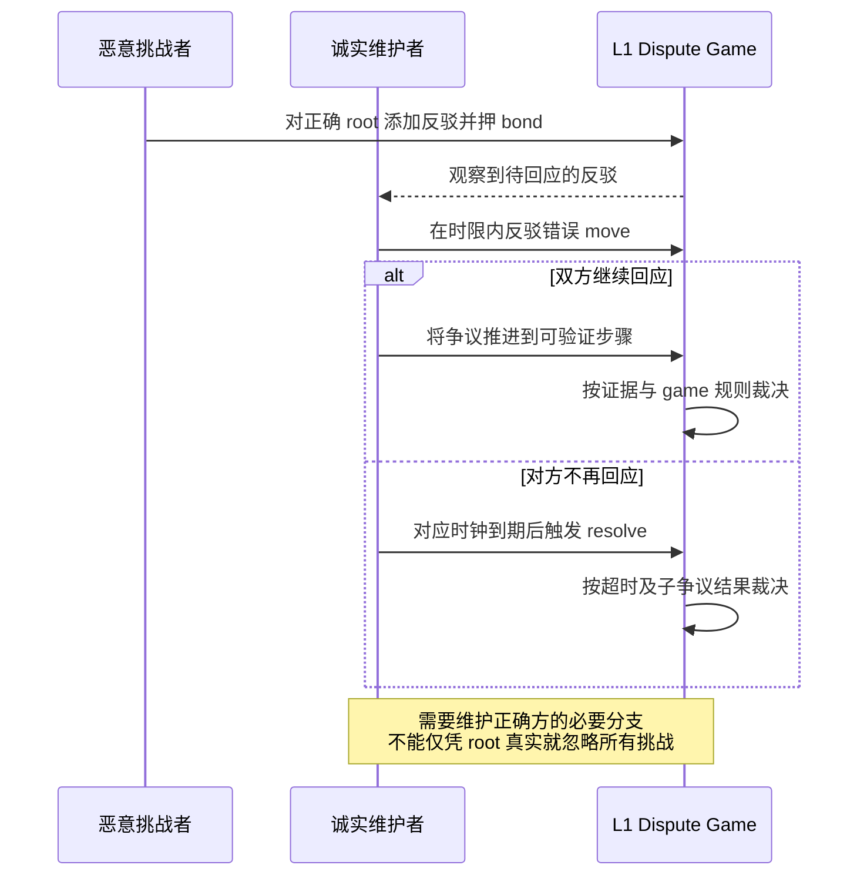

**结果：**在诚实方有能力并及时回应的前提下，维护正确声明；相关 bonds 按子争议规则结算。争议可能增加实际退出时间，不能保证零延迟。

**边界：**“没人回应我”不是密码学意义上的正确性证明。保证金激励参与，也不自动保证所有必要参与者在线。Game 的 bonds 不是一笔可用于惩罚 sequencer 所有审查、停机行为的通用质押。见 [Game clock](https://specs.optimism.io/fault-proof/stage-one/fault-dispute-game.html#game-clock)、[Bond Incentives](https://specs.optimism.io/fault-proof/stage-one/bond-incentives.html)。

<a id="censorship"></a>

## 9. 审查普通交易或提款请求

**触发：**用户只把普通交易交给 sequencer，但它一直不纳入。链下请求本身未必是规范输入，也没有由 fault proof 强制采用的公共 mempool。

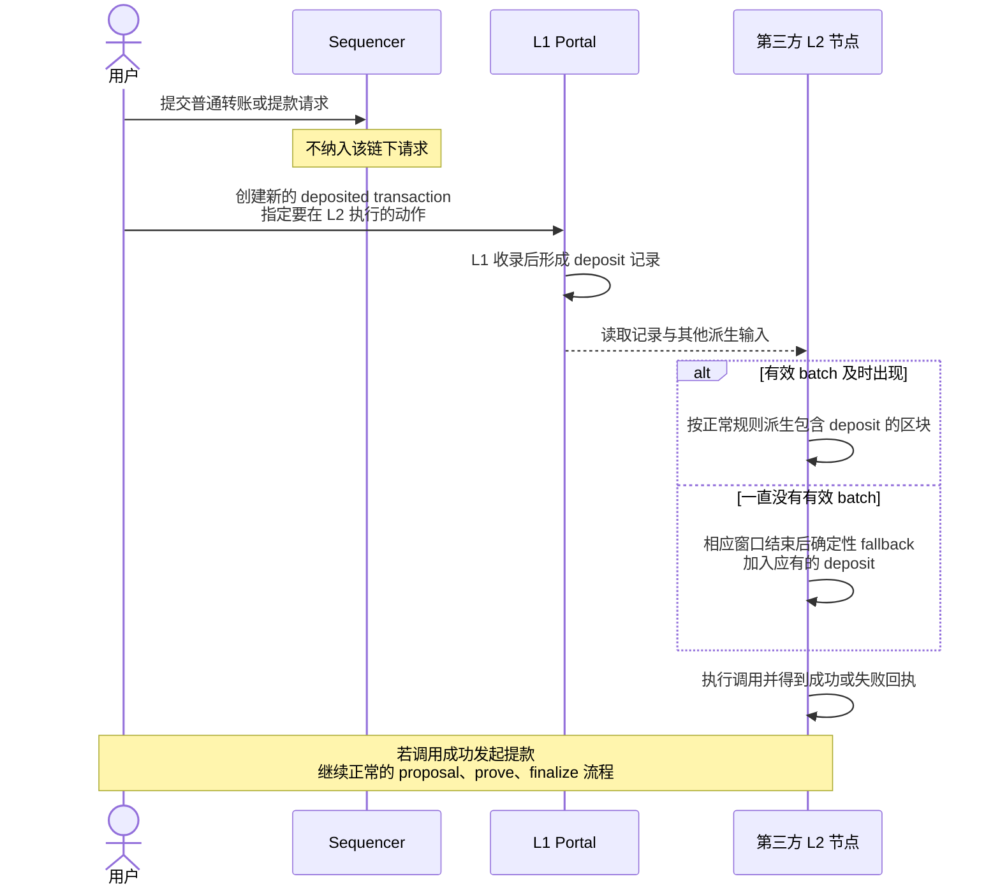

**结果：**请求经 L1 变成必须处理的输入；不必先证明审查，也不必等窗口结束才提交。可以只发起调用，不附带新存入资产，但仍需支付费用并设置足够的 gas。见 [Forced transactions](https://docs.optimism.io/op-stack/transactions/forced-transaction)。

**边界：**这不是原样重放任意旧的签名 L2 交易；deposited transaction 有自己的来源与授权规则。合约调用方涉及地址 alias，复杂钱包须匹配其授权路径。纳入也不保证调用成功。见 [Deposit address aliasing](https://specs.optimism.io/protocol/deposits.html#address-aliasing)。

若随后有人声称一个遗漏该必要 deposit 的错误状态，转入[错误 root 的挑战流程](#wrong-root)。强制纳入本身无需 challenger 先批准。

<a id="withholding"></a>

## 10. 扣留 batch 或持续离线

**触发：**sequencer 继续发送 unsafe 区块但 batcher 不发布数据，或者运营方持续离线、根本没有新的有效 batch。

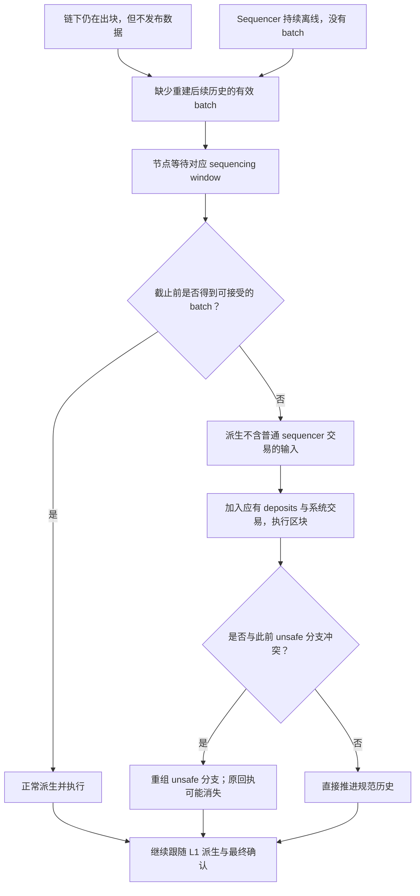

**结果：**节点可以继续推进由 L1 确定的历史，处理 forced deposits。所有正确节点计算相同 fallback；不需要某个第三方赢得出块权。发布太晚的旧 batch 不能恢复原有区块位置。

**边界：**未提交到 L1 的普通 mempool 交易不会被自动收录。第三方也不会因 sequencer 离线就获得 batch-sender 权限。若仍在链下出块，用户可能看到 unsafe 增长而 safe / finalized 停滞。见 [Submission outages](https://docs.optimism.io/op-stack/protocol/outages#transaction-submission-outages)、[Batch Queue](https://specs.optimism.io/protocol/derivation.html#batch-queue)。

### 两个不同的时间约束

| 参数 | 当前标准背景下的值 | 含义 |
| --- | --- | --- |
| `max_sequencer_drift` | Fjord 后 1800 秒 | 约束 L2 时间戳相对 L1 origin 的超前；超界不能继续携带普通 sequencer 交易 |
| `sequencing_window_size` | 标准配置为 3600 个 L1 区块；按每块 12 秒约 12 小时 | 限制相关 batch 的发布窗口，并支持缺失 batch 时确定 fallback |

30 分钟不是自动切换 leader 的期限。12 小时是按相关 L1 历史推进的窗口，不是每次故障启动的新计时器，也不是提款到账时间。自定义链需核对自己的参数；正常情况下有完整有效输入即可尽早派生，无须每次等满窗口。见 [Fjord](https://specs.optimism.io/protocol/fjord/derivation.html#constant-maximum-sequencer-drift)、[Sequencing window 配置](https://specs.optimism.io/protocol/configurability.html#sequencing-window-size)。

<a id="short-outage"></a>

## 11. 短时离线与运营切换

**触发：**sequencer 的进程、机器或网络短时间不可用。快速交易入口与出块暂停，但不必然阻断已经发布数据的最终确认或既有提款处理。

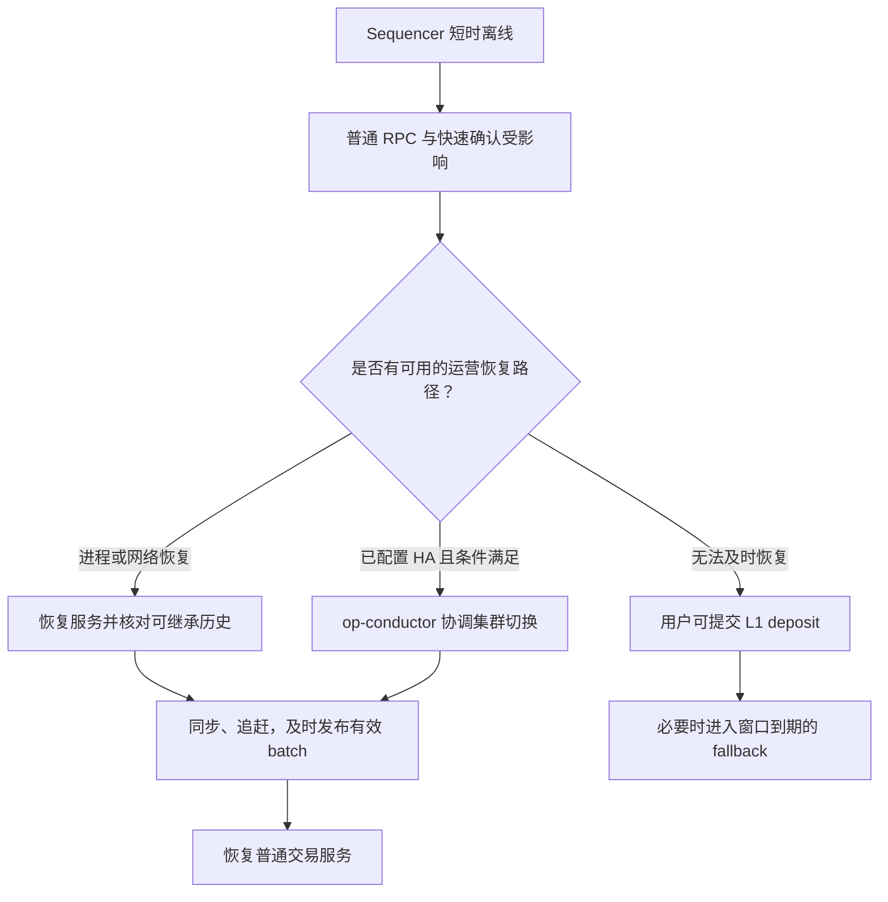

**结果：**快速恢复由运营系统负责；协议仍保留较慢的 L1 路径。

**边界：**`op-conductor` 使用 Raft 协调运营方配置的集群，官方明确不提供 Byzantine fault tolerance。它不能解决整个运营方恶意审查，也不是所有公共 L2 节点都可参加的选主。短时停机是否是 liveness violation，取决于讨论的是何种服务期限或最终纳入保证。见 [OP Conductor](https://docs.optimism.io/chain-operators/tools/op-conductor)。

<a id="equivocation"></a>

## 12. 冲突区块与预确认被撤回

**触发：**sequencer 给不同观察者发送同一位置的不同 unsafe 区块，或最终发布的有效输入与早先快速确认不同。

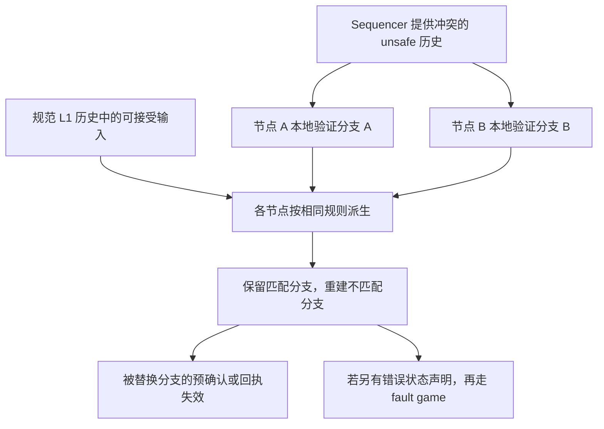

**结果：**规范 L1 输入确定最终采用的历史，不由节点数投票决定。

**边界：**撤回 unsafe 结果可能违背服务承诺，但不同于推翻 finalized 历史。基础 fault game 不应被理解为自动赔付所有预确认损失的机制。若要对签名双重承诺处罚，需要另有明确的承诺与罚则。见 [Unsafe consolidation](https://specs.optimism.io/protocol/derivation.html#l1-consolidation-payload-attributes-matching)、[确认状态](https://specs.optimism.io/glossary.html#unsafe-l2-block)。

<a id="ordering"></a>

## 13. 有效交易重排与 MEV

**触发：**用户不满意交易顺序，但该顺序满足 nonce、余额和其他协议约束，发布和执行也正确。

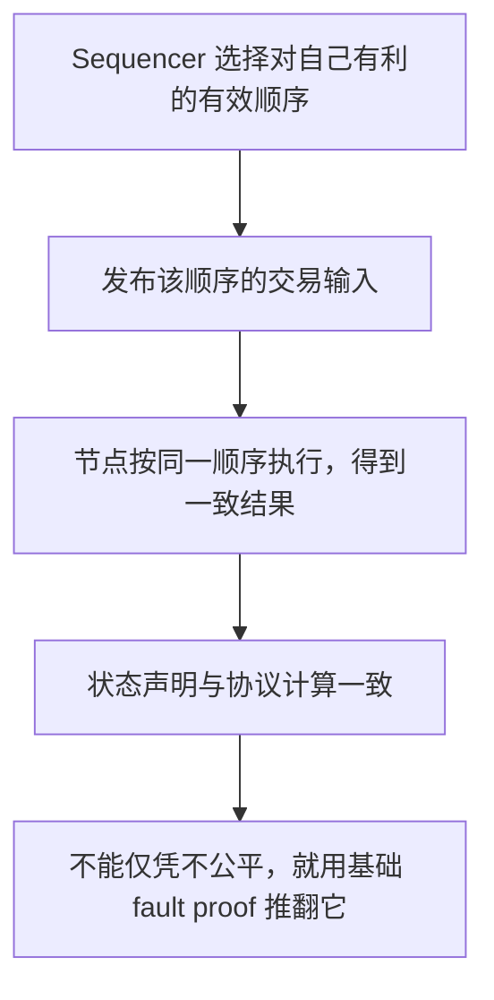

**结果：**该顺序可以成为规范历史。Fault proof 落实的是被编码进验证程序的规则，不会自行添加先到先得、公平排序或无 MEV 的要求。应用可设置滑点等约束，但那是另一层规则。见 [Sequencer policy](https://specs.optimism.io/interop/sequencer.html#sequencer-policy)。

<a id="proposer-outage"></a>

## 14. Proposer 停止工作

**触发：**输入数据已经公开，节点可计算正确状态，但常用 proposer 不提交包含某笔提款的新声明。普通交易的派生确认可继续，退出结算却可能停滞。

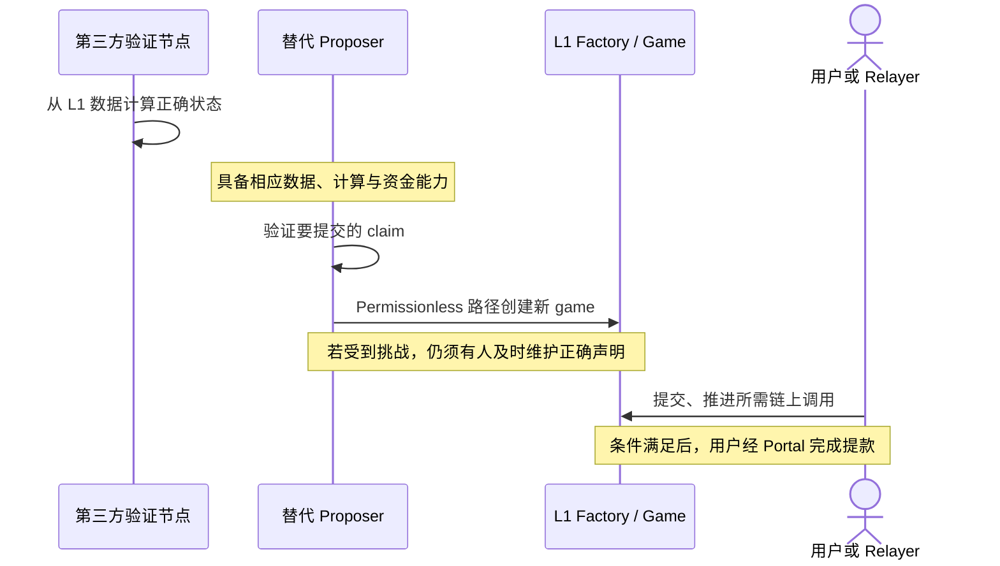

**结果：**无需原运营方独占地提供 proposal 服务。

**边界：**permissionless 表示别人可以承担职责，不表示计算、bonds 和 gas 无成本，也不保证无人行动时仍会自动完成。Permissionless proposing 不等于 permissionless sequencing；启用 permissioned game 的链还须另看权限。见 [DisputeGameFactory](https://specs.optimism.io/fault-proof/stage-one/dispute-game-interface.html#disputegamefactory-interface)、[安全模型](https://docs.optimism.io/op-stack/security/faq-sec-model)。

<a id="limits"></a>

## 15. 桥接调用失败与应急权限

### 15.1 消息真实，但目标调用失败

桥验证消息合法，不会保证目标应用接受调用。余额、gas、目标代码或业务条件仍可能导致失败；这不是证明系统发现了错误 root。

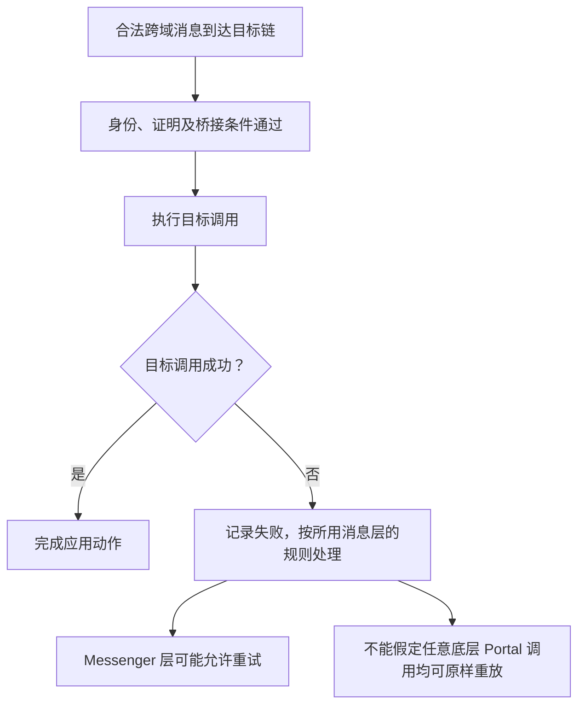

Messenger 的失败消息重试与 Portal 的底层提款 finalization 是不同机制；分析失败恢复时必须指明使用哪一层。见 [Messengers](https://specs.optimism.io/protocol/messengers.html#message-passing)、[Portal finalization](https://specs.optimism.io/fault-proof/stage-one/optimism-portal.html#finalizewithdrawaltransactionexternalproof)。

### 15.2 正常证明机制之外的前提

本文的恢复路径依赖 L1 持续可用并纳入交易、数据和计算资源可得、正确起点与实现，以及有能力的参与者及时行动。当前系统还存在暂停、game 黑名单、game retirement 和升级等权限；异常时可阻止危险放款，但也会影响退出活性。

合约上的 `Valid Claim` 是程序检查后的认可状态，不能脱离假设直接等同于真实正确。管理员改变规则、验证实现存在缺陷，或必要参与者未及时行动，都不在“单靠一个诚实节点知道真相即可保证安全”的简化说法之内。见 [AnchorStateRegistry assumptions](https://specs.optimism.io/fault-proof/stage-one/anchor-state-registry.html#assumptions)。

### 15.3 阅读官方材料时的版本边界

- 当前 [Overview](https://specs.optimism.io/protocol/overview.html) 使用 super-root game；Super FDG 可用于只有一条链的集合，不要求先开启跨 L2 interop。
- [旧 withdrawals 章节](https://specs.optimism.io/protocol/withdrawals.html)仍保留 `L2OutputOracle` 和固定七天的描述；本篇的当前提款认可流程依据专门的 Portal / AnchorStateRegistry 规范。
- 当前规范设计不等于所有 OP Stack 链都已采用同一合约版本、game type、权限或时间参数。

[返回中文阅读索引](README.md)
