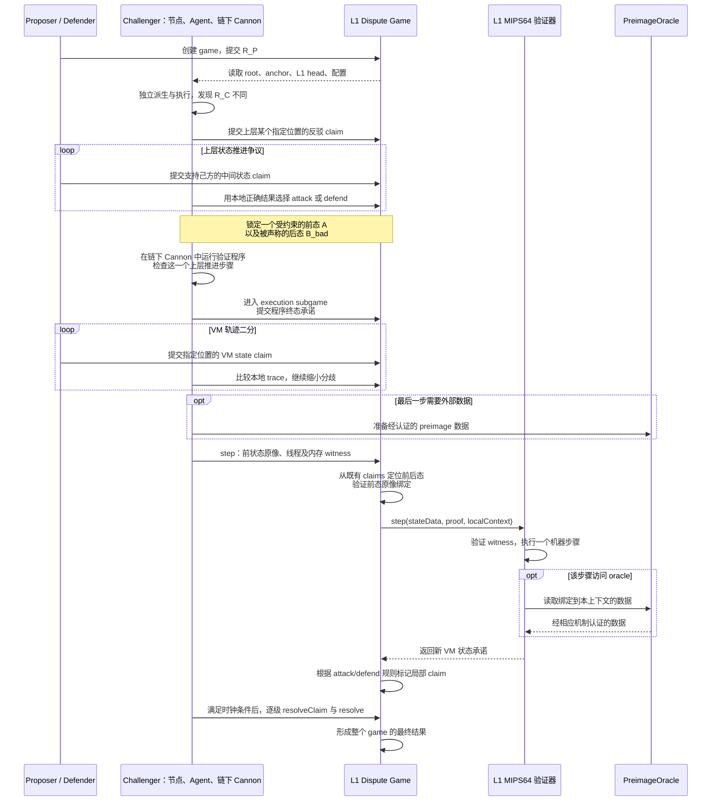
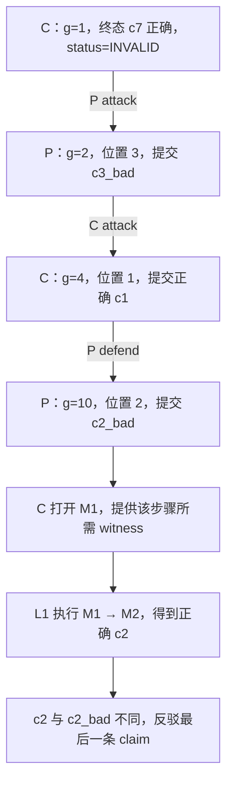
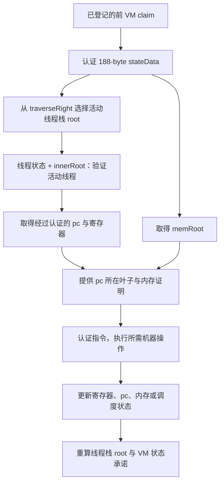
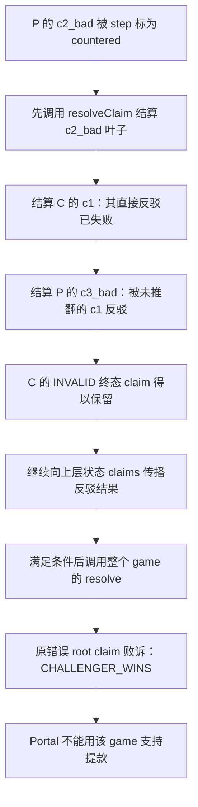

# OP Stack：从错误 root 到 Cannon VM 单步裁决

整理日期：2026 年 9 月 22 日。

本文展开第 08 篇中的 fault-proof 流程：**proposer 提交的 root 与 challenger 独立复现的结果不一致，如何通过真实 game 的 claims、position、VM 状态与 witness，定位一个可以在 L1 裁决的不一致步骤。**

[返回中文阅读索引](README.md) · [前置：桥接与各类争议](08_op_stack_bridge_and_disputes.md#proof-scope)

**版本与示例范围：**源码统一固定在 Optimism 提交 [`ad1c8e12f43c7e9158bb5da127b0153c3e28d4ad`](https://github.com/ethereum-optimism/optimism/commit/ad1c8e12f43c7e9158bb5da127b0153c3e28d4ad)，提交时间为 2026-09-21 17:52:59 UTC。使用该版本的 `SuperFaultDisputeGame` 与 **64 位多线程 Cannon / MIPS64**；不是旧的 32 位单线程 Cannon。所读 `MIPS64.sol` 标注版本 `1.10.1`，支持 `stateVersion = 8`。这固定了讲解对象，不表示核验了某条主网链的实际部署。

文中的八叶二分与寄存器数值是按真实规则构造的**教学示例**，不是截取的主网提款 trace，也没有声称执行过完整的链上争议。真实结构与示例参数在下文分别标注。

## 阅读路线

- [1. 从一个错误提款 root 开始](#example)
- [2. 全流程：两层二分与一个链上步骤](#pipeline)
- [3. 上层二分的对象](#upper)
- [4. Game 真正存储的数据](#claims)
- [5. 一个八叶二分示例](#bisection)
- [6. 真实 Cannon State 与 ThreadState](#vm-state)
- [7. 单步 witness 如何绑定线程、指令和数据](#witness)
- [8. 具体指令：41 加 1 为什么不能声称为 43](#instruction)
- [9. Game.step 与 VM.step 的职责](#onchain-step)
- [10. 从局部反驳到整个 game 结束](#resolution)
- [11. 和提款包含性证明的关系](#withdrawal-link)

<a id="example"></a>

## 1. 从一个错误提款 root 开始

假设 P 提交一个包含虚假提款记录 `w` 的状态声明 `R_P`。C 读取同一个 game 所指定的 L1 历史，从正确起点按相同配置派生、执行，得到不包含该记录的正确结果 `R_C`：

```text
R_P != R_C
```

这是 **C 在本地决定启动挑战的依据**，不是 L1 已经验证的错误证明。C 不能只提交另一个最终 root，就要求 L1 相信自己。

双方必须围绕相同计算问题展开争议。Game 固定或绑定的上下文包括：

| 上下文 | 作用 |
| --- | --- |
| 起始 anchor 及其位置 | 固定较早的、被系统认可的 L2 / super 状态起点 |
| `l1Head` | 固定本次计算可使用的 L1 历史范围，不能任意换成另一个分叉或更新后的输入 |
| 被争议的终点与 root claim | 固定要验证哪个时间点的什么结果 |
| 证明程序及配置 | 固定派生和执行规则；不同 program / prestate 不能混用 |
| `absolutePrestate` | 固定底层验证程序的初始 **VM 状态承诺** |

特别区分：**L2 anchor 是 rollup 计算的起点；absolute prestate 是运行验证程序的机器起点。** 它们不是同一种状态，也不是同一个 root。见 [Game 初始化与配置][game]、[Fault Proof Program](https://specs.optimism.io/fault-proof/index.html#fault-proof-program)。

本文用 `R` 表示上层状态声明，用 `M` 表示 VM 状态，用 `c` 表示 VM 状态承诺：

| 对象 | 承诺什么 |
| --- | --- |
| L2 state root | L2 账户与合约状态 |
| L2 output root | L2 state root、MessagePasser storage root、区块哈希等 |
| Super root / 上层 transition commitment | 一条或多条链的输出，或推进这些输出的中间状态 |
| VM state commitment `c` | 验证程序执行到某一步时的机器状态 |
| VM `memRoot` | 该机器全部内存的承诺，是 VM 状态中的一个字段 |

从上层进入 VM，并不是沿 L2 的状态树继续向下查账户；它是在验证“计算上层结果的程序究竟应当怎样运行”。

<a id="pipeline"></a>

## 2. 全流程：两层二分与一个链上步骤



两个容易误解的地方：

1. **初始 proposer 没有承诺一棵覆盖完整 VM trace 的 Merkle 树。** 后续 moves 会在指定位置提交新的状态声明；不是每轮向一棵初始 trace 树索取 midpoint inclusion proof。
2. **一次成功的 `step` 不直接结束整个 game。** 它反驳一条局部 claim；整个结果还要按照已登记的反驳关系和时钟规则向上结算。

参见 [SuperFaultDisputeGame][game]、[Challenger solver][solver]。

<a id="upper"></a>

## 3. 上层二分的对象

经典 output-root FDG 的上层可以理解为：从一段 L2 历史中定位一个有分歧的区块状态转移。当前 **Super FDG** 更一般：上层比较 super-root 状态推进中的承诺。

每个时间戳推进固定展开为 **128 个逻辑步骤**：逐链派生 local-safe blocks，超过链数量的位置推进步骤计数，最后进行 consolidation。单链集合仍采用这个结构。中间状态为：

```text
TransitionState {
    SuperOutput:     前一时间戳的 super output 编码
    PendingProgress: 已派生各链的 (blockHash, outputRoot) 列表
    Step:            当前逻辑步骤编号
}
```

因此被锁定的 `A → B_bad` 可能是“派生某条链下一个区块”的步骤，也可能是其他 super 状态推进步骤。**一个逻辑步骤通常对应很多 MIPS 指令，128 不是 CPU 指令数，也不是每秒 128 个 L2 区块。** 见 [Super FDG 规范](https://specs.optimism.io/fault-proof/stage-one/super-fault-dispute-game.html)。

到达 `SPLIT_DEPTH` 附近后，游戏转而验证这样一个程序：

```text
读取本子争议绑定的 A、B_bad、L1 head 等输入
按协议计算 Next(A, L1 inputs)
比较计算结果与 B_bad
相等则正常退出并返回 VALID；不相等则正常退出并返回 INVALID
```

程序被编译为选定 FPVM 可执行的机器代码，链下 Cannon 负责生成其执行轨迹。**验证程序输出 INVALID 可以是诚实的正确结果**：它表示被检验的上层声明错误，不表示提供这个 VM 终态的 challenger 在撒谎。

程序代码的初始状态由 `absolutePrestate` 约束；每个 execution subgame 的具体输入由 game 计算的 local context 和认证数据读取机制绑定。参与者不能通过偷偷更换程序、L1 输入或被比较的结果来改变题目。见 [Fault Proof 的输入与退出语义](https://specs.optimism.io/fault-proof/index.html#epilogue)、[execution root 与 local context 检查][game]。

<a id="claims"></a>

## 4. Game 真正存储的数据

### 4.1 一条 claim 的结构

所选源码中的 `ClaimData` 字段如下；这张表按字段解释语义，不代表 Solidity 的紧凑 storage 布局。

| 字段 | 类型 | 含义 |
| --- | --- | --- |
| `parentIndex` | `uint32` | 正在反驳的那条 claim 在 `claimData[]` 中的索引 |
| `counteredBy` | `address` | 被成功反驳后记录相应地址；初始为空 |
| `claimant` | `address` | 提交这条 claim 的人 |
| `bond` | `uint128` | 为本次 move 提供的保证金 |
| `claim` | `bytes32` 包装类型 | 上层状态承诺，或底层 VM state commitment |
| `position` | `uint128` 包装类型 | 声明对应的逻辑位置，采用 generalized index |
| `clock` | `uint128` 包装类型 | 累计回应时间与本次登记时间 |

Game 还维护 `subgames[parentIndex]`，记录有哪些 claims 反驳这个 parent。**`parentIndex` 与 `position` 是不同坐标：前者描述争议关系，后者描述计算位置。** 见 [ClaimData 与状态变量][game]、[类型定义][types]。

### 4.2 Position tree 与 claim 反驳图

设二叉位置树中一个节点深度为 `d`，在该深度的零基位置为 `i`：

```text
gindex = 2^d + i
```

它声称的是所覆盖区间的**最右端状态**。若该层使用的 trace 最大深度为 `D`，其对应 trace index 为：

```text
traceIndex = (i + 1) * 2^(D - d) - 1
```

这不是“这个区间内所有 states 的 Merkle root”。真实 move 的位置计算是：

```text
attack(g) = 2 * g
defend(g) = 2 * (g OR 1)
```

对通常出现的偶数非根位置，`defend(g) = 2g + 2`，**不是普通二叉树右孩子的 `2g + 1`**。因此，一条 defend move 在争议图中反驳它的 parent，但其 position 不必是该 parent 的普通二叉子节点。根 claim 和 execution subgame 的根不能通过 defend 回应。见 [LibPosition][position]、[move 检查][game]。

诚实 Agent 根据自己的 trace provider 取得相同位置的正确值：对需要回应的 claim，值不一致时通常 attack；值一致但仍需反驳该 move 的作用时，可以 defend，把分歧推进到后段。真实 solver 还考虑祖先关系、已有诚实反驳等，不能简化为“所有一致的 claim 都不用回应”。见 [solver 的 NextMove][solver]。

<a id="bisection"></a>

## 5. 一个八叶二分示例

### 5.1 示例起点与索引约定

上层已经锁定正确前态 `A` 与 P 的错误后态 `B_bad`。验证 `A → B_bad` 的程序实际应结束于 **INVALID**。诚实 C 对错误上层 claim 发起 attack，开启 execution subgame，提交该正确的 INVALID 终态承诺。

为了看清位置机制，**仅在这张图中**将底层 trace 缩小为八个位置，局部深度 `D = 3`。这不是生产参数，不表示真实验证程序只执行八条指令，也不替代上一节的 super-root 128 步映射。

令 `M_-1` 为 absolute prestate，`M_j` 为第 `j+1` 个 VM 步骤之后的状态，`c_j` 为它的承诺。位置使用以 execution subgame 根为 1 的**局部 gindex**；链上真实存储的是嵌入整棵 game tree 的全局 position。

### 5.2 按真实 attack / defend 规则走一遍

| 次序 | 提交者及动作 | 局部 gindex | 声明位置 | 提交内容 |
| --- | --- | ---: | ---: | --- |
| 0 | C 开启 execution subgame | 1 | 7 | 正确的 `c_7`，其终态 status 为 INVALID |
| 1 | P attack 次序 0 | 2 | 3 | 错误的 `c_3_bad` |
| 2 | C attack 次序 1 | 4 | 1 | 正确的 `c_1` |
| 3 | P 认同 `c_1` 的值，但 defend 次序 2 | 10 | 2 | 错误的 `c_2_bad` |
| 4 | C 对次序 3 执行 attack step | 不新增 claim | `1 → 2` | 打开 `M_1`，执行一步得到 `c_2 != c_2_bad` |

P 在次序 3 认同中点值，仍试图否定 C 的整个反驳，因此用 defend 指向后段。`defend` 这个名字不表示“认可父 claim 的挑战作用”。



最后前状态不是由 C 随意选择。Game 根据已有的 claim ancestry 查找前一个 trace 位置的承诺；本例恰好定位到 C 已提交的 `c_1`。若 execution root 的全局位置为偶数 `E`，以上位置嵌入为 `E → 2E → 4E → 8E+2`；最后前一个 leaf 位置 `8E+1` 的 trace ancestor 是 `4E`。

**这个例子找到一条足以反驳声明的不一致边，不宣称找到了 proposer 原始计算的“全局第一个错误”。** 对方没有预先提交整个 trace，也可能在不同分支提交不同状态；已上链的每条 claim 则被固定并受该分支约束。见 [位置映射][position]、[step 中的前态查找][game]。

<a id="vm-state"></a>

## 6. 真实 Cannon State 与 ThreadState

### 6.1 VM 顶层状态：188 bytes

真实链下模拟器持有完整内存对象和线程列表；发送给 L1 的 `stateData` 是它们的紧凑承诺表示。按顺序编码以下字段：

| 字段 | 字节数 | 含义 |
| --- | ---: | --- |
| `memRoot` | 32 | VM 全部内存的 Merkle root |
| `preimageKey` | 32 | 最近请求的外部数据 key |
| `preimageOffset` | 8 | 当前读取偏移 |
| `heap` | 8 | 内存分配进度 |
| `llReservationStatus` | 1 | 原子读写 reservation 类型 |
| `llAddress` | 8 | 被保留的内存地址 |
| `llOwnerThread` | 8 | reservation 所属线程 |
| `exitCode` | 1 | 退出码 |
| `exited` | 1 | 整个 VM 是否退出 |
| `step` | 8 | 全局 VM 步计数 |
| `stepsSinceLastContextSwitch` | 8 | 当前线程运行步数 |
| `traverseRight` | 1 | 当前从哪一个线程栈取活动线程 |
| `leftThreadStack` | 32 | 左线程栈承诺 |
| `rightThreadStack` | 32 | 右线程栈承诺 |
| `nextThreadID` | 8 | 下一个线程编号 |

合计 **188 bytes**。这是按规定字段宽度、big-endian 紧凑编码的 buffer，不是每个字段都填充到 32 bytes 的普通 ABI 编码。链下辅助信息不一定进入这个承诺。见 [Go State.EncodeWitness][state]、[MIPS64 State][mips]。

VM claim 的构造为：

```text
h = keccak256(Pack188(M))
c = 用 VMStatus 替换 h 的最高一个字节，保留其余 31 bytes
```

| Status byte | 意义 |
| ---: | --- |
| 0 | 已退出，exitCode=0：VALID |
| 1 | 已退出，exitCode=1：INVALID |
| 2 | 已退出，其他退出码：PANIC |
| 3 | 尚未退出：UNFINISHED |

这里是**替换**最高字节，不是在一个完整 32-byte hash 前再加一字节。状态中的 `exited`、`exitCode` 本身也参与底层哈希。见 [VM state hash 规范](https://specs.optimism.io/fault-proof/cannon-fault-proof-vm.html#state-hash)。

### 6.2 ThreadState：298 bytes

寄存器与程序计数器属于具体线程，不直接出现在顶层 188-byte buffer 中：

```text
threadID:     uint64
exitCode:     uint8
exited:       bool
pc:           uint64
nextPC:       uint64
lo:           uint64
hi:           uint64
registers:    uint64[32]
```

共 **298 bytes**，同样紧凑编码。`pc` 指向当前指令，`nextPC` 参与 MIPS 的分支延迟槽语义；不能一概假设它总等于 `pc + 4`。见 [ThreadState 与序列化][thread]。

<a id="witness"></a>

## 7. 单步 witness 如何绑定线程、指令和数据

### 7.1 线程栈使用 hash onion

`traverseRight` 选择活动线程栈。若活动线程状态为 `T`，去掉栈顶后的承诺为 `innerRoot`，活动栈承诺是：

```text
activeStackRoot = H(innerRoot || H(Pack298(T)))
```

提交者给出 `T` 和 `innerRoot`，L1 重新哈希并匹配顶层 State 中的相应栈 root。因此不能随意换掉寄存器或 `pc`。线程栈是哈希链式承诺，**不是内存所用的二叉 Merkle 树**。更新线程后，L1 也用同一规则更新栈 root。见 [线程 witness 验证][mips]。

### 7.2 内存使用二叉 Merkle 树

VM 内存的叶子是 **32 bytes 原始内存**，树深度为 59，覆盖 `2^59 × 32 = 2^64` 字节地址空间。一个叶子的证明包含：

```text
32-byte 内存叶子 + 59 个 32-byte sibling = 1920 bytes
```

由地址确定路径，逐层哈希并匹配 `memRoot`。所选实现直接以这 32-byte 叶子作为起始 node，不先额外对叶子哈希一次。见 [MIPS64Memory][memory]。

即使执行寄存器加法，也要证明 **pc 所指位置的指令字节**。如果指令还要 load/store，再提供其需要的数据内存证明；写入后重新计算内存根。



### 7.3 外部输入不是由 host 随意回答

验证程序需要 L1 headers、交易、receipts、blobs 或已有 L2 状态等数据时，通过 PreimageOracle 接口取得与指定承诺、局部上下文相符的内容。具体认证可能涉及哈希、blob 检查、预编译或相应 oracle 机制；host 的回答本身不构成信任依据。

`localContext` 由 game 根据本次 execution subgame 计算，隔离并绑定该子争议的输入。它不是 challenger 任意选择的一套 L1 历史。见 [PreimageOracle](https://specs.optimism.io/fault-proof/index.html#pre-image-oracle)、[Game 的 addLocalData / local context][game]。

<a id="instruction"></a>

## 8. 具体指令：41 加 1 为什么不能声称为 43

本节另取一条实际机器指令来展开数据字段。**这里的步号 1000 与前面八叶图的缩小索引无对应关系；数值是教学构造，不是实际提款 trace 的记录。**

假设已经定位到 `M_1000 → M_1001_bad`，受约束的前状态具有：

```text
VM：exited=false，step=1000，stepsSinceLastContextSwitch=7
活动线程：exited=false，pc=0x1000，nextPC=0x1004，registers[8]=41
内存 0x1000..0x1003：65 08 00 01
```

`0x65080001` 编码的是 MIPS64 指令 `daddiu $8, $8, 1`。在本例中不触发调度、退出或其他特殊情况，其语义为：

```text
registers[8] = (registers[8] + SignExtend64(1)) mod 2^64
```

| 字段 | 前状态 | 正确后状态 | 假设对方声称的错误后状态 |
| --- | --- | --- | --- |
| `registers[8]` | 41 | 42 | 43 |
| `pc` | `0x1000` | `0x1004` | `0x1004` |
| `nextPC` | `0x1004` | `0x1008` | `0x1008` |
| `step` | 1000 | 1001 | 1001 |
| `stepsSinceLastContextSwitch` | 7 | 8 | 8 |
| `memRoot` | `M` | `M` | `M` |

虽然内存没有改变，寄存器的不同会传递到：

```text
ThreadState 字节 → thread hash → active stack root → 顶层 VM claim
```

要让 L1 检查这一步，提交者需要提供：

1. 前状态的 188-byte `stateData`。
2. 活动线程的 298-byte 数据和 32-byte `innerRoot`。
3. 含上述指令的 32-byte 内存叶子及 59 个 siblings。

`pc=0x1000` 在该叶子的开头；这里认证到的前四个字节确定了指令。此指令不访问数据内存，也不需要 PreimageOracle 请求。L1 算出 42，重新计算后态承诺，与声称 43 的 claim 比较，就能判定这一局部边不符合 VM 规则。见 [指令读取与 daddiu 语义][instructions]、[MIPS64 单步执行][mips]。

这不是说虚假提款必然表现为这条加法出错。它展示的是：**上层错误可以被转化为验证程序的真假争议；若对方持续维护不符合正确程序的轨迹声明，最终可落到这样一个具体、有限的机器步骤。**

<a id="onchain-step"></a>

## 9. Game.step 与 VM.step 的职责

两个 `step` 不应混成一个接口。

### 9.1 Game 先约束要检查的前后状态

```text
Game.step(claimIndex, isAttack, stateData, proof)
```

Game 检查目标位置已达到最大深度，并从既有 claims 查找相应前后态。Attack step 使用前一个 trace 状态作为前态、目标 leaf claim 作为被检验后态；第一步使用 absolute prestate。

对前态原像，所选实现检查：

```text
keccak256(stateData) << 8 == preStateClaim << 8
```

这是 256-bit 左移，丢弃最高状态字节后比较剩余的哈希部分；不能误写成直接比较完整的未加标签 hash 与 claim。

### 9.2 MIPS64 认证 witness 并计算

Game 计算本子争议的 `localContext`，调用：

```text
c_computed = MIPS64.step(stateData, proof, localContext)
```

MIPS64 解包 State，验证活动线程与必要内存，执行一个步骤，更新承诺并返回带 status 字节的新 VM hash。它不自行知道 game 中哪两个 claims 正在争议，也不直接宣布 proposer 输赢。无效 witness 通常使调用失败，不是提交者凭一个错误 proof 就能赢。

实际 VM 步骤还包括已退出状态的保持、线程处理等特殊分支；第 8 节选择的是普通指令路径。见 [MIPS64.step / doStep][mips]。

### 9.3 Game 解释计算结果

对于本例的 attack step，计算结果不同于目标后态 claim，才构成成功反驳；Game 设置该 claim 的 `counteredBy`，不追加一条新的普通 move。

Defense step 则从当前 claim 出发，比较下一 trace ancestor，还要考虑两条 claims 在反驳关系中的深度奇偶。所选实现的核心关系是：

```text
validStep       = (c_computed == selectedPostClaim)
parentPostAgree = ((parentDepth - selectedPostDepth) mod 2 == 0)

只有 parentPostAgree != validStep，才成功反驳当前 claim
```

因此不能把所有 `step` 统一描述为“算出的 hash 不相等就赢”。前后态选择和比较的含义都由 game 规定。见 [Game.step][game]。

<a id="resolution"></a>

## 10. 从局部反驳到整个 game 结束

八叶示例中，最后 P 的 `c_2_bad` 被 step 反驳。假设示例只包含所画的单条分支，相关时钟已经满足结算条件：



真实 game 可能有很多分支：必须处理必要的子争议，不能仅凭一条局部成功 proof 就忽略所有其他 claims。`step` 只标记 `counteredBy`，不会把该叶子的 `resolvedSubgames` 置为已结算；因此叶子也必须先调用 `resolveClaim`，再向上结算父 claim，最后由 `resolve()` 登记整个 game 的状态。Bonds 的分配、game finality 与后续桥接认可还有各自条件。见 [resolveClaim / resolve][game]、[AnchorStateRegistry](https://specs.optimism.io/fault-proof/stage-one/anchor-state-registry.html#valid-claim)。

这套流程依赖正确的起点、验证程序与 VM 实现、足够的数据和资源、L1 交易能及时纳入，以及诚实参与者完成必要回应。有限深度和时钟约束的是争议机制，并不保证任意资源不足的 challenger 都能胜出。

<a id="withdrawal-link"></a>

## 11. 和提款包含性证明的关系

| 证明或承诺 | 所属层次 | 它回答的问题 |
| --- | --- | --- |
| `sentMessages[withdrawalHash] = true` 的 storage proof | 提款 prove | 这条提款记录是否在指定状态承诺中？ |
| 上层 root / transition claim 的争议 | Rollup 结果 | 这份承诺是否符合既定输入下的派生与执行？ |
| VM stateData 的 hash opening | 底层 game | 这些前态字节是否对应已有的 VM claim？ |
| Thread witness | Cannon 单步 | 当前线程、寄存器和 pc 是否绑定到该前态？ |
| VM memory proof | Cannon 单步 | 指令及所访问数据是否属于前态 memRoot？ |

提款 storage proof 使用的是合约存储的 MPT；Cannon memory proof 使用的是 VM 内存的二叉 Merkle 树。**名字都叫 proof，但它们认证的对象、根和路径并不相同。**

用户可以先 prove 一条记录相对于某个候选 root 的包含性。如果该 root 后来在上述 game 中败诉，之前的包含证明并没有变成“数学错误”；它只是绑定到了一份不能被桥接受的状态声明。对于真实存在的提款，需要改用合适的正确声明重新证明。参见 [第 08 篇的提款两类检查](08_op_stack_bridge_and_disputes.md#withdrawal)。

## 本篇核对范围

- 实际读取了固定提交中的 game、position、solver、MIPS64、内存、State 与 ThreadState 源码。
- 八叶表格按实际 position 公式检查；State / ThreadState 长度与指令编码可直接从所列字段、源码规则核对。
- 示例没有运行完整 rollup proof program，没有生成生产 game 的完整 witness，也不是一次主网 dispute 的实测复盘。

[返回中文阅读索引](README.md)

[game]: https://github.com/ethereum-optimism/optimism/blob/ad1c8e12f43c7e9158bb5da127b0153c3e28d4ad/packages/contracts-bedrock/src/dispute/SuperFaultDisputeGame.sol
[position]: https://github.com/ethereum-optimism/optimism/blob/ad1c8e12f43c7e9158bb5da127b0153c3e28d4ad/packages/contracts-bedrock/src/dispute/lib/LibPosition.sol
[types]: https://github.com/ethereum-optimism/optimism/blob/ad1c8e12f43c7e9158bb5da127b0153c3e28d4ad/packages/contracts-bedrock/src/dispute/lib/Types.sol
[solver]: https://github.com/ethereum-optimism/optimism/blob/ad1c8e12f43c7e9158bb5da127b0153c3e28d4ad/op-challenger/game/fault/solver/solver.go
[mips]: https://github.com/ethereum-optimism/optimism/blob/ad1c8e12f43c7e9158bb5da127b0153c3e28d4ad/packages/contracts-bedrock/src/cannon/MIPS64.sol
[state]: https://github.com/ethereum-optimism/optimism/blob/ad1c8e12f43c7e9158bb5da127b0153c3e28d4ad/cannon/mipsevm/multithreaded/state.go
[thread]: https://github.com/ethereum-optimism/optimism/blob/ad1c8e12f43c7e9158bb5da127b0153c3e28d4ad/cannon/mipsevm/multithreaded/thread.go
[memory]: https://github.com/ethereum-optimism/optimism/blob/ad1c8e12f43c7e9158bb5da127b0153c3e28d4ad/packages/contracts-bedrock/src/cannon/libraries/MIPS64Memory.sol
[instructions]: https://github.com/ethereum-optimism/optimism/blob/ad1c8e12f43c7e9158bb5da127b0153c3e28d4ad/packages/contracts-bedrock/src/cannon/libraries/MIPS64Instructions.sol
