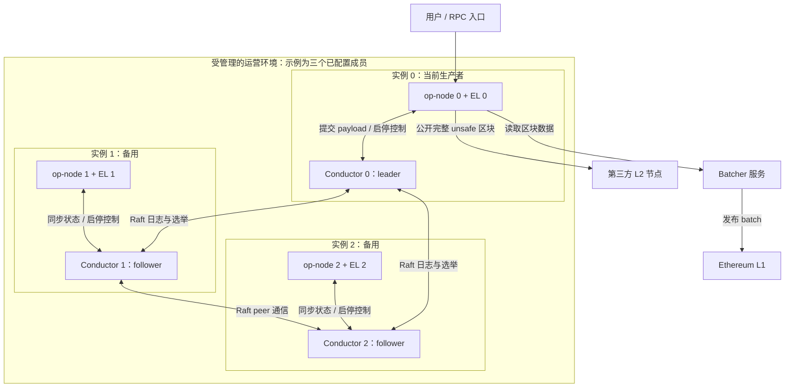
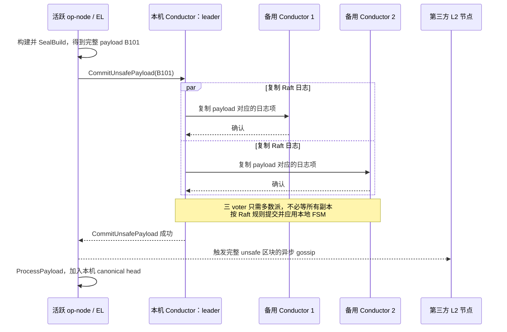
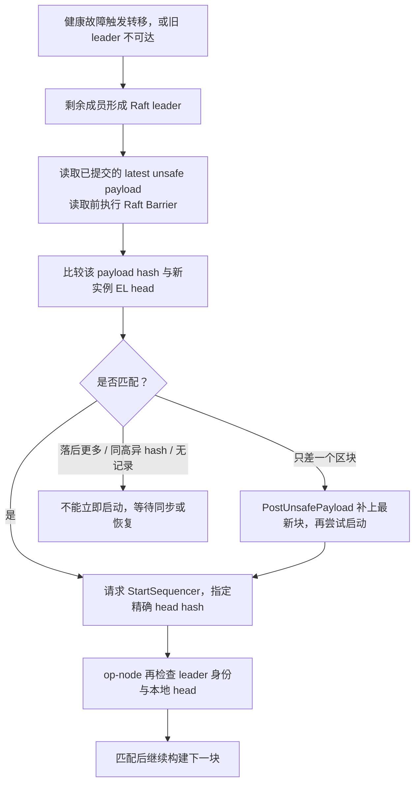
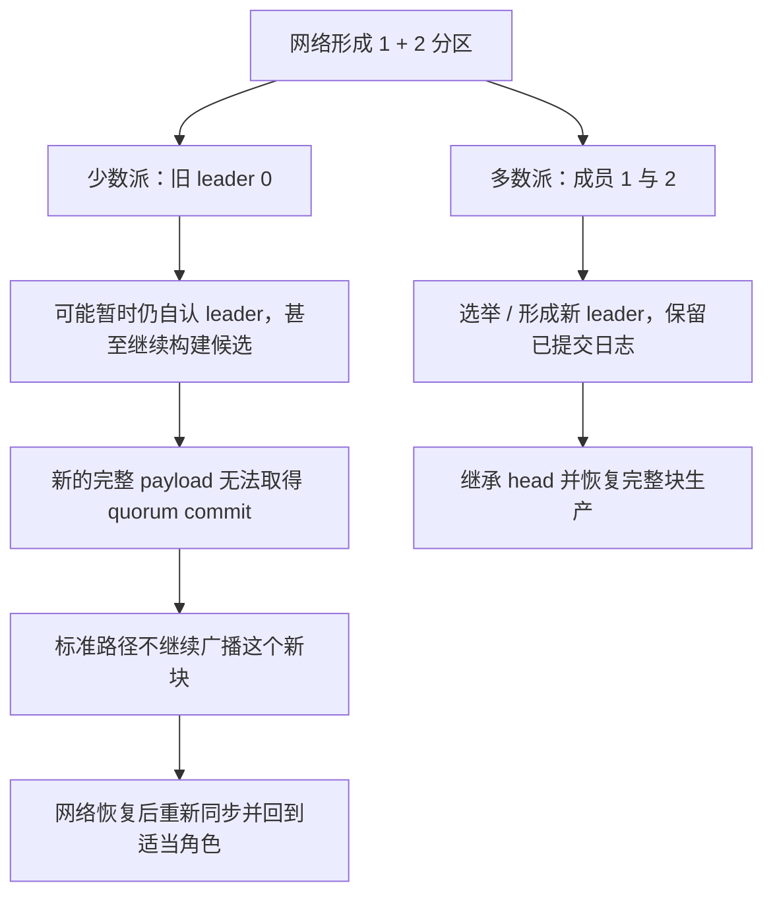
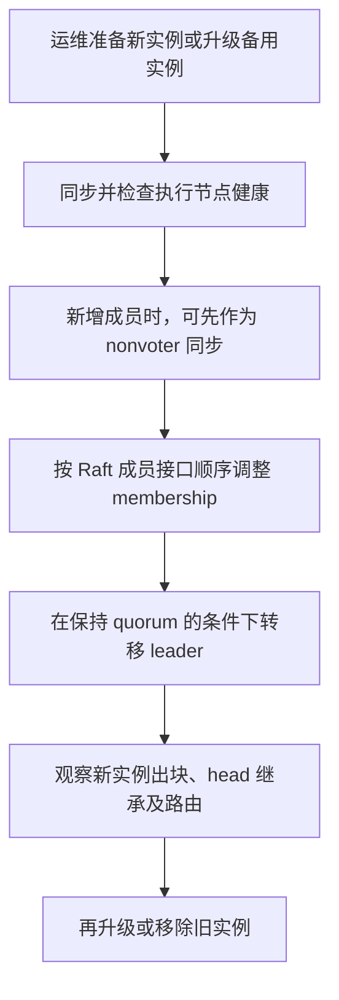
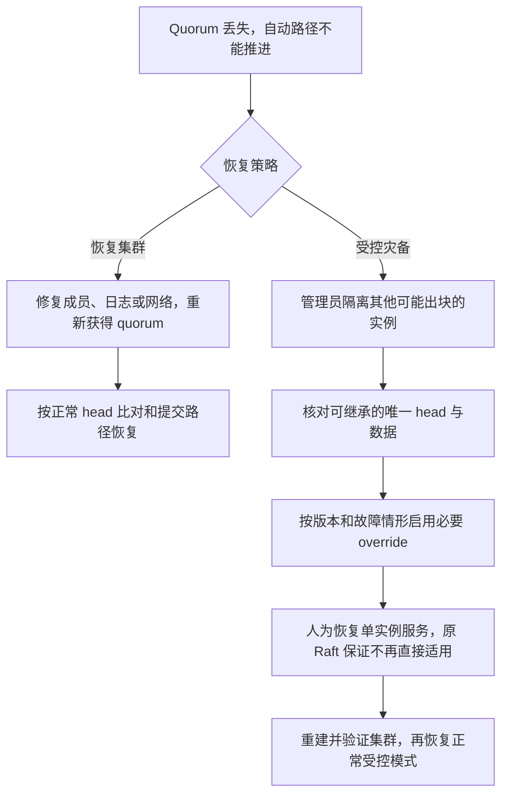
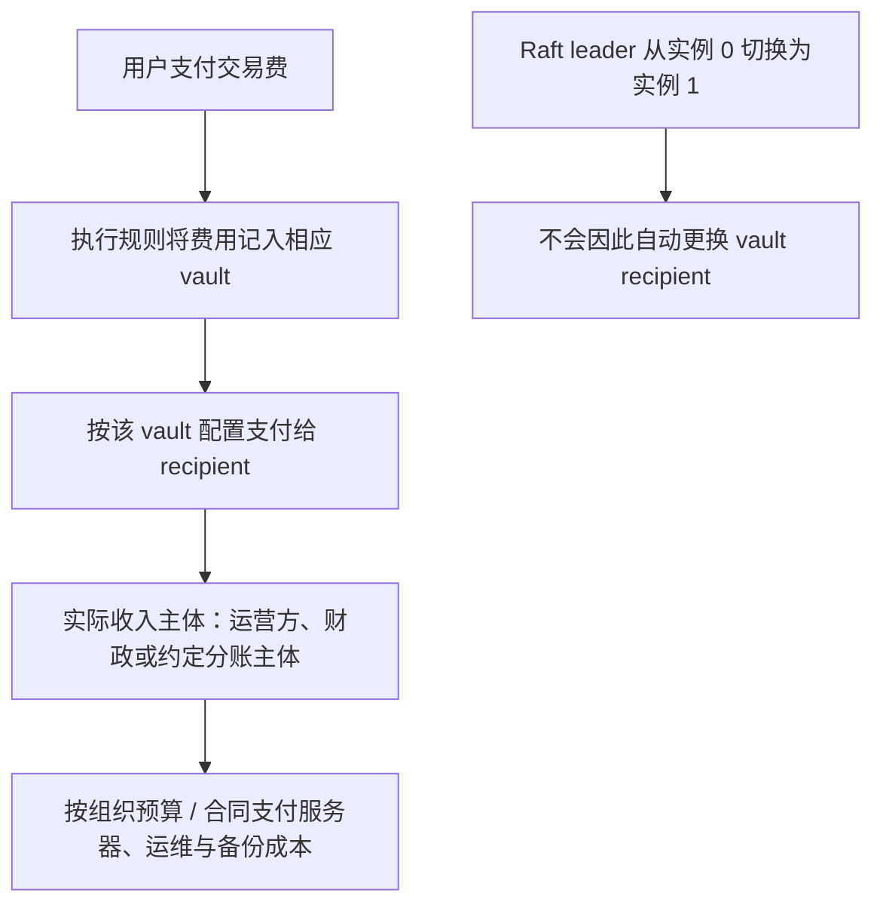

# OP Conductor：Sequencer 高可用、权限与激励

整理与来源核对日期：2026 年 9 月 22 日。

[返回中文阅读索引](README.md) · [前置：OP Stack 架构](06_op_stack_architecture_and_pipeline.md) · [桥接与故障兜底](08_op_stack_bridge_and_disputes.md) · [费用与代币经济](07_sequencer_selection_fees_and_tokenomics.md)

**OP Conductor 的核心是：在一个受管理、假设成员诚实的运营集群中，协调谁出块，并让接任者继承已经对外发布的完整区块。** 它通过 Raft 选举与日志复制、健康检查、出块启动与停止，以及提交前的检查来实现高可用。它没有内置通过质押、投票奖励和罚没来约束互不信任运营者的经济机制。

本文区分三类内容：**官方设计与配置**、**固定版本源码行为**、**基于这些行为的分析**。源码固定为 [`ad1c8e12f43c7e9158bb5da127b0153c3e28d4ad`][commit]（2026-09-21 17:52:59 UTC）；官方配置参考页标注由 `op-conductor/v0.9.4` 生成，版本不完全等同。本文不审计某条主网的实时部署、管理员签名人或商业合同。

## 阅读路线

- [1. 哪一层的高可用](#scope)
- [2. 实体、子模块与控制者](#entities)
- [3. 正常出块：先 Raft commit，再公开完整区块](#normal)
- [4. 故障切换：新 leader 从哪里继续](#failover)
- [5. 健康检查与控制循环](#health)
- [6. 各类故障与恢复边界](#cases)
- [7. 权限管理与信任边界](#permissions)
- [8. 灾备 override 会改变什么](#override)
- [9. 它如何处理激励](#incentives)
- [10. 与 L1、fault proof 及预确认的关系](#other-layers)
- [11. 阅读和设计时要核验什么](#questions)

<a id="scope"></a>

## 1. 哪一层的高可用

假设同一条 L2 有三套 sequencer 实例。每套都有 `op-node` 与执行引擎 EL，并配一个 Conductor。正常只有一套负责生产新块，其余保持同步，准备接任。

| 问题 | 对应机制 |
| --- | --- |
| 哪些机器可以进入这套运营集群？ | 管理员配置、成员管理和网络访问控制 |
| 当前哪套实例负责出块？ | Conductor 集群中的 Raft leader 与本地控制循环 |
| 接任者应继承哪个最新完整区块？ | Raft 提交记录与执行节点的同步状态 |
| 哪些交易最终成为规范 L2 历史？ | L1 数据与 rollup 派生规则 |
| 某个状态声明是否可供桥接使用？ | Fault-proof 与桥接检查 |

Conductor 解决的是前几项中的**运营协调**。Raft 是 crash-fault-tolerant：容忍进程停止、机器故障和一定的网络故障，前提包括参与者遵守协议及持久化状态正常；它不是用来容忍成员主动伪造或串谋的 BFT 系统。官方也明确假设参与节点诚实。见 [Conductor 说明][readme]、[Raft 原始论文](https://raft.github.io/raft.pdf)。

### 1.1 如何理解“高可用”的保证

稳定成员配置中，多数派大小是 `floor(N/2)+1`。三 voter 集群需要两票；一个 voter 故障后，剩余两者仍可构成 quorum。能否恢复出块，还需要有健康、同步到位的执行实例和可用的上下游。

官方列出 “No Unsafe Reorgs”“100% Uptime”等设计目标。学习时应带上条件理解：**在规定故障模型和依赖正常的条件下，避免因为单个实例故障丢失已公开的完整区块，并恢复服务。** 它不意味着任意分区、恶意管理员、所有节点同时故障或任意上游中断时仍零停顿运行。

恢复延迟可以按下面几项分析，不能当作一个固定 SLA：

```text
故障检测 + Raft 选举/转移 + 执行状态追赶 + 流量路由恢复 + 新块构建
```

<a id="entities"></a>

## 2. 实体、子模块与控制者

三套实例不等于三条 L2，也不必对应三个独立的经济主体。典型场景是同一个运营体系在不同可用区或区域维护多套副本。

| 实体 | 内部内容 | 谁控制它 |
| --- | --- | --- |
| 链治理 / 配置管理主体 | SystemConfig、合约升级与其他角色权限 | 具体链配置的管理员、治理主体或受委托服务方 |
| Sequencer 运营方 | 服务器、配置、签名服务、监控与运维流程 | 取得相应授权的运营组织；不由 Raft 按持币量产生 |
| 每套 sequencer 实例 | `op-node` + EL，可能另接 builder | 运营方的部署与密钥管理体系 |
| 每个 Conductor 实例 | Raft peer、持久化日志/FSM、健康监控、RPC、控制循环 | 运营方的集群与网络管理员 |
| RPC 入口与路由 | 公共交易入口、内部 leader 感知路由 | 运营方或所委托的 RPC 服务方 |
| Batcher | L2 数据读取、压缩、L1 提交服务及密钥 | 对应服务运营方；不一定与三套出块实例一起切换 |
| Proposer / Challenger | 状态提议与争议服务 | 对应参与者；不由 Conductor 完整接管 |
| 普通 L2 节点 | 独立派生、执行、RPC | 各自运营者；默认没有集群管理或 Raft 投票权 |

“链治理”和“运营方”可以属于同一组织，也可以分离。本文讲权限角色，不把某个组织名称推广到所有 OP Stack 链。见 [OP Stack 角色配置][config]。



图只突出职责。备用 op-node / EL 还需同步区块与状态，不能仅靠 Conductor 的最新 payload 就替代完整同步。部署通常跨故障域，但跨区域距离也会影响日志复制延迟。见 [官方 Setup](https://docs.optimism.io/chain-operators/tools/op-conductor/setup)。

<a id="normal"></a>

## 3. 正常出块：先 Raft commit，再公开完整区块

### 3.1 为什么仅有 leader election 不够

如果旧实例先向用户公开区块 `B101`，随后崩溃，而备份只知道 `B100`，新实例可能从 `B100` 重新生成另一个 `B101`。知道“谁接任”没有解决“继承什么”。

Conductor 因此还保存最新 unsafe payload。受控的完整区块路径要求：**先经过 Raft 提交，成功后才走完整区块的公开路径。**



图中的两条复制支路示意 Raft 复制，不表示必须收齐两台 follower 的确认。所选 `Sequencer.RunAction` 的代码顺序确为 **commit → 发起 gossip → ProcessPayload**。异步 gossip 调用不等于所有接收者已收完区块。见 [Sequencer.RunAction][sequencer]、[Raft CommitUnsafePayload][raft]。

Raft 成员复制的是 `ExecutionPayloadEnvelope` 的日志数据。FSM 保存最新 payload，并支持 snapshot / restore；这不是三台机器逐块投票认证 EVM 执行正确，也不是复制全部账户数据库、交易池和 batcher 的待发布队列。见 [unsafeHeadTracker][fsm]。

### 3.2 在三个位置崩溃会怎样

| 崩溃位置 | 已有什么记录 | 对接任的意义 |
| --- | --- | --- |
| 构建完成，但未完成 quorum commit | 可能只有本机候选或未提交日志 | 标准完整块广播步骤尚未发生；不应要求继任者保留未公开候选 |
| commit 完成，但尚未广播 | Raft 已记录完整 payload | 接任者可取得该块，解决“记录已提交但 P2P 尚未传播”的缺口 |
| 已广播后崩溃 | 公开前已先通过 commit | 正常 HA 恢复应延续该记录，避免仅因换机器丢掉它 |

如果只是 RPC 成功响应丢失，不能推断提交肯定失败；恢复时要以 Raft 实际提交记录为依据。这里讨论完整块，不自动覆盖 builder 提前发出的所有部分区块信号。

**Raft commit 之后，区块仍然是 unsafe。** 它还没有因此变成 L1 上的数据，更没有因此获得 Ethereum 最终性。

<a id="failover"></a>

## 4. 故障切换：新 leader 从哪里继续

当前 producer 的故障可能被健康监控发现并触发主动转移；如果整个 conductor 或主机失联，则需要 Raft 选举在剩余成员中形成新 leader。



这是固定源码中 `startSequencer`、`compareUnsafeHead` 和 `Sequencer.Start` 的关键逻辑。**当选不等于执行状态已准备好；Raft 也不会经这个接口自动补齐任意长度的历史。** 单块注入仍须被 op-node 正确处理，不能绕过执行验证。见 [Conductor 控制逻辑][service]、[op-node 启动检查][sequencer]。

接任还需要流量能到达新实例。Conductor 提供 leader 状态和有限的 RPC proxy 能力，供相关客户端使用；实际用户入口、服务发现与路由如何切换仍取决于部署。不能把一个健康的 Raft 集群等同于所有公共 RPC 都已恢复。

<a id="health"></a>

## 5. 健康检查与控制循环

### 5.1 “健康”是运营指标，不是密码学证明

所选实现检查的内容包括：

| 信号 | 检查目的 | 边界 |
| --- | --- | --- |
| `SyncStatus` 等 RPC 可达性 | 节点服务是否能响应 | 响应不保证状态正确或用户未被审查 |
| unsafe head 时间戳距现在的间隔 | 发现出块停滞或严重落后 | 阈值与时钟、区块时间及恢复阶段有关 |
| safe head 进展，可选 | 发现输入发布或派生停滞 | 可能是 batcher / L1 的共因故障，换 leader 未必能修复 |
| op-node P2P peer 数量 | 发现同步或连接异常 | peer 多不等于数据、执行都正确 |
| EL P2P 检查，可选 | 补充执行节点连接状态 | 是否启用及接口取决于部署 |
| rollup-boost / builder 健康，可选 | 检测外部构建链路 | 可配置部分健康的容忍条件 |

它不检查每笔交易的公平纳入，也不执行一场 fault proof。具体检查开关、阈值和容忍区间需按版本读取。见 [Health monitor][health]、[配置参考][reference]。

### 5.2 主要控制动作

| 观察到的状态 | 主要动作 |
| --- | --- |
| healthy leader，sequencer 已活跃 | 保持运行 |
| healthy leader，但本机未出块 | 检查继承 head，尝试启动 |
| follower 的 sequencer 仍在出块 | 尝试停止本机出块 |
| 活跃 leader 的 sequencer unhealthy | 尝试停止并转移 leadership |
| 新 leader 接手时因全链停滞而落后 | 有允许先启动、等待健康恢复的特殊分支；不能机械地永远拒绝启动 |

停止旧进程的 RPC 也可能失败。在 leadership 已成功转移或旧实例已失去 quorum 后，正常非 override 路径的另一道限制才是：旧实例不能继续成功提交新的完整 payload，因此不能顺着该路径广播新块。如果停止与转移都失败，且旧实例仍拥有 leadership 和 quorum，就不能声称它已经被阻止继续提交。

可选 round-robin 转移按已配置 voter 的顺序尝试；默认转移使用 Raft 的机制。它不是按 token、质押或服务收益选举，也不表示轮到某机器就必须无条件让它出块。见 [action / transferLeader][service]。

<a id="cases"></a>

## 6. 各类故障与恢复边界

### 6.1 进程、机器和 quorum 的故障不是同一件事

| 场景 | 系统如何处理 | 需要什么前提 / 仍可能失去什么 |
| --- | --- | --- |
| 一个备用 op-node / EL 故障 | 活跃实例继续；修复备用 | 当前服务可用，但接班能力下降 |
| 活跃 op-node / EL 故障，conductor 仍活着 | 健康检查后尝试停止并转移，由备用追赶接任 | 至少有合适执行实例，且 Raft quorum 与路由可用 |
| 活跃 conductor 故障，op-node 仍活着 | 其他 conductors 选举；旧 op-node 的 commit RPC 失败 | 旧进程不一定立刻停止，但标准完整块发布受阻 |
| 一整套主机故障 | 三 voter 中剩余两者可重新协调 | 还需可通信、持久日志正常和健康 EL |
| 两个备用 EL 故障，但三个 conductors 仍活着 | 活跃健康实例可能继续提交 | Quorum 尚在，却可能没有可用接班人 |
| 三 voter 中两个 conductors / 整机故障 | 无多数派，正常 commit 无法继续 | 恢复 quorum 或进行受控灾备；不能自动承诺零停顿 |
| 新 leader 落后多个区块 | 等待同步，而非在旧 head 强行出块 | 日志领先不代表本机执行状态领先 |
| RPC 入口仍指向旧机器 | 共识层可能已恢复，用户仍无法正常提交 | 必须恢复入口和路由 |
| Batcher 故障或 L1 发布失败 | unsafe 可继续，safe / finalized 可能停滞 | Conductor 不自动接管全部发布职责 |
| Proposer / Challenger 故障 | 出块可能正常，退出结算受影响 | 需要对应服务或其他参与者恢复 |

这些结论依据 [完整块发布路径][sequencer]、[Conductor client 的错误处理][conductor-client]、[控制逻辑][service]。不能把“两个备用执行进程坏了”改写成“两个 Raft 主机坏了仍有多数派”。

### 6.2 网络分区：为什么旧 leader 不能仅凭旧身份继续发布

三 voter 集群分成 `{0}` 与 `{1,2}`，假设旧 leader 0 被隔在少数派：



准确的安全理由不是“现实中任意时刻都绝无两个自认 leader 的进程”，而是 Raft 的提交规则与 op-node 的发布顺序共同约束了新块。若形成 `1+1+1` 分区，各方都没有 quorum，自动模式应停止正常新块提交。

已经提交但尚在传播途中的旧 payload 仍可能到达接收者，这不等于少数派还能提交任意新的冲突后继。以上依赖诚实实现、持久化记录及未启用绕过机制。见 [Raft 论文](https://raft.github.io/raft.pdf)、[CommitUnsafePayload][raft]。

### 6.3 升级与成员变更



这是维护原则示意，不是适用于每种故障的可直接执行脚本。Nonvoter 不计入投票多数派；增加 voter 会改变 quorum 要求。误 bootstrap 成两个独立集群、清掉日志后同时强启多个实例，都会越过正常接续模型。见 [Setup 与升级流程](https://docs.optimism.io/chain-operators/tools/op-conductor/setup)、[成员管理 API][api]。

### 6.4 共同依赖故障与恶意行为

- **相同软件 bug / 错误配置：**所有副本可能一起失败；换 leader 没有消除故障原因。
- **共享上游 L1 RPC、云网络或签名服务故障：**机器数量不等于依赖独立。可能需要修复共同依赖。
- **Raft 磁盘或日志广泛丢失：**L1 已发布历史仍可重建，但最新尚未发布的 unsafe 接续点不保证能仅从 L1 找回。
- **健康误判：**过紧阈值或网络抖动可引发不必要切换；健康阈值要服务于具体运行条件。
- **成员或管理员恶意：**伪造控制输入、绕过提交步骤或滥用签名权限，超出了 Conductor 的诚实成员模型。健康检查不会把恶意行为自动转化为可罚没证据。

本节是对源码机制与依赖的分析，不声称所有实际部署都具有同样的故障域或恢复配置。

<a id="permissions"></a>

## 7. 权限管理与信任边界

### 7.1 四种身份不能混同

```text
Raft 成员身份：谁被管理员加入 voter / nonvoter 配置？
当前 leader：这些已配置成员目前由谁协调提交？
链认可的服务密钥：谁能签 unsafe block、谁能发有效 batch？
链治理权限：谁能修改上述配置或升级合约？
```

Raft 当选不会自动授予链上 signer 或 batcher 密钥，也不会修改 `SystemConfig`。要无缝接任，新实例还必须能使用链当前认可的签名能力；具体是共享受控 signer、远程签名服务还是其他部署安排，要单独核验，不能从 Conductor 代码推出私钥一定如何存放。

| 权限或对象 | 控制者 / 授权方式 | 能做什么 |
| --- | --- | --- |
| Conductor membership 与管理 RPC | 获得内部管理入口访问权的运维主体 | 增删或调整 voter、转移 leader、pause / resume / stop、override |
| Raft peer 网络 | 运维配置的服务器与网络策略 | 决定哪些实例能参与集群通信；server ID 不是质押凭证 |
| op-node Admin RPC | 部署方启用管理接口，并限制其访问 | 启停出块、注入恢复 payload、应急 override |
| op-node → EL Engine API | 部署方配置 JWT secret | 控制执行引擎；JWT 仅保护这一通信边界 |
| Unsafe block signer | 对应密钥或签名服务权限的持有人 | 认证链下 unsafe 区块，供 P2P 接收者识别 |
| Batcher key | 对应 L1 发送账户的控制者 | 提交能被派生规则识别的 batch |
| `SystemConfig.owner()` | 具体链的配置管理主体 | 更新 unsafe signer、batcher 等配置 |
| ProxyAdmin owner | 具体链的升级控制主体 | 升级相关合约与系统实现 |
| Guardian 等应急角色 | 具体链设置的治理权限持有人 | 暂停相关系统，处理 game 黑名单、retirement 等；不等于 Raft leader |
| 普通节点 / 公共 challenger | 独立参与者 | 验证或挑战；不会因此获得上述内部权限 |

签名认证与 batch 授权仍有区别：unsafe signer 是链下 P2P 认证身份，batcher 身份用于 L1 数据的派生认证。不能把二者统称为“谁有一张 Raft 票谁就能发布”。见 [SystemConfig](https://specs.optimism.io/protocol/system-config.html)、[管理角色][config]、[当前治理关系](https://specs.optimism.io/protocol/overview.html#notes-for-core-l1-smart-contracts)。

### 7.2 Conductor RPC 本身不认证调用者

固定版本的官方 README 明确说明：Conductor 不对 RPC 请求执行 authentication / authorization，预期运行在仅授权用户可访问的私有网络中。源码的 `initRPCServer` 注册 `conductor` API backend，未给该服务配置 JWT；backend 的管理调用也没有链上 owner 或钱包签名验证。

因此，私有网络、ACL、认证代理等外围措施是实际权限边界的一部分。**“这是健康检查端口”不能作为公开整个端口的理由：同一命名空间还包含管理与 payload 提交方法。** 见 [README 的访问模型][readme]、[RPC 注册][service]、[API backend][backend]。

另一个版本细节：虽然参考页列出通用 `rpc.enable-admin` flag，但在这份 Conductor 源码的注册路径中，整个 `conductor` backend 并未由该 flag 条件控制。不能只看到默认值 `false`，就断言 Conductor 的管理接口已关闭。op-node 自己的 Admin RPC 是另一套注册逻辑。

Raft 使用所选实现中的 TCP transport；此处也不能假定内置了 TLS/mTLS 身份认证。部署方必须保护 peer 通信和成员管理入口。**Engine API 的 JWT 不会自动保护 Conductor RPC 或 op-node Admin RPC。** 见 [Raft transport][raft]、[op-node 管理 API 注册][node-server]、[Engine API JWT][engine-config]。

### 7.3 Proxy 的 leader 检查不等于调用者认证

Conductor 的可选 proxy 只支持特定方法，例如取区块、查询 rollup 状态、查询 sequencer 是否活跃，以及设置最大 DA 大小。它不是所有 Ethereum RPC 的通用代理，也不全是只读接口。

其 leader 检查用于限制相关客户端从不合适副本获取或设置结果；它回答“应由哪个后端处理”，不回答“这个外部调用者有没有权限”。见 [proxy API 定义][api]。

<a id="override"></a>

## 8. 灾备 override 会改变什么

正常路径失去多数派时，系统不会凭空恢复 quorum。管理员可以选择恢复原集群，或进入人为控制的灾备模式，但两者的保证不同。

| 动作 | 固定版本中的主要效果 | 不应误解成什么 |
| --- | --- | --- |
| `conductor_pause` | 暂停自动控制循环；仍可参与 Raft 选举 | 不等于所有 sequencer 已停止，也不是从 Raft 中移除成员 |
| `conductor_overrideLeader` | 改变对外报告的 leader 判断，供受控恢复使用 | 不等于真的取得 Raft 多数派；该动作本身不让 `Raft.Apply` 自动成功 |
| op-node 的 `admin_overrideLeader` | 本机 conductor client 直接认定 leader，并跳过实际 unsafe payload commit | 这是绕过正常发布前检查，不是多数派共识的另一种证明 |

见 [Conductor 状态与 RPC][service]、[op-node ConductorClient][conductor-client]。



这是信任边界，不只是一个方便的开关。尤其在网络分区时，看不到另一侧不等于另一侧已经停止；如果管理员同时在不同分区绕过检查，就可能制造冲突历史。选择恢复 head、排除其他活跃实例、保留记录和恢复正常模式，变成运维必须承担的职责。

本篇只解释其含义，不提供未经具体部署验证的灾备操作脚本。见 [官方 Runbook][runbook]。

<a id="incentives"></a>

## 9. 它如何处理激励

### 9.1 Conductor 没有内置一个经济选主市场

在本文核对的实现中，没有以下机制：

- 候选人质押 OP 或 ETH，按质押量取得 Raft 投票权。
- 每个 voter 因复制日志自动获得链上奖励。
- 每次 leader 轮换，按服务器 ID 自动分配交易费。
- 因停机、审查或退出集群而自动扣除一笔 Conductor bond。

Raft 投票资格来自管理员维护的 membership。失去 leadership 是恢复动作，不是一笔经济罚款。Conductor 的正确性假设是成员诚实，不是它已经证明“理性自利成员一定诚实”。见 [设计与信任假设][readme]、[成员管理接口][api]。

### 9.2 真实的链上资金路径在 Conductor 之外

按所激活升级和配置，用户交易费被分到相应 vault，再支付给配置的 recipient：

| 费用组成 | 典型 vault |
| --- | --- |
| Priority fee / tip | `SequencerFeeVault` |
| L2 base fee | `BaseFeeVault` |
| L1 数据费 | `L1FeeVault` |
| 配置启用的 operator fee | `OperatorFeeVault` |



当前 leader 的物理机器不会自动变成收款人。备机的成本通常来自运营预算或合同，而不是协议给每个 Raft follower 发工资。谁承担成本、谁最终拿到收入，要看 vault 配置与运营关系；本篇没有将它们假定为同一账户。见 [Fee vaults](https://docs.optimism.io/op-stack/transactions/fee-vaults)、[固定 FeeVault 实现][fee-vault]。

### 9.3 为什么运营方愿意部署多副本

下面是经济分析，不是 Conductor 合约公式：

```text
部署 HA 的净收益
≈ 减少停机所保住的业务价值
  − 额外副本、跨区域网络、运维及复制延迟的成本
```

稳定服务可以保住交易需求、收入、客户与生态信任；若存在相应商业合同，还可能减少违约损失。运营组织可以用预算、岗位职责或供应商合同维持备份资源。

但这些机制并不自动保证运营方选择社会最优的可靠性：减少副本节约的成本可能由运营方获得，而停机损失部分由用户承担。若收入受益方与故障成本承担方不同，激励还可能进一步错位。具体 SLA、赔偿和供应商奖励须有合同证据，不能由 Conductor 存在推出。

### 9.4 为什么 fault-proof bonds 不能替代这里的激励

| 机制 | 约束什么 | 不覆盖什么 |
| --- | --- | --- |
| Raft + Conductor | 可信副本协调、提交记录、接任 | 不自动惩罚恶意运营者或公平排序偏离 |
| Fault-dispute bonds | 对状态声明及相关 moves 的争议参与 | 不是对普通停机、拒收交易的通用罚没 |
| 运营预算、合同与长期业务价值 | 组织与商业层的可靠性动机 | 不等于程序验证的 incentive compatibility |

如果要把参与者改成互不信任、各自逐利的独立 sequencer，需要另外定义准入、可验证职责、承诺继承、奖励、罚则及争议机制。给现有 Raft peer 加上一个 token 名称，不会自动补齐这些机制。更多经济背景见 [第 07 篇](07_sequencer_selection_fees_and_tokenomics.md)。

<a id="other-layers"></a>

## 10. 与 L1、fault proof 及预确认的关系

### 10.1 三套机制分别保护什么

| 层 | 核心作用 |
| --- | --- |
| Conductor HA | 尽量保持完整 unsafe 区块生产和运营交接连续 |
| L1 数据与派生 | 确定规范交易输入；发布故障时提供规则化 fallback |
| Fault proof 与桥 | 阻止不符合规范计算的状态声明被用于放款 |

“Raft 已提交”不等于“batch 已上 L1”。HA 集群可能很健康，但 batcher 没钱付 L1 gas，或者无法向 L1 提交；此时仍可能只见 unsafe 前进。超过相关发布窗口后，按 L1 规则产生的重组也不会因为某个区块曾被 Raft 记录而被禁止。见 [发布故障](https://docs.optimism.io/op-stack/protocol/outages#transaction-submission-outages)。

### 10.2 更早的部分区块确认要单独检查

本文完整块的 `CommitUnsafePayload → gossip` 顺序不能自动推广到所有 Flashblocks / Subblocks 预确认。固定版本的可选 Flashblocks WebSocket handler 在转发时检查 leader，然后广播消息；这条处理路径并没有为每一条 Flashblock 调用 `CommitUnsafePayload`。

所以，保护完整 unsafe 区块接续，不能直接推出每一份更早的部分区块承诺都已经被多数派持久化。需要检查具体 builder、流式传播、签名与恢复集成。见 [Flashblocks handler][flashblocks]。

<a id="questions"></a>

## 11. 阅读和设计时要核验什么

针对一套具体部署，以下问题决定 Conductor 的保证实际落在哪里：

1. **谁管集群？** 谁能改 membership、访问管理 RPC、重置日志或调用 override？这些权限是否属于同一信任域？
2. **谁有链认可的密钥？** Unsafe signer、batcher、配置管理和合约升级权限分别由谁持有？接任机器如何取得必要签名能力？
3. **哪些故障是独立的？** 三个副本是否共享云区域、磁盘、上游 RPC、签名服务、代码缺陷或公共入口？
4. **哪一种确认已被持久化？** 完整 payload、部分区块、交易收到确认和执行结果，不应混为一种承诺。
5. **新机器继承什么？** Raft head、执行状态、交易池和待发布 batch backlog 是否分别有恢复路径？
6. **谁承担备份成本与停机损失？** Vault 收款者、实际运营方、供应商和用户是否利益一致？

### 本篇验证与版本限制

- 核对了固定提交的 Conductor 服务、Raft/FSM、健康检查、RPC，以及 op-node 的构建、commit、启动和 override 路径。
- 这是源码与规范分析，没有实际部署三节点集群，也没有进行网络分区、进程终止或灾备演练。
- 旧 README 的故障表混用了 sequencer 进程和 conductor/整机故障，部分持续运行表述不能直接覆盖当前代码；本文按明确故障对象和固定实现解释。
- 本篇没有声称某条链使用了全部可选健康检查、特定密钥托管方案或具体 SLA，也没有把官方目标解释为无条件的零停顿保证。

[返回中文阅读索引](README.md)

[commit]: https://github.com/ethereum-optimism/optimism/commit/ad1c8e12f43c7e9158bb5da127b0153c3e28d4ad
[readme]: https://github.com/ethereum-optimism/optimism/blob/ad1c8e12f43c7e9158bb5da127b0153c3e28d4ad/op-conductor/README.md
[runbook]: https://github.com/ethereum-optimism/optimism/blob/ad1c8e12f43c7e9158bb5da127b0153c3e28d4ad/op-conductor/RUNBOOK.md
[service]: https://github.com/ethereum-optimism/optimism/blob/ad1c8e12f43c7e9158bb5da127b0153c3e28d4ad/op-conductor/conductor/service.go
[raft]: https://github.com/ethereum-optimism/optimism/blob/ad1c8e12f43c7e9158bb5da127b0153c3e28d4ad/op-conductor/consensus/raft.go
[fsm]: https://github.com/ethereum-optimism/optimism/blob/ad1c8e12f43c7e9158bb5da127b0153c3e28d4ad/op-conductor/consensus/raft_fsm.go
[health]: https://github.com/ethereum-optimism/optimism/blob/ad1c8e12f43c7e9158bb5da127b0153c3e28d4ad/op-conductor/health/monitor.go
[api]: https://github.com/ethereum-optimism/optimism/blob/ad1c8e12f43c7e9158bb5da127b0153c3e28d4ad/op-conductor/rpc/api.go
[backend]: https://github.com/ethereum-optimism/optimism/blob/ad1c8e12f43c7e9158bb5da127b0153c3e28d4ad/op-conductor/rpc/backend.go
[sequencer]: https://github.com/ethereum-optimism/optimism/blob/ad1c8e12f43c7e9158bb5da127b0153c3e28d4ad/op-node/rollup/sequencing/sequencer.go
[conductor-client]: https://github.com/ethereum-optimism/optimism/blob/ad1c8e12f43c7e9158bb5da127b0153c3e28d4ad/op-node/node/conductor.go
[node-server]: https://github.com/ethereum-optimism/optimism/blob/ad1c8e12f43c7e9158bb5da127b0153c3e28d4ad/op-node/node/node.go
[engine-config]: https://github.com/ethereum-optimism/optimism/blob/ad1c8e12f43c7e9158bb5da127b0153c3e28d4ad/op-node/config/l2_el_rpc.go
[flashblocks]: https://github.com/ethereum-optimism/optimism/blob/ad1c8e12f43c7e9158bb5da127b0153c3e28d4ad/op-conductor/rpc/ws/flashblocks_handler.go
[fee-vault]: https://github.com/ethereum-optimism/optimism/blob/ad1c8e12f43c7e9158bb5da127b0153c3e28d4ad/packages/contracts-bedrock/src/L2/FeeVault.sol
[config]: https://specs.optimism.io/protocol/configurability.html
[reference]: https://docs.optimism.io/chain-operators/tools/op-conductor/reference
