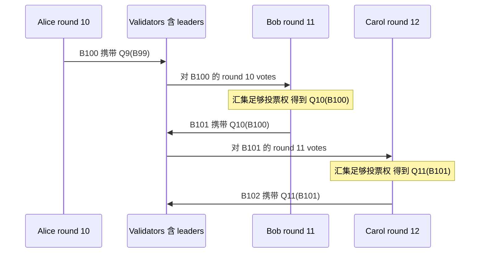
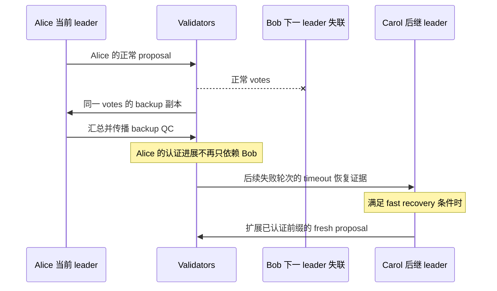

# Flow Aptos 和 MonadBFT 的正常 leader 轮换机制

[返回中文索引](README.md) · [v4 轮换讨论](../../formalization/sections/v4-rotation-discussion.tex) · [源码与资料索引](../sources/2026-10-09-hotstuff-rotation/README.md)

**正常 leader rotation 是共识流水线的一部分：本轮的 votes 形成 QC，QC 支持进入下一轮，下一轮的指定 leader 继续扩展经过认证的链。** 旧 leader 不需要被认定有故障，也不需要另发一份个人 release。故障导致无法形成正常进展证据时，才使用 timeout certificate 等恢复机制。

理解这套机制，要分别回答三个问题：**下一位 leader 是谁、节点凭什么进入下一 round，以及哪一个 block 已经达到 finality。** 同一个 QC 可能足以推进 round，却不足以使它认证的 block 最终确认。正常轮换也不要求每次都等前一 block finalized。

这里以 2026 年 10 月 9 日读取的 Flow、Aptos、MonadBFT 公开源码快照及官方资料解释机制。源码引用固定到 commit；主网实际启用的配置与部署版本可能不同。Aptos 的基本 two-chain 路径、可配置优化，以及 Monad 的 speculative/full finality 会分别说明。下面的四节点和连续轮次均是教学示例，不是链上运行记录。

阅读顺序：先读[统一记号和共同路径](#common)，再读 [Flow](#flow)、[Aptos](#aptos)、[MonadBFT](#monad)，最后看[比较](#comparison)、[安全性直觉](#safety)和[与当前 Sync HotStuff 稿件的关系](#our-protocol)。

## 1 从三个不同的进度变量开始

### 1.1 Round 不是 block height

令 $r$ 表示共识 round，也常称 view；令 $h$ 表示链上 block height。为避免把两者混淆，例子使用：

| Round | 指定 leader | 成功时提出的 block |
| --- | --- | --- |
| $10$ | Alice | $B_{100}$ |
| $11$ | Bob | $B_{101}$ |
| $12$ | Carol | $B_{102}$ |

这是正常连续成功的情况。若 round 11 失败，协议仍可能进入 round 12，但链上不一定增加一个新高度；某些恢复路径还会重新提出旧 block。**Round 记录生产机会和协议进度，height 记录最终所选链上的位置。** Monad 的 staking 文档也明确区分按 block 计数的边界与按 round 计数的延迟。[Monad epochs 与 rounds][monad-staking]

Leader 可以抽象表示为：

$$
L_r=\operatorname{Leader}(\mathrm{epoch},r,\text{共享的选举上下文}).
$$

这个函数解决“谁有资格提出本轮 block”。它不证明当前节点已经可以安全进入该轮，也不证明某个 parent 应被扩展。一个身份还可能连续被选中；**每轮重新确定 leader，并不意味着相邻轮次的身份必然不同。**

### 1.2 Proposal 投票 QC 和 finality

在本文的教学记号中：

$$
Q_r(B_h)=\text{对 round }r\text{ 的 }B_h\text{ 的 quorum certificate}.
$$

如果总投票权为 $W$，常见 quorum 门槛为大于 $2W/3$。等权的 $n=3f+1$ 模型中，对应至少 $2f+1$ 个不同成员。以下四节点示例需要三票；签名必须绑定相应的 block、round 和所属配置，不能把不同对象的票混在一起。

| 事件 | 节点能够得出的结论 | 尚不能自动得出的结论 |
| --- | --- | --- |
| 收到 proposal | 指定 leader 提出了一个可验证候选 | 其他节点也接受了它 |
| 自己投票 | 自己按当前安全规则支持这个候选 | 已经达到 quorum |
| 看到 $Q_r(B_h)$ | 足够投票权支持该认证对象 | $B_h$ 已经达到该协议的 finality |
| 满足 commit/finalization rule | 对应 block 及其祖先成为最终前缀 | 交易的外部执行、发布或其他链上的结算也同时结束 |

TC（timeout certificate）则聚合超时相关的签名和恢复信息。它可以支持跳过未成功的 round，但并不把一个任意 block 变成 committed block。QC、TC 的验证与高位证书/锁的约束需要同时满足。[Flow 进入 view 的规则][flow-safety]、[Aptos two-chain safety rules][aptos-twochain]

### 1.3 为什么把本轮 votes 发给下一位 leader

考虑最简单的正常路径，暂时不加入备份收集或提前传播优化：

Validators 这一栏表示投票者整体，leader 也可以是其中的成员；图中省略发给自己的本地处理。

Bob 有两个职责：**收集前任的 votes，以及提出自己的 child。** 将二者放在同一节点，可以避免“先在 Alice 汇总，再专门把 QC 交给 Bob”的必经转交步骤。Bob 的 proposal 又将 parent QC 传播给其他节点，因而兼具新数据提案和旧进展证据分发的作用。[Flow 投票路由][flow-readme]、[Aptos 普通投票路径][aptos-routing]

不过，**QC 形成的位置不等于所有节点同时知道 QC 的位置**。Bob 收齐三票时，可以先知道 round 10 已有 QC；其他节点可能只知道自己投过票。它们收到 Bob 的 proposal 并验证内含的 QC 后，才获得同样的认证进展证据。不存在必须先让所有节点共同执行一次“全员离开 round 10”的全局屏障。

## 2 Flow 的正常轮换

### 2.1 谁决定下一位 leader

Flow 的 `LeaderSelection` 为一段 view 范围保存 leader 序列。`ComputeLeaderSelection` 使用共享的确定性随机源和成员权重生成该序列，`LeaderForView(view)` 查询对应身份。底层加权抽样把成员权重变成累计区间，随机数落入哪个区间，就选择哪个成员。[Flow leader selection][flow-leaders]

例如，教学权重为 Alice 50、Bob 30、Carol 20，可以把区间写成：

$$
\mathrm{Alice}:[0,50),\quad
\mathrm{Bob}:[50,80),\quad
\mathrm{Carol}:[80,100).
$$

某次抽样值为 63 就对应 Bob。真正重要的是各节点使用相同上下文和确定性随机过程，得到一致的选择结果。它不是每轮让前任 leader 自由指定继任者，也不是每个节点各自运行一次无关的随机抽签。

### 2.2 正常进入下一 view 的证据

Flow 的 active pacemaker 分别提供 `ProcessQC` 与 `ProcessTC`。对一个尚未超过 round $r$ 的节点，合法 $Q_r$ 可以把它推进到 $r+1$；如果节点已经更靠前，旧 QC 不会使它回退。[Flow pacemaker][flow-pacemaker]、[view tracker][flow-viewtracker]

在 proposal 的安全检查中，正常入口的核心关系是：

$$
\operatorname{view}(\text{proposal})
=\operatorname{view}(\text{parent QC})+1.
$$

以 Bob 的 $B_{101}$ 为例：

1. Bob 是 view 11 的指定 leader。
2. $B_{101}$ 扩展 $B_{100}$，并带上 $Q_{10}(B_{100})$。
3. 接收者验证 leader、签名、证书、parent 和必要 ancestry。
4. parent QC 的 view 正好是 10，因此它提供进入 view 11 的正常证据。
5. 接收者还要满足自己的单调投票/超时记录约束，不能在同一 view 重新支持冲突提案。

其中 `validateEvidenceForEnteringView` 对正常情况直接接受上一 view 的 QC，并要求不附带多余 TC；若 QC 不是紧邻上一 view，就走 TC 检查。`HighestAcknowledgedView` 则阻止节点对已经投票或发过 timeout 的 view 再随意投票。[Flow safety rules][flow-safety]

因此，**“没有 BLAME”不等于“没有进入条件”**。进入条件由上一轮 QC 及其他安全检查承担。Alice 即使健康，也会在协议进度上把下一轮提案职责交给 Bob。

### 2.3 Alice 的 block 何时 finalized

Flow 的 `Forks` 实现使用下面的 two-chain 条件：存在已经 certified 的 child $B_{101}$，且它的 parent 是 $B_{100}$，二者 view 连续：

$$
\operatorname{view}(B_{101})=\operatorname{view}(B_{100})+1.
$$

此时可以 finalize $B_{100}$ 及尚未最终确认的祖先。这里的 “certified child” 要求看到 child 的 QC，不能只看到一份尚未获票的 child proposal。[Flow finalization code][flow-forks]

追踪同一条正常链：

| 观察者拿到的证据 | 对 $B_{100}$ 的状态 |
| --- | --- |
| Alice 的 $B_{100}$ proposal | 候选区块 |
| Bob 的 $B_{101}$，其中带 $Q_{10}(B_{100})$ | $B_{100}$ 已 certified，单凭这一项还未满足上述 two-chain finalization |
| $Q_{11}(B_{101})$，并已验证其 parent 为 view 10 的 $B_{100}$ | 满足 $B_{100}$ 的 finalization 条件 |
| Carol 的 $B_{102}$，其中带 $Q_{11}(B_{101})$ | 普通接收节点通过这份 proposal 获得同样的 finalization evidence |

Carol 作为 collector，可能比收到其广播的其他节点更早拿到 $Q_{11}$。最终性是由节点收到的证据触发，不是某个全球同时发生的“第三块到了”的时刻。

这也解释了流水线：Bob 在帮助确认 Alice 的 block 时，已经提出自己的 block；Carol 在帮助确认 Bob 的 block 时，又提出新的 block。**领导权已经移动，前面区块的 finalization 仍沿链继续推进。**

### 2.4 失败时为什么还需要 TC

假设 Bob 未成功产生 view 11 的正常进展。节点的本地 timeout 会产生 timeout 消息，而不是无条件自行宣布任意更高 view。形成 TC 后，节点才能通过相应的失败入口进入下一 view；proposal 所扩展的 QC 还必须与 TC 中的高位证书兼容。[Flow active pacemaker][flow-pacemaker]

这里可以用两条路径概括，但不能省掉其验证谓词：

$$
\begin{aligned}
\text{正常：}&\quad Q_r\ \longrightarrow\ \text{view }r+1,\\
\text{失败：}&\quad TC_r\ \longrightarrow\ \text{view }r+1.
\end{aligned}
$$

TC 是恢复入口；它不是正常轮换的前置步骤。Flow 官方关于 Jolteon 的说明，将 active pacemaker 与缩短后的 finalization rule 一起介绍，二者共同构成其协议设计。[Flow Jolteon 说明][flow-blog]

## 3 Aptos 的正常轮换

### 3.1 先把 proposer election 与 round advancement 分开

Aptos 用 `ProposerElection` 查询某个 round 的合法 proposer。在本次读取的 `LeaderReputation` 实现中，选择权重包含两部分：

$$
w_j^{\rm select}
=w_j^{\rm voting}\times w_j^{\rm reputation}.
$$

参与表现来自历史窗口。实现从 `round - exclude_round` 对应的历史获取元数据，按配置决定抽样状态是否包含 root hash，并结合 epoch、round 进行确定性选择。这里的 reputation 会影响被选中概率，不会让某个节点自行宣告自己是下一 proposer。[Aptos LeaderReputation][aptos-leaders]

使用滞后历史的直觉是：节点应从能够一致取得的历史导出 leader，避免一部分节点使用已执行的新状态、另一部分使用较旧状态，结果选出不同的 proposer。具体窗口和配置由部署决定；学习这个机制不需要把某组默认数值当成协议常数。

### 3.2 QCReady 是代码中的明确事件

`RoundState::process_certificates` 将已知最高证书对应的 round 加一，作为可能进入的新 round；当它确实超过本地当前 round 时，才更新状态。随后按触发证据区分：

- `QCReady`：最高 QC 支持进入该 round；
- `Timeout`：通过最高 TC 推进。

同时会更新本轮投票、timeout 和 timer 状态。**正常换 proposer 不需要先伪造一个超时理由。**[Aptos round state][aptos-round]

在普通投票路径中，未启用 `broadcast_vote` 时，对 round $r$ proposal 的票发给 `get_valid_proposer(r+1)`。因此 Bob 收集 Alice 的 votes，形成足够证据之后，继续自己那一轮。这一职责安排与前面的共同路径相符。[Aptos vote routing][aptos-routing]

### 3.3 Two-chain 规则究竟在提交谁

Aptos 的 `construct_ledger_info_2chain` 对 proposed block 与其 parent QC 检查连续轮次。若非 genesis parent 满足：

$$
\operatorname{round}(B_{100})+1
=\operatorname{round}(B_{101}),
$$

则为 $B_{101}$ 构造的 vote 中，`LedgerInfo.commit_info` 指向 parent $B_{100}$；否则这一路径的 commit info 为空。这是 **对 child 的投票携带 parent 的 ordering/commit 声明** 的实现方式。[Aptos two-chain commit construction][aptos-twochain]

读这段代码时最容易误判的是：看见单个 validator 在 vote 里写了 `commit_info=B100`，就认为全网已经 commit 了 $B_{100}$。实际上，那仍是一名成员的签名声明，必须形成协议要求的聚合证据。

沿基本 two-chain 路径可以这样读：

1. Alice 提出 $B_{100}$，其 votes 形成 $Q_{10}$，使 Bob 能继续。
2. Bob 提出 $B_{101}$ 并携带 $Q_{10}$。
3. 成员验证后为 $B_{101}$ 投票，vote 中可包含对 $B_{100}$ 的上述声明。
4. 足够一致 votes 被聚合，形成可供后续流程使用的排序证据。
5. 普通节点通过后续 proposal 或同步传播获得这些证据。

**正常轮换发生在 parent 被认证后，parent 的完成证据可以随着 child 的投票形成。** 不需要先单独运行一次“旧 proposer 离任”的共识，再开始 child 共识。

### 3.4 当前 Aptos 还有两类容易被简化描述遗漏的优化

**Optimistic proposal 可以提前传播下一轮候选。** 当前 `start_next_opt_round` 在配置启用、节点是下一 round proposer、已经为本轮 parent 投票、grandparent QC 连续等条件下，可以提前生成下一轮 optimistic proposal，不必把所有构造与传播都放到 parent QC 收齐之后。

但提前传播的候选不能因此被当成已认证 proposal。`process_opt_proposal` 将它转成正常 block 时，会检查最高 QC 的 certified round 恰好在它之前一轮，以及 QC 指向的 block ID 与候选的 parent ID 一致。[提前传播条件][aptos-optimistic]、[正式处理时的 parent 检查][aptos-opt-materialize]

因此应区分：

$$
\text{提前准备或发送下一轮候选}
\quad\text{与}\quad
\text{凭足够证据接受、投票和确认该候选}.
$$

**OrderVote 与执行后的 commit 也有独立路径。** 本次源码包含由 `order_vote_enabled()` 控制的 OrderVote 处理，以及独立的 commit-vote 安全检查。OrderVote 针对已经通过其 QC 等条件验证的 block；单个 OrderVote 仍不是一个 quorum。它说明“沿 child 的普通票形成 parent ordering evidence”不是所有配置下唯一的证据传播方式。[Aptos OrderVote handling][aptos-ordervote]、[OrderVote 与 commit-vote safety][aptos-safety]

对用户最终看到的交易结果，还要考虑执行、持久化和后续确认路径。因此，不能仅凭 `current_round` 增加，就推出对应交易结果已经可向客户端最终确认。

Baby Raptr 的官方生产升级说明进一步展示了这种模块区分：它优化 Quorum Store 与共识的数据路径，允许某些 batch digests 提前进入 proposal，而 validators 必须取得并验证所需 batch 内容后才能投票。这是数据就绪与投票关口的变化，不能被简化为“选出下一 proposer 后即可跳过数据验证”。[Baby Raptr 公告][aptos-baby]

## 4 MonadBFT 的正常轮换

### 4.1 排班与接班证据

Monad 的 staking 状态影响 validator voting weights 和 epoch 的 leader schedule。普通 round 在该 schedule 中查询 leader；epoch 配置变更是另外的边界过程，不能把“每轮换 leader”与“每轮更换 validator set”混为一谈。[Monad staking][monad-staking]

MonadBFT pacemaker 保存支持当前进度的 `high_certificate`，其当前 round 为：

$$
\text{current round}=\text{high certificate round}+1.
$$

新的合法 QC 或 TC 若比已有证书更新，就会更新 pacemaker、产生 `EnterRound` 并安排相应 timer。QC 与 TC 的进入事件也分别统计；旧证书不使节点回退。[Monad pacemaker][monad-pacemaker]

### 4.2 同一条链上的 Proposed Voted 和 Finalized

正常流程中，Alice 的 proposal 携带 parent QC；Bob 汇集对 Alice block 的 votes，提出携带该 QC 的 child；Carol 再收集对 Bob block 的 votes 并继续。这些新 proposal 逐步传播更深的认证关系。[Monad normal path][monad-doc]

Monad 官方文档用 `Proposed`、`Voted`、`Finalized` 区分 block 的不同共识状态。下面按普通接收节点的视角解释连续成功的例子：

| 收到的正常 proposal | 对 $B_{100}$ 的认识 | 对较新 block 的认识 |
| --- | --- | --- |
| Alice 的 $B_{100}$ | `Proposed` | 尚没有 child |
| Bob 的 $B_{101}$，含 $Q_{10}(B_{100})$ | `Voted`，进入文档所述 speculative finality 范围 | $B_{101}$ 为 `Proposed` |
| Carol 的 $B_{102}$，含 $Q_{11}(B_{101})$ | `Finalized` | $B_{101}$ 为 `Voted`，$B_{102}$ 为 `Proposed` |

这里的 `Voted` 是 block 的对外状态名称，不能与“某个 validator 刚发出一张 vote”画等号。两阶段认识之间的差别来自是否已经取得足够的认证证据。

其 full-commit 证据可以理解为：不仅 Alice 的 block 获得 QC，而且其 child 也获得 QC，形成对先前 QC 被后续 quorum 接受的更强证据。实现还检查符合 commit 规则的 round 关系和本地 block tree 的连贯性；不能任意挑两个不相关 QC 拼起来。[Monad block tree][monad-blocktree]

文档的 speculative finality 具有明确的 equivocation 例外，不能作为与 full finality 等价的无条件承诺。执行状态 `Verified` 又属于共识之外的执行核验层次。[Monad 状态定义][monad-doc]

### 4.3 一个 leader 为什么可能成为两个职责的故障点

只看最基本的下一 leader 收票模式，Bob 既要：

1. 汇总 Alice 的 votes 并公开其 QC；
2. 提出自己的 block。

如果 Bob 离线或故意隐藏 votes，其他成员可能看不到 Alice 的 QC，也等不到 Bob 的 proposal。Alice 的 block 即使得到许多 honest votes，仍可能停留在尚未最终确认的尾部。若恢复规则允许新 leader 轻易放弃这段尾部，还可能产生重排序和 MEV 问题。

**这类 tail-forking 与回滚一个已经 full-finalized block 是不同的安全命题。** 普通 finalized-prefix safety 不自动保证每个曾获支持但未 final 的 proposal 都会保留。MonadBFT 将这类尾部保护作为单独性质研究。[MonadBFT 论文][monad-paper]

### 4.4 当前实现把 votes 同时发给 current 和 next leader

本次读取的 `send_vote_and_reset_timer` 很明确：

- 将 vote 发给 `leader(round+1)`；
- 如果 `leader(round)` 是另一个身份，也把同一 vote 发给它。

第二份就是 backup collection 的基础。因而，学习当前 MonadBFT 时，不能只画“全员只给下一 leader 发票”而遗漏这条备份路径。[Monad vote routing][monad-routing]

图中恢复证据不一定只直接发送给 Carol；它表示 Carol 最终取得验证恢复所需的信息。是否可 fresh-propose 仍由完整恢复规则决定。

正常路径的 backup QC 不需要以 timeout 为前提：它可以提前产生，让网络不必到失败后才发现所有 votes 都被下一 leader 隐藏。官方 fast-recovery 更新还允许从 timeout 消息携带的 votes 重构 QC；如果无法满足快速恢复条件，则继续使用 high-tip、reproposal 和 no-endorsement certificate 等机制。**已有 QC 是重要输入，但“随便挑最高 QC 就跳过所有中间候选”不是完整规则。**[Monad fast recovery][monad-recovery]

从通信次数看，向两个 collector 发同一 vote 仍是每个 validator 常数次发送，因此这一优化本身不会把 fan-in 从线性改成平方。但 backup QC 的广播、证书编码与数据传输仍有实际成本；不能将消息数量与总字节数混为一谈。

## 5 把三者放到一张表里

| 问题 | Flow | Aptos | MonadBFT |
| --- | --- | --- | --- |
| 正常换 leader 是否需要先指责旧 leader | 不需要 | 不需要 | 不需要 |
| 基本正常推进证据 | 上一 view 的 QC | 标准 round state 的 QC-ready 事件 | 更高 QC 更新 pacemaker |
| 普通 votes 发给谁 | 下一 view 的 leader | 普通配置下发给下一 proposer，也有 broadcast 配置 | 下一 leader，并向不同身份的当前 leader 发 backup votes |
| leader 怎样选择 | 确定性的加权 schedule | 可按 voting power 和历史 reputation 选取 | 依据 staking/epoch schedule |
| finality 怎样区别于进入新 round | 连续 view 的 certified child 可 finalize parent | two-chain ordering evidence；另有 OrderVote、执行后 commit 等路径 | 区分 speculative 与 full finality，并处理 supported tail 的保留 |
| 失败时怎样推进 | TC 与安全继承检查 | timeout/TC 与高位 QC 约束 | TC、backup QC、tip/vote recovery、必要时 reproposal/NEC |
| 最值得借鉴的点 | 把正常进入与失败进入写成不同的认证条件 | 把选举、round event、提前传播和最终处理拆开 | 降低下一 collector 的故障影响，同时保护前任的未最终确认尾部 |

这张表是前面具体源码路径的比较，不能把所有称为 HotStuff 的协议都视为同一组 commit 条件。源码入口和固定版本见文末资料索引。

## 6 不先 quit 为什么不会有两个 leader 同时乱出块

### 6.1 权限按 round 命名

Alice 可能仍在处理 round 10 的旧消息，而 Bob 已经提出 round 11 的 block。允许两个节点同时做网络和验证工作，不等于允许两个人对同一个 round 任意提案。

正常情况下，验证者检查的是一个带上下文的声明：

$$
(\mathrm{epoch},r,L_r,B_h,\text{parent certificate}).
$$

Alice 的 round 10 签名不能冒充 Bob 的 round 11 提案；已经对更高 round 作出受保护行为的节点，也不能随意回头给旧 round 签新票。与此同时，旧签名和旧 QC 仍可作为 ancestry 或恢复证据保留。Flow 与 Monad 的 stateful safety code 都明确追踪已处理的投票/提案进度。[Flow stateful voting checks][flow-safety]、[Monad safety state][monad-safety]

### 6.2 新 leader 继承的是认证状态

Bob 能做的不是“从自己磁盘上最高的 block 后面随便接一块”，而是提出满足安全规则的 child，并给出允许它进入 round 11 的证据。节点验证该证据后，才根据自身状态决定是否投票。

这套继承没有要求 Alice 保持在线。Bob 需要的是由 quorum 产生的可验证事实，而不是 Alice 对其接班的个人许可。

### 6.3 Quorum intersection 有用但不构成完整证明

两个权重都大于 $2W/3$ 的 quorum 的交集权重必然大于 $W/3$。若 faulty weight 小于 $W/3$，交集中至少有 honest stake。结合正确成员的投票纪律，可以约束同轮冲突认证。

但不同 round 的 honest 节点本来就需要再次投票。因此，仅写“quorum 有 honest intersection”还不能证明跨 round 的 finalized prefix 不冲突；还必须说明这些 honest 成员在高位证书、超时和锁的约束下，允许投什么、拒绝什么，以及哪种证据才触发 commit。前面的 Flow/Aptos 正常 QC 条件与 TC 条件正是这类规则的一部分。

### 6.4 旧 leader 物理上停止不是唯一的安全手段

在这类设计中，安全目标通常落实为“协议不会接受非法上下文或冲突历史”，而不是要求旧 leader 的进程在某一瞬间完全停止。一个 Byzantine 旧 leader 无法被协议强制静音，但它产生的消息可以因 leader 身份、round、投票记录或 parent 证据不合法而被拒绝。

这也解释了“正常 rotation 不走 BLAME”的实质：正常 QC 已经使状态机具备推进依据，不需要额外构造一个故障证据来取得同样的进度。

## 7 轮换延迟 吞吐量和网络成本怎样读

### 7.1 正常轮换可以嵌入 proposal 和 vote 的往返

做一个仅用于解释因果顺序的理想化估算：每一跳消息和必要处理都耗时 $\delta$，忽略构造时间、带宽瓶颈、最小出块节奏与额外实现阶段。

从 Alice 开始发送 $B_{100}$ 算起：

| 理想时刻 | 事件 |
| --- | --- |
| $0$ | Alice 发 proposal |
| $\delta$ | validators 收到并投票 |
| $2\delta$ | Bob 收齐 votes，能够形成 parent QC 并发下一 proposal |
| $3\delta$ | validators 看到 Bob 的 proposal 和 parent QC |
| $4\delta$ | Carol 汇集对 Bob block 的 votes |
| $5\delta$ | 后续 proposal 将进一步的 finalization evidence 送达普通节点 |

这张表说明：**提案间隔可以接近两跳，而一个较早 block 的最终证据可能在更后面的流水线阶段出现。** 它不是三条链的主网时延承诺，也不覆盖 Aptos 的全部优化路径或 Monad 的生产 pacing。

### 7.2 没有独立 handoff 消息不代表没有 handoff 工作

接班工作分散在这些动作中：

- next-leader vote collection；
- parent QC 随新 proposal 传播；
- 本地 pacemaker 更新 round；
- 验证 parent、证书和本地投票/timeout 状态；
- 数据同步和必要的失败恢复。

协议把这些工作与正常流水线重叠，因而可以减少一个独立交接阶段。它并没有消除对正确历史和数据的需求。

### 7.3 线性消息数不等于线性字节数

在抽象点对点的正常 fan-out/fan-in 中，leader 向 $n$ 个成员发 proposal，成员向常数个 collector 发 votes，消息量可以为 $O(n)$。实际 dissemination tree、数据块传播和恢复广播需要单独计量。

若每个 proposal 又携带 $O(n\kappa)$ 位的显式签名列表，并向 $O(n)$ 个接收者发送，控制位数仍可能达到 $O(n^2\kappa)$。聚合签名改变证书表示，也不能自动省略 signer/weight 证明和恢复开销。当前稿件完整转发 proposal 的规则不同，因此不能仅修改收票对象，就宣布其原有平方消息或三次控制位数已经消失。

## 8 与当前 Sync HotStuff 稿件如何对应

当前 [v3](../../formalization/main_v3.tex) 中的正常流水线与上述机制有一个结构性区别：

$$
Q_v(B_k)\ \Longrightarrow\ \text{同一个 view 的 leader 可以提出 }B_{k+1}.
$$

QC 推进的是同一 leader 下的 physical-block chain。最终确认依赖 $2\Delta_R$ timer，而 commit 条件要求节点仍在原 view；换 view 的 quit 会取消 pending timers。NEWVIEW 又要求先把继承的 anchor 重新认证到当前 view。

因此，不能仅把这一条改成：

$$
Q_v(B_k)\ \Longrightarrow\ \text{下一位 leader 立即接着出块},
$$

然后原样保留所有 timer、parent-QC 和 proof 规则。这样改变了产生新 block 的 authority 与旧 block 的确认条件之间的关系。

[v4 的讨论](../../formalization/sections/v4-rotation-discussion.tex) 将两种目标分开：

| 希望达到的目标 | 对应的设计工作 |
| --- | --- |
| 正常轮换不再制造 BLAME | 固定 application boundary，完成 terminal finality 后正常打开下一段 |
| terminal 还没 final，下一 leader 已经推进 child | 采用兼容的跨 leader pipeline、commit 和 recovery 规则，重新证明区域服务 |

Flow、Aptos、MonadBFT 主要说明第二种结构可以怎样组织。第一种更接近当前稿件已有的 quota/DRAIN 适配器，但它要支付边界收尾成本。

还有两点迁移条件：

**批次数和 round 数不能直接交换。** 如果希望一位 leader 连续负责 100 个 blocks，必须说明 100 指 100 次生产机会、100 个已认证 blocks，还是 100 个已最终确认 APP。失败 round、reproposal 和 DRAIN 对这些计数的影响不同。

**Stake 故障界不自动给出身份排列中的连续 honest leaders。** 一位 honest 成员可以持有 80% stake，三位 faulty 成员共持有 20%。这满足当前 faulty stake 小于三分之一的假设，但按身份循环没有连续两个 honest leaders。若借用的活性证明需要连续若干 honest leaders，必须由选择机制、leader tenure 或其他明确假设提供，不能仅凭 quorum 的 stake 门槛推断。这是对拟议迁移的条件分析，不是对这三条实际链的攻击结论。

## 9 可以用来检查自己是否理解的六个问题

1. **Bob 为什么不用等 Alice 的 block final 才提案？** 因为正常进入下一 round 的 QC 条件与 commit 条件不同；后续 child 的认证过程可以帮助完成前任。
2. **Bob 知道自己是下一 leader，就一定能马上出块吗？** 不一定。它还需要相应的 round-entry、parent、数据及本地安全条件。提前传播候选的优化也不取消这些最终关口。
3. **所有人必须同时收到 QC 才能进入下一轮吗？** 不需要一个全局同时事件。各节点根据本地收到的合法证据前进；proposal 可以把较早已形成的 QC 带给落后节点。
4. **TC 是否是 normal rotation 的必要证书？** 不是。QC 支持成功路径，TC 等恢复证据支持相应失败路径。
5. **Bob 吞掉 Alice 的 votes，会不会已经破坏 full finality？** 不应直接这样判断。先判断 Alice block 是否已经 full-finalized；未 final 尾部的保留是另一项性质，Monad 的 backup/recovery 机制正针对这一问题。
6. **能否把某条链的 QC 直接换成当前稿件的 CONFIRM receipt？** 不能。必须保持相同的认证命题和 finality/export 含义，并完成新的接口与安全证明。

## 10 源码阅读入口

下表给出按功能定位的阅读顺序。固定源码副本及 SHA-256 记录保存在[资料目录](../sources/2026-10-09-hotstuff-rotation/README.md)，无需依赖未来 branch 的内容保持不变。

| 系统 | 先读什么 | 再读什么 |
| --- | --- | --- |
| Flow | `LeaderSelection`、`ProcessQC`、`ProcessTC` | `validateEvidenceForEnteringView`、`checkForAdvancingFinalization` |
| Aptos | `LeaderReputation`、`RoundState::process_certificates`、普通 vote routing | `construct_ledger_info_2chain`、OrderVote、`start_next_opt_round` 与 `process_opt_proposal` |
| MonadBFT | `Pacemaker::process_certificate`、`send_vote_and_reset_timer` | stateful safety、block-tree commit 检查、官方 backup QC 与完整恢复规则 |

[flow-readme]: https://github.com/onflow/flow-go/blob/b85954c90eb9f8ab4b62a71641b2a53fb311a170/consensus/hotstuff/README.md
[flow-leaders]: https://github.com/onflow/flow-go/blob/b85954c90eb9f8ab4b62a71641b2a53fb311a170/consensus/hotstuff/committees/leader/leader_selection.go#L64-L166
[flow-pacemaker]: https://github.com/onflow/flow-go/blob/b85954c90eb9f8ab4b62a71641b2a53fb311a170/consensus/hotstuff/pacemaker/pacemaker.go#L20-L26
[flow-viewtracker]: https://github.com/onflow/flow-go/blob/b85954c90eb9f8ab4b62a71641b2a53fb311a170/consensus/hotstuff/pacemaker/view_tracker.go
[flow-safety]: https://github.com/onflow/flow-go/blob/b85954c90eb9f8ab4b62a71641b2a53fb311a170/consensus/hotstuff/safetyrules/safety_rules.go#L263
[flow-forks]: https://github.com/onflow/flow-go/blob/b85954c90eb9f8ab4b62a71641b2a53fb311a170/consensus/hotstuff/forks/forks.go#L375-L440
[flow-blog]: https://flow.com/engineering-blogs/jolteon-advancing-flows-consensus-algorithm
[aptos-leaders]: https://github.com/aptos-labs/aptos-core/blob/bc7baea6b85295edb533c22284f8474613d32624/consensus/src/liveness/leader_reputation.rs#L720-L762
[aptos-round]: https://github.com/aptos-labs/aptos-core/blob/bc7baea6b85295edb533c22284f8474613d32624/consensus/src/liveness/round_state.rs#L245-L289
[aptos-routing]: https://github.com/aptos-labs/aptos-core/blob/bc7baea6b85295edb533c22284f8474613d32624/consensus/src/round_manager.rs#L1551-L1573
[aptos-optimistic]: https://github.com/aptos-labs/aptos-core/blob/bc7baea6b85295edb533c22284f8474613d32624/consensus/src/round_manager.rs#L1576-L1635
[aptos-opt-materialize]: https://github.com/aptos-labs/aptos-core/blob/bc7baea6b85295edb533c22284f8474613d32624/consensus/src/round_manager.rs#L965-L986
[aptos-ordervote]: https://github.com/aptos-labs/aptos-core/blob/bc7baea6b85295edb533c22284f8474613d32624/consensus/src/round_manager.rs#L1695-L1785
[aptos-twochain]: https://github.com/aptos-labs/aptos-core/blob/bc7baea6b85295edb533c22284f8474613d32624/consensus/safety-rules/src/safety_rules_2chain.rs#L53-L213
[aptos-safety]: https://github.com/aptos-labs/aptos-core/blob/bc7baea6b85295edb533c22284f8474613d32624/consensus/safety-rules/src/safety_rules.rs
[aptos-baby]: https://aptosnetwork.com/currents/baby-raptr-lands-on-mainnet
[monad-doc]: https://docs.monad.xyz/monad-arch/consensus/monad-bft
[monad-staking]: https://docs.monad.xyz/monad-arch/consensus/staking
[monad-paper]: https://arxiv.org/html/2502.20692v4
[monad-recovery]: https://www.category.xyz/blogs/monadbft-update-fast-recovery-leader-fault-isolation
[monad-pacemaker]: https://github.com/category-labs/monad-bft/blob/33e55fcca08ed3690a9a968217a0c54d33000fe4/monad-consensus/src/pacemaker.rs#L136-L233
[monad-routing]: https://github.com/category-labs/monad-bft/blob/33e55fcca08ed3690a9a968217a0c54d33000fe4/monad-consensus-state/src/lib.rs#L1208-L1264
[monad-blocktree]: https://github.com/category-labs/monad-bft/blob/33e55fcca08ed3690a9a968217a0c54d33000fe4/monad-blocktree/src/blocktree.rs#L330-L380
[monad-safety]: https://github.com/category-labs/monad-bft/blob/33e55fcca08ed3690a9a968217a0c54d33000fe4/monad-consensus/src/validation/safety.rs
