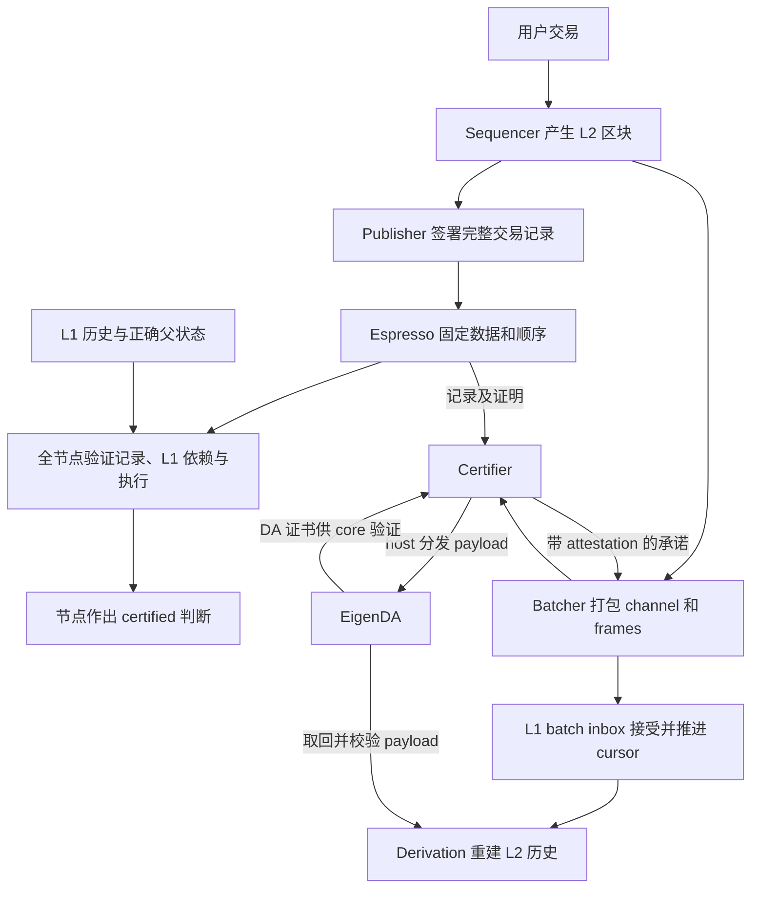

# Espresso 快速确认如何工作：MegaETH PR #8 中文学习笔记

**阅读基准：2026-10-17 核对的 [MegaETH specification PR #8][PR]，head 为 `aedc2826663b134ee25d26bea17e70c6d23d321c`。**
PR 标题是 “Write Block Certification spec; add the rollup deltas it requires”，核对时仍为 open、未合并。
该版本规范明确写明这套机制尚未在任何 MegaETH 网络激活；本文解释这份设计，不把它当作已部署行为。
以下引用的规范页面都固定在这个提交，讨论链接用于解释设计修改的原因。

如果只想先建立整体认识，读第 1、2、5、8 节；再读其余部分理解为什么需要这些检查。

## 1. 先把核心机制说清楚

**这套快速确认把“提前知道交易内容”与“约束以后采用的交易内容”连接起来。**
MegaETH 把每个 L2 区块的普通交易列表发布到 Espresso；Espresso 共识固定发布的数据及其顺序；全节点独立验证、选择记录并执行交易，从而在该区块尚未提交 L1 时，判断这些内容在规定条件下会进入后续派生链。
与此同时，后续批次必须通过 certifier 和 L1 inbox 的检查，不能随意换成另一份普通交易列表。[S1][S1]

可以把它拆成三个问题：

| 问题 | 谁来回答 | 回答的范围 |
| --- | --- | --- |
| 大家应当读取哪份已发布的数据？ | Espresso 共识，以及 MegaETH 的记录选择规则 | 固定记录字节、发布顺序，并选出每个 L2 高度的记录 |
| 这份交易列表在正确的父状态和 L1 输入下能否构成有效区块？ | 独立验证的 MegaETH 全节点 | 提前检查 L1 相关条件并执行交易 |
| Batcher 以后会不会提交另一份内容？ | Certifier、L1 batch inbox，以及修改后的 derivation | 对被接受的数据施加内容约束 |

其中，**快在不必等这个 L2 区块的批次上 L1，就可以完成全节点的条件性判断**。
这不意味着 Ethereum 已经 finalized，也不意味着提现挑战期已经结束。
PR 使用 `block certification` 和 `certified` 来描述 MegaETH 的这层保证，避免把它直接叫作无条件的最终性。[S1][S1] [S5][S5]

一个贯穿全文的区分是：

> “普通交易列表已受到约束”与“这些交易一定按当前结果完成结算”是两件事。
> 后者还依赖正确执行、相关 L1 历史不变、数据可取回，以及有人在期限内完成提交。

## 2. 角色与两条路径

### 2.1 每个角色做什么

| 角色 | 本设计中的职责 |
| --- | --- |
| Sequencer | 产生 MegaETH 区块、选择普通交易顺序及 L1 origin，向用户提供实时输出 |
| Publisher | 为每个 L2 区块签署并向 Espresso 发布 block record；由 sequencer 的运营者承担 |
| Espresso | 通过自身共识固定记录所在的数据历史，提供 finality、验证者集合演进和 namespace 完整性证明 |
| Full node | 自己验证 Espresso 历史，选择记录，检查 L1 条件并执行交易，作出 `certified` 判断 |
| Batcher | 将 L2 内容打包为 OP Stack channels 和 frames，并提交批次承诺 |
| Certifier | 核对提交内容与选中记录一致，验证 EigenDA 证书，签署受 TEE 保护的检查结果 |
| EigenDA | 保存后续派生所需的批次 payload，并提供相应数据可用性证书 |
| L1 batch inbox | 验证提交资格、certifier 签名和游标衔接等条件，接受合法提交 |
| Derivation | 每个节点从已被 inbox 接受的输入中重建 L2 历史，并执行相应有效性规则 |

Sequencer、publisher、primary batcher 可以由同一个运营者承担，但它们的职责和故障影响不同。
特别是：**替换 batcher 不等于替换 publisher，更不等于完成 sequencer 轮换。**[S1][S1] [S2][S2]



### 2.2 为什么要有两条路径

上半部分让节点提前获得信息；下半部分让后续派生受到同一份信息约束。
如果只有上半部分，恶意 batcher 仍可能向 L1 提交不同内容，节点只能事后发现不一致。
如果只有下半部分，节点又必须等批次提交后才知道结果，失去提前确认的作用。[S3][S3]

Publisher 按出块节奏发布记录，不能等 batcher、EigenDA 或 L1 提交完成才发布。
因此，正常情况下，全节点的提前验证不需要等待慢速批次路径；但其“内容会按时进入派生链”的预测仍以这条路径之后能完成为条件。[S2][S2] [S5][S5]

## 3. Espresso 究竟固定了什么

### 3.1 发布对象是完整的 block record

每个 L2 区块对应一条记录，核心字段如下：

```text
BlockRecord {
    block_number     // MegaETH L2 区块高度
    epoch_num        // 该区块选择的 L1 origin 高度
    transactions     // 有序的普通交易列表，包含完整交易字节
    publisher_sig    // 该 L2 高度的授权 publisher 签名
}
```

这里的 `epoch_num` 是 **L1 区块高度**，不是 Espresso 验证者轮换所用的 epoch。
普通交易包含完整字节，而不只是交易 hash；这样替代 batcher 才能从公开记录重建提交内容。
一个 record envelope 可以容纳多条记录，作为一笔 Espresso namespace transaction 发布；MegaETH 使用 `CHAIN_ID` 标识自己的 namespace。[S2][S2]

需要同时记住以下边界：

| 包含或约束的内容 | 不由这份记录直接固定的内容 |
| --- | --- |
| L2 高度 | 状态根、回执、gas 使用量 |
| 普通交易的完整列表及顺序 | L1 派生的 deposits 和 forced-inclusion transactions |
| L1 origin 的高度 `epoch_num` | 对应 L1 origin 的区块 hash |
| 由高度和 rollup 配置确定的 timestamp | 脱离父状态和 L1 输入的永久执行结果 |

Timestamp 通过固定映射得到：

```text
timestamp(n) = genesis_time
             + (n - genesis_block_number) * l2_block_time
```

因此，记录约束的是一个完整 L2 区块的普通输入，不是对每个实时 mini-block 的执行结果重新签一遍名。
其发布节奏也不能直接等同于用户收到实时回执的节奏。[S2][S2]

### 3.2 为什么还需要 publisher 签名

Espresso namespace 是 permissionless 的：别人也可以往同一 namespace 写入数据。
因此，“这段数据被 Espresso finalized”本身不能证明“它是 MegaETH 授权发布者给这个高度发布的记录”。
签名和按 L2 高度查找的 `PUBLISHER_KEYS` 共同提供这层授权检查。[S2][S2]

另一个容易忽略的细节是：实时 mini-block 和 block record 是分别签名的两种表示。
规范要求 publisher 忠实复制出块时的内容，但 Record Validity 没有把 record 与实时 mini-block 流逐项比对。
所以，用户要确认自己收到回执的那笔交易，必须在选中的记录及相应执行结果中核对它，不能仅凭“这个高度有 Espresso 记录”就认为先前回执得到确认。[S2][S2]

## 4. 从 Espresso 数据到每个高度唯一的 selected record

### 4.1 共识先固定数据历史，MegaETH 再运行选择规则

Espresso 的共识称为 HotShot，属于 HotStuff 家族；它在这里负责固定数据，不执行 MegaETH 的 EVM 交易。[Espresso 官方架构说明][E1]
PR 所依赖的验证分为三件事：

1. **Finality：**证明这个 Espresso 区块满足其协议版本的提交规则。
2. **Quorum 演进：**证明使用的验证者集合能从已信任集合，经认证的 epoch 转换得到。
3. **Namespace 完整性：**证明提供的是该区块中 MegaETH namespace 的完整有序内容，或者证明该 namespace 确实不存在。[S3][S3]

第三项不只是证明某条记录“在区块里”。
因为接下来的选择规则是 first-valid-wins，数据提供者若能隐藏更早的有效记录，就可能让观察者错误地选中后面的冲突记录。
**只检查 inclusion、却不检查完整性，不足以得出正确的选择结果。**[S3][S3]

### 4.2 不能把所有 Espresso 版本都写成“两张 QC”

PR 的早期版本曾使用两张连续 QC 的描述，讨论后改为按版本验证：

| Espresso 协议版本 | 该 PR 要求验证的 finality 证据 |
| --- | --- |
| `v < 0.3` | 不接受 |
| `0.3 <= v < 0.6` | 连续 view 的 committing QC 和 deciding QC，并验证所需的跨 epoch 集合 |
| `v >= 0.6` | 与 leaf commitment、view 和 block number 匹配的 `Certificate2` |

这是该版本 PR 的证据验证规则，不是“看到一张任意证书就 finalized”。
所有签名、证书绑定和验证者集合仍须通过相应检查；`ESPRESSO_FINALITY_PROFILE` 的其余具体配置还未全部赋值。
所以，理解总体工作方式不需要把旧 HotStuff 的提交规则硬套到所有版本上。[S3][S3] [相关 PR 讨论][C1]

### 4.3 First-valid-wins 是怎样选的

观察者从 L1 规定的 cursor 开始，按 Espresso 已固定的顺序向前扫描。
假设当前期待 L2 高度 `n`，上一条选中记录的 L1 origin 是 `e`，候选记录必须满足：

- `block_number == n`，不能跳过尚未解决的高度。
- `epoch_num >= e`，所选记录的 origin 不倒退。
- 签名匹配这个 L2 高度的授权 publisher key。
- 每个交易条目不是空字节，也不是 deposit 类型。
- 如果处于规范定义的 Interop 激活块，普通交易列表必须为空。

此外，envelope 和 record 必须先通过格式与大小检查。
同一 envelope 的格式检查要完整通过，才能从其中产出候选记录。[S2][S2]

选择逻辑可概括为：

```text
按 Espresso finalized 历史向前扫描：
    对当前候选 record：
        如果它有效地填补当前期待高度 n：
            选中它
            n := n + 1
            e := record.epoch_num
        否则：
            忽略它，继续扫描
```

**这里的有效性不检查账户余额、nonce 或 EVM 执行。**
这让拥有相同历史、参数和起点的观察者，在无需执行 L2 的情况下得到相同选择。
执行检查属于后续全节点认证。[S2][S2]

### 4.4 两个小例子

**冲突记录。**
扫描正期待高度 101，先遇到有效的 `R101 = [A, B]`，之后遇到另一个签名有效的 `R101' = [B, A]`。
选择结果是 `[A, B]`；第二条记录到达时，期待高度已经是 102。
这里按 Espresso 的顺序判断，不能按各节点收到网络消息的先后判断。[S2][S2]

**乱序发布。**
扫描正期待 101，却先遇到 `R102`，再遇到 `R101`。
前一个 `R102` 会被跳过；扫描选中 `R101` 后不会回头寻找它。
Publisher 需要重新发布尚未被选中的 102 记录，直到被选中或 inbox cursor 已经过该高度。
因此，“发送顺序正确”与“最终能连续选中”不是同一件事。[S2][S2]

以上 first-valid-wins 的不可替换性是在同一个 scan segment 内成立的。
管理员 override 会建立新的扫描起点，可能影响尚未被 L1 接受的选择；第 9 节会解释这点。

## 5. 全节点怎样在上 L1 之前确认

全节点需要独立完成以下工作，而不是直接相信某个 Espresso RPC 或 certifier 返回的标签：

1. 验证 Espresso finality、quorum 演进和 namespace 完整性，自己选出记录。
2. 根据 L1 inbox 的初始位置及后续 `CursorSet` 事件，使用正确的扫描起点。
3. 确认用于预测的父区块及其状态正确，不能在任意一条本地分叉上模拟成功就算通过。
4. 对照自己验证的 canonical L1 历史，检查 origin 连续性、timestamp 和 sequencer drift 等条件。
5. 从 L1 得到该高度应使用的系统输入，执行所选普通交易，检查整个区块的执行有效性。[S5][S5]

其中，origin 连续性比记录选择时的单调性更强：
如果实际派生父区块的 L1 origin 是 `e`，当前记录的 origin 必须是 `e` 或 `e + 1`。
仅仅不小于“上一条选中记录”的 origin 不够，因为发生 deposit-only 替代后，选中记录序列和实际派生链的 origin 可能已经分离。[S5][S5]

当这些检查通过，并满足后文的保证条件时，节点可以在没有该高度 L1 提交的情况下作出 `certified` 判断。
如果正确父状态或必要 L1 输入尚不可得，判断应保持 pending。
若父状态、相关 L1 历史或扫描起点发生变化，节点必须重新评估。[S5][S5]

### 一笔交易的完整例子

以下高度与交易名仅用于说明，不代表实际链上事件。
假设 L2 高度 499 的父状态已正确确定，高度 500 的普通交易是 `[A, B]`，origin 为 L1 高度 8000，并且所有时间与有效性条件均满足。

| 步骤 | 发生什么 | 此时能知道什么 |
| --- | --- | --- |
| 1 | Sequencer 向用户返回 A 的实时结果 | 用户知道 sequencer 给了什么承诺 |
| 2 | Publisher 发布 `R500 = (500, 8000, [A, B])` | 尚须等 Espresso finality 和记录选择 |
| 3 | Espresso 固定该记录所在数据，独立扫描选中 R500 | 普通内容选择为 `[A, B]` |
| 4 | 全节点验证 L1 输入，并在正确父状态上执行 | 可作出有条件的 `certified` 判断；此时无需该批次上 L1 |
| 5 | Batcher 完成 channel，获得 certifier attestation，inbox 接受推进至 500 的提交 | R500 成为 canonical record |
| 6 | Derivation 从 EigenDA 取回并校验 payload，再派生、执行 | 在条件成立时，普通内容 `[A, B]` 进入派生链 |

因此，用户所说的“快速确认”最接近第 4 步。
第 3 步是其前提，但不能直接替代第 4 步。
第 5、6 步负责落实后续内容约束。[S1][S1] [S5][S5]

PR 没有给这整个流程规定一个可以直接用于产品承诺的固定毫秒或秒数。
确认延迟取决于记录产生与发布、Espresso finality、数据和证明获取，以及全节点验证与执行；并行部分不能机械相加。
规范中的约 10 ms 描述的是 sequencer acknowledgement，不能拿来当作 Espresso certified 的延迟。[S1][S1]

### 5.1 补充：从单节点提交到有界延迟的公共公告板

**本节于 2026-10-17 补充，区分公开材料中的性能描述与我们为了协议分析引入的时序假设。**
下面的 `T_write`、`T_read` 是建议模型的参数，不是 PR #8 已规定的服务上界。

#### 实际 finality 时间能说到什么程度

Espresso 官方 FAQ 使用“亚秒级 finality”的描述；另一份官方 DAS NYC 2026 演示页面写的是约 3 秒，并把亚秒级列为 2026 年后期目标。
这些页面的部署与测量口径没有在这里对齐，因此可以把它们当作正常性能量级的参考，不能由此确定某个指定部署的端到端延迟，更不能推导出确定性的最坏情况上界。[官方 FAQ][E2] [官方演示说明][E3]

用户关心的起点是“把一份交易列表发给一个 Espresso 节点”，而不是“该列表所在提议已经进入正常共识路径”。
官方 Submit API 明确说明，成功响应返回交易 hash，不表示该交易已经被排序。[Submit API][E4]
读取端也不必立即完备：Availability API 允许节点暂时缺数据并从其他节点补齐；Node API 返回的是该节点自己的当前视图。[Availability API][E5] [Node API][E6]

因此，下列五个事件不能合并：

```text
发送请求
    → 完整数据可靠进入提交路径
    → 被最终收录在 Espresso 有序历史中
    → 观察者取回完整内容和证明
    → 观察者完成验证
```

向一个任意节点发送请求，无法独自启动一个无条件的最终收录倒计时。
该节点可能不转发、宕机，或者请求所在队列长时间得不到处理。
即使区块共识持续推进，也仍需单独保证这份特定请求获得收录机会。

#### 推荐抽象：有界延迟的追加式公共日志

令 `L*(t)` 表示实时时刻 `t` 已 finalized 的完整 Espresso namespace 日志，令 `L_u(t)` 表示观察者 `u` 已完整验证的日志前缀。
日志记录完整 payload、确定位置及验证所需证据；MegaETH 的 DATA、REGULAR、SWITCH 等应用记录是否合法，由单独的确定性解释规则决定。
以下是我们建议加入模型的服务契约。

**A. 永久性与前缀一致性。**
在 Espresso 的安全假设和共同可信起点成立时，`L*(t)` 只追加不回滚。
所有诚实观察者接受的视图都是它的前缀，且每个观察者自己的已验证视图不回退。
观察者可以看到不同长度，不能看到不兼容内容。

**B. 有界写入。**
若诚实提交者在 `t_s` 发起一份满足大小、费用、准入及流量限制的完整请求 `x`，并按规定持续重试或中继，且在整个所需时段满足下文的健康条件，则存在 `t_c <= t_s + T_write`，使 `x` 的完整字节出现在 `L*(t_c)` 中。
重复请求可以在原始日志中出现多次；应用层按明确的 record ID 去重，不需要假设 Espresso 自动提供 exactly-once 写入。

`T_write` 包含可靠入口、转发、排队、收录、可能的 view change 和 finality 所需时间。
如果更愿意从“至少一个诚实入口已完整接收”开始计时，可以将它拆为：

```text
T_write = T_ingress + T_inclusion-finality
```

这里不能把入口的一次 HTTP 成功响应当成对 B 的证明。
可靠入口本身是一项前提，或需要由客户端的多入口发送、重试及相应可达性保证实现。

**C. 有界公开可见性。**
对在 `t_c` 已 finalized 的每个日志前缀，以及所有持续在线、已同步、遵守读取协议且具有约定资源的诚实观察者 `u`，要求：

```text
L*(t_c) 是 L_u(t_c + T_read) 的前缀。
```

`T_read` 必须覆盖轮询或订阅延迟、完整 namespace 内容、必要 finality 与 quorum 证明的获取，以及验证与追赶开销。
只拿到某条记录的 inclusion proof 不足以满足这个条件；解释 first-valid-wins 或控制事件先后时，需要相应范围内完整的已验证顺序。
任意离线后刚加入、需要重放全部历史的节点，不在固定 `T_read` 的适用范围内；其恢复时间需要另行建模。

**D. 保留与可取回性。**
完整字节及必要证明至少保留协议要求的历史窗口，或者由明确的归档机制提供。
对已知位置取回有界大小对象，可以规定相应读取界；不能把整个无限增长的历史当成恒定时间可下载的对象。

由 B 和 C，对满足条件的一次提交得到：

```text
T_E = T_write + T_read

到 t_s + T_E 时，所有上述诚实观察者
均能完整验证一个包含 x 的共同历史前缀。
```

这个 `T_E` 才是“提交到公共可验证公告”的时间界。
它不要求所有观察者在同一瞬间看到相同的最新高度，也不保证同一时段提交的多条消息按它们的发送时间排序。
Finalized 日志已经给出唯一顺序后，不能再根据发送时间或本地超时调整它。

#### 有界假设需要覆盖哪些条件

要把 B、C 写成确定性的界，需要明确假设：所采用 Espresso 版本要求的诚实权益条件成立；通信、处理和数据恢复具有适当上界；请求与总负载有界；调度或准入机制给出特定请求的有界收录保证；诚实观察者能够访问可用的数据与证明提供者。
“至少一个诚实节点收到”不自动推出有界收录，“DA 可恢复”也不自动推出任意 RPC 都会在相同时间内返回完整数据。

如果底层只保证部分同步下的 eventual liveness，那么未知网络稳定时刻之前不能声称固定墙钟上界。
即使网络已稳定，也需处理积压、当前 view 同步和超时状态，以及特定请求的收录公平性；它们不能靠一句“GST 已经过了”自动得到统一常数。
因此可选择两种写法：

- **同步服务模型：**直接假设 B、C 在研究时段内成立，明确这是上层分析所依赖的 Espresso 服务契约。
- **条件活性模型：**前缀安全始终在其安全前提下成立，时间界仅在系统恢复到规定健康状态后适用；没有健康条件时不承诺及时推进。

如果参数来自压测分位数，则应写成概率性服务指标，并说明测量起点、网络、负载、客户端策略与失败概率。
不能把 p99 或典型 finality 时间改写成“所有执行都满足 `T_E`”。

#### 对区域轮换和无进展监控的作用

这个抽象可以强化 [v3 设想 §5.1][V3] 原先的“合法提交最终有机会被包含”：我们现在另外假设发布和公开读取都在给定界内完成。
若健康区域从上一进展点起至多用 `T_produce` 产生下一份完整合法输出，并由诚实中继在至多 `T_relay` 内开始可靠提交，则在线监控者看到下一条有效进展的保守预算为：

```text
T_progress = T_produce + T_relay + T_write + T_read
```

跨节点比较本地时间还要计入时钟误差，处理限额也须覆盖应用层验证。
监控者要基于完整且足够新的日志判断“没有有效 DATA”，不能把单个 endpoint 的 404 或超时当作不存在证明。
超时首先说明上述服务链至少一个前提未满足，不单独证明区域 Byzantine，也不能在 Espresso 本身停摆时保证 SWITCH 及时生效。

另一方面，观察者一旦验证了某条 finalized 日志及其应用前缀，就无需为了该前缀的安全性额外等待 `T_read`。
`T_read` 用来保证其他在线观察者及时获知，以及分析监控、交接和推进时间；前缀不可回退来自 finality 与确定性解释规则。

## 6. 后续提交为什么不能换内容

### 6.1 Certifier 负责连接两条路径

Batcher 仍构造 OP Stack 的 channel 和 frame。
一次提交 payload 可以包含同一 channel 的一个或多个连续新 frame；该 PR 固定使用 singular batches。
Certifier 接在 batcher 的 alt-DA provider 接口处，返回把 DA 证书与认证结果绑定在一起的 commitment。[S3][S3]

Certifier 分成两部分：

- **Host：**收集输入、获取 Espresso 证明、向 EigenDA 分发 payload；这些输入不能因来自 host 就被信任。
- **Core：**在 enclave 内执行检查，是对输入进行验证并产生签名结果的程序。

Core 的主要检查可按下面的顺序理解：

1. 输入 quorum 与 cursor 保存的锚点匹配，所需 Espresso 历史和 namespace 证明有效。
2. 新 frame 与此前已接受的 frame 前缀属于同一连续 channel，内容与前缀承诺一致。
3. Channel 关闭时，完整压缩流满足双方固定的解码规则，再提取其中的 batch。
4. 每个提取出的区块，与下一条 selected record 的普通交易字节和 `epoch_num` 完全相等，timestamp 匹配记录高度。
5. Payload 与 EigenDA 证书中的数据承诺一致，证书签名和权益阈值等检查通过。
6. 对前后 cursor、DA 承诺、证书及 registry evidence 的绑定关系签名，交给 batcher 提交。[S3][S3]

**Core 不执行 MegaETH 区块，也不验证完整的 canonical L1 执行输入。**
所以，获得 TEE attestation 仍然不能替代全节点的 `certified` 判断。[S3][S3]

### 6.2 Cursor 为什么必不可少

Cursor 是 L1 保存的进度凭据，包含 Espresso 扫描位置、上一个经过的 L2 高度及其 origin、当前 channel 的 frame 承诺，以及 quorum 锚点。
一个 certifier 调用返回的 cursor 只是候选结果；只有 inbox 接受才会提交这次状态变化。[S3][S3]

它解决的是：“这次证明承接的是哪段已经被接受的历史？”
正常提交必须让 `prev_cursor` 与链上当前状态匹配，因此 batcher 不能从任意位置开始，跳过自己不喜欢的记录。
未关闭 channel 的中间 frame 只推进相应 frame 状态，不推进 L2 记录位置；关闭 channel 的提交才可能把多个记录一起推进为 canonical。[S3][S3] [S4][S4]

### 6.3 TEE 在这里证明什么

可以把两层证据分开理解：

| 证据 | 要建立的关系 |
| --- | --- |
| 硬件 attestation | 某个签名公钥绑定到获授权的 enclave 镜像 measurement |
| Core 对一次提交的签名 | 该程序对这一组具体输入检查通过，并承诺这一次 cursor 转换及 DA 数据 |

PR 使用 AWS Nitro enclave，并以 `PCR0` 标识镜像 measurement。
L1 必须验证公钥与镜像的绑定证据；measurement 仍获授权时，对应已注册 key 的签名才可被接受。
Key 与 measurement 永久绑定，升级镜像要使用新 key；如果 key 被 sealed 保存，还需信任 sealing 服务及能修改释放策略的人。[S3][S3] [S4][S4]

因此，安全性依赖获授权程序正确、TEE 正常保护执行和密钥、硬件证明可信，以及相关治理和验证依赖保持正确。
全节点独立验证能避免把 host 的说法当事实，却不会消除后续 L1 执行约束对 TEE 的依赖。
PR 提到未来可用其他 proof system 替换这项检查，但当前规范没有给出完整替换方案。[S3][S3] [S5][S5]

### 6.4 Inbox 接受之后，derivation 才能使用

Inbox 检查 sender 是否有提交资格、cursor 是否衔接、channel 是否满足所有权与超时规则、证书是否满足相应条件，以及签名是否来自仍获授权的 certifier key。
通过后更新 cursor，并发出 `CursorAdvanced`。[S4][S4]

修改后的 derivation 要求交易 receipt 成功，且存在来自 inbox 地址的 `CursorAdvanced` 接受事件，同时满足接收地址和交易类型等规则。
**仅仅“交易发到了 inbox”或“发送者是 primary batcher”，都不足以成为派生输入。**
如果节点拿不到必要 receipt，就要等待，不能退回仅按 sender 判断的旧方式。[S6][S6]

这项修改非常关键：合约可以拒绝 calldata，但 calldata 仍存在于失败交易里。
如果 derivation 忽略交易是否被合约接受，就可能绕过整个认证机制，继续读取已被拒绝的数据。[S6][S6]

## 7. 为什么还要修改 OP Stack 的派生规则

Certifier 不执行 L2，也不持有完整的 canonical L1 输入，因此没有认证 batch 所携带的 `parent_hash` 和 `epoch_hash`。
如果继续让这两个 batch 字段决定是否丢弃批次，batcher 就能提交交易内容正确、hash 字段却故意错误的数据，造成派生障碍。[S3][S3] [S10][S10]

该 PR 因而作出几项配套修改：

| 修改 | 原因与作用 |
| --- | --- |
| 忽略 batch 提供的 `parent_hash` | 在实际派生父区块上构建，避免 batcher 用未经认证的字段破坏衔接；实际区块父链接与执行检查仍保留 |
| 用 `epoch_num` 解析 canonical L1 origin，忽略 batch 提供的 `epoch_hash` | L1 重组后重新采用对应高度的 canonical L1 输入 |
| 对指定 origin 连续性、timestamp、drift 失败作同高度 deposit-only 替代 | 避免一个已经不能原地改写的 selected record 永久卡住处理位置 |
| 执行拒绝后保留 channel 后缀 | 后续高度在替代后的父链上各自检查，而不是自动丢掉整个后缀 |
| Certifier 与 derivation 一致验证完整压缩流 | 防止双方从同一 channel 字节中读出不同的可接受内容 |

这些规则共同维护“认证检查过的内容”与“实际派生采用的内容”之间的关系。
它们不等于取消父区块合法性、L1 输入验证或 EVM 有效性要求。[S6][S6] [S10][S10]

## 8. 它究竟保证到哪一步

### 8.1 六个状态不要混用

| 状态 | 怎样建立 | 不能由此直接推出什么 |
| --- | --- | --- |
| Sequencer acknowledgement | 收到 sequencer 的实时承诺 | 不能推出 Espresso 已固定对应内容 |
| Selected record | 独立扫描 Espresso finalized 历史，按规则选中 | 不能推出可执行、canonical 或一定及时结算 |
| Certified | 全节点独立验证所选记录、L1 条件与执行，并依赖保证条件 | 不能推出 L1 输入已最终确定或结果永不改变 |
| Canonical record | Inbox 接受推进经过该记录的提交 | 不能推出普通交易一定执行有效 |
| Settled on L1，按本 PR 用语 | 从 L1 接受的数据派生出该高度内容 | 不自动等同于 Ethereum finality 或提现完成 |
| Fault proof window closed | 相应状态声明完成适用的争议流程 | 不是 Espresso 快速确认本身提供的能力 |

这里 `certified` 是节点本地的条件性判断，`canonical` 是相对于 canonical L1 历史的接受状态。
两者不是同一种证明，也不是必须由每个节点依次标记的统一流水线状态。[S1][S1] [S5][S5]

### 8.2 较弱但基础的保证：内容只能是哪两种

规范的 **Certification Claim** 是：在其安全、治理和数据可用性等前提下，一个覆盖高度如果完成派生，其普通内容要么等于被 inbox 接受并成为 canonical 的选中记录内容，要么该高度成为 deposit-only block。
它排除的是第三种任意普通交易列表。[S1][S1]

例如，选中 `[A, B]` 后，恶意 batcher 不能让 `[B, A]` 或 `[A, C]` 成为该高度的另一种合法普通内容。
但原内容可能因执行无效或未按时提交而失去，那个高度最终只保留从 L1 派生的 deposit 类交易。
Deposit-only 不是“原来的 A、B 仍然执行，只是换个叫法”。

**数据不可取回需要单独处理。**
如果已被接受的 payload 暂时无法从 DA 取回并校验，节点会等待，不能凭空换成 deposit-only。
因此，“只有两种已派生内容”不等于“系统在任何故障下都会继续推进”。[S9][S9] [DA 问题的 PR 修订说明][C3]

### 8.3 更强的保证：预测原内容会保留

全节点的 `certified` 判断进一步预测：在规定条件持续成立时，选中的普通内容会完成派生，不会落入 deposit-only fallback。
主要条件可以整理为：

- 从正确的 activation checkpoint 及后续正确父状态开始推导。
- Espresso finality、数据完整性、可信 quorum 起点和后续认证转换成立。
- TEE、密钥保护、注册验证和相关治理依赖正确。
- 相关 L1 历史及执行输入保持 canonical；变化后重新判断。
- 所需 payload 可取回并匹配承诺。
- 至少一个已注册 batcher 在 sequencing window 和 channel timeout 的约束内成功交付完整 channel。
- 如果 primary 反复占用并放弃 channel，管理员及时将其移除或替换。
- 在接受前，没有 override 跳过该高度或改变其所选记录。[S5][S5]

这些条件中，“不能偷换内容”属于内容安全性；“有人按时交齐数据”属于及时推进的条件。
PR 后期讨论专门把两者分开，避免把无需信任 batcher 的内容正确性，误写成不依赖 batcher 行动的及时结算保证。[相关 PR 修订说明][C2]

## 9. 故障发生时，哪些确认会失效

### 9.1 L1 重组：记录未改，执行结果仍可能变

Record 只固定 L1 origin 的高度，不固定该高度的 L1 hash。
重组后，新的 canonical L1 历史可能改变 deposits、账户余额、nonce 或其他执行输入。
于是同一普通交易列表可能继续有效但结果不同，也可能让整个区块变为无效，需要 deposit-only 替代。[S5][S5] [S7][S7]

例如，A 原本依赖一笔 L1 deposit 提供余额；重组后这笔 deposit 消失，A 可能无法通过区块执行有效性检查。
Espresso 上 A 的字节没有被撤销，但原先对 A 会在该高度完成派生的判断需要重做。
这也说明，确认交易列表不等于无条件确认 state root、receipt 或 block hash。

这里还要区分 **EVM 交易 revert** 与 **区块执行 INVALID**。
一笔合约调用正常执行后 revert，可以出现在有效区块内；nonce 等前置有效性失败导致整个区块被拒绝，才是这里讨论的另一种情况。[S5][S5]

### 9.2 Primary batcher 停摆：可接手，但需要资格和时间

提交资格按照 L1 高度判断：

```text
L1 当前高度 < cursor.epoch_num + EXCLUSIVE_WINDOW
    → 仅 primary batcher 可提交

L1 当前高度 >= cursor.epoch_num + EXCLUSIVE_WINDOW
    → primary 或已注册的 alternative batcher 可提交
```

Alternative batcher 可以从 Espresso 的记录重建 payload，无需取得 primary 的原始 channel 打包方式。
如果 primary 留下未关闭 channel，还要等它超时，才能从 frame 0 重新打包，接着未推进的 L2 cursor 提交。[S4][S4]

但这里并非完全 permissionless 的提交机制：

| 能力 | 准入 |
| --- | --- |
| 独立读取、验证记录与执行 | 对所有有相应数据和能力的节点开放 |
| 运行授权镜像并注册 certifier key | 由链上证据验证，无需逐个批准运营者 |
| 作为 alternative batcher 提交 | 地址需要进入管理员管理的 batcher registry |

能够验证，并不自动获得自救提交权。[S4][S4] [S5][S5]

`EXCLUSIVE_WINDOW` 仍是 TBD；该版本把 `CHANNEL_TIMEOUT` 固定为 50 个 L1 区块。
一个保守的恢复时间预算要考虑独占窗口、channel timeout，以及准备、认证、DA 分发和成功上链所需时间，并留在受影响高度**剩余**的 sequencing-window 预算内。
两段等待可以重叠；这不是协议自动保证的完成上界。
记录 origin 与实际派生 origin 分离时，通常的救援余量也未必成立。[S4][S4] [S5][S5]

### 9.3 其他故障

| 故障 | 该 PR 中的结果或恢复边界 |
| --- | --- |
| Publisher 不再发布下一高度 | Selected sequence 卡在缺口；没有规定替换沉默 publisher 的完整机制 |
| Publisher 发布无效记录 | 扫描忽略它，仍可发布修正记录；如果不重发，缺口继续存在 |
| Espresso 停止推进 | 已 finalized 的积压记录仍可提交，新记录的认证等待恢复 |
| EigenDA 无法完成分发并出证 | 无法构造合格提交；没有规定切换到其他 DA 网络的 fallback |
| 已接受的 DA payload 取不回来 | Derivation 等待可取回的匹配数据，不自行猜测内容 |
| Certifier key 或 TEE 假设被攻破 | 内容约束可能失效，需要撤销相关 measurement 等处置；独立全节点验证不能让 L1 自动拒绝伪造 attestation |

没有成功提交且错过适用 sequencing window 的高度，可能进入 deposit-only fallback。
已被接受却无法读取的数据则是另一种等待情形，不能把二者统称为“超时自动恢复”。[S7][S7] [S9][S9]

### 9.4 管理员 override 能跳过尚未落实的确认

管理员可以用 `CursorSet` 向前设置 cursor，放弃当前 channel，并指定后续扫描位置和 quorum 锚点。
这不是一份普通 batch 提交，也没有给被跳过记录带来 canonical 状态。
Derivation 按顺序处理该事件，对缺失高度进行规定的 deposit-only 填补，同时保留已建立的 safe prefix。[S4][S4] [S6][S6]

例如，cursor 从 100 被移到 105，而 101–105 从未被接受：
即使某个节点早已选中并暂时认证这些记录，它们也不会因为这个 override 自动成为 canonical。
节点必须重新评估受影响的判断。[S2][S2]

合约只检查前移、清空 frame 状态、origin 不在未来等有限条件。
恢复位置和 quorum 锚点的真实性还依赖管理员正确操作，不能从“cursor 只许前进”推出所有安全保证自然保留。[S4][S4]

## 10. 与 sequencer 轮换有什么关系

对轮换设计，最有用的启发是：**交接不能只交接“下一位是谁”，还需要固定“下一位必须继续哪段历史”，并约束后续派生实际采用它。**
这是从上述机制得到的设计启发，不是本 PR 已提供的完整 sequencer 轮换方案。

本 PR 实际上保留了以下边界：

1. Alternative batcher 接手解决的是提交停摆，不能替代 publisher 为下一高度制造新的授权记录。
2. `SequencerRegistry` 的 sequencer 变化不会自动修改 `PUBLISHER_KEYS`；如果 publisher key 也变，授权表必须在新 key 使用的首个高度生效。
3. 仍可被 inbox 接受的 certifier 镜像，必须对相关高度使用一致的 publisher-key schedule。
4. Publisher key 更新的完整治理流程、不同 certifier 版本的协调，以及沉默 publisher 的替换机制，仍未完整规定。[S2][S2]

因此，不能直接从“Espresso 已提供认证”推出“排序器轮换与故障接管已经解决”。

## 11. 阅读 PR 时最容易误读的地方

| 容易产生的理解 | 这份 PR 更准确的含义 |
| --- | --- |
| “Espresso finalized，所以 MegaETH 结果不可逆。” | 固定数据历史后，还要做记录选择、L1 条件与执行验证，并保留后续条件 |
| “Certifier 已签名，所以交易执行成功。” | Core 核对输入内容与 DA 证据，不执行 MegaETH |
| “有记录被选中，就已经 canonical。” | Canonical 需要 inbox 接受推进经过该记录的提交 |
| “只要超时，任何人都可以救援。” | Alternative batcher 需要 registry 资格，并成功赶上实际截止条件 |
| “只有原内容或 deposit-only 两种结果，因此不会停。” | 这是对已派生内容的约束；不可取回的已接受数据可以使派生等待 |
| “实时回执自动被 Espresso 确认。” | Record 与 mini-block 流没有 verifier 强制的逐项绑定，须核对实际交易 |
| “后续只要照常跑 OP Stack 就行。” | Inbox 接受事件、hash 字段处理、替代规则和解码一致性等都需要配套修改 |

PR 描述和早期评论包含历史表述，应优先读固定 head 的规范正文。
例如，当前正文已经以 receipt 中的接受事件决定 certified derivation 输入；不能继续沿用早期说明中“derivation 直接读 batcher registry”的版本。
同样，当前 `canonical` 定义以 L1 接受为准，而不是把 Espresso finalization 与 canonical 混用。[S2][S2] [S6][S6]

## 12. 自测：是否真正理解

读完后，可以试着不用回看回答这五题：

1. 为什么只在 Espresso 上发布一个交易列表，还不能约束 MegaETH 的后续派生？
2. 为什么 first-valid-wins 需要 namespace 完整性证明，而不仅是某条记录的 inclusion proof？
3. 同一列表在 Espresso 上没有变化，为什么 L1 重组仍可能使原来的 `certified` 判断失效？
4. 为什么替代 batcher 能从完整记录重建批次，却不能修复 publisher 不发布下一高度的问题？
5. 为什么“不能换成任意内容”和“原内容一定及时进入派生链”需要不同的假设？

对应答案分别在第 2、4、9、9–10、8 节。

## 来源与建议阅读顺序

先读总览与 Full Node Verification，再读记录格式、certifier 和 inbox，最后读故障恢复与派生修改。
`Full Node Verification` 等页面仍带有 draft / unstable 标记；其中的条件性保证、未定参数与未规定流程，应随后续 PR 修改重新核对。

| 来源 | 建议重点 |
| --- | --- |
| [PR #8][PR] | 设计目的与讨论；不要用早期描述覆盖最新正文 |
| [S1 — Overview][S1] | Certification Claim、角色、确认阶段 |
| [S2 — Block Records][S2] | Full transaction bytes、授权、first-valid-wins、selected/canonical 区分 |
| [S5 — Full Node Verification][S5] | Certified 判断、正确父状态、L1 依赖和保证条件 |
| [S3 — Block Certifier][S3] | Espresso 证据、cursor、channel 检查、TEE 信任边界 |
| [S4 — L1 Batch Inbox][S4] | 接受条件、registry、独占窗口、override |
| [S6 — Derivation][S6] | Receipt 事件、parent/origin 处理、同高度替代 |
| [S7 — Emergency Recovery][S7] | 不同故障、恢复条件与没有恢复路径的情况 |
| [S8 — Activation][S8] | 激活 checkpoint、可信 Espresso 起点与 bootstrap 的建立 |
| [S9 — Data Availability][S9] | 取回 payload、验证承诺与不可用时等待 |
| [S10 — Derivation Pipeline Deltas][S10] | 配套修改的理由与检查应放在哪里 |

[PR]: https://github.com/megaeth-labs/specification/pull/8
[S1]: https://github.com/megaeth-labs/specification/blob/aedc2826663b134ee25d26bea17e70c6d23d321c/specs/block-certification/overview.md
[S2]: https://github.com/megaeth-labs/specification/blob/aedc2826663b134ee25d26bea17e70c6d23d321c/specs/block-certification/block-records.md
[S3]: https://github.com/megaeth-labs/specification/blob/aedc2826663b134ee25d26bea17e70c6d23d321c/specs/block-certification/certifier.md
[S4]: https://github.com/megaeth-labs/specification/blob/aedc2826663b134ee25d26bea17e70c6d23d321c/specs/block-certification/batch-inbox.md
[S5]: https://github.com/megaeth-labs/specification/blob/aedc2826663b134ee25d26bea17e70c6d23d321c/specs/block-certification/full-node.md
[S6]: https://github.com/megaeth-labs/specification/blob/aedc2826663b134ee25d26bea17e70c6d23d321c/specs/rollup/derivation.md
[S7]: https://github.com/megaeth-labs/specification/blob/aedc2826663b134ee25d26bea17e70c6d23d321c/specs/block-certification/recovery.md
[S8]: https://github.com/megaeth-labs/specification/blob/aedc2826663b134ee25d26bea17e70c6d23d321c/specs/block-certification/activation.md
[S9]: https://github.com/megaeth-labs/specification/blob/aedc2826663b134ee25d26bea17e70c6d23d321c/specs/rollup/data-availability.md
[S10]: https://github.com/megaeth-labs/specification/blob/aedc2826663b134ee25d26bea17e70c6d23d321c/specs/block-certification/derivation-pipeline.md
[C1]: https://github.com/megaeth-labs/specification/pull/8#issuecomment-5883210450
[C2]: https://github.com/megaeth-labs/specification/pull/8#issuecomment-6093271573
[C3]: https://github.com/megaeth-labs/specification/pull/8#issuecomment-6093167865
[E1]: https://docs.espressosys.com/network/learn/what-is-espresso
[E2]: https://www.espressosys.com/faq
[E3]: https://www.espressosys.com/collateral-mgmt-demo
[E4]: https://docs.espressosys.com/network/developer/espresso-api/submit-api
[E5]: https://docs.espressosys.com/network/developer/espresso-api/availability-api
[E6]: https://docs.espressosys.com/network/developer/espresso-api/node-api
[V3]: ../../formalization_v2/arch_v3_espresso_brainstorm_zh.md
