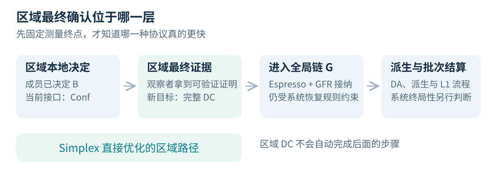
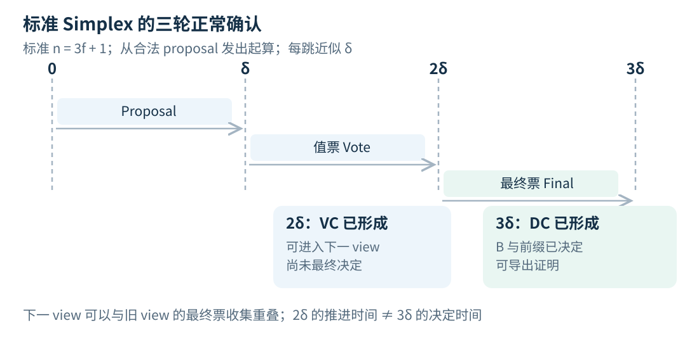
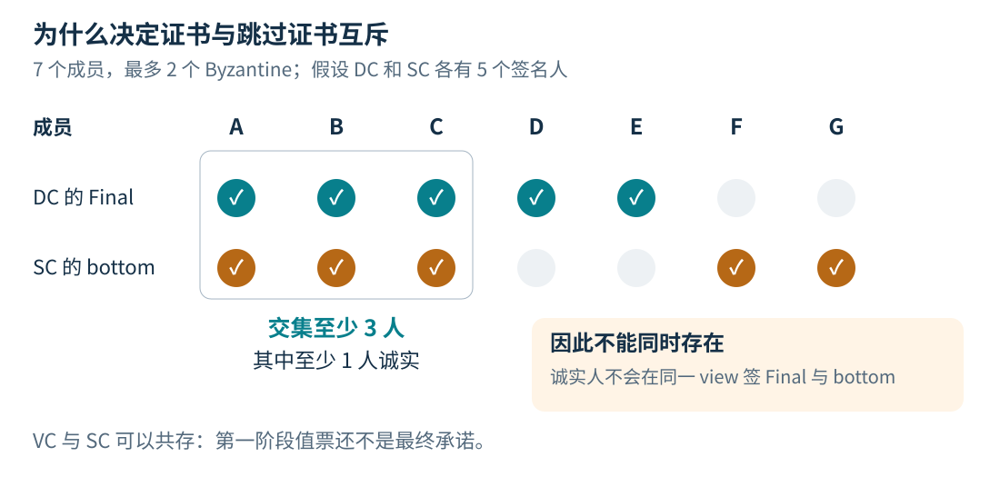
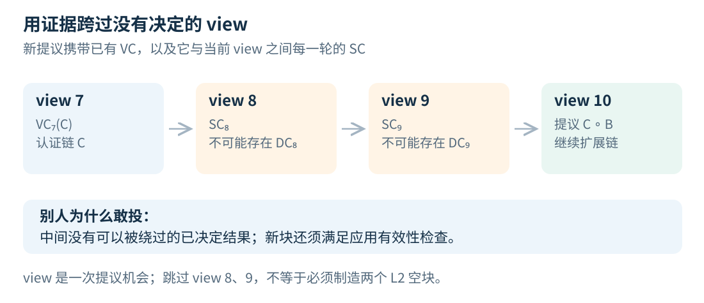
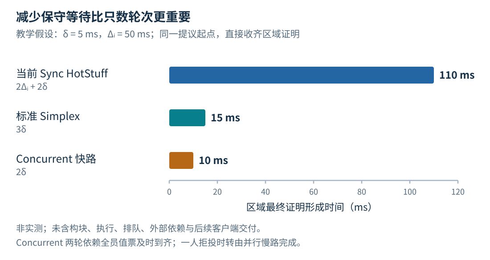
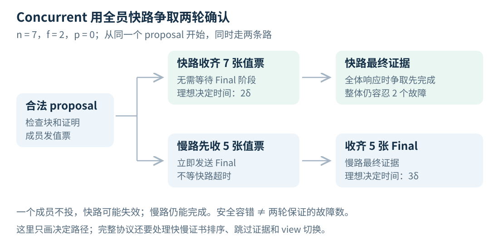

# Simplex 中文学习笔记与区域 BFT 选型

更新日期：2026 年 10 月 28 日。目标：理解部分同步 Simplex，并为现有区域 Sync HotStuff 寻找替代方案。选型约束按本次讨论确定为 **Byzantine 故障少于三分之一**；优先缩短区域最终确认时间。

入口是 Ittai Abraham 的 [Simplex 章节导览](https://decentralizedthoughts.github.io/2026-05-25-chapter-simplex/)。以下先把协议讲明白，再对照本项目的 Session Program、FINAL 和跨区交接讨论选择。文中的毫秒数都是教学示例，不是系统实测。

## 1 先给选型意见

**在 $n=3f+1$、保留 $f$ 个 Byzantine 容错的条件下，我建议把带签名的 Concurrent Simplex 的 $p=0$ 版本作为低延迟研究目标，用标准链式 Simplex 作为实现和测量基线。**

原因很直接：大家都迅速投票时，Concurrent 的快路有机会两轮确认；有人拒投或掉队时，已经并行运行的三轮慢路继续完成。它没有把整体安全和活性容错降到五分之一。代价是：两轮快路需要全员票，而且快慢路径、换 view 与链式应用的组合更复杂。

如果要求今天就选一个有现成工程参考、便于接入当前模块的基线，我会先选 **Commonware 风格的签名式链式 Simplex，使用真正的 finalization certificate**。如果实测发现主要问题是坏 leader 带来的长尾，再重点评估 Kuplex。Kuplex 的主要收益是少等坏 view，正常确认仍是三轮。

这里的“研究目标”不等于“已经可以直接替换”：Concurrent 原文给出的是单次共识构造，接入本项目还需要明确链式规则、加权门槛、session 边界与可对外验证的证书。上述判断依据见第 8—11 节。

## 2 我们究竟要把哪一段变快

“区域 finality”在讨论中容易同时指三件事：某个成员已经决定、别人拿到了可验证的区域证据、这个块已经进入全局链。先拆开，比较才有意义。

**图 1。** Simplex 直接优化前两步。区域证据生成得快，不代表 Espresso、DA 或 L1 结算也同时变快。

在当前 v5 设计中，`Conf(s,B)` 是区域成员本地提交；发布层收集 FINAL 后形成可转交的区域结果；GFR 还要根据 Espresso 和 L1 的公共历史检查这个结果，才能将块放入 $G$。Force、过期、Kill 等可能使区域已确认块无法进入 $G$；紧急 RESUME 还可能用派生链重置 $G$。这些是系统层的规则，换一个区域共识算法不会自动消失。参见 [Part 0 的确认语义](../../formalization_v5/part0_model_goals_zh_v0_8.md)与 [Part 5 的 GFR](../../formalization_v5/part5_global_finality_rule_zh_v0_1.md)。

因此，本文优先优化的是：**从一个合法块被提议，到指定的区域观察者拿到完整、可验证的最终证据，需要多久。** 同时单独测量 session 末块到下一区域首块的交接时间。

## 3 部分同步到底是什么意思

可以把网络想成一个平时很快、偶尔堵车的快递系统。

Byzantine 故障指节点可以任意作恶：不回复、撒谎、对不同人发送冲突内容，都算在里面；不只是掉线。

- **同步模型：** 事先约定最长送达时间 $\Delta$，并且协议所依赖的消息始终满足它。超时有很强的含义。
- **部分同步模型：** 网络可能先乱很久。存在一个我们不知道的恢复时刻 GST，之后诚实节点之间的消息才满足延迟界。协议不能因为 GST 前一条消息迟到，就把已经决定的历史改掉。
- **实际延迟界 $\delta$：** 稳定执行中，相关诚实节点消息实际需要的传播时间上界。它可能明显小于保守设置的 $\Delta$；不能用最快一条消息或平均延迟冒充这个界。

部分同步 BFT 的目标是：**网络乱的时候，保证不会确认相互冲突的结果；网络恢复、leader 合适且依赖齐全后，再保证继续出块。** 它不承诺在任意长的网络分区中仍按固定毫秒数确认。定时器仍然存在，但用于判断何时尝试放弃本轮，而不是靠“等够时间”单独赋予最终性。[Simplex 原作者介绍](https://simplex.blog/)

### 3.1 本项目的旧门槛与这次新目标不同

现有协议是 **Sync HotStuff**，不是通常说的部分同步 HotStuff。原始区域核心写的是 $n=2f+1$、最多 $f$ 个 Byzantine，QC 有 $f+1$ 票；v5 改成总权重 $W_s$、故障上界 $F_s<W_s/2$、证书权重 $>F_s$。这套较高的容错比例依赖同步假设。[区域核心模型](../../formalization_v3/sync_hotstuff_rr_part1_core.tex)、[v5 Part 0 第 1—2 节](../../formalization_v5/part0_model_goals_zh_v0_8.md)

你这次确定的新目标是 $f<n/3$。对等权节点，典型最小配置为：

| 可容忍故障数 $f$ | 旧同步配置 $2f+1$ | 新部分同步配置 $3f+1$ | 标准 Simplex 的 $2f+1$ 票 |
| --- | ---: | ---: | ---: |
| 1 | 3 | 4 | 3 |
| 2 | 5 | 7 | 5 |
| 3 | 7 | 10 | 7 |

这是保持**绝对故障数**的比较。若固定原来的人数，则可容忍的故障数要重新计算。多开几个由同一个实体控制的进程，不等于增加了独立的故障隔离。

v5 使用质押权重，因此落地时不能把“5 票”机械翻译成“5 个地址”。标准多数阶段可按 Byzantine 权重 $F<W/3$ 选择 quorum 权重 $Q$，满足 $2Q-W>F$ 且 $Q\le W-F$；常见选择为严格超过 $2W/3$。这个交集算式只解释基础门槛，**不替代 Concurrent 或其他变体的完整加权证明**。

## 4 Simplex 的核心是三种不同的证据

先忘掉复杂名字。每个 view 就是“轮到一个 leader 尝试提出下一步”的一次机会。Simplex 希望每次往前走，都拿得出证据：这一轮有一个得到支持的候选，或者这一轮不可能已经最终决定。

下面用标准 $n=3f+1$ 的教学版本。各版本的消息名不同，本文统一使用 VC、DC、SC；读代码时要按证据含义对应。

| 证据 | 标准版本怎样形成 | 人话解释 |
| --- | --- | --- |
| VC，value certificate | 合法 proposal 加 $2f+1$ 个第一阶段值票 | 这个候选已得到足够支持，可以供后续提议接着走 |
| DC，decision certificate | 合法 proposal 加 $2f+1$ 个 Final 票 | 已经拍板，可以对外证明最终决定 |
| SC，skip certificate | $2f+1$ 个本轮的 bottom／跳过票 | 本轮不可能形成 DC，可以证明绕过它是安全的 |

最容易记错的是：**VC 不是 DC；SC 排除的是 DC，不是 VC。** 同一轮可以同时出现 VC 和 SC。[Deconstructing Simplex](https://decentralizedthoughts.github.io/2026-04-23-deconstructing-simplex/)

### 4.1 正常时三次传播就完成

**图 2。** 从 leader 发出合法 proposal 起算，理想化的三个阶段分别是 proposal、值票、Final 票。这里的一“轮”是一次单向传播，不是一个来回 RTT。

例如，7 个成员最多坏 2 个。leader 提议区块 B；成员检查通过后发第一票；收齐 5 张值票得到 VC，随后发 Final；收齐 5 张 Final 得到 DC。正常情况下，节点在约 $2\delta$ 时已有 VC，可以推进下一 view；B 的最终证据约在 $3\delta$ 时形成。前后区块的处理可以重叠，**下一块开始得早，不等于上一块已经最终确认**。[原作者的协议与延迟介绍](https://simplex.blog/protocol/)、[Shoup 的 Simplex 分析，第 3—4 节](https://drops.dagstuhl.de/storage/00lipics/lipics-vol319-disc2024/LIPIcs.DISC.2024.37/LIPIcs.DISC.2024.37.pdf)

这里假设诚实 leader、网络稳定、view 已就绪、块与验证依赖可用。若从“第一个诚实成员进入 view”开始计时，还可能多出 leader 的入场差；不能把任何起点都写成 $3\delta$。

### 4.2 超时的作用是产生跳过证据

本节的 CGB 教学版本中，成员进入 view 后计时；本地计时不超过 $3\Delta$ 时收到 VC，且没有发过 bottom，就可以发 Final。超过 $3\Delta$、仍未发 Final 时，发 bottom。收集到 SC 才有可供别人验证的跳过依据。进入后续 view 后，旧 view 的证据收集和转发仍可能继续。[Deconstructing Simplex](https://decentralizedthoughts.github.io/2026-04-23-deconstructing-simplex/)

不要把它压缩成“我等急了，所以大家都应该认同我跳过去”。**本地超时是一个人的观察；SC 是一组人签名形成的公共证据。**

## 5 为什么跳过一轮不会跳过已经决定的块

用 7 人、最多 2 人作恶的例子看。DC 需要 5 人的 Final，SC 需要 5 人的 bottom。两组签名人至少重合：

$$5+5-7=3.$$

坏人最多 2 个，所以重合者中至少有 1 个诚实人。诚实人绝不会对同一个 view 同时签 Final 和 bottom。因此两种证书不可能一起存在。

**图 3。** A、B、C 同时落在两个假设的签名集合里；其中至少一人诚实。这幅图展示的是“不可能同时成立”的假设，不是一个合法执行。

注意下面的区别：

| 同一个诚实成员在同一 view 的动作 | 标准 Simplex 中是否允许 |
| --- | --- |
| 先投 B 的第一票，后来超时投 bottom | 可以；第一票并不是最终承诺 |
| 先发 Final(B)，后来又投 bottom | 不可以；会破坏 DC 与 SC 的互斥 |
| 给两个不同候选各投第一票 | 不可以；标准版本每 view 至多一个值票 |

所以，**“这轮曾有人投过 B”与“这轮已经最终决定 B”不是同一件事。** 这也解释了 VC 和 SC 为什么能够共存。交集与 skip 性质见 [From Benign Simplex to Byzantine Simplex](https://decentralizedthoughts.github.io/2025-11-15-simplex-from-benign/)；7 人例子只是把集合关系展开。

### 5.1 新 leader 怎样证明自己接得对

假设 view 7 有一条链的 VC，view 8、9 都已形成 SC，新 leader 在 view 10 想继续。它拿出：view 7 的 VC，加上 view 8、9 的 SC。别人检查后知道，中间两轮不可能藏着一个已决定的冲突结果。

**图 4。** SC 是“中间没有已决定结果”的桥梁。它不是“中间没人发过消息”的证明。

这省去了某些 Tendermint 式协议中新 leader 为摸清隐藏锁而额外等待的步骤。即使别人手里有更高的普通 VC，只要该轮有合法 SC，就说明它没有升级成不可绕过的 DC。[From Tendermint to Simplex](https://decentralizedthoughts.github.io/2025-06-18-simplex/)

## 6 从决定一个值到连续出块

单次共识是在多轮尝试后选定一个值；链式共识则不断把新块接到已有链后面。标准 Chained Simplex 的提议形式可以读成：

$$\mathrm{VC}_w(C),\quad \mathrm{SC}_{w+1},\ldots,\mathrm{SC}_{v-1}
\quad\Longrightarrow\quad\text{提议合法扩展 }C\circ B.$$

这里 $C$ 是已有的认证链，$B$ 是新块。DC 决定整个前缀；VC 只允许继续扩展，不能当成已经决定。**view 编号与块高度要分开：跳过一个 view，不等于必须生成一个空的 L2 块。** [From Single-Shot Simplex to Chained Simplex](https://decentralizedthoughts.github.io/2026-05-20-from-single-shot-to-chained/)

对我们的系统，session 末块尤其重要。标准版本能为该 view 直接收齐 DC，不必为了决定末块再等一个成功的后继 view。接入具体实现时仍应检查末块的应用验证、证书收集和关闭顺序；不能刚发出最后一个块就停止处理它的 Final 票。

还有一个选型细节：上述链式文章列出了具体的内部证书条件。Kuplex 的普通证书，以及两轮变体和 Concurrent 的小 VC，在未决定的 view 中可能不唯一，不能把“改几个 quorum 数字”当成已经完成链式证明。选用这些变体时，应采用它们明确的链协议，或重新给出所需的不变量。

## 7 和我们现在的 Sync HotStuff 怎样公平比延迟

### 7.1 当前快路径里确实有一个固定等待

当前 Session Program 在完成 proposal 验证、投票时启动 $2\Delta_i$ 提交计时器；计时器到期才本地 commit，之后才发送 FINAL。发布层再收集足够 FINAL。QC 自身不触发提交。[Part 3 协议框 P2 与 P3](../../formalization_v5/part3_session_program_zh_v0_1.md)

若从 proposal 发出开始计时，暂时忽略构块、执行、排队及密码学成本，并把每次传播近似为 $\delta$，可以得到这个**教学估算**：

| 观察点 | 当前 Sync HotStuff | 标准 Simplex |
| --- | --- | --- |
| 区域成员本地决定 | $\delta+2\Delta_i$ | $3\delta$ |
| 区域收集者直接收齐最终证明 | $2\Delta_i+2\delta$ | 约 $3\delta$，前提是它直接接收最终阶段消息 |
| 更远的客户端收到证明 | 再加交付延迟 | 再加交付延迟 |

Simplex 的优势在于正常确认随实际网络速度走。如果 $\Delta_i$ 设得很保守，旧方案仍要把那段时间等完。如果实际延迟已经接近 $\Delta_i$，本地决定的差距就可能很小。

**图 5。** 假设 $\delta=5$ ms、$\Delta_i=50$ ms，旧方案区域证明约 110 ms，三轮 Simplex 约 15 ms，Concurrent 快路约 10 ms。图中全部是理想化算式；两轮快路还要求全员票及时到齐。

### 7.2 真正上线后要比较完整路径

一次交易的体验大致由这些部分组成：入队等候、等可提议的块高度、构块与数据发送、应用验证、共识投票、证书交付。流水线可以让其中一部分重叠，不能把所有耗时都当作可以无条件相加或忽略。

本项目还保留原生块时间 $t(h)$、输入获取、DerivOK 和引用要求。即使共识少了一轮，若交易主要在等下一个出块时刻，用户感受到的改善也会小于消息轮数的改善。若投票只覆盖小摘要，但完整块尚未被验证或无法取回，那个小摘要的速度也不能代表我们需要的完整区域确认。

不要直接照搬文章中的异地部署或模拟毫秒数。应该拿同样的块大小、同样的故障配置、同样的观察者、同样的验证条件，比较完整区域回执的 P50、P95、P99。

## 8 Simplex 家族分别在优化什么

| 方案 | 典型等权配置 | 正常决定 | 主要改进 | 本项目判断 |
| --- | --- | --- | --- | --- |
| 标准签名式 Simplex | $n=3f+1$ | $3\delta$ | 证书驱动的快速推进 | 清晰的基础协议 |
| C-Simplex | $n=3f+1$ | $3\delta$ | silent leader 更早跳过 | 很值得纳入工程基线 |
| Kuplex | $n=3f+1$ | $3\delta$ | 更短的坏 view 等待 | 重点优化故障长尾 |
| Concurrent，$p=0$ | $n=3f+1$ | 全员快路 $2\delta$；慢路 $3\delta$ | 同样容错下争取正常两轮 | 本次低延迟研究首选 |
| 两轮 Simplex／Minimmit | 常见为 $n\ge5f+1$ | $2\delta$ | 在最多 $f$ 个拒投者下也有两轮好情形 | 一般不符合本次约三分之一容错目标 |
| Complex | $n=3f+1$ | $3\delta$ | 限制每 view 的证书数量 | 恢复成本成为问题时考虑 |

表中的正常决定都要求诚实 leader、稳定网络与合法可用提议；不是任意故障序列的端到端上界。具体来源和区别如下。

### 8.1 C-Simplex 和 Kuplex 优化坏 view

按原文口径，以下坏 view 延迟从 **GST 后最后一个诚实成员进入该 view** 开始计算，直到推进；它不是最终用户交易确认时间。

| 方案 | silent leader | 最坏单 view |
| --- | --- | --- |
| Simplex | $3\Delta+\delta$ | $3\Delta+\delta$ |
| C-Simplex | $2\Delta+\delta$ | $3\Delta+\delta$ |
| Kuplex | $2\Delta+\delta$ | $2\Delta+2\delta$ |

C-Simplex 相当于更早发现“leader 根本没给有效响应”；Kuplex 通过额外的负票及补充值票 SecondVote 规则改善更一般的坏情形。当 $\delta\ll\Delta$ 时收益明显；当 $\delta=\Delta$ 时，两种最坏界相同。它们都没有把正常决定降为两轮。[C-Simplex and Kuplex](https://decentralizedthoughts.github.io/2025-09-24-Kuplex/)

### 8.2 两轮 Simplex 和 Minimmit 的代价

典型两轮方案取 $n=5f+1$，最后决定要 $n-f=4f+1$ 张值票；$n-3f=2f+1$ 的小证书用于推进，不能当最终证据。例如容忍 2 个故障时，11 人中要 9 票决定，不是 5 票。[2-round BFT in Simplex style](https://decentralizedthoughts.github.io/2025-07-18-two-round-Simplex/)

Minimmit 采用类似的大、小 quorum 分工，并给出链式协议。它是比较两轮 finality 的重要候选，但其约五分之一故障比例与本次约三分之一目标不同。增加节点可以保留绝对故障数 $f$，不能据此宣称仍容忍新委员会三分之一作恶。[Minimmit 论文 v7](https://arxiv.org/abs/2508.10862v7)

更精细的构造可达到 $n=5f-1$，但要区分 leader 是否发出冲突提议，并重新设计特殊证书，不能简单减掉两个人。**小委员会有例外：$f=1,n=4=5f-1$ 可以做到容忍 1 故障的两轮好情形。** 因而“$3f+1$ 永远不可能两轮”说得太满。对一般 $f\ge2$ 的最小 $3f+1$ 配置，要分清“容忍满额故障仍保证两轮”与“无故障时乐观两轮”。[5f−1 构造](https://decentralizedthoughts.github.io/2025-08-06-5fminus1-simplex/)、[三轮下界及其条件](https://decentralizedthoughts.github.io/2025-11-22-three-round-BFT/)

### 8.3 其他方向怎样取舍

- **固定 view 时间表：** 有利于预先排班，却可能让交易或下一次提议等时间边界。我们的首要指标是确认延迟，优先采用事件驱动。同步时钟本身不会把部分同步模型变回始终同步。[Simplex 章节的固定时间表分支](https://decentralizedthoughts.github.io/2026-05-25-chapter-simplex/)
- **DispersedSimplex：** 用编码分发等办法处理大块带宽。如果主要时间花在搬数据上，应评估它；如果区域块很小，编码和重建也可能增加开销。[Shoup，第 2—3 节](https://drops.dagstuhl.de/storage/00lipics/lipics-vol319-disc2024/LIPIcs.DISC.2024.37/LIPIcs.DISC.2024.37.pdf)
- **稳定 leader：** 可以减少换人、准备提议和排队的开销，改善流水线，但不会凭空少一次最终投票。不能拿连续提议间隔代替 proposal 到 commit 的时间。[Shoup，第 4.2 节](https://drops.dagstuhl.de/storage/00lipics/lipics-vol319-disc2024/LIPIcs.DISC.2024.37/LIPIcs.DISC.2024.37.pdf)
- **无签名 IT 变体：** 接收者依靠自己直接收到的消息，不能照搬可转交证书的用法。我们的 GFR、跨区交接和历史验证都需要可转交证据，因此暂不优先。[Simplex 章节的 IT 分支](https://decentralizedthoughts.github.io/2026-05-25-chapter-simplex/)

## 9 为什么这次重点考虑 Concurrent 的 p 等于零版本

Concurrent 的一般参数是 $n=3f+2p+1$、$0\le p\le f$。安全性与最终活性容忍 $f$ 个 Byzantine；诚实 leader 的稳定好情形中，最多 $p$ 个 Byzantine 时保证两轮，最多 $f$ 个时保证三轮。其快路决定要 $n-p$ 票；慢路每个阶段要 $n-f-p$ 票。**两条路同时工作，慢路不需要先等快路超时。** [Concurrent Simplex](https://decentralizedthoughts.github.io/2025-07-29-2-round-3-round-simplex/)

取 $p=0$，就得到最小 $n=3f+1$ 的配置：

| 项目 | 通用 $p=0$ | 7 人、容忍 2 故障的例子 |
| --- | --- | --- |
| 快路最终决定 | 全部 $n$ 张值票 | 7 张值票 |
| 慢路第一阶段 | $2f+1$ 张值票 | 5 张值票 |
| 慢路最终决定 | $2f+1$ 张 Final | 5 张 Final |
| Byzantine 容错 | 整体仍容忍 $f$ | 整体仍容忍 2 |

**图 6。** 在 7 人例子中，若第 7 张值票先到，快路拍板；若有人不投，其他成员仍可以用 5 张 Final 完成。图只画决定路径，不是完整换 view 状态机。

### 9.1 它保留了容错，但没有保证所有时候都两轮

7 人中有 1 人拒投，7 票快路就走不通；5 票慢路仍能完成。一个恶意成员足以让我们享受不到快路，这与“一个恶意成员能破坏安全性”完全不同。

可以用一个测量模型理解快路是否划算。令 $T_{\mathrm{all}}$ 是同一个观察者收齐所有值票的时间，$T_{\mathrm{slow}}$ 是它收齐慢路最终票的时间。那么在消息、验证和证书格式都正确实现的前提下，候选的决定时间近似取两者较早者。**真正决定收益的是最慢那张值票能否赶在慢路完成前到达。**

区域内链路短、节点性能接近，确实可能适合这个快路；如果总有一台慢机器，全员门槛反而很难命中。这个判断要用投票到达分布来验证，不能仅凭“都在同一区域”下结论。

### 9.2 不能给现有 Simplex 随手加一条全票规则

Concurrent 的正确性还依赖两类证书的排序、各自的跳过证据，以及离开 view 的条件。原文规定同一 view 内 Fast 证书弱于 Slow 证书，完成 view 要满足两类证据要求。只添加“全票就直接确认”这一行，没有处理后续 view 的继承规则，不能据此声称实现了该协议。[Concurrent 原文的合并规则](https://decentralizedthoughts.github.io/2025-07-29-2-round-3-round-simplex/)

后续 $3f+2p-1$ 的改进要求 $0<p\le f$；不能把 $p=0$ 代进去，推导出一个不存在于该结论中的 $3f-1$ 配置。[5f−1 构造的推广](https://decentralizedthoughts.github.io/2025-08-06-5fminus1-simplex/)

### 9.3 地理位置优化还值不值得做

Designated Sets 让慢路在事先约定的近邻集合中收票：集合含 $3f+1$ 人，每阶段取 $2f+1$；快路仍需全局的大 quorum。它解释了为什么“两轮近距离”可能比“一轮等很远的人”更快。[Designated Sets](https://decentralizedthoughts.github.io/2026-10-06-designated-sets/)

但本项目本来就把区域分开。若采用最小 $3f+1$ 区域委员会，指定集就是整个委员会，没什么额外可省。委员会有冗余成员，并且其中存在明显更快或更可靠的局部集合时，才值得进一步评估。

## 10 接进当前系统时最关键的修改

这里对照的是 v5 的 [Part 0 v0.8](../../formalization_v5/part0_model_goals_zh_v0_8.md)、[Part 1 v0.3](../../formalization_v5/part1_module_interfaces_zh_v0_3.md)及 [Session Program v0.1](../../formalization_v5/part3_session_program_zh_v0_1.md)。以下是迁移设计建议，不是已修改的协议。

### 10.1 用决定证书替代等时间提交

原来的正常路径是：投票，等 $2\Delta_i$，提交，另签 FINAL。新路径应围绕可验证 DC 定义提交与区域证据。`CheckFINAL` 应按明确的协议版本识别普通路径 DC、Concurrent 快路决定证据等，验证正确的阈值及完整绑定关系。

**不能把普通 VC 改名为 FINAL。** 也不要在收齐 Simplex DC 后，无条件再要求大家签一遍旧 FINAL；那会多出一轮区域传播。若为兼容性确实保留这轮，就把它计入性能数字。

目前 GFR 只消费块体和 FINAL，不会重放 proposal、QC 和恢复过程。因此需设计一个完整的区域证据验证接口，保留 producing context、区块哈希、高度及祖先路径检查。验证者必须能验证证据代表的应用有效性承诺；一个只有签名数量、没有相应协议语义的对象不够。

### 10.2 普通 view 切换留在区域内部

现有 Quit 会冻结恢复代 $g$；进入 $g+1$ 要等 `REC(cid,g+1)` 在 L1 最终化。这对 Simplex 的普通失败 view 太重。若每次 skip 都走一次 REC，论文里省下的毫秒会被 L1 等待淹没。[Part 3 的恢复 P4](../../formalization_v5/part3_session_program_zh_v0_1.md)

建议区分：**普通 view 切换由区域证书驱动；成员、授权或治理恢复仍按明确的链上边界处理。** L1 可以预先授权某个 session 的 leader 推导规则，区域根据 view 选下一人；惩罚和 ban 的生效规则另外定义。不能直接把现有 $g$ 改名为 view，忽略其中的权限语义。

### 10.3 保留 session 与应用约束

投票签名至少要绑定协议版本、消息类型、session context、view、阶段和块哈希。现有 $s=(\beta,r)$、委员会快照、锚点与 `cid` 的隔离作用仍然需要。以后 slash 或委员会变动，也不能改写历史证据的门槛。

本项目还允许职责窗口内的自适应腐化，不假设旧密钥被安全擦除。Close 只能约束诚实节点，攻击者事后拿到旧密钥仍可能补签。因此，新 DC 也要遵守 GFR 的时间和生命周期准入规则；一个密码学验证通过的旧 DC，不等于当前仍可接纳的区域结果。

`DerivOK`、完整块验证、输入取回、session 高度配额、Close 后停签等约束也仍要保留。现有 V-AGE 用旧引用保障同步验证；换成部分同步后可以重新研究是否放宽，但要明确 `WAIT` 如何影响投票、确定性验证与后续进展，不能顺手删除。

### 10.4 不把合法协议动作当作双签

标准 Simplex 的值票之后可能还有 bottom；Final 与 bottom 才是特定的互斥动作。换共识后，持久化记录和 offense 证据应按新消息类型与互斥规则重写。旧方案的槽位或双投判据不能原样套用到所有变体。

### 10.5 末块直接完成证据再交接

当前后继区域可以在前驱末块区域 FINAL 后提前启动，无须等它进入 $G$。新实现要保持这项性能优势：末块可以形成真正的决定证据；收集器持续处理尾部消息；后继能取得完整 ReadyBundle；跨 session 的锚点和历史证明可验证。不要为了流水线好看，给 session 尾部引入隐藏的后继块等待。

## 11 工程上最容易把优势丢掉的地方

### 11.1 Commonware 的两跳宣传要读清含义

Commonware `simplex` 文档区分两跳块推进和三跳 finalization。它还有 speculative 的 optimistic finality 语义；notarization 之后仍可能出现 nullification。我们的公开区域最终证据应使用完整 finalization，不能直接拿乐观预确认替代。

该实现还提供应用 certification gate、缺失证书补取、重传、持久化和 stable leader 等机制，适合作为工程参考。应用认证可能增加等待，必须计入测量。这里参考的是文档版本 **2026.9.0**，不是把每项工程优化都当作原始 Simplex 的同名规则。[Commonware Simplex 文档](https://docs.rs/commonware-consensus/latest/commonware_consensus/simplex/index.html)

### 11.2 网络恢复了，历史证据也必须找得回来

Simplex 后续提议可能需要一串 SC。若停机期间这些消息丢了，网络重新变快也不会自动补出缺失证据。需要明确证书落盘、重传、追赶与清理规则，不能假设“GST 到了，旧消息自然全都到齐”。[Partial Synchrony variants](https://decentralizedthoughts.github.io/2025-12-19-cc-under-harsh-ps/)

Complex 用不同的锁与提议规则把每 view 所需的证书数量控制为常数，适合评估长时间故障后的恢复成本。它正常仍是 $3\delta$；不是把 Simplex 的旧 SC 直接删掉即可得到的优化。原文提到的 Komplex 等组合尚未在该文给出完整细节，不应当成现成替换方案。[From Simplex to Complex](https://decentralizedthoughts.github.io/2026-04-26-complex/)

### 11.3 聚合通信不一定免费

“所有人发给所有人”容易得到论文里的传播轮数，但消息量随委员会扩大。如果改成大家先把票给一个 collector，再由它广播证书，接收路径和 collector 故障可能增加延迟。签名聚合能减少证书大小，却不自动减少消息路径，也不自动让块数据可用。

同样，稳定 leader 可以减少交接开销，但我们仍要保留公平轮换和故障切换。先测清当前瓶颈，再决定用更复杂的数据分发、聚合签名或 leader 策略解决哪一部分。

## 12 按三分之一容错目标作最终选择

| 首要目标或限制 | 建议 |
| --- | --- |
| 优先正常区域确认，愿意做协议适配研究 | **Concurrent $p=0$**：保留 $3f+1$ 容错，争取全员两轮，三轮并行兜底 |
| 优先明确的链协议与现有工程参考 | **签名式 Chained Simplex／Commonware-style Simplex**：使用真正 DC，加入明确的 silent-leader 优化 |
| P95/P99 被坏 leader 等待主导 | **评估 Kuplex**：收益在坏 view，另做链式与回执适配论证 |
| 长期 outage 后证书恢复成为瓶颈 | **评估 Complex** 或完善可靠证书同步，不以此宣称更快正常 finality |
| 恰好只有 4 个等权节点、容忍 1 故障 | 额外研究 **$5f-1$ 两轮构造**，单独处理其特殊证书规则 |

**我会先建立三轮链式基线，再与 Concurrent $p=0$ 做同口径对比。** 如果全员快路经常能在慢路之前完成，并且快慢证书、链式安全和 session 交接都能清楚地写进规格，就把它作为最终候选。如果全员快路命中率很低，标准三轮方案通常更值得保留；长尾问题则交给 Kuplex 方向单独评估。

这一路线把本次目标落实为可检验的选择，而不是只看表格里谁写着 $2\delta$。

### 12.1 应该测什么

| 场景 | 要看的结果 |
| --- | --- |
| 全员正常，轻载与高负载 | 完整区域证据 P50/P95/P99；Concurrent 快路命中率 |
| 一个成员变慢或拒投 | 是否及时由慢路完成；不要等无必要的快路超时 |
| leader 静默或发冲突提议 | 故障发生到下一次决定的时间；普通恢复是否误入 L1 等待 |
| 网络分区后恢复、历史消息丢失 | 是否保持已决定前缀；缺失 SC 和数据能否补齐 |
| session 最后一个块 | 末块证据到齐、后继 ReadyBundle 和首块决定的完整间隔 |
| 验证依赖慢、块体较大 | 执行、取回、certification 与证书传播各占多少 |

性能实验之外，迁移需要明确四个协议义务：所有决定前缀可比较；快慢证据不会允许后续绕过已决定结果；区域证据确实覆盖应用有效性与完整上下文；关闭或切换 session 后不会混用授权。这些义务是选型落地的前提，不会由一次低延迟实验代替。

## 13 建议的阅读顺序

1. [Chapter Simplex](https://decentralizedthoughts.github.io/2026-05-25-chapter-simplex/)：先看整张地图。
2. [From Tendermint to Simplex](https://decentralizedthoughts.github.io/2025-06-18-simplex/)：理解为什么显式 skip 能省等待。
3. [Deconstructing Simplex](https://decentralizedthoughts.github.io/2026-04-23-deconstructing-simplex/)：弄清 VC、DC、SC 的含义与互斥。
4. [From Single-Shot to Chained](https://decentralizedthoughts.github.io/2026-05-20-from-single-shot-to-chained/)：理解链前缀、view 与高度。
5. [Concurrent Simplex](https://decentralizedthoughts.github.io/2025-07-29-2-round-3-round-simplex/)：重点代入 $p=0,n=3f+1$，再看快慢证书排序。
6. [C-Simplex and Kuplex](https://decentralizedthoughts.github.io/2025-09-24-Kuplex/)：研究坏 leader 时能省多少等待。
7. [Commonware Simplex 2026.9.0](https://docs.rs/commonware-consensus/latest/commonware_consensus/simplex/index.html)：看应用验证、最终证据、重传与持久化怎样落地。
8. [Sing a Song of Simplex](https://drops.dagstuhl.de/storage/00lipics/lipics-vol319-disc2024/LIPIcs.DISC.2024.37/LIPIcs.DISC.2024.37.pdf)：最后看数据分发、稳定 leader 与延迟口径。

系统对照入口：[Session Program](../../formalization_v5/part3_session_program_zh_v0_1.md)负责区域引擎，[模块接口](../../formalization_v5/part1_module_interfaces_zh_v0_3.md)定义 `CheckFINAL` 与区域结果，[GFR](../../formalization_v5/part5_global_finality_rule_zh_v0_1.md)决定这些证据怎样进入公共历史。
