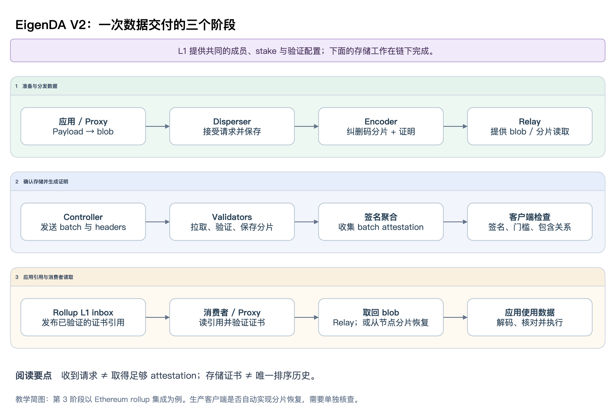

# 02 — EigenDA：从提交数据到取回数据

[学习入口](README.md) · [上一篇：AVS](01_avs_architecture.md) · [下一篇：共识与轮换](03_consensus_and_rotation.md) · [资料索引](sources.md)

本文以 EigenDA V2 的公开架构为主线，结合 2026-09-22 核对的接口快照 `bfa451e1`。V2 集成文档与该代码快照存在术语差异，文中会分别说明；没有将仓库版本视为某个实际部署的版本。

## 1. 客户买到的是什么服务

假设一个 rollup 已经产生一段交易数据，希望其他节点以后能够取得它。它把数据提交给 EigenDA，取得与数据绑定的 availability certificate；其他节点凭证书定位、下载并核对数据。

**EigenDA 的工作对象是 blob 的字节，而不是这些字节代表的交易应该如何执行。** 它不替 rollup 选择交易顺序，也不验证交易执行后的状态。其 Spec 明确将 EigenDA 描述为依托 EigenLayer、使用 Ethereum 上的成员状态、无需自建链和共识协议的 DA 服务。[EigenDA Spec](https://layr-labs.github.io/eigenda/)

EigenDA blob、rollup batch 和 MegaETH mini-block 是不同层次的对象。一个应用可以把自己的数据打包为 EigenDA payload，但它们不会因此拥有相同的边界、确认含义或生产节奏。[Rollup Payload Lifecycle](https://layr-labs.github.io/eigenda/integration/spec/2-rollup-payload-lifecycle.html)

## 2. 先认清组件

图为依据下文一手来源绘制的教学简图。数据传输与签名确认分开表示，省略内部数据库、重试和限流。图中的签名是对 batch 的 attestation，具体结构见第 4 节。

| 组件 | 职责 | 不应混同为 |
| --- | --- | --- |
| Client / Proxy | 将应用 payload 转成 EigenDA 可处理的 blob，提交并验证返回结果 | 排序共识节点 |
| Disperser | 编排一次数据分散请求，协调编码、分发与签名聚合 | 由 PoS 排班选出的全网出块 leader |
| Encoder | 生成纠删码分片及验证这些分片的密码学材料 | Rollup 交易执行器 |
| Relay | 为存储节点提供分片下载，也为客户端提供 blob 读取路径 | 一定参与 BFT 投票的委员会成员 |
| Validator / Operator | 取得、验证、保存自己负责的分片，并参与 attestation | 每个都保存所有完整 blob 的全节点 |
| Retriever | 从服务路径取得数据，必要时通过足够分片重建 | 能仅凭签名推算出原始数据的验证者 |

V2 的核心工程变化是把**小型协调消息**与**大批量数据传输**拆开：controller 发送 metadata，节点从 relay 拉取数据。慢节点的下载不必阻塞所有其他节点；relay 也可以按地区部署，以改善数据路径。这是在数据路径上使用地理布局，不是地理集群之间轮换排序权。[EigenDA V2: Core Architecture](https://www.eigenlabs.org/blog/eigenda-v2-core-architecture/)

## 3. 一份数据经历了什么

### ① 应用准备 payload，Proxy 构造 blob

Rollup 侧先有自己的 payload，例如压缩后的交易批次。Proxy 负责转换成 EigenDA 的数据表示，生成 commitment，并构造包含版本、quorum 与付款信息的 blob header。应用数据进入 EigenDA 后，不需要由存储节点解释其业务语义。[Payload Lifecycle](https://layr-labs.github.io/eigenda/integration/spec/2-rollup-payload-lifecycle.html)

### ② Disperser 接受请求，但此时还没有可用性保证

客户端调用 `DisperseBlob`。这是异步接口：请求通过初步检查后，可以先返回 blob key 与排队状态。接收请求、完成编码和取得足够 attestation，是不同的进度。[Disperser V2 API](https://github.com/Layr-Labs/eigenda/blob/bfa451e1aaa5eb53ec250758054bbc3267e66208/api/proto/disperser/v2/disperser_v2.proto)

这一点与我们的 stream obligation 很相似：S 说“我接到工作了”不等于 P 已有可消费的输入。

### ③ Encoder 产生可恢复、可验证的分片

普通切片若丢失一片，可能就无法恢复原文；纠删码添加冗余，让接收方在只取得一部分分片时仍能重建。EigenDA 使用 Reed–Solomon 编码，并用 KZG commitment 与 opening proof 检查分片是否与承诺的数据一致。

KZG 在这里解决的是**分片的正确性与绑定关系**。它不能证明持有者将来一定响应下载，也不能证明 blob 内的交易有效。[Security Model：Cryptographic Primitives](https://docs.eigencloud.xyz/eigenda/core-concepts/security/security-model#cryptographic-primitives)

### ④ Validator 拉取自己的分片，再签名

分片分配由约定的版本参数与 stake 状态确定。收到协调消息后，validator 找到自己负责的分片，从 relay 取回并检查。它在持有要求的数据之后参与签名，而不是仅收到一个哈希就签名。[Validator Node V2 API](https://github.com/Layr-Labs/eigenda/blob/bfa451e1aaa5eb53ec250758054bbc3267e66208/api/proto/validator/node_v2.proto)

Relay 的公开接口将获取整个 blob 与获取分片分开；固定快照还提供按 validator 的确定性分配取片的接口。这使“存储节点收自己负责的数据”和“消费者读取完整 blob”可以使用不同的读取方式。[Common V2 接口](https://github.com/Layr-Labs/eigenda/blob/bfa451e1aaa5eb53ec250758054bbc3267e66208/api/proto/common/v2/common_v2.proto)、[Relay API](https://github.com/Layr-Labs/eigenda/blob/bfa451e1aaa5eb53ec250758054bbc3267e66208/api/proto/relay/relay.proto)

### ⑤ 聚合签名，客户端检查自己的接受条件

Disperser 收集签名并返回 attestation 及 blob 在 batch 中的包含信息。客户端应验证使用的成员快照、quorum、签名门槛与编码参数，而不是只相信 disperser 给出的状态字符串。

这里存在一个明确的版本差异：2025 年 V2 集成文档使用 `CERTIFIED`；固定代码快照使用 `GATHERING_SIGNATURES` 和 `COMPLETE`，并说明 `COMPLETE` 只表示收集阶段结束，**不保证已经达到任意签名比例**。即使流程结束，消费者仍要检查门槛是否满足。[V2 Integration Spec](https://layr-labs.github.io/eigenda/integration/spec.html)、[BlobStatus 定义](https://github.com/Layr-Labs/eigenda/blob/bfa451e1aaa5eb53ec250758054bbc3267e66208/api/proto/disperser/v2/disperser_v2.proto#L164)

### ⑥ 应用发布引用，消费者取回并使用数据

以文档中的 Ethereum rollup 集成为例：rollup batcher 将证书编码后发到自己的 L1 inbox；rollup validator 读取这个引用，经 Proxy 取回 blob，验证其与证书匹配，再解码成原先的 payload。[V2 Integration Spec](https://layr-labs.github.io/eigenda/integration/spec.html)

正常读取可以从 relay 获取完整 blob；更底层的恢复能力来自存储节点持有的分片，节点接口提供直接读取分片的 `GetChunks`。[Relay API](https://github.com/Layr-Labs/eigenda/blob/bfa451e1aaa5eb53ec250758054bbc3267e66208/api/proto/relay/relay.proto)、[Validator Node V2 API](https://github.com/Layr-Labs/eigenda/blob/bfa451e1aaa5eb53ec250758054bbc3267e66208/api/proto/validator/node_v2.proto)

协议声称数据能够恢复，与某个客户端已经实现、能够及时走通恢复路径，是两个需要分别检查的事实。

## 4. 证书具体承诺了什么

可以按从内到外的顺序理解：

| 对象 | 绑定的内容 |
| --- | --- |
| BlobHeader | Blob commitment、编码版本、quorum 与付款上下文 |
| BlobCertificate | BlobHeader、提交者签名、提供读取路径的 relay keys |
| BatchHeader | 一组 blob certificates 的 Merkle root，以及用来解释成员状态的 `reference_block_number` |
| SignedBatch 与包含证明 | Operator 的 batch attestation，以及目标 blob 属于该 batch 的证明 |

**名为 BlobCertificate 的内部结构，不应单独当成最终的 operator quorum 证明。** Operator 的 attestation 通过 batch 间接覆盖其中的 blob；消费者还要验证聚合签名、包含关系与安全参数。这些层次可在 [Common V2 数据结构](https://github.com/Layr-Labs/eigenda/blob/bfa451e1aaa5eb53ec250758054bbc3267e66208/api/proto/common/v2/common_v2.proto)和 [证书验证库](https://github.com/Layr-Labs/eigenda/blob/bfa451e1aaa5eb53ec250758054bbc3267e66208/contracts/src/integrations/cert/libraries/EigenDACertVerificationLib.sol)中对应起来。

`reference_block_number` 的意义是让验证者使用同一个历史 stake 上下文。它不是 EigenDA 自己的区块高度，也没有自动选出这一时段的 sequencer。

## 5. 它的 consensus 到底是什么

### EigenDA 有拜占庭容错要求，但不建立自己的全局有序日志

DA 证书回答的是：**在给定成员与故障假设下，这份数据有足够的存储支持，能够被取回吗？**

排序共识回答的是：**如果 A 和 B 提出了两份不兼容的下一块，所有消费者最终接受哪一份？换 leader 后如何保留已经确定的历史？**

EigenDA 将 Ethereum 上的状态作为共同的成员与质押依据，通过 attestation 支持数据可用性判断。旧版 Spec 对这一点解释得最直接，但其中“只支持经 L1 桥接”的描述属于旧路径，不能直接套到 V2。[旧版 System Architecture](https://layr-labs.github.io/eigenda/protocol/architecture.html)

下面是对这一服务边界的推论：假设 mini-block 候选 X 和 Y 使用同一个父前缀，但内容冲突。EigenDA 可以存储 X，也可以存储 Y；**两份数据都可用，本身没有矛盾。** 两份 DA 证书不会告诉 P 应该选择哪个分支。

因此，“没有自己的排序共识”和“没有信任假设”是不同的说法。EigenDA 仍依赖门槛内的诚实存储、数据可获取、密码学正确性，以及共同解释的 L1 状态。

### L1 在哪个环节出现

| 环节 | L1 的作用 |
| --- | --- |
| 成员管理 | 为 operator 身份、stake 与相应配置提供共同依据 |
| 付款与配置 | 记录适用的付款、预约容量及验证参数 |
| V2 数据证书生成 | 不要求 EigenDA 先把每个 batch 的证书写入自己的 L1 桥接路径，才返回结果 |
| Rollup 集成 | Rollup 仍可能把证书作为自身输入发布到 L1，供后续派生读取 |

所以，**“V2 不再由 disperser 逐 batch 桥接证书”不等于“使用它的 rollup 完全不再向 L1 发布数据引用”。** 也不能把 DA attestation、L1 包含和 rollup 状态最终确定当成一个事件。[V2 Integration Spec](https://layr-labs.github.io/eigenda/integration/spec.html)、[Payload Lifecycle](https://layr-labs.github.io/eigenda/integration/spec/2-rollup-payload-lifecycle.html)

## 6. 为什么达到门槛的签名能支持可恢复性

以下是教学例子，不是 EigenDA 的部署参数。

假设一个 blob 编成 10 份互不相同的分片，任意 3 份即可恢复；10 个等权节点各负责一份，协议要求至少 7 个节点签名，最多有 2 个恶意节点。即使恶意签名者随后拒绝交付，签名集合中仍至少有 5 个诚实持有者，足以重建。前提是诚实节点只在取得有效分片后签名，且网络允许取回它们。

实际 EigenDA 按 stake 分配数据，须检查“诚实签名者对应的分片是否足够”，不能只数节点。安全参数分析的核心正是连接**签名门槛、允许的恶意权重和重建所需权重**。多 quorum 也不是自动独立的地理副本，同一个 operator 可以参加多个 quorum。[Security Model](https://docs.eigencloud.xyz/eigenda/core-concepts/security/security-model)

还要区分两个时间方向：已经充分分散的数据，在许多节点离线后可能仍能恢复；但新的请求未必还能收齐签名。因此，**纠删码允许丢失的分片比例，不是持续签发新证书所容忍的节点离线比例。** 我们也不能把这一比例移植成小集群的 liveness 门槛。

## 7. 服务故障与经济机制

### 谁会成为服务中断点

| 故障 | 直接后果 | 对我们的启示 |
| --- | --- | --- |
| Disperser 不接请求或不继续协调 | 新请求可能无法得到证书 | 分布式存储不自动消除入口／协调器的活性依赖 |
| Relay 不响应 | 快速读写路径受影响 | 需要明确其他读取路径及恢复时限 |
| 足够权重的 operator 不签名 | 新证书无法达到要求 | 服务容错要计入拒绝配合的成员 |
| 已签名者扣留数据 | 可能破坏证书背后的可恢复性 | 持有证明、实际读取和归责机制都重要 |
| 超出保存期限 | 原保存义务可能已经结束 | 交接、派生与归档必须覆盖各自需要的时间窗口 |

V2 架构文档描述了固定保存窗口及控制／数据路径；旧架构 Spec 明确承认集中 disperser 的 liveness 依赖。本表是结合这些职责作出的故障分析，不是声称每一种备用路径都已部署。[V2 Architecture](https://www.eigenlabs.org/blog/eigenda-v2-core-architecture/)、[System Architecture](https://layr-labs.github.io/eigenda/protocol/architecture.html)

### 付费买容量，质押承担责任

EigenDA 的付款文档区分按需使用和预约带宽。按需付款不等于获得固定吞吐保证；预约则在规定期间安排容量。付款合约、disperser 的计量与 validator 的检查相互配合，不能把“已付款”单独视为“已完成数据交付”。具体价格和限额随配置变化，本资料不固定它们。[Payments](https://docs.eigencloud.xyz/eigenda/core-concepts/payments)

### 数据不可用如何罚没

EigenDA 的安全 FAQ 将严重数据扣留的经济追责解释为 **EIGEN token forking / intersubjective slashing**：观察者发现不可用后，由更广泛的参与者形成判断，并通过分叉相关质押资产落实经济后果。这不是某个接收方超时后，Ethereum 合约就能自行证明全网不可用。[Security FAQs](https://docs.eigencloud.xyz/eigenda/core-concepts/security/security-FAQs)

L1 合约不能自行访问所有人的网络连接；服务者也可能只向一部分人提供数据。因此，应区分可验证的错误响应、违反公开响应挑战，以及广泛可观察但不能直接压缩成链上证明的数据扣留。特定挑战可以定义客观的响应义务，却不会自动证明过去对所有人的交付状况。

## 8. 新白皮书补充了什么

较新的 [EigenDA 白皮书](https://docs.eigencloud.xyz/assets/files/EigenDA_Whitepaper-c917fb56c146ebd146abfba3c52648a1.pdf)将系统进一步分成三层：

- **Storage：**持久保存可重建的数据，由 stake 加权的存储与 attestation 支持。
- **Access：**让大量消费者真正取得数据，考虑弹性服务能力与拒绝服务攻击。
- **Observability：**通过观察和抽样，使严重故障更容易被共同识别，为经济追责提供基础。

这是很适合我们借鉴的研究分解：**数据在某处保存着、P 能及时取到、其他人能判断谁失约，是三个不同问题。** 白皮书给出的是协议设计与分析；不能因为论文出现了 DAS 或激励机制，就认定所选生产版本已经实现全部细节。建议先读 §1.1–1.4，再按需要进入协议与安全分析部分。
