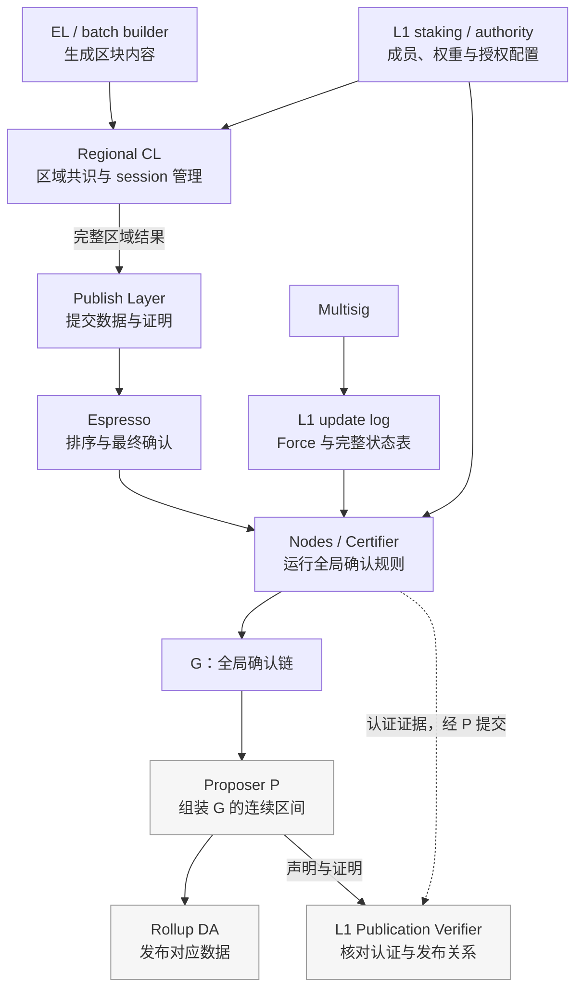
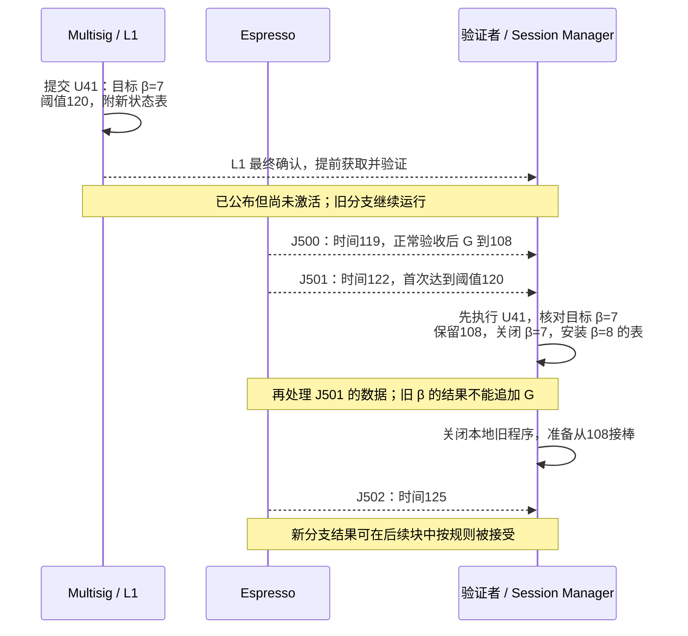
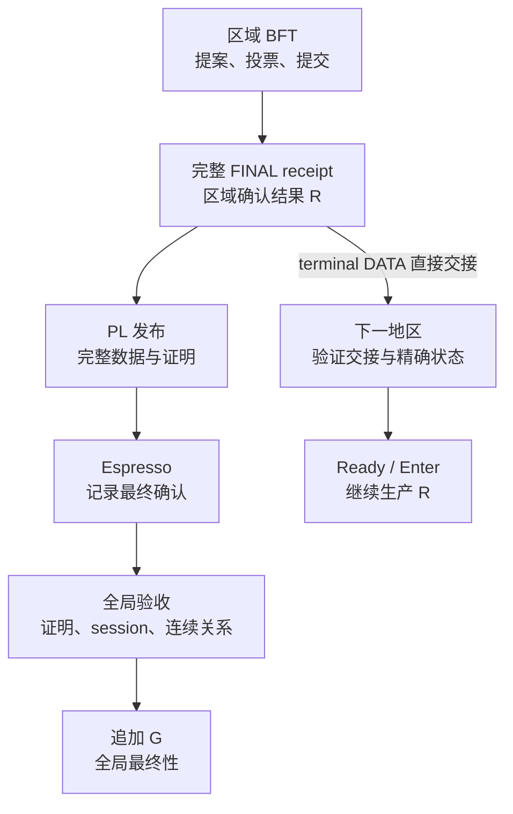
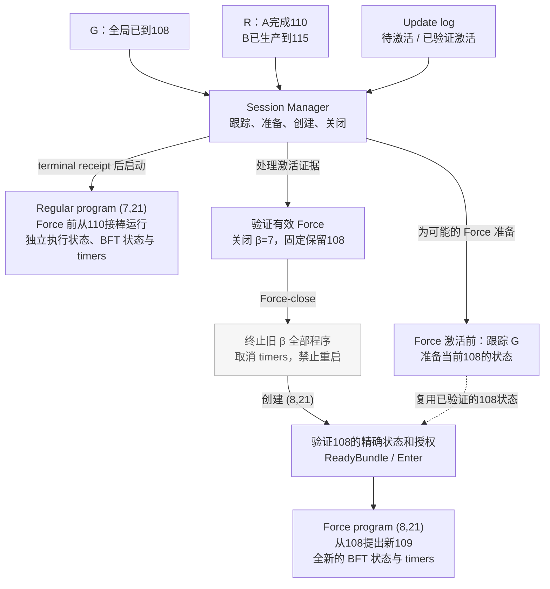
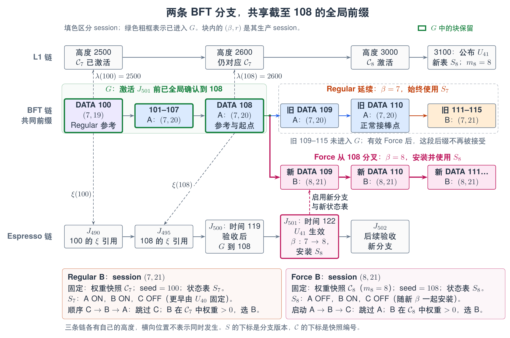
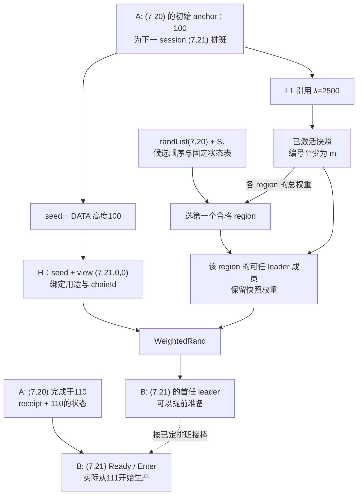

# 区域轮换设计：挑战、取舍与当前方案

我们希望多个 region 轮流出块，并同时满足两点：**正常交接时尽量不断流；故障切换时，不撤销任何已经全局确认的块。**

当前方案的思路是：区域可以先出块，不必等全局确认；全局链 G 由 Espresso 和 L1 上的公共历史决定。需要强制切换时，由 multisig 提前发布指令；指令生效后，保留当时 G 的末块，从这里继续。

## 1. Espresso 提供什么，我们还要补什么

Espresso 为我们的设计提供三样东西：

- 带顺序和时间戳的公共记录；
- 对这些记录的快速最终确认；
- 一条 light client 路径，让 Ethereum 合约能验证 Espresso 的历史。

其中，快速确认和 L1 light client 更新是两条不同的路径。后者要额外生成证明、再上链更新，耗时更长，所以区域交接不应每次都等它。[Espresso 集成说明](https://github.com/EspressoSystems/espresso-network/blob/main/doc/zk-integration.md)

Espresso 只负责确定输入的顺序；怎样执行、怎样解释这些输入，由应用自己决定。因此我们还要补两件事：区域结果怎样发布到 Espresso；以及怎样根据区域证明和 L1 控制记录，确定 MegaETH 的全局链。[Espresso 架构说明](https://docs.espressosys.com/network/learn/what-is-espresso)

**图 1｜整体架构：分层沿用 Arch v4，轮换流程采用 Part II v4.6。**

整个流程是：EL 决定区块内容；区域 CL 通过 BFT 产生提交证明；Publish Layer（PL）把完整结果送上 Espresso。节点和 certifier 运行同一套全局确认规则，检查四件事：区域证明、session 是否合法、L1 更新、是否与 G 连续。**记录上了 Espresso，不等于进入了 G；它还必须通过这套规则。**

Arch v4 中的 proposer（P）、rollup DA 和 L1 Publication Verifier 仍作为架构接口保留（图中灰色部分）：P 把 G 中尚未发布的连续区间发布出去，认证与验证接口保证发布内容与 G 对得上。这条路径可以落后于 G，但不能跳过 G 中的任何块。请注意区分两种发布：PL 发布到 Espresso，P 发布到 rollup DA，是两项不同的职责。本文重点讨论区域轮换。

对 PL 的核心要求是：只要有正确的参与者拿到了完整的区域结果，即使原 leader 不发布，也有别的途径把它送上 Espresso。形式化中，“发布”和“Espresso 确认并可读取”都被抽象为有时间上界的服务；这些上界依赖约定的网络、负载和费用条件。

| 方案 | 做法 | 现状与取舍 |
|---|---|---|
| 独立的 PL 职责 | 原 leader 优先发布，其他 replica 或 verifier 可以代发；系统代付手续费，并考虑补偿带宽 | Part IV 已有备用发布草案；PL 不增加共识轮次，区域提交也不等发布确认 |
| 把发布责任纳入 BLAME | leader 负责发布；副本在约定窗口内检查是否已有足够多的结果上了 Espresso，不够就 BLAME | 候选方案；需要定义窗口和证据，而且外部发布的延迟会影响区内换主 |

我们也考虑过惩罚发布无效结果的行为，但处罚必须有可验证的违规证据。几种情况要分清：合法的区域结果因为 Force 截止而没进入 G，不算发布者违规；发布慢和双签也要分开处理。

## 2. 跨区切换的难点：L1 指令何时生效

Multisig 在 L1 上管理各地区的资格，但区域结果的公共顺序由 Espresso 决定。如果有的节点按 L1 确认的时刻切换，有的按自己收到消息的时刻切换，大家对“哪些旧块还能进入 G”就会得出不同的结论。

我们的办法是：**指令先在 L1 上最终确认、提前公布，到指定的 Espresso 时间才生效。** 指令写明三项内容：目标分支版本、新的状态表、一个未来的 Espresso 时间阈值。验证者找到时间戳第一次达到该阈值的 Espresso 块，在这个块的开头执行指令。

**图 2｜同一条更新：先在 L1 上公布，到点后在 Espresso 上激活。**

保留的是**激活块开始之前已经进入 G 的全部前缀**，而不是此前上传到 Espresso 的所有数据。例如，多签签名时 G 到108，激活时 G 已到112，那就保留到112；多签不能要求退回108。由于激活块先执行更新、再处理块内数据，同一块里到达的旧分支结果也无法抢在 Force 之前补进 G。

当前模型有两条要求：更新必须提前可见；每个 Espresso 块最多激活一条更新。这样，公共截止点不会因为某个节点收到消息的早晚而改变。节点先确认激活有效，再关闭自己本地的程序。

## 3. 为什么只保留 multisig Force，并与状态更新绑定

我们讨论过根据 Espresso 日志自动触发 Force（AUTO）：某个 region 没在窗口内交付足够的块，就自动切走。这能减少人工干预，但会带来新问题：AUTO 和 multisig 指令冲突时怎么办？被切走的地区何时恢复资格？下一个地区还在准备，又被切走怎么办？

**当前选择：只保留 multisig Force。** 缺块监控、阈值设定、何时干预，都交给 multisig 的管理策略；协议只执行合法且已激活的明确指令。代价是：整个区域故障时，强制切换要靠 multisig 出手。区内原有的 BLAME 和 recovery 照常工作。

另一个取舍：地区状态更新要不要和 Force 分开？分开的好处是，B 恢复上线时只需把 B 改成 ON，不必打断当前生产；坏处是，正常交接时必须说清楚用哪一版状态表。举个例子，A 已完成最后一块110，要按状态表选下一棒：

| 事件 | 若按“收到 receipt 时的最新表”来选 |
|---|---|
| 节点甲较早收到 receipt，此时 B 为 ON | 选 B |
| 随后一次更新把 B 改成 OFF，C 仍为 ON | 状态表变了，但原分支仍在运行 |
| 节点乙较晚收到同一个 receipt | 选 C |

结果两个节点选出了不同的下一棒。

要让状态更新独立，就得固定一个历史选择点，但这会增加历史状态查询和交接规则。我们最终采用更简单的约束：**每个分支版本 β 固定一张完整状态表；每次更新状态都同时触发 Force，为新的 β 安装新表。** 这样，同一分支上的 regular handoff 始终依据同一张表。

指令还绑定了目标 β。如果目标 β 已被另一条 Force 关闭，这条指令整体失效，状态表也不更新；如仍需修改，多签重新提交。代价是：哪怕只是恢复一个空闲地区的资格，也要触发一次 Force，所以状态调整应尽量批量进行。另外，ON 的意思是“允许被选中”，并不证明该地区此刻在线。

## 4. 四个编号分别表示什么

完整的 view 是 **(β, r, g, t)**：

- **β**：分支版本；
- **r**：生产轮次；
- **g**：该轮次内的恢复编号；
- **t**：该恢复阶段内的 leader 轮次。

一个 **session = (β, r)**，表示某个 region 的一次生产任务。注意 r 是轮次，不是地区编号。

| 事件 | View 变化 | 含义 |
|---|---|---|
| 区内正常换 leader | `(β,r,g,t) → (β,r,g,t+1)` | 同一 session 内换下一任 leader |
| 区内 recovery | `(β,r,g,t) → (β,r,g+1,0)` | 根据已有的锁和证明恢复 |
| Regular handoff | `(β,r,g,t) → (β,r+1,0,0)` | 本轮完成，正常交棒 |
| Force | 新 session 为 `(β+1,r′,0,0)` | 关闭旧分支，从保留的 G 重新开始 |

Force 后新 session 的 r′ 怎么定？看**当前负责给 G 接下一块的那个 session**：

- 它还没有任何 DATA 进入 G：沿用它的 r；
- 它已有 DATA 进入 G：用 r+1；
- 此前还没选出地区：保留这个待分配的轮次。

r′ 不由跑得最远的生产程序决定。即使沿用了 r，新的 β 也保证这是一个独立的 session。

## 5. 平滑交接：R 可以领先 G

节点需要区分两条链：

- **R**：当前生产分支上已取得区域确认的结果，可能跨越多个已正常交接的 session；
- **G**：验证者根据公共历史接受的全局前缀。

R 可以领先 G，G 只增不减。区域 FINAL receipt 证明对应的区域提交条件已经满足，但这个结果在进入 G 之前，仍可能被 Force 截掉。

**图 3｜区域确认之后分成两条路：一条继续生产，一条发布并等待全局确认。**

正常接棒需要当前 session 的最后一个 DATA（terminal DATA）及其完整 receipt。下一个地区拿齐交接材料和对应的执行状态后就能启动，**不必等这个 terminal DATA 进入 G**。直接传输能加快交接；已发布的结果也可以从 Espresso 读取。当然，首次提案仍需要合法引用等必要输入。

### 为什么同一个区域要管理多个 session

假设 A 的 `(7,20)` 生产了101–110；B 已凭110的 receipt 启动 `(7,21)`，接着生产了111–115；但公共确认只到 G=108。这时一条针对 β=7 的 Force 生效，并再次选中 B：

- 108及以前的 G 全部保留，旧的109–115不再进入 G；
- B 关闭从110接棒的旧程序 `(7,21)`；
- B 用108对应的状态启动新程序 `(8,21)`，重新提出109。

可见，节点不能把一个程序的 anchor 从110原地改成108，而要同时协调生产、状态准备和交接事件。**每个 replica 运行自己的 Session Manager，为每个 `(β,r)` 管理一个独立的 session program。**

**图 4｜以 B 的一个 replica 为例：Manager 跟踪三类输入，分别处理两次交接。**

Manager 跟踪 **G、R 和 update log** 三类输入，并准备两种执行状态：G 末端（tip）的状态，供可能的 Force 使用；前驱区域结果的状态，供 regular 交接使用。交接一旦确定，程序就绑定一个精确的 anchor，之后不随 G 的更新而改变。

两种交接共用同一套启动流程：验证交接、authority 和精确状态 → 转发完整的 ReadyBundle → 执行一次 Enter → 初始 leader 直接提出首块。因为新 session 的 anchor 已经确定，首次启动可以省掉 STATUS、NEWVIEW 和 ANCHOR QC 这几个阶段；而同一 session 内的 recovery 仍要处理已有的锁，所以保留原流程。ReadyBundle 包含可直接验证和使用的状态及依赖。假设完整传输、验证和安装都能在区域处理时限内完成，正确成员就能在一个区域延迟上界内进入新 session。

两种结束方式不同。正常结束靠 terminal receipt。Force 结束时，节点确认激活有效后，关闭**旧 β 下的所有程序**，包括已经提前启动的 regular 后继。如果 Force 先被验证，之后迟到的旧 receipt 不能再启动旧程序。这样既始终保护 G，又可以直接放弃 G 之外的旧后缀，省掉为让这段后缀一致提交而需要的复杂退出等待。程序关闭后，仍要保留所需的数据和已有证据。

## 6. 提前选区和选主：先固定参考块，再取状态表与权重

**每次轮换，先固定三项排班输入：权重快照、seed、liveness map。** 三者分别回答“用谁的权重”“用什么共同输入选 leader”和“哪些 region 有资格”。

| 必须固定的输入 | 如何确定 | Regular B：`(7,21)` | Force B：`(8,21)` |
|---|---|---|---|
| **权重快照** | 用参考块 E 的 L1 引用查已激活快照，并满足分支最低快照编号 | E=100，λ=2500，使用 C₇ | E=108，λ=2600，但 m₈=8，使用 C₈ |
| **Seed** | **参考块的 BFT DATA 高度 h(E)**；与目标 view 一起输入选主哈希 | seed=100 | seed=108 |
| **Liveness map** | **目标分支 β 唯一绑定的 S_β** | regular 不改 β，沿用 S₇ | 有效 Force 创建 β=8，同时安装 S₈ |

固定三项后，按候选顺序、liveness map 和目标快照中的正权重选 region，再用该 region 的成员权重、seed 和 view 选 leader。**实际开始出块还要固定执行 anchor：它决定从哪个状态继续，不能与选主参考块混为一谈。**

### 状态表跟着 β 走：三条规则

1. **每个 β 绑定唯一、固定的状态表 S_β。** 创建该分支时确定这张表，分支存续期间不再修改。
2. **Regular 不改变 β，因此沿用前驱的状态表。** 从 `(7,20)` 交给 `(7,21)`，两者都属于 β=7，都用 S₇；交接只推进 r。
3. **有效 Force 同时更新 β 和状态表。** 关闭 β=7、创建 β=8 时，原子地安装更新携带的 S₈。之后的新 session 用 S₈，旧 β=7 的所有 session 关闭。

因此，**按目标 session 的 β 找状态表；按选主参考块的 L1 引用找权重快照。** 状态表不在每次 regular 交接时按“最新时间”重新选取。

### 选主参考块与执行 anchor：两件事分别决定

选主参考块 E 用于确定下一 session 的权重快照和 seed；执行 anchor A 决定从哪个块的状态继续出块。它们都是 BFT DATA 块。每个块携带的 L1 引用 λ 和 Espresso 引用 ξ，则是它指向的外部链位置。

| 交接 | 选主参考块 E：用来排班 | 执行 anchor A：用来接棒 | 何时固定 |
|---|---|---|---|
| Regular：前驱 p → 后继 s | **前驱的初始 anchor**，即 $E_s=A_p$ | **前驱的 terminal DATA**，即 $A_s=T_p$ | 前驱开始时可排班；前驱完成后固定接棒点 |
| Force：开启新分支的首个 session | **激活时保留的 G tip** | **同一个 G tip** | 验证激活边界及其之前的 G 后，两者一起固定 |

例如，A 的 `(7,20)` 从100生产到110，B 正常接棒为 `(7,21)`：**B 用100排班，从110继续执行。** 若之后 Force 激活时 G 只到108，新 B 的 `(8,21)` 就**用108重新排班，也从108继续执行**。它不会拿旧 B 的起点110，或已生产到的115来选主。

**图 5｜同一个 G tip 分出 regular 与 Force 两条 BFT 路径；每个块标出生产 session。**

[查看矢量 PDF](../output/pdf/261020_fig5_reference_branches.pdf) · [TikZ 源码](figures/261020_reference_blocks/main.tex)

图中**填色表示生产 session**：紫色是 `(7,19)`，蓝色是 A 的 `(7,20)`，橙色是 regular B 的 `(7,21)`，粉色是 Force B 的 `(8,21)`；**绿色粗框表示已进入 G 的块**。图里只有一个108：上方路径接到旧109、110和 `(7,21)` 的111–115；下方路径直接从108接出 `(8,21)` 的新109、110等块。有效 Force 后，G 保留，上方旧后缀不再被接受，新分支继续生产。三条链各用自己的编号，横向位置不表示跨链同时发生。λ、ξ 箭头表示外链引用；**Force 的切换边界是 J501，不是108自身引用的 J495。**

下方两个说明框列出每次固定的三项输入，以及“为什么两次都选 B”：假设更早的 U40 创建 β=7 并固定 S₇，regular 沿用它，按 `(C,B,A)` 跳过 OFF 的 C，选 ON 且有正权重的 B；U41 生效后安装 S₈，Force 按启动列表 `(A,B,C)` 跳过 OFF 的 A，再选 B。**S 的下标是分支 β，C 的下标是权重快照编号；两者的编号不必相同。**

对应的权重与 seed 则来自参考块：regular B 取100，经 λ(100)=2500 得到 C₇，seed=100；Force B 取108，经 λ(108)=2600 先查到 C₇，但 U41 为新分支规定 m₈=8，所以最终用 C₈，seed=108。C₈已在 L1 高度3000激活，早于 U41 在3100公布；U41 则直到 Espresso 的 J501 才生效。

### 用参考块取快照；用分支版本取状态表

L1 按较长的 staking epoch 生成快照，并提前固定其激活高度。快照记录每个 stake position 的 region、运营密钥和权重，给出各 region 的成员及总权重。同一份快照可以服务多个 session。目标 session 的快照由下面这条规则固定：

$$
e_s=\max\{m_\beta,\ e(\lambda(E_s))\}.
$$

e(ℓ) 是 L1 **高度** ℓ 时最新已激活的快照编号；m_β 是该分支允许使用的最低编号。这个下界防止已退出的旧权重再次获得授权。**固定后不会每换一次 leader 就重新查最新 L1 权重。**

Espresso 时间决定创建新 β、安装新表的生效边界；regular 仍按不变的 β 使用原表。Terminal DATA 的 Espresso 引用 ξ 用于约束合法引用，不用于给 regular 重新挑状态表。

选 region 的步骤是：

1. **确定候选顺序。** Regular 用前驱的 `randList(β,r)`；Force 用新分支预定的启动列表。
2. **确定表和权重。** Regular 用原分支的 S_β；Force 用成功更新安装的新表。两者都用目标 session 按 E 选定的快照。
3. **按顺序选第一个 ON 且总权重大于零的地区。** ON 但权重为零也跳过；权重再大也不能越过列表优先级。没有合格地区就保持待分配，缺少快照证据则先等证据。

例如，regular 的候选顺序是 `(C,B,A)`，S₇ 中 C 为 OFF、B 为 ON，且 B 在 C₇ 中有正权重，就选 B。Force 后改用新表 S₈ 和启动列表；即使参考块108仍属于旧 β=7，**选区也使用新 β=8 的表**。状态表跟目标分支走，权重快照由参考块的 L1 引用及最低编号确定。

### 在选定的 region 内计算 leader

区内每个 view 的 leader 由所有节点共有的输入算出：

$$
L_s(g,t)=\operatorname{WeightedRand}\!\left(
\mathcal W_s^g,
H(\texttt{LEADER},\mathit{chainId},h(E_s),\beta,r_s,g,t)
\right).
$$

这里的权重集合 $\mathcal W_s^g$ 是：所选 region 中，第 g 代允许担任 leader 的成员及其原始权重。初始排班可以提前算好；recovery 时使用该代已固定的禁任名单，可能排除更多 leader 候选，但历史投票权重不会因此改写。这是一种公开、任何人都能重算的加权排班；注意，对公开高度做哈希，本身并不保证不可预测。

**图 6｜展开 regular B 的排班：100提供 seed，2500用于查快照，110是实际接棒点。**

提前固定排班的代价是：配置变更生效会滞后。前驱运行期间新激活的 stake 快照，不会替换已经排好的下一棒；退出资金也必须覆盖已分配的职责。Part III 的退出路径是：

1. 退出后不再进入新快照；
2. 一次有效的批量 Force 关闭旧职责，并提高最低快照编号；
3. L1 验证并清退；
4. 等待追责期结束；
5. 提款。

这样 regular handoff 不必每次都等 L1，但最终提款依赖一次符合条件的 Force，而这次 Force 可能会丢弃 G 之外的后缀。

## 7. 两个例子：从排班到实际出块

### Regular：提前排班，最后一块到齐后接棒

沿用图5：前一个 session 结束于100，A 的 `(7,20)` 从100生产到110，B 随后接棒为 `(7,21)`。给 B 排班时，参考块是100，即 A 的初始 anchor。它引用 L1 高度2500，当时最新快照为 C₇，且最低快照编号不超过7，因此采用 C₇。

假设 `randList(7,20)=(C,B,A)`：S₇ 中 C 为 OFF，B 为 ON；B 在 C₇ 中权重为正，于是选 B。B 有三位可任 leader 的成员，权重为 `(60,30,10)`。若用 seed=100、目标 view `(7,21,0,0)` 得到的哈希抽样结果为73（示例值），落在第二位的区间 [60,90)，就选第二位。

B 可以从 A 开始时就知道自己的职责，并跟着 A 同步。等110的完整 receipt 和执行状态到齐，B 才进入 `(7,21)`，从111开始生产。**100决定排班，110决定从哪里继续；即使110引用了新快照，也不会重算这一棒。**

### Force：从保留的 G 重新排班、重新起步

回到前面的例子：A 的 `(7,20)` 已完成110，B 的 `(7,21)` 已生产到115，G 只到108。U41 在 J501 激活，关闭 β=7。负责给 G 接下一块（109）的是 A 的 `(7,20)`，它已有 DATA（101–108）进入 G，所以新 session 用 r+1，即 `(8,21)`。

新 session 的选主参考块和执行 anchor 都是108。假设108引用 L1 高度2600，对应 C₇；但这次更新给新分支设置的最低快照编号是8，且 C₈ 在 U41 公布时已激活，于是改用 C₈。假设新分支的启动列表为 `(A,B,C)`，S₈ 中 A 为 OFF、B 为 ON，且 B 在 C₈ 中有正权重，则选 B。再用 B 在 C₈ 中的权重、seed=108 和目标 view `(8,21,0,0)` 算出 leader。

B 验证 Force 后关闭旧程序，用108的精确状态，经 Ready / Enter 重新提出109。它不能继承旧 `(7,21)` 的 votes、locks 或 timers。**Regular 继承前驱的终点；Force 继承公共规则保留下来的 G 终点。**

---

**设计依据**：整体分层见 [Arch v4](../formalization_v2/arch_v4.tex)；轮换语义以 [Part II v4.6](../formalization_v2/sync_hotstuff_rr_part2_rotation_v4_6.tex) 为准；[Part III v3](../formalization_v2/sync_hotstuff_rr_part3_staking_v3.tex) 补充 staking 与选主；[Part IV v0.1](../formalization_v2/sync_hotstuff_rr_part4_force_v0_1.tex) 补充 Force handler 与 PL 实现。

Arch v4 中的 AUTO、独立状态更新、cooldown、独立 backbone 和旧退出规则不属于当前方案；数据传输由直接交接和 PL／Espresso 路径承担。另外，Part III 中按 `(β,r)` 绑定 authority、候选列表和最低快照编号的接口，还需要统一回写到 Part II／IV。
