# Liveness Recovery：让 L1 继续推进，让 sequencer 从确定的状态恢复

2026 年 10 月 27 日 · Meetup

上周我们讨论多个区域怎样轮流出块，以及单个区域故障后怎样从 G 的末端换区继续。

本周把问题往外推了一层：**如果坏的是 Publisher / Espresso，或者把批次送到 L1 的这条路径，how to recovery?**

本周方案的核心是：**正常时，让区域块与 L1 派生出的块完全一致；故障时，由 L1 deposit 路径维持派生；恢复时，以已经确定的 L1 派生链 D 为准，关闭旧 session，再从同一个确定块重新出块。**

## 1. 先看架构：出块、全局确认、交付到 L1 是三段不同的工作

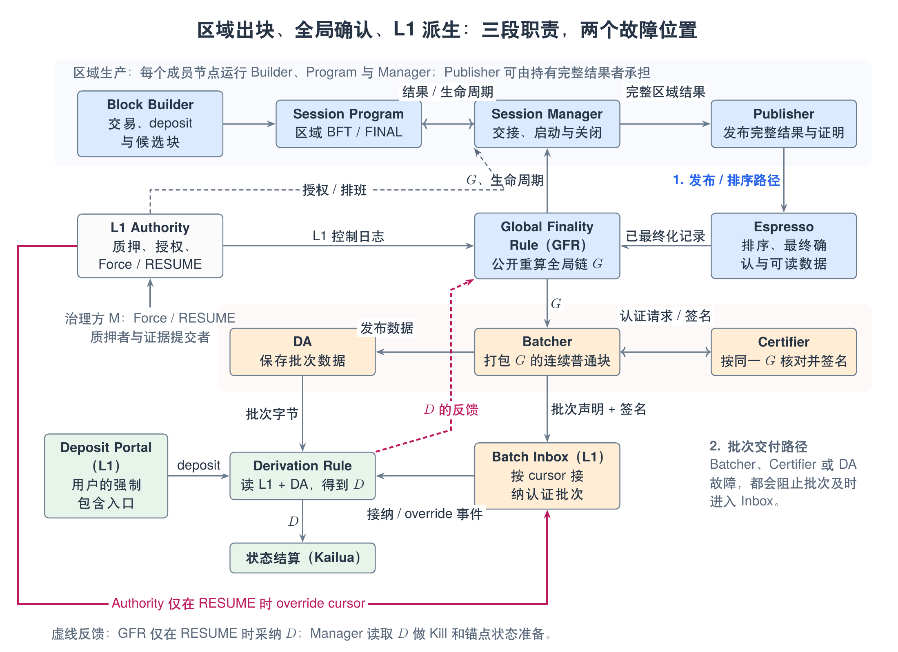

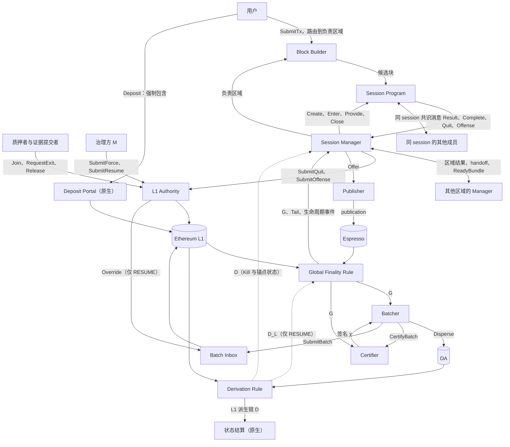

## 2. 四条链：先看正常时的关系

**同一批区块依次经过区域确认、全局确认、L1 接纳和派生。R、G、G′、D 分别记录这四个阶段的进度。**

| 对象 | 含义 | 谁根据什么得到它 |
|---|---|---|
| **R** | 当前区域生产分支上已取得 FINAL 的结果，可跨越正常交接的多个 session | Session Manager 跟踪区域结果 |
| **G** | GFR 接纳的全局链 | 任何观察者重算 L1 与 Espresso 历史；RESUME 时还读取派生结果 |
| **G′** | Batch Inbox 的接纳进度，即 cursor 所标记的高度前缀 | L1 合约记录 |
| **D** | 从已最终化 L1 与已取回 DA 数据派生出的原生 L2 链 | 任何派生节点运行相同的 Derivation Rule |

正常且交付及时、各阶段视图对齐时，可以把它们看成同一条流水线上的不同进度：`D ⪯ G′ ⪯ G ⪯ R`。**G′ 是接纳进度，不是另一份执行状态。**

- The batcher layer (certifier + batcher) ensures that $G' \preceq G$. （CFT ONLY) 

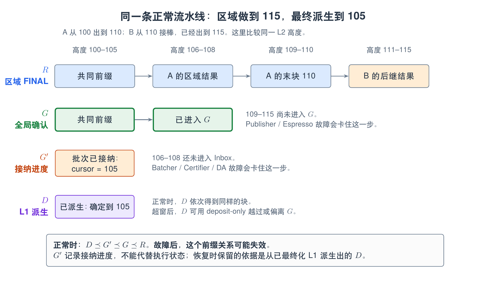

具体来说，A 的 session `(7,20)` 从 100 生产到 110；B 凭 110 的完整 receipt 接棒为 `(7,21)`，已经生产到 115。106–108 虽然进入了 G，还没有被 Inbox 接纳。下一节的两类故障都从这个状态出发，是两条独立的后续：分别看哪一段先停住，以及超窗后四条链还是否互为前缀。

## 3. 两类核心故障：四条链的关系怎样被打断

**第一类故障卡住 R → G，第二类卡住 G → G′。开始时只是进度差拉大；一旦错过 L1 的 sequencing window（批次交付期限），D 会按原生规则补 deposit-only，原来的前缀关系就可能失效。**

| 故障层 | 典型原因 | 哪一步停住 | 哪些部分仍可能前进 |
|---|---|---|---|
| **发布 / 排序层** | Publisher 没有送出完整结果，all regions are dead, 或 Espresso 无法继续最终化、提供可读记录 | 区域结果无法进入 G，即 **R → G** 卡住 | R 可能继续生产；批次层正常时，G′ 与 D 仍可消化已有的 G |
| **批次交付层** | Batcher、Certifier 或 DA 无法完成新的批次交付 | G 中的普通块无法及时被 Inbox 接纳，即 **G → G′** 卡住 | R 与 G 可能继续增长；D 最终按窗口规则处理未交付高度 |

第二类问题可以统一描述为：**已经通过 Espresso 和 GFR 确定的普通块，没有及时完成 DA、认证与 Batch Inbox 接纳。** Inbox 接纳的是带认证的批次声明；批次字节由 DA 提供。

### 故障一：G 停住，D 最后越过 G

**只要已有 G 仍能正常交付，D 会保留整个旧 G；接不上的主要是 G 之外的旧区域后缀。**

**图 2a｜G 停住，已有 G 继续结算；窗口到期后 D 越过 G，与旧 R 后缀分叉。**

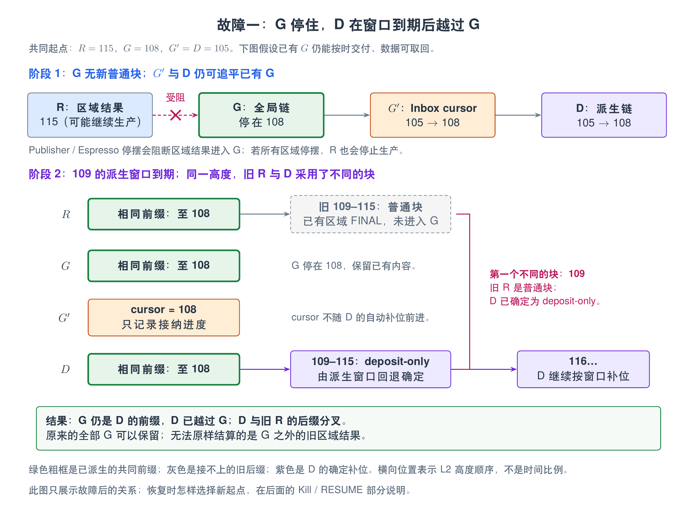

沿用 `R=115、G=108、G′=D=105` 的起点：

1. **发布 / 排序停摆。** G 停在 108，R 已有 109–115，二者的进度差可能继续扩大。
2. **已有 G 继续结算。** 假设批次层正常，106–108 被送到 Inbox，G′ 与 D 都能追到 108。这时四条链仍是兼容的前缀，只是 R 领先。
3. **109 的派生窗口到期。** D 在 109 填 deposit-only，随后继续推进；旧 R 在同一高度却是普通块。此时 **G 仍是 D 的前缀，但 D 已不再是 G 的前缀，并且与旧 R 后缀分叉。** Inbox cursor 可以仍停在 108，D 的补位不需要为这些高度提交普通批次。

也就是说，原来“D 在 G 后面追”的关系变成了“G 停住，D 自己往前走”。恢复时要让 sequencer 接到 D 已确定的后续上。

### 故障二：G 继续增长，D 却与 G 分叉

**Inbox 没有接纳的普通块，即使已进入 G，也可能错过最终交付机会。**

**图 2b｜G′ 停住，R 与 G 继续增长；窗口到期后 D 在 106 与旧 G 分叉。**

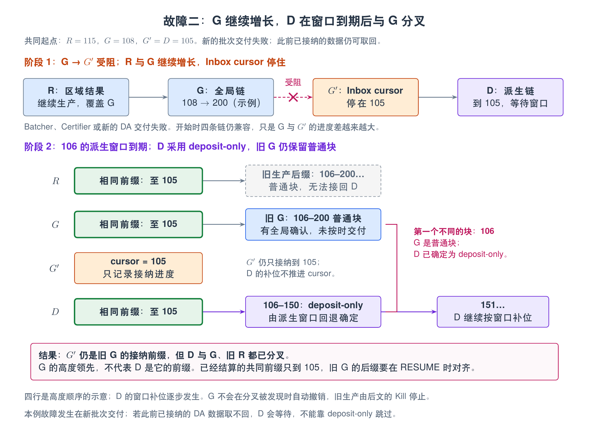

两类故障中，D 能继续推进都以**此前已被 Inbox 接纳的数据仍可取回**为前提；若这部分 DA 数据缺失，派生会等待，不能将其当成未提交批次跳过。

**检测因此分两步：先看哪条链的进度停住，再看 D 与旧生产链是否已失去前缀关系。** 单个 Publisher 失效可以由其他持有完整结果的参与者代发；这里关心的是备用发布也没能恢复整条路径的情况。单纯 Force 换区无法修复所有区域共用的 Publisher / Espresso 或批次交付路径。接下来要明确：在这些关系发生变化之后，我们仍要保证什么。

## 4. 我们要保证什么：强制包含、统一解释、重新接棒

**故障期间的保底活性来自 L1 派生；普通出块恢复后，sequencer 必须能接回这条链。** 这需要同时满足三件事。

| 要求 | 具体含义 |
|---|---|
| **L1 deposit 仍然有效** | 正常时，区域块正确包含应纳入的 deposit；普通出块或交付停摆时，用户仍能通过 L1 的强制包含路径进入 D |
| **GFR 与派生对同一段历史有统一解释** | DepositFill preserves liveness through L1 deposits under either of the two failures. Recovery must make G compatible with D. |
| **服务恢复后重新出块** | When $D \npreceq G$, reset G and R from the correct anchor, $D[h_{\rm res}]$, and close the old sessions. |

这里保住的是 **L2 经 L1 继续推进的能力**，不意味着 Espresso 停机时 G 仍能照常增长，也不意味着普通交易仍有原来的快速确认。强制包含还依赖 L1 正常推进，以及此前已经接纳的 DA 数据可以取回。

**Our core logic:**

- The regional BFT consensus layer should ensure that each regional block includes all required deposit transactions.
- The multisig committee **resumes** regional BFT production by aligning G with D and starting a new session:
  - **Fill D to a future height.** Choose a future L2 height $h_{\rm res}$. After processing previously accepted inputs, D fills any remaining gap up to this height with deposit-only blocks.
  - **Realign G.** Once the RESUME transaction is finalized on L1 and GFR can process it, G adopts the prefix of D through $h_{\rm res}$.
  - **Restart R.** A new session uses $D[h_{\rm res}]$ as its anchor and starts producing blocks from height $h_{\rm res}+1$, using the anchor's exact execution state.
  - **Close old sessions.** Each Session Manager kills an old session as soon as its future blocks can no longer enter G or D. This local step can occur before RESUME.

Here, $D[h_{\rm res}]$ is $\operatorname{last}(D)$ at the recovery point fixed by this RESUME.

**图 2c｜D 补到未来高度，G 采纳这段确定前缀，R 从同一个锚点重启。**

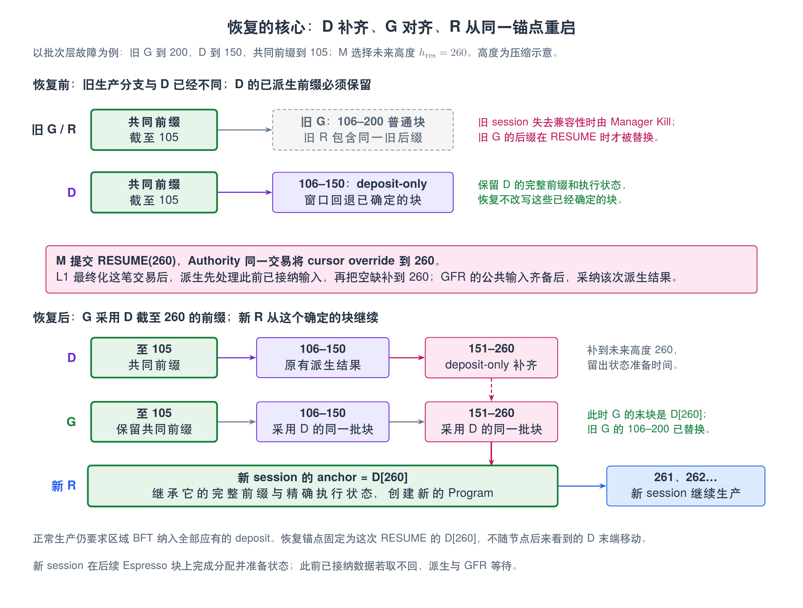

[矢量 PDF](../output/pdf/261027_fig2c_recovery_alignment.pdf) · [TikZ 源码](figures/261027_liveness_recovery/02c_recovery_alignment.tex)

**这三个目标也要求我们区分三层确认：恢复时以 D 已确定的前缀为准。**

| 确认层级 | 承诺的范围 |
|---|---|
| **区域 FINAL** | 区域已经提交；G 之外的结果仍可能因 Force、过期、Kill 或 RESUME 被放弃 |
| **全局确认 G** | 常规轮换、Force 和过期都不撤销已有 G；**紧急 RESUME 可以撤销未结算的后缀** |
| **进入 D** | 在 L1 最终性、派生确定性和 DA 绑定的前提下，已派生前缀不再改变 |

与上周相比，最重要的变化是：**G 的“只增不减”增加了明确的 RESUME 例外；D 仍然只增长。** 现稿保留“全局最终”这个名称，但它不等同于 L1 派生后的不可撤销结算。

RESUME 的 override 可以推进 Inbox cursor，但不表示被跳过的每个高度都提交过普通批次；对应的原生块由派生规则确定。

## 5. 第一处修改：BFT 投票前检查派生一致性

**正常情况下，区域成员应当只为“L1 派生会原样得到”的块投票。** 我们需要同一高度、同一 hash、同一执行状态，而不只是普通交易列表相同。

为什么原来的执行有效性检查还不够？因为 **批次不携带 deposit；派生节点按 L1 origin 自己重建 deposit 前缀。** 如果区域块漏了 deposit，区域执行和 L1 派生就会得出不同结果。

举例：父块 108 的 origin 是 L1 块 1000；L1 块 1001 记录了一笔 deposit `d1`。Leader 提出 109，把 origin 前进到 1001，却只放入普通交易 `tx1、tx2`。区域如果照样投票，G[109] 漏了 `d1`；L1 派生 109 时却会包含 `d1`。

**图 3｜把这类差异挡在区域投票之前。**

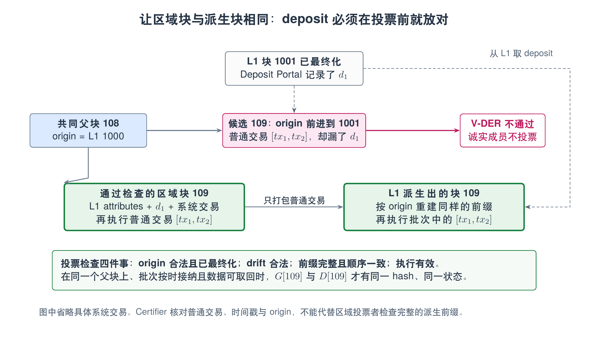

新增的 **DerivOK / V-DER** 检查四件事：

1. **Origin 合法。** 相对父块只能保持或前进一个 L1 块，且已经在 L1 最终化，时间戳不晚于候选 L2 块。
2. **Drift 合法。** L2 块不能离 origin 的时间太远；本版对空的普通区域块也采用同一限制。
3. **前缀完全相同。** L1 attributes、应包含的全部 deposit、适用的系统与升级交易，都必须与派生规则构造的一致，顺序也一致；普通交易列表不能伪装 deposit。
4. **执行有效。** 在同一个父块状态上执行通过。

- **Why must the L1 origin be finalized?** 我们需要所有诚实 replicas 对所引用高度及其之前的 L1 历史有一致、不会回退的解释；它们当前同步到的最新 L1 高度可以不同。
  - **Consistent deposits.** All honest replicas derive the same required deposit transactions, in the same order, from that finalized L1 history.
  - **Stable authority reference.** When a block is used as a session's planning reference, its L1 origin provides a fixed historical reference for authority lookup. Together with the branch policy, this fixes the snapshot used for committee selection; the assigned committee then remains fixed.
- **Why check drift?** The L2 block's timestamp must not be too far ahead of its L1 origin's timestamp. This bound serves two purposes:
  - **Stake withdrawal.** Drift 是质押退出锁定期的一个组成部分。它与 session 配额、G 的接纳时限和证据窗口共同限制旧授权还能影响多久。GFR 以 R-FRESH 公开执行这个界，使解锁时限不必依赖区域始终满足诚实性假设。
  - **Sequencing window.** The L1 delivery deadline is tied to the L1 origin, while the G acceptance limit is measured from the L2 block's timestamp. Bounding their difference is necessary to reserve enough time for delivery after the block enters G.

**内容一致之外，还要给交付留出时间。** 当前设计给普通块进入 G 设置约 **10 小时**的接纳时限，由 GFR 根据 Espresso 时间戳判断；sequencing window 的示例值约为 **12 小时**。剩下的时间要覆盖公共事件处理余量、批次交付，以及 origin 相对 L2 时间的落后。

### 一个区块的生命周期：两个时限分别从哪里开始算

**10 小时从这个 L2 块的固定时间戳开始；约 12 小时从它的 L1 origin 开始。Session anchor 负责接棒的执行状态，不会重置这两个计时。**

下面单独给一个时间例子。假设 L2 每秒一块，session 从块 100 接棒，它的时间戳是 09:59:51；那么块 108 对应 09:59:59，块 109（记作 B）对应 **10:00:00**。这是高度确定的时间，即使 session 晚启动、B 晚提出或晚取得 FINAL，也不会把 B 的时间戳改成那个较晚的时刻。

再假设 B 引用的 **L1 origin 时间戳为 09:30**，投票时该 L1 块已经最终化。这里的 origin 是 B 的原生 L1 引用，和 session 的执行 anchor 是两件事。

**图 3b｜从接棒、区域 FINAL、Espresso、G，到 Inbox 与 D：一个块的完整时间预算。**

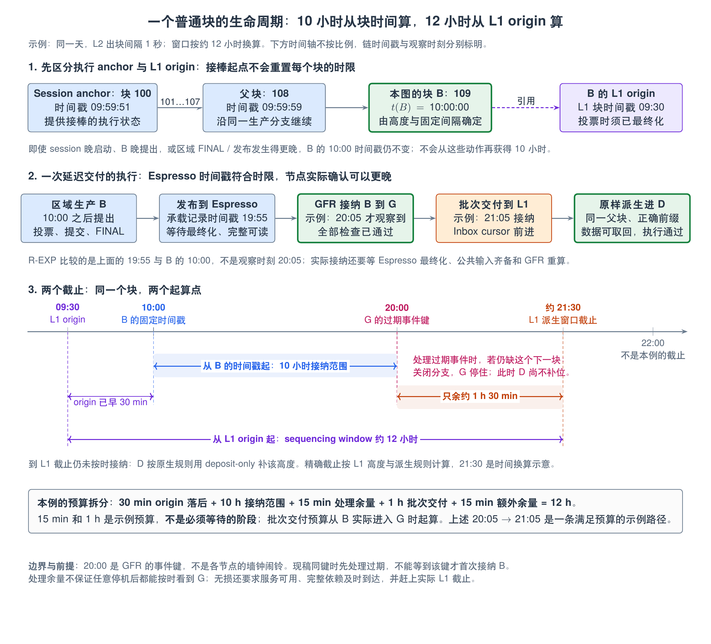

[矢量 PDF](../output/pdf/261027_fig3b_block_lifecycle.pdf) · [TikZ 源码](figures/261027_liveness_recovery/03b_block_lifecycle.tex)

沿图看四个时间点：

| 时间点 | 对 B 的含义 |
|---|---|
| **09:30：L1 origin** | 原生 sequencing window 的起算参考。按 12 小时换算，本例的 L1 截止约在 **21:30**；精确边界仍按 L1 高度和派生规则计算 |
| **10:00：B 的固定时间戳** | 10 小时接纳时限从这里起算，GFR 的过期事件键是 **20:00**。不从 session Enter、区域 FINAL、发布或故障发现时刻重新计时 |
| **19:55：承载记录的 Espresso 时间戳** | 在 R-EXP 的范围内；还必须有完整 FINAL、连续父块、合法 session 等。假设直到 **20:05**，节点才拿齐最终化记录并重算接纳 B，这不等于它的 Espresso 时间戳变成 20:05 |
| **21:05：示例中的 Inbox 接纳** | 从 B 实际进入 G 的 20:05 起，交付花 1 小时，仍早于约 21:30 的 L1 截止；随后在同一父块上正确派生出 B |

**20:00 和 21:30 是两个不同的边界。** GFR 处理到 20:00 的过期事件时，若 B 仍是缺失的下一块，就关闭分支、让 G 停住；D 不会因此立即补位。到约 21:30 的原生窗口截止，若 B 的批次仍未按时接纳，D 才按窗口回退规则用 deposit-only 填这个高度。现稿同键时先处理过期事件，因此不能等到 Espresso 时间戳恰好为 20:00 时，才第一次把 B 送来接纳。

这也解释了为什么剩余预算不能简单说成“两小时”：**本例的 origin 已经比 B 早了 30 分钟，20:00 之后只剩约 1 小时 30 分钟。** 如果再为公共事件处理留 15 分钟、为批次交付留 1 小时，就还有 15 分钟余量。后两项是示例预算，不是必须等待的时间；完整预算仍为：

**最大 origin 落后 + G 接纳时限 + 事件处理余量 + 批次交付预算 ≤ sequencing window。**

接纳时限检查的是 Espresso 时间戳，实际进入 G 还取决于最终化、完整读取、公共输入和 GFR 的处理进度。因此，不能把图中的处理余量理解为“任意停机后，节点都会在 20:15 前看到 G”，也不能仅凭“故障不到 10 小时”保证无损；每个块都必须赶上自己的完整交付期限。这些数值是工作稿的设计参数与示例，不是对当前网络的测量。

### Why must G halt when its next block expires?

**G 必须逐块连续增长：过期的下一块不能再作为普通块接纳，后续块不能跳过它，而当前设计把补位决定交给 D。** 这三条规则一起，决定了 G 此时必须停住。

1. **The acceptance limit reserves time for L1 delivery.** 10 小时是按交付预算选择的保守接纳界。它不表示一过界就物理上绝无可能上 L1，而是协议只在这个界内承诺：满足前述条件的普通块，仍有足够预算完成后续交付。继续无界地接纳迟到块，就可能把已经错过 L1 窗口的内容加入 G，使全局确认无法兑现为同一个块的结算。
2. **G cannot skip the missing height.** 若 G 停在 108，下一块必须是 109；110 的父块和执行状态依赖 109，不能直接接在 108 后面。换一个 region 也不能解决这个缺口：Force 仍要从 108 继续，而高度 109 的固定时间戳和截止不会重置。
3. **Only derivation supplies the fallback blocks.** 当前 GFR 不自行生成或预测 deposit-only。109 在 G 中过期，并不等于 L1 已经确定了 D[109]；要等原生派生规则确定这段内容，再通过 RESUME 让 G 采纳 D 的前缀，从新的确定锚点恢复。

沿用上面的时间例子：**GFR 处理到 20:00 的过期事件时，若 G 仍到 108、缺少 109，就保留这个前缀并停住。** 约 21:30，109 的原生窗口到期，D 才在没有按时接纳批次的情况下用 deposit-only 补位。进入紧急状态且服务恢复后，M 发出 RESUME，G 对齐到指定的 D 锚点，新 session 从该锚点继续。已有 G 的块仍可继续交付；本地看到这一关闭事件的 Manager 则停止旧分支的生产。

**这段等待是当前方案的取舍：用固定接纳时限保留交付预算，并让 D 统一决定缺失高度的内容。** 10 小时这个参数可以在总预算约束内调整；但在现有规则下，只要下一缺失高度已经过期，单纯换区或恢复发布都不能让 G 原地继续增长。

## 6. 第二处修改：Kill 关闭已经接不上的旧 session

**Kill 回答的是“这个 session 还有没有可能接到最终链上”，不是“它多久没响应”。** 一旦公共历史已经排除了它，继续签名和生产就没有意义。

Manager 有两种关闭依据：

| 依据 | 可以判死的情况 | 例子 |
|---|---|---|
| **D 判死** | D 已在某个高度确定了与该 session 链不相容的块；或已在它尚待生产的职责高度补了 deposit-only | D[109] 是 deposit-only，而 A 的旧链在 109 是普通块；从旧 110 接棒的 B 也无法继续 |
| **G 判死** | G 在该 session 必须经过的高度接纳了别的块；或其下一高度已在 GFR 中过期、仍未接纳 | 旧路径不能再追加到 G，相关程序应当关闭 |

**不能只比较高度。** D 高于某个本地缓存，不一定表示冲突；必须确认原生块不同，或者该职责高度已被窗口回退 / override 的 deposit-only 占据。最新正文已经把这两种判据写清楚。

沿用例子：D 在 109 确定 deposit-only 后，A 的旧 109–110 接不上；B 虽然属于另一个 session，但它从旧 110 接棒，也接不上。关闭范围因此包括受影响的旧 session、提前进入的后继，以及已经分配但尚未启动的实例。

Kill 是**本地生命周期动作**：先持久化关闭标记，再停止 Program，不再为它签名；结果与追责证据保留，迟到的 receipt 不能把同一个已关闭实例重新启动。**Kill 本身不修改 G、不撤销 G，也不提交 L1 交易。** 已发布的积压仍由 GFR 按公开规则处理。

这对 Espresso 停机尤其重要：GFR 此时可能因为缺少 Espresso 的公共进度而等待，但 L1 仍在推进。Manager 可以从 D 判断，也可以使用只读 L1 的 **cursor 超窗停滞**判据，及时停止旧生产。精确边界取决于 cursor 的 origin 和 sequencing window，不是从本地发现故障起机械地计时 12 小时。

## 7. 第三处修改：RESUME 把 G 对齐 D，再创建新 session

**恢复不沿用“谁本地跑得最远”的状态，而是由一笔 L1 记录固定所有人共同的新起点。** 这个起点就是该次 RESUME 指定高度 h 处的派生块。

M 在 L1 发起 `RESUME(h)`，同时给出新的区域 policy。Authority 记录它，并在同一交易内把 Inbox cursor override 到 h。随后派生规则先处理此前已经接纳的输入，再把尚未派生的空缺立即填成 deposit-only，直到 h。

这里的 deposit-only 仍包含应有的 L1 attributes、deposit 和系统交易，只是不包含普通 sequencer 交易。override 也不会改写此前已经派生的 D 前缀。

**图 4｜先关闭旧工作，再通过一个公共恢复点重新接棒。**

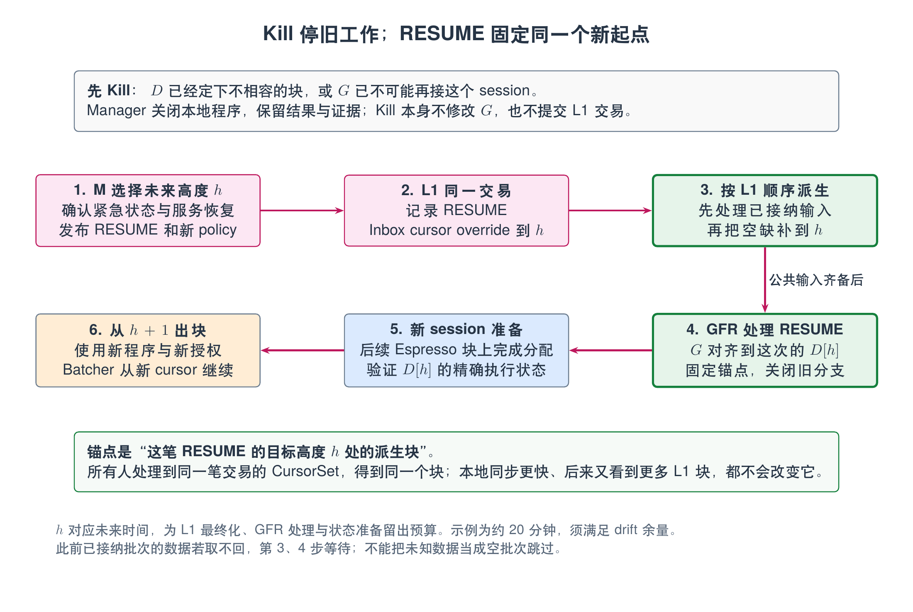

[矢量 PDF](../output/pdf/261027_fig4_resume.pdf) · [TikZ 源码](figures/261027_liveness_recovery/04_resume.tex)

GFR 处理到这条 RESUME 时，采用**按 L1 顺序处理到该交易的 CursorSet 为止**得到的 D，并把 G 替换为它截至 h 的前缀：共同部分保留；从第一个不同块起，旧 G 后缀被撤销。随后创建新分支，在后续 Espresso 块上完成选区和 session 分配。

被选区域验证 **D[h] 的精确执行状态**，创建新的 Program，经 Ready / Enter 从 h+1 出块。即使再次选中同一个区域，也不能沿用旧程序的 votes、locks 和 timers。恢复锚点若是派生块，启动依据来自派生与 handoff 证据。

### 为什么 h 要放在未来

**提前选择未来高度，是为了让 L1 最终化、派生和状态准备完成后，新的 session 能直接接上实时出块。** 当前操作规程要求：

- 已进入紧急状态，即 cursor 已超窗停滞；Espresso 已恢复，相关批次交付服务和必需数据也已可用。
- h 高于当前 cursor 和旧 G 的末端；它对应的时间晚于收录 RESUME 的 L1 块时间，并留出准备预算。
- 示例准备时间约为 **20 分钟**，同时要小于 **30 分钟 drift 减去余量**；具体预算仍需校准。
- 新 policy 排除仍有故障的区域。

合约负责授权、序号、格式和 cursor 只能前进；是否真正需要恢复、服务是否已恢复，以及准备预算是否足够，仍由 M 按操作规程决定。最新 Part 2 另提出让合约检查 h 的时间范围，这项补充仍待确认。

**锚点固定为这次恢复的 D[h]，不会跟着节点后来看到的 D 末端移动。** 下载慢只会让某个节点更晚准备好，不会让它选到另一块。此前已接纳批次的数据取不回时，派生和 GFR 都停下等待。

### 恢复后的第一批怎样接上 Inbox

**新的批次必须同时接上新 cursor 和新 G。** Batcher 从 override 写入的 cursor 继续；Certifier 在认证前，必须先把 GFR 运行到该 cursor 写入位置之后，确保已处理这次 RESUME。

这样，旧证书不能在 override 后重新提交；新的证书也不能拿旧 G 的内容配上新 cursor。当前接口已经写明这个要求，具体 cursor 字段与签名编码还要在 Part 6 落实。

## 8. 全局确认规则：先排序，再逐个处理

**GFR 把公共历史排成一个确定的处理顺序，再据此更新 G、负责 session 和关闭状态。** 同一份输入必须产生同一结果；节点读得快慢只影响什么时候得到结果，不改变事件顺序。本节按最新 [Part 5 v0.1 §4–5](../formalization_v5/part5_global_finality_rule_zh_v0_1.md) 展开。

### 8.1 四种情况，分别使用什么时间

**汇报中分四种情况讲：Espresso 结果、Force、Expire、RESUME。程序的主队列实际只排三类事件：RESUME、Expire、Espresso 块；Force 在 Espresso 块的开头执行。**

| 情况 | 使用的时间 | 怎样定位处理位置 |
|---|---|---|
| **Espresso 块中的区域结果** | Espresso 块头的时间戳 $\theta_q$ | 整个 Espresso 块以 $\theta_q$ 为排序键；其中的区域块不是各自独立排队 |
| **Force** | 指令写明的未来 Espresso 时间阈值 $\theta_a$ | 在第一个满足 $\theta_q\ge\theta_a$ 的 Espresso 块开头执行；**阈值本身不是一个独立队列事件** |
| **Expire(h)** | 该 L2 高度的固定时间戳 $t(h)$，加接纳时限 $W_{\rm exp}$ | 排序键为 $t(h)+W_{\rm exp}$，当前示例为块时间加 10 小时 |
| **RESUME** | 收录该交易的 L1 块时间戳 $\operatorname{ts}(L)$，加公告提前量 $M_a$ | 排序键为 $\operatorname{ts}(L)+M_a$；例如 L1 时间 21:45、$M_a=15$ 分钟，对应键 22:00 |

这里使用的是**链上记录的时间戳**。L1 交易最终化的实际时刻、节点收到消息的时刻，都不拿来重新排序。$M_a$ 是协议固定的提前量，也不是从本地收到 RESUME 后再开始等的一段时间。

Force 还必须满足 `θ_a ≥ 收录它的 L1 块时间 + M_a`，给指令提前可见留出预算。但它具体在哪个位置起作用，要看第一个达到阈值的 Espresso 块。

**主队列先比较时间键；同键时依次处理：RESUME → Expire → Espresso。** 同类内部，RESUME 按 L1 位置（块高、交易位置、日志位置），Expire 按 L2 高度，Espresso 按块高排序。同一个 Espresso 块内有多条已到阈值的 Force 时，按控制序号处理。

需要区分三个相近的动作：`Expire(h)` 是 G 的接纳过期；L1 sequencing window 到期由 Derivation 处理；`CursorSet` 的效果包含在 RESUME 的派生结果中，不再作为另一项 GFR 事件处理。Manager 的本地 Kill 也不进入这条队列。

### 8.2 排好了之后，什么时候可以处理：R-WAIT

**排在前面，不等于现在就能执行；GFR 还要确认公共前缀已经读齐，没有漏掉排在它前面的输入。** 对下一事件的时间键 x，要求：

| 要处理的事件 | 必须已经读到的公共进度 |
|---|---|
| **任何事件** | 已最终化 L1 日志至少包含一个时间戳不小于 `x − M_a` 的块 |
| **RESUME 或 Expire** | 另外，已最终化 Espresso 日志至少包含一个时间戳不小于 x 的块 |
| **RESUME** | 处理它时，还必须能取得派生所需的已接纳批次数据，算出该次恢复的 D 前缀 |

例如，处理键 20:00、$M_a=15$ 分钟的 Expire，需要 L1 已最终化前缀覆盖到至少 19:45，并且 Espresso 已最终化前缀达到至少 20:00。否则返回 `WAIT`，不能只因为本地时钟到了 20:00 就关闭分支。

这也是 Espresso 停机时 GFR 会等待的原因：Expire 和 RESUME 都需要 Espresso 的公共进度。D 仍可按 L1 派生前进，Manager 仍可在本地 Kill，但 GFR 不跳过尚不能处理的事件。

每个事件处理完成后，GFR 一起保存新状态、输出事件和处理位置。重启后从该位置继续；若在 RESUME 的中途发现缺数据，则保留处理前的状态，不只做一半替换。

### 8.3 Force：在 Espresso 块的开头先执行

**Force 保留生效时已有的整个 G，只改变之后由谁从哪个锚点继续。** 处理 Espresso 块 J 时，先找出阈值不超过 J 时间戳、尚未处理的 Force，逐条执行：

1. **核对目标分支。** 目标仍是当前分支，且尚未关闭，指令才有效；否则整条指令失效，新 policy 也不安装。
2. **关闭旧分支，保留 G。** 输出关闭事件，覆盖旧分支上所有相关 session，包括提前启动的常规后继；Manager 据此关闭本地程序。
3. **安装新分支与 policy。** 新的执行 anchor 固定为此刻的 `last(G)`，据此重新排班；选出区域则分配新 session，没有合格区域则保持待分配。

同块内的下一条 Force 会看到前一条产生的新状态，因此也要重新核对目标。**所有这些动作都先于该 Espresso 块中的普通结果验收。** 旧分支的迟到结果不能利用同一个块抢在 Force 前进入 G。

### 8.4 Espresso 普通结果：接着处理待开的 session，再逐块追加

**一个 Espresso 块的内部顺序固定为：Force → 待开的 session → 普通块验收。** 因此区域结果上了 Espresso，还要通过当时 GFR 状态下的接纳条件。

Force 处理完后，若此前的 RESUME 已经固定了新锚点、正在等下一个 Espresso 块，此时完成新 session 的分配。随后，从**截至当前 Espresso 块累计发布的对象**中寻找 G 的下一块，检查：

- **负责性与连续性：** 来自当前负责且未关闭的 session；高度正好是 G 的下一高度；父块正好是 G 的末块，并且没有超过 session 配额。
- **区域证明：** 完整块体、所需路径和 FINAL 签名齐备，公开检查通过。
- **Espresso 引用：** 引用的是当前块之前、但不早于该 session 开出位置的已最终化 Espresso 块。
- **两项时间约束：** 满足 R-EXP 的接纳时限，以及 R-FRESH 的 L1 origin 新鲜度。

有合格块就追加；若存在多个合格候选，按最小哈希确定一个。然后继续检查新的下一高度，因此一个 Espresso 块可以让 G 连续追加多块。没有合格候选时，本次追加停止，等待后续公共事件。

若追加的是本 session 的末块，就记录其正常完成，并按原 policy 分配常规后继；后继的已发布结果也可以继续接受检查。GFR 输出的是公共生命周期事件，具体程序的准备和启动由 Manager 执行。

**由 Force 或 RESUME 在 J 中新开出的 session，其普通块最早在下一 Espresso 块中被接纳。** 新 session 的结果不能在创建它的同一个 Espresso 块里立即进入 G。

### 8.5 Expire：下一高度仍缺失，就关闭分支并停住

**Expire 只检查 G 的下一个缺失高度；它不撤销已进入 G 的块，也不生成替代块。** 处理 `Expire(h)` 时：

1. 如果 h 已不是 G 的下一高度，或已经处于 HALT，事件不产生新的效果。
2. 否则关闭当前分支及其 session，包括提前启动的常规后继；记录后续恢复需要的轮次信息，进入 HALT，G 保留到 h−1。
3. 等待 RESUME。此后针对这个已关闭分支的 Force 无效，不能靠换区重置高度 h 的时限。

同键时 Expire 先于 Espresso：若高度 109 的过期键是 20:00，且它仍是缺失的下一块，那么时间戳恰为 20:00 的 Espresso 块也不能首次把它补进 G。截止前已经处理并接纳的块则照常保留。

同键的 RESUME 又先于 Expire。如果 RESUME 已改变 G 的末端，待检查的下一高度也随之更新；不会再把旧高度的过期当作新分支的过期。

### 8.6 RESUME：先取得确定的 D，再替换 G、准备新分支

**RESUME 是唯一能替换已有 G 后缀的入口；替换内容由这笔 L1 记录对应的派生结果决定。** 处理到它的排序位置后：

1. **派生到该交易位置。** 按 L1 顺序处理到这笔 RESUME 的 `CursorSet` 为止：先处理此前已接纳输入，再按 override 规则补到目标高度 h。缺 L1 或 DA 数据就在此等待。
2. **确定共同前缀与锚点。** 比较同高度的原生块哈希，找到旧 G 与该次 D 的第一个不同块；锚点固定为该次派生的 D[h]。
3. **关闭旧分支、对齐 G。** 共同前缀保留，后续采用 D 截至 h 的块；旧 G 若只是 D 的前缀，则无需撤销旧块，只需接上 D 的后续。
4. **安装新分支与 policy。** 先记录固定锚点，进入“待开出”状态；在合并顺序中随后的第一个 Espresso 块上分配新 session。若该 Espresso 块与 RESUME 同键，它仍排在 RESUME 之后。

之后 Manager 验证锚点状态并启动新 Program，从 h+1 出块。**“G 已经对齐 D”“新 session 已分配”“新普通块已进入 G”是三个不同步骤。** 不把它们都算成处理 RESUME 的瞬间完成。

### 8.7 用同一条时间线看排序的结果

**Force 的阈值不等于它的独立生效位置；同键的 RESUME 和 Espresso 也有明确的先后。** 图中示例取 $M_a=15$ 分钟，起初分支为 7、G 到 108，而 109 的过期键为 20:00。

**图 4b｜三类事件进入主队列，Force 在 Espresso 块内部执行。**

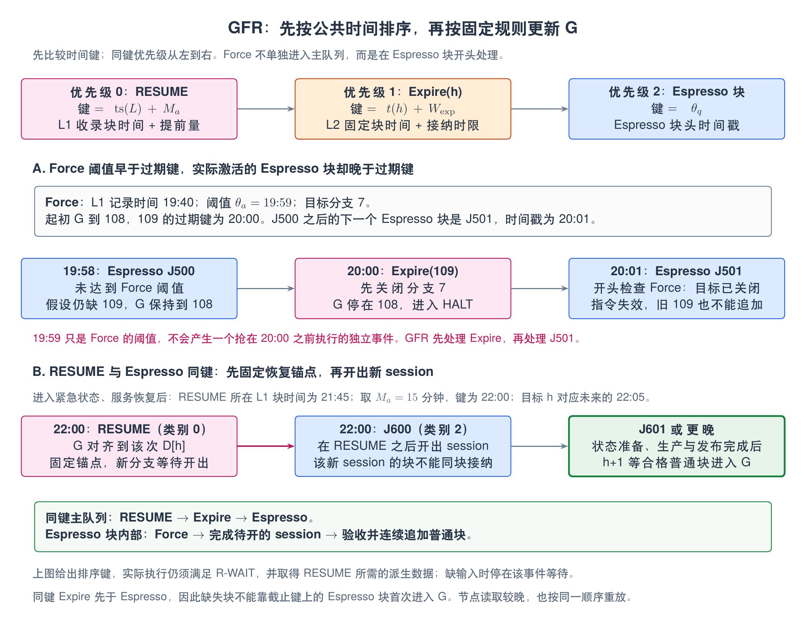

### 8.8 Derivation：沿用原生规则，为每一种输入状态给出明确处理

| 派生遇到什么 | 处理方式 |
|---|---|
| **已接纳且数据可取回的普通批次** | 在实际父块上检查，按 origin 重建 deposit 等前缀，执行普通交易 |
| **某高度没有按时接纳的批次** | 等该高度窗口到期，按原生规则生成 deposit-only |
| **批次不满足原生转换或执行条件** | 沿用原生的同高度替换规则；正常路径通过 DerivOK 避免走到这里 |
| **RESUME 产生的 CursorSet** | 先处理此前已接纳输入，再将未派生空缺立即填到 h，不再等待各高度窗口到期 |
| **已接纳，但 DA 字节暂时取不回** | 停在明确位置等待，保留已派生前缀；不能把缺失数据当成空内容 |

这里的“完整派生逻辑”包括等待分支，不能理解为任何情况下都能立即产出下一块。**本周方案保留原生窗口回退和 override 填充，让投票规则与 GFR 去兼容这套派生。** 状态结算、Manager 的状态准备、GFR 的 RESUME 都使用同一套 Derivation。

## 9. 故障如何处理，恢复需要多久

### 前期：先自动重试，通常不做治理操作

**Espresso 或批次交付路径发生短故障时，M 前期通常不需要发 Force 或 RESUME。** 节点继续监控、重试发布和补交批次：GFR 缺公共输入时等待；Batcher 仍可交付已有 G；服务及时恢复后，原生产分支按规则继续。这里“不处理”指不主动做治理切换，节点的自动处理仍然运行。

**决定能否无损的是每个块是否还赶得上自己的接纳与派生期限。**

| 情形 | 恢复路径 |
|---|---|
| Publisher / Espresso 恢复时，积压块仍满足 G 的时效检查，且交付预算足够 | 重试发布，按原顺序追加 G，再补交 L1；不需要 RESUME |
| 批次层恢复时，受影响的每个高度仍能在窗口截止前被接纳 | 从 cursor 继续补交；不需要重建 session |
| G 的下一高度已经过期，但派生窗口尚未到期 | G 保持停止；不能直接宣称已进入紧急状态。待 D 越过或分叉、服务恢复后，再按规程 RESUME |
| 派生已经越过或偏离旧链 | Kill 停旧生产；服务恢复后由 M 发起 RESUME，重新接棒 |

### Espresso 停机期间：由 L1 deposit 路径提供保底活性

**Espresso 不可用时，新的普通块无法持续进入 G；用户的保底交易入口是 L1 Deposit Portal。** 用户通过它提交强制包含交易，D 按原生派生规则、在适用的窗口到期后用 deposit-only 推进，并纳入应有的 deposits。已经进入 G 的内容，只要批次层正常，仍可继续交付。

这条路径保住的是 **L2 最终仍能处理 L1 强制包含交易的能力**，不提供普通 sequencer 路径原来的低延迟确认。它依赖 L1 正常推进，以及此前已接纳的 DA 数据能够取回。Espresso 恢复之前，GFR 的 RESUME 也受 R-WAIT 约束，不能靠一笔治理交易绕过 Espresso 停机。

### 恢复耗时：从提交 RESUME 到首个新区块上线

**这里从 M 提交 RESUME 开始计时，不把此前的停机时长算进去。** 适用前提是：系统已经进入需要 RESUME 的紧急状态，Espresso 与相关交付服务已恢复，且新区域与所需数据可用。若 Espresso 恢复时尚未满足紧急恢复条件，仍应走上面的自动路径或继续等待，不能直接假定此刻就能发 RESUME。

“首块上线”在这里取**恢复后的首个普通块经 Espresso 最终化并进入 G**。为了区分各段耗时，同时列出更早的“首块产出”时间：

| 终点 | 正常恢复路径下的估计 |
|---|---|
| **新 session 产出第一块** | 等待 RESUME 被 L1 纳入的时间 + 约 **20 分钟**准备预算 + 一个 L2 出块间隔 |
| **这块进入 G，即这里的“上线”** | 在上面基础上，再加首块的区域确认、Publisher 发布、Espresso 最终化及 GFR 接纳所需时间 |
| **这块进一步进入 D** | 还需批次交付与派生；不计入本段“首块上线”的口径 |

**20 分钟从收录 RESUME 的 L1 块时间戳算起。** M 选择的目标高度 h 对应这个时间之后约 20 分钟，新 session 在 h+1 开始出块。这个准备预算用于覆盖 L1 最终化、GFR 处理 RESUME、session 分配、合法引用等待与状态准备；$M_a$ 的示例值为 15 分钟，属于其中的预算，不能再机械地算成“15 + 20 = 35 分钟”。节点提前完成的工作可以与等待并行。

例如，假设一次正常恢复按下面的节奏完成：

| 时间（示例） | 动作 |
|---|---|
| **22:00** | 发现 Espresso 已恢复，且系统已满足紧急恢复条件；M 提交 RESUME，开始计时 |
| **22:01** | 交易被 L1 纳入；假设选定的目标 h 对应 **22:21**，留出 20 分钟预算 |
| **排序键 22:16** | 按 `22:01 + 15 分钟` 处理 RESUME；公共输入与 DA 齐备后，G 对齐 D，后续 Espresso 块完成 session 分配 |
| **约 22:21 + 一个 L2 出块间隔** | 若状态与引用已准备好、区域正常出块，新 session 产出 h+1；以 1 秒间隔为例，目标为 **22:21:01** |
| **随后** | 完成区域确认、发布和 Espresso 最终化，该块进入 G，结束本段计时 |

因此，这个例子里，**提交 RESUME 到首块产出约 21 分钟；到首块进入 G，还要加一段正常确认与发布延迟。** 服务恢复且满足预算时，可以向 leader 表述为“恢复是约 20 分钟的准备量级，再加 L1 纳入和首块上线开销”，不需要在提交 RESUME 后再等一个 12 小时窗口；override 会立即填充尚未派生的空缺。

20 分钟是当前工作稿的目标预算，不是已经测得或证明的固定恢复上界。是否足以覆盖 Espresso 进度与引用等待、状态重建和首块生产，还需按实际参数校准；若已接纳数据取不回或相关服务再次不可用，就不能沿用这个估计。

### 两类长故障的恢复结果

**两类故障共用 Kill / RESUME，但被放弃的内容处在不同确认层级。** 下面的高度是压缩示意，不把 5 个高度解释成 20 分钟；真实 h 由固定出块间隔和恢复时间预算决定。

**图 5｜Espresso 故障主要丢掉 G 之外的区域后缀；批次层故障可能撤销 G 的未结算后缀。**

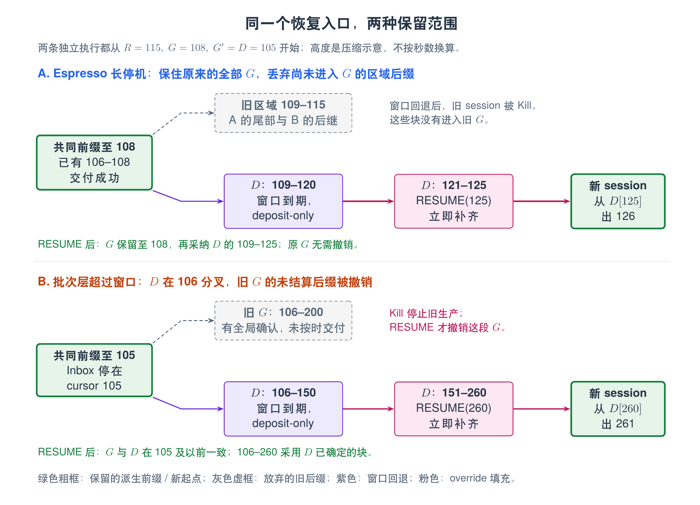

[矢量 PDF](../output/pdf/261027_fig5_recovery_examples.pdf) · [TikZ 源码](figures/261027_liveness_recovery/05_recovery_examples.tex)

### 例 A：Espresso 长停机，G 停在 108

**只要批次层仍正常，旧 G 可以全部保留；无法保留的是没有及时进入 G 的区域结果。**

1. 起点为 R=115、G=108、G′=D=105。Espresso 停机，G 不再增长；Batcher 把已经进入 G 的 106–108 继续交付，D 到 108。
2. 停机足够久后，109 的派生窗口到期，D 在 109 填 deposit-only。A 的旧 109–110、B 从旧 110 延续的 111–115 都接不上，Manager Kill 相关旧程序。这一步不必等 Espresso 恢复。
3. Espresso 恢复后，GFR 按公共顺序处理积压；本例的 109 已错过接纳时限，分支停住。假设 D 此时已派生到 120，M 按规程发出目标高度为 125 的 RESUME。
4. 派生立即补齐 121–125。GFR 保留原 G 的 108 及以前，接上 D 的 109–125；新 session 从 D[125] 的状态提出 126。

这次**没有撤销任何原 G 的块**。旧 109–115 只有区域确认，未进入 G；其中的普通交易不能因为服务恢复就原样塞回已经确定的高度，仍需执行的交易应按新状态重新提交。

### 例 B：批次层超过窗口，G 继续长到 200

**G 的增长会掩盖交付故障；只有进入 D 的共同前缀可以保证保留。**

1. 从同一起点出发，区域与 Espresso 正常，G 继续增长到 200，但 Batcher / Certifier 的交付路径失效，Inbox cursor 停在 105。
2. 106 的窗口到期，D[106] 成为 deposit-only，而旧 G[106] 是普通块，两条链在这里分叉。Manager Kill 相关旧程序，停止继续生产；G 的旧后缀尚未因此撤销。
3. D 继续通过 deposit-only 推进到 150。服务恢复后，M 选择合适的未来高度 260，提交 RESUME；派生立即补齐 151–260。
4. GFR 保留共同前缀至 105，撤销旧 G 的 106–200，采用 D 的 106–260；新 session 从 D[260] 提出 261，Batcher 从 cursor 260 继续提交。

这次被撤销的 106–200 **曾经进入 G，却没有按时进入 D**。RESUME 使 sequencer 重新承认 L1 已确定的结果，而不是要求 L1 回到旧区域状态。两例中的 deposit-only 块都会照常纳入适用的 L1 deposit。

## 后续工作

1. **梳理安全假设与边界情况。** 以 [Part 0 v0.8](../formalization_v5/part0_model_goals_zh_v0_8.md) 为基础，合并重复假设，区分外部依赖、协议规则和实现条件。重点检查固定的 L2 时间戳间隔、L1 origin 与 drift 约束，在 Force 追赶和 RESUME 锚点跳转后是否仍然成立，排查安全漏洞与 corner cases。

2. **统一模块接口与功能保证。** 在 [Part 1 v0.3](../formalization_v5/part1_module_interfaces_zh_v0_3.md) 中明确各模块的输入、输出、状态、functionality 及 safety / liveness properties，标清“自身保证什么、依赖其他模块什么”，避免把待证明的性质重复写成假设。

3. **逐模块实现并验证。** 完善 [Part 2：Authority](../formalization_v5/part2_l1_authority_zh_v0_1.md)、[Part 3：区域 BFT](../formalization_v5/part3_session_program_zh_v0_1.md)、[Part 4：Manager](../formalization_v5/part4_session_manager_zh_v0_1.md) 和 [Part 5：GFR](../formalization_v5/part5_global_finality_rule_zh_v0_1.md) 的协议实现，补齐其余模块，并验证各模块及其组合是否满足接口承诺。
