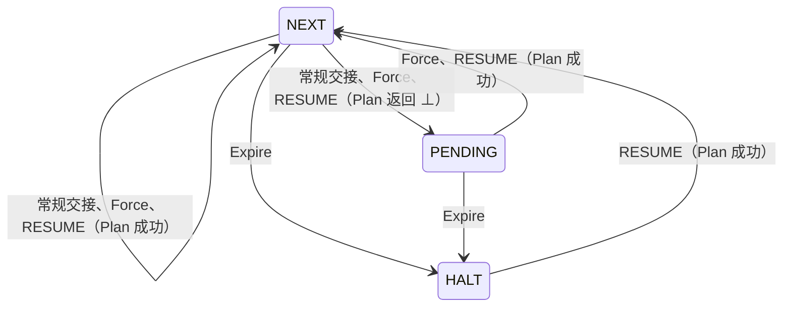
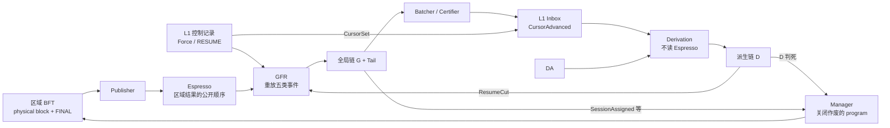

# 第三部分：换成 Simplex 之后的交接、恢复与两条公开规则

2026 年 11 月 3 日 · Meetup 讲稿（接在 [18 Simplex 直觉与选型](../learning/zh-CN/18_simplex_intuition_and_selection_zh.md) 之后）

规格来源：[09 最终性规则 v0.2](../formalization_v9/09_finality_rules_zh_v0_2.md)、[03 Session Manager](../formalization_v9/03_session_manager_zh_v0_1.md)、[01 §3.9–§3.10](../formalization_v9/01_l1_authority_zh_v0_1.md)、[10 端到端流程](../formalization_v9/10_pipelines_zh_v0_2.md)。本稿只讲抽象逻辑，数值例子取自 10。

讲的顺序：

1. Simplex 带来的新问题：session 的末块不再确定。
2. Regular handoff：谁接班、从哪里接。
3. RESUME：什么时候需要、做了什么。
4. GFR：列出全部事件，排序，逐类处理。
5. Derivation Rule：不读 Espresso 的另一条链。

---

## 1. Simplex 带来的新问题

换成 Simplex 系列之后，我们去掉了 term：每个 view 有一个 leader，至多贡献一个 physical block，失败的 view 直接跳过。这带来三个事实：

- **physical height 可以跳跃**：中间高度由 Merge 补成 deposit-only 的 virtual block（padding）。
- **session 的上界 $h_{\max}$ 不一定有 block**，也不一定被决定。
- **到 stop 只保证诚实节点不再签新票**；停止前签出的票，可能在 stop 之后才组成证书、才公开。

所以"前驱 session 的最后一块是哪一块"不再由区域自己说了算，必须有一条**公开、确定、所有人算出同一答案**的规则。这条规则就是 GFR 的一部分。

---

## 2. Regular handoff

### 2.1 把交接拆成两个问题

| 问题 | 由什么决定 | 何时可知 |
| --- | --- | --- |
| **谁接班**（后继区域与委员会，即 Plan） | 前驱的**初始** anchor 作为选区参考 block，加上前驱区域 $i_s$ | 前驱一被 GFR 选定就能算 |
| **从哪一块接着生产**（后继的 anchor） | 前驱的**实际末端**，由 GFR 公开固定 | 前驱结束时才固定 |

拆开的好处：后继区域可以在前驱整个 session 期间提前知道自己要接班，持续跟随前驱的决定链执行状态；末端的不确定只影响"从哪接"，不影响"谁接"。

后继窗口固定为 $[h_{\max,s}+1,\ h_{\max,s}+\mathrm{TB}]$，与前驱实际末端无关。

### 2.2 末端判据

按顺序检查：

1. $h_{\max}$ 的 physical block 已被 GFR 接纳 → **立即**以它为末端，关闭前驱（COMPLETE）。
2. 否则等到前驱的公开截止 SessionEnd → 以截止前**最后接纳**的 physical block 为末端。
3. 截止前没有接纳任何新 block → 沿用前驱的初始 anchor。

规则不等待"可能永远不会出现的 $h_{\max}$"。

### 2.3 候选：快和稳的取舍

后继区域不必等 GFR 固定末端才开始。它可以：

- 对前驱决定链上已知的**最高**区域 FINAL block，提前准备一个候选 program（cid 绑定这个 anchor），到窗口开始就出块；
- 更高的 FINAL 出现时转向更高的候选，旧候选只暂停（Paused），不销毁。

GFR 固定末端之后，**只有 anchor 完全匹配的那个 cid 被选中**，其他候选被排除（EXCLUDED）并永久关闭。相同 height 不足以表示相同 anchor。

```
前驱 c：  … 32 408 ── 32 409 ── 32 410(h_max)?
                         │           │
后继 a 候选：       cid(32 409)   cid(32 410)
                         │           │
GFR 固定末端：   SessionEnd 时末端=32 409   或   32 410 已接纳
                 → 选 cid(32 409)            → 选 cid(32 410)
```

两种结果（10 §3.4）：

- **前驱没决定 $h_{\max}$**：后继从 32 409 起已经出的块被缓存，SessionEnd 选定后一并接纳。内容不丢，全局确认最多晚约 $T_{\rm grace}$。
- **$h_{\max}$ 的证书迟到但赶上截止**：GFR 改选 cid(32 410)，后继在 cid(32 409) 上做的块作废，变成 padding。

这就是大纲里的待决问题：**我们要不断的是区域生产，还是 $G$ 的连续增长？** 提前跑候选保证前者，代价是候选可能落选。

### 2.4 Force 交接（L1 上的强制换区）

区域故障、Espresso 正常时，治理方在 L1 提交 Force：

- 关闭当前分支，开新分支；**$G$ 不变**，从 $\mathrm{last}(G)$ 接着生产；
- 激活时刻与 RESUME 相同，都是 L1 收录时间加 $M_a$；新窗口从激活时刻之后再留 $T_{\rm init}$ 开始，故障时段成为 padding；
- 分支已经因全局过期而 HALT 时，Force 无效，只能 RESUME。

---

## 3. RESUME

### 3.1 什么时候需要

GFR 有两种情况自己无法走出来，都要靠 RESUME：

| 情形 | 发生了什么 | 例子（10） |
| --- | --- | --- |
| **$G$ 停住（HALT）** | 下一高度等了 $W_{\rm exp}$ 还没被接纳，GFR 关闭分支 | Espresso 停机 14 h（§5） |
| **$G$ 与 $D$ 分叉** | 批次没能在原生期限内上 L1，派生链 $D$ 在该高度补了 deposit-only，与 $G$ 不同 | 批次层故障超过原生截止（§6） |

第二种情况由 Manager 的 **D 判死**最先发现：某候选的前缀与 $D$ 在同一高度的原生 block hash 不同，即可永久关闭它，不必等 Espresso。

### 3.2 核心原则

**$D$ 只依赖 L1 和 DA，Espresso 停机时仍随 L1 推进。** 因此 RESUME 不去修复旧 Espresso 上的区域结果，而是：

> 在 L1 上的一个确定位置，把 $G$ 对齐到 $D$ 的切面，再从那里重新开始生产。

### 3.3 步骤

```
治理方 ──SubmitResume(h_res)──▶ L1（block L）
                                  │ 同一交易：Inbox CursorSet(cursor → h_res)
                                  ▼
Derivation：先处理此前已接纳的批次，再把未派生的高度填成 deposit-only 直到 h_res
                                  │ 得到切面 D_L
                                  ▼
GFR（激活时刻 = ts_L1(L) + M_a）：G ← D_L[h⁰ : h_res]，关旧分支，开新分支
                                  ▼
同一事件中立即算 Plan → SessionAssigned，新 session 窗口 [h_res+1, h_res+TB]
                                  ▼
Manager：用 D_L[h_res] 的执行后状态准备 → 新区域在 h_res+1 出块
```

$h_{\rm res}$ 的选取（01 §3.10，链外规程）：

$$
\mathit{ts}_{\rm L1}(L)+T_{\rm prep}\ \le\ \mathit{ts}^*(h_{\rm res})\ \le\ \mathit{ts}_{\rm L1}(L)+T_{\rm drift}-\epsilon
$$

下界留出 L1 finalized、GFR 处理和状态准备的时间；上界保证新 anchor 的 origin 不违反 drift。合约只检查 $h_{\rm res}$ 高于 Inbox 当前 cursor。

### 3.4 它会撤销什么

$G$ 与 $D_L$ 的共同原生前缀保留；从第一个不同的 block 起，旧 $G$ 后缀被撤销。

- **Espresso 长停机**（10 §5）：停机前的 $G$ 早已上 L1，$G$ 是 $D_L$ 的前缀，**不撤销**，只接上填充的 deposit-only 部分。
- **批次层超窗**（10 §6）：$G$ 照常增长了约 12 h，但没进 $D$，**这一段全部撤销**。
- 停机瞬间有在途 Espresso block 的变体（10 §5.5）：一个已进入 $G$ 的块也可能被撤销。

"$G$ 已对齐 $D$"、"新 session 已分配"、"新普通块已进入 $G$" 是三个不同步骤。

---

## 4. GFR

### 4.1 它是什么

$$
(G,\ \mathit{Tail}) = \mathrm{GFR}(\text{L1 日志},\ \text{Espresso 日志})
$$

GFR 是一个确定的**重放器**，不是新的共识。每个读取者按同一顺序处理同一组事件，得到同一条全局链 $G$ 和同一个"下一段职责" Tail。

### 4.2 全部事件

事件分三类来源：L1 上的控制记录、Espresso 上的区域结果，以及没有任何日志记录、由已有状态和参数算出来的两个"定时器"。

| 来源 | 事件 | 内容 | 时间键 |
| --- | --- | --- | --- |
| L1 | **Force**($U$) | 控制序号、目标分支、新 policy | 激活时刻 $\mathit{ts}_{\rm L1}(\ell_U)+M_a$ |
| L1 | **RESUME**($p$) | 控制序号、新 policy、$h_{\rm res}$；同一交易的 CursorSet | 激活时刻 $\mathit{ts}_{\rm L1}(p.\ell)+M_a$ |
| 定时器 | **Expire**($h$) | 只针对 $G$ 的下一缺失高度 $h=h_G+1$ | $\mathit{ts}^*(h)+W_{\rm exp}$ |
| 定时器 | **SessionEnd**($s$) | 当前 session 的公开截止 | $\theta_s^{\rm end}=\tau_s^{\rm stop}+T_{\rm grace}$ |
| Espresso | **区域结果**（在 block $J_q$ 中） | publication：physical blocks、区域 FINAL 证明、所需 ancestor／anchor | $\theta_q$（首次完整公开所在 block） |

几点说明：

- **读 Espresso 本质上是读区域结果**：一个 Espresso block 里装的是各区域发布的 physical block 和它们的 FINAL 证明。一份结果的"公开时刻"是它的全部组成部分**首次在 Espresso 前缀中齐备**的那个 block，不是观察者收到的时刻。
- **Force 和 RESUME 的时间都来自 L1**：激活时刻由收录它的 L1 block 唯一确定，等于该 block 的 timestamp 加 $M_a$，治理方不能另选。Force 激活时，GFR 已处理的 Espresso blocks 恰好是 $\theta_q$ 小于激活时刻的那些；由 E-S，这个切点对所有读取者相同。
- **Expire 和 SessionEnd 不在任何日志里**：它们是从当前 $G$、当前 session 和参数推出来的时刻，所有读取者算出的键相同。

### 4.3 排序

所有事件放在同一条时间键轴上，**先比键，同键再比类别，同类再比序号**：

$$
\text{L1 控制（Force、RESUME）} \prec \text{EXPIRE} \prec \text{SESSION\_END} \prec \text{ESPRESSO}
$$

| 同类内的序号 | 规则 |
| --- | --- |
| L1 控制 | L1 位置（Force 与 RESUME 混合排序）；后一条看到前一条产生的新状态 |
| EXPIRE | 高度 |
| SESSION_END | session 标识 |
| ESPRESSO | Espresso height；block 内的合格扩展按规范编码 hash，去掉与已接纳前缀重复的部分 |

因为激活时刻随 L1 block 单调，**全部控制记录按 L1 位置依次生效**：后收录的不会先于先收录的生效，冲突由各自的有效性检查解决。

这个顺序表达的意图：

- **同键时截止先于接纳**：截止键为 105 时，在 105 公开的结果排在 SessionEnd 之后，所以不被接纳，"等号不接纳"由此而来。
- **控制记录先于同键的 Espresso block**：旧分支的迟到结果不能借同一个键抢在 Force 或 RESUME 之前进入 $G$。
- **控制记录开出的 session，只能在激活之后的 Espresso block 中被接纳**。
- **键只决定顺序，不是处理时刻**：晚一天才读到日志的人，按同样的顺序重放，得到同样的结果。

### 4.4 处理前：R-WAIT

处理键为 $x$ 的事件之前，先确认判断它所需的公开历史已经读全：

- L1 finalized 前缀覆盖到 timestamp $\ge x-M_a$；
- 非 Espresso 事件：已读到 timestamp $\ge x$ 的 Espresso watermark；
- RESUME：Derivation 能给出它的切面 $D_L$（所需 DA 数据可得）。

不满足就等待。目的是不把"还没读到"误当成"不存在"。

$M_a$ 的作用就在这里：L1 记录要推迟 $M_a$ 生效，所以只要 L1 读到 $x-M_a$，就保证所有可能影响 $x$ 之前事件的控制记录都已经读到。正常服务下取 $M_a\ge T_{\rm L1}+2\Delta_{\rm ts}+b_{\rm L1}$，这时 L1 不会拖住 Espresso 侧的处理。

### 4.5 状态：$G$ 与 Tail

GFR 只维护两样关键东西：

- **$G$**：已选定的全局 virtual chain，每个高度记录出处（来自哪个区域结果，或来自派生 DER）；
- **Tail**：下一段公开职责。



- **NEXT(ν)**：已选定实例 ν，正在接纳它的结果（正常运行状态）。
- **PENDING(ζ)**：Plan 算过但没有合格区域，等 Force 或 RESUME。
- **HALT(ζ)**：分支因全局过期停止。

### 4.6 逐类处理

| 事件 | 前提 | 对 $G$ | 对 Tail | 输出 |
| --- | --- | --- | --- | --- |
| **RESUME** | R-WAIT 含切面 $D_L$；总是有效 | **替换**：$G\leftarrow D_L[h^0:h_{\rm res}]$ | 关旧分支，开新分支，立即算 Plan，→ NEXT 或 PENDING | BranchClosed、Resumed、SessionAssigned |
| **Expire**($h$) | $h$ 仍是下一缺失高度，且未 HALT | 不变（停在 $h-1$） | 关分支，→ HALT | BranchClosed(EXPIRED) |
| **SessionEnd**($s$) | Tail 仍是 $s$ 的 NEXT | 不变 | 按 §2.2 固定末端，算后继 Plan，→ NEXT 或 PENDING | SessionClosed、SessionAssigned |
| **Force** | 目标分支是当前分支，且未 HALT | 不变 | 关旧分支，从 $\mathrm{last}(G)$ 开新分支，→ NEXT 或 PENDING | BranchClosed、SessionAssigned |
| **接纳区域结果** | Tail 为 NEXT(ν)，且满足下面三组条件 | **追加**（含 padding） | 若接纳了 $h_{\max}$，立即走常规交接 | SessionClosed、SessionAssigned（仅当触发交接） |

接纳区域结果的条件（09 v0.2 §4.2），可以归成三组：

- **是不是它**：cid 等于当前选定的 ν.cid，分支与 session 未关闭。
- **接不接得上**：FINAL 证明有效；接在已接纳前缀或选定 anchor 后面；新 physical heights 在 session 窗口内；origin 与 drift 满足原生兼容。
- **来不来得及**：首次完整公开早于 session 的公开截止；每个新增高度 $h$ 都未过期（$x<\mathit{ts}^*(h)+W_{\rm exp}$）。这两条其实已由排在前面的 SessionEnd 和 Expire 保证，列出来只是为了让单条接纳可以独立核对。

一次接纳可以追加多个高度：前一块在 98、新块在 101，就一次追加 99、100、101，其中 99、100 是 padding。

### 4.7 四个时限不能互相替代

以一个高度 $h$（属于 session $s$）为例：

| 时限 | 谁判断 | 错过的后果 |
| --- | --- | --- |
| $\tau_s^{\rm stop}$ | 区域 BFT | 诚实节点不再为 $s$ 签新票 |
| $\theta_s^{\rm end}=\tau_s^{\rm stop}+T_{\rm grace}$ | GFR | 这份区域结果不能再进入 $G$ |
| $\mathit{ts}^*(h)+W_{\rm exp}$ | GFR | $h$ 仍缺失则分支 HALT |
| 原生截止（$\mathrm{ddl}$） | Derivation | $D[h]$ 变为 deposit-only |

$\theta^{\rm end}$ 约束一份**结果**；Expire 约束 **$G$ 能等多久**，在此之前后继或 Force 仍可用 padding 覆盖缺口；原生截止约束**交付**。三者之间的预算关系是

$$
W_{\rm exp}+M_a+T_{\rm batch}+T_{\rm drift}\le W_{\rm seq},
$$

它保证按时进入 $G$ 的块能赶在原生窗口内上 L1。

### 4.8 GFR 保证什么

- **确定性**：同一 L1 与 Espresso 历史，所有读取者得到同一个 $(G,\mathit{Tail})$。
- **两次 RESUME 之间只追加**：接纳只追加；常规交接、Force、Expire 都不改已有的 $G$。
- **$G$ 不自己造内容**：缺失高度只能由后继结果的 padding 覆盖，或由 RESUME 从 $D$ 取来；Expire 只停，不补。
- **只有 RESUME 能撤销 $G$**，撤销范围是 $G$ 中没有进入 $D$ 的后缀。

---

## 5. Derivation Rule

### 5.1 它是什么

$$
D = \mathrm{Derive}(\text{L1 日志},\ \text{DA 数据})
$$

这是原生 L2 派生的抽象：按 L1 顺序解码已接纳的批次，合入 deposit 并执行，得到派生链 $D$。**它不读 Espresso。**

### 5.2 它读的 L1 事件

| 事件 | 来源 | 作用 |
| --- | --- | --- |
| **CursorAdvanced** | Inbox 接纳一份批次 | 指向 DA commitment，按此取回批次内容 |
| **CursorSet** | RESUME 的 override | 把派生推进到 $h_{\rm res}$，并清空未完成的 channel |
| deposits 与 L1 attributes | L1 | 每个高度的强制前缀 |

### 5.3 逐高度规则

| 遇到的情况 | 处理 |
| --- | --- |
| 有已接纳、数据可取回、可执行的批次 | 按原生规则确定普通交易与 origin，合入 deposits 执行 |
| 原生期限到了仍没有可用批次 | 补 deposit-only block（只含 deposits 与系统交易） |
| CursorSet（目标 $h_{\rm res}$） | 先处理此前已接纳的输入，再把未派生的高度填成 deposit-only 直到 $h_{\rm res}$ |
| 已接纳但 DA 暂时取不回 | 在明确位置等待，不当作空内容 |

已输出的高度不再改写。

### 5.4 $D$ 与 $G$ 的关系

| | $G$ | $D$ |
| --- | --- | --- |
| 依据 | Espresso 顺序选择区域结果 | L1 接纳的批次与原生期限 |
| 依赖 Espresso | 是 | 否 |
| 速度 | 快，落后区域决定约数秒到数分钟 | 慢，要等批次上 L1 并 finalized |
| 会不会改写 | RESUME 可撤销后缀 | 在 L1 最终性与 DA 绑定下不再改变 |

- **正常时**：$D$ 跟在 $G$ 后面，相同高度上原生 block 和执行结果相同。
- **出故障时**：批次没在原生期限内上 L1，$D$ 补 deposit-only，与 $G$ 分叉。Manager 据此 D 判死，及时停掉注定作废的生产。
- **RESUME 是让 $G$ 重新对齐 $D$ 的唯一入口。**

---

## 6. 一张总图



## 7. 留给讨论

- 常规交接：提前跑候选（生产不断、可能作废）还是等 $G$ 固定末端（不作废、多等 $T_{\rm grace}$）？
- 停机瞬间有在途 Espresso block 时，RESUME 可能撤销一个已进入 $G$ 的块（10 §5.5）。是否接受这种语义？
- Publisher 全部失效超过 $W_{\rm exp}$ 时，从 HALT 到 $D$ 越过缺口之间约有 2 小时的死区（10 §7），这段时间只能等。
