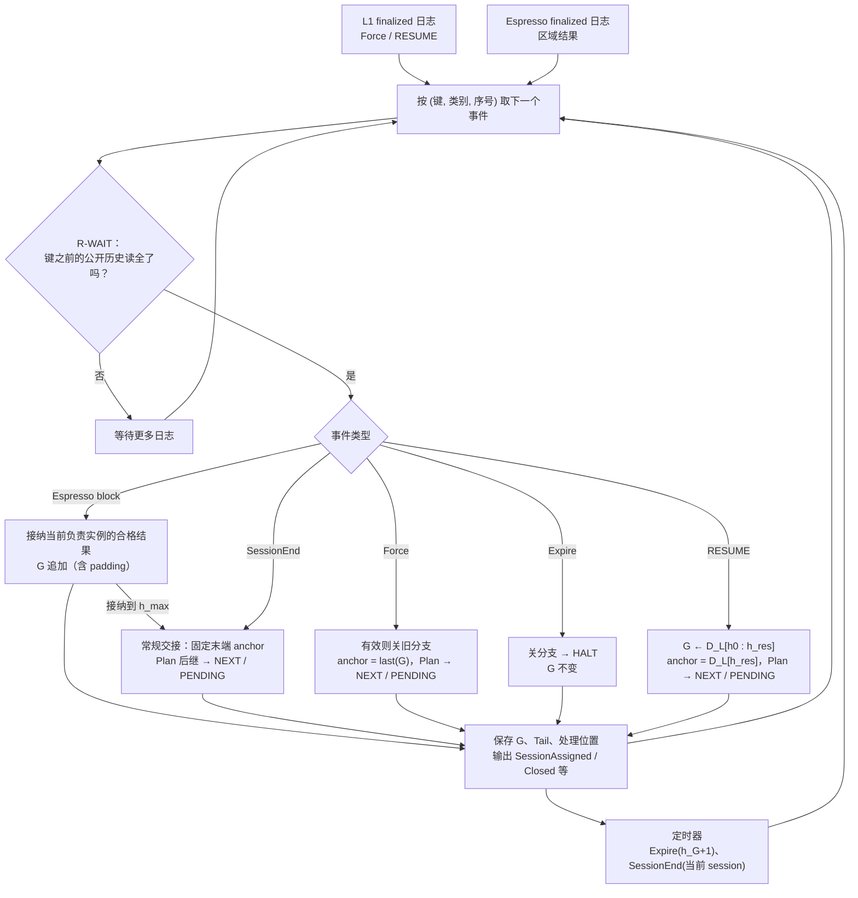
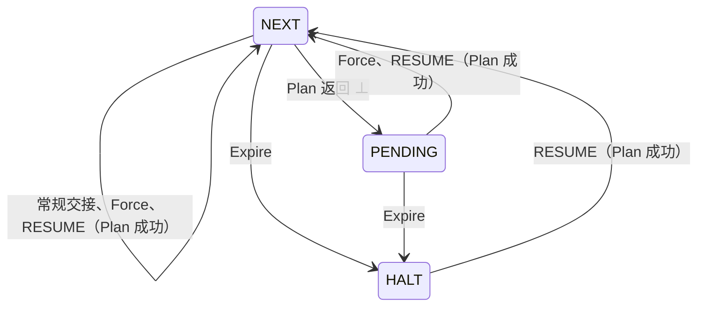
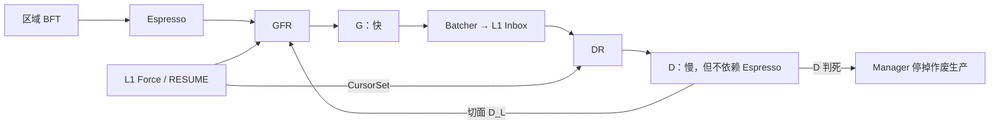

# 区域 BFT：模块化、固定节奏 L2 与待决设计

2026 年 11 月 3 日 · Meetup 讨论大纲

Last week we ask? 

- Can we make the regional BFT consensus orthogonal to our selection? 
- Simplex variant for the partial sync? 
- What is our assumptions to gurantee the safety and livness 


## This week 
- How to enforce a fixed L2 block time? 
- Simplex variant compatiblity and variant selection. 
- Global clock alignment. 

### 1 将 physical chain 与 virtual L2 chain 分开

> Can we enforce a fixed L2 block time? i.e., a hard binding between the L2 block height and the  block timestamp. 

Combined with a fixed-block-time L1 like Ethereum, we can have a hard binding between the L1 deposit transaction and L2 chain. 

E.g., Given L2 block height h, we can fixed a public common deposit tx list Dep(h). 


However, it is costy to enforce a fixed "physical block time in reginoal BFT", detailed in [this post](https://decentralizedthoughts.github.io/2026-03-07-simultaneous-agreement/)

> "view length is fixed to accommodate worst-case events, which can lead to unnecessarily long good-case view latency." 


So we only apply the fixed pace virtual chain 上：

| 对象 | 含义 |
| --- | --- |
| **Physical chain** | Regional BFT 决定的链，保存普通交易与连接信息，height 可以跳跃 |
| **Virtual chain** | 将 physical chain 与 L1 确定的强制前缀合并，补齐中间 heights，得到连续的 L2 执行序列 |

例如，physical block 从 100 直接接到 103：

```text
Physical：  B100 ─────────────────────────── B103
               ＋ L1 确定的 deposit / 系统前缀
Virtual：   100 ── 101（仅强制前缀）── 102（仅强制前缀）── 103
```

101、102 不各自运行一次区域共识，而是由 merge rule 补齐。103 则执行该高度的强制前缀与普通交易。

Virtual chain 要满足三项性质：

1. **VP1：固定时间表。** 每个 height 对应唯一的 timestamp。
2. **VP2：强制输入一致。** L1 -> L2 mapping，deposit 和系统前缀由 L1 与规则唯一确定. 
3. **VP3：执行前状态一致。** block 记录的 root 等于执行完此前所有 heights 后的 state root。

See our Doc: 


### 1.1 把 Regional BFT 与应用出块规则分开

目标是：**任何满足接口和 required properties 的 BFT，都可以作为区域共识模块使用。** 

- **BFT session program**负责安全 building real world block from an anchor. 
- **应用规则**负责从给定 parent 构造 payload，以及检查它是否满足 L2 的时间、deposit 和执行状态规则。
- 去掉原先的 **term**：每个 view 有一个指定 leader，同一条 BFT chain 上每个 view 至多贡献一个 physical block；失败的 view 可以没有 block。

{see our 01 first 3 sec assumption + the BFT session program doc. }

| 接口 | 做什么 |
| --- | --- |
| `Create / Enter / Close` | 固定 session 配置与 anchor，准备执行状态，启动或永久关闭实例 |
| `Build(P, τ)` | 从 parent P 和当前时刻构造 physical payload |
| `Accept(P, B, τ_recv)` | 检查 payload 的连接、height、时间、origin、执行前 root 和基础交易格式 |
| `NotBefore(P)` | 确定从 P 提议后继的最早时刻 |
| `Final / Evidence`，及其公开验证函数 | 输出区域最终证明与违规证据，供其他模块核对 |

我们要求的性质分为四组：

- **Agreement 与 chain validity：** 同一 context 的决定链前缀相容；成为共识依赖的 block 必须经过应用检查。
- **每 view 至多一个 block，证明可公开验证：** 外部模块能核对 FINAL 与违规证据，签名不能跨 context 混用。
- **条件性进展：** 网络恢复、足够诚实权重持续参与、数据与状态齐全，并且窗口内还有足够时间时，正常 leader 能推进；失败 view 能被离开。
- **窗口与停止：** physical height 不越过 session 窗口；到 stop 后，诚实节点不再生成该实例的新共识签名。

当前抽象采用区域内 partial synchrony、认证通信、全局协议时钟和 Byzantine 权重低于三分之一的模型。**安全性覆盖 GST 前；有界进展需要满足良好运行区间的前提。**


### 状态根要在投票前检查到什么程度？

**需要先决定：区域快速确认究竟承诺交易顺序，还是也承诺正确的执行状态？**

当前稿在 `Accept` 中检查执行前 root：这需要执行 parent 与中间 padding，但不要求在投票前完整执行当前 block 的普通交易。当前交易只做基础检查；执行时按确定规则过滤不能执行的交易。因此，**B_h 的 FINAL 不能直接解释为已经验证了执行 B_h 后的 state root。**

原大纲中提出的几种方向，可以放在一起讨论：

| 方向 | 主要取舍 |
| --- | --- |
| **保留现稿：检查执行前 root** | 保留对既有执行前缀的状态承诺；执行与追赶可能进入提议、投票的关键路径 |
| **Regional BFT 去掉 root** | 区域先确定顺序与数据，状态由后续执行得到；快速确认的承诺范围随之变化 |
| **保留 root，但延后检查、允许错误值进入 FINAL** | 必须明确错误 root 如何处理，以及是否需要撤销区域结果；目前仍是讨论选项 |
| **将状态承诺交给独立执行／Publisher 层** | 区域排序与执行流水线并行；另行 |

add a graph here: 

若采用后面的方向，还需要明确 session 末块执行后状态由谁认证、下一 session 何时可以据此进入。现有证明栈能否复用，需要再核对接口与成本。


### 2 BFT selection 

see [this post](./261103_simplex.md)

### 3 Simplex 之后的交接：Regular handoff、Force 与 RESUME


换成 Simplex 系列之后，我们去掉了 term：每个 view 有一个 leader，至多贡献一个 physical block，失败的 view 直接跳过。这带来三个事实：

- **physical height 可以跳跃**：中间高度由 Merge 补成 deposit-only 的 virtual block（padding）。
- **session 的上界 $h_{\max}$ 不一定有 block**，也不一定被决定。
- **到 stop 只保证诚实节点不再签新票**；停止前签出的票，可能在 stop 之后才组成证书、才公开。

所以"前驱 session 的最后一块是哪一块"不再由区域自己说了算，必须有一条**公开、确定、所有人算出同一答案**的规则。这条规则就是 GFR 的一部分。


无论哪种交接，都只回答三个问题：

1. **Anchor**：新 session 从哪个 block 接着生产？
2. **谁**：新 session 由哪个区域、哪个委员会负责？由 `Plan(policy, session, 选区参考块, 来源区域, 窗口)` 算出，Plan 是只读 L1 的纯函数。
3. **何时**：新 session 的窗口从哪个高度开始？第一块在该高度的 slot 时刻 $ts^*(h_{\min})$ 提出。

规格见 [09 v0.2 §4.3–§4.6](../formalization_v9/09_finality_rules_zh_v0_2.md)；下文数值取自 [10 流程 v0.2](../formalization_v9/10_pipelines_zh_v0_2.md)（$b_{\rm L2}=1$ s、$M_a=20$ min、$T_{\rm grace}=2$ min）。

#### 3.1 Regular handoff

固定 block time 让每个 session 有固定的高度窗口 $[h_{\min,s},h_{\max,s}]$，对应时段 $[ts^*(h_{\min,s}),\,ts^*(h_{\max,s}+1))$。窗口结束时诚实副本停止签名：$\tau_s^{\rm stop}=ts^*(h_{\max,s}+1)$。在此之后再留发布余量，得到 session 的 **Espresso 公开截止**：

$$
\theta_s^{\rm end}=\tau_s^{\rm stop}+T_{\rm grace}=ts^*(h_{\max,s}+1)+T_{\rm grace}.
$$

截止是整个 session 一个。一份区域结果只有在截止之前**首次完整公开**（证明、bodies、所需 ancestor 都已在 Espresso 前缀中，$\theta_{q_{\rm avail}}<\theta_s^{\rm end}$）才算数；观察者何时收到不影响判断。

**Anchor。** 按顺序判断：

1. $h_{\max,s}$ 的 physical block 已被 GFR 接纳 → **立即**以它为末端，不等截止；
2. 否则在截止时，以截止前**被 GFR 接纳**的最后一个 physical block 为末端。“被接纳”指属于被选中的 cid、且在截止前完整公开；区域内已 FINAL、但截止后才公开的 block 不算；
3. 截止前没有接纳任何新块 → 沿用前驱的初始 anchor。

**谁。** 后继 $(\beta,r+1)$ 的 Plan 用前驱的**初始** anchor 作选区参考块、前驱区域 $i_s$ 作来源区域。前驱一被选定，后继由谁负责就已确定，与前驱最终停在哪块无关。选区参考块固定“谁接班”，末端 anchor 固定“从哪块接”。

**何时。** 后继窗口固定为 $[h_{\max,s}+1,\ h_{\max,s}+\mathrm{TB}]$，第一块在 $ts^*(h_{\max,s}+1)$ 提出。后继区域不等 GFR 固定末端：它对前驱决定链上已知的最高 FINAL block 提前准备候选 program，到点就出块。末端固定后，只有 anchor 完全匹配的 cid 被选中，其余候选被排除，其产出作废并成为 padding。


#### 3.2 L1 控制记录的激活时刻

Force 与 RESUME 都是 L1 上的控制记录。记收录它的 L1 block 为 $\ell$，**激活时刻**为

$$
\mathrm{act}=ts_{L1}(\ell)+M_a .
$$

- 用收录 block 的 timestamp，而不是“finalized 的时刻”：后者不是所有人能一致计算的公开值。finalized 所需时间由 $M_a\ge T_{L1}+2\Delta_{ts}+b_{L1}$ 覆盖，保证所有人在 act 之前已读到该记录。
- act 由收录 block 唯一确定，治理方不能另选。L1 timestamp 严格递增，因此**控制记录按 L1 位置依次生效**，后收录的不会先生效。
- 冲突靠各自的有效性检查解决：Force 可能失效（见下），RESUME 总是有效。

#### 3.3 Force handoff：区域失活，Espresso 正常

**有效性。** 目标分支必须是当前分支，且没有 HALT；否则整条记录作废。

**Anchor：Espresso finalized 的切点。** 记 $q^*=\min\{q:\theta_q\ge\mathrm{act}\}$。Force 激活时，GFR 恰好已处理 $J_0,\dots,J_{q^*-1}$，即所有 $\theta_q<\mathrm{act}$ 的 Espresso blocks（$\theta_q=\mathrm{act}$ 的 block 排在 Force 之后）。新 anchor 为此时的 $A=\mathrm{last}(G)$：GFR 选出的全局链末端，不是 Espresso 上“最长的 physical chain”，未选中的候选和截止后才公开的结果都不算。由 E-S，$q^*$ 对所有读取者相同且不会改变。$G$ 本身不变。

**谁。** 关闭旧分支，开新分支 $\beta+1$。Plan 的输入：新 policy、选区参考块 $\mathrm{BlockRef}(A)$、来源区域为旧负责区域。旧负责 session 还没贡献新块时沿用序号 $r$，否则用 $r+1$。

**何时。**

$$
h_{\min}=\max\{A.h+1,\ \mathrm{slot}(\mathrm{act}+T_{\rm init})+1\},\qquad h_{\max}=h_{\min}+\mathrm{TB}-1 .
$$

窗口只由 L1 记录与参数决定，不依赖 Espresso block 落在哪里。$A$ 到 $h_{\min}$ 之间的故障时段成为 deposit-only padding。

例：(7,8) 的区域 b 从 10:00:11 起完全故障，$G$ 停在 36 010。Force 于 10:10:00 收录（L1 block 3 050），act = 10:30:00。新 session (8,8) 由 c 负责，anchor 36 010，窗口 [37 921, 41 520]；c 在 10:32:01 提出 37 921，被接纳时 $G$ 一次追加 padding 36 011–37 920 和 37 921。

#### 3.4 RESUME：Espresso 长停机或批次层超窗

**何时需要。** 两种情况 GFR 自己走不出来：

- **$G$ 停住**：Espresso 长停机，下一高度过了 $W_{\rm exp}$ 仍没被接纳，Expire 使分支 HALT。此时 Force 无效，因为这个高度已来不及进入 $D$，在 $\mathrm{last}(G)$ 上接着生产只会产出无法派生的内容。
- **$G$ 与 $D$ 分叉**：批次没在原生期限内上 L1，$D$ 补了 deposit-only，与 $G$ 不同（Manager 据此 D 判死，及时停掉作废的生产）。

**Anchor：L1 finalized 的切点。** `SubmitResume(c, policy, h_res)` 在同一笔 L1 交易里写入 Inbox 的 CursorSet，把 cursor 直接推到 $h_{\rm res}$。派生按 L1 顺序处理到这条 CursorSet，把尚未派生的高度填成 deposit-only 直到 $h_{\rm res}$，得到切面 $D_L$。新 anchor 为 $A=D_L[h_{\rm res}]$。切面绑定 RESUME 自己的 L1 位置（时间 $ts_{L1}(\ell)$）；act 只决定 GFR **何时**执行

$$
G\leftarrow D_L[h^0:h_{\rm res}].
$$

$G$ 与 $D_L$ 的共同前缀保留，不同的后缀被撤销。RESUME 总是有效：cursor 已在 L1 上改写，$D$ 已经跟着走了，GFR 若判它无效，$G$ 与 $D$ 将永久不一致。

**谁。** 开新分支 $(\beta+1,0)$，按新 policy 从循环排列的首个区域选起，选区参考块为 $\mathrm{BlockRef}(A)$。Plan 在激活时立即计算。

**何时。** 窗口为 $[h_{\rm res}+1,\ h_{\rm res}+\mathrm{TB}]$。$h_{\rm res}$ 由治理方选取，满足

$$
ts_{L1}(\ell)+T_{\rm prep}\le ts^*(h_{\rm res})\le ts_{L1}(\ell)+T_{\rm drift}-\epsilon,\qquad T_{\rm prep}\ge M_a+T_{\rm ready}.
$$

下界留出 L1 finalized、填充派生和状态准备的时间（所以开工晚于 act）；上界保证新 anchor 的 origin 不违反 drift。

**只看 finality：anchor 数据何时完整，新 session 何时能出块。** 下面不计执行开销，只看要等哪些 L1／Espresso 数据被 finalize。记收录 RESUME 的 L1 block 为 $L$、RESUME 在其中的位置为 $p$。

1. **填充从哪开始。** 从 $h_D^-+1$ 开始，$h_D^-$ 是派生处理完 $p$ 之前全部 L1 输入后的末端。它只由 $p$ 之前的 L1 决定：此前接纳的批次照常派生，期限已到的高度已回退成 deposit-only，期限未到、尚未派生的高度不再等窗口，直接由 CursorSet 填掉。
2. **填充到哪为止。** 正好到 $h_{\rm res}$。填充块的 origin 沿 schedule 推进且不超过 $L$，所以 $D_L[h_{\rm res}]$ 的 origin 是 $L$。第一个 origin 推进到 $L$ 的高度要执行 $\mathrm{DEP}(L)$，即 block $L$ 中**全部** deposits（包括排在 RESUME 之后的），所以需要整个 $L$ 被 finalize，而不只是到 $p$。
3. **$p$ 之后不会有新的 physical block 进入 Inbox 并落在 $\le h_{\rm res}$ 的高度。** Inbox 只接纳 prev 等于当前 cursor、且带 Certifier 签名的提交：

   | 提交落在哪里 | 结果 |
   | --- | --- |
   | $p$ 之前（含同一 block 中排在 RESUME 前面的交易） | 正常接纳，属于 $D_L$ 的输入，在填充之前先派生 |
   | $p$ 之后，prev = 旧 cursor | 被拒：cursor 已改为 $h_{\rm res}$（CERT-3 (a)） |
   | $p$ 之后、act 之前，prev = $h_{\rm res}$ | 没有可提交的内容：Certifier 要等自己的 GFR 在 act 处理完 RESUME 才签名（CERT-3 (b)） |
   | act 之后 | 只能是新 session 从 $h_{\rm res}+1$ 起的内容 |

   Override 同时清空未完成的 channel，此前只交了部分 frames 的 channel 也不会再补全。$L$ 之后的 L1 deposits 只进入 origin $>L$ 的高度，也都在 $h_{\rm res}$ 之后。
4. **因此 anchor 数据在 $L$ finalized 时完整且不再变化**，最晚 $ts_{L1}(L)+T_{L1}$（还要求此前接纳批次的 DA 可取回）。在此之前只能推测性地计算，唯一风险是 $L$ 被 reorg。
5. **新 session 在 $ts^*(h_{\rm res}+1)$ 提出 $h_{\rm res}+1$。** 届时需要三件事都已就绪：

   | 需要 | 何时就绪 |
   | --- | --- |
   | anchor 数据 $D_L[h_{\rm res}]$ | $L$ finalized，$\le ts_{L1}(L)+T_{L1}$，早于 act |
   | 新 session 已分配 | GFR 在 act 处理 RESUME；实际要等 Espresso watermark 越过 act，$\le \mathrm{act}+\Delta_{\rm ts}+T_E$（治理规程要求 Espresso 已恢复 live） |
   | 第一块的 origin $L+1$ 可读 | $\le ts_{L1}(L)+b_{L1}+T_{L1}$ |

   所以下界严格应写成 $ts^*(h_{\rm res}+1)\ge ts_{L1}(L)+M_a+\Delta_{\rm ts}+T_E+T_{\rm ready}$，即 $T_{\rm prep}$ 还应覆盖 act 之后等 watermark 的 $\Delta_{\rm ts}+T_E$。例子里 $T_{\rm prep}=25$ min，远大于 20 min + 45 s，够用。这只是“能提出”，第一块能否被区域 FINAL 还取决于 BFT 的良好运行条件。

```
高度:  … h_D^- │ h_D^-+1 ………………… h_res │ h_res+1 …
来源:  p 之前的 L1 │ CursorSet(p) 填充 deposit-only │ 新 session；Inbox 的 prev = h_res
       已 finalized │ origin ≤ L，需整个 L finalized   │ origin ≥ L+1
```

例：Espresso 从 10:00 停机到第二天 00:00。RESUME 于 D2 00:05:12 收录，act = D2 00:25:12，$h_{\rm res}=88\,212$（D2 00:30:12）。GFR 在 act 执行 $G\leftarrow D_L[h^0:88\,212]$（停机前的 $G$ 已上 L1，不撤销），新 session (8,0) 在 D2 00:30:13 提出 88 213。

#### 3.5 三条路径对照

| | Regular handoff | Force handoff | RESUME |
| --- | --- | --- | --- |
| 场景 | 正常运行 | 区域失活，Espresso 正常 | Espresso 长停机（HALT），或批次层超窗（$G$、$D$ 分叉） |
| 触发 | $h_{\max}$ 被接纳，或 SessionEnd | L1 Force，在 act | L1 RESUME + CursorSet，在 act |
| **Anchor** | 前驱截止前被接纳的最后 physical block | act 时的 $\mathrm{last}(G)$（Espresso 切点） | $D_L[h_{\rm res}]$（L1 切点） |
| **谁** | 前驱初始 anchor + 前驱区域，提前已知 | 新 policy，$\mathrm{BlockRef}(A)$，旧区域往下轮 | 新 policy，$\mathrm{BlockRef}(A)$，从首区域选 |
| **何时** | $h_{\max}+1$ | $\max\{A.h+1,\mathrm{slot}(\mathrm{act}+T_{\rm init})+1\}$ | $h_{\rm res}+1$ |
| 对 $G$ | 追加 | 不变，故障段成为 padding | 替换为 $D_L$ 前缀，可能撤销后缀 |

### 4 GFR：从事件流得到 $G$

GFR 不是新的共识，而是一个确定的重放器：

$$
(G,\ \mathit{Tail})=\mathrm{GFR}(\text{L1 finalized 日志},\ \text{Espresso finalized 日志}).
$$

做法分三步：把两份日志合并成**一条全序的事件流**；对每个事件先确认所需历史已读全；再用一个**状态机**处理它、更新 $G$。拿到相同日志前缀的人，得到同一条 $G$。

#### 4.1 事件

| 来源 | 事件 | 内容 | 时间键 |
| --- | --- | --- | --- |
| L1 | Force | 目标分支、新 policy | $ts_{L1}(\ell)+M_a$ |
| L1 | RESUME | 新 policy、$h_{\rm res}$；同交易的 CursorSet | $ts_{L1}(\ell)+M_a$ |
| 定时器 | Expire($h$) | $G$ 的下一缺失高度 $h=h_G+1$ | $ts^*(h)+W_{\rm exp}$ |
| 定时器 | SessionEnd($s$) | 当前负责的 session | $\theta_s^{\rm end}$ |
| Espresso | block $J_q$ | 其中首次完整公开的区域结果（physical blocks + FINAL 证明） | $\theta_q$ |

定时器不在任何日志里，它的键由当前 $G$、当前 session 和参数算出，所有人算出的相同。读 Espresso，本质上就是读区域结果。

#### 4.2 排序与 R-WAIT

- **全序**：先比时间键；同键时 L1 控制 ≺ Expire ≺ SessionEnd ≺ Espresso；同类再比序号（L1 位置、高度、session、Espresso height）。
  - 同键时截止先于接纳：公开时刻等于截止键的结果不被接纳；
  - 控制记录先于同键的 Espresso block：旧分支的迟到结果不能抢在 Force／RESUME 之前进入 $G$。
- **R-WAIT**：处理键 $x$ 之前，L1 已 finalized 到 timestamp $\ge x-M_a$，Espresso 已读到 timestamp $\ge x$ 的 block（watermark）；RESUME 还要能取得 $D_L$。否则等待，不把“没读到”当成“不存在”。
- 键只决定顺序，不是处理时刻：晚一天才读到日志的人按同样顺序重放，结果相同。

#### 4.3 状态与处理

状态只有两样：链 $G$，以及 Tail（当前谁负责）。Tail 取三种值：NEXT(ν)（实例 ν 负责，接纳它的结果）、PENDING（Plan 没有合格区域）、HALT（过期停止）。

**重放循环：**



**Tail 的转移：**




**两条结论：**

- **$G$ 只在两处改变**：Espresso block 中的接纳只追加；RESUME 替换。常规交接、Force、Expire 只改 Tail。所以两次 RESUME 之间 $G$ 只增不减。
- **$G$ 不自己造内容**：缺失高度只能由后继结果的 padding 覆盖，或由 RESUME 从 $D$ 取来；Expire 只停，不补。

### 5 DR（Derivation Rule）：从 L1 得到 $D$

$$
D=\mathrm{Derive}(\text{L1 finalized 日志},\ \text{DA 数据}).
$$

DR 是原生 L2 派生的抽象，**不读 Espresso**，Espresso 停机时照样随 L1 推进。逐高度处理：

| 遇到的输入 | 处理 |
| --- | --- |
| 已接纳、数据可取回的批次（CursorAdvanced） | 按原生规则执行其中的交易，合入 deposits |
| 原生期限到了仍没有可用批次 | 补 deposit-only block |
| RESUME 的 CursorSet | 把未派生的高度填成 deposit-only 直到 $h_{\rm res}$ |
| DA 暂时取不回 | 等待，不当作空 |

已输出的高度不再改写。

**RESUME 在 DR 和 GFR 中各是什么样。** 同一条 RESUME，两条规则在不同时刻、用不同方式处理它：

| | DR（派生链 $D$） | GFR（全局链 $G$） |
| --- | --- | --- |
| 何时处理 | 读到 L1 位置 $p$ 时，按 L1 顺序立即处理（依据 finalized 的 $L$） | 在激活时刻 act = $ts_{L1}(L)+M_a$，按事件流排序 |
| 读到什么 | CursorSet：cursor → $h_{\rm res}$ | RESUME 记录，以及 DR 给出的切面 $D_L$ |
| 做什么 | 先派生 $p$ 之前的输入，再把 $h_D^-+1..h_{\rm res}$ 填成 deposit-only，重置 channel | $G\leftarrow D_L[h^0:h_{\rm res}]$，关旧分支，Plan 新 session |
| 与平时规则的区别 | 平时缺批次的高度要等原生期限过了才补 deposit-only；这里不等期限，一次填到 $h_{\rm res}$ | 平时 $G$ 只追加；这里整段替换，可能撤销旧后缀 |
| 之后 | 只接受 prev = $h_{\rm res}$ 的批次，从 $h_{\rm res}+1$ 起恢复平时规则 | 只接纳新 session 的结果，从 $h_{\rm res}+1$ 起恢复平时规则 |

在 $p$ 到 act 之间，$D$ 已经到了 $h_{\rm res}$，$G$ 还停在旧分支上。这段时间不会出错：上面已说明，期间没有任何新批次能进入 Inbox，而 Certifier 在其 GFR 处理完 RESUME 之前不会签发新的认证。act 之后两条链在 $h_{\rm res}$ 处对齐，之后又回到“$G$ 在前、$D$ 在后”的常态。

**$G$ 与 $D$ 的关系：$G$ 是对 $D$ 的快速预测。** 正常时 $G$ 的块被 Batcher 及时送上 L1，$D$ 跟在后面、内容相同；预算 $W_{\rm exp}+M_a+T_{\rm batch}+T_{\rm drift}\le W_{\rm seq}$ 保证按时进入 $G$ 的块赶得上原生窗口。出故障时 $D$ 先补 deposit-only 而分叉，Manager 据此关掉注定作废的生产，RESUME 再让 $G$ 对齐 $D$。




A ->  B -> C -> D         ..... Z 

D as anchor  (if no resume, G inceasing )

B anohor 


A -> B -> C -> D (G can suffer possible fork)
    |-> E -> F 


if espresso too fast: 
    - G be forked 

if too slow 
    - wait longer time , under the espresso time catch the activation timesamp act. 
    - the new session can be start. 


6 -> 7 

8 pm. 

deposity only 