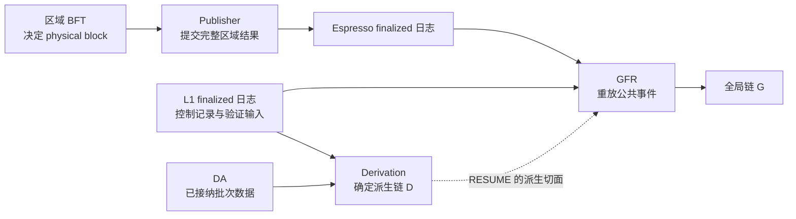
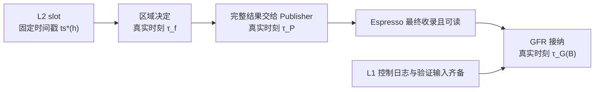
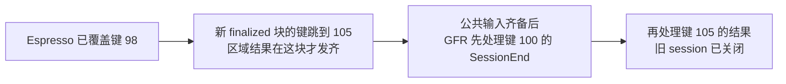
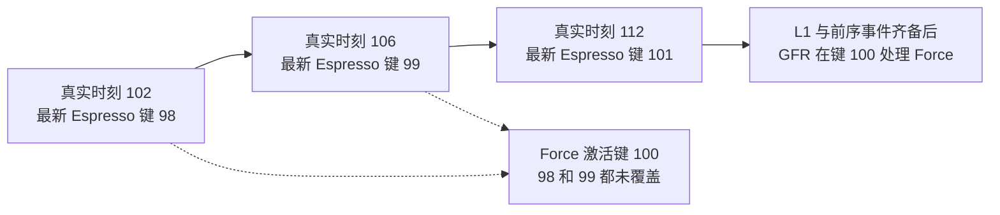
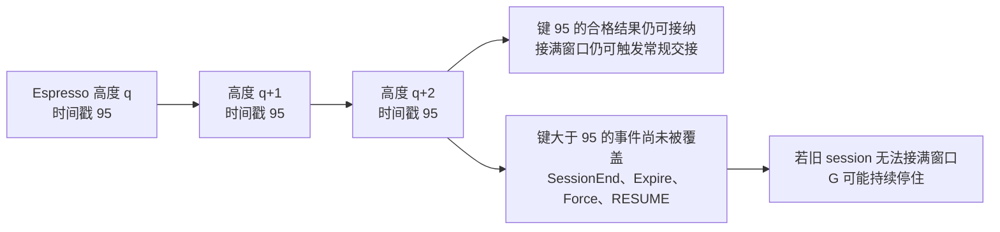
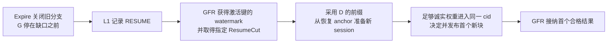

# 全局链 $G$ 的安全性与活性

2026 年 11 月 10 日 · Meetup 演示稿 · v10

讲稿延续 [10 月 27 日的恢复讨论](261027.md) 和 [11 月 3 日的交接讲稿](261103_part3_handoff_resume_gfr_zh.md)。事件顺序、交接和恢复规则以 [v10 的 09 最终性规则](../formalization_v10/09_finality_rules_zh_v0_1.md) 为准。三个安全命题沿用 [模块 11](../formalization_v10/11_global_chain_safety_liveness_zh_v0_1.md) 的编号。

这次回答三个问题：

1. 两个节点从同一份公共历史重放，为什么会算出同一个 $G$？
2. 正常出块和交接时，哪些条件决定了一个块何时进入 $G$？
3. Espresso 出块变慢、停机，或者继续出块但时间戳不正常时，$G$ 会怎样？

---

## 1. 模型与基本假设

### 1.1 区域决定和进入 $G$

区域 BFT 在一个 session 内出块。**Anchor** 是这段链的起始块及其执行后状态。**Plan** 固定该 session 的区域、委员会和高度窗口。**cid** 绑定 Plan、anchor 和规则配置，同一个 session 可以提前准备多个不同 anchor 的候选实例。

区域决定给出区块和区域最终证明。GFR 只接纳当前选定 cid 的合格结果，再按 **Virt** 展开成连续的 virtual heights。某个高度本来没有 physical block 时，Virt 会按规则生成 padding，仍执行该高度的强制输入。$D$ 则由 L1 与 DA 按原生规则派生。RESUME 可以把 $G$ 替换为 $D$ 的指定前缀。

### 1.2 L1、诚实时钟与区域 BFT

| 假设 | 内容与用途 |
| --- | --- |
| **L1 safety** | 通过验证的 finalized 日志互为前缀，已 finalized 的历史不回退。同一 L1 位置上的合约执行及日志顺序固定。L1 时间戳严格递增，用于确定控制记录的顺序和输入覆盖范围。 |
| **L1 liveness** | 正常服务条件下，$T_{\rm L1}$ 给出 L1 最终化并可读的时间预算。v10 用固定出块间隔 $b_{\rm L1}$，并用 $\delta_{\rm L1}$ 约束 L1 时间戳相对真实产出时刻的误差。时序预算使用这些界。 |
| **诚实时钟** | $\tau$ 是分析用的真实时间。诚实 replica 的本地时钟 $C_m(\tau)$ 与它相差至多 $\delta_G$，且连续、单调。同一节点的 Manager 和 replica 共用该时钟。两个诚实时钟最多相差 $\Delta_G=2\delta_G$。读取者按公开日志重放，自己的时钟不决定事件顺序。 |
| **区域 BFT safety** | 对固定 cid，已决定的链前缀可比（BFT-1）；最终证明可公开验证并绑定 cid 和目标块（BFT-4）。实际故障权重在阈值内，时钟故障也计入。节点可以在不同时间进入同一 cid。 |
| **区域 BFT liveness** | 在区域达到 GST，即消息延迟开始有界之后，需要权重至少为 $Q_s=W_s-F_s$ 的诚实集合持续运行同一 cid，并及时取得验证输入。$W_s$ 是委员会总权重，$F_s$ 是故障权重上界。BFT-5 给出成功 view 的决定时限，BFT-6 给出 view 同步和离开不成功 view 的时限。BFT-7 限制诚实节点何时停止新签名。 |

签名、hash 和 DA commitment 采用协议的真实性与绑定假设。RESUME 重放使用同一个 L1 位置和该位置所需的已验证 DA 数据。正常时序还依赖诚实在线的 Publisher 和足够的本地处理能力。详见 [00 §1–§2](../formalization_v10/00_arch_zh_v0_1.md)、[02 §4](../formalization_v10/02_session_program_zh_v0_1.md) 和 [04 PUB-4](../formalization_v10/04_publisher_zh_v0_1.md)。

### 1.3 Espresso 的三项保证

记 $J_q$ 为高度 $q$ 的 Espresso 块，$\theta_q$ 为它写入日志的时间戳。

| 性质 | 保证 | $G$ 用它做什么 |
| --- | --- | --- |
| **E-S：安全性** | Finalized 日志互为前缀且不回退；给定前缀的消息可完整核对；$\theta_q\le\theta_{q+1}$。 | 用同一份日志确定公开内容和顺序。读齐到时间戳至少为 $x$ 的块，就知道不会再出现键小于 $x$ 的新块。这称为 **watermark 覆盖 $x$**。 |
| **E-L：活性** | 持续 live 的所需区间内，合格的提交在 $T_E$ 内最终收录并可读。另有 watermark 进度保证：从真实时刻 $\tau$ 起持续 live，到 $\tau+T_E$ 有可读的 finalized 块达到至少 $\tau-\Delta_{\rm ts}$ 的时间戳。 | 收录保证用于普通块的发布。Watermark 保证用于估计 SessionEnd、Expire、Force 和 RESUME 何时可重放。 |
| **E-TS：时间戳准确性** | 在 live 期间提出的块，时间戳与实际提出时刻相差至多 $\Delta_{\rm ts}$。 | 把实际收录时间转换成公开键的上界，核算是否赶上截止。 |

v10 把 $\mathsf{Live}_E$ 当作模型给出的服务状态。E-S 在 live 和 non-live 期间都要求成立；non-live 时没有 E-L 的时限，也不能对该期间提出的块使用 E-TS 的误差界。一个旧块后来才 finalized，仍用它原来的时间戳。见 [00 §1.4](../formalization_v10/00_arch_zh_v0_1.md)。

### 1.4 公共时间键与可重放范围

| 事件 | GFR 使用的时间键 |
| --- | --- |
| Force 或 RESUME | 收录它的 L1 块的时间戳加公告提前量 $M_a$ |
| Expire | 下一缺失高度 $h$ 的固定时间戳 $\mathit{ts}^*(h)+W_{\rm exp}$ |
| SessionEnd | 当前负责 session 的公开截止 $\theta_s^{\rm end}=\tau_s^{\rm stop}+T_{\rm grace}$ |
| Espresso 块 $J_q$ | $\theta_q$ |

同键时依次处理 **L1 控制、Expire、SessionEnd、Espresso 块**。处理键 $x$ 的事件，Espresso 前缀须覆盖 $x$，L1 控制日志须覆盖 $x-M_a$，还须提供该事件实际使用的验证材料。若正在处理 $J_q$，读齐 $J_q$ 及其前缀就满足 Espresso 覆盖。所需公共输入尚未齐备时，GFR 保留上一处理位置；补齐后在同一事件继续。见 [09 §3.2–§3.4](../formalization_v10/09_finality_rules_zh_v0_1.md)。

**演示。** 旧 session 的截止键是 100。若最新 finalized Espresso 块的时间戳是 95，旧 session 的末端还不能据此固定。之后可能出现键 99 的合格结果。读齐到键 100 后，GFR 先处理 99，再执行 `SessionEnd`；键 100 的 Espresso 结果排在 `SessionEnd` 之后。本地读到这些日志的时刻不参与排序。

---

## 2. $G$ 的性质与论证

### 2.1 G-S1：同一重放位置得到同一个 $G$

**目标。** 对同一公共执行，两个读取者已完成的事件序列前缀可比。在同一重放位置，它们得到相同的 $G$、当前分支、职责和选定的 descriptor。

**依赖。** 共同的 genesis 和规则配置；L1 safety 和严格递增的 L1 时间戳；E-S；[09 §3.4](../formalization_v10/09_finality_rules_zh_v0_1.md) 的公共输入条件，以及对同一输入执行确定的 GFR 转移。候选资格、证明检查、Plan 和 Virt 均按固定规则计算。区域 BFT-1 与 BFT-4(2) 保证同一 cid 的有效区域决定前缀可比较。

**直觉证明。** 从同一初始状态开始，假设两个读取者已经做了相同的前 $k$ 步。

1. **下一事件相同。** 当前状态相同，所以产生的定时器也相同。L1 覆盖排除了没读到的更早或同键控制记录，Espresso 覆盖排除了没读到的更小键块。同键事件用固定规则排序。
2. **处理结果相同。** Espresso 接纳从同一份日志判断哪些结果发齐，并用相同的接纳条件计算同一追加区间。常规交接和 Force 从相同状态选择 anchor 和 Plan。RESUME 按同一 L1 位置读取 `ResumeCut`，相同的 L1 与 DA 数据决定同一派生前缀；首个新 session 用恢复 anchor 的实际 L1 origin 查授权历史。
3. **读得慢的节点停在同一条事件序列上。** 输入不齐就停在该步之前，读齐才完成。归纳到两个节点都已完成的最后一步，即得前缀关系。

E-L、E-TS 和同步启动都不用于这个归纳。该命题比较公共链与职责，代表证明的存储格式不属于这一结论。详见 [11 §1.2](../formalization_v10/11_global_chain_safety_liveness_zh_v0_1.md)。

### 2.2 G-S2：无 RESUME 的区间只追加

**目标。** 如果两个重放位置 $p\le p'$ 之间没有 RESUME，则 $G_p\preceq G_{p'}$。比较两个读取者的视图时，另用 G-S1 确认它们重放的是同一条事件序列。

**依赖与直觉证明。** 逐步查看 [09 §4](../formalization_v10/09_finality_rules_zh_v0_1.md) 的转移。Espresso 接纳只能从当前末端连续追加。Regular handoff 和 Force 改变后续的生产职责，Expire 停止分支，三者均保留旧 $G$。把这些步骤接起来，早先的链就一直是后来的前缀。

**RESUME 的范围。** RESUME 在明确的 L1 位置采用派生切面 $D_L$，令 $G\leftarrow D_L[h^0:h_{\rm res}]$。若采用的派生前缀与旧 $G$ 在某个高度不同，旧后缀可以被替换。低目标也可以把旧 $G$ 截短到 $h_{\rm res}$，即使被截去的块与 $D$ 相同。$D$ 本身不回退。所有读取者处理同一条 RESUME 时会一致切换。见 [09 §4.6](../formalization_v10/09_finality_rules_zh_v0_1.md) 和 [11 §1.4](../formalization_v10/11_global_chain_safety_liveness_zh_v0_1.md)。

### 2.3 G-S3：进入 $G$ 的块具有按时接纳的完整前缀

**目标。** 从 genesis 重放且没有 RESUME 时，若 $B$ 进入 $G$，它的每个前缀高度 $h$ 都在自己的适用截止前进入 $G$，而且接纳位置不晚于 $B$。前缀可以更早接纳，也可以在同一个 Espresso 事件里按高度顺序一起追加。

**依赖。** GFR 从选定 anchor 检查 hash 连接；实际 physical ancestors 的正文和覆盖它们的有效最终证明均须公开；Virt 唯一确定 padding；GFR 对整段新增高度检查截止。已由公共重放确定的 anchor 无需随每个结果重发旧证明。

对追加高度 $h$ 的那一步，记 $p_h$ 为接纳位置，$x_h$ 为承载这次接纳的 Espresso 块的时间戳，$s_h$ 为负责 session。检查条件是

$$
p_h\le p_B,\qquad
\underbrace{\theta_{q_{\rm avail}}}_{\text{所需证明与正文第一次发齐}}
\le
\underbrace{x_h}_{\text{GFR 接纳的公开键}}
<
\underbrace{\theta_{s_h}^{\rm end}}_{\text{该 session 的截止}},
\qquad
x_h<\mathit{ts}^*(h)+W_{\rm exp}.
$$

**直觉证明。** 旧前缀的接纳记录保留。每次接纳只在整段新增高度都通过检查后才追加，所以按追加步骤归纳即可。一个后代的证明可以覆盖同链祖先，证书不能补上缺失的祖先正文。见 [09 §3.2、§4.2](../formalization_v10/09_finality_rules_zh_v0_1.md)。

**演示。** $G$ 到了 98，实际 physical 链是 `98 → 100 → 102`。要追加的是 **99、100、101、102**，其中 99 和 101 是 padding。假设整份结果在键 115 发齐，session 在键 120 截止，而高度 99 在键 119 过期。

| GFR 接纳键 | 判定 |
| --- | --- |
| **118** | 其余检查均通过时，四个高度一起进入 $G$。 |
| **119** | 99 已经过期，整段不能追加，即使 102 自己仍未过期。 |

如果 100 的正文还没发，就要等它实际公开才算发齐。99 是 padding，本来就没有 physical 正文，由 GFR 按 Virt 补齐。「按时」使用公开键，读者可以在现实时间更晚的时候重放出相同的接纳判定。

### 2.4 活性目标一：正常 session 的一个块多久进入 $G$

**目标。** 在已选定 cid 中，从一次满足 BFT-5 前提的成功 view 出发，为合格块到达 $G$ 给出条件性时间上界。

| 阶段 | 依赖与上界 |
| --- | --- |
| **Slot 到区域决定** | 成功 view 满足 BFT-5(1) 的参与、同步、leader 和剩余时间条件。Build 按本地时钟选 slot，加上 C2 时钟界，得 $\tau_f-\mathit{ts}^*(h)<b_{\rm L2}+\delta_G+T_{\rm build}+T_{\rm fin}$。 |
| **区域决定到 Publisher** | BFT-4(1) 提供可验证的 Final 输出。完整结果的组装和交付需要另外的预算 $T_{\rm pack}$。 |
| **Publisher 到 Espresso** | 诚实在线 Publisher 的提交上界为 $T_{\rm pub}$。E-L 的收录保证再给 $T_E$。因此真实时间最迟是 $\tau_P+T_{\rm pub}+T_E$。E-TS 再为公开时间键的上界加 $\Delta_{\rm ts}$，用于检查公开截止。 |
| **Espresso 到 $G$** | 所需 L1 和其他验证输入就绪、前序事件处理完、结果仍有接纳资格时，用 $T_{\rm replay}$ 覆盖在线读取者的本地重放和验证。 |

**直觉证明。** 在接纳所需的公共输入随 Espresso 结果可读时已经就绪的条件下，上面各段依次完成，时间预算可以相加：

$$
\tau_G(B)-\mathit{ts}^*(h)
<
b_{\rm L2}+\delta_G+T_{\rm build}+T_{\rm fin}
+T_{\rm pack}+T_{\rm pub}+T_E+T_{\rm replay}.
$$

在 v10 的示例参数中，$T_{\rm pub}=T_E=30$ 秒。Publisher 拿到结果后，真实收录并可读的预算是 **60 秒**。若 $\Delta_{\rm ts}=15$ 秒，公开键的上界是交付时刻加 **75 秒**。若结果最晚在 $\tau_s^{\rm stop}+\delta_G$ 交到 Publisher，取 $T_{\rm grace}>T_{\rm pub}+T_E+\Delta_{\rm ts}+\delta_G$ 可使结果赶上 SessionEnd。BFT-7 的停止签名本身不保证结果已交给 Publisher。逐高度 Expire 和当前 cid 的资格仍需检查。见 [04 PUB-4](../formalization_v10/04_publisher_zh_v0_1.md)、[10 §2.2](../formalization_v10/10_pipelines_zh_v0_1.md) 与 [11 §2.1](../formalization_v10/11_global_chain_safety_liveness_zh_v0_1.md)。

**$M_a$ 为什么不用加到每个普通块上？** 为处理键 $x$，只需确定键不大于 $x$ 的 L1 控制记录，它们都收录在时间戳不大于 $x-M_a$ 的 L1 块中。在正常服务模型下，

$$
M_a\ge T_{\rm L1}+b_{\rm L1}+\Delta_{\rm ts}+\delta_{\rm L1}
$$

使这段控制历史可以在 Espresso 一侧就绪之前读齐。若验块还需要更新的 L1 origin，那部分数据有自己的就绪条件。$M_a$ 超过所需门槛后，再增大它会把 Force 和 RESUME 的激活键推后。持续出块还需要后续持续有符合条件的 view 和结果。见 [09 §3.5](../formalization_v10/09_finality_rules_zh_v0_1.md)。

### 2.5 活性目标二：交接后恢复出块

**共同条件。** 确定新 anchor 和 cid 后，至少 $Q_s$ 的诚实权重须取得同一个 anchor 的执行后状态，在区域 GST 后持续运行同一个 cid。若足够权重提前进入且满足同步开始条件，view 1 的起算时间相差最多 $\Delta_G$；若陆续进入或从暂停恢复，需要留出 view 同步、失败 view 退出、等待可用 leader 以及完成成功 view 的时间。

| 路径 | 选择起点与委员会 | 活性依赖与论证 |
| --- | --- | --- |
| **Regular** | 以旧 session 已接纳的末块为新 anchor，没有新块时沿用其初始 anchor。接满窗口就立即交接；否则等公开 SessionEnd。委员会用前驱的初始 anchor 和当前 L1 floor 提前算。 | 后继提前跟随前驱的执行状态。末块及其证明及时到达时，足够权重可从同一候选开始。若末块未及时公开，候选结果可能要等 SessionEnd 选定后才进 $G$；晚到的更高末块也可能让后继切换候选。 |
| **Force** | 保留 $G$，以激活事件前的 $\mathrm{last}(G)$ 为新 anchor。查询高度取该 anchor 的 origin、旧 floor 与 Force 收录高度的最大值。 | E-L 的 watermark 保证决定何时能确定快照。新窗口的 $T_{\rm init}$ 要覆盖等 watermark、重放和准备状态的时间。已有 HALT 的分支需要 RESUME。 |
| **RESUME** | 按该 L1 位置的 `ResumeCut` 采用 $D_L[h^0:h_{\rm res}]$，首个新高度为 $h_{\rm res}+1$。委员会查询用恢复 anchor 的实际 L1 origin。 | 需取得 watermark、L1 和 DA，并派生出同一 anchor 状态。目标高度要给至少 $Q_s$ 的诚实权重留出准备时间。新 cid 决定的首块还要经过发布和 GFR 接纳。 |

**直觉证明。** 公共规则固定唯一的目标实例。若相应交接路径能在准备预算内使足够权重汇合，就可以用 BFT-5/6 推进。区域有了合格结果后，接上 §2.4 的发布和接纳过程。若要从交接起算给出统一上界，还必须给出找到 active leader 和准备状态的上界。见 [02 §4.6–§4.8](../formalization_v10/02_session_program_zh_v0_1.md)、[09 §4.3–§4.6](../formalization_v10/09_finality_rules_zh_v0_1.md) 和 [11 §2.2](../formalization_v10/11_global_chain_safety_liveness_zh_v0_1.md)。

---

## 3. Espresso 的活性条件不成立时

### 3.1 Non-live：间歇出块或完全停机

下面先保留 E-S。**Non-live 表示没有 E-L 的时间保证。** 这允许偶尔有新块 finalized，也允许 finalized 前缀完全不动。

| 情况 | $G$ 的行为 |
| --- | --- |
| **仍偶尔有 finalized Espresso 块** | 如果该前缀发齐了当前 cid 的合格结果，且前序事件与验证输入齐备，$G$ 仍可追加。何时有下一块或下一段 watermark 没有统一时限。 |
| **Finalized 前缀停止** | 处理完已有前缀后，新的区域结果无法经 Espresso 进入 $G$。高于最后 watermark 的 SessionEnd、Expire、Force 和 RESUME 均不能重放。区域可能短暂继续出块；跨区域转发在 non-live 时没有有限延迟保证。若 L1 与所需数据仍可得，$D$ 可以按原生规则继续。 |

**恢复例。** 停机前已提出、键为 **99** 的块，可能在恢复后才 finalized。如果它首次公开了合格结果，GFR 仍在键 **100** 的截止之前处理 99。若材料到键 **105** 才首次发齐，就不能再进入这个已关闭的 session。是否要走 RESUME，要看重放时是否先遇到了仍未覆盖高度的有效 Expire。实际停机时长本身不能决定这一点。见 [10 §5.5–§5.6](../formalization_v10/10_pipelines_zh_v0_1.md) 和 [11 §3.1](../formalization_v10/11_global_chain_safety_liveness_zh_v0_1.md)。

### 3.2 Espresso 仍在出块，但时间戳异常

以下三个例子都保持 E-S：块的 finalized 历史仍一致，时间戳仍不递减。异常在于时间戳与真实时间脱节。若服务仍声称 live，这些超出误差界的例子不满足 v10 的 E-TS。图中的数字是示意键。

**例一：时间戳跳快。** 某份结果在真实时间上很快收录，但其首次完整公开的时间键被推到了截止之后。时间戳越超前，GFR 还可能需要更新的 finalized L1 历史，才能重放该键。

如果跳过的是下一缺失高度的 Expire，并且此前没有结果覆盖该高度，GFR 会先处理 Expire，分支进入 HALT。

**例二：时间戳滞后但还在前进。** 真实时间已经过了 Force 的激活键，L1 上也已 finalized 该记录，但 GFR 要等 Espresso watermark 覆盖该键。在这之前，键更小且符合规则的旧分支结果仍可被接纳。

新区域实际收到选定结果时，预定窗口可能已经过去一部分。较小的 Espresso 键也可能让结果在真实时间很晚时仍符合 $G$ 的公开截止；此时交付给 $D$ 的原生期限未必还赶得上。

**例三：时间戳冻结。** Espresso 高度继续增加，但日志一直只覆盖到键 95。

这三个例子说明，**Espresso 的块高和时间 watermark 是两个不同的进度**。只要 E-S 仍成立，读取者仍按同一个事件顺序处理。如果时间戳还能倒退，已经越过键 100 后可能再出现键 99 的块，G-S1 使用的日志覆盖论证就不成立。见 [11 §3.2](../formalization_v10/11_global_chain_safety_liveness_zh_v0_1.md) 和 [v9 时钟审查 K11–K15](../formalization_v9/clock_skew_review_zh_v0_2.md)。

### 3.3 HALT 后，什么时候能恢复

**目标。** 缺口已过期时，先从已确定的 $D$ 恢复共同前缀，再让新区域的普通结果进入 $G$。

**依赖与直觉证明。** 治理规程要求 $D$ 已越过或偏离旧生产分支，并选好目标 $h_{\rm res}$。L1 记录 finalized 后，GFR 仍须取得覆盖激活键的 Espresso 日志和该位置的 L1、DA 派生材料。同一 `ResumeCut` 给出同一恢复前缀和 anchor。新 session 还要有合格 Plan，且来得及准备、运行、发布。Force 保留旧 $G$，在 HALT 时无法解决已过期的首个缺口。

现稿对低目标还有一条明确规则。设 RESUME 激活键为 $x$。如果新下一高度的 Expire 或新 session 的 SessionEnd **严格早于** $x$，GFR 仍完成对齐，但在同一 RESUME 事件把新分支设为 HALT。若恰好同键，则先处理 L1 控制，再处理仍适用的定时器。正常恢复选更靠后的目标，为 anchor 状态准备和首个成功 view 留时间，同时遵守原生 origin drift 上界。见 [01 §3.10](../formalization_v10/01_l1_authority_zh_v0_1.md) 和 [09 §4.5–§4.6](../formalization_v10/09_finality_rules_zh_v0_1.md)。

---

## 4. 演示时的依赖速查

| 要说明的结论 | 关键依赖 |
| --- | --- |
| **G-S1：同一公共位置的 $G$ 一致** | L1 safety、E-S、公共输入覆盖、确定的 GFR 转移；RESUME 步骤用绑定具体 L1 位置的派生切面。 |
| **G-S2：无 RESUME 的区间只追加** | 连续追加规则；regular、Force、Expire 保留旧前缀。跨读取者比较再用 G-S1。 |
| **G-S3：前缀及时性** | 选定 cid、公开证明与完整正文、确定性 Virt、SessionEnd 的顺序、整段逐高度 Expire 检查。范围为从 genesis 开始且没有 RESUME 的执行。 |
| **有界普通块确认** | BFT-5 成功 view、时钟界、组装与发布预算、E-L 收录、及时的 L1 验证输入和本地处理预算。E-TS 用于把发布预算换算成公开截止界。 |
| **有界交接或恢复** | 足够诚实权重及时在同一实例就绪，BFT-5/6 及可用 leader；用到的跨区转发、watermark、L1、DA 和状态准备也要有界。 |
| **Espresso non-live 时的 $G$** | E-S 支撑已完成重放的一致性。能否继续增长由实际公开的结果、watermark 与截止决定，正常时延上界此时不适用。 |
