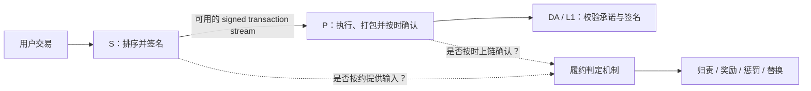
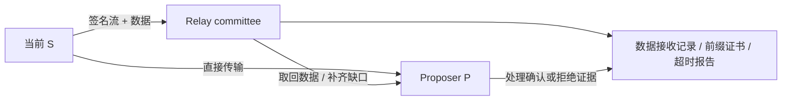
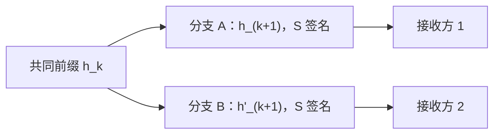
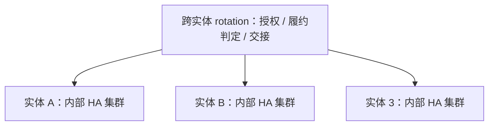

# Meeting 0916 Response — Sequencer Obligations and Accountability

整理日期：2026-09-22。基于 [09-16 会议问题](260916.md)、[原始架构图](rotation_overview.jpg)及本次讨论。以下是研究提案的初步形式化；涉及现有系统的事实另附来源。

## 1. 核心问题：获得 sequencing right 后，如何判定履约？

**在 sequencer 与 proposer 分离后，sequencer 获得某段时间内提供 transaction stream 的权利，也应承担相应的服务义务。核心问题是：如何定义、观察并判定它是否完成了这项义务？**

只有先建立这套判定机制，才能区分 sequencer 没有提供合格输入，还是 proposer 收到输入后没有继续处理，并据此设计双方的奖励、惩罚与替换规则。

> Sequencing right → 明确的 stream obligation → 可验证的履约／违约证据 → 责任划分 → 激励机制。

这里统一用 **S** 表示 sequencer，用 **P** 表示 proposer（对应原图中消费交易流的 pre-confirmer）。双方的义务分别是：

- **S：在获得授权的期间，持续提供可用、一致的 live transaction stream。**
- **P：在输入满足约定条件后，于规定时间内完成打包、上链，并达到协议规定的 confirmation 条件。**

原图中另列的 state-proposer 是状态声明提交角色，不与这里的 P 混同。



这里的目标不是证明 S 在任意情况下都会诚实，而是让义务可检查、可归责，使违约具有可执行的后果，并在故障时恢复服务。**签名只能证明 S 承诺了什么，不能单独证明它持续提供了可用且一致的服务。**

## 2. 最小义务模型

设一个 rotation term 为 `r`，其中的故障切换轮次为 `v`；有效授权 `A(r,v)` 指定当前 S、有效区间与服务规则。二者与 OP 的 L1-origin epoch 区分。

S 的第 `k` 个流片段包含有序交易列表 `T_k`。可用以下逻辑承诺表示：

```text
h_k = H(domain, r, v, k, h_(k-1), context_k, OrderedRoot(T_k))
σ_k = Sign_S(h_k)
```

`domain` 绑定链和协议版本，`h_0` 绑定双方认可的起始历史，`context_k` 绑定目标 EVM block、L1 origin 等执行相关输入；`OrderedRoot` 承诺顺序和列表长度。接任时从切换证书指定的已确认前缀继续。以上是候选接口，不是现有 MegaETH 编码。

| S 的 obligation | 需要判定的内容 |
| --- | --- |
| 持续提供服务 | 在授权区间内按约定时限提供新片段；没有交易时允许明确的空片段／心跳，不能仅凭“无交易”认定停机 |
| 提供可获取的数据 | 接收方能取回对应交易字节和签名；只公布 commitment 不算完成交付 |
| 提供一致的流 | 片段连续，扩展已确认前缀，不向不同接收方签发不兼容历史 |
| 提供符合接口的输入 | 授权、签名、顺序及执行上下文满足规则；无效交易的处理有确定规则 |

每项义务还需要指定：**向谁交付、从哪个可共同识别的事件开始计时、允许多久、什么证据算完成，以及网络或 L1 异常时的例外。** “诚实提供 stream”必须落到这些具体条件上。心跳只能证明响应，不能单独证明及时纳入交易或没有审查。

**P 的对应义务**是：按协议获取 S 的输入，在满足约定前提后，按时打包并完成上链确认。由于输入已经被 S 增量承诺，P 应忠实发布对应流；具体约束与不上链的处理见下一节。

因为 S 不执行交易，必须先选择接口语义：签名流是“保证可执行的精确列表”，还是“按确定规则过滤的有序候选列表”。前者需要执行验证或确认环节；后者需要可复核的拒绝理由。否则，P 的合法拒绝与恶意丢弃无法区分。详见[已有接口讨论](../learning/03_formal_model_and_handoff.md#5-resolve-invalid-transactions-before-promising-exact-execution)。

**与现有系统的边界。** 当前 MegaETH mini-block 含执行后的 receipt commitment；其 header 没有前驱哈希，且同一 EVM block 的 mini-block 必须由同一授权 key 签名。因此，这里的 S 排序签名及累计前缀承诺是新增接口，不能直接视为现有 mini-block 签名。[区块规范](../megaeth_specs/specs/protocol/blocks.md#mini-block-header)、[授权规则](../megaeth_specs/specs/protocol/sequencing.md#sequencer-authority)，本地快照 `59797b45b1f59b7c2c147e6f99be39399a1f2b44`。

## 3. Proposer：忠实上链，或承担不上链的后果

相较于判断 S 是否提供了可用的实时流，**P 的问题可以简化为对已确定输入的按时发布义务。** 前提是 S 已提供满足接口要求的可用输入，其规范前缀已确定，并且 L1 的接受规则检查：

1. 每个提交片段都由对应授权期间的 S 签名。
2. 片段数据与签名承诺匹配，增量承诺从已接受前缀连续扩展，打包结果保持所承诺的内容与顺序。

在这些条件下，P 不能让被篡改的流通过 L1 校验。**对于本轮应发布的流，P 要么忠实上链，要么未完成上链义务。** 仅验证“签名来自 S”还不够：连续性和内容匹配检查防止删改、重排或拼接；S 自己签出冲突分支的情况由第 5 节的共同前缀机制处理。执行正确性仍由相应的执行验证／证明规则保证。

对第二种情况，可将按时发布写成链上可验证的履约条件，并据此设计 incentive。设 `J` 为待发布任务，绑定 P、流的起止位置及末端承诺、合格输入的可用性依据和截止时间 `d_J`：

```text
Fulfilled_P(J) = 指定流已忠实上链，且在 d_J 前达到规定的 confirmation 条件
Penalty_P(J)   = 任务已有效生效，截止时仍未履约，且不满足协议规定的免责条件
```

只发布较短前缀、拖延到截止时间之后，也属于未完成该任务。任务的生效与计时应由可验证事件触发，不能只依赖 P 自愿确认，否则 P 可以通过不确认来逃避义务。有效任务到期后，链上检查其完成状态，即可按规则扣除奖励、罚没保证金或替换 P。

这里的思路是用 **validity／可验证履约条件支撑 incentive design**：内容校验排除篡改，任务与截止时间使不上链成为可判定的违约。普通的区块 validity 检查本身不会对沉默自动罚没，还需上述任务登记、超时及处罚规则。S 的履约判定为这套机制提供输入可用性的依据，因此仍是核心研究问题。

## 4. Sequencer liveness oracle：为履约判定提供共同观察点

考虑由 `n` 个 relay 组成的委员会，至多 `f` 个 Byzantine 成员，证书需要 `m` 个成员签名。Relay 接收、保存并转发 S 的流，记录可验证的进展；P 可以直接接收，也可以经 relay 获取。



核心作用是把 S 与 P 之间的私下争议变成有共同记录的协议事件。可以将 S 的交付义务定义为：**在期限内将完整、合规的数据交付到规定 relay 集合，并形成所需接收证书。** 证书表示签署者收到并承诺在规定期间服务这些数据，不等于 P 已收到，也不替代最终 DA。

| 观察到的情况 | 可以支持什么判定 | 还缺什么 |
| --- | --- | --- |
| Relay 已取得完整签名流，P 的发布任务已有效生效，但期限内没有完成确认 | 结合链上任务状态，支持 P 未履约的判定 | 将输入可用性依据、任务生效及截止时间绑定起来 |
| Relay 已形成接收证书，P 声称没有输入 | 可以检验 S 是否完成 relay 交付义务，并为 P 提供补取路径 | 接收证书不能单独证明 relay→P 的交付成功 |
| 足够 relay 超时未观察到新流 | 可以形成超时证书，触发服务切换 | 不能无条件区分 S 停机、网络隔离和 relay 故障 |
| S 签出了冲突流 | 可构造 S 的分叉证据；P 篡改流的提交则由 L1 内容校验拒绝 | 需要共同前缀规则及增量承诺一致性检查 |

对 S 的服务观察，需要区分 **failure detection** 与 **fault attribution**：relay 超时可以支持恢复服务，但罚没需要更明确的义务及证据。网络时限应建立在同步性假设上；若要求链上裁决，可另设公开的数据交付／响应挑战与截止时间，不能把“我没有收到”直接当成客观作恶证明。P 已生效任务的超时未完成，则可按第 3 节的链上履约规则处理。

Relay 共签也有门槛要求：若要让两个 `m-of-n` 证书的交集必含诚实成员，需 `2m > n + f`；若要在恶意成员全部拒签时仍有可能形成证书，需 `m <= n - f`。例如 `n = 3f + 1, m = 2f + 1`。这些是固定委员会下的门槛条件，仍需诚实成员不签冲突历史，以及后文的锁定和切换规则。

对 P 而言，随机抽样可用于监测，但不能自动保证取到流；缺失时应扩大查询范围，直到获得数据或进入协议规定的超时流程。Relay 自身不可用也会形成新的 liveness bottleneck。

## 5. Forking sequencer：从追责证据到共同前缀

S 可以向不同接收方发送分别合法签名、彼此冲突的流，造成 split view。



**事后追责：proof of forking。** 在相同授权、轮次、位置及历史上下文内，两份不同承诺及其有效 S 签名可以构成冲突证据。发现分叉可能需要交换并追溯历史，但一旦找到冲突位置，提交的证据通常不需要包含两条完整分支；若手中只有不同高度的 tip，则还需连接路径或相应证明。协议允许的 L1 reorg／取消不能直接算双签违约。

**共同确认：周期性共签 tip commitment。** Relay 每隔一个约定窗口，对已经取得完整数据、验证连续性的前缀 `(r,v,k,h_k)` 共签。诚实 relay 只为兼容其锁定前缀的历史签名；消费者将达到门槛的前缀视为委员会确认。

这使委员会承担了有限的共识职责：需规定冲突提案处理、锁定规则和 view change，不能只要求“每个 relay 定期签自己看到的 tip”。否则即便 S 的分叉可被追责，委员会仍可能卡住。签名流到下一个共签点之间的尾部也可能出现 split view；证书提供的是委员会层面的确认，不是 L1 finality。

## 6. Fallback：谁批准，何时生效？

**在这个提案中，P 不应单方面宣布 S 失效并夺取其排序权。** Fallback 应由 relay 委员会按预定规则认证，或走独立的链上裁决路径；否则 P 可以借停机指控绕过 S，破坏最初的权利与义务分配。

候选切换证书至少绑定：旧授权、新轮次、故障依据、继承前缀、下一位 S，以及生效边界。下一位 S 可由预先确定的顺序选出，委员会只认证触发条件和交接状态，无须拥有任意选人的权力。

| 方案 | 生效条件 | 主要取舍 |
| --- | --- | --- |
| L1 确认后切换 | L1 接受授权更新，并达到协议要求的确认程度 | 权威边界明确，但停机包含 L1 等待时间；功能上是一次紧急 rotation |
| 委员会证书先行切换 | 消费者按预先授权的规则接受有效切换证书，随后记录到 L1 | 可缩短服务中断，但委员会承担即时授权责任，需明确 L1 重组和最终接受规则 |

“不等 L1”不等于可以绕过最终验证：**L1 的授权及流校验规则必须承认该切换路径。** 第 3 节中对 P 的约束继续适用：每个新片段须对应生效后的 S 授权，并延续切换证书确定的前缀。

所有切换都要保留已确认前缀、明确未确认尾部的处理，并拒绝旧授权在边界之后产生的新输入。若变更现有 MegaETH mini-block 签名 key，还须遵守 EVM block 内签名者不变的规则；只更换新增排序 key 时，也要明确如何与执行端的区块边界衔接。

**换 S 只能修复 S 或其输入路径的问题。** 如果 P 已停机或拒绝处理，仍需 P 自身的恢复／替换机制。这里讨论的下一位是 sequencer，不自动涉及 state-proposer 的更换。

## 7. OP Conductor：作为部署与高可用的参考

OP Conductor 在受管理、成员诚实的集群中用 Raft 协调活跃实例并保存最新 unsafe block；它不提供针对恶意独立运营者的 BFT 或经济问责机制。[官方说明](https://docs.optimism.io/chain-operators/tools/op-conductor)

原 notes 中的两条方向可表述为：

- **替换整体协调层：**用新的 rotation／共识机制承担跨实体授权与交接，同时保留原来需要的历史复制、恢复和旧实例隔离能力。只替换 leader election 不够。
- **两层架构：**实体内部用 Raft 或其他 HA 机制处理机器故障，实体之间用 rotation 协议分配排序权。内部副本不自动获得额外的委员会投票权。



部署上，OP 官方示例是三个同步的 sequencer 实例，各配一个 conductor，使用持久 Raft 日志、唯一 server ID、可互通的 peer 地址及 node／execution RPC；单点 bootstrap 后加入其他 voter，再检查成员、启停与故障切换。管理接口应处于受控网络。纯排序 S 的 HA 可借鉴该结构，但 OP Conductor 面向 op-node／EL，不能未经适配就直接包裹任意 tx-stream 服务。[部署指南](https://docs.optimism.io/chain-operators/tools/op-conductor/setup)、[配置参考](https://docs.optimism.io/chain-operators/tools/op-conductor/reference)

## 8. 由履约判定走向激励设计

原 notes 中“旧 OP proposer 的 bond 承担全部 liveness 责任”需要收窄：OP fault-dispute bonds 约束状态声明与争议行为、激励挑战者参与；它们不是覆盖排序、数据传输与发布全链路的 uptime 保证。[Bond incentives 规范](https://specs.optimism.io/fault-proof/stage-one/bond-incentives.html)

对新方案，双方激励分别建立在各自的履约条件上：**S 按可验证的持续流交付获得报酬；P 按规定时间内完成的忠实上链确认获得报酬，未完成已生效任务则按规则受罚。** S 的双签可通过冲突证据追责，S 的不可用仍需 oracle 的观察与归责机制；P 的篡改提交不能通过 L1 校验，其剩余的发布违约由任务和截止时间约束。具体奖励与罚金仍需结合服务收益、违约获利及执行成本确定。

若 S 的义务止于向 relay 完成交付，其应得报酬就不应完全取决于 P 单方面确认；否则 P 可以通过拒绝确认剥夺 S 的收益，重新模糊双方的责任边界。

下一次讨论应优先确定四件事：

1. **S 完成什么才算履约？** 向哪些接收方、在什么期限内交付什么数据；交付与被 P 执行是否分开结算。
2. **证据由谁产生、由谁裁决？** Relay 接收证书、P 的确认／拒绝及超时报告分别承担什么证明责任。
3. **P 的发布任务如何生效与结算？** 固定应发布的流范围、confirmation 条件、截止时间与超时罚则，避免将 S 未交付的责任转给 P。
4. **Fallback 的权威来自哪里？** 委员会门槛、继承前缀，以及等待 L1 或证书先行的生效规则。
