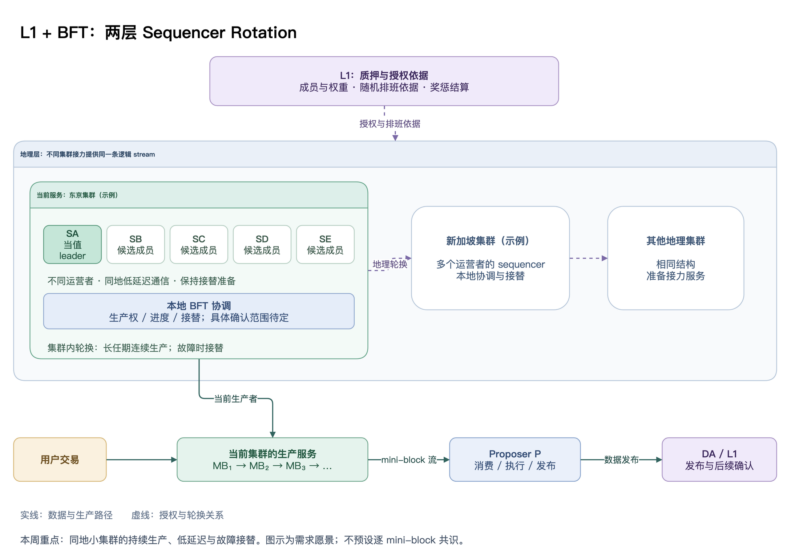

# Meeting 0922 — L1 + BFT Sequencer Rotation：架构愿景与本周需求

整理日期：2026-09-22。根据 [本次会议语音草稿](260922.md)，沿用 [Meeting 0916 Response](meeting_0916_response.md) 中“角色分工 → 服务义务 → 故障接替 → 激励”的思路。本稿用于对齐新架构的目标与边界，尚未确定的机制在文中标出。

## 1. 核心愿景：让一个低延迟集群持续提供 mini-block stream

**我们希望设计一个由 L1 质押与授权支持、通过本地 BFT 协调运行的 sequencer rotation 系统：多个独立运营者在同一地理位置组成小集群，由当值 sequencer 连续生产 mini-block；当值节点失效时，集群能够快速接替，继续向 proposer 提供同一条流。多个地理集群再通过上层轮换，接力承担这项服务。**

这个架构希望同时保留三件事：同地部署带来的低通信延迟、多个运营者带来的接替能力，以及链上质押支持的参与资格与问责。排序服务不应长期依赖某一个运营者，也不应因为频繁换人而失去实时性。

本周的中心问题是：**在一个同地小集群中，怎样让多个 sequencer 轮流承担生产责任，并在有人停止服务时，以尽可能低的开销维持 mini-block stream 的进展？** 跨地理轮换属于整体架构，但本周先把集群内部的运行与接替机制讲清楚。

## 2. 我们想象中的系统长什么样

图中地区和节点数量均为示例。地理轮换暂按“同一时段由一个地理集群承担主生产责任”理解；各地区接力提供一条逻辑上的 stream。

可以想象这样的运行画面：东京当前当值的 A 连续向 P 提供 mini-block，其他成员做好接替准备。A 中途停止服务时，集群授权 B 接手，B 从约定的前缀继续；到了地理轮换边界，再由另一个地区接棒。对 P 而言，生产者会变化，但它始终知道当前应当接收谁提供的哪一段流。

### 两层集群、两种 rotation

**第一层是同一地理位置内的 sequencer 集群。** 例如，东京部署一个包含五个节点的小集群，每个节点由不同运营者运行。这些节点彼此靠近，可以低延迟通信，但运营者之间仍需要面对不合作、停机或恶意行为，因此需要 BFT 协调。每个成员都有成为当值 sequencer 的资格，其余成员保持接替所需的准备。

**第二层是由多个地理集群组成的网络。** 东京、新加坡等集群分别作为一个整体参与地理轮换。集群切换时，新的地理位置接过已有服务进度，继续提供流。备用地区如何保持接替所需的数据与状态，需要后续定义。

| 轮换层次 | 改变什么 | 希望达到的效果 |
| --- | --- | --- |
| 集群内 sequencer rotation | 同一地区内，当前由哪个运营者负责生产 | 分配服务机会，并在当值节点失效时快速恢复生产 |
| 地理 rotation | 当前由哪个地理集群提供排序服务 | 让生产责任能够在不同地区之间转移 |

两种 rotation 的时间表和触发条件可以不同。集群内换人不应自动要求更换地区；跨地区切换也需要确定新集群中的当值节点。

### L1、BFT、sequencer 与 proposer 的分工

| 组成部分 | 在新架构中的职责 |
| --- | --- |
| L1 | 记录质押、成员与权重，为授权、轮换规则及奖惩提供可共同验证的依据 |
| 同地集群的 BFT 协调机制 | 协调生产权、进度与接替，使少量节点故障或不合作时仍能继续服务；具体确认范围待定 |
| 当值 sequencer（S） | 按自己的打包策略组织交易，以 mini-block 为单位持续提供合格、可获取的流 |
| 其他 sequencer 成员 | 按协议参与协调，维护接替所需的信息，并在获得授权后继续生产 |
| Proposer（P） | 消费已接受的流，承担后续执行、发布与确认义务；沿用上次文档对 P 的角色定义 |

整体分工是：**L1 提供资格与授权依据，本地 BFT 支持实时协调，S 提供流，P 继续处理与发布。** 正常 mini-block 生产应能依据已生效的授权运行，避免每产生一个 mini-block 都等待一次新的 L1 授权。

这里延续的是 S 与 P 的职责分离，两种 rotation 都发生在 sequencer 服务一侧。上次文档中的 relay 功能是否由本地成员承担，还是仍需独立 relay，目前不预设。

## 3. 服务对象：从 transaction stream 转为 mini-block stream

本次最直接的接口变化是：**系统以 mini-block 作为生产、传递与交接的基本单位。** S 的任务是持续交付一系列有明确边界和顺序的 mini-block，P 按同一顺序消费它们。

在需求层面，一个交付单元至少要让接收方知道：谁在什么授权下提供了它、包含哪些有序交易、接在哪个已有前缀之后，以及如何取得完整数据。只有一个哈希、签名或“仍在线”的心跳，不等于已经交付了可消费的新 mini-block。

不同 sequencer 可以有不同的打包策略。即使看到了相同的交易输入，A 和 B 也可能选择不同的交易集合或顺序。架构允许这种差异，只要求实际输出满足共同的协议有效性规则，并按约定的接受规则进入 stream。

**需要保留一个接口问题：这里的 mini-block 是排序侧的候选交易包，还是已经执行完成的 MegaETH mini-block？** 语音草稿没有决定这一点。上次架构允许 S 不执行交易，而现有规范中的 mini-block 包含执行后的 receipt commitment。因此，本稿先确定“以 mini-block 为单位交付”的需求；执行、有效性检查和最终签名由谁完成，留到接口设计时明确。[现有 mini-block header](../megaeth_specs/specs/protocol/blocks.md#mini-block-header)

## 4. 本周要满足的核心需求

### 4.1 Weak liveness：集群能够不断产出被接受的 mini-block

先采用会议里的简化场景：网络同步，各成员面对同一份交易输入，每个成员按自己的策略打包。在网络满足约定条件、足够多成员正常参与，且存在可生成的合规 mini-block 时，**系统应在约定的进展期限内，让至少一个成员按其策略生成的合规 mini-block 被接受，并持续扩展 stream。**

这里关注的是 **block-level liveness**。它不承诺每笔提交的交易都会在固定时间内被纳入，也不要求所有人的打包偏好同时得到满足。具体交易可能被持续遗漏，因此抗审查与逐笔交易纳入保证仍是另一项需求。

“总有 mini-block 产生”也不能只指某台机器在本地生成候选块。新内容必须能够进入 P 可获取、可识别的流，才算这项服务取得进展。正常运行的出块间隔和故障后的恢复时限应分别定义；本周先确定这两类要求，不填写未经验证的数值。无交易时是否允许空 mini-block，也需明确。

### 4.2 Stream continuity：接收方知道自己应该接着哪条历史走

对 P 而言，输入应表现为一条可以连续消费的 stream：后续 mini-block 接在已有前缀之后，换 leader 后仍能接续，旧 leader 也不能在失去授权后继续提供被系统接受的新内容。

会议中对是否称之为 safety 留了问号。本稿将它写为独立需求：**在协议规定的接受层级上，接收方不应把互相冲突的两个前缀都当成已确定历史。** 本地候选提案可以不同，哪些内容已经可以依赖、哪些仍是暂定尾部，必须能够区分。

这是一项一致性要求，不能从“总有人能出块”自动得到。BFT 是对每个 mini-block、周期性前缀，还是仅对接替决定进行确认，尚未选择；本周要说明选择会给 P 什么承诺，而不直接把集群确认等同于 L1 finality。

### 4.3 Low latency：leader 连续服务，轮换发生在任期或故障边界

一个 leader 应在相对较长的服务时段内连续生产多个 mini-block。正常轮换发生在预定任期结束时；故障轮换发生在当值 leader 无法继续提供合格服务时。**不把每个 mini-block 都更换 leader 作为默认设计。**

低延迟需要分别关注正常生产路径和故障恢复路径：前者减少生产与交付的额外等待，后者尽快识别服务停滞并完成接替。同地部署可以缩短通信距离，但具体需要几轮协调、是否逐块共识，仍应由方案设计决定。

### 4.4 Handoff：换人以后能够真正继续生产

一次接替至少需要说清楚四件事：

1. 谁根据什么事件决定切换，新 leader 的授权何时生效。
2. 新 leader 从哪个已接受前缀继续，所需数据与执行上下文如何取得。
3. 尚未确定的尾部如何处理，P 如何识别新的输入来源。
4. 旧 leader 恢复后如何重新加入，以及为什么不能形成第二个有效生产者。

当值节点停机、拒绝继续交付或提供不合格输入时，应有对应的处理路径。**触发接替与执行罚没是两个决定：为了恢复服务可以先切换，是否惩罚仍需根据约定义务和证据判断。** 整个地区失效与 P 自身失效需要另外的恢复路径，单靠集群内换 S 无法覆盖。

## 5. 质押与轮换：类似 restaking 服务网络的组织方式

我们希望每个 sequencer 的参与资格背后都有链上质押，stake 权重影响服务机会的分配；获得生产权，也意味着承担可检查的持续交付义务。这里的 restaking 是架构类比，是否复用已有质押资产或接入某个具体 restaking 协议，尚未决定。

会议提出了一个候选方向：在 L1 确定成员及 stake 权重后，通过可验证的随机机制，预先派生未来一段时间的轮换安排。可以将其理解为一张所有参与者都能核对的排班表：**某个时段由哪个集群服务，以及该集群内由谁当值。** 随机数来源、VRF 的具体用法及地理层如何加权仍待设计。

这里需要区分三个节奏：

| 节奏 | 决定什么 | 会议中的示例 |
| --- | --- | --- |
| 成员与权重更新周期 | 哪些成员有资格参与，以及使用哪份 stake 快照 | 每月更新一次 |
| Leader 服务任期 | 某个成员连续负责生产多久 | 每小时安排一位 leader |
| Mini-block 生产节奏 | 当值 leader 在任期内多频繁交付新内容 | 高频、连续生产，具体间隔待定 |

“每月”和“每小时”都只是示例。预先确定成员集合与排出未来 leader 顺序也是两件事；排班表还必须包含或引用故障接替规则，不能因为当值节点失效就一直等到下一个正常任期。

本周的激励需求先落在三点：**按明确规则分配服务机会，按可观察的履约结果结算，对有证据的违约保留惩罚与退出机制。** 具体收益分成和罚金公式后续再定。用于分配 leader 机会的 stake 权重，也不自动等于 BFT 投票权重或足够的容错保证。

## 6. 本周应交付什么

本周应形成一份能够指导后续协议设计的架构方案，让团队对系统如何运行、哪里需要作出选择形成共同理解。

| 交付内容 | 完成后应能回答的问题 |
| --- | --- |
| 一张整体架构图与角色说明 | 两层集群如何组织？L1、本地 BFT、S 和 P 分别负责什么？ |
| 一份最小服务契约 | 什么算交付了一个合格 mini-block？什么算 stream 取得进展？ |
| 一套集群内轮换流程 | 正常任期如何开始和结束？故障时由谁发起、确认和执行接替？ |
| 一份 stream 接受与交接说明 | 哪个前缀可以依赖？新 leader 从哪里继续？冲突与旧 leader 如何处理？ |
| 一份质押与排班机制草案 | 成员、权重、随机排班和故障接替如何衔接？哪些行为留下结算或追责依据？ |

可以用三个场景检查方案是否已经讲清楚：**正常 leader 连续生产；leader 中途停机后其他成员接续；正常任期结束后平稳交班。** 每个场景都应能说明谁在生产、P 接受什么、何时恢复进展，以及之前的流如何保留。

本周文档暂不展开实验环境、性能测量、参数调优、完整安全性证明或精确经济模型。地理轮换先保留授权与交接接口，主要设计精力放在同地小集群。

## 7. 下一步需要作出的四个选择

1. **Mini-block 的承诺边界。** S 输出候选排序包还是已执行 mini-block？谁验证、谁签名，P 何时可以继续处理？
2. **BFT 的确认范围。** 哪些决定需要委员会共同确认？P 接受 stream 的条件是什么，暂定尾部允许怎样变化？
3. **故障与接替规则。** 怎样观察没有进展，允许多长恢复时间，谁能授权接替？成员数量、投票权重与容错假设如何配套？
4. **排班与授权的衔接。** 哪些安排预先在 L1 确定，哪些由集群根据故障实时决定？如何与地理轮换、成员更新及已有区块边界兼容？

其中，现有本地规范要求同一个 EVM block 内的 mini-block 使用同一个授权签名 key。后续必须区分“更换排序 leader”与“更换原生 mini-block 签名者”，再决定切换落在哪个边界；本稿不预设它们是同一个动作。[现有授权规则](../megaeth_specs/specs/protocol/sequencing.md#sequencer-authority)，本地快照 `59797b45b1f59b7c2c147e6f99be39399a1f2b44`。
