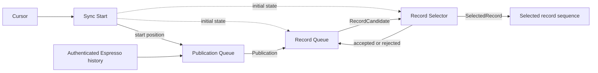

# Block Records


This page specifies unstable behavior.
Block certification is not activated on any MegaETH network.
Parameters marked `TBD` remain unassigned.
Test vectors for the publication encodings, signatures, the record selection pipeline and scan resumption will be added when the constants are assigned.
The publication formats and the record selection pipeline below are an agreed design, not implemented by the current reference publisher or certifier.
The current implementation publishes batches of individually signed records; this page instead specifies signed batches and signed fragments with unsigned record content.


A **block record** is the per-block content MegaETH publishes to [Espresso](https://docs.espressosys.com/network/learn/what-is-espresso) for each L2 block, carrying that block's ordinary transactions in full together with the L1 origin they attach to.
A full node treats a block as **certified** when it has verified the record selected from Espresso's finalized history, its L1-dependent validity and execution, establishing that its content will settle under the [full-node guarantee's conditions](full-node.md#conditions-under-which-it-holds), without waiting for L1 submission.
A record becomes **canonical** only when the [L1 inbox accepts](batch-inbox.md#acceptance) a submission that advances the L2 cursor through that record; local scanning or attestation alone does not confer that status.
This page specifies unsigned record content, signed publication formats, the rules governing its publication, the [record selection pipeline](#record-selection-pipeline) that selects records from Espresso's finalized history, and [canonicality after inbox acceptance](#canonical-record-sequence).

## Motivation

A MegaETH sequencer acknowledges a transaction within approximately ten milliseconds, but that acknowledgement is a promise by the sequencer alone.
Recipients of [signed mini-blocks](../protocol/blocks.md#mini-block-header-signing) and [streamed transaction data](../protocol/state-sync.md#transaction-fragment) can retain the bytes and verify what the sequencer signed before L1 settlement.
The sequencer can still publish conflicting signed streams; a signature identifies its signed content but does not independently determine which content will settle.

Data already delivered can exist outside the sequencer, and recipients with the complete data can reconstruct the blocks they received.
That does not ensure every observer received the data or can retrieve it later if the sequencer stops serving it.
The realtime stream therefore provides neither independently finalized ordering nor a general guarantee of continued data availability.

Block certification publishes each height's ordinary transaction list to Espresso, whose finalized history, together with the inbox's scan starting point, determines the [selected record sequence](#canonical-record-sequence) before L1 settlement.
Observers can obtain the records independently of the sequencer under the stated [availability and retention assumptions](overview.md#confirmation-stages); the [Certification Claim](overview.md#the-certification-claim) defines how those records constrain settlement.

## Record Format

This section defines the [integer semantics](#integer-semantics), the record's [fields](#fields), the [publication encodings and signatures](#encoding), and [well-formedness conditions](#well-formedness).

### Integer Semantics

In the block-record, [certifier](certifier.md) and [batch-inbox](batch-inbox.md) rules, integer expressions over heights, origins, timestamps, indices, counts, lengths and deadlines MUST be evaluated over mathematical integers without wrapping or truncation.
Fixed-width types constrain stored and encoded values, not intermediate arithmetic: a `uintN` field MUST lie in `0 .. 2**N - 1`.
An out-of-range input MUST be rejected under the applicable decoding rule; an operation that would emit or store an out-of-range field MUST fail without emitting output or modifying state.
Implementations MAY use fixed-width operations when they preserve these results, including comparisons whose intermediate sums or products exceed a field's range.

### Fields

```text
BlockRecord {
    block_number:  uint64,
    epoch_num:     uint64,
    transactions:  bytes[],
}
```

`block_number` is the height of the L2 block this record fills.
For `block_number >= genesis_block_number`, the height's timestamp is `genesis_time + (block_number - genesis_block_number) * l2_block_time`, fixed by [OP Stack derivation](https://specs.optimism.io/protocol/derivation.html)'s constant block cadence; this specification relies on that one-to-one correspondence and adds no rule of its own.
Here `genesis_time` and `genesis_block_number` are the rollup configuration's L2 genesis timestamp and block number, and `l2_block_time` is the rollup configuration's interval between L2 blocks, in seconds.
These parameters MUST come from the same rollup configuration used by [derivation](../rollup/derivation.md); the [certification activation checkpoint](activation.md#initial-cursor) MUST NOT replace that genesis baseline.
This fixes a one-to-one correspondence between L2 heights and their scheduled timestamps.
The fixed cadence identifies the next expected height, so an observer can determine that its verified finalized history has no selected record for that height.
It does not set a deadline for that record to be published or finalized, or distinguish publisher silence from publication, finalization or data-retrieval delay.

`epoch_num` is the height of the L1 block this L2 block attaches to as its [L1 origin](https://specs.optimism.io/glossary.html#l1-origin) — the L1 origin number the sequencer committed to when it produced the block.
Whether the derived chain adopts that origin is decided by [derivation](../rollup/derivation.md) against the derived parent's origin, not by this page: a record whose origin the [batch queue](https://specs.optimism.io/protocol/derivation.html#batch-queue) cannot accept loses its height to a [deposit-only block](https://specs.optimism.io/protocol/derivation.html#batch-queue) under [Δ5, substitution instead of dropping](derivation-pipeline.md#delta-5-substitute-instead-of-dropping), while the record itself remains canonical.
The L1 origin is an input to execution rather than a derived artifact: the [`L1Block` predeploy](https://specs.optimism.io/protocol/predeploys.html#l1block) exposes the chosen L1 block's base fee, hash, and timestamp to L2 contracts, so an identical transaction list executed against a different L1 origin can produce a different state root.
The corresponding L1 block _hash_ is deliberately not part of the record, for the reorg-tolerance reason given in the [Rationale](#rationale).

Two trajectories track a block's L1 origin, and they normally coincide.
[Record Validity](#record-validity) compares a record's `epoch_num` with the preceding selected record's; derivation compares a batch's origin with the derived parent's, the block it actually produced for the previous height.
They can separate when the [deposit-only fallback](https://specs.optimism.io/protocol/derivation.html#batch-queue) or a [Δ5 substitution](derivation-pipeline.md#delta-5-substitute-instead-of-dropping) selects an origin different from the record's.
An [execution-rejection replacement](../rollup/derivation.md#channel-retention-after-execution-rejection) instead retains the origin that already passed batch validity checks.
Later records are checked individually against their actual derived parents: content that remains valid can settle, while origin or timestamp failures handled by Δ5 and execution failures cause deposit-only substitution, as [S4](recovery.md#s4-a-height-settles-as-a-deposit-only-block) describes.

`transactions` is the block's ordered list of ordinary, non-deposit L2 transactions, carried in full rather than as a commitment to them.
[Deposit transactions](https://specs.optimism.io/protocol/deposits.html) and [forced-inclusion transactions](../rollup/deposits.md) are excluded: every node derives those directly from L1, so they are already determined by L1 state and are never part of what Espresso finalizes.

The record carries no publisher signature of its own.
Its authenticity MUST be established through the signed [record batch](#record-batch) containing it or the signed [record fragments](#record-fragment) whose payloads concatenate to it, using the height-indexed [publisher keys](#authorized-publisher-keys).

### Encoding

Espresso is a BFT-finalized layer whose blocks carry, per **namespace**, an ordered payload of opaque **namespace transactions**; MegaETH's namespace identifier is [`CHAIN_ID`](#constants).
Within one Espresso block, a namespace's payload has an order of its own, which Espresso fixes and which is not the order in which its transactions were submitted; across Espresso blocks, the order is Espresso's finalization order.
Espresso's validators are grouped into **epochs** — unrelated to a record's `epoch_num`, which names an L1 origin — each governed by a **quorum**: the validator set, each validator's stake weight, and the threshold that speaks for the network, which changes at most once per epoch.
Block finality is established under the adopted Espresso protocol's rules, as specified by [Espresso Verification](certifier.md#espresso-verification).
Espresso serves finalized blocks together with proofs of finality and of a namespace's content or absence, which every observer checks with the [certifier's verification operations](certifier.md#espresso-verification) against a quorum reachable from the snapshot matching [`INITIAL_QUORUM_HASH`](activation.md#constants).

One Espresso namespace transaction MUST carry exactly one **publication**: either a [record batch](#record-batch) or a [record fragment](#record-fragment).
A publication MUST NOT mix complete records with fragments or carry multiple fragments.
Every multi-byte integer below MUST be big-endian; `|` and `||` denote byte concatenation.

A block record MUST be encoded as:

```text
record := block_number(uint64) | epoch_num(uint64) | tx_count(uint32)
          | (tx_len(uint32) | tx_bytes)*
```

`tx_count` MUST equal the number of transaction entries, and each `tx_len` MUST equal the length of its immediately following `tx_bytes`.
`tx_bytes` MUST be the ordinary transaction's standard encoded bytes, the same bytes an OP Stack [SingularBatch](https://specs.optimism.io/protocol/derivation.html#batch-format) carries in its transaction list.
The fixed record header is 20 bytes; a record with `N` ordinary transactions has length `20 + 4 * N + sum(len(tx) for tx in transactions)`.
A block with no ordinary transactions MUST encode `tx_count` as zero and MUST still have a published record under [Publication](#publication).
No publisher signature is appended to these record bytes.

### Record Batch

A **record batch** is one signed publication carrying one or more complete block records.
It MUST have the following encoding:

```text
header := PUBLICATION_MAGIC(4) | PUBLICATION_VERSION(uint16) | RECORD_BATCH_TYPE(uint8)
body   := header | count(uint32) | (record_len(uint32) | record_bytes)*
batch  := body | publisher_sig(65)
```

`count` MUST be nonzero and equal the number of complete records; each `record_len` MUST equal the length of its immediately following record.
Decoding does not interpret the records' heights, under [Well-Formedness](#well-formedness): their order, spacing and repetition do not make a batch malformed.
Consecutive ascending heights within a batch are a publisher obligation under [Publication](#publication), and the [Record Queue](#record-queue) drops each record that does not continue the expected height sequence.
The batch signature MUST cover the entire `body`, including the header, count, lengths and every record's bytes, under [Publication Authentication](#publication-authentication).
Key authorization is per record: each record is kept only if the key governing its own height is the batch's signer, and a record failing that check is dropped individually without affecting the batch's other records.

For example, a batch for heights 100 and 101 has one header, a count of two, the two length-prefixed unsigned records in that order, and one signature over that complete body.
Neither record needs an individual signature or a position inside the transaction in the [cursor](certifier.md#cursor).

### Record Fragment

A **record fragment** is one signed publication carrying a contiguous portion of one encoded block record.
It MUST have the following encoding:

```text
header := PUBLICATION_MAGIC(4) | PUBLICATION_VERSION(uint16) | RECORD_FRAGMENT_TYPE(uint8)
body   := header | block_number(uint64) | attempt_nonce(uint64)
          | record_hash(32) | fragment_index(uint32) | fragment_count(uint32) | payload
fragment := body | publisher_sig(65)
```

`block_number` MUST identify the record's L2 height and MUST equal the completed record's own `block_number`.
`record_hash` MUST equal `keccak256(record_bytes)` over the complete unsigned record encoding under [Encoding](#encoding).
`fragment_count` MUST be the number of fragments in the attempt, and `fragment_index` MUST be its zero-based index.
The first fragment has index zero, and the final fragment has index `fragment_count - 1`.
`payload` MUST be nonempty and MUST occupy all bytes between the fixed fragment metadata and the final signature; the Espresso transaction boundary supplies its length.
The signature MUST authenticate the entire `body`, including every metadata field and `payload`, against `publisherKeyAt(block_number)` under [Publication Authentication](#publication-authentication).
An individual fragment MUST NOT be decoded as a complete record or resolve an L2 height; only the [Record Queue](#record-queue) completing an attempt produces a record from fragments.

`attempt_nonce` identifies a publication attempt for this L2 height, not a transaction sender's nonce or an Espresso block height.
An **attempt** is the set of fragments sharing one `(block_number, attempt_nonce, record_hash, fragment_count)`, and every fragment the publisher signs for one attempt MUST carry those same four values.
The [Record Queue](#record-queue) admits openings for one expected L2 height only with strictly increasing nonces, which need not be consecutive.
An attempt nonce MUST NOT wrap; after its maximum value is admitted, no larger fragment attempt is representable for that height.

For example, an unsigned record split into byte strings `a`, `b` and `c` has three publications with the same height, nonce, `keccak256(a || b || c)` and count three, indices zero through two, and one signature on each publication.

### Publication Authentication

Every record batch and record fragment MUST carry exactly one publisher signature over:

```text
publication_digest(body) = keccak256(DOMAIN_PUBLICATION || CHAIN_ID || body)
```

`body` MUST be the exact publication bytes excluding the final signature, and `CHAIN_ID` MUST be encoded as a big-endian `uint64`.
The signed header binds the magic, version and transaction type, so a signature MUST NOT be interpreted under a different publication type or layout.
`DOMAIN_PUBLICATION` MUST be nonempty and its first byte MUST NOT lie in `0xc0 .. 0xff`, separating the digest from [mini-block header signing](../protocol/blocks.md#mini-block-header-signing) when roles reuse a key.
`publisher_sig` MUST be an ECDSA signature over secp256k1 encoded as `r || s || v`, with `v` in {27, 28} and `s` at most half the curve order.
`ECDSA_verify(key, digest, sig)` MUST be true exactly when the signature has that form and the Ethereum address of the recovered public key equals `key`.
A high-s signature MUST be rejected even if replacing `s` with `n - s` and flipping `v` recovers the same key, where `n` is the curve order.

Authentication MUST verify each namespace transaction's signature once and recover its signer address `S`.
A transaction whose signature does not have the required form, or from which no signer can be recovered, MUST be dropped in its entirety.
For a record batch, each record `r` MUST be kept if and only if `publisherKeyAt(r.block_number)` is defined and equals `S`; every other record MUST be dropped individually, and the remaining records MUST be kept in encoded order.
A batch whose records are all dropped contributes no record.
For a record fragment, the fragment MUST be kept if and only if `publisherKeyAt(block_number)` is defined and equals `S`; otherwise it MUST be dropped.
An undefined key lookup MUST drop the record or fragment, rather than substituting the latest key or the key at the expected height.
Authentication MUST complete before a publication reaches the [Record Queue](#record-queue), so an unauthenticated fragment can never open, replace or extend an attempt, and an unauthenticated record can never become a candidate.
The [certifier](certifier.md#certifier-core), independently verifying full nodes and recovery scanners MUST perform the same authentication; the [L1 inbox](batch-inbox.md#acceptance) verifies the certifier's attestation instead of these publication signatures.

### Well-Formedness

A decoder MUST reject a publication with an unknown magic, version or type, a truncated field, an invalid signature encoding, or a total length above [`MAX_PUBLICATION_BYTES`](#constants).
Unknown or malformed publications MUST contribute no records and MUST NOT terminate the scan or change [Record Queue](#record-queue) state.
The accepted version MUST designate the new signed-publication layouts above, not the previous unsigned container of individually signed records.
All observers and every certifier image whose attestations remain admissible MUST enforce the same publication version and decoding rules within a scan segment.

A record batch MUST be rejected in its entirety before yielding any candidate if its count is zero or exceeds [`MAX_BATCH_RECORDS`](#constants), a length exceeds [`MAX_RECORD_BYTES`](#constants), any contained record is malformed, or bytes follow its final signature.
A record is malformed if its encoded length exceeds `MAX_RECORD_BYTES`, its fixed header or a declared transaction entry is truncated, its `tx_count` exceeds [`MAX_RECORD_TRANSACTIONS`](#constants), a `tx_len` exceeds [`MAX_TRANSACTION_BYTES`](#constants), or bytes remain after its declared transaction entries.
Decoding checks bytes only: it MUST NOT reject a batch for the order, spacing or repetition of its record heights.

A record fragment MUST be rejected if `fragment_count` is zero or exceeds [`MAX_RECORD_FRAGMENTS`](#constants), `fragment_index >= fragment_count`, or its payload is empty.
The fixed fragment overhead, including header and signature, is 128 bytes; a batch has 76 bytes of fixed overhead and four length-prefix bytes per record.
The configured limits MUST satisfy `MAX_RECORD_BYTES >= MAX_TRANSACTION_BYTES + 24`, `MAX_PUBLICATION_BYTES > 128` and `MAX_RECORD_FRAGMENTS * (MAX_PUBLICATION_BYTES - 128) >= MAX_RECORD_BYTES`, under [Integer Semantics](#integer-semantics); the fragment timeout's relation to `MAX_RECORD_FRAGMENTS` is stated under [Record Queue](#record-queue).
These relations alone do not establish coverage of every valid block.
Before activation, the configured record-byte, transaction-byte, transaction-count and fragment-count limits MUST accommodate the record encoding of every protocol-valid block under the supported network and hardfork parameters, including failed transactions and the final transaction's permitted resource-limit overshoot.
The values remain unassigned; the current implementation's one-transaction-derived bound is not a proof of that coverage.

Beyond the content conditions of [Record Validity](#record-validity), ordinary transaction bytes MUST NOT be decoded, signature-checked or executed by record selection.
Well-formedness and Record Validity MUST NOT depend on L2 execution state, such as sender nonces, balances or transaction gas consumption.

## Publication

Block records are published by the **publisher** — the block certification role this specification authorizes to write block records into the Espresso namespace, performed by the operator that also runs the [sequencer](../protocol/sequencing.md#sequencer-authority) for the heights it produces and the primary [batcher](batch-inbox.md#batcher-registry); the rules of this section bind the role, not the operator.
The role is defined by the key alone: whoever holds the secret half of the [`PUBLISHER_KEYS`](#constants) entry governing a height is that height's publisher, and no registration or other state is involved.
This section specifies publication obligations and [which key authenticates each L2 height](#authorized-publisher-keys).

For every L2 block the sequencer produces, the publisher MUST publish a block record, carrying the values [Fields](#fields) defines for each of its fields, to the Espresso namespace [`CHAIN_ID`](#constants), subject to the republication and recovery rules below.
The publisher MUST keep each signed publication within [`MAX_PUBLICATION_BYTES`](#constants), including its header, metadata, record bytes and signature.
It MAY group complete records into a record batch or split one encoded record into record fragments; it MUST NOT mix the two forms in one Espresso transaction.
The records of one record batch MUST carry consecutive heights in ascending order.
This is a publisher obligation, not a decoding or validity rule: the [Record Queue](#record-queue) drops each record that does not continue the expected height sequence and keeps the batch's other records.
The publisher MUST sign a record batch only with the key that `publisherKeyAt` designates for every record in it; a record whose height another key governs is dropped alone under [Publication Authentication](#publication-authentication).

The publisher MUST NOT sign any record fragment for the [activation checkpoint](activation.md#initial-cursor) height `ACTIVATION_BLOCK_NUMBER - 1`.
It MAY publish that height's record only in a record batch, or not at all, because certification never requires it: the first record the scan expects is at [`ACTIVATION_BLOCK_NUMBER`](activation.md#constants).
This is the one exception to the obligation to publish a record for every L2 block the sequencer produces.
[Sync Start](#sync-start) relies on it to start the activation scan at `ACTIVATION_BLOCK_NUMBER`, since no authenticated index-0 fragment for the checkpoint height can then exist, whoever writes into the namespace.

A new fragment attempt for a height MUST use an `attempt_nonce` strictly larger than that of every earlier attempt the publisher signed for that height.
A larger-nonce opening discards an incomplete earlier attempt, so the publisher MUST NOT sign one unless it intends to supersede that attempt.
Espresso does not guarantee that a namespace's finalized order follows submission order, so a fragment finalized before its predecessor is dropped by the [Record Queue](#record-queue); this is an expected event, not a fault.
The publisher SHOULD recover by re-sending the same signed fragment after its predecessor is finalized.
A re-sent fragment is not a new attempt and keeps its nonce; copies that do not carry the next expected index of the current attempt are dropped.
The publisher MAY instead restart with a new attempt under a larger nonce, re-sending the whole record.
The publisher MAY send fragment `i + 1` only after fragment `i` is finalized, which avoids reordering at a cost of up to one Espresso block per fragment.

The publisher MUST extend the [selected record sequence](#canonical-record-sequence) in ascending `block_number` order with no gaps, and MUST NOT sign a second, different record for a `block_number` already governed by a selected or canonical record.
It MUST monitor its records in Espresso's finalized history to determine whether they extend that sequence; sending publications in order does not establish their finalized order.
Publications for a height `n + 1` finalized before a record for `n` is selected may be dropped by the [Record Queue](#record-queue); the publisher MUST republish each such record until the scan selects a record for its height or the inbox cursor passes that height.
A record that was published but is not selected resolves no height in the scan, so this republication is not a second record for a resolved height.
Serializing publication submission until prior finalization and submitting concurrently with retries are both permitted; neither changes the canonicality scan.
A publisher that violates that prohibition does not corrupt the sequence — [record selection](#canonical-record-sequence) resolves the conflict deterministically — but it does forfeit any guarantee about which of its two records the network will treat as binding.

The publisher MUST NOT make publication conditional on the progress of batch settlement.
It MUST NOT wait on the batcher, on the data availability layer, or on L1 inclusion before publishing a record, so that record availability depends on Espresso finalization rather than settlement progress; the full node's certified determination additionally requires its verification checks.
A publisher whose settlement path has stalled entirely MUST continue publishing records for every block the sequencer produces.

A record's `epoch_num` MUST be the L1 origin the sequencer chose when it produced the block, and MUST NOT be chosen afterwards to suit settlement.
[Record Validity](#record-validity) checks only that `epoch_num` does not decrease from the preceding selected record's; it does not check that this value matches the origin of the block the sequencer originally produced, nor that it advances by at most one, which is the OP Stack origin rule derivation applies to the derived chain.
The [certifier's cursor advance](certifier.md#advancing-the-cursor) binds the batch to the selected record, without independently establishing that match either.
[Derivation](derivation-pipeline.md#delta-4-resolve-the-l1-origin-from-epoch_num) uses the record-bound origin subject to the specified deposit-only substitution rules; following the derived chain requires the sequencer to reorganize whenever the resulting block differs from the one it originally produced, as in [recovery S4](recovery.md#s4-a-height-settles-as-a-deposit-only-block).
That consequence does not make an inaccurately copied origin fail Record Validity.

### Authorized Publisher Keys

[`PUBLISHER_KEYS`](#constants) is an ordered table of `(from_block_number, public_key)` entries pinned by this specification and indexed by L2 height, where `public_key` is the 20-byte Ethereum address of a secp256k1 key.
An entry's `from_block_number` is the first height whose record publication MUST be authenticated by the secret half of that entry's `public_key`.
The key governing a height `n` is `publisherKeyAt(n)` — the `public_key` of the entry with the greatest `from_block_number` less than or equal to `n`.
Entries MUST have strictly increasing `from_block_number`, so that `publisherKeyAt(n)` selects exactly one entry at every height at or above the first entry's `from_block_number`.
The first entry's `from_block_number` MUST be at most the first height the [initial cursor](activation.md#initial-cursor) expects, so that `publisherKeyAt` is defined at every height a scan can reach.
An entry added later MUST have a `from_block_number` greater than every height whose record has already been selected or made canonical under the earlier entries, so that changing the key table does not invalidate those selections.
Because [Publication Authentication](#publication-authentication) checks the key per record, such an entry never invalidates a selected record retroactively, even when that record's batch also carries records at or above the new entry's `from_block_number`; those records alone are dropped.
A record whose `block_number` lies below a later entry's `from_block_number` MUST continue to be validated against the entry `publisherKeyAt` selects for that lower height — the earlier one.
At or above the new entry's activation height, a record or fragment MUST be checked against the updated `publisherKeyAt` schedule even if its Espresso transaction was finalized before the table changed.

A sequencer change in [`SequencerRegistry`](../system-contracts/sequencer-registry.md#read-methods) MUST NOT implicitly change `PUBLISHER_KEYS`.
If the sequencer change also changes the key used to sign record publications, the new publisher-key entry MUST be authorized and effective at the first height signed by that key, before the sequencer switch takes effect.
Every certifier image whose attestations remain admissible MUST enforce the same publisher-key schedule at the affected heights, under the [publisher-key compatibility requirement](#security-considerations).
A sequencer change that retains the existing authorized publisher key requires no publisher-key table change.

This specification fixes which key authenticates which height, and nothing further about the table.
It does not define how an entry comes to be authorized, and it defines no procedure for replacing a publisher that has stopped publishing the heights its entry governs.
It also leaves unspecified how a future table change coordinates certifier-version activation and retirement of images carrying the previous table; the required agreement is stated under [Security Considerations](#security-considerations).
What that leaves open is stated under [Security Considerations](#security-considerations).

## Canonical Record Sequence

For each scan segment, the **selected record sequence** is the sequence of records the [record selection pipeline](#record-selection-pipeline) emits when it scans finalized Espresso history from the segment's starting cursor: the first valid record for each successive L2 height.
This selection determines which content the certifier can attest; selection alone establishes neither full-node certified status nor canonicality.
Accepted submissions commit prefixes of that selection and supply resume points for further scanning.
The **canonical record sequence** consists of the selected records through which accepted L1 submissions have advanced the inbox's L2 cursor, ordered by L2 height; it may have gaps where overrides skipped unaccepted heights.

Espresso fixes the published bytes and their order; inbox acceptance fixes which selected records become canonical.
Observers using the same protocol parameters, verified Espresso history and canonical L1 inbox history reconstruct the same selection and canonical records.
This section defines [record validity](#record-validity), the [record position](#record-position) a cursor records, the [record selection pipeline](#record-selection-pipeline) that computes the selection, the [canonicality](#canonicality) rule, and the [conformance cases](#conformance-cases) covering them.

### Record Validity

Validity is judged at a point in the scan, and that point supplies two values besides the record itself: `n`, the next expected L2 height, and `prev_epoch_num`, the preceding origin — the L1 origin of the preceding selected record or, before the scan has selected one, the starting cursor's `epoch_num`.
A block record `r` read at such a point is **valid** if and only if all six of the following hold, each enforced by the stage of the [record selection pipeline](#record-selection-pipeline) named with it:

- `r.block_number == n`, enforced by the [Record Queue](#record-queue), which produces candidates only for `n`;
- its containing record batch, or every fragment of its completed attempt, passed [Publication Authentication](#publication-authentication) for `r.block_number`, enforced by the [Publication Queue](#publication-queue);
- no entry of `r.transactions` is zero-length, enforced by the [Record Selector](#record-selector);
- no entry of `r.transactions` has [`DEPOSIT_TX_TYPE`](#constants) as its first byte, enforced by the Record Selector;
- `r.transactions` is empty whenever `is_interop_activation(r.block_number)` holds under the [activation-boundary definition below](#record-validity), enforced by the Record Selector;
- `prev_epoch_num <= r.epoch_num`, the origin continuity condition, enforced by the Record Selector.

Every selected record satisfies all six conditions at the point the scan selects it.
The re-selection of a consumed record, when [Sync Start](#sync-start) requires one, applies the same conditions, with `n` equal to the consumed height and `prev_epoch_num` equal to the cursor's `epoch_num`.

A scan segment begins at bootstrap or an override and ends at the next override, as defined under [Canonicality](#canonicality) below.
The base case of each scan segment is [the L1 batch inbox's initial cursor](activation.md#initial-cursor), or an [override](batch-inbox.md#emergency-cursor-override)'s cursor, per [Canonicality](#canonicality).
At that base case, `prev_epoch_num` is that cursor's own `epoch_num`, and the first height whose record the scan emits is its `block_number + 1`.

Under [Integer Semantics](#integer-semantics), when `prev_epoch_num` is the maximum `uint64`, only that same origin remains representable and permitted by the continuity condition.

The three content conditions are, equivalently:

```python
def content_permitted(item):
    # the content conditions of Record Validity
    return (all(len(tx) > 0 and tx[0] != DEPOSIT_TX_TYPE
                for tx in item.transactions)
            and not (is_interop_activation(item.block_number)
                     and item.transactions))
```

`is_interop_activation(n)` MUST identify the first post-genesis block that crosses [`INTEROP_ACTIVATION_TIMESTAMP`](#constants), under the OP Stack [Interop activation-block rule](https://specs.optimism.io/interop/derivation.html#activation-block).
Writing `timestamp_at(n)` for the [genesis-relative timestamp mapping](#fields), it MUST be true exactly when `n > genesis_block_number` and `timestamp_at(n - 1) < INTEROP_ACTIVATION_TIMESTAMP <= timestamp_at(n)`.
The activation timestamp need not equal a block timestamp.
While `INTEROP_ACTIVATION_TIMESTAMP` is unassigned for a network, `is_interop_activation` MUST be false at every height.
If Interop is already active at genesis, the genesis block MUST NOT be classified as an activation block, and the predicate MUST be false at every later height.

A record that fails any of the six conditions MUST be dropped individually without terminating the scan or discarding other records of its batch.
Authentication MUST denote the completed checks on the supplied bytes under [Publication Authentication](#publication-authentication), not a flag supplied by the host.

The content conditions belong to validity because a record violating any of them would be dropped by derivation without replacement, as the [Rationale](#rationale) explains.

Validity makes no claim about whether the block the record describes will execute successfully, which is not something certification establishes; it establishes only that the height is the expected one, that the record is authentic, and that its content is not of a shape derivation would refuse to consider at all.

The `epoch_num` condition is enforced here, and not where the sequence is consumed on the settlement path, because refusing a record at validity leaves the height it claims unresolved and still claimable by a corrected record.
By contrast, refusing it at [the certifier's cursor advance](certifier.md#advancing-the-cursor) comes after the scan has already selected the record, where refusal saves nothing and only stops the cursor permanently.
The full argument, including why a condition on the sequence rather than on any single record can still be a validity condition, is given under [Rationale](#rationale) as "Why `epoch_num` continuity is a validity condition rather than a settlement-time assertion".

### Record Position

A **record position** is a position in Espresso's finalized history:

```text
RecordPosition {
    height: uint64,   // Espresso block height
    index:  uint32,   // namespace-transaction index within that block's namespace payload
}
```

`index` MUST identify the namespace transaction, never an offset within a batch or a fragment index.
Positions MUST be ordered by `height`, then by `index`: within one Espresso block they follow the authenticated namespace transaction order, and across blocks they follow increasing finalized Espresso height.

A record's **span** is the range of positions it occupies.
A record from a record batch occupies the batch's single position.
A fragmented record's span runs from the position of the index-0 fragment of the attempt that completed it to the position of that attempt's final fragment.
The **span start** is the first position of the span: the batch's position, or the completing attempt's index-0 fragment.
The record position associated with a selected record MUST be its span start, although a fragmented record is selected only at its final fragment's position.

The [cursor](certifier.md#cursor)'s `(height, index)` MUST be the span start of the last consumed record, and its `block_number` that record's height.
This exact position is required.
Republication means the same record can appear at several positions, and the span start pins which occurrence was consumed, and with it which later publications fell inside that occurrence's span and were ignored by the scan that consumed it.
A scan starting from a cursor MUST include the transaction at its position and MUST exclude earlier indices in the same block, and when the consumed record was fragmented it re-selects that record from there under [Sync Start](#sync-start).

For example, a batch at `(1000, 3)` containing heights 100 through 109 leaves a cursor consuming height 104 at `(1000, 3)`; the resumed scan drops that batch's records through 104 and continues with 105 in the same batch.
A record 104 assembled from fragment transactions at heights 1000, 1001 and 1003 leaves its cursor at the index-0 fragment at 1000; the resumed scan reopens that attempt, re-selects 104 at 1003, and only then looks for record 105.
Neither form requires a transaction-type field, record offset, attempt nonce or pending fragment bytes in the L1 cursor.

### Record Selection Pipeline

The scan that computes the selected record sequence is a pipeline of three stages — the [Publication Queue](#publication-queue), the [Record Queue](#record-queue) and the [Record Selector](#record-selector) — preceded by [Sync Start](#sync-start), which runs once and initializes the stages from a cursor; [Scan Pseudocode](#scan-pseudocode) restates the whole.



| Stage             | Input                                                             | Output                                                                              | Own state                    | Initial value                                                                                                                       |
| ----------------- | ----------------------------------------------------------------- | ----------------------------------------------------------------------------------- | ---------------------------- | ----------------------------------------------------------------------------------------------------------------------------------- |
| Sync Start        | A cursor, and the authenticated publication at its position       | Each stage's initial state, and the start position `(cursor.height, cursor.index)`  | None                         | Not applicable                                                                                                                      |
| Publication Queue | Authenticated Espresso history, from the start position           | `Publication`s, one at a time, in position order                                    | None                         | Not applicable                                                                                                                      |
| Record Queue      | One `Publication`, and a `Verdict` for each candidate it produces | `RecordCandidate`s, one at a time, each for the current `n`                         | `n`, `slot`, `highest_nonce` | `cursor.block_number` when the cursor's transaction is an index-0 fragment for it, otherwise `cursor.block_number + 1`; empty; none |
| Record Selector   | One `RecordCandidate`                                             | A `Verdict` for the candidate, and a `SelectedRecord` when it accepts and emits one | `prev_epoch`, `consumed`     | `cursor.epoch_num`; `cursor.block_number` in the first case, otherwise none                                                         |

No stage writes another stage's state, and [`PUBLISHER_KEYS`](#constants) and the other constants are fixed parameters rather than state.
The only signal from a later stage to an earlier one is the `Verdict`: for each candidate, the Record Selector returns `accepted` or `rejected` to the Record Queue, which [advances its height](#record-queue) only on `accepted`.
This mirrors the OP Stack [Holocene](https://specs.optimism.io/protocol/holocene/derivation.html) batch stage signalling the channel stage to flush, and it is the only such signal.

The stages exchange the following values:

```text
Publication = PublicationBatch | PublicationFragment

PublicationBatch {
    position:        RecordPosition,
    records:         BlockRecord[],   // in encoded order; only records kept by Publication Authentication; may be empty
}

PublicationFragment {
    position:        RecordPosition,
    block_number:    uint64,          // publisherKeyAt(block_number) is the signer
    attempt_nonce:   uint64,
    record_hash:     bytes32,
    fragment_index:  uint32,
    fragment_count:  uint32,
    payload:         bytes,           // nonempty
}

RecordCandidate {
    record:          BlockRecord,     // record.block_number equals the Record Queue's n when produced
    span_start:      RecordPosition,  // the batch's position, or the attempt's index-0 fragment
}

Verdict = accepted | rejected         // returned by the Record Selector to the Record Queue

SelectedRecord {
    record:          BlockRecord,
    span_start:      RecordPosition,  // the record position a cursor records for this record
}
```

The scan MUST process one namespace transaction at a time.
Each candidate the Record Queue produces MUST reach the Record Selector, and its verdict MUST return to the Record Queue, before the Record Queue produces its next candidate or the next transaction is read.
A batch's records are walked one at a time in encoded order, so a record accepted earlier in the batch changes `n` for the records after it.
The scan's output is the selected record sequence: the `SelectedRecord`s in the order the Record Selector emits them.
Their heights are `cursor.block_number + 1`, `cursor.block_number + 2`, and so on, with no gap, and their span starts are non-decreasing.

#### Publication Queue

The Publication Queue reads, decodes and authenticates namespace transactions and holds no state; it interprets L2 heights only to look up their keys.
It MUST visit namespace transactions in position order, starting at the position [Sync Start](#sync-start) determines, inclusive.
Every Espresso block from the start position's height through the last position the scan examines MUST be authenticated under [Espresso Verification](certifier.md#espresso-verification), including blocks with an absent or empty namespace, so that the host cannot omit a transaction carrying a higher nonce, a competing complete record or the passage of a timeout interval.
It MUST drop every transaction that fails [Well-Formedness](#well-formedness), and MUST apply [Publication Authentication](#publication-authentication) to every transaction that decodes.
It MUST pass on a fragment only if authentication keeps it, and a batch only with the records authentication keeps, in encoded order.

#### Record Queue

The Record Queue holds `n`, the next expected L2 height; `slot`, at most one incomplete fragment attempt; and `highest_nonce`, the highest `attempt_nonce` admitted for `n`, or none.
A non-empty `slot` holds the attempt's `nonce`, `record_hash` and `fragment_count`, its `next_index`, the concatenated `payload` so far, `open_height`, the Espresso height of its index-0 fragment, and `open_position`, that fragment's position.

The Record Queue MUST produce candidates only for `n`, so every candidate continues the height sequence and the [Record Selector](#record-selector) never checks height.
On receiving `accepted` for a candidate, it MUST set `n = n + 1`, empty `slot` and clear `highest_nonce`, since both belonged to the resolved height.
On receiving `rejected`, it MUST change nothing, and height `n` stays unresolved.
If `n` would exceed the `uint64` range, the scan MUST stop without producing further candidates.

For a record batch at position `p`, the Record Queue MUST walk its records in encoded order, and for each record `r`:

- if `r.block_number == n`, it MUST produce `RecordCandidate(r, span_start = p)` and wait for its verdict before continuing;
- otherwise, it MUST drop `r` and continue with the next record.

With `n = 100` and every record valid, these rules give:

| Batch             | Produced in order | Dropped                                    |
| ----------------- | ----------------- | ------------------------------------------ |
| `{100, 101, 102}` | 100, 101, 102     | None                                       |
| `{100, 102, 101}` | 100, 101          | 102, which is above `n = 101` when reached |
| `{100, 101, 103}` | 100, 101          | 103, reached when `n = 102`                |
| `{98, 99, 100}`   | 100               | 98 and 99, already resolved                |
| `{100, 100}`      | The first 100     | The second 100, reached when `n = 101`     |

A rejected candidate does not advance `n`, so a later record of the same batch for the same height can still be produced: in `{100 with invalid content, 100}`, the first is rejected and the second is produced and accepted.
Batch records MUST NOT change `slot` or `highest_nonce` except through `accepted`, so a batch record for `n` accepted while a fragment attempt for `n` is incomplete discards that attempt.

For a record fragment `f` at position `p`, the Record Queue MUST apply the following steps in order, following [Holocene frame ordering](https://specs.optimism.io/protocol/holocene/derivation.html#frame-queue) except where stated:

1. **Expiry.**
   If `slot` is non-empty and `p.height > slot.open_height + RECORD_FRAGMENT_TIMEOUT`, it MUST empty `slot` and keep `highest_nonce`.
2. **Other heights.**
   If `f.block_number != n`, it MUST drop `f`.
3. **Opening, when `f.fragment_index == 0`.**
   If `highest_nonce` is set and `f.attempt_nonce <= highest_nonce`, it MUST drop `f`, even if its record hash differs.
   Otherwise it MUST set `highest_nonce = f.attempt_nonce` and replace `slot` with a new attempt from `f`, with `next_index = 1`, `payload = f.payload`, `open_height = p.height` and `open_position = p`, discarding any incomplete earlier attempt as Holocene discards an incomplete channel when a new first frame arrives.
4. **Continuation, when `f.fragment_index > 0`.**
   If `slot` is empty, or `f`'s `attempt_nonce`, `record_hash` or `fragment_count` differs from `slot`'s, or `f.fragment_index != slot.next_index`, it MUST drop `f` without changing `slot`; this covers duplicates, gaps and out-of-order arrival, which Holocene likewise drops immediately.
   Otherwise it MUST append `f.payload` to `slot.payload` and increment `slot.next_index`; if the payload length then exceeds [`MAX_RECORD_BYTES`](#constants), it MUST empty `slot` and keep `highest_nonce`.
5. **Completion, when `slot.next_index == slot.fragment_count`.**
   If `keccak256(slot.payload) != slot.record_hash`, or `slot.payload` is not exactly one well-formed record under [Well-Formedness](#well-formedness), or that record's `block_number != n`, it MUST empty `slot`, keep `highest_nonce` and produce nothing.
   Otherwise it MUST produce `RecordCandidate(record, span_start = slot.open_position)`, then empty `slot` and keep `highest_nonce`.

An attempt opened at Espresso height `s` can therefore complete through height `s + RECORD_FRAGMENT_TIMEOUT`, inclusive, and later fragments MUST NOT extend that deadline or revive an expired attempt.
Expiry MUST be decided by authenticated Espresso heights, never local arrival time; a completed record MUST NOT expire merely because an observer retrieves it later.
Applying expiry when the next fragment arrives is equivalent to applying it on every Espresso block, including one with an absent or empty namespace, because `slot` affects only the processing of fragments.

`RECORD_FRAGMENT_TIMEOUT` MUST be at least `MAX_RECORD_FRAGMENTS` plus a margin for the re-sends [Publication](#publication) describes, whose value is unassigned.
A maximum-size record sent one fragment per Espresso block, the order-safe way, needs up to `MAX_RECORD_FRAGMENTS` blocks, and a smaller timeout could expire it before it completes.

A fragment is never a candidate on its own, and an incomplete attempt never resolves or reserves a height.
If a completed attempt's candidate is rejected, `slot` is already empty and `highest_nonce` kept, so only a higher-nonce attempt or a batch record can still fill height `n`.
Unlike Holocene, where a new channel's first frame displaces the incomplete one, a fragment for another height never displaces `slot`: fragments for `n + 1` are dropped while `n` is unresolved, because the namespace is permissionless and anyone can copy a signed opening for `n + 1` into it to discard `n`'s progress.

#### Record Selector

The Record Selector holds `prev_epoch`, the preceding origin of [Record Validity](#record-validity), and `consumed`, the height of a record already consumed before this scan, which is re-selected but not emitted, or none.
Because the [Record Queue](#record-queue) produces only candidates for the next expected height, the Record Selector checks content and origin only.
A candidate `r` passes if and only if `content_permitted(r)` holds under [Record Validity](#record-validity) and `prev_epoch <= r.epoch_num`.

- If `r` passes and `r.block_number == consumed`, the Record Selector MUST set `consumed` to none and return `accepted` without emitting a record and without changing `prev_epoch`.
  This is the re-selection of the consumed record under [Sync Start](#sync-start); `prev_epoch` keeps the cursor's `epoch_num`, so that an override's `epoch_num` remains the origin floor for the next record.
- If `r` passes otherwise, the Record Selector MUST emit `SelectedRecord(r, span_start)`, set `prev_epoch = r.epoch_num` and return `accepted`; `r` is then **selected**.
- If `r` does not pass, the Record Selector MUST return `rejected` and change nothing.

Three properties follow.
The first complete valid record for a height wins: a batch record for `n` arriving while `n`'s fragments are incomplete is selected, and the incomplete attempt is discarded.
A selected record is never replaced by anything later, because the Record Queue never produces a candidate for a resolved height again.
Selections do not interleave: publications for `n + 1` arriving inside `n`'s span are dropped by the Record Queue, so the spans of consecutive selected records appear in order and do not overlap, except that the records of one batch share its single position.

#### Sync Start

Sync Start takes a cursor `C` and outputs the initial state of each stage and the position at which the [Publication Queue](#publication-queue) starts, `(C.height, C.index)`, inclusive.
It runs once, before the pipeline, like the OP Stack's search for a sync starting point on a reset; it only initializes, and the pipeline does all further work through its ordinary rules.

Sync Start MUST examine the namespace transaction at `(C.height, C.index)`, decoded under [Well-Formedness](#well-formedness) and authenticated under [Publication Authentication](#publication-authentication) exactly as the Publication Queue would; that transaction lies in the first Espresso block the Publication Queue authenticates, so the decision needs no history beyond the scan's own.
Sync Start MUST NOT otherwise distinguish cursors: it reads nothing from L1 and treats accepted, bootstrap and override cursors alike.
It MUST initialize the stages in one of two ways:

- **Re-selection.**
  If that transaction is an authenticated record fragment with `fragment_index == 0` and `block_number == C.block_number`, Sync Start MUST initialize the [Record Queue](#record-queue) with `n = C.block_number`, an empty `slot` and no `highest_nonce`, and the [Record Selector](#record-selector) with `prev_epoch = C.epoch_num` and `consumed = C.block_number`.
  The pipeline then re-selects `C.block_number` without emitting it: the Record Queue opens that attempt, drops every publication for `C.block_number + 1` while `n` is still `C.block_number`, and produces the record at its final fragment, so publications for `C.block_number + 1` inside the consumed record's span stay ignored as they were in the scan that consumed it.
- **Fresh start.**
  Otherwise — when the position holds a record batch, a fragment for another height, a fragment with a nonzero `fragment_index`, a transaction that fails decoding or authentication, or no transaction — Sync Start MUST initialize the Record Queue with `n = C.block_number + 1`, an empty `slot` and no `highest_nonce`, and the Record Selector with `prev_epoch = C.epoch_num` and `consumed` none.
  The pipeline then looks for `C.block_number + 1` from the cursor position, inclusive.

This decision covers every cursor the certifier emits, whose position is the span start of the last consumed record `H = C.block_number`.
When `H` came from a record batch, the cursor names that batch and Sync Start takes the fresh start; because the batch occupies one position and the Record Queue drops its records at or below `H`, walking on to `H + 1` and any later records in it, the result is identical to re-selecting `H` from the batch.
Re-selection is needed only when `H` was fragmented, since only then can publications for `H + 1` lie inside `H`'s span, and that is exactly when the transaction at the cursor is `H`'s index-0 fragment.
Sync Start takes this decision from one publication only; all further work is the pipeline's ordinary rules.

The [activation cursor](activation.md#initial-cursor) is `(DEPLOYMENT_HEIGHT, 0, ACTIVATION_BLOCK_NUMBER - 1, …)` and names no consumed record: the activation checkpoint was settled before certification, and its record need not appear at or after `DEPLOYMENT_HEIGHT`.
Because the [publisher signs no record fragment for the checkpoint height](#publication), the transaction at `(DEPLOYMENT_HEIGHT, 0)` is never an authenticated index-0 fragment for it, even when signed bytes are copied into the permissionless namespace.
Sync Start therefore always takes the fresh start at activation, and the first record selected is `ACTIVATION_BLOCK_NUMBER`'s.

An [override](batch-inbox.md#emergency-cursor-override) cursor is processed by the same rule, because the certifier cannot distinguish it from an accepted one; the admin's obligations for choosing its position are stated under [Emergency Cursor Override](batch-inbox.md#emergency-cursor-override).
If an override takes the re-selection branch and that attempt does not complete with a record that passes the Record Selector with `prev_epoch = C.epoch_num`, the pipeline re-selects `C.block_number` only at a later passing record for it, if one exists; until then the scan yields no record and certification stalls, and it never emits a record for a later height without first re-selecting `C.block_number`.

In the re-selection branch, until the consumed record is re-selected, the scan yields no record.
Supplied history that ends before the consumed record's span ends is therefore insufficient to select any later record; the [certifier's cursor advance](certifier.md#advancing-the-cursor) states when that insufficiency fails a call.

#### Scan Pseudocode

The pipeline is equivalently:

```python
def publication_queue(history, start):                       # stateless
    for pos, raw in history.namespace_txs(start=start):      # inclusive; every block authenticated
        pub = decode(raw)                                     # Well-Formedness: bytes only
        if pub is None:
            continue
        pub = authenticate(pub, pos)                          # per-record keys
        if pub is not None:
            yield pub

class RecordQueue:
    def __init__(self, n):
        self.n = n
        self.slot, self.highest_nonce = None, None

    def accepted(self):                                       # verdict from Record Selector
        self.n += 1
        self.slot, self.highest_nonce = None, None

    def candidates(self, pub):
        # Yields (record, span_start) for self.n only. The caller delivers a verdict
        # for each one, calling accepted() on acceptance, before resuming the generator.
        pos = pub.position
        if pub.is_batch:                                      # filter by height only
            for r in pub.records:
                if self.n >= 2**64:
                    return
                if r.block_number == self.n:
                    yield r, pos
            return
        f = pub
        if self.slot and pos.height > self.slot.open_height + RECORD_FRAGMENT_TIMEOUT:
            self.slot = None                                  # step 1: expiry, nonce kept
        if f.block_number != self.n:
            return                                            # step 2
        if f.fragment_index == 0:                             # step 3
            if self.highest_nonce is not None and f.attempt_nonce <= self.highest_nonce:
                return                                        # replayed or stale opening
            self.highest_nonce = f.attempt_nonce
            self.slot = Slot.open(f, pos)                     # replaces any incomplete attempt
        elif self.slot is None or not self.slot.is_next(f):   # step 4
            return                                            # Holocene: drop out-of-order
        else:
            self.slot.append(f)
            if len(self.slot.payload) > MAX_RECORD_BYTES:
                self.slot = None
                return
        if not self.slot.complete():
            return
        slot, self.slot = self.slot, None                     # step 5, nonce kept
        r = slot.decode_record()                              # hash, well-formed, height == n
        if r is not None:
            yield r, slot.open_position

class RecordSelector:
    def __init__(self, prev_epoch, consumed):
        self.prev_epoch, self.consumed = prev_epoch, consumed

    def offer(self, r):
        # Returns (accepted, record to emit or None).
        if not content_permitted(r) or self.prev_epoch > r.epoch_num:
            return False, None                                # rejected
        if r.block_number == self.consumed:
            self.consumed = None                              # re-selected, not emitted;
            return True, None                                 # prev_epoch keeps cursor.epoch_num
        self.prev_epoch = r.epoch_num
        return True, r                                        # accepted and selected

def sync_start(cursor, history):                              # initializes only
    start = (cursor.height, cursor.index)
    pub = peek_publication(history, start)                    # decoded and authenticated, or None
    if (pub is not None and not pub.is_batch and pub.fragment_index == 0
            and pub.block_number == cursor.block_number):
        n, consumed = cursor.block_number, cursor.block_number   # re-select the fragmented record
    else:
        n, consumed = cursor.block_number + 1, None           # fresh start at the next height
    return RecordQueue(n), RecordSelector(cursor.epoch_num, consumed), start

def next_selected(cursor, history):
    rq, rs, start = sync_start(cursor, history)
    for pub in publication_queue(history, start):
        if rq.n >= 2**64:
            return
        for r, span_start in rq.candidates(pub):              # each r has height rq.n
            accepted, emit = rs.offer(r)
            if accepted:
                rq.accepted()                                 # verdict back to Record Queue
                if emit is not None:
                    yield SelectedRecord(emit, span_start)
            # rejected: no state changes; height rq.n stays unresolved
```

`decode` MUST apply [Well-Formedness](#well-formedness) and `authenticate` MUST apply [Publication Authentication](#publication-authentication) to the whole transaction before returning a publication.
`peek_publication(history, start)` MUST return what `publication_queue` yields for the namespace transaction at exactly `start`, or `None` when no transaction is there or it is dropped, without examining any later position.
`Slot.open`, `is_next`, `append`, `complete` and `decode_record` MUST implement steps 3 through 5 of the [Record Queue](#record-queue)'s fragment rules.
A `SelectedRecord` exposes its record's fields, and `position_of(s)` denotes its `span_start`, never its completion position.

### Canonicality

**The scan MUST select the first complete valid record for each expected L2 height in Espresso's finalized transaction order and ignore later records for that height.**
Within one record batch, candidates MUST be considered in encoded record order.
A fragmented record MUST become a candidate only at the transaction that completes its attempt, although its record position names its span start.
Opening a fragment attempt MUST NOT retrospectively claim a height or change an earlier selection.
A height is resolved in the scan once its record is selected; this does not make it canonical before inbox acceptance.
The [record selection pipeline](#record-selection-pipeline) implements this rule, and every observer MUST compute the selected record sequence by it.

For identical authenticated histories, parameters and starting cursors, observers MUST obtain the same selected sequence regardless of cache contents, process restarts or retrieval timing.
A scan whose next expected L2 height exceeds the `uint64` range MUST terminate without yielding a record, including when its starting cursor already names the maximum height; the height MUST NOT wrap to zero.

The scan's starting point is fixed by the [L1 batch inbox](batch-inbox.md), not chosen by the observer.
The [initial cursor](activation.md#initial-cursor) supplies position `(height, index)`, preceding origin `epoch_num` and, under [Sync Start](#sync-start), the first expected height `block_number + 1`; accepted submissions advance this resume point under the [certifier's rules](certifier.md#advancing-the-cursor).
The canonical records of an accepted submission's [`CursorAdvanced(prev, next)`](batch-inbox.md#events) are the selected records at heights `prev.block_number + 1 .. next.block_number`, as the scan starting from `prev` over the authenticated Espresso history selects them; no other record acquires canonical status from that submission.
An intermediate frame or an empty closing frame that leaves `block_number` unchanged makes no additional record canonical.
The accepted records need not carry content that executes successfully; canonicality does not replace derivation's validity checks.

Each [override](batch-inbox.md#emergency-cursor-override) ends the current scan segment and starts a new one at its supplied cursor.
Records already made canonical by accepted submissions in the same L1 history stay canonical, and heights that `CursorSet` skips have no canonical record.
The new segment's scan starts from the supplied cursor under [Sync Start](#sync-start): when the supplied `(height, index)` holds an index-0 fragment for the supplied `block_number`, it first re-selects that attempt's record without emitting it; either way it then expects `block_number + 1` with `epoch_num` as the preceding origin.
Re-selecting that record MUST NOT make it or any skipped record canonical.
This is the resume rule the certifier follows, which every observer MUST apply identically to reach the same selection.
Local selections beyond the old accepted cursor confer no canonical status and are superseded by the selection from the new resume point; the heights skipped by the override remain without canonical records.
Thus an override from 100 to 105 with no accepted submissions for 101 through 105 leaves those heights without canonical records even if a local scan had already selected their records.
The override submits no content and makes no skipped record canonical.
Its `CursorSet` event triggers [deposit-only gap filling in derivation](../rollup/derivation.md#emergency-cursor-overrides) without waiting for sequencing-window expiry, while preserving the established safe prefix.

Canonicality is relative to the canonical L1 history containing the acceptance, not final merely because a transaction was included.
After an L1 reorganization, the accepted records and scan resume points are those of the replacement L1 history; Espresso finality alone does not preserve an acceptance removed from L1.

### Conformance Cases

Conformance vectors MUST cover both signed layouts, domain and type separation, modified batch membership or order, and rejection of malformed batches before any record is yielded.
They MUST cover per-record key authorization, including a batch in which one record's height is governed by a key other than the signer and only that record is dropped.
They MUST cover a key rotation whose new entry starts above a selected height `n` while a batch `{n, n + 1000}` supplied `n`: the rotation MUST NOT invalidate `n`, a scan resuming at that batch MUST continue with `n + 1`, and the record for `n + 1000` is dropped alone.
They MUST cover batches whose heights are out of order, repeated or gapped, which decode without error, including a batch `{100, 102, 101}` at `n = 100` that yields 100 and 101 and drops 102.
They MUST cover single-fragment completion, maximum fragment count, index gaps and duplicates, mismatched hashes or counts, cumulative size overflow, nonce gaps, nonce exhaustion, higher-nonce replacement, and replay of an equal or lower nonce after expiry.
They MUST cover out-of-order fragments within one Espresso block, where the early fragment is dropped and the attempt then completes through a re-send of the same fragment with the same nonce.
They MUST cover completion at the timeout boundary and rejection immediately after it, including empty Espresso blocks, and processing multiple namespace transactions in one Espresso block.
They MUST compare uninterrupted scanning with scanning resumed from a cursor after partial batch consumption and after a fragmented record, including publications for the next height inside the consumed record's span that a scan resuming from its span start ignores, incomplete history before the consumed record is re-selected, and a quorum transition between opening and completion.
They MUST cover an activation cursor whose position holds a record batch containing the checkpoint record, from which the scan starts at `ACTIVATION_BLOCK_NUMBER`, and a cursor at a record batch, which yields the same selection as an uninterrupted scan.
They MUST cover an override cursor at an index-0 fragment for its `block_number` whose attempt never completes, which stalls the scan, and an override cursor at a position holding no fragment for its `block_number`, from which the scan resumes at `block_number + 1`.
The concrete byte vectors remain unassigned until the publication constants and bounds are fixed.

## Constants

| Constant                       | Value  | Description                                                                                                                                                                                                                                                                                                         |
| ------------------------------ | ------ | ------------------------------------------------------------------------------------------------------------------------------------------------------------------------------------------------------------------------------------------------------------------------------------------------------------------- |
| `CHAIN_ID`                     | TBD    | MegaETH chain identifier (`uint64`), also the Espresso namespace and signature domain input.                                                                                                                                                                                                                        |
| `DOMAIN_PUBLICATION`           | TBD    | Nonempty publication-signature prefix whose first byte is outside `0xc0 .. 0xff`.                                                                                                                                                                                                                                   |
| `PUBLISHER_KEYS`               | TBD    | Height-indexed table of authorized publisher Ethereum addresses.                                                                                                                                                                                                                                                    |
| `PUBLICATION_MAGIC`            | TBD    | Four-byte prefix identifying record publications.                                                                                                                                                                                                                                                                   |
| `PUBLICATION_VERSION`          | TBD    | New signed-publication layout version (`uint16`); distinct from the previous individually signed-record layout.                                                                                                                                                                                                     |
| `RECORD_BATCH_TYPE`            | TBD    | Batch type tag (`uint8`), distinct from `RECORD_FRAGMENT_TYPE`.                                                                                                                                                                                                                                                     |
| `RECORD_FRAGMENT_TYPE`         | TBD    | Fragment type tag (`uint8`), distinct from `RECORD_BATCH_TYPE`.                                                                                                                                                                                                                                                     |
| `MAX_PUBLICATION_BYTES`        | TBD    | Maximum total signed namespace-transaction payload, including metadata and signature.                                                                                                                                                                                                                               |
| `MAX_BATCH_RECORDS`            | TBD    | Maximum number of complete records in a record batch.                                                                                                                                                                                                                                                               |
| `MAX_RECORD_BYTES`             | TBD    | Maximum unsigned record bytes, including the full concatenated payload of a fragmented record.                                                                                                                                                                                                                      |
| `MAX_RECORD_FRAGMENTS`         | TBD    | Maximum fragment count in one record attempt.                                                                                                                                                                                                                                                                       |
| `RECORD_FRAGMENT_TIMEOUT`      | TBD    | Fragment attempt window in finalized Espresso blocks, inclusive through opening height plus this value; at least `MAX_RECORD_FRAGMENTS` plus an unassigned re-send margin; independent of the OP Stack settlement-channel timeout.                                                                                  |
| `MAX_RECORD_TRANSACTIONS`      | TBD    | Maximum transaction count in one record.                                                                                                                                                                                                                                                                            |
| `MAX_TRANSACTION_BYTES`        | TBD    | Maximum encoded bytes of one ordinary transaction in a record.                                                                                                                                                                                                                                                      |
| `DEPOSIT_TX_TYPE`              | `0x7E` | The OP Stack deposit transaction type byte; a record whose transaction list carries an entry beginning with it is invalid, per [Record Validity](#record-validity).                                                                                                                                                 |
| `INTEROP_ACTIVATION_TIMESTAMP` | TBD    | The configured activation timestamp for Interop. The first post-genesis block crossing this timestamp MUST carry no ordinary transactions, even when its timestamp is later than the configured value; if Interop is active at genesis there is no later activation block, per [Record Validity](#record-validity). |

## Rationale

**Why fragment counts and per-height attempt nonces.**
The record is complete before publication, so its fragment count is known and is authenticated in every fragment.
The nonce distinguishes the publisher's attempts for one height, so a newer attempt can replace an incomplete older one while a copied opening cannot reset progress: an opening is admitted only above the highest nonce already admitted for that height.
Nonce gaps permit an attempt that never reached Espresso to be bypassed without blocking publication.
The timeout frees incomplete payload bytes; retaining the nonce across expiry prevents the same signed opening from creating an unlimited sequence of fresh windows.

**Why height continuity and the nonce are tied to the next expected height.**
The OP Stack's frame queue and channel bank know no L2 height and leave the timestamp check to the batch queue.
That works because only the batcher's own L1 transactions count and they cannot be replayed, so channel assembly keeps no memory beyond the channel timeout.
Here anyone can copy a signed fragment into the permissionless namespace, so the memory that rejects a copied opening, the highest admitted nonce, must outlive expiry.
Gating fragments to the next expected height and clearing the nonce when that height is selected makes this memory begin at the previous record's selection.
A scan resumed at a fragmented consumed record's span start therefore rebuilds it exactly: the consumed attempt's opening is the highest nonce either scan admitted for that height, and once the record is re-selected both scans hold an empty slot and no nonce for the next height.
A nonce memory not tied to a height would instead depend on arbitrary history before the cursor, which a resumed scan does not read.
Making the Record Queue the only owner of the expected height also means every later stage receives only candidates that continue the sequence.

**Why fragments follow Holocene ordering.**
Dropping an out-of-order fragment immediately, as [Holocene](https://specs.optimism.io/protocol/holocene/derivation.html#frame-queue) does for frames, keeps the Record Queue's state at one slot and one nonce, with no buffer of early fragments that copied or spammed fragments could fill.
Because Espresso does not guarantee submission order, the cost of that choice falls on the publisher as a regular, cheap recovery: re-sending the dropped fragment with the same nonce once its predecessor is finalized.
The timeout constraint `RECORD_FRAGMENT_TIMEOUT >= MAX_RECORD_FRAGMENTS` plus a margin ensures that a publisher sending one fragment per Espresso block, which never reorders, can still complete a maximum-size record, with room for re-sends.

**Why key authorization is per record.**
A whole-batch key check would let a later key rotation invalidate a batch retroactively whenever the batch also carried a record above the new entry's activation height, including a record that was dropped for height rather than selected.
Preventing that would require the rotation bound to exceed every height in every batch that supplied a selected record, a bound that depends on namespace history rather than on selection.
Checking each record against the key for its own height makes a record's authentication depend only on its own height and the batch's signer, so a rotation above every selected height never invalidates a selection, and a record signed by the wrong key costs only itself.
The batch signature still covers the whole body, so no record can be removed, reordered or spliced between batches without invalidating it.

**Why resuming re-selects only a fragmented consumed record.**
Sync Start only initializes, and the consumed record is re-selected through the pipeline's ordinary rules rather than by a separate replay procedure with its own consistency checks.
Starting at a fragmented consumed record's span start with `n` still at the consumed height keeps every publication for the next height inside that span dropped, as the scan that consumed it dropped them; skipping the consumed record's fragments instead would admit publications that scan ignored.
A record batch occupies a single position, so no publication lies inside its span, and starting at `block_number + 1` from the batch selects what re-selecting from it would.
The cursor therefore needs no transaction type, offset, nonce or pending bytes, and the core needs no state beyond what the history it reads rebuilds.

**Why Sync Start decides from the publication at the cursor.**
The activation cursor names no consumed record: the checkpoint is settled before certification and its record need not appear at or after `DEPLOYMENT_HEIGHT`, so a scan that required its re-selection would let whatever was published at the deployment position, or the absence of anything there, halt activation.
Recognizing the activation cursor by its fields would require the core to know `DEPLOYMENT_HEIGHT` and `ACTIVATION_BLOCK_NUMBER`, which the admin schedules on L1 and the core, reading nothing from L1, cannot learn.
The one fact that determines whether re-selection is needed — that the cursor names an index-0 fragment for its `block_number` — is instead in the history the scan reads anyway.
The publisher's obligation never to fragment the checkpoint record makes that fact false at activation, whatever is published at `(DEPLOYMENT_HEIGHT, 0)`, because no authenticated index-0 fragment for the checkpoint height exists to place there.
The obligation costs nothing: certification never requires the checkpoint record, and a record batch can still carry it.

**Why an incorrect override stalls rather than being detected.**
The certifier cannot distinguish an override cursor from an accepted one, and the inbox cannot read Espresso to check one, so an override is processed under the same Sync Start rule as every cursor.
An override at an index-0 fragment for its `block_number` whose attempt never completes therefore yields no re-selection and no record, and an override whose `epoch_num` lies above the next record's origin yields no record until a record at or above that floor appears; every certifier call exposes either by failing to find the records it needs.
The failure is visible and recoverable by a corrected override, and it selects no content from a wrong position; because each override must advance `block_number`, a correction costs at least one more skipped height.

**Why one signature per publication.**
The batch or fragment is the authentication unit, while the record remains the selection and settlement unit.
Independent verification retains the original signed publication; an alternative batcher can still extract authenticated record content and construct OP Stack settlement batches without a publisher key.
Fragmentation handles a record exceeding the publication-size limit without making several records share an attempt lifecycle.

**Why fixed-width fields and explicit lengths.**
The encoding is fixed-width with explicit lengths rather than self-describing, and that is a deliberate choice.
The format is re-implemented independently by more than one party, and a self-describing format leaves choices — how an integer is minimally encoded, how an empty list is spelled, whether a nested item is wrapped — that surface only as a digest that disagrees, which presents as every signature failing with nothing saying why.
Explicit per-transaction lengths are also what make a transaction split unambiguous: the boundary between two transactions is stated rather than inferred from their contents, so two different splits of the same bytes cannot share a digest.

**Why publish transactions in full rather than a commitment to them.**
A commitment would pin the ordering at a fraction of the data cost, and would be sufficient if the only goal were to prevent reordering.
It would not make the data available.
An observer holding only a commitment can detect that a sequencer later presented different content, but cannot reconstruct the content it was promised, so the sequencer remains the sole holder of the unsettled chain suffix and withholding remains as effective as it was before.
Publishing the transactions themselves means certification delivers both properties at once, and the data becomes retrievable by parties that never held it — which is what later allows a party other than the sequencer to assemble a settlement batch at all.

**Why the L1 origin height but not its hash.**
For a fixed canonical L1 view, `epoch_num` uniquely identifies the origin used by [derivation](../rollup/derivation.md#canonical-l1-origin-resolution).
Pinning the hash would bind the record to an L1 block that a reorganization could displace.
Keeping only the height allows derivation to use the replacement canonical origin without changing the selected record; the record commits to content and origin height, not to an L1 branch.
The replacement origin can change execution results even when execution succeeds; if it makes the block invalid, the [deposit-only escape hatch](recovery.md#s3-an-l1-reorganization) applies.

**Why `parent_hash` and `timestamp` are excluded.**
Both are mechanical consequences of `block_number` and the L2 parent, with nothing for a publisher to choose.
Finalizing them would gain no constraint but would couple certification to fields the batcher attaches later, turning a byte-equality check into a check that must also reason about how those fields were derived.

**Completeness of the pinned input set.**
For a fixed parent state and canonical L1 history, `(block_number, epoch_num, transactions)` determines the remaining payload-attribute inputs.
The gas limit, EIP-1559 parameters, and minimum base fee come from the system configuration, which is the L2 parent's own settled state updated only by L1 receipts at the pinned origin.
`PrevRandao` and the parent beacon block root come from the L1 block at the pinned origin, whose exact hash derivation resolves against canonical L1 at settlement time.
The timestamp is a function of `block_number`, and the transaction list is the pinned value itself.
The record does not freeze the L1 history or parent state; an L1 reorganization can change these derived inputs without changing the record.
The certifier checks equality with the record's fields, while derivation evaluates execution validity using the canonical inputs.

**Why complete records travel in a batch.**
Submission order need not be the [finalized namespace order](#record-position), so separate transactions carrying consecutive records can be reordered.
A record batch occupies a single position and preserves the publisher's byte order within it; one finalized batch can supply a run of selected records rather than one.
This amortizes finalization latency across the run, including when the publisher waits for one batch to finalize before sending the next.
Batches do not constrain ordering between separate namespace transactions: a later-height batch finalized before its predecessors is dropped by the [Record Queue](#record-queue) and needs [republication](#publication), not a change to canonicality.

**Why a malformed record drops the entire batch.**
Batches carry runs of records, so a malformed record in a consecutive run leaves a gap that prevents the later records from being selected anyway.
Rejecting the whole transaction at decoding also discards any well-formed prefix, deliberately making decoding all-or-nothing on bytes.
This rule applies to every observer computing the selected sequence, including the certifier and full nodes; it requires no publication parsing on L1.
Key authorization and height filtering, by contrast, act on each record individually, and a structurally well-formed record that fails Record Validity remains an individual rejection, so a repeated old-height record does not discard a later candidate for the expected height.

**Why a signature, given that Espresso already orders the namespace.**
Espresso namespaces are permissionless, so ordering alone does not establish authorship: without a signature, the first otherwise-valid payload at an expected height would be selected no matter who wrote it, and any party could seize a height by writing into the namespace first.
The signature makes authorship the filter and ordering the tie-break, in that order.

**Why record validity is decided by pinned publisher keys rather than by `sequencerAt`.**
[Sequencer authority](../protocol/sequencing.md#sequencer-authority) answers who may produce a block, and `sequencerAt(block_number)` is a [`SequencerRegistry` read method](../system-contracts/sequencer-registry.md#read-methods) over L2 state — the registry is an L2 system contract, so establishing who the sequencer was at height `n` requires the L2 state as of `n-1`, and obtaining that state requires executing the chain up to that point.
The [certifier core](certifier.md#certifier-core) performs no I/O and no L2 execution: its [cursor advance](certifier.md#advancing-the-cursor) compares batch content with the selected record rather than proving the resulting L2 state transition.
That verification relation can be reused by a future proof system, subject to the separately specified proof and L1 integration that a [replacement of the TEE attestation](certifier.md) would require.
Deciding record validity from the `SequencerRegistry` would put execution on that path, which is the property the whole design is built to avoid.
The objection is not circularity: records are validated in strictly ascending height order, so defining the key for height `n` as the one designated by the state after `n-1` is a well founded induction — it is discharging that induction, not stating it, that requires execution.

**Why not an authenticated key-set input.**
Supplying the authorized key set as an authenticated input instead does not escape the problem, because an input the core cannot authenticate is an input the untrusted certifier host chooses.
The set would have to be committed in the [`Cursor`](certifier.md#cursor) and checked by the L1 contract, and L1 can learn L2 state only from a settled state root, which lags.
Record publication would then depend on settlement progress, which [Publication](#publication) forbids outright, because record publication must remain independent of settlement progress.
Pinning the table therefore keeps the core a pure function of its inputs, at the cost of making the authorization of an entry a specification change rather than a transaction.
Because the pinned table is part of the program the enclave measurement covers, that change also requires a reproducible rebuild and authorization of its measurement under [Certifier Key Registration](batch-inbox.md#certifier-key-registration).

**What the pinned table authorizes.**
What this arrangement authorizes independently is the publisher role's key and not an operator's key material: record validity is decided by [`PUBLISHER_KEYS`](#constants) and never by `sequencerAt(block_number)`.
Whether one operator uses the same key material to sign records and to sign [mini-blocks](../protocol/blocks.md#mini-block-header-signing) is its own choice, invisible to this specification, and neither required nor forbidden by it.
Nothing should therefore be read into the two being separately authorized: it is a statement about where authority over a record comes from, not about how many secrets exist — though separate authorization does leave an operator free to keep the publishing path's secret distinct from the one that signs every mini-block.

**Why the table is pinned now and L1-governed later.**
An L1-governed table, committed to through the [`Cursor`](certifier.md#cursor) as the quorum anchor is, would keep the core execution-free while letting L1 governance replace a silent publisher, and it is the form this table should take once sequencer authority itself moves to L1.
Until then the table is pinned with a single entry, no rotation is planned, and the absence of a recovery path for a silent publisher, [S6](recovery.md#s6-the-publisher-goes-silent-no-recovery-path-exists), is accepted for this stage.

**Why reusing the sequencer's signing key is safe, and what it costs.**
Reusing the sequencer's mini-block signing key as the publisher key is safe against cross-purpose replay.
A publication digest is computed over `DOMAIN_PUBLICATION || CHAIN_ID || body`, while a [mini-block digest](../protocol/blocks.md#mini-block-header-signing) is computed over the header's RLP encoding with no prefix.
[`DOMAIN_PUBLICATION`](#constants) is required to begin with a byte no RLP list encoding can begin with, so no byte string is a valid preimage of both.
What reuse costs is containment: with one key, a compromise of the sequencer's signing key also confers record authority, whereas with separate keys an attacker holding only the sequencer's key can produce mini-blocks but no record for them, so those blocks are never certified or settled and the damage stays in the unsettled realtime stream.
A compromise of the publisher key alone is the content-authority failure the [Security Considerations](#security-considerations) describe either way.

**Why some content rules are checked here and others are left to derivation.**
Derivation rejects content in two ways whose costs are not comparable.
A batch judged invalid is dropped, and the pipeline goes on waiting for a batch at that height; because later records cannot replace the record selected within that scan, no corrected batch can be built without an override, so derivation stalls for the whole sequencing window and the height ends as a deposit-only block.
A structurally valid batch whose transactions cannot execute is accepted by batch validation and rejected afterwards by the execution engine, which substitutes a deposit-only block at that same height immediately, with nothing waiting on a replacement.
The discriminator is therefore whether a condition causes a batch to be dropped or only a payload to be rejected.
A condition belongs in this specification when it would cause a batch to be dropped and is computable from a record's own bytes, which is exactly what the three content conditions under [Record Validity](#record-validity) are.
It does not belong here when its only effect would be to pre-empt an engine rejection, because that outcome costs the height's content and no liveness, while pre-empting it would make every observer re-implement transaction decoding as a consensus rule.
That leaves a residual category: conditions that cause a batch to be dropped but are not computable from a record alone, such as the hashes a batch carries and where in the sequencing window it is submitted, which are enumerated with their exposure on the [block certifier](certifier.md#security-considerations) page.
The three content conditions are conditions on content, and they belong to validity rather than being obligations on the publisher alone because a record violating any of them is guaranteed never to derive.
The [OP Stack derivation specification](https://specs.optimism.io/protocol/derivation.html) drops a batch outright, without deriving anything from it, when one of its transaction entries is empty or when one of them carries the deposit transaction type byte.
The [Interop derivation rules](https://specs.optimism.io/interop/derivation.html) drop a batch outright for the same reason when the block at the L2 timestamp at which Interop activates carries any user transaction, and unlike the fork gates whose activation heights are already behind the chain, that height lies in the future and is therefore still reachable by a record.
A dropped batch is not replaced: the pipeline goes on waiting for a batch at that height and fills the height with a deposit-only block only once the [sequencing window](https://specs.optimism.io/protocol/derivation.html#overview) elapses.
Because later records cannot replace a record already selected by the current scan, no corrected batch can be built without changing the scan through an override.
Since validity is what decides selection, rejecting such a record here leaves the height unresolved in the scan, so a corrected record can still claim it; admitting it instead fixes the height's content to something whose only possible outcome is a deposit-only block after a full sequencing window of stalled derivation.
All three are computable from the record's own content: each entry's length, its leading type byte, and the height the record claims.
The height fixes the block's timestamp through the [protocol-fixed bijection](#fields), while the activation timestamp is a constant.
Validity therefore remains a function of the record together with the height and preceding L1 origin expected at that point, and of nothing else.

**Why first-valid-wins rather than rejecting a height with conflicting records.**
Rejecting a contested height would let a compromised key halt the chain by publishing a second record for every height, converting a key compromise into a liveness failure on top of a safety one.
First-valid-wins keeps the sequence total under exactly the same conditions, and confines the damage of a compromised key to the content it manages to place first.

**Why the continuity condition is monotonicity rather than the OP Stack origin rule.**
The derived chain's L1 origin advances by at most one per block, but a record's origin is compared against the preceding selected record's, not against the derived parent's, and after a range of heights has been filled without its batches the derived origin can lie several blocks ahead of the last selected record's origin.
A record produced on the derived chain must then be able to name it, or certification would stall at the first drain with nobody at fault.
Monotonicity orders selected-record origins; it does not establish the relation to the derived chain required by the [exclusive window](batch-inbox.md#exclusive-window)'s fixed rescue margin.
The at-most-one rule remains derivation's own: a record whose origin is more than one ahead of the derived parent's is substituted under [Δ5](derivation-pipeline.md#delta-5-substitute-instead-of-dropping).
That substitution does not lower the selected-record origin anchor; if it remains ahead of the derived chain, it can prevent subsequent honest records from being selected, as [S4](recovery.md#the-publisher-keeps-publishing) explains.

**Why `epoch_num` continuity is a validity condition rather than a settlement-time assertion.**
A condition on a value the selected record fixes can only usefully be checked before selection is fixed.
Once the current scan selects a finalized record, later records cannot replace it within that scan, so refusing it later — in [the certifier's cursor advance](certifier.md#advancing-the-cursor), or at [the inbox's acceptance checks](batch-inbox.md#acceptance) — does not save the height.
It only prevents the cursor from ever passing it, which is a permanent halt recoverable solely by an [emergency cursor override](batch-inbox.md#emergency-cursor-override), whereas refusing the record at validity leaves the height unresolved and still claimable — the same argument the content conditions already rest on.
Checking such a value late is therefore strictly worse than not checking it at all, and the general rule is that a condition is worth pre-empting only where the party controlling the offending value can still produce a corrected submission.
The objection to admitting the rule here is that the L1-origin rule is a property of the sequence of records rather than of any single record, and so has nothing for a validity predicate to compare against.
The objection fails once the scan's threaded state is considered: the scan that produces the [selected record sequence](#canonical-record-sequence) already threads state, namely the next expected height, and threading the preceding selected record's `epoch_num` alongside it costs nothing in determinism.
Given the same starting cursor and protocol parameters, selection remains a pure function of the record bytes and Espresso's order, requiring no L2 execution state.
That is what distinguishes it from a check on a sender's nonce or balance, which genuinely cannot be a validity condition.

**Why the prohibition on a second record applies after selection.**
The recovery argument that justifies the content conditions — that rejecting a record leaves the height unresolved, so a corrected record can still claim it — requires that publishing a record for that height afterwards be permitted.
Read literally as a prohibition on any second record for a height already published, [the publication rule](#publication) would forbid exactly the act that recovery argument depends on.
An invalid record resolves no height, so a record published after one is not a second record for a resolved height; the prohibition is against equivocating over a height already governed by a selected or canonical record.

## Security Considerations

**Signed publication and fragment replay.**
A batch signature covers the whole body, so no record can be removed, reordered or spliced without invalidating it; key authorization is nevertheless evaluated at each record's own height, and checking only the first height or the expected height would let an old key authorize records beyond its rotation boundary.
A fragment's signature covers its height, nonce, hash, index, count and payload; omitting any field could allow an attacker to alter resets, splice records or truncate an attempt.
If expiry forgot the highest admitted nonce, replaying an old opening would repeatedly replace useful progress; if a fragment for another height could displace the slot, copying a signed opening for the next height would do the same.
If a verifier trusted a host's nonce or pending bytes rather than rebuilding them from the span start under [Sync Start](#sync-start), two enclave invocations could select different records from the same history.
A legitimate larger-nonce opening supersedes an incomplete attempt; it does not replace an already selected record or guarantee that the latest signed attempt wins.

**A resumed scan selects what an uninterrupted scan selected.**
For every cursor the certifier emits, the scan starting from it under [Sync Start](#sync-start) selects exactly the records the uninterrupted scan selected after the consumed record `H`.
When `H` came from a record batch, Sync Start takes the fresh start at the batch's position, and the equivalence is immediate: the uninterrupted scan, after accepting `H` in that batch, held `n = H + 1`, an empty slot, no nonce and `H`'s origin as the preceding origin at that same position, which is exactly the resumed scan's initial state, and both walk the batch's remaining records identically.
When `H` was fragmented, Sync Start takes the re-selection branch at `H`'s index-0 fragment, and the following argument applies.
The only possible difference is another record for `H` passing before the consumed one, because the resumed scan checks origin against the cursor's `epoch_num`, which is `H`'s own origin, where the uninterrupted scan used `H - 1`'s origin, which is at most `H`'s.
A record for `H` that the uninterrupted scan rejected for its origin had an origin below `H - 1`'s, hence below the cursor's `epoch_num`, so it is rejected again.
A record for `H` that passes in the resumed scan would also have passed in the uninterrupted one, which would then have selected it instead of the consumed record; since it did not, no such record lies between the span start and the consumed record's completion.
Content rejections and the Record Queue's nonce, ordering, expiry, size and hash rules are identical in both scans, and a higher-nonce opening for `H` before the consumed attempt's end cannot exist, because it would have replaced that attempt in the uninterrupted scan.
After re-selecting `H`, both scans hold `n = H + 1`, an empty slot, no nonce and the same preceding origin at the same position.
An implementation that resumed at a position other than the span start, reset the preceding origin to something other than the cursor's `epoch_num`, or started at `H + 1` from the index-0 fragment of a fragmented `H`, would break this equivalence and could select different records for the same heights than the scan the inbox accepted.

**An incorrect override stalls certification.**
The scan processes an [override](batch-inbox.md#emergency-cursor-override) cursor under the same [Sync Start](#sync-start) rule as every cursor.
An override at an index-0 fragment for its `block_number` whose attempt never completes with a passing record yields no re-selection and therefore no later record; an override whose `epoch_num` lies above the next records' origins yields none of them.
Certification stalls until a later passing record or a corrected override; it does not select content from the wrong position, but every correction costs at least one more skipped height, because each override must advance `block_number`.
An override at a position that does not hold an index-0 fragment for its `block_number` but from which the scan finds a genuine but different publisher record for `block_number + 1` first is not detected, and can change which later records are selected, as the inbox's [override considerations](batch-inbox.md#security-considerations) describe.

**Assets and threat model.** This section protects the selected record sequence — at most one transaction list per L2 height, derived identically by every observer from the same finalized history and starting cursor — and the authority of the [`PUBLISHER_KEYS`](#constants) entry that fixes which content may occupy a height.
Espresso is trusted for BFT finality, namespace completeness and retention of finalized history.
The publisher is trusted to publish every height and to carry the produced block's field values, obligations that [Record Validity](#record-validity) does not verify against the mini-block stream.
Every other writer to the namespace is untrusted, and the validity rules must filter its payloads at bounded cost.
The [Roles and Trust](overview.md#roles-and-trust) table records these premises; the paragraphs below state what each one costs when it fails.

**Validity filtering does not eliminate namespace-spam costs.**
Because anyone may write to the namespace, an attacker can fill it with payloads that are malformed, unsigned, or signed by the wrong key.
[Record Validity](#record-validity) prevents such records from entering the selected sequence, but observers still incur the work needed to read, decode and reject them.
Well-formed publications signed by unauthorized keys can require signature verification before rejection; paying Espresso fees does not eliminate that additional work.
An implementation that treated an undecodable payload as a fatal error rather than an ignorable one would convert this into a denial of service: the scan would abort on the crafted payload, and because the scan must pass that Espresso block to make progress, it would abort identically on every retry, permanently.
[Well-Formedness](#well-formedness) therefore requires decoding to be total, since the input is attacker-chosen and the signature filter runs only after decoding; an implementation should also allocate nothing beyond what the `MAX_*` constants bound, which is what those constants make achievable.
Those bounds are fixed under [Well-Formedness](#well-formedness): publication bytes, batch count, record bytes, transaction counts and lengths, and fragment count are checked before accepting their declared contents.
The [Record Queue](#record-queue) holds at most one slot and one nonce and buffers no out-of-order fragment, so copied or spammed fragments cannot grow its state.
The fragment timeout bounds the lifetime of buffered payload bytes, but nonce replay protection remains until selection or the end of the scan segment.
These per-object limits do not bound aggregate work over a growing namespace history; timely scanning depends on sufficient processing capacity, including the certifier's [history-verification capacity](certifier.md#security-considerations).

**Record selection is unique within each scan segment.**
For the same verified histories and starting cursor, the [canonicality rule](#canonicality) selects at most one transaction list for each L2 height within that segment.
An implementation that resolved conflicts by local arrival order rather than Espresso's finalization order could make observers choose different records even from the same inputs, breaking this agreement.

**Compromise of a publisher key hands the attacker the content authority for every height the entry governs.**
An attacker holding the secret half of a [`PUBLISHER_KEYS`](#constants) entry can publish records for heights that entry governs and the genuine publisher has not yet reached, and thereby control the records selected for those heights.
A later record cannot displace an earlier selection within the same scan, nor a record already made canonical by inbox acceptance in the same L1 history.
Publishing a record cannot make an individual transaction execute that its sender did not sign; execution validity remains independently checked.
The consequence of compromise is confined to content the attacker can place first, which is not a mechanism for spending funds.
But under [first-valid-wins](#canonicality) an attacker that races the genuine publisher can place first at every subsequent height, including empty records that cost each height its content, so "first" bounds the kind of damage and not its extent.
A compromised key governing the activation checkpoint height can also sign an index-0 fragment for that height, which the [publisher obligation](#publication) otherwise rules out, and place it at `(DEPLOYMENT_HEIGHT, 0)`; [Sync Start](#sync-start) then takes the re-selection branch, and activation stalls until a record for the checkpoint height that passes the [Record Selector](#record-selector) is re-selected from that position onward.
This adds a consequence to the existing key-compromise risk, which already gives the attacker control of content not yet selected; it is not a new trust premise.
Replacing the compromised key requires a new [`PUBLISHER_KEYS`](#constants) entry, which the [Rationale](#rationale) notes is a specification change together with a rebuilt image and authorization of its measurement, and no page bounds how long that takes.
The next [authorized entry](#authorized-publisher-keys) bounds the stolen key's authority only if every certifier image whose attestations the inbox accepts enforces the same publisher-key schedule at the affected heights.
The inbox checks [authorized-measurement membership](batch-inbox.md#certifier-key-registration), not which publisher-key table an image uses: an old image that remains authorized can still attest records signed by the old key above the new entry's activation height.
Adding an entry therefore does not establish the cutoff while such an image remains admissible.
The current stage pins a single entry and plans no rotation; a future table change requires this compatibility premise, but its version-transition procedure is not specified.

**A sequencer acknowledgement is not certification, and record validation does not establish agreement with the mini-block stream.**
A block record and the [mini-blocks](../protocol/blocks.md#mini-block-header-signing) the sequencer signed for the same L2 height are two independently signed representations of that height's content, authorized by separate rules: the mini-blocks by the key [sequencer authority](../protocol/sequencing.md#sequencer-authority) designates for that height, the record by `publisherKeyAt(block_number)`.
[Publication](#publication) requires the publisher to carry the produced block's field values; omitting an ordinary transaction actually included in that block violates this obligation.
Both representations can nevertheless pass their signature checks, and [Record Validity](#record-validity) does not compare the record's transaction list with the mini-block stream.
A consumer that treats a sequencer acknowledgement as equivalent to certification therefore relies on the sequencer and publisher to honor their obligations, and MUST NOT infer from record selection alone that the record confirms the content acknowledged at that height.
This specification defines no verifier-enforced binding between the two representations.

**Record selection and TEE attestation do not establish execution validity.**
Consumers MUST NOT infer the full node's certified status from finalized record inclusion, selection or a certifier attestation alone.
That status requires the [full-node checks and guarantee conditions](full-node.md#the-guarantee); when those conditions cease to hold, such as after an L1 reorganization or an override that skips the height, the node reevaluates its determination.
The protocol's weaker content-or-deposit-only guarantee is stated as the [Certification Claim](overview.md#the-certification-claim).

**A publisher that stops publishing stalls certification, and this specification defines no recovery from it.**
Because the [Record Queue](#record-queue) produces candidates only for the next expected height, a missing record for height `n` prevents every later height's record from being selected, however many records for those heights are published.
This is deliberate — it makes selection gap-free within each scan segment — but it makes publication liveness a prerequisite for certification.
The selected sequence therefore stops at the first missing height within the scan segment; already finalized selected records before the gap remain usable for attestation and submission while the required data and proofs are available and the existing acceptance and delivery conditions hold.
The stall does not admit conflicting content, but heights that remain without a usable batch fall to deposit-only blocks once their [sequencing window](https://specs.optimism.io/protocol/derivation.html#overview) elapses under [derivation](../rollup/derivation.md)'s ordinary rules.
The asymmetry with the settlement path is what an implementer should not misread.
A batcher that stops submitting to L1 is recoverable, because the [batcher registry](batch-inbox.md#batcher-registry) admits other parties and the [exclusive window](batch-inbox.md#exclusive-window) expires, leaving another registered batcher free to submit the same selected content.
A publisher that stops publishing has no counterpart, because this specification defines no mechanism by which a different key becomes authorized for the affected heights — [Authorized Publisher Keys](#authorized-publisher-keys) fixes which key authenticates which height and stops there.
This is a known undefined area rather than an oversight.
It is the publication-side half of the boundary the L1 batch inbox's [out-of-scope note on withholding at the source](batch-inbox.md#security-considerations) draws from the settlement side.
That note leaves a sequencer that stops producing blocks to governance rather than to this protocol, and the case here is the adjacent one of a publisher that stops publishing blocks the sequencer did produce.

**Origin/timestamp incompatibility is relative to an L1 view.**
An observer can check the [timestamp relation OP Stack derivation requires between a block and its L1 origin](https://specs.optimism.io/protocol/derivation.html#batch-queue) once the corresponding origin header is available in its validated canonical L1 view, without waiting for a batch submission.
The publication signature under [`PUBLISHER_KEYS`](#constants) authenticates the record's origin choice, not the L1 history the publisher observed when signing.
Because the record does not pin the origin's hash, an L1 reorganization can turn a previously compatible choice into an incompatible one; a mismatch against the current view alone therefore does not establish a publication-time violation by the publisher.
If the corresponding header is unavailable, the comparison cannot yet be completed.

**Incompatible selected records can outlast the publisher's faulty behavior.**
An authorized publisher can craft a record whose origin violates the timestamp relation or stays frozen past the [sequencer drift bound](https://specs.optimism.io/protocol/derivation.html#batch-queue) while the record carries transactions.
Such a record can pass [Record Validity](#record-validity) yet require a deposit-only substitution under [Δ5](derivation-pipeline.md#delta-5-substitute-instead-of-dropping); the certifier does not evaluate these L1-dependent conditions, and the rationale for leaving them to derivation is given in [Rationale](#rationale).
Once selected, the record cannot be replaced in place merely because the publisher resumes honest behavior.
[Recovery S4](recovery.md#s4-a-height-settles-as-a-deposit-only-block) drains the affected range under its stated conditions, preserving later content that still passes the applicable checks; an [emergency cursor override](batch-inbox.md#emergency-cursor-override) can instead skip heights subject to its own constraints, without restoring their content.
The publisher is the same operator as the [sequencer](../protocol/sequencing.md#sequencer-authority), which can also stop producing blocks, but that shared authority does not make the attacks equivalent in persistence, content loss or recovery cost.
A batcher, including an [alternative batcher](batch-inbox.md#recovery-by-an-alternative-batcher), cannot correct the selected record's origin or height-derived timestamp: those values are fixed by the record and the [protocol-fixed height-to-timestamp bijection](#fields).

**Validating every record against the newest key entry would stall every scan below that entry.**
An implementation that validated every record against the newest entry instead would break the [selected record sequence](#canonical-record-sequence) for every observer scanning from a position below that entry's `from_block_number`.
Each publication for a record below that height would fail its height-indexed signature check, be discarded as invalid, and stall the scan at the first such height.
After that, no later height's record could ever be selected for that observer.
The party this breaks first is the one the recovery path depends on, because an [alternative batcher](batch-inbox.md#recovery-by-an-alternative-batcher) that has just been registered begins validating at `cursor.block_number + 1`, a height that may well lie below the most recent entry — so the failure would arrive precisely when recovery was needed.

## Spec History

Block certification has not been activated on any network.
