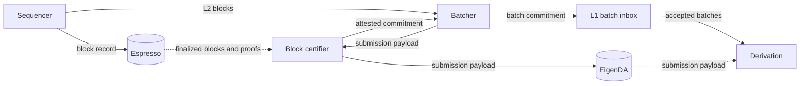

# Block Certification


This section specifies unstable behavior.
Block certification is not activated on any MegaETH network.
Parameters marked `TBD` remain unassigned.


**Block certification** publishes each L2 block's ordinary transactions to [Espresso](https://docs.espressosys.com/network/learn/what-is-espresso) as a [block record](block-records.md), and gates L1 settlement on a check that what settles is exactly what was published.
A full node treats a block as [certified](full-node.md#the-guarantee) after verifying its selected Espresso record, L1-dependent validity and execution, predicting settlement without fallback under the stated conditions before L1 submission.
Its record becomes [canonical](block-records.md#canonicality) only when the L1 inbox accepts the closing submission that advances the cursor through it; local scanning and TEE attestation alone do not confer that status.
The [activation procedure](activation.md) defines scheduling, bootstrap acceptance and the transition from legacy derivation.
The settlement path is otherwise unchanged: [EigenDA](https://docs.eigencloud.xyz/eigenda/core-concepts/overview) carries the batch data and Ethereum settles it on their usual schedules, now bound to the ordering of the selected records rather than to whatever the sequencer chooses to submit.

## Specifications

- [Block Records](block-records.md) — record format, signing, publication, record selection, and canonicality.
- [Block Certifier](certifier.md) — Espresso verification, cursor transitions, and attestation.
- [L1 Batch Inbox](batch-inbox.md) — commitments, registration, submission rights, acceptance, and alternative-batcher recovery.
- [Derivation Pipeline Deltas](derivation-pipeline.md) — the eight normative deltas (Δ1 and Δ3–Δ9), with the principle that places every check.
- [Full Node Verification](full-node.md) — draft capabilities, independent-finality claim, and assumptions.
- [Emergency Recovery](recovery.md) — draft failure scenarios, recovery obligations, and open questions.

Two neighbouring behaviors are specified as deltas over OP Stack rather than here.
[Batch Submission](../rollup/batch-submission.md) covers how the batcher reaches the certifier, spelling out the hand-over that leaves batching itself with no new logic: which frame bytes go over, what commitment comes back, and how it is posted to L1.
[Derivation](../rollup/derivation.md) covers what changes on the reading side: a batch transaction is derived from if and only if the inbox contract accepted it, which derivation reads from the acceptance event in the transaction's receipt rather than from the sender.

The certifier's attestation covers selected block inputs — which ordinary transactions, in what order, against which L1 origin — rather than execution results.
The full node additionally executes those inputs to establish certified status; state roots, receipts and gas usage remain derived artifacts, not outputs any record fixes.
Deposit and [forced-inclusion transactions](../rollup/deposits.md) are likewise outside it, being derived directly from L1 by every node and never part of any selected record.

Retrieving Espresso blocks together with the proofs that they were finalized, assembling the certifier's inputs out of them, dispersing each submission payload to EigenDA, and sending the resulting transaction to L1 are implementation rather than protocol.
Every part of that work is untrusted, no safety property depends on it, and two implementations that carry it out entirely differently are indistinguishable to every other party.

This section assumes that block certification activates at an L2 height by which the [Isthmus](https://specs.optimism.io/protocol/isthmus/overview.html) upgrade is already active.
Two properties follow, and the pages below rely on them without restating the assumption.
First, the pre-Isthmus derivation rule that drops a batch carrying a set-code (EIP-7702) transaction cannot apply to any certified height, so [Record Validity](block-records.md#record-validity) imposes no condition on such transactions.
Second, because fork ordering places [Holocene](https://specs.optimism.io/protocol/holocene/overview.html) no later than Isthmus, derivation substitutes a deposit-only block at the same height when the execution engine rejects one, rather than reverting and retrying, which the Claim's second branch and [Δ5 and Δ6](derivation-pipeline.md#delta-5-substitute-instead-of-dropping) rely on.

The [publisher](block-records.md#publication) — a role the sequencer's operator performs — publishes one record per block at production cadence, never waiting on the settlement path.
The batcher builds standard OP Stack channels and frames and hands a [submission payload](certifier.md#encodings) containing one or more consecutive frames of one channel to the block certifier in the alt-DA provider slot.
The certifier disperses that payload to EigenDA, verifies its certificate and the channel content against records selected from Espresso, and returns one commitment bundling the certificate with its own attestation.
The L1 batch inbox accepts that commitment only if the attestation verifies and the submission continues exactly where the previous one ended, binding accepted blocks to those selected records.
Derivation then reads accepted submissions from the inbox as OP Stack batch data: it verifies neither Espresso nor the attestation, taking the inbox's acceptance event as its evidence, and applies the [derivation pipeline deltas](derivation-pipeline.md) that certification requires.

## How a Block Settles

The two paths below follow one L2 block, N, from production to L1 settlement, and then show how an observer that trusts no operator verifies it; each step names the party acting, what it produces, who checks it, and the page that specifies it.
Three words carry distinct meanings throughout.
A record is _selected_ when the scan of Espresso's finalized history keeps it as the first valid record for its height.
A record is _canonical_ when the L1 inbox has accepted a cursor transition through it.
A block is _certified_ when a full node has itself determined that its content will settle.

### Settlement Path

1. The sequencer produces L2 block N, committing at production time to the L1 origin `epoch_num` the block attaches to and to its ordered list of ordinary transactions, per [Fields](block-records.md#fields).
   No party on the settlement path checks the block as the sequencer streamed it; what settles is fixed by the record of the next step, as the [Roles and Trust](#roles-and-trust) table states.
2. The publisher — the sequencer's operator, holding the secret half of the [`PUBLISHER_KEYS`](block-records.md#authorized-publisher-keys) entry governing N — publishes a [block record](block-records.md#fields) carrying N's `block_number`, `epoch_num` and `transactions` in full, authenticating either its containing [record batch](block-records.md#record-batch) or each of its [record fragments](block-records.md#record-fragment), and sends those publications to the Espresso namespace [`CHAIN_ID`](block-records.md#constants).
   It does so for every block the sequencer produces, at production cadence, never waiting on the batcher, the data availability layer or L1 inclusion, per [Publication](block-records.md#publication).
   The signature is checked by every party that scans the namespace in the next step.
3. Espresso finalizes the publications; a record becomes selectable in its batch's encoded order or when the final fragment of its attempt completes it.
   Its [record position](block-records.md#record-position) is its span start — the batch, or the index-0 fragment of its completing attempt — from which a resumed scan continues, re-selecting it first only when it was fragmented.
   Every party that scans the namespace forward from the inbox's [initial cursor](activation.md#initial-cursor), restarting at each [override](batch-inbox.md#emergency-cursor-override), and keeps the first valid record for each successive height computes the same [selected record sequence](block-records.md#canonical-record-sequence).
   A record is [valid](block-records.md#record-validity) when it claims the next expected height, carries an `epoch_num` no lower than the preceding selected record's, verifies under the publisher key governing its height, and meets the content conditions.
   Selection makes N's record neither canonical nor N certified: given the same starting cursor and protocol parameters it is a pure function of the record bytes and Espresso's order, and depends on no L1 or L2 execution state.
4. The batcher — the sequencer's operator as primary, or a registered alternative once the exclusive window has expired — packs post-checkpoint blocks into standard OP Stack channels and frames under the pinned [`CHANNEL_PARAMS`](certifier.md#constants), singular batches only.
   It hands each [submission payload](certifier.md#encodings) — one or more consecutive new frames of one channel — to the block certifier as its alt-DA provider, per [Provider Substitution](../rollup/batch-submission.md#provider-substitution).
   The batcher performs no certification check of its own and cannot bypass the certifier: a payload dispersed directly carries no attestation, and the inbox rejects it.
5. The certifier host — an untrusted process that anyone running the authorized image may operate — disperses the payload to [EigenDA](https://docs.eigencloud.xyz/eigenda/core-concepts/overview), obtaining the certificate `eigenda_cert`.
   It assembles the [core's inputs](certifier.md#inputs-and-outputs): the inbox's current [`Cursor`](certifier.md#cursor), the Espresso blocks from `cursor.height` onward with their finality and namespace proofs, the anchored quorum and any quorum steps, the channel's already-accepted frames as a prefix witness, and the EigenDA operator-set data the certificate is verified against.
   The host is trusted for nothing: the core authenticates every input, and a wrong input yields no attestation the inbox accepts.
   The one exception is [key sealing](certifier.md#key-sealing): an operator able to change the release policy of a sealed certifier key is trusted for that policy.
6. The certifier core — the attested pure function inside the enclave — checks that the supplied quorum matches `cursor.quorum_snapshot_hash` and verifies each Espresso block's finality and namespace completeness against it.
   It checks that the frames form one channel continuing the accepted prefix bound by `cursor.frames_digest`.
   It decodes the complete L2 blocks and compares each with the next selected record — `transactions` and `epoch_num` byte for byte, and the batch timestamp against the height's fixed timestamp — per [Advancing the Cursor](certifier.md#advancing-the-cursor).
   It verifies the EigenDA certificate's blob inclusion, aggregate signature and stake thresholds against the supplied registry evidence, per the [Verification Procedure](certifier.md#verification-procedure).
   It then signs `attest_digest`, which covers `prev_cursor`, `eigenda_commitment`, `keccak256(eigenda_cert)`, `registry_evidence_hash` and the resulting `cursor` under the chain identifier and inbox address, per [Encodings](certifier.md#encodings); a failed check produces no output, so there is nothing to submit.
   The host returns the [batch commitment](batch-inbox.md#batch-commitment) — the certificate, the attested commitment, the cursor pair and `certifier_sig` — to the batcher, and the enclave's key is admissible only while [hardware attestation](certifier.md#attestation) binds it to an image whose measurement remains in the [authorized-measurement set](batch-inbox.md#certifier-key-registration).
7. The batcher posts that batch commitment, prefixed by `BATCH_TX_PREFIX`, as the calldata of a transaction to the fixed [L1 batch inbox](batch-inbox.md#batch-commitment) proxy.
   The inbox [accepts](batch-inbox.md#acceptance) only if all of the following hold.
   The transaction carries no blob.
   `prev_cursor` equals the stored cursor, an open channel older than `CHANNEL_TIMEOUT` counting as closed.
   `cursor.epoch_num` does not exceed `block.number`.
   An open channel is continued only by its opener.
   The sender is the primary batcher or, once [`EXCLUSIVE_WINDOW`](batch-inbox.md#exclusive-window) L1 blocks have passed since `cursor.epoch_num`, a registered alternative.
   The certificate's reference block is fresh.
   `certifier_sig` recovers through `certifier_verifier` to a key [registered](batch-inbox.md#certifier-key-registration) under a still-authorized measurement, over a digest the contract rebuilds using registry evidence read from EigenDA's own registries.
   The certificate's commitment equals `eigenda_commitment`.
   The inbox then stores `cursor` and emits [`CursorAdvanced`](batch-inbox.md#events), which makes the selected records the transition advanced through canonical; on any failure it reverts, nothing changes, and no event exists.
8. Derivation — every node, applying identical rules — selects a transaction to the inbox as a batch under the [certified rules](activation.md#derivation-transition) if and only if its receipt is successful and carries `CursorAdvanced` from the inbox address; the sender is not evaluated and blob-carrying transactions are excluded, per [Batcher Transaction Selection](../rollup/derivation.md#batcher-transaction-selection).
   It resolves the calldata to frame bytes by retrieving the payload `eigenda_cert` certifies from EigenDA and refusing to ingest it unless its G1 commitment and length under `EIGENDA_CODEC` equal those in the blob commitment of `eigenda_cert`, whose hash the inbox established equals `eigenda_commitment`, per [Batch Commitment Resolution](../rollup/data-availability.md#batch-commitment-resolution), then assembles channels and batches as OP Stack does.
   It verifies neither Espresso nor the attestation, and applies the [derivation pipeline deltas](derivation-pipeline.md).
   Selection on the acceptance event, ignoring the batch's `parent_hash`, resolving the canonical origin from `epoch_num`, and the activation boundary are normative ([Δ1](derivation-pipeline.md#delta-1-batch-transaction-selection-keys-on-the-acceptance-event), [Δ3](../rollup/derivation.md#batch-parent-hash), [Δ4](../rollup/derivation.md#canonical-l1-origin-resolution), [Δ7](derivation-pipeline.md#delta-7-activation-boundary)).
   The normative [Δ5](../rollup/derivation.md#same-height-deposit-only-substitution) substitutes a deposit-only block at the same height for the specified timestamp-against-origin, sequencer-drift and origin-continuity rejections, retaining the channel suffix; [Δ6](../rollup/derivation.md#channel-retention-after-execution-rejection) also retains the suffix after an execution rejection.
9. The execution engine executes N's batch against the derived parent: on success N settles with its selected record's content, and on `INVALID` derivation substitutes a [deposit-only block](https://specs.optimism.io/protocol/derivation.html#batch-queue) at that height, per [The Two Kinds of Failure](derivation-pipeline.md#the-two-kinds-of-failure).
   If no accepted batch for N is ingested before its [sequencing window](https://specs.optimism.io/protocol/derivation.html#overview) elapses, whatever the cause, the deposit-only fallback fills N with a deposit-only block, unchanged from OP Stack, per [Unchanged Behavior](../rollup/derivation.md#unchanged-behavior).
   These are the only two outcomes, which is [the Certification Claim](#the-certification-claim); the settled block then remains subject to L1 finality and the fault proof window, per [Confirmation Stages](#confirmation-stages).

### Observer Path

1. A full node reads the Espresso namespace itself, verifying each block's finality, the quorum transitions back to the snapshot matching `INITIAL_QUORUM_HASH` and namespace completeness rather than trusting an endpoint.
   It runs the selection scan from the inbox's initial cursor and from each `CursorSet` override it finds on L1, producing the selected record sequence on its own, per [Read the Espresso Namespace and Select Records](full-node.md#read-the-espresso-namespace-and-select-records) and [Verify Espresso Consensus](full-node.md#verify-espresso-consensus-rather-than-trust-an-endpoint).
   It tracks canonical status separately, from the `CursorAdvanced` transitions the inbox has accepted.
2. The node compares each selected record's `epoch_num` and height-derived timestamp against the corresponding header in its own canonical L1 view, per [Evaluate the L1-Dependent Conditions](full-node.md#evaluate-the-l1-dependent-conditions-against-its-own-l1-view), and executes the record's transactions against its own head, per [Execute the Record's Transactions](full-node.md#execute-the-records-transactions-against-its-own-head) — the one check that anticipates an engine rejection, which the certifier can never make.
   A block that passes is certified: the node has determined, before any L1 transaction for it exists and with no trust in the sequencer, batcher or certifier operators beyond the release policy of any [sealed](certifier.md#key-sealing) certifier key, that its content will settle without the deposit-only fallback under the [conditions](full-node.md#conditions-under-which-it-holds) the [guarantee](full-node.md#the-guarantee) lists.
   The determination is revocable by that node: an L1 reorganization or an override that skips the height requires it to be reevaluated.
3. A node that also runs a certifier enclave, has [registered](batch-inbox.md#certifier-key-registration) its key, and holds membership in the [batcher registry](batch-inbox.md#batcher-registry) may submit for N itself once the [exclusive window](batch-inbox.md#exclusive-window) has expired, building the channel from the selected records alone, per [the self-rescue capability](full-node.md#optionally-the-ability-to-self-rescue) and [Recovery by an Alternative Batcher](batch-inbox.md#recovery-by-an-alternative-batcher).
   A node without both can verify everything above but knows only that N will settle on the condition that some registered party submits.

## The Certification Claim

Every L2 block covered by certification — every height above the [activation checkpoint](activation.md#initial-cursor) — if it settles, settles either byte-identical to the selected record's ordinary content made canonical by inbox acceptance, or settles as a [deposit-only block](https://specs.optimism.io/protocol/derivation.html#batch-queue) for that height.
There is no third settled-content outcome.
These settlement outcomes assume that required accepted payloads remain retrievable under the [retention assumption](#confirmation-stages); a node unable to obtain a matching payload [stalls derivation until it becomes available](../rollup/data-availability.md#batch-commitment-resolution), rather than substituting a deposit-only block.
Throughout this section, a height _settles_ as whatever content [derivation](../rollup/derivation.md) fills it with from L1 data, and a _deposit-only block_ is a block carrying only the deposit transactions derived from L1, which derivation produces for a height whose batch never arrives or is rejected.
The Claim rests on two premises: the inbox's [initial cursor](activation.md#initial-cursor) is correctly constrained to the administrative schedule, and every [emergency cursor override](batch-inbox.md#emergency-cursor-override) is correct — its position is either the index-0 fragment of an attempt for its `block_number` that completes with a record the [record scan](block-records.md#sync-start) re-selects, or a position from which that scan finds the [publisher](block-records.md#publication)'s record for `block_number + 1` first, its origin floor is one the next record's origin (and, in the first case, the re-selected record's) does not go below, and its quorum anchor is reachable from the scheduled trusted Espresso quorum.
The Claim further assumes what the [Roles and Trust](#roles-and-trust) table records: an authentic scheduled Espresso quorum anchor, an intact certifier image and key, Espresso's finality, and governance that authorizes only sound images.

The Claim rules out a third settled-content outcome; it does not promise that every selected record's content settles.
A height that settles as a deposit-only block satisfies it.
The stronger claim that a node can predict which outcome a height will have is stated separately in the draft [full-node guarantee](full-node.md#the-guarantee).

Espresso finality and the certifier's attestation do not assert execution validity.
The record carries the ordered transaction list for a height and the [L1 origin](https://specs.optimism.io/glossary.html#l1-origin) it attaches to; the full node's certified determination additionally checks that the block executes under its current L1 view and the guarantee's conditions.
Execution is a separate deterministic function of the parent state, the selected transaction list, and inputs derived from canonical L1, which every node can recompute.
An L1 reorganization can change those inputs and invalidate a previously executable block without changing its selected record on Espresso.
When a selected record's block fails to apply, OP Stack derivation deterministically discards the block's ordinary content and substitutes a deposit-only block for that height, which is the second half of the dichotomy.

The same dichotomy covers a batch that never arrives.
The certifier produces no attestation for content that differs from the [transaction list selected for those heights](block-records.md#canonical-record-sequence), so the batcher has nothing valid to submit.
If nothing valid reaches the inbox before the [sequencing window](https://specs.optimism.io/protocol/derivation.html#overview) of the heights the channel carries elapses, the [deposit-only fallback](https://specs.optimism.io/protocol/derivation.html#batch-queue) (the empty batch derivation produces when a height's sequencing window elapses) fills the height with a deposit-only block.
The deposit-only fallback itself needs no escape mechanism, no governance action, and no new trust assumption — derivation never needs to know why nothing arrived, and the two causes are indistinguishable to it by design.
The inbox does separately provide an [emergency cursor override](batch-inbox.md#emergency-cursor-override), by which the chain's existing L1 super admin can move the inbox's position past a state from which no valid next attestation can be produced.
That override is not part of the deposit-only fallback path above and does not itself submit content or fill a missing height.
It changes the position and trust anchor from which subsequent certification proceeds; an override can therefore skip unaccepted records or change future selection despite the cursor only advancing, invalidating an earlier full-node certified determination.
Preserving the Claim across an override depends on the admin satisfying the override's correctness obligations, which the contract does not verify.

## Roles and Trust

Every guarantee on these pages is conditional on the trust this table records; each row names what a role is relied on for and what bounds it when it misbehaves.

| Role                                          | Performed by                                             | Does                                                                                                                                                                                                                                                        | Trusted for                                                                                                                                                                                                                                              | Not trusted for, or bounded by                                                                                                                                                                                                                                                                                                                                                                                   |
| --------------------------------------------- | -------------------------------------------------------- | ----------------------------------------------------------------------------------------------------------------------------------------------------------------------------------------------------------------------------------------------------------- | -------------------------------------------------------------------------------------------------------------------------------------------------------------------------------------------------------------------------------------------------------- | ---------------------------------------------------------------------------------------------------------------------------------------------------------------------------------------------------------------------------------------------------------------------------------------------------------------------------------------------------------------------------------------------------------------- |
| Sequencer                                     | the sequencer operator                                   | produces L2 blocks and chooses each block's L1 origin                                                                                                                                                                                                       | liveness of block production                                                                                                                                                                                                                             | what settles is fixed by the selected record, not by the stream it acknowledged                                                                                                                                                                                                                                                                                                                                  |
| Publisher                                     | the same operator, holding the `PUBLISHER_KEYS` secret   | signs publications carrying one record per block                                                                                                                                                                                                            | publishing every height (no replacement path exists, [S6](recovery.md#s6-the-publisher-goes-silent-no-recovery-path-exists))                                                                                                                             | a compromised key fixes the content of heights not yet selected that the entry governs, until the table changes; it cannot displace a record already selected or forge a sender's signature; by publishing an origin ahead of the derived chain it can force an [emergency cursor override](batch-inbox.md#emergency-cursor-override), as [S4](recovery.md#s4-a-height-settles-as-a-deposit-only-block) explains |
| Primary batcher                               | the same operator                                        | packs channels, obtains attestations, posts commitments                                                                                                                                                                                                     | liveness within the [exclusive window](batch-inbox.md#exclusive-window)                                                                                                                                                                                  | every byte it submits is checked by the certifier core; it cannot choose the cursor's anchor; it can stall settlement until the window expires, plus one `CHANNEL_TIMEOUT` for a channel it opens and never closes, repeatable each time an alternative's closing submission re-arms the window, until the admin removes it                                                                                      |
| Alternative batchers                          | admin-curated addresses                                  | submit from public data after the window expires                                                                                                                                                                                                            | acting at all (unincentivized)                                                                                                                                                                                                                           | a channel opened and never closed costs one `CHANNEL_TIMEOUT` per occurrence                                                                                                                                                                                                                                                                                                                                     |
| Certifier host and its operator               | anyone running the authorized image                      | assembles the core's inputs, disperses to EigenDA, returns the commitment the batcher submits                                                                                                                                                               | nothing, unless it can change the release policy of a [sealed](certifier.md#key-sealing) `CERTIFIER_KEY`; then that policy, since dropping its measurement condition releases the key to arbitrary code                                                  | the core authenticates every input against the cursor's anchor; a wrong input yields no attestation the inbox accepts                                                                                                                                                                                                                                                                                            |
| Certifier core, TEE and Nitro attestation     | an image whose measurement is currently authorized       | the verification procedure and its signature                                                                                                                                                                                                                | correct execution, key protection, and the measurement's authenticity                                                                                                                                                                                    | key compromise permits arbitrary settled content until its permanently bound measurement is withdrawn; an image upgrade uses a fresh key                                                                                                                                                                                                                                                                         |
| Espresso                                      | its validators from the admin-approved quorum anchor     | finalizes records; serves finalized history with proofs                                                                                                                                                                                                     | BFT finality, namespace completeness, and retention of finalized history                                                                                                                                                                                 | a liveness failure halts certification ([S9](recovery.md#s9-espresso-liveness-failure))                                                                                                                                                                                                                                                                                                                          |
| EigenDA                                       | its operators                                            | holds dispersed payloads; issues certificates                                                                                                                                                                                                               | availability of certified payloads; certificates whose quorum signatures the [certifier core verifies](certifier.md#security-considerations) against registry evidence the inbox rebuilds                                                                | unavailability halts submission ([S10](recovery.md#s10-the-data-availability-provider-is-unavailable)); a certificate does not by itself prove that retrieved bytes match, which derivation re-verifies                                                                                                                                                                                                          |
| L1 admin                                      | the chain's OP Stack super admin                         | schedules activation and its Espresso anchor, curates the batcher registry, authorizes enclave measurements, performs the emergency cursor override, owns the EigenDA certificate verifier router and admin-controlled delegated verification configuration | an authentic scheduled quorum anchor, a correct override, authorizing only sound images, and setting sound EigenDA security thresholds and required quorums, and preserving sound admin-controlled verification dependencies (governance trust premises) | an incorrect override can make later canonical records differ from the records the publisher published; withdrawing a measurement costs liveness, never safety; a verifier with lowered thresholds or quorums lowers settlement's data-availability security for later reference blocks                                                                                                                          |
| External verification and registry governance | controllers of mutable dependencies outside the L1 admin | controls externally governed proof-verification routes, certificate-verification configuration, or EigenDA and EigenLayer operator registries                                                                                                               | sound registration-proof acceptance and certificate security configuration for the decisions each controller can change; authentic operator keys, stake histories and registry configuration                                                             | an unsound registration verifier can admit an arbitrary signer; weakened certificate parameters or registry configuration can reduce data-availability security; dependencies and controllers are identified under [Certifier Key Registration](batch-inbox.md#certifier-key-registration)                                                                                                                       |
| Derivation nodes                              | everyone                                                 | apply identical rules                                                                                                                                                                                                                                       | consensus                                                                                                                                                                                                                                                | a node without receipts or a matching DA payload must stall                                                                                                                                                                                                                                                                                                                                                      |
| Other namespace writers                       | anyone                                                   | can write to the namespace                                                                                                                                                                                                                                  | nothing                                                                                                                                                                                                                                                  | validity filters them; the cost is bounded work per object                                                                                                                                                                                                                                                                                                                                                       |

The table's external-governance entry includes EigenDA and EigenLayer operator-registry controllers.
Any additional independently mutable verification dependency, including a registration-proof gateway, MUST be identified here with its controller and the decisions it can change, under the [delegated-verification governance rules](batch-inbox.md#certifier-key-registration).
An immutable verification dependency introduces no controller for changing its acceptance rules.

## Confirmation Stages

| Stage                      | When established                                     | Meaning                                                                                                                                                       | Data availability                                                           |
| -------------------------- | ---------------------------------------------------- | ------------------------------------------------------------------------------------------------------------------------------------------------------------- | --------------------------------------------------------------------------- |
| Sequencer acknowledgement  | ~10 ms                                               | Revocable by the sequencer alone                                                                                                                              | Stream recipients may hold copies; continued availability is not guaranteed |
| **Certified** (node-local) | Espresso finality and a full node's own verification | The node's determination that the content will settle without fallback under the guarantee's conditions; revocable by that node, and needing no L1 acceptance | Public — the record carries the transactions in full                        |
| **Canonical record**       | Inbox acceptance advancing through the record        | Selected content committed by the accepted cursor transition, relative to the canonical L1 history                                                            | Public — record on Espresso and submitted frames on EigenDA                 |
| Settled on L1              | Derivation of accepted data                          | Derived content, including any deposit-only substitution; subject to L1 finality                                                                              | Public — retrievable from EigenDA                                           |
| Fault proof window closed  | ~7 days                                              | Derived state claim finalized for withdrawals                                                                                                                 | Unchanged                                                                   |

The first three stages distinguish a sequencer promise, a full node's conditional prediction, and inbox acceptance; an override cannot promote skipped records from one to another.
Canonical record status decides what settles only under the [Claim's premises](#the-certification-claim); an incorrect override or a compromised certifier key would break that link.
An L1 reorganization can remove acceptance or change execution inputs, requiring affected statuses to be reevaluated.
The fault proof window concerns the derived state and withdrawals; neither a TEE attestation nor canonical record status proves execution results.
Public availability rests on an assumption this specification does not enforce: Espresso and EigenDA continue serving their finalized history.
That history is at least the last `seq_window_size` of L1 blocks' worth of records for an alternative batcher rebuilding a submission, the whole record history for an observer reconstructing selection and canonicality from initialization, and the dispersed frames for derivation.

## Spec History

Block certification has not been activated on any network.
