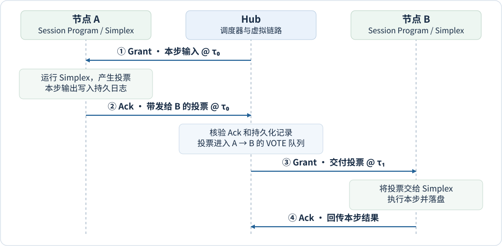
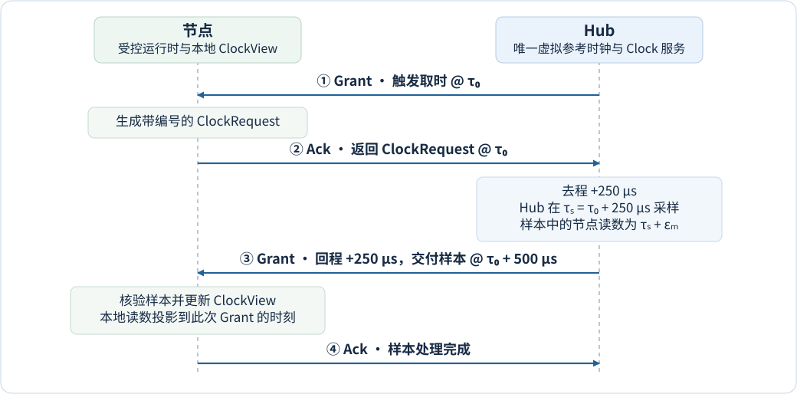

# Sequencer Rotation PoC v2 架构与实验报告

2026-11-17 · M1–M5 的协议实现和正式离线回放已合入本地 `main`（`bd3df19a89921eb25a6c51a82b5314af74e1fef7`）。各结果保留各自的受测提交。

## 1. 阶段成果

五条主路径均使用单机三地区、15 个真实 OS worker 和原生 Simplex 证书，并经独立检查。

| 里程碑 | 主场景结果 |
| --- | --- |
| **M1 · 健康满窗** | R0、R1 分别在 h10、h20 接棒，R2 的 h21 在虚拟 **31.085 s** 进入 G。 |
| **M2 · 健康主动 Force** | 真实 Anvil 收录控制，GFR 在公开键 22.000 s 保留 h10 并切到 R2，h16 在虚拟 **26.041 s** 进入 G。 |
| **M3 · 地区故障自动 Force** | R0 五个 worker 离线，2-of-3 治理触发 Force。GFR 保留 h1，按历史 policy 选 R1，h18 在虚拟 **28.041 s** 进入 G。 |
| **M4 · 预设 RESUME** | h2 出现 G/D 分歧。GFR 于虚拟 28.001 s 采用历史 D(h20)，R2 的 h21 于 **31.0525 s** 进入 G。 |
| **M5 · 自动 RESUME** | Espresso 停止 finalized 或冻结 θ 后恢复。治理自动选 h30，GFR 于虚拟 36.001 s 采用历史 D(h30)，两组的 R2 h31 均于 **41.084 s** 进入 G。 |

## 2. 单机运行架构

PoC 在一台机器上启动 **15 个独立节点进程**，分成 3 个模拟地区，每区 5 个等权节点。节点实际运行 Simplex、交换消息并签名。**Hub 统一推进虚拟时间**，决定消息、计时器和故障何时交付。需要执行 L1 合约时，实验启动本地 Anvil。

*图 1. M1–M5 单机仿真拓扑。图中的箭头表示数据或控制的流向。批次服务和独立派生在 M4、M5 中由同一个 Rust 进程托管。*

### 2.1 进程怎么分

| 运行位置 | 实际运行的组件 |
| --- | --- |
| **Hub 父进程** | 离散事件调度器、网络与时钟模型、每节点一份 Session Manager 状态，以及 Publisher、SimEspresso 和一份驱动节点的现场 GFR。M3 和 M5 的三名治理成员也在 Hub 内，分别维护自己的观察和决策状态。 |
| **15 个节点子进程** | 各自持有签名身份、时钟视图和本地持久化目录。获分配的节点通过 Session Program 启动一个原生 Simplex 实例。GFR 给各节点对应的 Manager 提供交接结果。Manager 先记录决定，再通过 Hub 下发准备、进入或关闭会话的动作。 |
| **L1 相关进程** | M1 满窗场景使用预置的 finalized L1 记录。M2–M5 由 Python 场景进程接收 Hub 指令，交给 Rust L1 driver，通过本机 HTTP JSON-RPC 调用独立的 Anvil 进程。M4、M5 使用 `m4-driver`，在同一进程内运行 L1 driver、Batcher、Certifier、DA 和各读者的 D 派生状态。 |

现场 GFR 在 Hub 读取已交付的 Espresso 和 L1 记录。子进程接收会话动作，并按当前虚拟时刻读取其可见的 L1 高度和时间戳。每个节点自行下载并重放公共日志的接线仍在完整 M1 的验收范围内。[完整 M1 合同](milestones/M1-regular-merge-zh.md)

### 2.2 Hub 怎么驱动底层仿真

1. **统一排程。** Hub 用一个 Rust 有序事件队列管理所有节点。入站消息、计时器、Clock RPC、区块验证与构造的完成、L1 出块和故障都排入同一个虚拟时间轴。同一时刻的事件按因果顺序和固定 seed 派生的顺序键处理。
2. **授权执行一步。** Hub 通过节点的 stdin/stdout 管道发送带长度的 Protobuf 帧。每条 **Grant** 带上目标节点、会话、虚拟时刻和本次输入。节点内的受控执行器运行这一步的 Simplex 任务，将本步记录和签名见证写入本地日志，再返回包含结果的 **Ack**。
3. **确认后交付输出。** Hub 核验 Ack 与已落盘的步骤记录，然后安排后续消息、计时器和发布任务。区块正文、投票、证书和补取请求各走独立通道，按发送方、接收方和通道排队。节点时钟偏差和取时的请求、应答延迟分别建模。
4. **记录并复算。** Hub 保存 JSONL 事件轨迹和原始 Grant/Ack 帧，L1 路径另存 Anvil 的 RPC 请求和收据。独立检查器用这些证据复算公开链和恢复结果。磁盘、IPC 或 Anvil 调用的实际等待计入墙钟耗时，虚拟时间由队列中的下一事件推进。

### 2.3 各模块的实现技术栈

| 模块 | 实现技术 | 输入和输出 |
| --- | --- | --- |
| **Hub 与节点运行时** | Rust 1.95、Tokio、Prost / Protobuf。PoC 适配 Commonware 的任务调度、时钟、存储和 P2P 接口。 | Hub 投递模拟输入，节点回传本步产生的消息与状态记录。Clock RPC 的往返走同一套事件调度。 |
| **区域共识（Session Program）** | Commonware Simplex 2026.10.0，使用仓库固定的 runtime 和 consensus 补丁。区域证书采用原生 BLS12-381 多签。 | 当前地区在分配的窗口内生产区块。区内 5 个成员中至少 4 个不同成员签名才能形成最终证明，区块正文与证明齐备后才可发布。 |
| **会话管理（Session Manager）** | Rust `session-manager` 状态机，按节点持久化输入和动作。 | 读取 GFR 产生的会话分配和关闭记录，核对准备材料后让各节点分别进入共识，也负责结束旧会话。 |
| **发布（Publisher）** | Rust `publication-bridge`、`publisher` 和本地持久发布队列。 | 接收区域最终证明和完整区块正文，封装为发布任务并提交给 SimEspresso。 |
| **公开排序（SimEspresso）** | Rust 确定性日志模型，模拟 Espresso 的排序、确认和公开时间水位。 | 为发布内容分配公开顺序和时间键，按场景时序交给各读者。实验可暂停确认或冻结公开时间键。 |
| **全局链规则（GFR）** | Rust `viewer-gfr`、`authorization`、`core`。L2 使用余额、nonce、存款和转账的轻量执行模型。 | 合并已交付的 Espresso 和 L1 记录，校验证书与区块连接，再执行合格区块并更新全局链 **G**。处理交接时生成新的会话安排。 |
| **L1 驱动与合约** | Python 场景接线、Rust `l1-adapter`、Foundry Anvil 与 Forge、Solidity。场景进程和驱动经标准输入输出交换逐行编码的 JSON 指令。 | Anvil 执行控制合约 `ControlAuthority` 或 `CommitteeControlAuthority`，以及批次入口合约 `BatchInbox`。驱动按虚拟时程手动出块，模拟 finality，并为 A/B 等读者分别交付可见的区块和收据。 |
| **治理委员会** | Rust 决策状态机，Python 通过 coincurve 生成 secp256k1 签名，控制合约校验 EIP-712 签名。 | 在自动治理场景中，每名成员按自己已核验的公共记录与时钟作出判断。M3–M5 的委员会合约要求两名不同成员对同一请求签名。M2 主动 Force 使用单签控制。 |
| **批次与数据可用性（DA）** | Rust `batch-services`。DA 以 Keccak-256 内容承诺为索引把批次存为本地文件。DA 和 Certifier 使用 secp256k1 签名。 | Batcher 把 G 中已接纳的交易打包。DA 先保存正文，Certifier 核验批次与其来源并签名，Batcher 再把签过的批次交给 L1 驱动提交。 |
| **独立派生（D）** | Rust `derivation`，复用 `core` 的轻量执行器，各读者维护各自的派生状态。 | 从 finalized L1 收据取出已接纳记录，按承诺取回并校验 DA 正文，在自己的父状态上执行得到 **D**。已接纳但数据未到时等待，完整窗口内没有合格批次时只执行存款。RESUME 时保存与具体 L1 日志位置绑定的历史快照。 |
| **检查与离线回放** | 独立 Python 检查器和 Rust 原生证书验证工具，读取 JSON/JSONL 证据与 Protobuf 帧。 | 按读者实际收到的位置复算结果。**G′** 是由 Inbox 接纳记录引用的历史 G 和恢复快照重建的接纳视图。 |

### 2.4 三种交接如何接到同一套运行时

- **Regular** 由 GFR 根据当前窗口的最后一块或公开的窗口结束事件安排下一轮。G 保留，Manager 让下一地区接棒。
- **Force** 由 L1 控制记录触发。公开输入齐备且控制生效时，GFR 保留已有 G，按该场景的选区规则分配新窗口。M3 的自动治理根据公开停滞提出请求。
- **RESUME** 同一笔 L1 交易记录恢复指令并设置 Inbox 的位置。GFR 使用该条记录对应的历史 D 快照对齐 G，Manager 将恢复点和执行后状态交给下一轮节点。M4 使用预设目标，M5 由治理根据自己的视图计算目标。

[运行时代码](../prototypes/i1b-runtime/src/m1_smoke/) · [Grant/Ack 消息定义](../proto/native.proto) · [L1 合约](../contracts/src/) · [批次与 DA](handoffs/11-batch-services-zh.md) · [独立派生 D](handoffs/12-derivation-zh.md)

## 3. 受控通信和时钟

### 3.1 Session Program 如何经 Hub 收发消息

节点里的 Simplex 通过适配后的 Commonware P2P 接口收发消息。**发出的消息先随 Ack 返回 Hub，由 Hub 排定收件节点何时看到它。** 图 2 以同一区域内节点 A 给节点 B 发投票为例。

*图 2. 一条投票从节点 A 经 Hub 到达节点 B。A 和 B 各自有一对 Grant/Ack。*

1. **Hub 下发 Grant。** Grant 指定节点、会话、事件和虚拟时刻，携带本步唯一的输入，例如入站消息、工作完成或会话关闭。Hub 和节点用 stdin/stdout 管道传输带长度的 Protobuf 帧。
2. **节点执行并返回 Ack。** 受控执行器在该时刻运行 Simplex 的可执行任务，提交本步日志和见证，再把发送消息、定时器更新等输出随 Ack 返回。Hub 将 Ack 与原 Grant、节点落盘的步骤序号和摘要核对。
3. **Hub 给收件节点安排新的一步。** 核验通过后，Hub 按 `(发送方, 接收方, 通道)` 将消息排队。区块正文、投票、证书和补取请求各走自己的通道。同一队列按顺序交付。图中投票在 τ₀ 入队，正常区域链路的基线延迟是 4 ms。到排定的 τ₁，Hub 给 B 发一条携带投票的 `Grant(Deliver)`。

**会话控制也经过 Hub。** GFR 产生交接记录后，Hub 内对应的 Session Manager 决定各节点何时准备、进入和关闭。准备材料经同一管道发送，启动和关闭可由 `Grant(Start)` 和 `Grant(Close)` 驱动。Hub 根据节点返回的 Ack 确认会话状态。

[Hub 调度和传输](../prototypes/i1b-runtime/src/m1_smoke/hub.rs) · [节点执行与落盘](../prototypes/i1b-runtime/src/m1_smoke/worker.rs) · [Grant/Ack 消息定义](../proto/native.proto)

### 3.2 Hub 如何推进全局虚拟时间

**Hub 是虚拟参考时间 τ 的唯一推进者。** Hub 从同一个队列中取出最早的事件，将 τ 推进到该事件的时刻。相同虚拟时刻的事件按因果顺序、seed 派生的顺序键和事件 ID 定序。一个 Grant 的执行、磁盘写入和 Ack 校验都发生在该步的虚拟时刻。Hub 等待进程、磁盘或 Anvil 响应所用的真实时间计入墙钟耗时。

节点向 Hub 请求时钟样本来校准本地 **ClockView**。取时的去程和回程都要经过事件队列，使用同一套 Grant/Ack 通道。

*图 3. 节点 Clock RPC 的基线时序，去程和回程各 250 µs。M5 的慢 RPC 对照把两段各调到 1 ms。*

- **读钟。** 样本携带请求号、序列号、采样时刻、该时刻的节点读数和租约截止时间。节点验证样本后，将采样读数按虚拟时间投影到当前 Grant 的时刻。Simplex 的 `Clock::current()` 同步读取这个本地值。节点凭验过的新样本续租，租约到期时停止发出新签名。
- **定时。** Simplex 请求 `sleep_until()` 时，运行时随 Ack 发出定时器登记。Hub 把节点的本地截止时间换算成全局虚拟时刻，排入同一个事件队列。到期且定时器仍有效时，Hub 用 `Grant(TimerFired)` 唤醒节点。

[本地 ClockView](../prototypes/i1b-runtime/src/clock.rs) · [Commonware 时钟适配](../prototypes/i1b-runtime/src/context.rs)

### 3.3 仿真、本地和公开时间分别用在哪里

| 时间 | 用途 |
| --- | --- |
| **虚拟参考时间 τ** | Hub 的事件轴，决定消息、故障、工作完成、出块和交付何时发生。 |
| **节点时钟 Cₘ(τ)** | 用于本地窗口、超时和签名门禁。当前固定速率模型中 Cₘ(τ) = τ + εₘ，节点相对 τ 的偏差最多 1 ms，两节点读数最多相差 2 ms。Clock RPC 延迟决定样本何时到达，εₘ 决定节点读数相对 τ 偏多少。 |
| **公开时间键 x、θ_q** | GFR 按公共记录重放。θ_q 是 Espresso 的时间键，q 和消息索引标识日志位置。Force 的激活键是 x = ts_L1 + M_a，等完整公开水位覆盖该键后才处理。典型的同键顺序为 L1 控制 → Expire → SessionEnd → Espresso。 |
| **实际墙钟** | 记录运行耗时，用于进程 watchdog 和暂停复跑。相同虚拟轨迹可以对应不同墙钟耗时。 |

以 M2 为例，Anvil 收录 Force 的区块时间戳是 **12.000 s**，加上 10 s 激活等待得到公开键 **22.000 s**。SimEspresso 在虚拟时刻 **22.001 s** 交付覆盖该键的 q10，GFR 在这一虚拟时刻执行切换。M4 的 RESUME 同样从 L1 收录时间戳 18.000 s 得到公开激活键 28.000 s，q89 在虚拟 28.001 s 提供覆盖后执行。A/B 已分别于 19.500 s 和 19.510 s 取得历史切面，D 随后继续推进。

M5 则展示了本地与公开时间各自生效的情形。旧节点的本地停止阈值是 21 s。GFR 等到虚拟 24.501 s 取得对公开键 24.000 s 的覆盖，才处理 Expire。同一虚拟时刻内的事件顺序可在轨迹的 `seq` 字段中查看。

### 3.4 这些控制在实验中怎么用

- **M2** 延后旧分支 h11 的公开发布，并单独运行墙钟暂停对照。
- **M3** 让 R0 的五个进程离线，另测读者落后、排序停止和 Espresso 水位冻结。
- **M4** 按虚拟时序安排批次提交、L1 出块、finalized 交付及预设 RESUME。两个 D 读者按各自已收到的 L1 位置处理数据。墙钟暂停对照在派发 RESUME 前插入 650 ms 等待。
- **M5** 暂停 SimEspresso 的 finalized 输出或冻结公开时间键，L1、Clock RPC 和 D 继续推进。治理成员按各自收到的公开记录和时钟样本判断可签时刻，签完的交易通过同一个 Anvil driver 提交。

这条运行路径复用 **I1b 原生运行时与 native wire**，其调度、路由和 Ack 证据来自 `m1_smoke/hub.rs`。I1a 双进程 SignedIntent 和 02 transport kernel 有各自的组件验收记录。[I1a 有限验收](i1a-gate-result.md) · [原生 Fresh 有限验收](native-engine-fresh-result.md) · [通信组件验收](sim-transport-kernel-results.md)

## 4. M1–M5 场景、触发条件与成功终点

| 场景 | 测什么，谁触发 | 跑到哪里算成功 |
| --- | --- | --- |
| **[M1 · 健康满窗](../web/m1-gfr-replay/index.html)** | 地区正常出块。GFR 接纳窗口的最后一块后，按常规规则换区。 | R0、R1 分别在 h10、h20 交棒，R2 的 h21 接上 h20 并进入 G。 |
| **[M2 · 健康主动 Force](../web/m1-gfr-replay/force.html)** | 各区仍正常出块。实验定时提交单签 Force，测试在途控制与正常换区相遇时的处理。 | 保留 h10，排除同键公开的旧实体 h11，R2 的 h16 进入 G。 |
| **[M3 · 地区离线后自动 Force](../web/m1-gfr-replay/auto-force.html)** | R0 离线，公开排序继续。治理观察到当前地区长期没有新区块进入 G，自动提交 Force。 | 按生效规则排除 R0，保留 h1，R1 的 h18 进入 G。 |
| **[M4 · G/D 分歧后预设 RESUME](../web/m1-gfr-replay/resume.html)** | 故意让 h2 批次错过派生窗口，令 G 和 D 在 h2 分歧。实验确认分歧后按预设计划提交 RESUME。 | G 对齐到该次 L1 控制对应的历史 D(h20)，R2 从它接出 h21，且 h21 进入 G。 |
| **[M5 · 排序停滞后自动 RESUME](../web/m1-gfr-replay/auto-resume.html)** | 排序暂停或公开时间冻结，L1 和 D 继续。排序恢复后，治理确认 G 已停、D 已前进，自动选择恢复目标。 | 两种故障都由治理选出 h30，在预算内广播，G 对齐到历史 D(h30)，R2 的 h31 进入 G。 |

表中链接是各主场景的 Web 离线回放。下文列出的事件时刻用 **Hub 虚拟时间 τ**，与回放横轴一致。每次链上控制还要看 **L1 区块时间戳**和据此计算的**公开激活键**。控制收录后，GFR 等到 finalized L1 记录可见、Espresso 公开水位覆盖激活键，再处理切换。例如 M2 的 L1 区块时间戳是 12.000 s，公开激活键是 22.000 s，回放中的实际切换发生在虚拟 22.001 s。签名、收录、激活与新块进入 G 在回放中分别看。

### 4.1 共用参数

| 参数 | 封存主场景的取值 | 对实验时间的作用 |
| --- | --- | --- |
| 节点和窗口 | 15 个独立进程，3 区各 5 个等权节点，区域证明需 4 份签名。每轮负责 10 个高度，seed 42。 | 满窗时最后一块进入 G 即可交接。 |
| L2 时基与启动 | L2 创世时间戳 10 s，每高度 1 s。初次节点启动安排以虚拟 10.800 s 为基准，同区节点错开 3 ms。 | h1 的 L2 时间戳为 11 s。节点各自准备并进入共识。 |
| 节点时钟 | 区内偏差 −1000、−500、0、+500、+1000 µs。Clock RPC 单向基线 250 µs，刷新周期 80 ms，样本从采样起有效 180 ms。 | 本地超时看节点读数，取时请求和应答按虚拟延迟交付。 |
| 区域链路与执行 | 消息基线延迟 4 ms，每条按发送方、接收方和通道划分的队列容量 64。模拟工作完成延迟 5 ms。 | 决定消息到达、区块构造和验证完成的调度时刻。 |
| Simplex | leader 超时 1.5 s，认证超时 1.6 s，超时重试 1.5 s，补取重试 30 ms，view 1–128。 | 驱动区域内超时与重试。 |
| 公开发布 | Publisher 链路 5 ms，SimEspresso 确认延迟 1 ms。基线公开时间偏移为 0，粒度 1 µs。M3–M5 另每 250 ms 产生一次排序心跳。 | 区域确认、公开排序和 G 接纳在轨迹中各有位置。 |
| L1 与控制 | L1 出块槽为 2 s。M2–M5 使用 Anvil chain ID 31337，模拟 finality 延迟 1.5 s。读者 A 在 finalized 时收取，B 晚 10 ms。Force 和 RESUME 的公开激活键为 L1 收录块时间戳 + 10 s。 | 能分别观察提交、收录、读者获得记录和 GFR 应用控制。 |
| 公开等待窗口 | 所有场景的 SessionEnd 等待余量为 3 s，从窗口后第一个高度的 L2 时间戳起算。缺失高度的 Expire 从该高度的 L2 时间戳起算，M1/M2 加 8 s，M3/M4 加 30 s。 | 公开水位覆盖相应键后，GFR 才能处理窗口结束或缺块过期。 |
| Force 准备预算（M2、M3） | 公开激活后留 3 s 准备，再按 L2 槽位与已接纳高度确定新窗口。 | 新地区的首块高度可跨过旧分支未接纳的高度。 |
| 治理和批次 | M3–M5 的委员会门槛为 2-of-3。M3/M5 自动治理每 100 ms 轮询，三名读者的基础交付延迟为 0/10/20 ms，模拟签名和广播各用 10 ms。M4/M5 的派生批次窗口为 4 个 L1 块。 | 治理按各自收到的记录判断可签时刻。批次是否及时按 L1 上的收录位置判定。 |
| 轻量执行 | 创世时账户 1 余额 100、nonce 0。h1–h40 的固定存款向账户 2 注入金额 h，实体块含一笔账户 1 向 2 的转账，金额为 `1 + (42 + h) mod 3`。 | 用可观察的余额与状态变化区分正常派生和只含存款的派生。 |
| 运行上限 | 虚拟时刻上限 M1/M2 为 33 s，M3–M5 为 60 s。Hub 最多排 100,000 个事件，节点 Ack 的墙钟 watchdog 为 20 s，runner 命令的墙钟上限为 1,800 s。 | 主场景达到成功终点后收尾。各上限用于终止超时运行。 |

实跑工具版本为 Rust 1.95.0、Commonware 2026.10.0、Python 3.12.8。L1 场景使用 Anvil/Forge 1.0.0-stable 和 solc 0.8.20。链路、执行和交付延迟取自封存配置。[M1 profile](../../.build/commander-jobs/m1-regular/artifacts/healthy-smoke-91547857-seed42-run01/raw/profile.json) · [M2 profile](../../.build/commander-jobs/m2-healthy-force/artifacts/merge-ea4d853b-seed42-force-run01/raw/profile.json) · [M3 profile](../../.build/commander-jobs/m3-auto-force/artifacts/tester-7f4ade9-seed42-run01/outage/raw/profile.json) · [M4 profile](../../.build/commander-jobs/m4-resume/artifacts/tester-2ce2db0-seed42-run01/primary/raw/profile.json) · [M5 profile](../../.build/commander-jobs/m5-auto-resume/artifacts/tester-d6a3643-seed42-run01/primary/raw/profile.json) · [M5 慢 RPC profile](../../.build/commander-jobs/m5-auto-resume/artifacts/tester-d6a3643-seed42-run01/slow-rpc/raw/profile.json)

### 4.2 M1 · 健康满窗

L1 使用预置的 finalized 记录，所有地区按正常流程出块。当前窗口最后一块经区域确认、公开发布并进入 G 时，GFR 以该块为父块分配下一个窗口。本次两次交接均由满窗接纳触发。SessionEnd 路径仍由完整 M1 合同跟踪。[完整 M1 合同](milestones/M1-regular-merge-zh.md)

**20.045 s** 接纳 h10，R0 交给 R1 → **30.091 s** 接纳 h20，R1 交给 R2 → **31.085 s** 接纳 R2 的 h21，验证第二次交接后的新区块接上 h20。

### 4.3 M2 · 健康主动 Force

场景在 R0 正常生产时主动提交指向当前分支 β0 的单签 Force。等待公开激活期间，h10 进入 G，R0 按常规规则把职责交给 R1，分支仍是 β0。场景把旧 R1 的实体 h11 延到与 Force 相同的公开键 22.000 s，专门检查两件事。Force 能在同一分支正常换区后生效，同键的旧块按公开规则被排除。

**11.500 s** 提交 → **12.000 s** L1 收录 → **13.500 s** A 读到 finalized 控制 → **20.045 s** 正常接棒 → **22.001 s** GFR 激活 Force，保留 h10 并分配 R2 的 [16,25] → **26.041 s** h16 连同 h11–h15 的补位条目进入 G。

### 4.4 M3 · 地区离线后自动 Force

h1 进入 G 后，场景让 R0 的五个进程离线。排序心跳和 L1 继续推进。治理成员用各自读齐并验证的公共记录，比较最新的 Espresso 公开键与该职责最近一次让 G 前进的公开键。差值达到 **2 s**，且该职责还在生产窗口内、时钟和资料可用、预计接棒能赶在过期前、没有在途控制时，成员可以签署请求。两份同请求签名使交易可提交。排序停止或时间键冻结时，排序前进条件不成立。

**实际提交的 Force 请求**

| 字段 | 值 | 直白解释 |
| --- | --- | --- |
| 请求 ID / 控制序号 | 1 / 1 | 标识这次请求及其控制顺序。 |
| 目标分支 | β0 | 对当前的 β0 分支发起强制交接。 |
| 可选地区 | `enabled_mask = 0b110` | 排除 R0，允许 R1 和 R2 参与后续选区。 |
| 选区顺序 | `[R0, R1, R2]` | 提供给选区规则的地区顺序。 |
| 签署时的 L1 floor | h3 | policy 中携带的 L1 高度下界。 |
| 治理签名 | 2-of-3 | 两名不同成员签署同一请求，合约验证签名。 |

治理记录中还保存了当时观察到的旧会话 cid 和 G 头 h1。链上 Force 参数包含上表的请求 ID、序号、目标分支、policy 和签名。GFR 在激活时根据公开状态确定 anchor 和新窗口，本次实际得到 h1 与 R1 的 [h18, h27]。[封存请求](../../.build/commander-jobs/m3-auto-force/artifacts/tester-7f4ade9-seed42-run01/outage/raw/l1/governance-transaction.json)

| 虚拟时间 | 事件和链状态 |
| --- | --- |
| **11.073 s** | R0 的 h1 进入 G。 |
| **11.250 s** | 实验让 R0 五个节点离线，Espresso 心跳和 L1 继续推进。 |
| **13.300250 s** | 治理成员观察到公开进展差为 2.178 s，超过 2 s 门槛，满足签名条件。 |
| **13.320250 s** | 收集同一 Force 请求的签名并广播。 |
| **14.000 s** | L1 收录 Force。区块时间戳为 14 s，公开激活键是 24 s。 |
| **24.001 s** | Espresso 水位覆盖激活键，GFR 保留 G 的 h1，按历史选区规则排除 R0，安排 R1 的窗口 [h18, h27]。 |
| **28.041 s** | R1 的 h18 连接实体父块 h1。h2–h17 的补位条目与 h18 一起进入 G，达到主场景成功终点。 |

### 4.5 M4 · G/D 分歧后预设 RESUME （A faulty batcher)

各地区保持正常，场景只延后 h2 的批次。h1 批次及时在 L1 h6 收录，独立执行得到的 D(h1) 和 G(h1) 一致。h2 批次最晚可在 L1 h7 收录。A 在 **15.500 s** 读齐 h7 时仍未看到合格批次，D 遂为 h2 派生一个只含存款的块。G 的 h2 还含普通转账，两个区块哈希因此分歧。h2 批次在 **15.750 s** 才提交，**16.000 s** 收录于 L1 h8，已过派生窗口。

这次实验预设在 **17.000 s** 请求恢复到 h20，目标块引用 L1 h9。提交前检查分歧已确认、Espresso 最新公开时间键距当前虚拟时刻不到 1 s，且 G、D 和 Inbox 位置都低于 h20。两名成员对这条预设请求签名，真实 L1 同一笔交易记录 RESUME 并设置 Inbox 位置。

**实际提交的 RESUME 请求**

| 字段 | 值 | 直白解释 |
| --- | --- | --- |
| 请求 ID / 控制序号 | 1 / 1 | 标识这次恢复请求及其控制顺序。 |
| 恢复目标 | `targetHeight = h20`，`origin = L1 h9` | 恢复采用指定位置的历史 D(h20)，该目标块的 L1 origin 是 h9。 |
| 可选地区 | `enabled_mask = 0b111` | R0、R1、R2 均允许参与后续选区。 |
| 选区顺序 | `[R2, R0, R1]` | 提供给恢复后选区规则的地区顺序，本次选出 R2。 |
| 签署时的 L1 floor | h3 | policy 中携带的 L1 高度下界。 |
| 治理签名 | 2-of-3 | 两名成员签署这条预设请求。 |

实验提交时记录的观察值为 G 头 h6、D 头 h2、Inbox 高度 h2。它们用于检查预设条件。L1 的 RESUME 参数由请求 ID、序号、policy、目标高度、origin 和签名组成。[封存请求](../../.build/commander-jobs/m4-resume/artifacts/tester-2ce2db0-seed42-run01/primary/raw/l1/resume-authority.json)

| 虚拟时间 | 事件和链状态 |
| --- | --- |
| **12.000 / 13.500 s** | L1 收录 h1 批次，A 在 finalized 后读取并独立派生 D(h1)，结果与 G(h1) 一致。 |
| **15.500 s** | A 读齐 h2 的批次窗口，D 派生只含存款的 h2。它与包含普通交易的 G(h2) 哈希不同，出现分歧。 |
| **15.750 / 16.000 s** | h2 批次提交并在 L1 h8 收录，已错过截止于 h7 的窗口。 |
| **17.000 / 18.000 s** | 实验检查分歧和预设条件后，提交目标为 h20 的 RESUME。两名成员签名，L1 在 18 s 收录控制及 Inbox 位置更新。 |
| **19.500 / 19.510 s** | A/B 各自处理 L1 记录，保存该次控制绑定的历史 D(h20) 切面。回放根据 A 的切面重建 G′ 到 h20。 |
| **27.500 s** | live D 在读齐 L1 h13 后按窗口回退规则派生只含存款的 D(h21)，native hash 为 `ab9a15c8…`。 |
| **28.001 s** | 公开水位覆盖激活键 28 s。GFR 保留 G 的 h0–h1，以历史切面的 D(h2)–D(h20) 替换旧后缀，并安排 R2 的窗口 [h21, h30]。live D 此时已到 h21。 |
| **31.0525 s** | R2 以历史 D(h20) 为 anchor 提出的 h21 进入 G，含一笔普通交易，native hash 为 `a2fab4f3…`。主场景在此结束，G / 重建的 G′ / live D 分别为 h21 / h20 / h22。 |

恢复后的 G(h21) 和 live D(h21) 哈希不同。该主场景验证到恢复首块进入 G，后续如何处理这次新分歧尚未在该主场景中观察。

### 4.6 M5 · 排序停滞后自动 RESUME (Faulty Espresso, TBD)

两条主路径都在 **11.250 s** 注入故障。一条暂停 SimEspresso 的 finalized 输出，另一条继续增加记录序号 q，同时冻结公开时间键 θ。L1 和 D 在两条路径上都继续推进。M5 将缺块 Expire 窗口设为 **12 s**，h2 的公开过期键为 24.000 s。旧节点在各自本地时钟到 21 s 时停止当前会话，对应虚拟 20.999–21.001 s。GFR 等到排序水位重新覆盖过期键，才处理公开 HALT。

排序服务在 **24.500 s** 恢复，GFR 于 **24.501 s** 处理 h2 过期。治理先核实排序再次推进、所需记录与时钟可用、G 已 HALT 且 D 已超过它，以及没有在途控制，再求可行目标。目标高度要高于预计收录前 G、D 和 Inbox 可能达到的上界，同时给新会话留下准备时间并满足时间上限。本次预计 L1 收录区间为 **[26,28] s**。用最晚端加 12 s 准备时间、最早端加 15 s 漂移上限再减 1 s 余量，两边都得到 L2 时间戳 40 s，对应唯一可行的 h30。就绪预算为 0.5 s。

**实际提交的 RESUME 请求**

| 字段 | 值 | 直白解释 |
| --- | --- | --- |
| 请求 ID / 控制序号 | 1 / 1 | 标识这次恢复请求及其控制顺序。 |
| 恢复目标 | `targetHeight = h30`，`origin = L1 h13` | 治理自动计算目标，恢复采用对应 L1 位置的历史 D(h30)。 |
| 可选地区 | `enabled_mask = 0b111` | R0、R1、R2 均允许参与后续选区。 |
| 选区顺序 | `[R2, R0, R1]` | 提供给恢复后选区规则的地区顺序，本次选出 R2。 |
| 签署时的 L1 floor | h3 | policy 中携带的 L1 高度下界。 |
| 治理签名 | 2-of-3 | 两名成员各自判断并签署同一请求。 |

两条主路径提交的链上请求内容相同。治理的本地记录还保存旧会话 cid、目标分支 β0 和观察到的 G 头 h1，作为决策上下文。链上的 RESUME 参数包含请求 ID、序号、policy、目标高度、origin 和签名。[封存请求](../../.build/commander-jobs/m5-auto-resume/artifacts/tester-d6a3643-seed42-run01/primary/raw/l1/governance-transaction.json)

| 虚拟时间 | 事件和链状态 |
| --- | --- |
| **11.250 s** | 注入排序故障。G 停在 h1，L1 与 D 继续推进。 |
| **13.500 s** | A 读到已接纳的 h1 批次，回放重建 G′ 到 h1。 |
| **20.999–21.001 s** | R0 节点分别达到本地停止阈值，停止当前会话。GFR 等待公开水位。 |
| **24.500 / 24.501 s** | 排序恢复，公开水位覆盖 h2 的过期键 24 s，GFR 处理 Expire 并进入 HALT，G 仍为 h1。 |
| **24.761 / 24.820250 s** | 两名治理成员首次满足同一请求的签名条件并广播目标 h30，距可签 59.250 ms，在 120 ms 预算内。 |
| **26.000 / 27.500 s** | L1 在 26 s 收录 RESUME 及 Inbox 位置更新。A 于 27.500 s 保存对应的历史 D(h30) 切面，回放重建 G′ 到 h30。 |
| **35.500 s** | A 读齐 L1 h17，D 的 h31 批次窗口已结束，派生只含存款的 D(h31)，native hash 为 `611cfc22…`。该块的 L2 时间戳是 41 s。 |
| **36.001 s** | 公开水位覆盖激活键 36 s，GFR 用历史 D(h30) 对齐 G，安排 R2 的窗口 [h31, h40]。live D 已到 h31。 |
| **41.056 / 41.078 / 41.084 s** | R2 提议 h31、形成区域最终证明、经公开发布进入 G。这个 h31 以历史 D(h30) 为 anchor，含一笔普通交易，native hash 为 `fa3478e6…`。主场景成功终点为 G / 重建的 G′ / live D = h31 / h30 / h33。 |

这次运行中，D 在 R2 提议 h31 前已完成该高度的只含存款回退。当前 PoC 的回退由 L1 批次窗口是否读齐驱动，D(h31) 的 L2 时间戳为 41 s，但其派生发生在虚拟 35.500 s。窗口结束早于 R2 首块产生，G(h31) 与 D(h31) 因此不同。主场景结束于 h31 进入 G，未继续观察该新分歧的处理。慢 RPC 对照把单向延迟改为 1 ms，仍验证到 h31。

自动治理也接受同高度的 G/D 哈希分歧作为恢复理由。AR05 对照验证到 L1 收录。短暂停顿后 G 正常恢复出块时，治理继续观察。[M5 验收用例](milestones/M5-auto-resume-task-contract-zh.md)

## Todos

- Align current simulation with real timing.
- Rebuilding session manager to enable concurrent block building.
- Further global clock test:
  - a fast/slow Espresso ts
- Implement the staking/slash layer
- Long term benchmark
  - randomized regional BFT failure

To be determined:

- what is the setup of the a regional BFT:
  - number of nodes? latency? bandwidth?
  - cross-region rotation frequency
