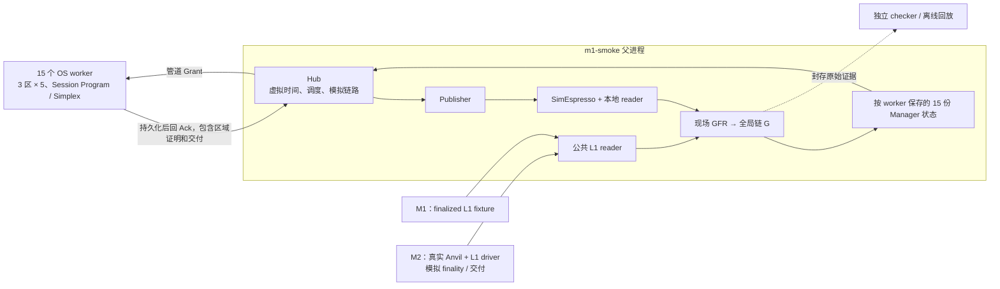

# Sequencer Rotation PoC v2 架构与实验报告

2026-11-16 · 运行实现与 M2 复跑以 `ea4d853bd8b62ee04c4e8e470550648242073950` 为准。本地 `main` 在审阅期间前进到 `8a80e5a051fed08d92979c506ed4d634f369555e`，该提交增加 M2 离线回放。每项结果保留原运行提交。时间表用秒显示，原始记录以整数微秒保存。

## 1. 阶段成果

单机 PoC 已用 **15 个真实 OS worker** 跑通两条基于真实 Simplex 证书的路径。**M1 健康满窗口**在 R0 的 h10 和 R1 的 h20 被全局链 `G` 接纳时完成两次 Regular 接棒，R2 的 h21 在虚拟 **31.085 s** 进入 `G`。**M2 健康主动 Force**在 15 个 worker 持续运行时，经真实 Anvil 合约收录控制交易，在公开键 **22.000 s** 激活并保留 h10，R2 的首个实体块 h16 在虚拟 **26.041 s** 进入 `G`。两个场景均有从原始记录独立验签和执行复算的证据。[M1 结果](milestones/results/M1-healthy-smoke-result-zh.md) · [M2 合并版独立报告](../../.build/commander-jobs/m2-healthy-force/artifacts/merge-ea4d853b-seed42-force-run01-independent/report.json)

本阶段把原先双进程的受控运行基础扩到三地区，并接通了真实区域结果、公共发布和职责切换。M1 Regular 和 M2 Force 的离线回放均已合入，Force 页面已通过浏览器验收。M3 自动 Force 已冻结合同和独立预期，历史 policy 向量及 M2 回归入口已提交，正式集成验收待补。M4 和 M5 将加入独立派生链 `D` 与 RESUME。完整 M1 的 SessionEnd、多 seed、错时候选与官方 Espresso 同字节读回继续跟踪，完整 I1/I1b 跨崩溃恢复验收仍开放。[M1–M5 实现与验收计划](milestones/M1-M5-implementation-plan-zh.md)

已记录的时间点来自固定场景的虚拟时间，可以在同一条轨迹里计算阶段间隔。正式的 handoff 延迟、吞吐和真实跨地区网络 benchmark 尚未执行，本报告不提供这类数据。

## 2. 单机运行架构

三区各有五个等权 replica，节点编号分别为 R0 的 0–4、R1 的 5–9、R2 的 10–14。每个区域证书需要四个不同的合法 BLS signer。节点以独立子进程运行，各自持有签名身份、Simplex、协议时钟和本地持久记录。M1/M2 用静态授权模拟 staking。选区按 `(β+r) mod 3`，区内 leader 按 `(view−1) mod 5` 轮转。Session 的十个连续高度与 Simplex 的 view 分别计数。[PoC v2 设计](../../formalization_v10/poc_design_zh_v2.md)

下面是 **已运行的 smoke 拓扑**。图中 Region 是逻辑划分，15 个子进程都在同一台机器上。



| 模块 | 实际职责与接线 |
| --- | --- |
| **Session Program / Regional BFT** | 使用 Commonware Simplex 2026.10.0 和 BLS 多签。节点在实际窗口、父链和执行状态上 Build/Accept，签名前核对本地 Clock、租约、stop 与 terminal。区域 Final 与区块正文分别到达，Hub 拿到足够材料后构造完整区域结果。Regional BFT 子模块固定在 `691cfc14daaa53c1a08cbd87dd3fe0cd60a214e6`，历史 15 成员 benchmark 与这里的三个独立委员会使用不同拓扑。 |
| **Session Manager** | smoke 把 15 份绑定各逻辑 worker 的 Manager 实例放在 **Hub 父进程**。GFR 提交 `ReplayRecord` 后，Hub 按节点调度应用，Manager 持久化对应决定和动作，再经受控步骤送出 Prepare、Enter、Close 等动作。子进程在收到本节点的动作后运行或关闭实际引擎。每节点自己的 Ready/Enter 分开记录。 |
| **Publisher、SimEspresso、GFR** | 同在 Hub 进程内。持久发布任务携带完整区域证明和正文，SimEspresso 给它确定的 `(q,index,θ)`。本地 reader 收到 finalized 块后，GFR 按公共键重放并验签、验父链和执行。区域 Final、公开完整和进入 `G` 是不同的事件。公共材料缺失时规则返回 `WAIT`。健康 smoke runner 要求预设路径的重放返回 `Ready`，WAIT 后补齐的行为另用规则向量验收。单个节点的本地计时到期只约束该节点，公共 SessionEnd 由 GFR 重放。 |
| **L1** | M1 的公共 GFR 读取已达到 fixture finalized 时刻的 header 和空控制覆盖。M2 由 Hub 调用 L1 driver，driver 经 loopback 调用真实 Anvil，手动出块并按虚拟时程交付 finalized 前缀。现场 GFR 消费 reader A，reader B 有独立、较慢的 L1 交付。worker 的执行元数据仍使用按 Grant tick 暴露的高度/时间戳 fixture 投影，M2 在 Hub 核对投影可见上界的高度与时间戳在 A 的真实前缀中可读。 |
| **worker 怎样读公共输入** | 已跑通的版本由 Hub 读取公共 L1/Espresso、执行一份现场 GFR，并把生命周期记录应用到 Hub 中各 worker 的 Manager。子进程收到由此派生的受控动作，使用自己的 L1 元数据视图。每节点独立下载、重放与现场位置一致性属于完整 M1 的后续接线和验收范围。 |
| **独立派生 `D`** | M4/M5 的数据路径是 finalized L1、Inbox 接纳和可验证 DA → 批次读取/回退 → 在自己的 parent 上执行 → `D`。已接纳批次暂缺 DA 时在原位 `WAIT`；完整窗口确认缺批次时走 deposit-only。RESUME 按具体 L1 `(block,tx,log)` 取历史 `ResumeCut`，用该前缀对齐 `G`，再把恢复 anchor/state 交给 Manager。批次/DA、派生切面已有独立组件；完整接线待 M4。 |

合入版代码入口为 `poc/prototypes/i1b-runtime/src/m1_smoke/{hub,worker,public,profile,l1}.rs`。公共组件可从 `main:poc/crates/` 中的 `session-manager`、`authorization`、`publication-bridge`、`publisher`、`sim-espresso`、`viewer-gfr`、`l1-adapter` 查看。使用 `git show main:<路径>` 可在当前分支读取合入源码。D 和批次组件见各自交付记录。[批次/DA](handoffs/11-batch-services-zh.md) · [派生 D](handoffs/12-derivation-zh.md)

## 3. 受控通信和时钟

### 受控一步

1. Hub 从同一事件队列取出下一项，按虚拟 tick、因果波次、seed 派生的顺序键和事件 ID 定序。输入可以是 Clock 样本、timer、入站消息、工作完成或生命周期动作。
2. Hub 经 stdin/stdout 管道传递带长度的 protobuf frame。Grant 含 worker/session 绑定、事件身份、虚拟 tick 和输入。子进程运行受控 executor，提交该步 journal 和见证后，返回完整 Ack。
3. Hub 校验 Grant/Ack 身份、哈希、序号和 worker 持久化的 head，再释放 Ack 中的 send、timer、工作和发布等效果。消息进入对应方向和通道的队列，出队后用新的 Grant 交付。BODY、VOTE、CERTIFICATE、RESOLVER 分通道；队列键为 `(src,dst,channel)`，同条队列保序。
4. Hub 根据下一事件推进虚拟时间。处理 RPC、磁盘或 Anvil 时可以等待墙钟，等待本身不推进虚拟时间。

此路径复用 **I1b 原生运行时和 native wire**。原来的 I1a 双进程 SignedIntent 测试是受控模型的早期证据。02 的 transport kernel 已有组件验收，当前 smoke 的证据来自 `m1_smoke/hub.rs` 自身的调度、路由和 Ack 路径，普通运行的通用接线不能由此视为已验收。M2 对旧分支 h11 注入的是**公开发布延迟**，并对同候选复跑单独注入墙钟暂停。M3 计划让旧区五进程离线，M5 计划停止 finalized 或冻结 Espresso 水位。[I1a 有限验收](i1a-gate-result.md) · [原生 Fresh 有限验收](native-engine-fresh-result.md)

### Clock RPC 和公共时间

| 量 | 用途与边界 |
| --- | --- |
| 虚拟参考 `τ` | 唯一由 Hub 推进，用于消息、故障、工作、出块和交付调度。 |
| 节点时钟 `C_m(τ)` | 在当前固定速率 profile 中等于 `τ+ε_m`，每节点偏移绝对值 ≤1 ms，两台节点的读数可相差 2 ms。用来判定本地窗口、timeout 和签名门禁。 |
| Clock RPC 延迟 | Grant/Ack 内的逻辑取时服务。请求去程和样本回程分别排队各 250 µs，正常设定的往返为 500 µs。样本带 request、sequence、as-of tick 和 lease；同步 `Clock::current()` 读取投影后的本地 ClockView。只有新收到且通过校验的样本续租，Grant 本身不续租。 |
| 公共键 `x`、`θ_q` | `θ_q` 是 Espresso 日志的公开时间键，`q` 和消息 index 标识序列位置。Force 的 `x=ts_L1+M_a` 由实际收录时间戳推出，完整水位追上后才能处理。典型同键顺序为 L1 控制 → Expire → SessionEnd → Espresso。 |
| 实际墙钟 | 用于进程耗时、watchdog 和复跑扰动。相同虚拟 trace 可对应不同墙钟耗时。 |

M2 的 L1 收录在 12.000 s，`M_a=10 s`，所以公开激活键是 22.000 s。携带同键的 Espresso q10 在虚拟 22.001 s finalized、交付并形成水位，GFR 在该虚拟 tick 执行激活。trace 的 `seq` 保留同一 tick 内的实际事件顺序。

## 4. 已运行 profile 与待测配置

### M1 与 M2 的实际共同参数

| 参数 | 两条已封存运行的取值 |
| --- | --- |
| 进程与证书 | 15 个独立 OS worker，3 区×5，q=4，固定十高度窗口，seed 42，正向拉起，无脚本签名者 |
| 基准与场景范围 | L2 genesis timestamp 10 s，L2 slot 1 s，L1 slot 2 s；`start_us=10.800 s`，`cutoff_us=33 s`；主运行分别在 h21/h16 接纳后结束 |
| 节点时钟 | 每区按成员序号取 −1000、−500、0、+500、+1000 µs；RPC 单向 250 µs；样本 lease 180 ms、refresh 80 ms |
| 链路和执行 | 区域消息 4 ms，按路由键队列上限 64；工作完成延迟 5 ms；错时 Enter 步长 3 ms |
| Simplex | leader timeout 1.5 s，certification timeout 1.6 s，timeout retry 1.5 s，fetch retry 30 ms，view 范围 1–128 |
| 公共发布 | Publisher 链路 5 ms，SimEspresso finalize 1 ms；健康路径使用 0 timestamp offset / 1 µs 量化。M2 对旧 h11 单独延迟到公开键 22.000 s。 |
| 公共时间预算 | `T_grace=3 s`，`W_exp=8 s`；M2 另使用 `M_a=10 s`、`T_init=3 s` |
| 轻量执行 | Genesis 账户 1 的余额 100、nonce 0。已配置的 `dep[h]` 向账户 2 注入 credit `h`（h1–h40），每个实体块含一笔账户 1→2 的转账，金额 `1+(42+h) mod 3`。 |

数据来自两个封存的 `raw/profile.json` 与同场景的 `profile.rs`、`hub.rs`、`native_config.rs`。Hub 事件上限 100,000，worker Ack 墙钟 watchdog 20 s，runner 单命令上限 1800 s。4 ms、5 ms 等值是模型的延迟配置。PoC v2 设计中的 20/100 ms 是较早的区域内/跨区初始设计值，本表以实际 profile 为准。[M1 profile](../../.build/commander-jobs/m1-regular/artifacts/healthy-smoke-91547857-seed42-run01/raw/profile.json) · [M2 profile](../../.build/commander-jobs/m2-healthy-force/artifacts/merge-ea4d853b-seed42-force-run01/raw/profile.json)

### 分场景参数与运行层级

| 场景 | 本次差异或计划输入 | 运行状态 |
| --- | --- | --- |
| **M1 满窗** | finalized L1 fixture、虚拟链路、SimEspresso；`[1,10] → [11,20] → [21,30]`，截至 h21 | seed 42 单次 15-worker smoke PASS |
| **完整 M1 扩展** | 计划 seed 7/42/99、墙钟 0/2 ms、启动顺序对照；额外发布延迟构造 SessionEnd，官方 dev-node 另做同字节提交/读回 | SessionEnd 仅有规则向量证据；其余按完整系统矩阵跟踪 |
| **M2 合并版及原候选** | 真 Anvil/Forge 1.0.0-stable、solc 0.8.20；11.500 s 主动提交目标 β0 的单签控制；L1 slot 2 s、模拟 finality 1.5 s；A 同 tick、B 延后 10 ms，worker L1 fixture 投影滞后参数 1 µs。原候选同 seed 增加 650 ms 墙钟暂停。 | 合并版 seed 42、0 ms PASS；原候选主运行与暂停复跑均 PASS |
| **M3 自动 Force** | 合同固定 seed 42、15 进程、2/3 治理多签；R0 五进程在虚拟 11.250 s 离线，Espresso heartbeat 250 ms、finalize 1 ms、三 signer reader 交付 0/10/20 ms；`T_stall=2 s`，轮询 100 ms、签名/广播各 10 ms，`W_exp=30 s`、`M_a=10 s`、`T_init=3 s` | 合同参数，未录入正式运行结果 |
| **M4 固定 RESUME** | 计划用真实 Anvil/Inbox、确定性 DA、`dep[h]`、有限执行及固定合法 RESUME；预计以错过原生 L1 接纳窗口产生 G/D 可核对分歧 | 尚未冻结端到端运行 profile；待测 |
| **M5 自动 RESUME** | 计划分别注入 finalized 停止与 θ 冻结，保留 L1/Clock/D 推进；v2 给出的预算初值含 `M_a=6 s`、`T_prep=10 s`、`T_ready=3 s`、`T_drift=15 s`，实际故障长度、seed 和收录窗口待冻结 | 设计初值；待测 |

M3 具体配置和验收以 `git show 27fd202:poc/docs/milestones/M3-auto-force-task-contract-zh.md` 为准。M4/M5 计划值随冻结合同与实际 manifest 更新。[M1–M5 计划](milestones/M1-M5-implementation-plan-zh.md)

## 5. 实测结果

### M1 健康满窗

所有 15 个 worker 正常退出。独立检查复算了 **21 份原生 Final 和 21 个 G 条目**，核对 **4,571 对持久化 Grant/Ack** 与 **2,040 个在 Ack 提交后释放的输出**。运行候选 `9154785732d803c1f2f69aee3b2af67220a12f58` 已在合入版本的历史中。

| 观测事件 | 公共位置与键 | 虚拟时间 | trace seq |
| --- | --- | ---: | ---: |
| h10 接纳，R0→R1，anchor h10，窗口 [11,20] | q9 / 20.044 s | 20.045 s | 7426 / 7428 |
| h20 接纳，R1→R2，anchor h20，窗口 [21,30] | q19 / 30.090 s | 30.091 s | 15174 / 15176 |
| R2 的 h21 接纳，parent 连接 h20 | q20 / 31.084 s | 31.085 s | 16038 |

这条运行覆盖健康满窗。完整 M1 另需让 h10 未及时公开，SessionEnd 取 h9 为 anchor，窗口仍保持 [11,20]，由后继的合格结果补足 padding；同时覆盖候选切换/选回、错时 reader 及多 seed 矩阵。[M1 结果](milestones/results/M1-healthy-smoke-result-zh.md) · [完整 M1 验收](milestones/M1-regular-merge-zh.md)

### M2 健康主动 Force

合并提交 `ea4d853bd8b62ee04c4e8e470550648242073950` 的主运行使用 seed 42。独立检查验证了 **12 份原生 Final、16 个 G 条目（11 个实体块和 5 个 padding）、3,205 对持久化 Grant/Ack、1,286 个 Ack 后输出**及 53 个 Hub/driver 操作。15 个进程在 Force 与 h16 接纳时持续存活，全部正常退出。EVM 执行和收据来自真实 Anvil，finality 和交付由虚拟场景控制。

| 观测事件 | 公开位置或含义 | 虚拟时间 | trace seq |
| --- | --- | ---: | ---: |
| 提交合法 Force | target β0，R0 正在生产 | 11.500 s | 760 |
| Anvil 收录 | L1 (6,0,0)，timestamp 12.000 s | 12.000 s | 943 |
| 模拟 finalized、A 收取、B 收取 | 同一 L1 h6 | 13.500 / 13.500 / 13.510 s | 2294–2296 |
| 在途 Regular | h10/q9 接纳，R0→R1，仍为 β0 | 20.045 s | 7503 / 7505 |
| Force 激活 | 键 22.000 s，保留 h10，关闭旧 β0，分配 (β=1,r=1) 的 R2 | 22.001 s | 8765 |
| 排除旧 R1 实体 h11 | q10 同键公开，Force 优先，G 头仍为 h10 | 22.001 s | 8767 |
| R2 各节点 Ready/Enter | 窗口 [16,25]，全部早于准备截止 25.999 s | 22.0025–22.0145 s | 8845–8926 |
| 新区域交付 h16 | 实体 parent 为 h10 | 26.035 s | 11020 |
| h16 进入 G | q11 / 26.040 s，同次追加 padding h11–h15，早于 h11 的 29.000 s Expire | 26.041 s | 11152 |

窗口从实际激活状态推导。由于 R1 尚无已接纳实体贡献，沿用 `r=1`，`β` 增为 1。用 `h_min=max(A.h+1,slot(act+T_init)+1)` 得 h16，末高 h25。旧 R1 的实体 h11 和随后补入的 padding h11 各有自己的来源和哈希。

原 M2 候选 `e97681e81cbff73b1252cd31b0a1c9e2c2534ff5` 的 HF01–HF14 按以下层级覆盖。650 ms 暂停对照属于该候选；合并版证据是单次 0 ms 复跑。

| 验收范围 | 实际证据 |
| --- | --- |
| HF01、HF03、HF09 | 同一 15-worker 主运行验证有效控制、在途 Regular、同键旧结果排除，以及新 R2 的首块进入 G。 |
| HF02 | 同提交、同 seed，650 ms 墙钟暂停。去除已声明的进程墙钟/PID 诊断后，完整规范化虚拟 trace 与原生 frames、原始 L1 RPC bundle 逐字节相同。 |
| HF04–HF07、HF10、HF11、HF14 | 11 个独立 GFR 向量通过，覆盖 r/floor/PENDING、同键排序、重复和 WAIT、A/B 同位置一致、HALT/stale、SessionEnd h9→padding10+h11。HF14 是生产规则入口向量。 |
| HF08 | 现场旧委员会关闭之后的工作探针无新签名。Manager 与 native signer 的专项测试补充 Running/Preparing/Paused、迟到动作和签名守卫。 |
| HF12 | 真实 EVM 收据确认错误 signer、过期序号和冲突请求回滚且零新增控制日志；同内容合法重试成功，只有首次产生控制日志。 |
| HF13 | 同候选 15-worker M1 回归与独立重放通过，核对 21 个 G 条目和 h10/h20/h21。 |

[合并版独立报告](../../.build/commander-jobs/m2-healthy-force/artifacts/merge-ea4d853b-seed42-force-run01-independent/report.json) · [原候选逐项独立验收](../../.build/commander-jobs/m2-healthy-force/artifacts/independent-review-e97681e8/verdict.md) · [同候选复跑比较](../../.build/commander-jobs/m2-healthy-force/artifacts/tester-e97681e8-repeat-compare.json)

## 6. M1–M5 用例矩阵与补录位置

| 里程碑 | 主用例的可观察成功条件 | 进度与后续证据 |
| --- | --- | --- |
| **M1 Regular** | R0 h10、R1 h20 驱动两次接棒，R2 h21 用正确 parent 和状态经真实 Final/公开发布进入 `G`。SessionEnd 对照保持后继固定窗口，并核对真实 padding。 | 满窗 PASS。**补录** SessionEnd 端到端、错时候选、完整重放矩阵、A/B 各自下载/重放和官方读回。 |
| **M2 Healthy Force** | 健康 worker 持续运行，真实控制收录及公共覆盖到位，旧分支终止、G 保留、新窗口算对、新分支首个合格结果进入 `G`。 | 主运行、限定复跑与向量 PASS。Force 回放已随 `8a80e5a` 合入。 |
| **M3 自动 Force** | R0 离线而排序服务仍推进。达到阈值后，至少两个独立 signer 用各自已验证的公共视图对同一 payload 签名。真实 L1 收录后，历史 policy 排除 R0，选择合格地区并让首个合法块进入 `G`。健康、reader 落后、Espresso 停滞、阈值边界等作为对照。 | 合同 `27fd202`、独立预期 `035f8ec`，开发分支已有历史 policy 向量和 M2 回归入口（`1b8179b`）。**补录** AF01–AF12、逐 signer 观察及签名、交易/激活位置、policy/Plan、故障 PID、新块接纳、M2 回归。 |
| **M4 从 D 恢复** | 独立 D 产生可核验的分歧和位置绑定的 `ResumeCut`。真实 RESUME 与 Inbox CursorSet 原子记账，GFR 等到对应切面并替换 G 后缀；新 session 的 h_res+1 连接指定的 D(h_res) 并进入 `G`。另测缺 DA、不同 L1 位置、切面历史稳定。 | 待集成。**补录** D 原始输入、分歧 hash、交易/切面位置、对齐区间、状态根和首块接纳。 |
| **M5 停滞后自动 RESUME** | Espresso 停滞期间 GFR 在原位等水位，L1/D 继续。排序恢复且公开恢复条件成立后，在预算内完成独立多签提交、正确选目标高度并对齐。新 session 的首块经公开接纳进入 `G`。短停、普通 lag、只增高无分歧、目标无解与迟到收录作为对照。 | 待实现。**补录** 停滞和恢复水位、`t_eligible`、签名/提交/收录/激活、准备截止和首个新 `GAccepted`。 |

每次补录至少给出实测候选 SHA、seed、实际 profile、命令、manifest 和原始 trace、独立检查、适用范围及回放链接。计划中的虚拟时点随真实收录和公开进度重新核对。

## 7. 证据与复现入口

证据根在本机 `.build/commander-jobs/`，该目录属于运行数据。运行命令应从对应的干净候选 checkout 执行，使用本机配置的 Python 3.11+ 和锁定工具链，新运行和新报告各用新目录。

| 证据 | M1 seed 42 | M2 合并版 seed 42 |
| --- | --- | --- |
| 运行 manifest | [manifest.json](../../.build/commander-jobs/m1-regular/artifacts/healthy-smoke-91547857-seed42-run01/manifest.json) | [manifest.json](../../.build/commander-jobs/m2-healthy-force/artifacts/merge-ea4d853b-seed42-force-run01/manifest.json) |
| 原始 trace | [16,085 行](../../.build/commander-jobs/m1-regular/artifacts/healthy-smoke-91547857-seed42-run01/raw/trace.jsonl) | [11,199 行](../../.build/commander-jobs/m2-healthy-force/artifacts/merge-ea4d853b-seed42-force-run01/raw/trace.jsonl) |
| 独立检查和复算 | [Verifier](../../.build/commander-jobs/m1-regular/artifacts/independent-verification-91547857-seed42-run01/report.json) · [Tester](../../.build/commander-jobs/m1-regular/artifacts/healthy-smoke-91547857-seed42-run01-tester/tester.json) | [报告](../../.build/commander-jobs/m2-healthy-force/artifacts/merge-ea4d853b-seed42-force-run01-independent/report.json) · [逐步公共复算](../../.build/commander-jobs/m2-healthy-force/artifacts/merge-ea4d853b-seed42-force-run01-independent/public-replay.json) |
| 回放 | `main:poc/web/m1-gfr-replay/index.html` | `main:poc/web/m1-gfr-replay/force.html`，浏览器验收已通过 |

M1 manifest / trace SHA-256 分别为 `4e76e4eeb8e41e801db9689441b6fd82b94b7060b6ad2dbb47034e695e9f78ca`、`359f4c6f366d69cc406c07fc9071faff01e26ddf9c0c6fa9c1946f412d2fe1b8`。M2 合并版分别为 `33a4c9d22845fe1150119113d04a56cb3a78759543b50a73064b963dd6561f9c`、`0d79366c15169f580c08351883baaed92a53bbfd6e3561ddbd56c7aba5297cca`。

```sh
# 在 M1 smoke 候选 checkout，runner 固定 seed 42。
python3 -B poc/scenarios/m1-healthy-regular/run.py smoke \
  --candidate 9154785732d803c1f2f69aee3b2af67220a12f58 --output "$M1_NEW_OUTPUT"

# 在 M2 合并候选 checkout。
python3 -B poc/scenarios/m2-healthy-force/run.py \
  --candidate ea4d853bd8b62ee04c4e8e470550648242073950 \
  --seed 42 --wall-pause-ms 0 --output "$M2_NEW_OUTPUT"
```

实际 launcher 和构建/执行 argv 在 M1 的 `invocation.json` 与两份 manifest 的 `commands`。离线复核使用下面的入口，变量分别指向上表的运行目录、独立检查目录、对应 checkout 或新的报告目录。M2 用原候选构建的封存 `m2-force-independent` 复核合并包。核对过两个提交之间的差异只涉及离线回放，运行和 checker 源码相同。

```sh
bash "$M1_INDEPENDENT/checker/reproduce.sh" \
  "$M1_RUN/raw" "$M1_NEW_REPORT" "$M1_CHECKOUT"

python3 -B "$M2_CHECKOUT/poc/verification/m2-healthy-force/check.py" \
  --repository "$M2_CHECKOUT" --candidate ea4d853bd8b62ee04c4e8e470550648242073950 \
  --raw "$M2_RUN/raw" --receipts "$M2_RUN/raw/l1/raw-rpc-bundle.json" \
  --driver-rpc "$M2_RUN/raw/l1/driver-trace.json" --hub-l1 "$M2_RUN/raw/l1/hub-l1.jsonl" \
  --public-checker "$M2_PUBLIC_CHECKER" --output "$M2_NEW_REPORT"
```

本次报告复核了 manifest 的候选、seed、参数、命令与关键 trace 行。M1 的独立公共复算、受控检查与 Tester 输出均与封存文件逐字节一致。M2 用同一个封存 checker 复查合并运行、原候选 650 ms 对照及原候选 Regular 回归，结果也逐字节一致。复核复用原始运行证据。原候选的暂停比较需要对应的 `--repeat-raw`，参数与哈希见 Tester 和 Verifier 的封存记录。[原 M2 Tester 命令与证据](../../.build/commander-jobs/m2-healthy-force/artifacts/tester-e97681e8-report-zh.md)
