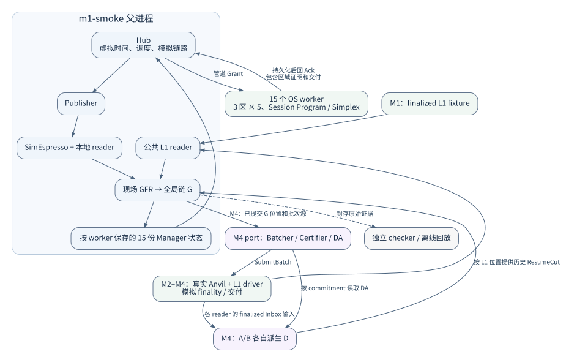
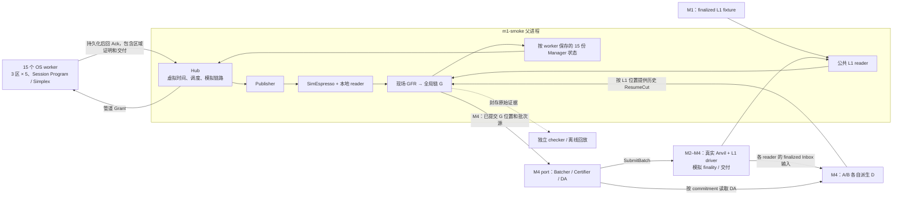

# Sequencer Rotation PoC v2 架构与实验报告

2026-11-17 · M1–M5 的协议实现和正式离线回放已合入本地 `main`（`bd3df19a89921eb25a6c51a82b5314af74e1fef7`）。各结果保留各自的受测提交。

## 1. 阶段成果

五条主路径均使用单机三地区、15 个真实 OS worker 和原生 Simplex 证书，并经独立检查。

| 里程碑 | 主场景结果 |
| --- | --- |
| **M1 · 健康满窗** | R0、R1 分别在 h10、h20 接棒，R2 的 h21 在虚拟 **31.085 s** 进入 G。 |
| **M2 · 健康主动 Force** | 真实 Anvil 收录控制，GFR 在公开键 22.000 s 保留 h10 并切到 R2，h16 在虚拟 **26.041 s** 进入 G。 |
| **M3 · 地区故障自动 Force** | R0 五个 worker 离线，2-of-3 治理触发 Force。GFR 保留 h1，按历史 policy 选 R1，h18 在虚拟 **28.041 s** 进入 G。 |
| **M4 · 预设 RESUME** | h2 出现 G/D 分歧。GFR 于虚拟 28.001 s 采用历史 D(h20)，R2 的 h21 于 **31.0525 s** 进入 G。 |
| **M5 · 自动 RESUME** | Espresso 停止 finalized 或冻结 θ 后恢复。治理自动选 h30，GFR 于虚拟 36.001 s 采用历史 D(h30)，两组的 R2 h31 均于 **41.084 s** 进入 G。 |

M1 的通过范围是健康满窗 smoke。完整 SessionEnd、多 seed、候选切换及官方 Espresso 同字节读回仍单独跟踪，完整 I1/I1b 跨崩溃恢复验收也仍开放。下文的时点和间隔是固定场景的虚拟时间。真实跨地区网络、吞吐和 handoff 性能 benchmark 尚未执行。[M1–M5 实施与验收计划](milestones/M1-M5-implementation-plan-zh.md)

## 2. 单机运行架构

- 三区各有五个等权 replica。每个区域证书需要四个不同的合法 BLS signer。
- M1/M2 的静态选区按 `(β+r) mod 3`，M3–M5 的新职责按生效 policy 和历史 L1 状态选区。区内 leader 按 `(view−1) mod 5` 轮转。

下图展示 M1–M4 的基础拓扑。图中 Region 是逻辑划分，15 个子进程都在同一台机器上。M3 在此基础上增加 Hub 内的三个治理 signer 状态机。M4 保留 15 个 OS worker，增设批次和派生 port 进程及 A/B 两套 D 状态。M5 复用该布置，另在同一 port 内为三个治理 signer 提供 S0/S1/S2 三套独立 D feed。



<details>
<summary>Mermaid 源码</summary>



</details>

| 模块 | 实际职责与接线 |
| --- | --- |
| **Session Program / Regional BFT** | 使用 Commonware Simplex 2026.10.0 和 BLS 多签。节点在实际窗口、父链和执行状态上 Build/Accept，签名前核对本地 Clock、租约、stop 与 terminal。区域 Final 与区块正文分别到达，Hub 拿到足够材料后构造完整区域结果。Regional BFT 子模块固定在 `691cfc14daaa53c1a08cbd87dd3fe0cd60a214e6`，历史 15 成员 benchmark 与这里的三个独立委员会使用不同拓扑。 |
| **Session Manager** | smoke 把 15 份绑定各逻辑 worker 的 Manager 实例放在 **Hub 父进程**。GFR 提交 `ReplayRecord` 后，Hub 按节点调度应用，Manager 持久化对应决定和动作，再经受控步骤送出 Prepare、Enter、Close 等动作。子进程在收到本节点的动作后运行或关闭实际引擎。每节点自己的 Ready/Enter 分开记录。 |
| **Publisher、SimEspresso、GFR** | 同在 Hub 进程内。持久发布任务携带完整区域证明和正文，SimEspresso 给它确定的 `(q,index,θ)`。本地 reader 收到 finalized 块后，GFR 按公共键重放并验签、验父链和执行。区域 Final、公开完整和进入 `G` 是不同的事件。公共材料缺失时规则返回 `WAIT`。健康 smoke runner 要求预设路径的重放返回 `Ready`，WAIT 后补齐的行为另用规则向量验收。单个节点的本地计时到期只约束该节点，公共 SessionEnd 由 GFR 重放。 |
| **L1** | M1 的公共 GFR 读取已达到 fixture finalized 时刻的 header 和空控制覆盖。M2–M5 由 Hub 调用 L1 driver，driver 经 loopback 调用真实 Anvil，手动出块并按虚拟时程交付 finalized 前缀。现场 GFR 消费 reader A，reader B 有独立、较慢的 L1 交付。worker 的执行元数据仍使用按 Grant tick 暴露的高度/时间戳 fixture 投影，M2 在 Hub 核对投影可见上界的高度与时间戳在 A 的真实前缀中可读。 |
| **worker 怎样读公共输入** | 已跑通的版本由 Hub 读取公共 L1/Espresso、执行一份现场 GFR，并把生命周期记录应用到 Hub 中各 worker 的 Manager。子进程收到由此派生的受控动作，使用自己的 L1 元数据视图。每节点独立下载、重放与现场位置一致性属于完整 M1 的后续接线和验收范围。 |
| **M3 治理与历史 Plan** | 三名 signer 在 Hub 内各自维护 L1、Espresso 和 GFR 视图，根据实际已验证位置、时钟和公开进展独立作出决定。同一请求的两份不同成员签名由真实 Anvil 上的 2-of-3 合约核验。GFR 按公开键激活控制，再用当时生效的 policy 和历史 L1 header 算 Plan。治理签名门槛为 2-of-3，区域 BLS Final 仍需四个合法 signer。 |
| **M4 批次、Inbox 与 DA** | Hub 记录已提交 G 的位置和真实执行输入。M4 port 进程托管 Batcher、Certifier 和 DA，并使用现有 L1 driver。Batcher 生成带来源位置的封闭 DA frame，经 DA 持久化和 Certifier 签署后，向 Anvil 上的 Inbox 提交。reader 分别读取各自已交付的 finalized 收据，并按 commitment 取回和验证 DA 字节。 |
| **独立派生 `D` 与重建 `G′`** | 两个 D reader 只用各自已验证的 Inbox/DA 历史、genesis、配置和 DEP，在自己的父状态上执行。已接纳数据缺失时原位 `WAIT`，完整扫描窗口仍无合格批次时执行 deposit-only 回退。回放中的 G′ 用成功 Inbox 接纳所认证的历史 G 和 CursorSet 对应切面重建。它的时标表示相关 reader 看到来源的时点。 |
| **M4 RESUME** | 预设请求通过真实 2-of-3 治理签名完成同交易 CursorSet 和 ResumeRecorded。A/B 以具体 L1 位置保存历史 `ResumeCut`。GFR 在 Espresso 水位和 L1 覆盖齐备后，按该位置的切面原子修改 G，并按 `BranchClosed → Resumed → SessionAssigned` 通知 Manager。后继 worker 用切面的派生 anchor 和执行后状态准备新实例。 |
| **M5 自动 RESUME** | Hub 给每名 signer 分别交付 L1、Espresso、D/Inbox 证据与时钟样本。每名 signer 判断排序服务是否恢复、是否确有恢复理由、资料是否齐备，再估算 G、D 和 Inbox 在预计收录前的上界并求最小合法目标。两份相同请求的签名随交易提交 Anvil。GFR 复用 M4 的历史 Cut 和 Manager 恢复流程。 |

合入版代码入口为 `poc/prototypes/i1b-runtime/src/m1_smoke/{hub,worker,public,profile,l1}.rs`。公共组件可从 `main:poc/crates/` 中的 `session-manager`、`authorization`、`publication-bridge`、`publisher`、`sim-espresso`、`viewer-gfr`、`l1-adapter` 查看。使用 `git show main:<路径>` 可在当前分支读取合入源码。M4 的 D 和批次接线复用以下组件。[批次/DA](handoffs/11-batch-services-zh.md) · [派生 D](handoffs/12-derivation-zh.md)

## 3. 受控通信和时钟

### 受控一步

1. Hub 从同一事件队列取出下一项，按虚拟 tick、因果波次、seed 派生的顺序键和事件 ID 定序。输入可以是 Clock 样本、timer、入站消息、工作完成或生命周期动作。
2. Hub 经 stdin/stdout 管道传递带长度的 protobuf frame。Grant 含 worker/session 绑定、事件身份、虚拟 tick 和输入。子进程运行受控 executor，提交该步 journal 和见证后，返回完整 Ack。
3. Hub 校验 Grant/Ack 身份、哈希、序号和 worker 持久化的 head，再释放 Ack 中的 send、timer、工作和发布等效果。消息进入对应方向和通道的队列，出队后用新的 Grant 交付。BODY、VOTE、CERTIFICATE、RESOLVER 分通道；队列键为 `(src,dst,channel)`，同条队列保序。
4. Hub 根据下一事件推进虚拟时间。处理 RPC、磁盘或 Anvil 时可以等待墙钟，等待本身不推进虚拟时间。

此路径复用 **I1b 原生运行时和 native wire**。原来的 I1a 双进程 SignedIntent 测试是受控模型的早期证据。02 的 transport kernel 已有组件验收，当前 smoke 的证据来自 `m1_smoke/hub.rs` 自身的调度、路由和 Ack 路径，普通运行的通用接线不能由此视为已验收。M2 对旧分支 h11 注入的是**公开发布延迟**，并对同候选复跑单独注入墙钟暂停。M3 主场景让 R0 五进程离线，并分别运行读者落后、排序停止和 Espresso 水位冻结对照。M4 的 Hub 按虚拟时序触发批次提交、L1 出块、finalized 交付和 RESUME，M4 port 通过既有 L1 driver 交换命令和结果。两个 D reader 按各自交付的 L1 位置处理数据。650 ms 墙钟暂停注入在预设 RESUME 派发前。M5 故障只作用于 SimEspresso 的 finalized 输出或公开时间键，L1、Clock RPC 与 D 继续。治理根据各 reader 实际收到的前缀与时钟样本判断可签时刻；固定交易通过同一 Anvil driver 提交。[I1a 有限验收](i1a-gate-result.md) · [原生 Fresh 有限验收](native-engine-fresh-result.md)

### Clock RPC 和公共时间

| 量 | 用途与边界 |
| --- | --- |
| 虚拟参考 `τ` | 唯一由 Hub 推进，用于消息、故障、工作、出块和交付调度。 |
| 节点时钟 `C_m(τ)` | 在当前固定速率 profile 中等于 `τ+ε_m`，每节点偏移绝对值 ≤1 ms，两台节点的读数可相差 2 ms。用来判定本地窗口、timeout 和签名门禁。 |
| Clock RPC 延迟 | Grant/Ack 内的逻辑取时服务。请求去程和样本回程分别排队各 250 µs，正常设定的往返为 500 µs。样本带 request、sequence、as-of tick 和 lease；同步 `Clock::current()` 读取投影后的本地 ClockView。只有新收到且通过校验的样本续租，Grant 本身不续租。 |
| 公共键 `x`、`θ_q` | `θ_q` 是 Espresso 日志的公开时间键，`q` 和消息 index 标识序列位置。Force 的 `x=ts_L1+M_a` 由实际收录时间戳推出，完整水位追上后才能处理。典型同键顺序为 L1 控制 → Expire → SessionEnd → Espresso。 |
| 实际墙钟 | 用于进程耗时、watchdog 和复跑扰动。相同虚拟 trace 可对应不同墙钟耗时。 |

M2 的 L1 收录在 12.000 s，`M_a=10 s`，所以公开激活键是 22.000 s。携带同键的 Espresso q10 在虚拟 22.001 s finalized、交付并形成水位，GFR 在该虚拟 tick 执行激活。M4 的 RESUME 在 L1 timestamp 18.000 s 收录，以 `M_a=10 s` 得 act=28.000 s，q89 在虚拟 28.001 s 提供公共覆盖后执行。A/B 已于 19.500/19.510 s 取得历史切面，live D 还会继续推进。M5 中旧节点的本地 stop 阈值是 21 s。GFR 另等公开键 24.000 s 的覆盖，在虚拟 24.501 s 才处理 Expire。trace 的 `seq` 保留同一 tick 内的实际事件顺序。

## 4. 已运行 profile

### M1 与 M2 的实际共同参数

| 参数 | 两条已封存运行的取值 |
| --- | --- |
| 进程与证书 | 15 个独立 OS worker，3 区×5，q=4，固定十高度窗口，seed 42，正向拉起，无脚本签名者 |
| 基准与场景范围 | L2 genesis timestamp 10 s，L2 slot 1 s，L1 slot 2 s；`start_us=10.800 s`，`cutoff_us=33 s`；主运行分别在 h21/h16 接纳后结束 |
| 节点时钟 | 每区按成员序号取 −1000、−500、0、+500、+1000 µs；RPC 单向 250 µs；样本 lease 180 ms、refresh 80 ms |
| 链路和执行 | 区域消息 4 ms，按路由键队列上限 64；工作完成延迟 5 ms；错时 Enter 步长 3 ms |
| Simplex | leader timeout 1.5 s，certification timeout 1.6 s，timeout retry 1.5 s，fetch retry 30 ms，view 范围 1–128 |
| 公共发布 | Publisher 链路 5 ms，SimEspresso finalize 1 ms；健康路径使用 0 timestamp offset / 1 µs 量化。M2 对旧 h11 单独延迟到公开键 22.000 s。 |
| 公共时间预算 | `T_grace=3 s`，`W_exp=8 s`；M2 另使用 `M_a=10 s`、`T_init=3 s` |
| 轻量执行 | Genesis 账户 1 的余额 100、nonce 0。已配置的 `dep[h]` 向账户 2 注入 credit `h`（h1–h40），每个实体块含一笔账户 1→2 的转账，金额 `1+(42+h) mod 3`。 |

数据来自两个封存的 `raw/profile.json` 与同场景的 `profile.rs`、`hub.rs`、`native_config.rs`。Hub 事件上限 100,000，worker Ack 墙钟 watchdog 20 s，runner 单命令上限 1800 s。4 ms、5 ms 等值是模型的延迟配置。PoC v2 设计中的 20/100 ms 是较早的区域内/跨区初始设计值，本表以实际 profile 为准。[M1 profile](../../.build/commander-jobs/m1-regular/artifacts/healthy-smoke-91547857-seed42-run01/raw/profile.json) · [M2 profile](../../.build/commander-jobs/m2-healthy-force/artifacts/merge-ea4d853b-seed42-force-run01/raw/profile.json)

### 分场景参数与运行层级

| 场景 | 本次差异或计划输入 | 运行状态 |
| --- | --- | --- |
| **M1 满窗** | finalized L1 fixture、虚拟链路、SimEspresso；`[1,10] → [11,20] → [21,30]`，截至 h21 | seed 42 单次 15-worker smoke PASS |
| **完整 M1 扩展** | 计划 seed 7/42/99、墙钟 0/2 ms、启动顺序对照；额外发布延迟构造 SessionEnd，官方 dev-node 另做同字节提交/读回 | SessionEnd 仅有规则向量证据；其余按完整系统矩阵跟踪 |
| **M2 合并版及原候选** | 真 Anvil/Forge 1.0.0-stable、solc 0.8.20；11.500 s 主动提交目标 β0 的单签控制；L1 slot 2 s、模拟 finality 1.5 s；A 同 tick、B 延后 10 ms，worker L1 fixture 投影滞后参数 1 µs。原候选同 seed 增加 650 ms 墙钟暂停。 | 合并版 seed 42、0 ms PASS；原候选主运行与暂停复跑均 PASS |
| **M3 自动 Force** | seed 42，启动 15 个 worker，2-of-3 治理，R0 五进程于 11.250 s 离线。Espresso heartbeat 250 ms、finalize 1 ms，三 signer reader 的基础交付延迟为 0/10/20 ms。停滞门槛 2 s，轮询 100 ms，签名/广播各 10 ms。 | AF01–AF12 PASS。主运行和 650 ms 墙钟暂停复跑均在 h18 接纳后结束。 |
| **M4 预设 RESUME** | seed 42，15 个健康 worker，真实 Anvil/Inbox、确定性 DA、2-of-3 治理。批次顺序窗口为 4 个 L1 块，h1 在 L1 h6 及时收录，h2 在 h8 迟到。17.000 s 提交预设目标 h20，恢复 origin 9。 | DR01–DR12 PASS。同候选 650 ms 墙钟暂停对照和 M1–M3 回归通过。 |
| **M5 自动 RESUME** | seed 42，15 个 worker，真实本机 Anvil、2-of-3 治理和独立 D。两个主配置均于虚拟 11.250 s 注入 Espresso 故障，24.500 s 恢复。公开 Expire 窗口 12 s。 | AR01–AR12 在各自验收边界内通过。两条主路径和慢 RPC 对照都恢复到 h31。 |

M3–M5 沿用上表的副本偏移、时钟租约、4 ms 区域链路、5 ms 工作和发布延迟、3 ms Enter 步长。起始参数为 10.800 s，场景上限 60 s。M3–M5 的 L1 每槽 2 s，模拟 finality 1.5 s，公共 reader A/B 分别在 finalized 时及 10 ms 后收取。Espresso heartbeat 为 250 ms，finalize 为 1 ms。工具版本为 Rust 1.95.0、Commonware 2026.10.0、Anvil/Forge 1.0.0-stable、solc 0.8.20、Python 3.12.8。

| 配置差异 | M3 | M4 | M5 |
| --- | --- | --- | --- |
| `M_a` / grace / Expire 窗口 | 10 / 3 / 30 s | 10 / 3 / 30 s | 10 / 3 / 12 s |
| Clock RPC 单向延迟 | 250 µs | 250 µs | 250 µs，慢 RPC 对照 1 ms |
| 治理或派生参数 | Force 初始化预算 3 s | Anvil chain ID 31337，批次窗口 4 个 L1 块 | 同 M4 的 L1/批次配置，准备时间 12 s，就绪预算 0.5 s，漂移上界 15 s，额外余量 1 s |
| signer 交付与动作 | S0/S1/S2 基础交付延迟 0/10/20 ms，轮询 100 ms，签名和广播各 10 ms | 预设请求 | 同 M3 的 signer 交付与动作参数 |

[M3 封存 profile](../../.build/commander-jobs/m3-auto-force/artifacts/tester-7f4ade9-seed42-run01/outage/raw/profile.json) · [M4 封存 profile](../../.build/commander-jobs/m4-resume/artifacts/tester-2ce2db0-seed42-run01/primary/raw/profile.json) · [M5 主 profile](../../.build/commander-jobs/m5-auto-resume/artifacts/tester-d6a3643-seed42-run01/primary/raw/profile.json) · [M5 慢 RPC profile](../../.build/commander-jobs/m5-auto-resume/artifacts/tester-d6a3643-seed42-run01/slow-rpc/raw/profile.json)

## 5. 实测结果

### M1 健康满窗

所有 15 个 worker 正常退出。独立检查复算了 **21 份原生 Final 和 21 个 G 条目**，核对 **4,571 对持久化 Grant/Ack** 与 **2,040 个在 Ack 提交后释放的输出**。运行候选 `9154785732d803c1f2f69aee3b2af67220a12f58` 已在合入版本的历史中。

| 观测事件 | 公共位置与键 | 虚拟时间 | trace seq |
| --- | --- | ---: | ---: |
| h10 接纳，R0→R1，anchor h10，窗口 [11,20] | q9 / 20.044 s | 20.045 s | 7426 / 7428 |
| h20 接纳，R1→R2，anchor h20，窗口 [21,30] | q19 / 30.090 s | 30.091 s | 15174 / 15176 |
| R2 的 h21 接纳，parent 连接 h20 | q20 / 31.084 s | 31.085 s | 16038 |

这条运行覆盖健康满窗。完整 M1 另需让 h10 未及时公开，SessionEnd 取 h9 为 anchor，窗口仍保持 [11,20]，由后继的合格结果补足 padding；同时覆盖候选切换/选回、错时 reader 及多 seed 矩阵。[M1 结果](milestones/results/M1-healthy-smoke-result-zh.md) · [完整 M1 验收](milestones/M1-regular-merge-zh.md)

### M2 健康主动 Force

合并提交 `ea4d853bd8b62ee04c4e8e470550648242073950` 的主运行使用 seed 42。独立检查验证了 **12 份原生 Final、16 个 G 条目（11 个实体块和 5 个 padding）、3,205 对持久化 Grant/Ack、1,286 个 Ack 后输出**及 53 个 Hub/driver 操作。15 个进程在 Force 与 h16 接纳时持续存活，全部正常退出。EVM 执行和收据来自真实 Anvil，finality 和交付由虚拟场景控制。

| 观测事件 | 公开位置或含义 | 虚拟时间 | trace seq |
| --- | --- | ---: | ---: |
| 提交合法 Force | target β0，R0 正在生产 | 11.500 s | 760 |
| Anvil 收录 | L1 (6,0,0)，timestamp 12.000 s | 12.000 s | 943 |
| 模拟 finalized、A 收取、B 收取 | 同一 L1 h6 | 13.500 / 13.500 / 13.510 s | 2294–2296 |
| 在途 Regular | h10/q9 接纳，R0→R1，仍为 β0 | 20.045 s | 7503 / 7505 |
| Force 激活 | 键 22.000 s，保留 h10，关闭旧 β0，分配 (β=1,r=1) 的 R2 | 22.001 s | 8765 |
| 排除旧 R1 实体 h11 | q10 同键公开，Force 优先，G 头仍为 h10 | 22.001 s | 8767 |
| R2 各节点 Ready/Enter | 窗口 [16,25]，全部早于准备截止 25.999 s | 22.0025–22.0145 s | 8845–8926 |
| 新区域交付 h16 | 实体 parent 为 h10 | 26.035 s | 11020 |
| h16 进入 G | q11 / 26.040 s，同次追加 padding h11–h15，早于 h11 的 29.000 s Expire | 26.041 s | 11152 |

窗口从实际激活状态推导。由于 R1 尚无已接纳实体贡献，沿用 `r=1`，`β` 增为 1。用 `h_min=max(A.h+1,slot(act+T_init)+1)` 得 h16，末高 h25。旧 R1 的实体 h11 和随后补入的 padding h11 各有自己的来源和哈希。

原 M2 候选 `e97681e81cbff73b1252cd31b0a1c9e2c2534ff5` 的 HF01–HF14 按以下层级覆盖。650 ms 暂停对照属于该候选；合并版证据是单次 0 ms 复跑。

| 验收范围 | 实际证据 |
| --- | --- |
| HF01、HF03、HF09 | 同一 15-worker 主运行验证有效控制、在途 Regular、同键旧结果排除，以及新 R2 的首块进入 G。 |
| HF02 | 同提交、同 seed，650 ms 墙钟暂停。去除已声明的进程墙钟/PID 诊断后，完整规范化虚拟 trace 与原生 frames、原始 L1 RPC bundle 逐字节相同。 |
| HF04–HF07、HF10、HF11、HF14 | 11 个独立 GFR 向量通过，覆盖 r/floor/PENDING、同键排序、重复和 WAIT、A/B 同位置一致、HALT/stale、SessionEnd h9→padding10+h11。HF14 是生产规则入口向量。 |
| HF08 | 现场旧委员会关闭之后的工作探针无新签名。Manager 与 native signer 的专项测试补充 Running/Preparing/Paused、迟到动作和签名守卫。 |
| HF12 | 真实 EVM 收据确认错误 signer、过期序号和冲突请求回滚且零新增控制日志；同内容合法重试成功，只有首次产生控制日志。 |
| HF13 | 同候选 15-worker M1 回归与独立重放通过，核对 21 个 G 条目和 h10/h20/h21。 |

[合并版独立报告](../../.build/commander-jobs/m2-healthy-force/artifacts/merge-ea4d853b-seed42-force-run01-independent/report.json) · [原候选逐项独立验收](../../.build/commander-jobs/m2-healthy-force/artifacts/independent-review-e97681e8/verdict.md) · [同候选复跑比较](../../.build/commander-jobs/m2-healthy-force/artifacts/tester-e97681e8-repeat-compare.json)

### M3 地区故障后的自动 Force

精确受测提交为 `7f4ade983ea78ebdff73d17b3cefc31609e7b507`，已合入本地 `main`。Tester 在干净候选上执行 seed 42 矩阵，11 条命令全部退出 0。主场景的独立检查核对 **873 对持久 Grant/Ack、295 次 Ack 后输出、1,194 次 Manager 提交、540 次 signer 轮询**。G 共复算出 18 个条目，包括故障前的实体 h1、16 个 padding 和 R1 的实体 h18。[独立验收结论](../../.build/commander-jobs/m3-auto-force/artifacts/independent-review-7f4ade98/verdict.md) · [主场景独立报告](../../.build/commander-jobs/m3-auto-force/artifacts/independent-review-7f4ade98/run01/outage/report.json) · [独立公共复算](../../.build/commander-jobs/m3-auto-force/artifacts/independent-review-7f4ade98/run01/outage/public-replay.json)

| 观测事件 | 公共位置或结果 | 虚拟时间 | trace seq |
| --- | --- | ---: | ---: |
| 接纳 h1，R0 五节点随后离线 | q5 / θ 11.072 s，h1 成为最后一个旧分支 G 条目 | 11.073 / 11.250 s | 738 / 824–828 |
| 排序继续推进 | q6 为空 heartbeat，θ 11.250 s | 11.251 s finalized | 829 |
| 达到治理门槛 | 三名 signer 各自核对到 q14 / θ 13.250 s，与最近进展键 11.072 s 相差 2.178 s | 13.300250 s | 1076–1078 |
| 签名、广播及确认 | 三名 signer 各自产生签名，交易携带其中两份。首次广播响应丢失，重载已落盘的原请求与 nonce，确认同一交易 | 13.310250 / 13.320250 / 13.330250 s | 1079–1087 |
| 真实 Anvil 收录 | `(7,0,0)`，区块 timestamp 14.000 s，收据中只有一条有效 Force 记录 | 14.000 s | 1152–1153 |
| 模拟 finalized 与交付 | L1 h7 finalized，公共 reader A/B 各自收取 | 15.500 / 15.510 s | 1319–1321、1345 |
| 公开激活、选择 R1 | act 24.000 s，q57 提供覆盖。同键 Force 优先于旧 SessionEnd，保留 h1，启动 (β=1,r=1)、R1、窗口 [18,27] | 24.001 s | 2293–2296 |
| 五名 R1 成员分别 Ready/Enter | 跨度 12 ms，最晚 24.0145 s，早于准备截止 27.999 s | 24.0025–24.0145 s | 2341–2423 |
| h18 区域交付 | 原生 Final 和完整结果，实体 parent 为 h1 | 28.035 s | 4955 |
| h18 进入 G | q74 / θ 28.040 s，原子接纳 padding h2–h17 和实体 h18，早于 h2 的公开 Expire 42.000 s | 28.041 s | 5090–5109 |

Force 激活后的有效 policy 使用 mask `0b110` 和 order `[0,1,2]`，从来源 R0 顺序选出 R1。h1 的 L1 origin 为 3，激活后的 L1 floor 为 7，Plan 因而读取 `ℓ_s=max(3,7)=7`。独立重放核对了真实 Anvil h7 的 header hash、历史控制位置及 Plan 的授权来源。实体 h18 指向 h1，其执行前态包含截至虚拟 h17 的 padding。[主场景原始轨迹](../../.build/commander-jobs/m3-auto-force/artifacts/tester-7f4ade9-seed42-run01/outage/raw/trace.jsonl) · [原始 L1 RPC 与收据](../../.build/commander-jobs/m3-auto-force/artifacts/tester-7f4ade9-seed42-run01/outage/raw/l1/raw-rpc-bundle.json)

| 用例 | 执行层级与结果 |
| --- | --- |
| **AF01 · R0 离线** | 15 个真实进程启动，故障脚本退出 R0 五个进程。空 heartbeat 保持水位推进，2-of-3 Force 实际落链，按历史 Plan 接到 R1 h18。 |
| **AF02 · 墙钟复跑** | 同 SHA、seed 和输入，增加 650 ms 墙钟暂停。完整规范化虚拟 trace、原生 Grant/Ack 帧、L1 原始收据包和 driver trace 逐字节一致。 |
| **AF03 · 健康对照** | 15-worker 场景，330 次 signer 轮询，零治理签名和零 Force 交易。h10 正常接棒，h11 于 21.039 s 进入 G。 |
| **AF04 · reader 落后** | 实时场景两名 signer 得知有新 tip 但尚未读齐，先 WAIT。前缀补齐后在 13.700250 s 达到门槛，13.720250 s 广播，仍在 14 s 槽收录并接到 R1 h18。缺公开证明时等待和补齐后的重放另由生产 signer 向量覆盖。 |
| **AF05 · 排序停止 / 水位冻结** | 两个有界进程对照均观察至 16.000 s，各有 177 次轮询、零治理签名和零 Force。停止组故障后无新增排序记录，冻结组新增 19 个 q 但 θ 共用同一键。 |
| **AF06 · 决策与进展** | 3 项生产治理向量核对门槛、时钟和拒绝条件、PENDING/HALT 及已验证进展。无效、重复、未选中或只有证明的 publication 不刷新进展。 |
| **AF07–AF08 · 合约验签与持久请求** | 真 Anvil 2-of-3 和 1-of-3 两种部署共 37 份向量收据，分别为 28 份（23 回滚）和 9 份（4 回滚）。每种部署各有两个新控制、两个成功幂等重试，重试零新增日志。AF01 另检验了首次广播响应丢失后的原交易恢复。 |
| **AF09–AF11 · 历史资格与重放** | 12 项独立历史 Plan/GFR 向量核对 mask/order、零 mask、缺历史、收录到激活的边界、旧 Plan/cid 保持、stale/HALT、A/B 同位置一致，以及 worker-facing Plan basis 校验。 |
| **AF12 · M2 回归** | 同 SHA 的原单签、静态 policy 健康 Force 通过独立复算。h10 为 anchor，新 R2 窗口 [16,25]，h16 于虚拟 26.041 s 进入 G。 |

M3 的证据覆盖固定 seed 42、模拟交付、真实本机 Anvil，并验证从已持久化的待广播交易恢复。完整治理进程重启和其它 seed 的覆盖仍待测。[对照与专项检查](../../.build/commander-jobs/m3-auto-force/artifacts/independent-review-7f4ade98/run01/focused.json) · [暂停比较](../../.build/commander-jobs/m3-auto-force/artifacts/tester-7f4ade9-seed42-run01/repeat-compare.json)

### M4 独立 D 与预设 RESUME

正式受测提交为 `2ce2db03356db741285e397598940becbcf6ed6f`，Tester 矩阵固定 seed 42，十条命令均退出 0。主场景 15 个 worker 启动并正常收尾。独立检查核对了 **4,385 对持久 Grant/Ack、1,843 个 Ack 后输出、1,681 次 Manager 提交、15 次恢复记录提交和 10 个 Close 意图**，并在各 Grant 核对 worker 可见的 reader A L1 元数据上界。[正式矩阵](../../.build/commander-jobs/m4-resume/artifacts/tester-2ce2db0-seed42-run01/manifest.json) · [主场景及暂停组独立报告](../../.build/commander-jobs/m4-resume/artifacts/independent-review-2ce2db03/primary-pair/report.json) · [边界复核](../../.build/commander-jobs/m4-resume/artifacts/independent-review-2ce2db03/run01/boundaries.json)

| 观测事件 | 公开位置或结果 | 虚拟时间 | trace seq |
| --- | --- | ---: | ---: |
| h1 批次及时收录、派生 | 普通交易从真实 G 审计位置打包，在 L1 `(6,0,0)` 接纳。A 到达该前缀后按 DA 重新执行，D(h1) 与 G(h1) 的 native hash 一致 | 12.000 s 收录，13.500 s A 可读 | 869、1089、2538–2539 |
| h2 窗口回退及分歧 | origin 3 加 4 块窗口到 L1 h7，A 读齐 h7 后回退 h2。G(h2) 为 `559edd12…41b67`，D(h2) 为 `68f99bb4…8b5c`。h2 批次迟至 `(8,0,0)` 收录，D 读取时标为 old | 15.500 s 分歧，16.000 s 迟到收录，17.500 s A 可读 | 4206–4209、4427、5878–5879 |
| 预设 RESUME 提交和收录 | 共高分歧已出现，两名治理 signer 授权。真实 Anvil 同交易写 `CursorSet (9,0,0)` 和 `ResumeRecorded (9,0,1)`，目标 h20 | 17.000 s 提交，18.000 s 收录 | 5275、6100 |
| 保存历史切面 | ℓ9 模拟 finalized 后两 reader 各自从已派生 h3 继续填 h4–h20。在 RESUME 的具体位置存储同字节的 Cut，目标 origin 9 | 19.500 / 19.510 s | 7546–7547、7566 |
| 原子关闭并对齐 G | act=28.000 s，q89 提供覆盖。live D 此时为 h21，GFR 保留 h0–h1，撤销旧 G 的 h2–h17，采用该历史 Cut 的 h2–h20 | 28.001 s | 14589、14609–14610 |
| R2 准备恢复 | 历史 Plan 读取 L1 h9，policy 的启用 mask 为 `0b111`、顺序 `[2,0,1]`，选择 (β=1,r=0) 的 R2，窗口 [21,30]。五名成员最晚 28.0145 s Ready/Enter，早于 30.999 s 的准备截止 | 28.0025–28.0145 s | 14674–14755 |
| R2 的 h21 交付及进入 G | h21 的实体父连接使用 Cut 内 D(h20) 的 anchor ID，执行前态是 D(h20) 的执行后状态。q102 的公开键为 31.0515 s，接纳早于 61.000 s Expire | 31.0465 s 区域交付，31.0525 s 入 G | 16678、16814 |

主场景结束时 **G / G′ / D = h21 / h20 / h22**。这里的 G′ 根据 reader 的真实批次接纳和历史切面证据重建。其回放时点来自来源可读记录。D 自身在激活前已推进到 h21，并最终继续到 h22。GFR 使用的是位置 `(9,0,1)` 的历史 Cut，摘要为 `0c0d09e99d8e05c2f405b7f6318b84dbde2d1218b435884a15807731d296e61e`。[原始轨迹](../../.build/commander-jobs/m4-resume/artifacts/tester-2ce2db0-seed42-run01/primary/raw/trace.jsonl) · [真实 L1 RPC 收据](../../.build/commander-jobs/m4-resume/artifacts/tester-2ce2db0-seed42-run01/primary/raw/l1/raw-rpc-bundle.json) · [独立 D 派生](../../.build/commander-jobs/m4-resume/artifacts/independent-review-2ce2db03/run01/live/primary/independent-D.json)

| 用例 | 执行层级与结果 |
| --- | --- |
| **DR01 · 独立 D 与预设 RESUME** | 15 个真实进程，实际 Anvil 双日志、G 来源批次与 DA 字节均有证据。独立复算及时批次、窗口回退、共高分歧、位置绑定的恢复和 R2 首个真实 Final 进入 G。 |
| **DR02 · 墙钟复跑** | 同 SHA、同 seed 输入，增加 650 ms 墙钟暂停。Tester 对照的 22 个文件逐字节一致，包括规范化完整轨迹、原生帧、Anvil/RPC、DA、接纳输入、D 轨迹和 A/B 历史 Cut。 |
| **DR03、DR05、DR06、DR10 · L1/DA 实际输入** | 八个真实 Anvil/DA 向量覆盖已接纳 DA 缺失、错误 commitment 与补齐，真实写入后回滚及重试，同块两条 RESUME 与夹在中间的批次，以及窗口前/等于/之后、实际父 origin、未来和畸形输入。另离线核查了功能 11 的封存批次样本。 |
| **DR04、DR08、DR09、DR11 · 重放和 Manager** | 十项生产入口向量覆盖缺切面、Plan 历史或 DEP 的原位 WAIT、错绑定的原子拒绝、过低目标对齐后 HALT、同键控制优先于动态 Expire、生命周期三事件顺序、缺恢复材料、旧 cid 永久终止和迟到/重复输入。双 reader 与 checkpoint 的对照也在这一层验证。 |
| **DR07 · D 已超过目标** | 同 SHA 生产 `derivation-replay` 读取封存的真实 `ahead-300` 收据。L1 `(45,0,0)` 的 CursorSet 前 D 已到 h10，配对 `(45,0,1)` 取 h8 anchor/state，保留整个 h10 前缀。同块下一目标 h11 取得另一切面，最终 D 为 h14。独立核对 A/B 合计 28 个派生块、三个历史切面及新进程从 checkpoint 恢复的结果。 |
| **DR12 · M1–M3 回归** | 同一提交实际运行 M1 满窗至 h21、M2 单签 Force 至 h16、M3 自动 2-of-3 Force 至 h18，均通过相应独立复算。 |

DR01 使用预设恢复目标。M5 在相同的历史切面和恢复接线之上增加自动求解和治理提交。[独立逐项结论](../../.build/commander-jobs/m4-resume/artifacts/independent-review-2ce2db03/verdict.md) · [专项报告](../../.build/commander-jobs/m4-resume/artifacts/independent-review-2ce2db03/run01/focused.json) · [DR07 补验](../../.build/commander-jobs/m4-resume/artifacts/independent-review-2ce2db03/ahead-independent.json) · [650 ms 对照](../../.build/commander-jobs/m4-resume/artifacts/tester-2ce2db0-seed42-run01/repeat-compare.json)

### M5 排序停滞后的自动 RESUME

后端受测提交为 `d6a36431a42cb6e155e9d192bea37f154f742eaa`。正式矩阵固定 seed 42，18 条命令全部退出 0，封存 13 个实跑子清单。AR01 停止 finalized，AR03 保留 q 递增但冻结公开时间键 θ。停滞中，L1 块 5–11 继续 finalized，D 独立推进。下表左列是仿真虚拟时间，act 和 θ 是公开排序键。[独立验收结论](../../.build/commander-jobs/m5-auto-resume/artifacts/independent-review-d6a3643/verdict-zh.md) · [矩阵独立报告](../../.build/commander-jobs/m5-auto-resume/artifacts/independent-review-d6a3643/run01/report.json)

| 阶段 | 主场景实测 | AR01 / AR03 原始 trace seq |
| --- | --- | --- |
| **11.250 s 故障** | 停止组保持 q5 和 θ=11.072 s。冻结组新增 53 条空 finalized 记录，q6–q58 的 θ 均为 11.072 s。 | 972 |
| **旧节点 stop，GFR 等水位** | 五个 R0 worker 的本地 stop 阈值为 21 s，对应虚拟 20.999–21.001 s。虚拟 24.100 s 仍缺公开键 24.000 s 的覆盖，GFR 保持阻塞位置。 | stop 8608–8642 / 9810–9847，WAIT 8862 / 10454 |
| **24.501 s 公开 HALT** | 服务 24.500 s 恢复推进 θ。GFR 随后重放公开键 24.000 s 的 Expire(h2)，进入 HALT，G 仍为 h1。 | 8896 / 10518 |
| **24.761 s 首次可签** | 两名 signer 首次同时满足同一请求的条件。理由为 `HALTED_D_ADVANCED`。收录前上界为 G 1、D 16、Inbox 1，所以 `H_guard=16`。预计收录区间 [26,28] s 给出唯一可行的 L2 时间键 40 s，即 h30。 | 8980 / 10602 |
| **24.820250 s 广播** | 从 `t_eligible` 到实际广播耗时 **59.250 ms**，在 120 ms 预算内。两份签名进入实际 2-of-3 交易。Anvil 在 ℓ13 的 26.000 s 槽收录，`CursorSet=(13,0,0)`，`ResumeRecorded=(13,0,1)`。 | 广播 8999 / 10621，收录 9203 / 10825 |
| **36.001 s 对齐** | A 于 27.500 s 读到配对控制并保存目标 h30 的切面。公开 act=36.000 s，GFR 采用该位置的历史 D(h30)，保留 h0–h1，live D 此时已达 h31。GFR 分配 R2 的新窗口 [31,40]。 | 对齐 11105–11135 / 12727–12757，覆盖 q52 / q105 |
| **41.084 s 恢复首块** | 五名 R2 成员于 36.0025–36.0145 s Ready/Enter，其中 quorum 于 36.0115 s 就绪。首提议 41.056 s，原生 Final 41.078 s。实体 h31 连接 D(h30) 的派生 anchor，公开接纳键 41.083 s，实际入 G 为 41.084 s，早于 53.000 s Expire。 | 14477 / 16099，q73 / q126 |

预计收录区间的最晚端加准备时间是 `28+12=40 s`，最早端加漂移上界再减余量也是 `26+15−1=40 s`。按 L2 genesis 10 s 和 1 s slot 映射为 h30，且 h30 高于 H_guard。两条正例结束时 **G / 重建的 G′ / live D = h31 / h30 / h33**。[停止组原始轨迹](../../.build/commander-jobs/m5-auto-resume/artifacts/tester-d6a3643-seed42-run01/primary/raw/trace.jsonl) · [冻结组原始轨迹](../../.build/commander-jobs/m5-auto-resume/artifacts/tester-d6a3643-seed42-run01/watermark-frozen/raw/trace.jsonl) · [主场景独立复算](../../.build/commander-jobs/m5-auto-resume/artifacts/independent-review-d6a3643/run01/primary/report.json)

| 用例 | 实际覆盖 |
| --- | --- |
| **AR01、AR03 · 两种水位故障** | 真实 15-worker 端到端运行。分别停止 finalized、冻结 θ，均观察到本地 stop、公共 WAIT、恢复后 HALT，以及真实 RESUME 和 h31 接纳。 |
| **AR02 · 墙钟复跑** | 同提交、同 seed，额外暂停 650 ms。26 项证据逐字节一致，含规范化 trace、Grant/Ack 原生帧、L1 收据、DA、治理日志和各 reader 的切面。 |
| **AR04 · 短停及高度差** | 短停 13.000 s 恢复，h4 于 14.042 s 入 G，记录 28 次 `NO_RECOVERY_REASON`，零治理签名和提交。普通 D 落后、较高但兼容的 NEXT、HALT 和 hash 分歧由生产谓词向量检查。 |
| **AR05 · 真实共高分歧** | 实际 G(h2) 与 D(h2) hash 不同。治理记录 `HASH_DIVERGENCE`，在预计 [24,26] s 内选 h28，真实 Anvil 在 ℓ12/t24 收录交易。该实跑的验收终点为收录。 |
| **AR06 · 输入不足** | S1/S2 的已验证前缀落后于公布前缀，签署门槛未满足。至 26.000 s 仍为 G h1，零治理签名。缺精确切面或 Plan 时的 WAIT 与错绑定拒绝另有生产重放向量。 |
| **AR07 · 求最小目标** | 主场景独立复算上界与 h30。无目标实跑记录 34 次 `NO_TARGET`，零签名。生产向量检查上下界取整、严格大于 heads、区间端点及溢出。 |
| **AR08 · 真实迟收录** | h30 的原签名交易保留到 43.500 s 才发给 Anvil，ℓ22/t44 实际收录，公开 act=54.000 s。虚拟 54.001 s 仍按精确 h30 切面对齐，因 h31 的 Expire 早于 act，随后 HALT。 |
| **AR09 · 慢 RPC** | 单向 1 ms 的真实 Grant 对照，保留 ±1 ms 副本偏差。R2 quorum 于 36.013 s 就绪，h31 仍在 41.084 s 入 G。时钟租约和 terminal 签名守卫各有一个生产向量。 |
| **AR10 · 生命周期与切面** | 主场景独立核对 3,120 个实际持久 Ack。旧 h2 延迟公开后按已关闭职责排除。A/B 同位置历史切面逐字节相同，恢复记录顺序为 `BranchClosed → Resumed → SessionAssigned`。 |
| **AR11 · 同 SHA 回归** | M1 健康满窗、M2 单签 Force、M3 自动 Force、M4 预设 RESUME 的实跑与独立复算均通过。另核对 10 项 M4 生产重放向量。 |
| **AR12 · 可追溯结果** | 停止组独立复算 2,190 次 signer 视图，冻结组 2,667 次。资格、求解、签名、真实收录、历史 Cut 和首块接纳均可定位到原始记录。 |

较早的分歧开发变体继续运行时，在旧分支切换到 R1 的区域准备阶段报 `M1 anchor history proof/plan mismatch`。该失败轨迹单独留存。正式 AR05 验收到真实 L1 收录，完整激活和恢复首块由停止组、冻结组及慢 RPC 场景验证。另一次 `938216d` Tester 尝试在构建阶段以状态码 130 中断；正式矩阵使用 `d6a3643` 的 M5 专用构建缓存。[开发变体错误](../../.build/commander-jobs/m5-auto-resume/artifacts/builder-dev03-divergence/raw/worker-5/stderr.log) · [正式 AR05 独立结果](../../.build/commander-jobs/m5-auto-resume/artifacts/independent-review-d6a3643/run01/divergence/report.json) · [早期中断记录](../../.build/commander-jobs/m5-auto-resume/artifacts/tester-938216d-seed42-run01/manifest.json)

## 6. M1–M5 验收范围

| 里程碑 | 主用例的可观察成功条件 | 进度与后续证据 |
| --- | --- | --- |
| **M1 Regular** | R0 h10、R1 h20 驱动两次接棒，R2 h21 用正确 parent 和状态经真实 Final/公开发布进入 `G`。SessionEnd 对照保持后继固定窗口，并核对真实 padding。 | 满窗 PASS。**补录** SessionEnd 端到端、错时候选、完整重放矩阵、A/B 各自下载/重放和官方读回。 |
| **M2 Healthy Force** | 健康 worker 持续运行，真实控制收录及公共覆盖到位，旧分支终止、G 保留、新窗口算对、新分支首个合格结果进入 `G`。 | 主运行、限定复跑与向量 PASS。Force 回放已随 `8a80e5a` 合入。 |
| **M3 自动 Force** | R0 离线而排序服务仍推进。达到阈值后，至少两个独立 signer 用各自已验证的公共视图对同一 payload 签名。真实 L1 收录后，历史 policy 排除 R0，选择合格地区并让首个合法块进入 `G`。健康、reader 落后、Espresso 停滞、阈值边界等作为对照。 | `7f4ade98` 的 AF01–AF12 已通过，正式 AF01 离线回放随 `b404818` 合入。 |
| **M4 从 D 恢复** | 独立 D 产生可核验的分歧和位置绑定的 `ResumeCut`。真实 RESUME 与 Inbox CursorSet 原子记账，GFR 等到对应切面并替换 G 后缀；新 session 的 h_res+1 连接指定的 D(h_res) 并进入 `G`。另测缺 DA、不同 L1 位置、切面历史稳定。 | `2ce2db0` 的 DR01–DR12 已通过，并通过同 SHA 的 M1–M3 回归。正式 DR01 回放随 `e44b6e8` 合入。 |
| **M5 停滞后自动 RESUME** | Espresso 停滞期间 GFR 在原位等水位，L1/D 继续。排序恢复且公开恢复条件成立后，在预算内完成独立多签提交、正确选目标高度并对齐。新 session 的首块经公开接纳进入 `G`。短停、普通 lag、只增高无分歧、目标无解与迟到收录作为对照。 | `d6a3643` 的 AR01–AR12 已在对应边界内通过。同 SHA 的 M1–M4 回归通过，正式 AR01/AR03 回放随 `bd3df19` 合入。 |

正式回放使用封存实跑和独立 checker 的数据。生产入口向量验证指定边界条件。标为合同样本的回放使用计划参数和合成时间线，用于说明规则与交互。

## 7. 证据与复现入口

证据根在本机 `.build/commander-jobs/`，该目录属于运行数据。运行命令应从对应的干净候选 checkout 执行，使用本机配置的 Python 3.11+ 和锁定工具链，新运行和新报告各用新目录。

| 证据 | M1 seed 42 | M2 合并版 seed 42 |
| --- | --- | --- |
| 运行 manifest | [manifest.json](../../.build/commander-jobs/m1-regular/artifacts/healthy-smoke-91547857-seed42-run01/manifest.json) | [manifest.json](../../.build/commander-jobs/m2-healthy-force/artifacts/merge-ea4d853b-seed42-force-run01/manifest.json) |
| 原始 trace | [16,085 行](../../.build/commander-jobs/m1-regular/artifacts/healthy-smoke-91547857-seed42-run01/raw/trace.jsonl) | [11,199 行](../../.build/commander-jobs/m2-healthy-force/artifacts/merge-ea4d853b-seed42-force-run01/raw/trace.jsonl) |
| 独立检查和复算 | [Verifier](../../.build/commander-jobs/m1-regular/artifacts/independent-verification-91547857-seed42-run01/report.json) · [Tester](../../.build/commander-jobs/m1-regular/artifacts/healthy-smoke-91547857-seed42-run01-tester/tester.json) | [报告](../../.build/commander-jobs/m2-healthy-force/artifacts/merge-ea4d853b-seed42-force-run01-independent/report.json) · [逐步公共复算](../../.build/commander-jobs/m2-healthy-force/artifacts/merge-ea4d853b-seed42-force-run01-independent/public-replay.json) |
| 回放 | `main:poc/web/m1-gfr-replay/index.html` | `main:poc/web/m1-gfr-replay/force.html`，浏览器验收已通过 |

M1 manifest / trace SHA-256 分别为 `4e76e4eeb8e41e801db9689441b6fd82b94b7060b6ad2dbb47034e695e9f78ca`、`359f4c6f366d69cc406c07fc9071faff01e26ddf9c0c6fa9c1946f412d2fe1b8`。M2 合并版分别为 `33a4c9d22845fe1150119113d04a56cb3a78759543b50a73064b963dd6561f9c`、`0d79366c15169f580c08351883baaed92a53bbfd6e3561ddbd56c7aba5297cca`。

```sh
# 在 M1 smoke 候选 checkout，runner 固定 seed 42。
python3 -B poc/scenarios/m1-healthy-regular/run.py smoke \
  --candidate 9154785732d803c1f2f69aee3b2af67220a12f58 --output "$M1_NEW_OUTPUT"

# 在 M2 合并候选 checkout。
python3 -B poc/scenarios/m2-healthy-force/run.py \
  --candidate ea4d853bd8b62ee04c4e8e470550648242073950 \
  --seed 42 --wall-pause-ms 0 --output "$M2_NEW_OUTPUT"
```

实际 launcher 和构建/执行 argv 在 M1 的 `invocation.json` 与两份 manifest 的 `commands`。离线复核使用下面的入口，变量分别指向上表的运行目录、独立检查目录、对应 checkout 或新的报告目录。M2 用原候选构建的封存 `m2-force-independent` 复核合并包。核对过两个提交之间的差异只涉及离线回放，运行和 checker 源码相同。

```sh
bash "$M1_INDEPENDENT/checker/reproduce.sh" \
  "$M1_RUN/raw" "$M1_NEW_REPORT" "$M1_CHECKOUT"

python3 -B "$M2_CHECKOUT/poc/verification/m2-healthy-force/check.py" \
  --repository "$M2_CHECKOUT" --candidate ea4d853bd8b62ee04c4e8e470550648242073950 \
  --raw "$M2_RUN/raw" --receipts "$M2_RUN/raw/l1/raw-rpc-bundle.json" \
  --driver-rpc "$M2_RUN/raw/l1/driver-trace.json" --hub-l1 "$M2_RUN/raw/l1/hub-l1.jsonl" \
  --public-checker "$M2_PUBLIC_CHECKER" --output "$M2_NEW_REPORT"
```

本次报告复核了 manifest 的候选、seed、参数、命令与关键 trace 行。M1 的独立公共复算、受控检查与 Tester 输出均与封存文件逐字节一致。M2 用同一个封存 checker 复查合并运行、原候选 650 ms 对照及原候选 Regular 回归，结果也逐字节一致。复核复用原始运行证据。原候选的暂停比较需要对应的 `--repeat-raw`，参数与哈希见 Tester 和 Verifier 的封存记录。[原 M2 Tester 命令与证据](../../.build/commander-jobs/m2-healthy-force/artifacts/tester-e97681e8-report-zh.md)

### M3 封存证据与复现

| 证据 | 路径 |
| --- | --- |
| 正式矩阵 | [Tester manifest](../../.build/commander-jobs/m3-auto-force/artifacts/tester-7f4ade9-seed42-run01/manifest.json) |
| AF01 主运行 | [outage manifest](../../.build/commander-jobs/m3-auto-force/artifacts/tester-7f4ade9-seed42-run01/outage/manifest.json) · [profile](../../.build/commander-jobs/m3-auto-force/artifacts/tester-7f4ade9-seed42-run01/outage/raw/profile.json) · [5,161 行原始 trace](../../.build/commander-jobs/m3-auto-force/artifacts/tester-7f4ade9-seed42-run01/outage/raw/trace.jsonl) |
| 独立检查 | [outage/report.json](../../.build/commander-jobs/m3-auto-force/artifacts/independent-review-7f4ade98/run01/outage/report.json) · [跑法及 AF01–AF12 结论](../../.build/commander-jobs/m3-auto-force/artifacts/independent-review-7f4ade98/verdict.md) |
| 正式离线回放 | `main:poc/web/m1-gfr-replay/auto-force.html`。生成与复查说明见 `main:poc/verification/m3-auto-force-replay/README.md`。 |

Tester manifest 的 SHA-256 为 `065e6e8d588f82daf07c36244b1f97e242e06b7247ded38f568f23c836f3ff33`。它的 `bundles.outage.sha256` 和 AF01 独立报告的 `manifest_sha256` 都绑定同一份 AF01 manifest，摘要为 `5045ce4c259cd41661a033fa051f6e9c855f700243591d71b51e784a3579f32e`。AF01 独立报告的 SHA-256 为 `27093d3534f015651bd93d47a9e1e4a4acaa75722bab1776aeb1c3df720c671a`。

```sh
# 在干净的 M3 精确受测候选 checkout 重跑 Tester 矩阵，使用新目录。
python3 -B poc/verification/m3-auto-force/tester/run_matrix.py \
  --candidate 7f4ade983ea78ebdff73d17b3cefc31609e7b507 --output "$M3_NEW_MATRIX"

# 使用封存的同候选 checker，复查既有矩阵。
M3_ARTIFACTS=/mnt/reth/jy/megaroation_poc/.build/commander-jobs/m3-auto-force/artifacts
bash "$M3_ARTIFACTS/independent-review-7f4ade98/replay.sh" \
  "$M3_ARTIFACTS/tester-7f4ade9-seed42-run01" "$M3_NEW_REPORT"
```

本次文档核对复跑了离线 checker。六组场景报告及公开重放输出、专项复核结果与封存文件逐字节一致。复跑的校验清单记录新的输出路径，并额外列出 checker 二进制和脚本的摘要。

### M4 封存证据与复现

| 证据 | 路径 |
| --- | --- |
| 正式矩阵 | [Tester manifest](../../.build/commander-jobs/m4-resume/artifacts/tester-2ce2db0-seed42-run01/manifest.json) · [十项命令与结果](../../.build/commander-jobs/m4-resume/artifacts/tester-2ce2db0-report-zh.md) |
| DR01 / DR02 | [主运行 manifest](../../.build/commander-jobs/m4-resume/artifacts/tester-2ce2db0-seed42-run01/primary/manifest.json) · [封存 profile](../../.build/commander-jobs/m4-resume/artifacts/tester-2ce2db0-seed42-run01/primary/raw/profile.json) · [16,861 行原始 trace](../../.build/commander-jobs/m4-resume/artifacts/tester-2ce2db0-seed42-run01/primary/raw/trace.jsonl) · [650 ms 暂停 manifest](../../.build/commander-jobs/m4-resume/artifacts/tester-2ce2db0-seed42-run01/primary-pause650/manifest.json) |
| 独立检查 | [总 verdict](../../.build/commander-jobs/m4-resume/artifacts/independent-review-2ce2db03/verdict.md) · [主场景及暂停组报告](../../.build/commander-jobs/m4-resume/artifacts/independent-review-2ce2db03/primary-pair/report.json) · [DR07 补验清单](../../.build/commander-jobs/m4-resume/artifacts/independent-review-2ce2db03/ahead-case/SHA256SUMS) |
| 正式回放 | `main:poc/web/m1-gfr-replay/resume.html`，生成说明见 `main:poc/verification/m4-resume-replay/README.md`。 |

正式 Tester manifest 的 SHA-256 是 `0da3af41ddd97b926ce1fca91c932faf0f2a9364e5a838c47fa0f17a7bc96308`。清单的 `bundles.primary.sha256` 和 pair 独立报告的 `manifest_sha256` 都指向主运行 manifest 摘要 `59b6b88d83b0fd7f91b9f4013125104d1e9f2887516bbeb81d2d70193ab8b282`。pair 报告摘要是 `ae149c228a98eb537b69723454c56d4666fb394924c76a584840752dfb96ce2d`，暂停组 manifest 摘要为 `47ffa2d8793fc69ea98afbab521165f303052caeff9795a22f252215cc3efce5`。主运行与暂停组的规范化 trace 同为 `2370f82cb05691843b662fce2edfe5872355bc85edcc25e79614b869d3ce0d38`。

回放提交 `53074ed9f2a31fc1784338f56b070760d24dec2e` 绑定前一候选 `108158364da5b7157b88c65b7dd6b1f56e506a77` 的独立复验 DR01，原运行 manifest 摘要为 `5c48ee94161db8c425d52ace3ded8392b0f1366b0bef6edce1ad3a95a1098de1`。从该候选到 `2ce2db0` 的唯一改动，是将离线重复运行检查器的 DA 参数改为封存 DA 目录。正式后端验收有最终候选的完整同 SHA 矩阵及暂停对照。正式回放的 359 帧以它自己绑定的旧候选证据复查。[回放绑定的独立报告](../../.build/commander-jobs/m4-resume-replay/artifacts/dr01-1081583-seed42-independent/report.json)

```sh
# 在干净的 M4 精确受测候选 checkout 重跑正式矩阵，使用新目录。
python3 -B poc/verification/m4-resume/tester/run_matrix.py \
  --candidate 2ce2db03356db741285e397598940becbcf6ed6f --output "$M4_NEW_MATRIX"

# 仅用封存输入及同候选 checker 离线复查。
M4_ARTIFACTS=/mnt/reth/jy/megaroation_poc/.build/commander-jobs/m4-resume/artifacts
bash "$M4_ARTIFACTS/independent-review-2ce2db03/replay.sh" \
  "$M4_ARTIFACTS/tester-2ce2db0-seed42-run01" "$M4_NEW_REPORT"
```

本次报告复查中，封存矩阵的离线 checker 输出与原独立场景报告、公开重放和专项结果逐字节一致。DR07 封存清单校验通过，正式离线页通过生成器的 `--check`。

### M5 证据与复现

| 证据 | 入口 |
| --- | --- |
| 正式矩阵 | [Tester manifest](../../.build/commander-jobs/m5-auto-resume/artifacts/tester-d6a3643-seed42-run01/manifest.json) · [实跑与向量结果](../../.build/commander-jobs/m5-auto-resume/artifacts/tester-d6a3643-report-zh.md) · [650 ms 逐文件比较](../../.build/commander-jobs/m5-auto-resume/artifacts/tester-d6a3643-seed42-run01/repeat-compare.json) |
| 独立验收 | [AR01–AR12 结论](../../.build/commander-jobs/m5-auto-resume/artifacts/independent-review-d6a3643/verdict-zh.md) · [矩阵复核报告](../../.build/commander-jobs/m5-auto-resume/artifacts/independent-review-d6a3643/run01/report.json) · [停止组报告](../../.build/commander-jobs/m5-auto-resume/artifacts/independent-review-d6a3643/run01/primary/report.json) · [冻结组报告](../../.build/commander-jobs/m5-auto-resume/artifacts/independent-review-d6a3643/run01/watermark-frozen/report.json) |
| 正式离线回放 | `main:poc/web/m1-gfr-replay/auto-resume.html`，回放候选 `82a7b7c782f8fc1550a7ac1a17cfcd42658bd3e0`。两条实测时间线共 5,581 帧，绑定后端候选 `d6a3643`。生成步骤和精确事件位置见 `main:poc/verification/m5-auto-resume-replay/README.md`。同目录另有明确标注的合成样本。 |

矩阵 manifest SHA-256 为 `5db423ff955e6a6f64538f3dcf12cfd140e490ea8d7061d4de7eb12c2a440cc0`，与独立报告的 `manifest_sha256` 一致。两条正式回放输入的 manifest 摘要分别为停止组 `2e95f780d1a52682fc2224bd347d67175c6e7fad9ad10b3e088cec04aac3bf77`、冻结组 `9bed4904de54b3babe433b22fbf9af2093a36b2fd4a73d5323fd7fdec68f2d86`。

```sh
# 在干净的 M5 受测候选 checkout，运行矩阵或复核已封存矩阵。
M5_SHA=d6a36431a42cb6e155e9d192bea37f154f742eaa
M5_JOB=/mnt/reth/jy/megaroation_poc/.build/commander-jobs/m5-auto-resume
python3 -B poc/verification/m5-auto-resume/tester/run_matrix.py \
  --candidate "$M5_SHA" --output "$M5_NEW_MATRIX"

python3 -B poc/verification/m5-auto-resume/replay.py \
  --candidate "$M5_SHA" --matrix "$M5_JOB/artifacts/tester-d6a3643-seed42-run01" \
  --public-checker "$M5_JOB/target/debug/m2-force-independent" --output "$M5_NEW_REVIEW"
```

离线复核的 12 个场景报告及其公开重放与封存输出逐字节一致。矩阵复核总报告重记了新输出路径。两条正式回放通过生成器的 `--check`。
