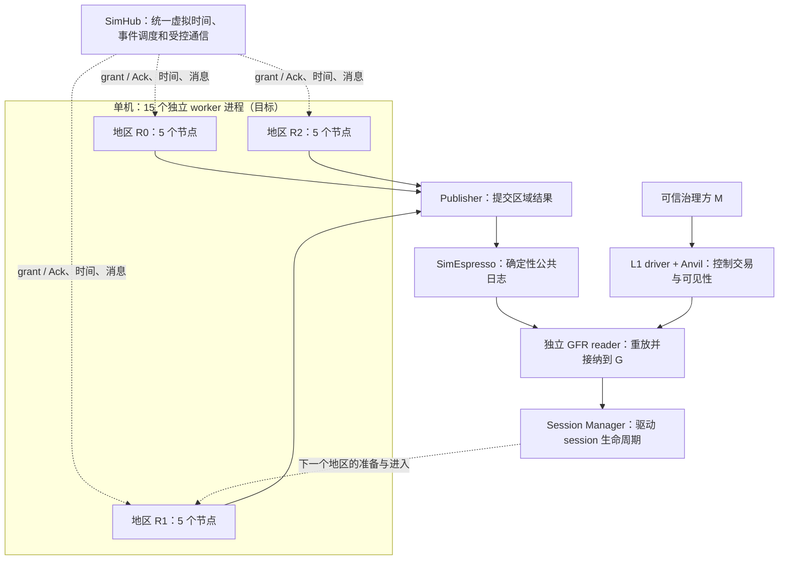
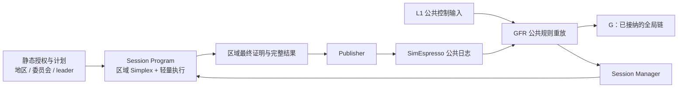
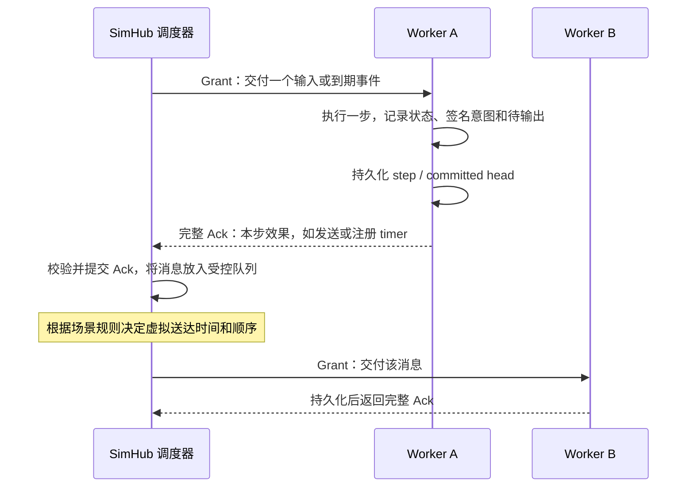

# Sequencer Rotation PoC：架构与阶段工作报告

> **后续验收更新。** 2026-11-16 已验证 seed 42 健康满窗口轮转。15 个真实 worker 完成两次 GFR 接棒，R2 的 h21 进入 `G`。下文记录验收前的工作快照。[M1 结果](milestones/results/M1-healthy-smoke-result-zh.md)

**状态快照：2026-11-16。** 本文供项目负责人了解阶段成果，也供开发者理解系统如何运行。文中“目标”表示设计或近期验收目标；“组件已交付”表示已有独立实现和有限验证；“端到端通过”必须有完整场景证据。三者不能互相替代。

## 1. 给负责人的一页说明

我们正在构建一个**可重复运行、可注入故障的 Sequencer 轮转验证环境**。目标是在一台服务器上启动 15 个独立节点，分成三个地区、每区五个节点，以区域 BFT 产生的结果驱动跨区轮转。系统同时模拟消息延迟、节点时钟偏差、外部公共日志及控制链，最终验证正常轮转 Regular、治理触发的 Force 和恢复流程 RESUME。

这一阶段的主要工作是先把底座做成可控制、可检查的系统：

1. 建立统一的虚拟时间和消息调度，让独立进程的输入、输出、计时器和持久化都有可审计的顺序。
2. 将真实 Commonware Simplex 引擎接入受控环境，完成小规模真实进程与脚本成员混合的重复运行。
3. 完成静态授权与执行、模拟传输、Publisher/SimEspresso、GFR、L1 接入及官方 Espresso 本地 API 适配等组件，并合并为 M0 基础；各组件的验证范围不同。
4. 正在将组件接成 15 个真实健康节点的 Regular 全链路（M1）；下一步是健康节点下由可信治理方主动触发的 Force（M2）。

**当前还没有 15 真实节点轮转的端到端通过证据，也没有 handoff 延迟或吞吐 benchmark。** 已有的有限实验支持“底座和部分组件具备可重放性”，不能推出跨区交接已经完成，更不能作为生产性能结论。完整 I1/I1b 和崩溃恢复验收仍开放；为加快 M1/M2，恢复、D/RESUME、批次/DA 和 Web 暂不作为这两个里程碑的前置。

## 2. 我们要验证什么

Sequencer 需要在不同地区的委员会之间接续区块生产。PoC 关注的不是比较 BFT 算法性能，而是验证：在节点进入时间不同、消息延迟及外部公开进度不同的情况下，系统能否按公共规则决定哪个 session 生效，并从一个地区安全地接续到下一个地区。

- **Regular**：按既定窗口和公开结果正常轮转，例如 R0 → R1 → R2。
- **Force**：由可信治理方提交控制动作，按公开规则结束旧分支并启动新分支；近期 M2 先验证健康节点下主动触发，不要求自动检测故障。
- **RESUME**：基于符合规则的恢复切面重新开始；属于后续工作，不能等同于普通 Force。

每个 session 以 **10 个高度的固定窗口**为基础；窗口有十个高度不意味着故障或延迟下必然产生十个实体区块。P0 使用公开静态规则和等权身份模拟授权，不实现 staking/slashing，也不声称完成形式化证明或生产部署。[设计依据](../../formalization_v10/poc_design_zh_v2.md)

## 3. 目标环境：15 个节点和两类外部系统

**图是目标架构，不是已经运行的完整拓扑。** 近期 M1 使用受控的 finalized L1 fixture，重点接通 Regular、SimEspresso 和 GFR；M2 才把真实 Anvil 控制交易接入 Force。目标系统保留每个节点独立的协议状态、BFT 实例和日志，不能把 15 份共享内存对象当作 15 个进程验收。

| 部分 | 设计与作用 | 当前边界 |
| --- | --- | --- |
| 15 个节点 | R0、R1、R2 各 5 个等权 replica；各节点独立准备和进入，不使用“全部同时启动”掩盖时差。 | 15 个真实 worker 的整体场景仍在实现。 |
| Regional BFT | 使用固定版本 Commonware Simplex 和 BLS 多签；每个五成员委员会采用 4 个不同合法 signer 的 quorum。Regional BFT 子模块提供参考实现和实验基础。 | 现有 native Fresh 是 2 个真实 worker 加最多 3 个脚本签名者；子模块原有 15 成员 benchmark 不等于这里的 3 个独立五成员委员会。 |
| L1 | 用 Anvil 执行真实 EVM 交易，由 driver 手动出块，并单独建模 finalized 与各观察者的可见性；控制交易支持后续 Force。 | Anvil 手动出块 smoke 已通过；L1 driver/合约已有组件交付，尚未证明完整 Force 联调。 |
| Espresso | 主验收使用 SimEspresso：由固定输入生成可重放的有序公开日志、时间与覆盖信息。 | Publisher/SimEspresso 等已有组件；尚未用 15 worker 完成主链路。官方本地 dev-node API 已有独立兼容 profile；M1 还需发布并读回该场景真实结果。官方节点的墙钟行为不混入确定性 trace，也不宣称已验证 QC/VID 或完整时序。 |

可把 L1 理解为控制和授权事实的来源，把 Espresso 理解为区域结果的公共发布渠道；GFR 则依据已验证的公共输入，决定全局链 `G` 接纳什么。区域 BFT 最终证明、结果公开完整和进入 `G` 是不同事件，不能把其中一个当成整个 handoff 成功。

## 4. 实现架构：从节点到全局结果

各层的职责如下：

1. **授权与计划**：P0 使用公开固定规则，而不是读 staking。设计中 `region=(β+r) mod 3`，区内 leader 按 `(v−1) mod 5` 轮转；其中 `β/r` 标识 session，`v` 是 view。各方使用同一 registry、身份和规则，不按“谁先启动”选 leader。静态授权、公共对象及轻量执行已有组件，仍需与真实运行链路接线。
2. **Session Program / 区域 BFT**：地区内节点运行 Simplex，对区块产生投票和最终证明。原生引擎已在有限 fixture 中运行；面向 15 真实进程的正常运行适配、完整准入和真实证明接线正在实施。
3. **Publisher 与 SimEspresso**：Publisher 把区域结果与证明送入模拟公共日志；日志提供确定性排序和公开进度，供各 reader 消费。这些已有组件，但仍需连接实际区域结果。
4. **GFR（Global Finality Rules）**：根据 L1 和 Espresso 公共输入重放规则，决定全局链 `G` 的接纳、结束与下一 session 事件。纯规则组件已交付；真实证明验证及系统接线进行中。缺少必要的公共覆盖或材料时，应等待，而不是由节点本地时钟单方面宣布全局结束。
5. **Session Manager**：把公开生命周期事件转为各节点创建、准备、进入、暂停或关闭候选 session 的本地动作。M1 所需的最小 Manager 和跨组件连接正在开发。
6. **后续派生 D 与观察界面**：设计中 D 从 L1/DA 等独立输入派生，而非直接复制 G；Web 用于只读展示状态和轨迹。这些不是 M1/M2 前置，完整链路仍待实现和验收。

## 5. 受控通信：一个节点的一步如何发生

核心做法是把真实进程放在统一的离散事件调度之下。以已验证的 I1a 双进程 fixture 为例：

- **输入受控**：Hub 决定哪些消息、计时器、时钟回复和工作完成事件何时交给哪个节点。节点不是各自推进一个互不相干的模拟世界。
- **输出受控**：节点通过完整 Ack 报告一步产生的效果；Hub 校验并提交之后才安排后续交付。受控路径不允许协议输出绕过 grant/Ack 直接发送。
- **网络可配置**：根据场景设定链路延迟、抖动、队列、丢失、重复与故障；原生 fixture 区分 BODY、VOTE、CERTIFICATE、RESOLVER 通道，定向队列按其 FIFO 规则处理。请求和响应的延迟可以分开设置。
- **可恢复和去重**：worker 有自己的持久化记录；重复 grant/Ack 有明确处理，避免同一已提交效果重复生效。真实原生同 `cid` 跨进程恢复还只有有限场景，完整恢复验收仍开放。
- **可核对**：保存固定 seed、场景配置、虚拟事件轨迹、消息帧、持久化记录和进程诊断。独立检查器检查结果；同一输入在指定的墙钟扰动和启动顺序变化下比较轨迹。

这里的实际 RPC/loopback 是进程之间的承载通道；**仿真网络延迟由调度模型决定**，不能把本机 socket 耗时当作目标网络延迟，也不能把组件通过等同于真实跨地域网络实验。[I1a 实现](i1a-implementation.md) · [原生引擎实现](native-engine-fresh-implementation.md)

## 6. 全局时钟：可重放的时间，不是机器墙钟

| 时间概念 | 含义与使用 |
| --- | --- |
| 虚拟参考时间 `τ` | SimHub 维护的仿真时间，也是场景中事件排序和推进的基准。 |
| 节点协议时钟 `C_m(τ)` | 每个节点根据受控样本维护本地 ClockView；正常 profile 下相对参考时间误差不超过 1 ms。两个节点各在相反边界时，彼此可相差 2 ms。 |
| RPC 延迟 | 取时请求、响应和网络传递的模拟延迟，是独立变量；RPC 花了多久不能作为时钟同步精度的证明。 |
| 公共时间/位置 | L1、Espresso 公共输入中的时间和排序位置，用于公共规则；不能与某个节点的本地计时混为一谈。 |
| 墙钟时间 | 机器实际运行时间，用于进程诊断和测试超时；人为暂停机器执行不应偷偷推进虚拟时间。 |

SimHub 是虚拟时间权威。节点通过 Clock RPC 获取带身份、序号和有效期限的样本，本地 ClockView 为同步读取接口提供时间；timer 由受控调度器安排到期。延迟、过期、重复或乱序回复需要按规则处理；普通 grant 不会免费刷新时钟租约，租约失效时节点须按规则停止相关 session。节点分别获得 Create/Ready/Enter，因此即便时钟误差受限，进入时间仍可相差很大。

例如，场景可让两个节点分别比 `τ` 快 1 ms 和慢 1 ms，同时给它们配置不同 RPC 延迟；它们各自何时进入 session 是另一组输入。对同一个 seed 重跑时，再加入本机墙钟暂停，预期受控的虚拟事件轨迹不变。这验证的是**模型及已覆盖场景的确定性**，不是对真实机器时钟同步精度或公网时延的测量。[时钟设计](../../formalization_v10/poc_design_zh_v2.md#4-时间设计rpc-服务是时间权威)

## 7. 已有证据与尚不能声称的结论

| 证据 | 实际运行与结果 | 不能推出 |
| --- | --- | --- |
| I1a 受控基础 | 2 个真实 worker、SignedIntent fixture；8 个场景 × 3 个 seed × 2 种墙钟/启动条件，共 48 次，24 对完整虚拟轨迹逐字节一致。[结果](i1a-gate-result.md) | 这不是原生 Simplex、15 节点或 handoff 测试。 |
| 原生运行时、存储、见证 | 受控任务、时钟和随机数、存储桥接、持久化见证分别有有限子项验收。[运行时](i1b-runtime-slice-result.md) · [存储](native-storage-result.md) · [见证](native-witness-result.md) | 各子项通过不等于完整 I1/I1b 通过。 |
| Native Simplex Fresh | 五成员、quorum 4；2 个真实 native worker 加最多 3 个脚本签名者。66 次运行、33 对完整结果一致；健康场景中两个真实 worker 各交付两块。[结果](native-engine-fresh-result.md) | 脚本签名者不是活进程；实际 resolver 消息为零，不能证明跨进程修复或 15 节点轮转。 |
| 同 `cid` 恢复 | 已复跑 seed 7 的等待区块体场景：杀掉 worker 后以新进程恢复原工作及原认证截止时间；场景在零交付处结束。[记录](native-recovery-implementation.md) | 并非完整 R1–R18 恢复验收，也不是恢复后端到端交接成功。 |
| M0 组件基础 | 2026-11-16 将可复用组件合并到本地 `main`，基线 `35d382ac445cc8bc779f0d18fd23cb57e54680da`；包含静态授权/执行、传输、发布、SimEspresso、GFR、L1 及官方 Espresso 适配等组件；集成矩阵 7 组、43 条命令通过。 | 组件整合及各自有限检查不等于 M1 Regular 或 M2 Force 已通过；历史 Fresh 矩阵也不自动转移为 M0 的系统验收。 |

已有记录中的采集墙钟耗时包含本机运行和检查器工作，**不是交接时延**。当前没有可报告的 handoff benchmark；真实网络、生产容量和安全证明也不在这些结果的覆盖范围。

## 8. 下一步和验收终点

**M1：15 健康节点 Regular。** 15 个真实 worker、3×5 委员会和四个不同合法签名者；R0 → R1 → R2，真实区域最终结果经 Publisher 和 SimEspresso，由两个独立 GFR reader 重放，直到 R2 首个合格结果进入 `G`。另测 SessionEnd 而后继固定窗口不变。官方本地 Espresso 节点单独提交、读回同一场景的真实结果字节。单独记录 Ready/Enter、区域最终证明、公开完整和 `G` 接纳。[M1/M2 计划](milestones/README.md)

**M2：健康节点主动 Force。** 基于 M1，由可信治理方提交 Force，通过本地 Anvil 真实交易及公共规则驱动新分支；旧分支候选关闭、保留已接纳的 `G`，直到新分支首个合格结果进入 `G`。自动停滞检测和故障恢复不是本里程碑的前置。

**之后**再推进恢复、独立 D/DA、RESUME、Web 和更全面故障矩阵；等端到端链路稳定、测量定义和条件固定后，再设计并报告 handoff 性能实验。

## 9. 阅读代码与版本说明

本报告所在 checkout 为 `/mnt/reth/jy/megaroation_poc`，记录时分支 `codex/poc-v2-i1` 的基线为 `3c0df2a`；它并不包含另一个本地 `main` 上的 M0 全部组件。M1 计划以 `35d382ac` 为集成基础，相关实现也可能继续在独立 worktree 开发。请按具体提交确认代码和测试，不把不同版本的验收结果直接叠加。

| 想了解什么 | 从哪里开始 |
| --- | --- |
| 总体设计及协议 | [v2 设计](../../formalization_v10/poc_design_zh_v2.md)、[v10 协议索引](../../formalization_v10/README.md) |
| 已有 I1a 运行时 | [sim-hub](../crates/sim-hub/src/main.rs)、[sim-runtime](../crates/sim-runtime/src/lib.rs)、[replica-worker](../crates/replica-worker/src/main.rs)、[I1 RPC 定义](../proto/i1.proto) |
| 真实 Simplex 适配 | [native-hub](../prototypes/i1b-runtime/src/native_hub.rs)、[native replica](../prototypes/i1b-runtime/src/native_replica.rs)、[受控网络](../prototypes/i1b-runtime/src/native_network.rs)、[时钟](../prototypes/i1b-runtime/src/clock.rs)、[native RPC 定义](../proto/native.proto) |
| 新近组件与交付 | [里程碑计划和组件精确版本](milestones/README.md)、[M1 实施说明](milestones/M1-implementation-dispatch-20261116.md)。M0 验收报告封存在提交 `ca1b3d7`，可用 `git show ca1b3d7:poc/docs/milestones/results/M0-result-20261116.md` 阅读。M0 中的 `poc/crates/authorization`、`core`、`sim-transport`、`publisher`、`sim-espresso`、`viewer-gfr`、`l1-adapter` 和 `espresso-compatibility` 可用 `git ls-tree -r --name-only 35d382ac poc/crates` 查阅。 |
| 实验记录及复现 | [项目 README](../../README.md)、[历史进度和命令](POC进度报告.md)、[I1a 验收](i1a-gate-result.md)、[Fresh 验收](native-engine-fresh-result.md)。原始 artifacts 依记录位置保存，是否在本机可用取决于运行环境。 |

旧 README 和历史进度报告记载的是当时 checkout 的状态，部分“尚未实现”描述早于 M0 的组件交付；涉及优先级和集成范围时，以 2026-11-16 里程碑文档和各准确提交的证据为准。
