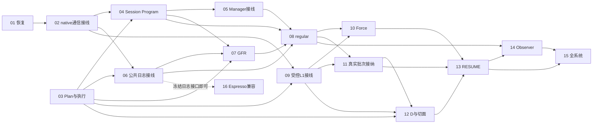

# 五 chat 调度与分层依赖 v2

2026-11-15，总协调冻结。用户将并发功能 chat 上限由 3 提高到 **5**，要求优先推进互不依赖的工作。此版本覆盖旧交接中“必须等整个前置功能完成才能写任何实现”的统一门禁；不修改协议、不降低完整功能验收。每三个完整 accepted 功能创建一个新的合并 chat，规则保留。

## 四种依赖

1. **接口依赖**：公共数据/行为需先冻结版本、独立向量和所有者。消费者可用同接口 fixture 开发，不必等生产者整个功能完成。
2. **代码依赖**：编译或真实接线需要某个准确的接口/组件提交。发布可单独消费的提交，记录其复核范围；不必等待批次进入 main。
3. **集成验收依赖**：使用真实上游完成原有矩阵。fixture/组件通过只记组件里程碑，不记功能 accepted。
4. **写入冲突**：同文件同一时间仅一名被指定 writer。拆开模块和移交编辑权；拥有不同 worktree 并不自动允许各自重定义公共 types/proto/编码。

## 功能依赖表

“可先做”均要求本阶段合同冻结和独立预期先行；包含合同修订与实现的授权不等于批准现有草案的所有字段。

| 功能 | 可先做的独立组件 | 接线/完整验收所需依赖 |
| --- | --- | --- |
| 01 恢复/I1 | 既有冻结合同上的完整恢复 | 原 R1–R18、Fresh/I1a 受影响回归；无新前置 |
| 02 通信 | 独立 endpoint/envelope、LinkProfile、队列、FIFO/jitter/drain、原子 route plan 与故障向量 | 03 的身份公共接口；01 精确恢复提交/文件移交后才能改 native hub/driver/wire 并验收持久 outbox、Clock、真实流量 |
| 03 Plan/执行 | registry/PoP、Schedule、域对象、编码、执行/Merge、L1 fixture | **删除对01完整验收的前置要求**；消费01/02 runtime时另做接线回归，04提供原生证书适配，03不能伪称已验收04 |
| 04 Session Program | 接口/准入向量可先做 | 01恢复经02接入；02+03实际可用提交；15进程/五真实引擎 REG-A |
| 05 Manager | 纯生命周期状态机和持久状态转换 | 03域对象与04生命周期接口先冻结；真实 native parking、恢复和多cid接线等04 |
| 06 Publisher/Espresso | 公共日志/reader接口、TimestampPolicy、持久Publisher状态机与组件测试 | 03公共对象和验签边界、02受控调度接线；原06矩阵保留，实际区域结果联调由04/08完成 |
| 07 GFR | 纯规则与A/B独立重放 | 03公共对象、06冻结日志接口即可启动；完整真实证书向量需要04，真实公共日志接入需要06 |
| 08 regular | 场景/检查器准备 | 04+05+06+07真实组件和受控15-worker场景 |
| 09 Anvil/L1 | Solidity ControlAuthority/Inbox、ABI/签名向量、真实EVM测试、driver的显式输入接口 | 与03核对L1公共对象，02受控时钟/reader接线；完整09验收仍需真实受控运行 |
| 10 Force | 治理/控制纯状态机与向量 | GFR改动继承07；08+09实际链路、真实生产恢复 |
| 11 Batch/DA | DA、batch编码、attestation、角色持久状态机 | 03执行/对象、09冻结ABI即可组件开发；完整接纳需08公共G+09真实Inbox，恢复切面扩展在12/13联调 |
| 12 D/ResumeCut | 独立派生纯状态机/窗口向量 | 03执行、09/11冻结输入接口即可组件开发；完整验收需要09真实receipts+11真实DA；不能读取G替代D |
| 13 RESUME | 目标求解和恢复规则向量 | 10+11+12真实组件和历史切面，Manager/GFR事件边界已定 |
| 14 Observer | 版本化快照/SSE/回放界面，明确标注fixture | 08验证regular初版；13后完成四层链、Force/RESUME及W1真实对照 |
| 15 全系统 | 独立checker/场景映射可先准备 | 13+14及全部前置的同一集成提交，原完整矩阵 |
| 16 Espresso兼容 | 官方版本/API调查及适配 | 06冻结公共日志接口；真实dev-node独立验收，不等待15 |

真实集成的主要路径为：

图中实线描述真实集成，不表示必须阻塞目标功能的独立组件实现。当前重点保持01推进，并尽早交付02/03接口；06日志和09 ABI分别释放07/16与11/12两组下游。没有时长测量前不声称某条路径具有已知工期。

## 当前五个槽位与具体写入权

- **01**：继续完整恢复范围，native恢复源码、vendor hook/patch、原型manifest和native wire保持01独占，直到准确提交移交。
- **02**：从准备提交 `125d8cf4e30b5affe3cd731fbb5d4a73d0e40a10` 修订组件合同，冻结后启动单Builder。新独立 `poc/crates/sim-transport/` 由02独占，先作为独立workspace构建并保留自己lockfile；不改01的native文件或现有hub/runtime。对签名/descriptor使用03的opaque边界，禁止另造域对象；先固定路由内部规则。native接线仍等待01。
- **03**：从准备提交 `183430e71e5d61533f54a76b2d7d22c5021f1704` 修订实现合同并继续完整03，不再等待01。03 lead独占新增公共域对象、authorization、core的execution/metadata/merge和L1 fixture；03 lead是当前根 `poc/Cargo.toml`、`poc/Cargo.lock`、`poc/crates/types/` 及core模块声明的唯一集成writer。单Builder写分配模块；保持现有I1编码和导出兼容。
- **06**：新增功能chat，独占 `poc/crates/sim-espresso/`、`poc/crates/publisher/`，各组件可独立workspace构建。优先交付日志/reader contract和样本，随后实现独立组件。公共对象消费03接口；当前不写共享chain-adapters声明或根manifest。接入02真实调度后才能完成原06 gate。
- **09**：新增功能chat，独占 `poc/contracts/` 与 `poc/crates/l1-adapter/`（独立workspace）。先冻结ABI/签名域并做真实合约测试，L1 driver按显式受控输入开发；不等01/02全部结束。根manifest及公共类型由03收口，02真实调度仍是完整09验收门槛。

新crate路径是为解除原建议目录中services/chain-adapters公共声明冲突而作的工程路径修订。是同一功能的生产组件，后续直接接入，禁止留下另一套绕过真实通路的替代实现。各功能的docs/verification仍沿用交接命名。需要跨模块依赖时优先交付小接口提交；总协调指定一次导入和确切SHA，避免把其他任务未验证实现整包引入。

## 接口决策的分工

- 03 lead在v10/v2和独立Verifier审阅下，可冻结D-REG/D-PLAN/D-CODEC/D-EXEC及L1 fixture最小语义。黄金LE64 profile仍只是提案：决定采纳/修订须记录来源、版本和独立expected，再编码。不得改变Commonware原生签名字节或既有I1/Fresh格式。
- 02 lead可冻结Q3/Q4的纯运输算法、容量、ACK/去重组件规则；持久化root custody和Q1恢复接线仍由01明确交接。01终止状态与签名门禁不能被独立组件绕过。
- 06 lead拥有公共日志与reader接口，09 lead拥有Solidity ABI/控制/Inbox事件映射。均先用现有消费者交接和规格审查最小接口，不需等待尚未启动的每个消费者chat；发布接口版本后，总协调组织实际消费者兼容检查。
- 跨责任的D-ROUTE、D-CERT、D-REPLAY、D-ABI只冻结必需的typed引用/能力边界；完整证书域归04、重放/lifecycle归05/07、恢复切面归12/13。语义有争议时显式列出局部问题，继续所有不受影响的工作，不以“未来有人可能需要它”阻塞整个功能。
- 每个接口提交附版本、精确字段/错误/状态、独立向量、owner和消费方。fixture必须走相同trait/类型；不能把bool验证桩计为密码学通过，也不能把fixture日志计为真实Anvil/15-worker证据。

## 调度与批次管理

最多五个活跃job，包含合并chat；主协调不占槽，内部角色遵守实际子agent容量。waiting-dependency且已停止计算的chat释放活跃槽，保留原chat/worktree用于后续续派。不得把仍在运行的子agent隐藏为等待状态。

使用ready队列而非固定三任务一波：优先推进能释放最多下游的接口和实现；有工作完成便补充就绪任务。每三个完整accepted功能触发新的merge chat，不强求编号相邻、不等待预定三人组。main合并队列和功能开发队列分开，四个无冲突的功能可以与一个merge chat并行；写同路径的集成工作仍串行。

总协调接受接口/组件交付不增加完整功能计数。跨批次消费已审查提交时记录确切基线，合并改变行为后在实际集成SHA复验。原有每宿主一个重型build/仿真锁及任务独立数据盘目录继续保留；五chat并发并不自动授权五个重型构建同时运行。
