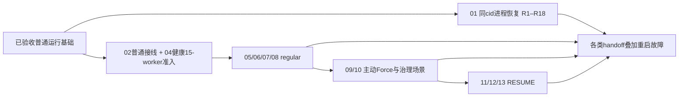

# 不重启BFT worker的交接测试路线

2026-11-16，总协调调度修订。用户指出 regular、主动 Force、RESUME 可在不调用同cid进程恢复的情况下测试。对照v2 §§7–10、12和现有01/04/05/08/10/13合同，判断成立：**完整01 R1–R18不是所有交接场景的协议前置条件。** 本修订覆盖旧依赖图中“一切native接线都必须等完整01”的门禁，但不改变已有协议和全系统验收要求。

## 范围区别

- 01测试旧worker崩溃后，在新PID/incarnation下恢复同一cid的journal、签名缓存、原deadline、未完成工作及Ack/outbox。单纯网络离线但进程/内存仍存活，不等于这条恢复路径。
- regular/Force/RESUME是公共规则驱动的职责或分支变化，通常创建/选择新cid；进程可一直存活。Manager的内存Pause/恢复原候选也不等于OS进程重启，但仍必须保留原engine/view/签名历史和timer，不能重建成空状态。
- RESUME中的恢复是G按具体L1位置的历史ResumeCut对齐独立D，然后启动新生产分支；不能等同于01的进程恢复，也不能用重启、清空数据库或直接令G=D代替。

## 可独立运行的测试

| 路线 | 不使用01完整恢复的构造 | 仍必须验证 |
| --- | --- | --- |
| regular | 15个worker持续运行、错时Enter，各地区相继运行新cid；分别满窗与SessionEnd | 正确anchor/固定window、真实四票quorum、状态准备、候选生命周期、Publisher/GFR与后继首结果进入G |
| 主动Force控制路径 | 用授权M身份提交合法Force，原地区可以完全健康；或旧地区停止且本场景不重新加入 | 真实L1收录/finality、公共覆盖与act顺序、branch/Tail有效性、旧branch关闭、保留G和新branch首结果进入G |
| RESUME | BFT进程持续运行；暂停/延迟批次提交形成独立D fallback与真实hash分歧，或构造符合规则的HALT/D推进，再恢复数据路径 | M的触发和目标预算、真实RESUME/Override、精确历史cut、D不回退、G原子对齐、新cid首结果进入G |

主动Force验证控制和handoff行为，不是PublicationStallPolicy自动检测正确性的证据。当前P0由可信M授权，不是另设committee投票；仍需合法签名/sequence/policy、有效branch和非HALT条件。合约按v2 §7不判断“是否真的故障”。

暂停/延迟批次可验证分歧和RESUME链路，但不能冒充原U1中的实际Batcher进程crash/restart。服务自身持久恢复属于相应服务任务，和01的BFT engine恢复区分。已接纳但DA暂不可读必须WAIT，不能为了制造分歧跳过数据补空块；D的fallback须由真实窗口结束及合格公共输入触发。使用会改变状态的交易验证实际native hash分歧。

若只测试合法RESUME控制的GFR转移，可以输入授权控制与有效公共历史；这不替代M在规定触发条件下主动决策的验收。普通D落后或共同高度一致的更高D，仍不能冒充hash divergence。

## 最小运行基础仍是门槛

这些场景仍需可验证的普通运行路径：唯一虚拟时钟、有效sample/lease、timer、确定性消息路由、完整grant/Ack后输出、实际签名/证书、状态准备、Close/stop门禁与独立公共重放。已知普通运行bug必须修复；不能靠“不重启”绕过运行时持久输出规则。

新测试profile明确禁止BFT worker的OS重启及同cid重建。场景遇到意外进程退出时记失败/基础设施中断，不能自动用空journal重新加入。同一进程内重复Enter、Pause/选回和永久Close仍按原协议处理。故障旧节点如不再回来，不能据此宣称其重启安全已验证。

沿已验收的native Fresh/运行时/存储见证基础，另冻结普通运行接线与15-worker准入合同；Fresh的两个真实worker加脚本signer本身不是15-worker验收。结合02的运输组件、03已接受的对象/执行，独立建立不重启profile的02/04接线。不要把未验收的01 WIP整体视作稳定基础。

## 调度与所有权

两条并行验证路线：

图描述测试范围，不强迫RESUME必须先执行一次Force；共享治理/L1/生命周期实现可以复用。各组件的具体依赖沿分层调度，接口就绪即可先实现。

01继续独占目前恢复文件，不直接抢占其路径。待新的活跃槽位可用，优先派发02普通运行接线/04健康准入合同与集成；指定新adapter路径和最小共享接口，必要的共享文件更改单独移交、串行提交并复验。不能通过复制一套Commonware或旁路grant/Ack来隔离。

当前五chat上限不变，本修订不自动启动第六个chat，也不无故中断已运行任务。后续调度优先级包含这条直达三类交接演示的路线。

## 如何报告通过

各结果必须注明profile、实际过程与未覆盖故障。允许明确报告“15-worker无BFT进程重启的regular/Force/RESUME场景PASS”。这不会自动关闭完整I1、01 R1–R18或各feature原本包含的重启用例。三完整功能一批的合并计数继续使用原完整accepted定义，不能用新增profile替代未完成的完整验收。
