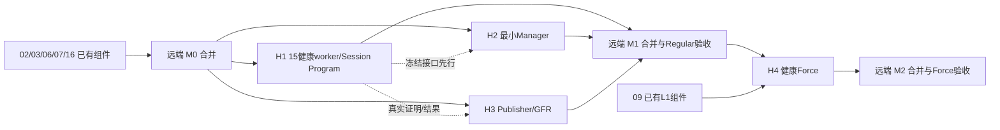

# 近期实施计划：健康15节点的 Regular 与 Force

2026-11-16。用户最新范围覆盖旧16项功能的执行优先级；旧代码、合同和证据继续保留。本计划只追求两个可审查的里程碑，不以恢复、D/RESUME、批次/DA、Web或完整生产系统为前置。

## 两个验收终点

**M1：Regular。** 单机15个真实健康worker，三个独立五成员委员会，四个不同合法signer的quorum，固定10-height窗口。R0→R1→R2轮转；区域最终证明和完整结果经Publisher进入SimEspresso，独立GFR重放驱动Session Manager/Program，R2首个合格结果进入G。另测末结果未及时公开而走SessionEnd、后继固定窗口不改变。全部worker持续运行，无OS重启、同cid重建或脚本签名者。

用户已确认 **SimEspresso是确定性主验收**；同时用16的官方本地dev-node提交并读回M1实际产生的区域最终结果字节，作为独立真实发布测试。官方节点的wall-clock和Unknown时间证据不混入确定性trace，不把官方HTTP读回说成QC/VID验证或完整PE时序证明。

**M2：Healthy Force。** 复用M1的15健康节点链路，以授权可信M主动发出合法Force，经本地Anvil真实交易、finalize、公共覆盖与act重放，关闭旧branch全部候选，保留G，按实际激活前anchor/window启动新branch，直到首个合格结果进入G。没有节点崩溃，也不要求自动停滞检测策略。所有旧节点仍保持存活，旧分支结果按公开规则处理。

成功终点不能缩成regional final、publication submitted、Force recorded或SessionAssigned。签名/证书、公开完整、G接纳、各节点Ready/Enter/Close分开记录。M1/M2各有准确候选SHA、独立预期、真实进程轨迹、固定输入和离线checker。

## 现有成果如何复用

| 原功能 | 已有交付 | 本计划用途 |
| --- | --- | --- |
| 02 | `e1a435712ec492cae2bbff120a51ffd507eebf45`，运输内核组件通过 | H1真实运行接线，不重写FIFO/clock/route算法 |
| 03 | `e9c15e04bc83b335668f3ecd837367aa87344a89`，总协调ACCEPT | 唯一registry/PoP、Plan、编码、执行/Merge、M1 L1 fixture |
| 06 | `4b034dfbb6c3e1c7143208347b546daab8dfe298`，组件通过 | Publisher、SimEspresso、独立reader；还缺真实区域结果adapter |
| 07 | `788291735ce6db3c3eb78b4594a28d730cce71cd`，纯规则组件通过 | regular/Expire/GFR；还缺04真实FinalVerifier和系统接线 |
| 16 | `5c34b400ba5245d7775a281566e21bf59708b147`，官方本地API profile通过 | 同一真实regional result的本地官方发布/读回；PE时间证据仍Unknown/Unsupported |
| 09 | `c443ae925ed549b046731c2d8ef3dd9ce0311d24`，A01–A17组件通过 | 仅M2的ControlAuthority、L1 driver和reader；不引入批次/D全流程 |
| 01 | 当前恢复分支安全封存；精确checkpoint见commander登记 | 保留恢复成果，不合入M1基础，不等待R1–R18 |
| 11/12 | 11封存当前测试结果；12交付`1f6d1b3b4076ff16908dc59f272a06686b1d1ea5` | 保留提交、worktree和artifact，暂缓扩展，不进入M1/M2 |

Fresh历史基线`fec7ade1675cb60dd16a16fb28ebe81e3f76f508`只有两个真实worker和脚本同伴，不能当15健康节点证据。组合源码采用明确版本，经最小兼容复验后接入新normal profile；详细候选接口见[NR草案](../contracts/normal-running-reg-a-preparation-v1.md)。

## 功能拆分与依赖

| 工作 | 交付与所有者安排 | 开始条件 |
| --- | --- | --- |
| [M0 基础合并](M0-foundation-merge-zh.md) | 新的远端merge chat，合入02/03/06/07/16，并保留09作为M2备用组件 | 现有准确提交即可开始 |
| [H1 健康运行与Session Program](H1-healthy-session-program-zh.md) | 复用02 chat，单writer拥有normal adapter及串行批准的共享shim | M0验收SHA后实现；现在可冻结接口/独立预期 |
| [H2 最小Session Manager](H2-session-manager-zh.md) | 新的独立chat/crate，生命周期/候选状态准备 | M0+H1已冻结接口即可实现；真实接线等H1 |
| [H3 发布与GFR接线](H3-publication-gfr-zh.md) | 复用07 chat，消费06/16；拥有publication bridge与必要GFR扩展 | M0+H1证书/lifecycle接口冻结；真实输入等H1/H2 |
| [M1 Regular集成验收](M1-regular-merge-zh.md) | 新的远端merge chat，合并H1/H2/H3、运行完整M1 | 三项候选与独立报告齐备 |
| [H4 健康Force](H4-healthy-force-zh.md) | 复用09 chat，追加最小M2控制、GFR/Manager Force接线 | M1+09交付；可提前冻结合同但不抢写H3 |
| [M2 Force集成验收](M2-force-merge-zh.md) | 新的远端merge chat，合并H4并回归M1 | H4候选与独立报告齐备 |

H2/H3在接口冻结后并行实现，不必等H1全部完成才读规格或写纯规则。已验证的最小接口提交可以先供消费者使用，不能使用浮动HEAD或复制第二套公共编码。总协调处理具体共享文件所有权，不用“等待整个01”代替具体接口问题。

## 执行与保存约定

主chat统一Astra/ultra；内部Docer Astra/xhigh→Verifier Astra/xhigh独立期望→单Builder Sol/high→独立复核→Tester Sol/high。只使用实际可用角色，保持模型证据。最多五个活跃chat，合并任务占槽；重build/仿真仍使用宿主flock。所有命令显式workdir，数据盘独立cargo/target/artifact，保留旧worktrees和测试失败。

01/11先安全完成当前写入/测试，停子agent，提交命名checkpoint后暂缓；12已干净封存。不得为了收敛scope重置、删文件或清理原始证据。新工作使用自己的managed worktree；已有chat在原worktree正常合并准确M0/M1提交，不重建工作区。

**本次用户明确要求合并有用成果，故立即派M0作为组件集成工作，不等待旧的三完整feature计数。** 后续合并均委派新的远端chat，在M1/M2关口收口；原“每三个完整accepted功能”只作常规交付触发，不再成为这两个里程碑的阻塞条件。组件合入不等于其原完整故障范围通过。

根checkout由总协调保存计划与状态，不直接进行功能merge。merge chat先在`codex/`集成分支合并/复核/测试，成功后以旧值比较更新本地main；若main被其他worktree检出或旧值变化，报告并由总协调协调，不force覆盖。不推远端、不部署公网。

M0/M1/M2输出新的完整SHA后才作为下游实现基线。未知未来SHA必须等待该交付，不使用“最新main”猜测。每个feature的handoff是范围与执行约定，具体接口/编码变动仍须在编码前冻结任务合同和独立预期。

M0纳入09源码只是为了让H4从统一基线继续；M1运行命令不启动PoC控制链/批次服务。功能间代码合并和冲突由独立merge chat处理，feature chat只从已交付基线接续；准备文档如产生分叉，应回传自己的精确文档提交供集成，不擅自整合其他功能的实现。
